# WorkBuddy 教师实战蓝皮书

> **写给已经会用 AI、但只会「点点看」的一线教师**
>
> 全书**四篇二十六章 + 三个附录**，主张只有一句：
> **AI 给你答案，WorkBuddy 给你成品；工具负责「量」，教师负责「读懂学生」。**

---

## 怎么用这本书

**不要从第一页读到最后一页。** 按你的身份选一条路线：

| 你是谁 | 建议路线 | 大约用时 |
|---|---|---|
| 刚接触 WorkBuddy | 第 1→2→3→6 章 → 附录 B | 2 小时 |
| 想提升日常效率 | 第二篇全篇（第 7-16 章）+ 附录 A | 1 周，每天 30 分钟 |
| 教研组长 / 校长 | 第三篇（第 17-22 章）+ 第 23、26 章 | 2 周 |
| 想走在教研前沿 | 第四篇全篇（第 23-26 章） | 按需 |

> **第 6 章是全书地基。** 先学会让WorkBuddy 读写 Word / Excel / PPT / PDF，
> 后面所有教学场景都是这一章的组合。
> **红线部分（附录 C）不是「建议看」，是「必须看」。**

---

## 目录

- 第 1 章　这本蓝皮书怎么用
- 第 2 章　认识 WorkBuddy：它和豆包、DeepSeek 有什么不一样
- 第 3 章　安装、登录与第一个任务
- 第 4 章　界面与工作区：会对话，更要会下指令
- 第 5 章　加载一个真正用得上的 Skill
- 第 6 章　先当通用文件助手用起来（Word / Excel / PPT / PDF）
- 第 7 章　备课：从课标到一份能直接用的教学设计
- 第 8 章　课件：从教案到能投屏的 PPT
- 第 9 章　作业与练习：分层设计而不是一份到底
- 第 10 章　出卷与试题库：一次生成整套卷子
- 第 11 章　批改与学情分析：从凭感觉到看数据
- 第 12 章　错题本：让错题真的能被再用一次
- 第 13 章　阅读与写作：语文学科的两个深水区
- 第 14 章　英语听说与词汇：开口难怎么破
- 第 15 章　理化生实验与图表：理科教师怎么用
- 第 16 章　家校共育：家长会、沟通话术与家校协同
- 第 17 章　教研：从个人备课到教研组共用
- 第 18 章　听评课与课堂观察：让数据代替感觉
- 第 19 章　教师培训与微课：把会的东西变成课
- 第 20 章　行政文书：通知、计划、总结、简报
- 第 21 章　课题与论文：选题、提纲、文献综述
- 第 22 章　校本档案与教师成长记录
- 第 23 章　自动化：把每天都要做的事交给它
- 第 24 章　打造属于你的 Skill
- 第 25 章　多 Agent 与专家团：一个教研组配一支 AI 团队
- 第 26 章　从个人到区域：把工作流交给学校
- 附录 A　常用指令模板
- 附录 B　场景速查表
- 附录 C　红线清单
- 附录 D　增补素材库与提示词总集（2026 年 10 月）
- 专题　MG 动画与代码生成视频
- 专题　360° 全景互动网页·教师极简流程
- 专题　360° 全景互动网页·完整版（原理与设计规则）

---


---

# 第一篇　先把工具用起来（第 1-6 章）

# 第一篇 · 先把工具用起来

> 这一篇解决一件事：让你在三天内真正开始用，而不只是"知道有这个工具"。
> 六章读完，你应该能独立完成一次完整的任务，并且知道每一步该由谁来确认。
>
> **本篇截图说明**：第一章到第五章的操作界面图，全部来自官方蓝皮书《WorkBuddy 使用手册与实战指南》原版，已按教师场景重新编排。你可以直接照着图做，不用再自己截图。

---

## 第 1 章　这本蓝皮书怎么用

### 这不是一本需要读完的书

先说清楚一件事：你不会一次性读完 26 章，这本蓝皮书的设计是让你**做完一件事就走开**。

每一章的结构都是一样的：

| 部分 | 你要做什么 |
|---|---|
| 场景痛点 | 花 30 秒确认"这说的是我" |
| 备课五问 | 花 1 分钟想清楚自己的任务规格 |
| 推荐流程 | 照着走一遍 |
| 提示词示例 | 直接复制去用，然后改 |
| 常见错误 | 做完看一眼，避免踩坑 |
| 区域实践参照 | 看看别人怎么做的 |
| 你校可以怎么改 | **写你自己的做法** |

最后一栏是这本书和别的地方最不一样的地方。**它不是读完就完的教材，是要你往上写字的工作手册。** 一本书如果能让老师在里面写字，它才会被留下；只会被收藏。

### 三条阅读路线

**路线一：我先试试（适合第一次用）**
第 1 章 → 第 2 章 → 第 3 章 → **第 6 章（先学会读写文件）** → 挑第二篇里最急的一章直接做

**路线二：我是教研员，想推全校**
第 1 章 → 第 2 章 → 附录 C（红线）→ 第 17 章（教研组共用）→ 第 26 章（从个人到区域）

**路线三：我有明确任务，只想解决它**
直接翻**附录 B 场景速查表**，找到"我要做什么"对应的章节和提示词编号，跳过去做

### 一个前置提醒：先看附录 C

教育部《教师生成式人工智能应用指引》把边界划得很清楚——**六类场景鼓励用，六类行为规范是红线**。红线里最要紧的三条，请现在就记住：

1. **不得把学生个人信息、考试成绩、试题等敏感数据输入 AI 工具**
2. **不得直接用 AI 生成内容评价学生**
3. **价值观引导、德育、心理支持这些环节，教师必须主导完成**

这本书里所有的工作流设计，都建立在这三条之上。遇到需要上传学生材料的任务，本书会给出本地处理的替代方案（见第 11 章）。

### 这本蓝皮书的一句话主张

> **AI 给你答案，WorkBuddy 给你成品。**
>
> 这个差别在下一章展开，它是这本书存在的全部理由。

### 你需要准备什么

- 一台 Windows 或 Mac 电脑（Windows 更稳）
- 30 分钟不被打断的时间，用来跑通第 3 章
- 一份你手上真实的、正在烦的材料：一份要做的教案、一堆要改的作业、一份要写的通知

---

## 第 2 章　认识 WorkBuddy：它和豆包、DeepSeek 有什么不一样

### 先说结论

这一章是全书最重要的一章。如果只读一章，读这章。

很多老师第一次接触 WorkBuddy 时的反应是："这个功能豆包也有。"这个反应不算错——**但它混淆了两件根本不同的事。**

豆包、DeepSeek 这类工具，你给它一个提问，它给你一段答案。你要做的是：**把答案复制出来，自己去排版、做PPT、存成文件、发给同事。**

WorkBuddy 不是这样。你说清一件事，它自己在你的电脑上把事做完，**直接把能用的文件交到你手上**——教案是 Word，课件是 PPT，成绩单是 Excel。

### 一个真实的对比

假设你要做一节公开课的备课包，包含教案、PPT、逐字提问稿、板书设计、检测题、评价量表。

**用豆包或 DeepSeek：**

你得开五个对话框，依次问五次。然后你会遇到这些情况：
- 教案复制出来是一大段文字，标题层级全丢了
- 让你出 PPT，它给你一个大纲，你说"做成 PPT"，它说它不能直接生成文件
- 检测题的答案和题目混在一起，印出来学生能看到
- 五个回答的风格、术语、深浅前后不一致，还得自己统一

**用 WorkBuddy：**

你把要求一次说清（放在工作区里），它给出材料清单和每份的页数预览，你确认后生成：

```
教学设计.docx      18 页
公开课课件.pptx    17 页
逐字提问稿.docx     8 处提问 + 预设回答
课堂检测题.docx     6 题，答案在最后一页
评价量表.docx       4 维度，可直接打印
```

六份文件，风格一致，互相引用一致，改一处可以全量重出。

**差别不在模型聪不聪明，在它有没有手。** 对话式 AI 给你"大脑的输出"，WorkBuddy 给你"做完的活"。

### 六个具体差别

| 维度 | 豆包 / DeepSeek | WorkBuddy | 对你意味着 |
|---|---|---|---|
| **交付形态** | 给文字，你自己复制、排版、存文件 | 直接给 Word / PPT / Excel / PDF 文件 | 省掉的是"排版"这一整段劳动 |
| **提示词门槛** | 要会写长提示词，会追问、调格式 | 骨架式指令就能出成品 | 不用背"咒语"，也不用怕写错 |
| **文件操作** | 传不上去、或者只能传文本 | 直接读写你电脑里的文件，能批量 | 40 份试卷、20 份教案可以一次性处理 |
| **数据安全** | 内容上传到云端服务器 | **本地批量处理可以不上传云端** | 学生材料有不上传的方案 |
| **可否重复** | 每次从零开始 | 提示词存成 Skill，下次直接调用 | 一个班做完，全年级都能用 |
| **能力覆盖** | 生成内容为主 | 规划、执行、验证、交付一体 | 你要的不是"生成"，是"做完" |

**第三条和第四条，是老师最该关心的两条。** 后面会专门展开：第 11 章（批改与学情）会讲本地处理学生材料的具体做法；附录 C 会讲数据红线的完整清单。

### 一句话记住三句话心态

很多老师问"我该用什么心态用它"，答案其实就三句，来自一线教师实践的沉淀：

> 1. **我不是要它替我干活，我是要它替我做重复劳动。**
> 2. **我说的越具体，它做的越准。**
> 3. **不满意的不是它笨，是我没把标准说清。**

第 3 句最重要，也最反直觉。**本书后面 20 章，每一章都有一个"备课五问"表，就是把第 3 句拆成了可以照着填的五个问题。**

### 它适合做什么，不适合做什么

| 适合交给它 | 必须你来 |
|---|---|
| 从课标和教材整理出教学框架 | 决定这节课的核心目标 |
| 生成课件初稿、检测题初稿 | 判断题目是否超纲、是否符合学情 |
| 批量处理文件、转换格式、生成台账 | 决定哪些信息可以进系统 |
| 整理会议记录、写通知和总结初稿 | 决定这封信怎么写、什么话说 |
| 陪你打磨提示词、帮你建立工作流 | 在孩子困惑的时候，说话的那个人必须是你 |
| 陪你把公开课从 3 天压到 45 分钟 | 上台讲课的那个人必须是你 |

**这张表是本书的伦理底线。** 左边那些事，你做起来慢，AI 做起来又快又好。右边那些事，别人做不了。

### 区域实践参照：别人已经走到哪一步

在讲具体怎么用之前，先看几个已经跑起来的地方。以下均为公开报道，来源可查。

**安徽长丰**（安徽青年报 2026 年报道）：全县2026 年"好课堂"评选覆盖 21 个学科，**要求每个学科至少使用一种 AI 工具**，206 名教师参与。长丰县在市级教师人工智能应用案例征集中有 7 件入选，居五县市第一。语文教研员曹婷婷的体会是："以前评课靠感觉，说这堂课气氛不错，到底哪里好、哪里不好，说不清。现在 AI 报告一出来，提问分布、学生参与热力图一目了然，建议也有了依据。"

**广西贺州市**（贺州市人民政府网 2026 年报道）：2026 年 3—4 月开展覆盖全市各县区的深度应用培训。八步区新城实验小学唐甜老师的做法是把本地元素带进数学课——**把昭平的茶叶包装箱搬进课堂讲"观察物体"，用贺州地标建筑讲"确定位置"**。她说："学生看到自己家乡的场景出现在屏幕上，眼睛都亮了，这种'贺州味'的课堂，是以前不敢想的。"

**山东临沭**（临沭县人民政府网报道，九年级教师反馈）："系统评价的有效性依托于学生的真实写作水平。**因此需在课堂上预留充足时间组织现场写作**，确保文稿真实反映学生能力，使系统的问题定位、评分分析具有参考价值。"

这三条放在一起看，能得出一个很实用的结论：

> **长丰靠"硬性条件 + 数据模板"把 AI 推开了，贺州靠"本地化"让 AI 变得不可替代，临沭的老师提醒我们"离了真实场景的 AI 数据没有价值"。**
>
> 三个条件缺一个，AI 就会停在"用过一次但没用第二次"。

### 【2026 年 10 月增补】教师版 WorkBuddy：区别又多了一条"身份"

2026 年 9 月 2 日，腾讯企鹅教师助手联合 WorkBuddy 打造的**「企鹅教师助手 Buddy 应用」**在 WorkBuddy 内正式上线，9 月 6 日腾讯签约教育部第三期"尊师惠师公益行动"。这给"和豆包的区别"补上了最直接的一条：**豆包没有教师身份体系，WorkBuddy 有。**

教师版的四个事实（来源：公众号"AI-老骆"《教师版WorkBuddy正式发布》）：

| 事实 | 内容 |
|---|---|
| **身份认证** | 通过教育部"中国教师"小程序完成认证，可免费领 1000 开学专属积分（留意当期活动时限）；企鹅教师助手星星币 1.5 倍加速、1:1 兑换 WorkBuddy 积分 |
| **三工作模式** | 教学设计 / 家校共育 / 专业成长——**"切场景不切账号"** |
| **资源体量** | 33 位教育专家智能体（与北京大学共建）+ 15 项标准化教学 Skill + 21 类高频教学场景 |
| **官方定位** | "让教师掌握主导权，让 AI 承担辅助工作" |

**判断它值不值得用的三句话**（一线教师实测后的原话）：

> "以前：'均分掉了 3 分。'现在：'第 14 题全班失分率 68%，对应知识点是二次函数图像平移，低分段 12 人里 9 人卡在这一步。'"
>
> "AI 替代不了站在讲台上的那个人，它不懂你班上的孩子。但它能把备课、出卷、整理错题这些'谁做都差不多的碎活'接过去，把时间省出来——让你有时间去懂他们。"

另外一个常被问到的区别，用一段话就能说清（来源：《WorkBuddy 从入门到精通》系列）：

> **Ask 模式就是纯聊天，你问它答，跟你平时用豆包那种对话框是一样的。** Plan 是先出计划再动手；Craft 是平时干活的 Agent 模式。
> **注意 WorkBuddy 默认 Craft 模式**——你随便发一条消息，它就直接开干了，积分也就开始消耗了。**只想问问题的时候，先切到 Ask。**

---

## 第 3 章　安装、登录与第一个任务

### 安装前的三件事

**第一，确认电脑能装。** Windows 10/11 或 macOS 12 以上，8GB 内存以上，剩余磁盘空间 20GB 起。**教师用机的硬盘常年紧张，建议先清一次**——很多人第一次装完发现跑不动，原因是桌面和下载文件夹里堆了十几个 G 的旧课件。

**第二，想清楚文件放哪。** 装完之后你会有一个工作区。这个工作区就是你以后放"AI 相关材料"的地方，**建议一次就建好结构**，别以后乱：

```
我的AI工作区/
├─ 01_教学设计/
│  ├─ 2026秋_七年级/
│  └─ 2026秋_八年级/
├─ 02_课件成品/
├─ 03_试题与作业/
├─ 04_批改与学情/
├─ 05_教研材料/
├─ 06_行政文书/
└─ 99_提示词库/     ← 你的提示词都存这里
```

`99_提示词库` 这个文件夹是全书最值钱的一个。**你每一次成功的提示词，都应该存进去、命名、用起来。** 到学期末你会发现，教研组里最有价值的不是某个人会用 AI，而是他存了 30 个验证过的提示词。

**第三，想清楚第一件事做什么。** 不要拿最难的任务开局。**推荐用本章后面的"第一个任务"：把一份已经上过的课的教学设计，让它按你的格式重新出一版。** 它足够真实、足够简单、失败成本极低。

### 下载安装（Windows）

访问官网 `https://www.codebuddy.cn/work/`，选择 WorkBuddy 点击下载。网站会自动判断你的设备版本（Mac ARM64 / Mac x64 / Windows x64）。

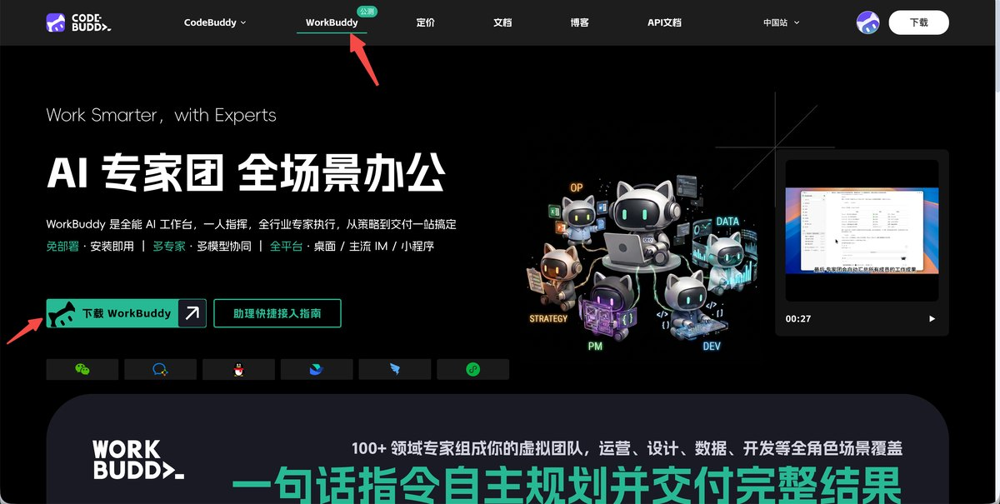

自动识别系统版本，选择对应安装包：

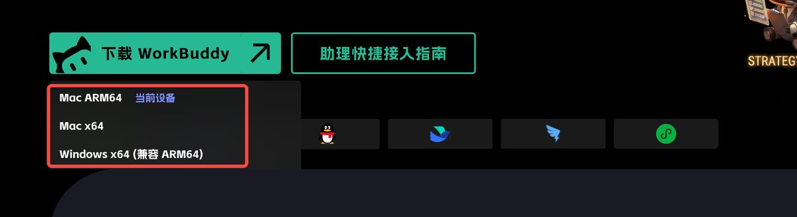

> **切记：从官方入口下载，不要从网盘或不明镜像获取安装包。**

下载完成后双击安装文件：

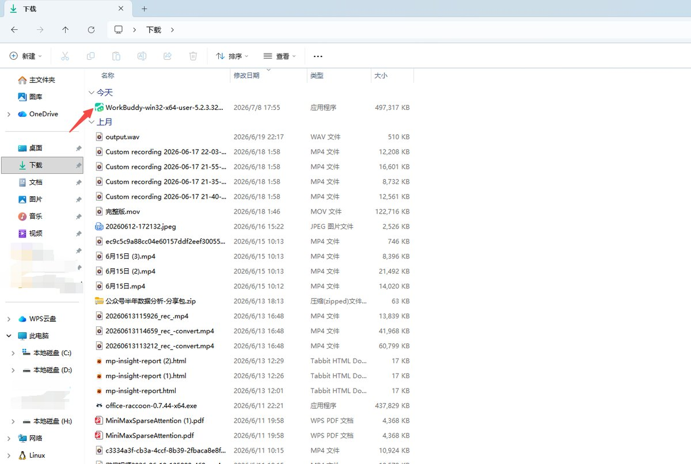

如系统弹出安全提示，先核对发布者与下载来源，再决定是否继续：

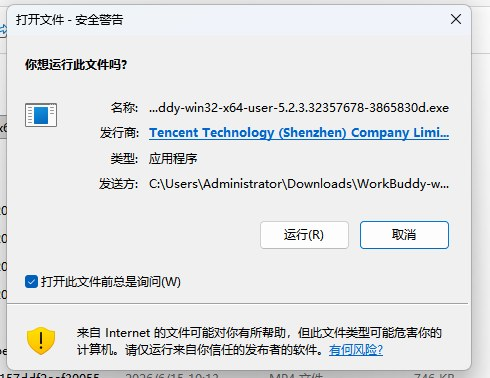

按安装向导完成安装：

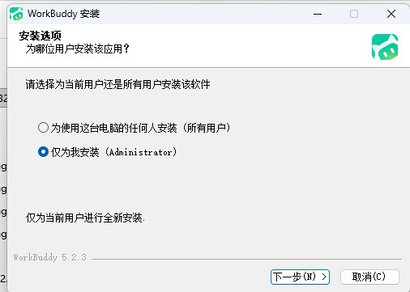

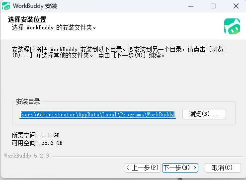

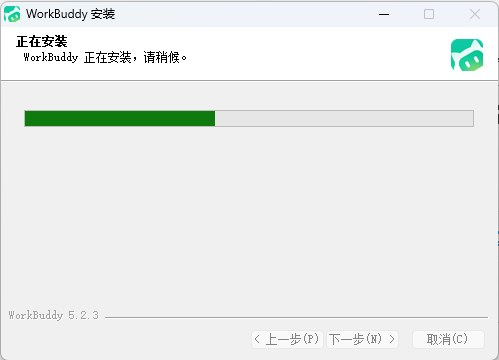

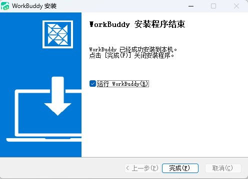

进入准备运行环境：

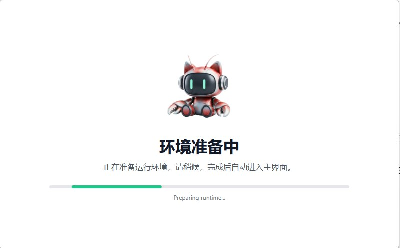

### macOS 安装（更简单，三步）

如果学校用的是 Mac，步骤更少：

打开安装文件，将 WorkBuddy 拖入"应用程序"：

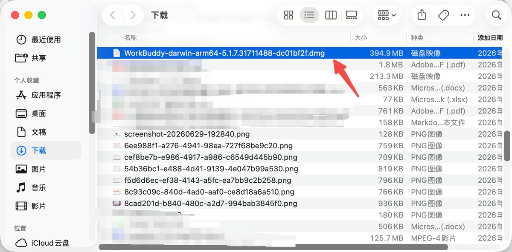

拖到位之后的样子：

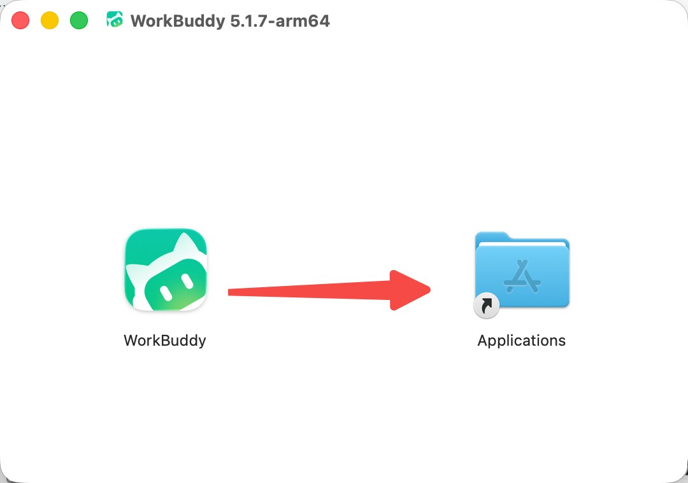

从"应用程序"启动：

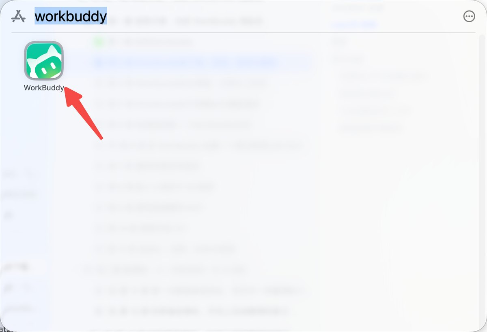

### 登录

点击登录按钮：

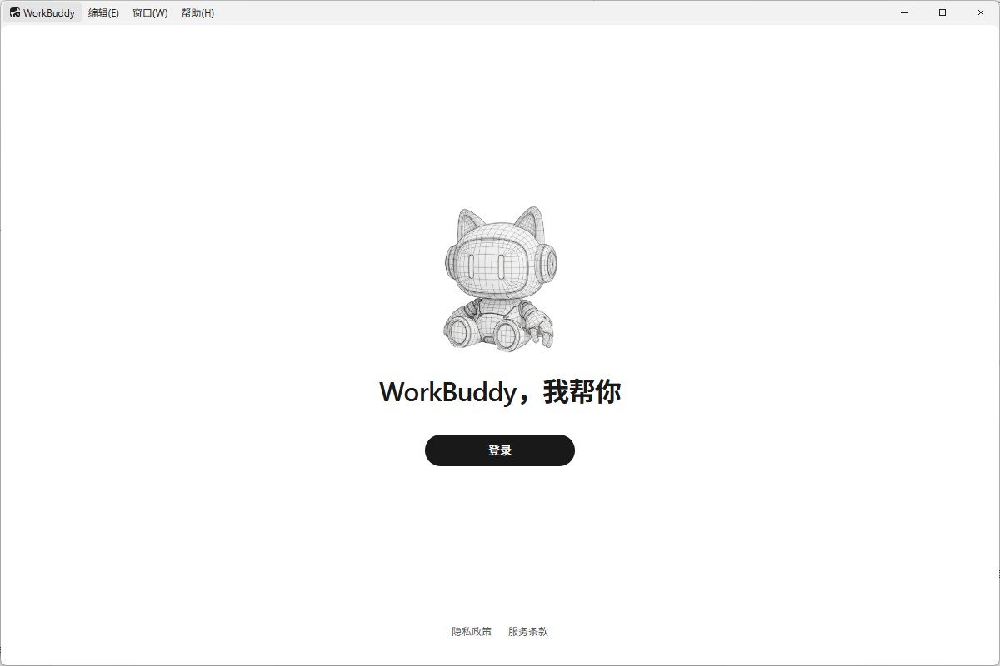

会自动跳转网页登录：

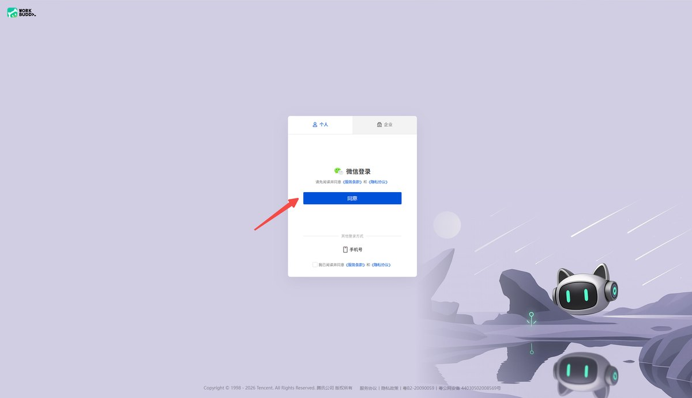

选择微信扫码登录，也可以手机号登录：


完成后即可使用：

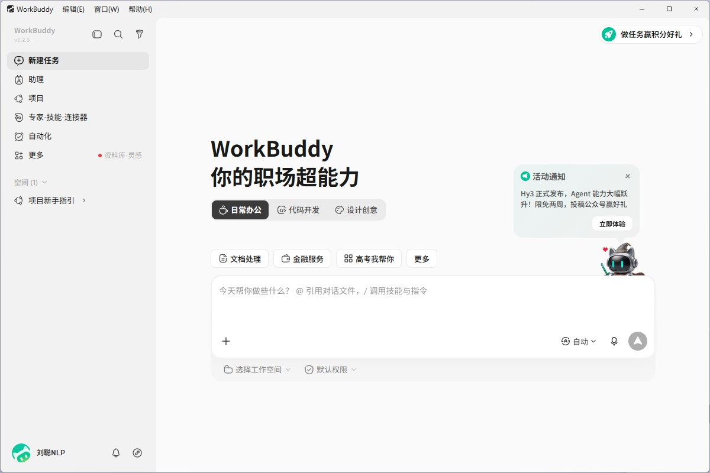

> **若学校电脑禁止安装软件，不要绕过终端安全策略**，应联系 IT 管理员确认白名单或企业部署方式。

### 更新

点击左下角个人中心，选择"检查更新"：

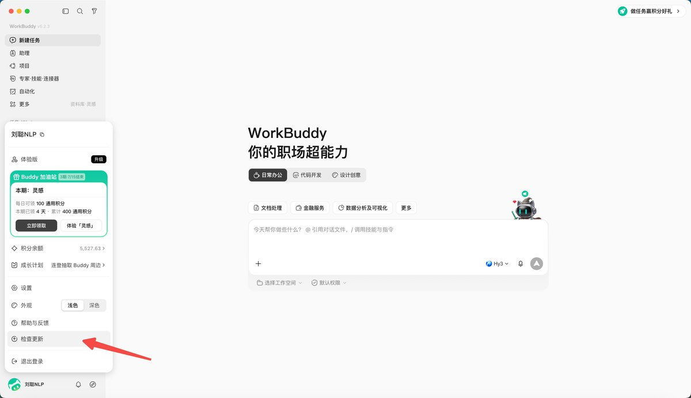

### 安装环节的四个常见问题

| 问题 | 怎么办 |
|---|---|
| 安装包打不开或提示损坏 | 删除安装包并从官网重新下载，核对系统和芯片版本；仍失败则记录系统版本、安装包名和报错截图走官方渠道，**不要随意关闭系统安全功能** |
| 登录后没有反应 | 检查默认浏览器是否拦截登录回跳、网络代理是否影响认证、系统时间是否准确；退出应用后重试 |
| 无法读取或写入文件 | 确认工作目录是否正确、系统是否授予目录权限、文件是否被其他程序锁定；**先用一个空白文本文件测试，不要拿重要文件反复试错** |
| 更新前要不要备份 | 应用更新一般不修改工作文件，但长期项目仍应把输入、产物、配置和自定义 Skill 纳入版本管理 |

### 登录后立刻做两件事

1. **确认模型设置。** 默认模型能用就别动。如果你要处理长文档或大批量文件，可以在设置里选能力更强的模型。
2. **找到 Skill 面板。** 这是 WorkBuddy 和对话式 AI 最大的结构差异——**它把"能力"做成了可安装的模块（Skill）**。你不需要懂技术，只需要知道去哪里找。第 5 章会讲怎么挑。

### 顺便装一个「企鹅教师助手」：给教育版准备的专属入口

**这一节强烈建议现在就做，因为在教师场景里，这是最省事的一步。**

很多老师装完 WorkBuddy 就直接开始用对话功能，**其实左下角还有一个专门给教育场景准备的东西没装。**

#### 先说清楚它在哪

**版本要求：5.5.0及以上才有这个入口。** 如果你的左侧栏找不到，说明需要更新。

更新方式：点击左下角个人中心，选择"检查更新"。

#### 找到「发现应用」

**在左侧菜单面板的右上角**，你会看到一个带外链箭头的入口，写着**「发现应用」**。


*图：WorkBuddy 5.7.6 真实界面。「发现应用」在左上角 Logo 右侧，点开后第一屏就是「最近使用」里的企鹅教师助手。*

点击它，会展开一个下拉菜单，里面分三类：

| 分类 | 是什么 | 对你的意义 |
|---|---|---|
| **最近使用** | 你近期开过的工具 | 常用的直接快捷进入 |
| **Buddy 应用** | 官方推荐的行业应用列表 | **这里能找到「企鹅教师助手」** |
| **探索更多** | 完整应用目录 | 想找其他行业应用时展开 |

下拉面板里除教育类应用外，还有通义信、美图设计室、腾讯自选股、腾讯电子签AI合同助手、Alpha派·Lite 等官方推荐，**说明 Buddy 应用是一个通用入口，不只是给教育用的**——但对教师来说，最该装的还是第一个：**企鹅教师助手**。

#### 装「企鹅教师助手」

在 Buddy 应用列表里找到**「企鹅教师助手」**，它的介绍是**"懂教学，更懂你的教学"**，右边有一个**「进入」**按钮。

点进去，中间会经过**授权、确认、绑定账号**这几个环节，**都是一次性的**，整个过程不用写一行代码。

装完之后，它会固定出现在你的侧栏里，**下次直接从"最近使用"进，不用再找。**

#### 装好之后，你的界面长这样

装上企鹅教师助手之后，整个界面会换成教育专用形态。**顶部是三个工作模式**，**中间一排是该模式下的教学场景入口**：


*图：企鹅教师助手「教学设计」模式。顶部三个模式是教学设计 / 家校共育 / 专业成长；下方一排是该模式的场景入口：创意教学设计、课件制作、教学目标生成、分层教学、写教案、教学评…（右侧还有箭头可横向翻页）。*

**注意这个「教学设计」是默认选中的**——这也印证了前面讲的：装上之后是教育版默认状态，你不需要自己配。

**另外两个模式长这样：**

| 模式 | 顶部场景入口 | 适合什么时候用 |
|---|---|---|
| **家校共育** | 个性化评价、家校沟通、分层作业、作业讲评、学生辅导、学情分析 | 和家长打交道、分析班情、布置分层作业 |
| **专业成长** | 教学研究、课题研究、教师培训、技能创作、网站开发、论文写作 | 写论文、做课题、搞培训、给自己开发小工具 |


*图：「家校共育」模式。左上角同时展开了「专家 · 技能 · 连接器」菜单——装上助手后，这三项教育内容已经内置，不用自己再配。*


*图：「专业成长」模式。注意这一排全是教师个人成长向的场景：教学研究、课题研究、教师培训、技能创作、网站开发、论文写作。*

> **把这三张图存下来，贴在办公桌前。** 你能一眼看出该干什么活的时候，切到哪个模式，这就是第 1 章说的"不用记功能，只记场景"。
>
> **三个模式的分界线是：**
> - **教学设计**＝课怎么上（备课、上课、课件、目标、分层）
> - **家校共育**＝课怎么延伸（家长、作业、讲评、辅导、学情）
> - **专业成长**＝自己怎么变强（研究、课题、培训、开发、写论文）

#### 它到底带来了什么

**这不是一个"功能"，是一个教育场景的工作台。** 装上之后，你不用自己配 Skill、不用自己写提示词，直接就是教育版的默认状态。

**你得到的是这四样：**

| 你得到什么 | 具体内容 |
|---|---|
| **教育专家** | 33 位教育专家（学科命题、学情分析、错题集生成等） |
| **教学 Skill** | 15 个即插即用的教学 Skill |
| **三大工作模式** | 教学设计 / 家校共育 / 专业成长，顶部一键切换 |
| **四类开箱能力** | 课件制作、创意教学、剧本教学、素材加工 |

**注意后两项。**「三大工作模式」和「四类开箱能力」是装上企鹅教师助手之后**直接出现在界面里的**，不是你还要自己去配——**这一句能帮你省掉至少半小时摸索。**

#### 一个容易踩的坑

> **官方早期文档写的是"点击左上角 Buddy 应用入口"，很多老用户会习惯性地往左上角找。**
>
> **但在5.5.3之后的界面里，它已经统一改名叫「发现应用」，位置也移到了顶部。**
>
> **名字变了，位置变了。别再找"左上角"了。**

#### 顺便认识一下能力的三层结构

**这一段值得你花两分钟看完，因为它能解释清楚你以后遇到的很多疑问。**

WorkBuddy 的能力分三层，**你现在用的是最下面那层，但教师最该用的是最上面那层：**

| 层 | 叫什么 | 是什么 | 教师的对应物 |
|---|---|---|---|
| **最底层** | **Skill** | 给它加某一种工具能力，比如读写 Excel、生成 PPT | 第 5 章讲的那些 |
| **中间层** | **Expert 专家** | 模拟某个岗位的 AI 角色 | 学科命题专家、学情分析专家 |
| **最上层** | **Buddy 应用** | **把能力、数据、品牌打包成一个独立工作台** | **企鹅教师助手** |

**用一个类比就清楚了：**

- **Skill 是零件**（一个扳手）
- **Expert 是角色**（一个汽车修理工）
- **Buddy 应用是整车**（一辆能直接开上路的车）

> **大部分人不会去拧零件，也不会去造角色。他们需要的是一辆能直接开上路的车，加满油，钥匙插进去就能发动。**
>
> **「发现应用」给的正是这个。而对教师来说，这辆车就是「企鹅教师助手」。**

**所以你现在要做的判断是：**

| 你想解决的问题 | 该在哪一层找 |
|---|---|
| 出一份分层作业 | 先试专家（教育版自带），不够再找 Skill |
| 这个流程我每周都做，想固化 | Skill → 做到第 24 章的封装 |
| **整体的教学工作台，不想自己拼** | **Buddy 应用 → 企鹅教师助手** |
| 要接学校自己的系统 | 连接器（第 7 章） |

### 【2026 年 10 月增补】开干之前，先给它三个"自我介绍文件"

装完不等于会用。一篇传播很广的教程（《WorkBuddy 的三个关键文件：90% 的人都没配置》）给了一个贴切的类比：

> **你招了一个新员工，上来就说"去做份产品 PPT"，不介绍公司、不说团队风格——你觉得他能交出让你满意的东西吗？**

三个文件让 WorkBuddy"懂你"，**配置一次，受益很久**：

| 文件 | 写什么 | 教师版示例 |
|---|---|---|
| **IDENTITY.md** | 它的身份与口吻（四行：名称/身份/风格/标识） | "小助手 · 初中数学教师的备课搭档" |
| **USER.md** | 你的档案：学科、学段、班级情况、写作习惯、交付偏好 | "八年级数学，两个班 92 人，几何证明普遍薄弱；报告要 Word，课件要 PPT；讨厌'AI 味'套话" |
| **SOUL.md** | 行为准则：核心价值观、边界、风格 | "数据说话不拍脑袋""不确定的先查证，不瞎编数字""给学生的话必须我过目" |

**最省事的写法**：不用自己从零写——直接告诉它你的职业、学科、教学习惯、希望它怎么称呼你，让它把三个文件写好给你，你再逐步调整。全程自然语言对话。

另一个等价做法（来源：《AI 驱动的个人知识库：中小学教师实战指南》）是先写一份**"个人教学说明书"**，15 分钟就够：

```
基本信息：初中数学，八年级，学生中等偏上但几何证明普遍薄弱，教龄 8 年。
我的教学风格：喜欢问题驱动，不喜欢满堂灌；备课最在意学生能不能真的动手。
作业偏好：分层设计，A/B/C 三档。
我希望 AI 怎么帮我：备课时给思路框架，不要直接给完整教案；
出题时参考我的教材版本和学生易错点；语言风格简洁直接，不要套话。
```

两种入口（三个文件 / 教学说明书）是同一件事：**把"AI 不知道、但会真实影响结果的信息"一次性交给它。** 这也是第 7 章备课增补里"上下文决定 AI 能走多远"的地基。

### 第一个任务：按你的格式重做一份教学设计

这是推荐给所有人的第一次任务。理由：真实、低风险、成果可对比。

**准备工作**：找到你上学期上过的、一份你比较满意的教学设计（Word 就行）。这是你的"参照物"。

**第一条指令**（直接复制，替换方括号内容）：

```
我要做一节公开课。

课题：【课题名】
教材版本：【人教版/北师大版/苏教版，几年级第几单元】
课时：【1课时 40 分钟】
听众：【区级教研员 + 兄弟校骨干教师】

请先不要生成文件，先给我一份材料清单：
1. 教学设计（我需要哪些部分）
2. 课件 PPT（多少页，每页大概放什么）
3. 逐字提问稿（几处提问）
4. 板书设计
5. 课堂检测题（几道，分几档）
6. 评价量表（几个维度）

每项写清楚：多少页、交付成什么格式、你会问我什么。
我要先确认清单，再生成。
```

**它在做什么**：不是直接给你教案，而是先给你一份**"施工图"让你审**。这一步是全书反复出现的模式——**先看计划，再看产出**。你审清单的那一分钟，比省下的一小时都值钱。

你确认后（比如"第 3 项改成 10 处提问，第 6 项改成 3 个维度"），它会重新出清单。然后你说"生成"。

**验收清单**（生成完逐条看）：

- [ ] 标题层级完整，能直接打印
- [ ] 内容能追溯到教材第几页
- [ ] 没有任何编造的事实、数据、引用
- [ ] 风格和你的习惯一致
- [ ] 有一个地方比你原来的版本**更好**（找到它，这是你下次要主动加的要求）

最后一条最重要。**如果生成的还不如你原来那版，别急着否定它——去找到它哪里不如，然后把这个差距写成一句话加进下一次指令。** 这就是"我说的越具体，它做的越准"的实际含义。

### 第一个任务里最可能卡住的地方

| 卡在哪 | 表现 | 怎么解 |
|---|---|---|
| 指令太笼统 | 给了个特别泛的东西，像"万能模板" | 补齐第 6 章的"对象/规格/约束/验收"四要素 |
| 不敢让它生成 | 一直在让它改、改、改，不敢说"生成" | 明确说"先出清单我确认"，然后就批准 |
| 生成后不知道好不好 | 只能凭"感觉还行" | 用上面那个验收清单逐条打勾 |
| 结果不如预期就放弃 | 第一次不满意就换工具 | 先找出差在哪里，把它写成一句要求，再试一次 |
| 材料没放到工作区 | 它找不到你的参照文件 | 把参照文件拖进工作区，指令里说清文件名 |

**"结果不如预期就放弃"是最常见的死法。** 一个不熟悉的工具，前三次的结果都不理想是正常的。第四次开始你会突然发现它懂了——因为你已经知道该怎么说了。

### 你现在应该做什么

跑完上面这个任务，然后：

1. 把成功的这条指令**存进 `99_提示词库`，命名成"公开课备课-初版"**
2. 记一句：这版哪里好、哪里差
3. 进入第 4 章

> **如果你刚才做第一个任务时卡在了"文件怎么放进去""结果怎么存出来"，先跳到第 6 章。** 那一章专门讲 Word / Excel / PPT / PDF 这类通用文件怎么处理，是后面所有教学场景的地基。

---

## 第 4 章　界面与工作区：会对话，更要会下指令

### 三个必须知道的区域

WorkBuddy 主界面可以理解为三个区域：左侧（侧边栏）管理任务，中间（对话区）下达和追踪任务，右侧（结果区）查看文件、变更、预览和最终产物。

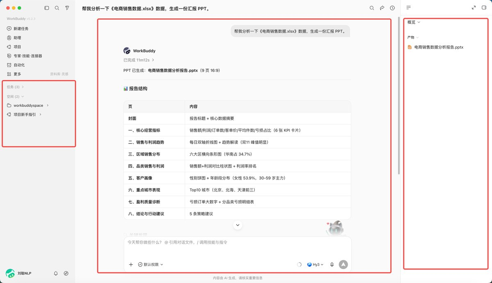

| 区域 | 主要用途 | 使用时重点检查 |
|---|---|---|
| 侧边栏 | 新建、搜索、切换和管理任务 | 是否进入了正确任务 |
| 对话区 | 描述需求、补充信息、确认计划 | 目标和约束是否完整 |
| 结果区 | 查看产物、全部文件、变更与预览 | 文件名、路径和改动是否符合预期 |

### 【新版功能】还有一种界面形态：文件浏览器

**现在 WorkBuddy 不只是"一个聊天窗口"，还可以是"一个文档编辑器"。**

**同样是三块地方，但用途不同：**

| | 对话界面（原有） | 文件浏览器（新增） |
|---|---|---|
| **左边** | 任务列表 | **正在看的文件** |
| **中间** | 对话 | **文档正文** |
| **右边** | 结果预览 | **AI 对话栏（默认收起）** |
| **怎么进** | 点开 WorkBuddy | **右键文件 → 打开方式 → WorkBuddy** |
| **适合** | 从零生成一份东西 | **改一份已经存在的文件** |

**两个要点：**

- **对话栏默认是收起的**——打开时先让你安静看文档，要说话再点「和 WorkBuddy 对话」。
- **一个窗口能开多个文件，用标签页切换**，切到哪个文件，右边就是那份文件的对话。

> **这一形态的详细用法见第 6 章「独立文件浏览器」那一节。**
>
> **一句话记住区别：** 对话界面是"让它做一份新的"，文件浏览器是"**在它旁边改你手上这份**"。

### 【新功能】全局搜索：不用记得问过什么

**这一条对教师特别重要，因为你的记忆容量是有限的。**

**2026 年 9 月 28 日（5.7.0）起，WorkBuddy 支持全局搜索。**

| 能搜什么 | 说明 |
|---|---|
| **资料库内容** | 你上传过的文档、课件、表格 |
| **聊天记录** | **半年内问过的问题、做过的任务，全都能搜回来** |

**为什么这条对教师重要？**

一年下来，你在 WorkBuddy 里问过几百个问题：
- "莱州的积分机制怎么设计的？"
- "小学科学命题专家怎么用？"
- "分层作业怎么设计第三档？"

**当时答得很好，但你不可能全记住。** 以前只能重新问一遍，**现在直接搜关键词就找回来。**

> **一个建议：** 养成习惯——**每做完一个有用的任务，就把关键词记在 `99_提示词库` 里**。
>
> **双保险：搜历史（找以前的答案）+ 查库（找自己的沉淀）。**

### "任务"和"工作空间"的区别

"工作空间"是 WorkBuddy 为了管理任务而设置的目录，每个任务都有一个对应的目录空间，任务可以在目录空间内进行操作。

若未设置，会在默认安装的目录下执行任务，对话保存在"任务"目录下。

**为什么必须隔离工作目录**

工作目录既是效率设置，也是安全边界。把发票、周报、客户材料混在同一个大目录里，会增加误读、误改和信息串用的风险。

对教师来说这条更实际：**学生的试卷、成绩单、作文原文，和你的课件、教案放在一起，就是一个随时可能出事的状态。**

可以按任务建目录空间，并且对目录空间的权限进行设置。当开启"允许完全访问"后，智能体可读写授权目录外文件，**请谨慎使用并优先按任务限定目录**。

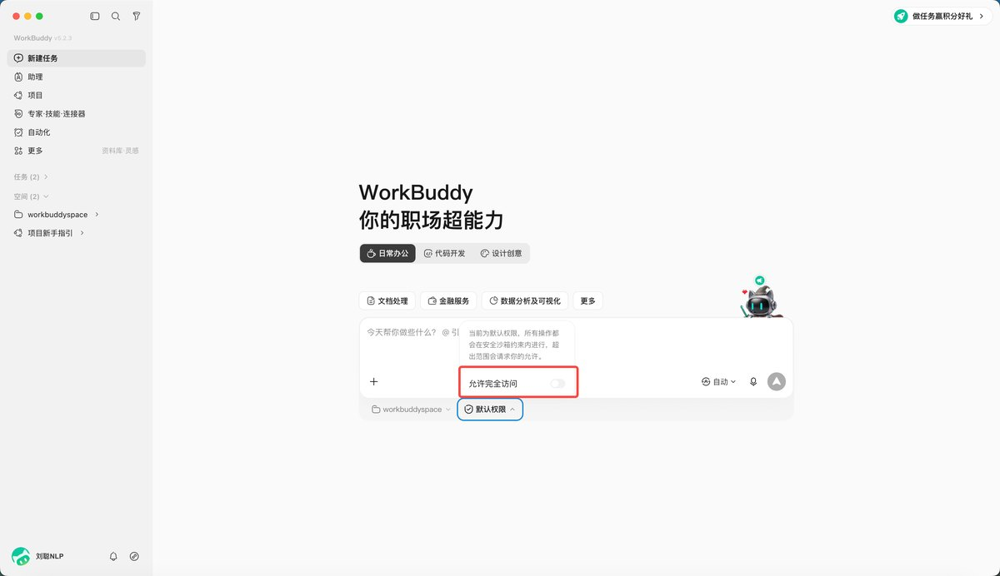

### 【2026 年 10 月增补】空间、任务、三层记忆：为什么"新建任务不记得上次教过的东西"

一篇被广泛转发的专栏（《WorkBuddy Day 11：任务、空间、工作空间——90% 的人搞混了这三个东西》）把这三个概念讲透了：

| 概念 | 是什么 | 类比 |
|---|---|---|
| **空间（Space）** | 任务的容器，管分类 | 一间办公室 |
| **工作空间（Workspace）** | 空间对应的物理目录 | 门牌地址 |
| **任务（Task）** | 让 AI 做的一件具体的事 | 办公桌上的一份待办 |

**关键规则在记忆上**——WorkBuddy 有三层记忆：全局记忆（所有任务共享的基础设定）、空间记忆（同一空间内共享的项目背景、格式偏好、术语表）、任务记忆（单个任务里的对话上下文）。**新建任务只继承全局记忆，不继承空间里积累的经验。**

这就解释了很多老师的一个困惑："我上个任务明明教过它我们的评分细则，怎么这个任务又不知道了？"——**因为那是空间记忆，你没有把它写进全局设定，或者你没有在同一个空间里继续做同类任务。**

一位老师的实际用法（四个空间各配一个物理目录）：

| 空间 | 目录 | AI 记住了什么 |
|---|---|---|
| 试卷批改 | D:\工作\试卷批改 | 批改标准和评分细则 |
| 数据分析 | D:\工作\数据报表 | 报表模板格式 |
| 内容创作 | D:\工作\公众号 | 写作风格和排版要求 |
| 学习整理 | D:\学习资料 | 笔记分类方式 |

配套的任务四守则：**① 一事一任务；② 任务名用"日期_主题_动作"（如 20261023_八年级月考_成绩分析）；③ 做完归档不删除（下次同类任务直接参考）；④ 文件直接拖进任务。**

> 一句口诀：**"空间管分类，任务管干活。"** 搞清楚这三者关系之后，WorkBuddy 才算真正上手——不然就跟拿了一把瑞士军刀只会当螺丝刀使一样：能用，但亏了。

### 三种工作模式

WorkBuddy 提供三种工作模式，**选错模式是新手最常见的浪费**：

| 模式 | 中文界面 | 能做什么 | 教师场景里什么时候用 |
|---|---|---|---|
| Ask | 问一问 | 问答、理解和查看，不修改文件 | 读课标、读教材、读一份已有材料，让你先讲清楚 |
| Craft | 做一做 | 可直接操作本地文件、运行代码及系统指令 | 路径清楚、风险较低的任务，比如批量改格式 |
| Plan | 想一想 | 先生成计划，确认后再执行 | **多步骤、涉及重要文件的任务，比如出一整套公开课材料** |

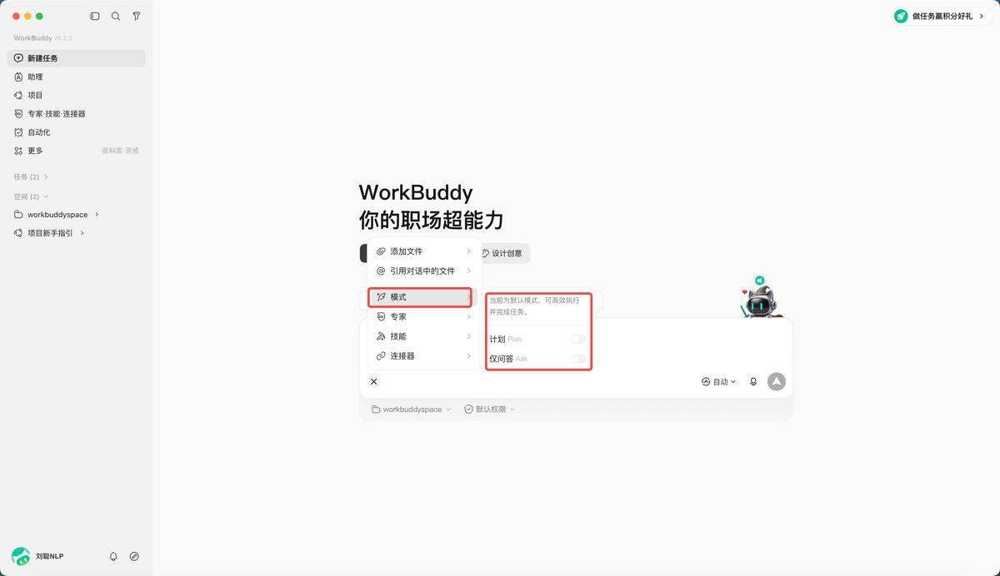

**给教师的建议：涉及学生材料的任务，一律先用 Plan。** 先看它打算怎么做，再决定让不让它做。

### 选择模型

默认为自动模式，可以指定你想使用的模型，不同模型积分消耗不同。

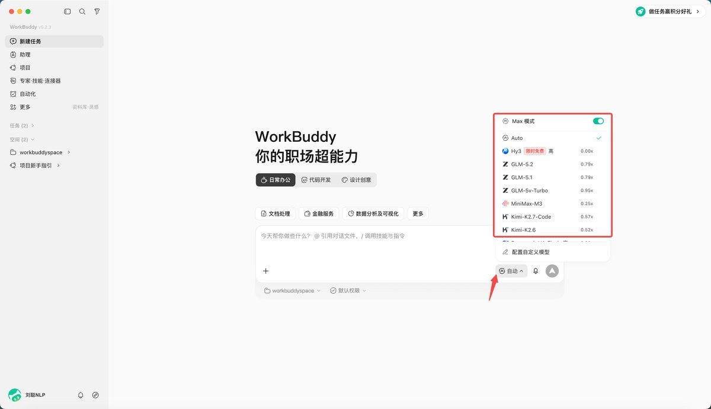

| 任务特征 | 优先关注 |
|---|---|
| 大量文本与长资料（整本教材、三年试卷） | 上下文长度，比如 100 万 tokens（1M） |
| 图片与截图（学生作文扫描件、实验照片） | 需要有视觉理解能力 |
| 高频简单任务（改个标题、换个格式） | 优先选择响应速度快、成本较低的模型 |

### 对话区最该知道的三个动作

**动作一：让它先给计划。**

几乎所有重要任务，第一句都应该是"先给我清单/计划，我确认后再生成"。

这不是不信任，是**把最便宜的一分钟放在最值钱的位置**。看计划花 1 分钟，改计划花 5 分钟，返工重出花 30 分钟。

**动作二：二次修改不要说"重写"。**

第一版不满意时，说差异，不要重来：

```
不要重新生成。在上一版基础上改：
1. 教学目标第 2 条太笼统，改成"能说出……并举例说明"这种可观测的表述；
2.逐字提问从 8 处减到 6 处，保留其中最有梯度的 3 处；
3. 检测题里第 4 题超纲了，换成本册第 5 单元的内容；
4. 板书设计加一个"易错点"区。
改完列出改了哪几处，其他不要动。
```

**"不要重新生成 + 说清差异"是全书反复出现的模式。** 重写会丢掉你上一版里已经对的东西，差异修改能保住它们。

**动作三：追问要往下问三层。**

它给的方案你看着不对，别只说"不行"：

```
第 1 层：这个设计里，学生的活动占比是多少？
第 2 层：分组是几个人一组，依据是什么？
第 3 层：如果班上有一个基础很弱的学生，这节课他会卡在哪一步？
```

**三层追问能把"感觉不对"变成"知道哪里不对"。** 知道了才能改，只说"不行"它只能猜。

### 一个任务的完整流程长什么样

新建任务的第一步是选模式。WorkBuddy 默认是 Craft，还可以设置成 Ask 或 Plan：

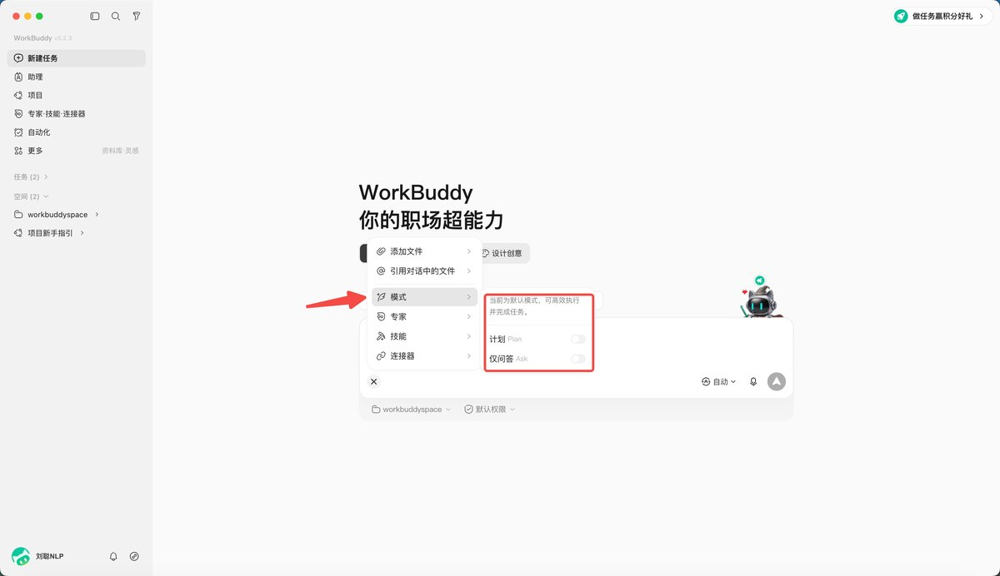

新建任务时要选择或创建独立工作目录：

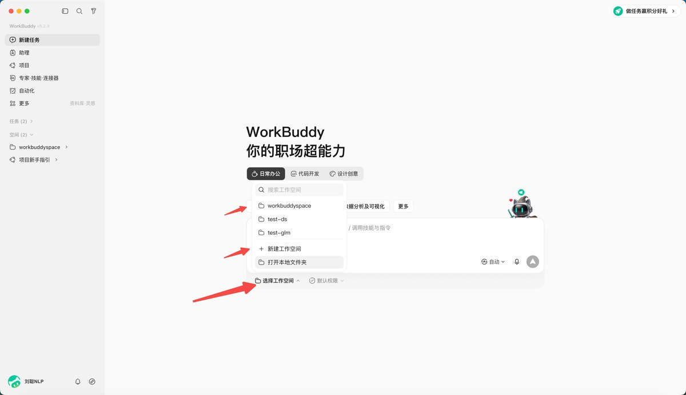

> **教师注意**：WorkBuddy 采用文件夹级授权与高危拦截机制。**首次操作请先在演练目录进行、留意授权范围，处理真实业务数据前谨慎确认。** 这句话尤其适用于你要处理学生材料的时候。

选择模型：


输入任务说明：

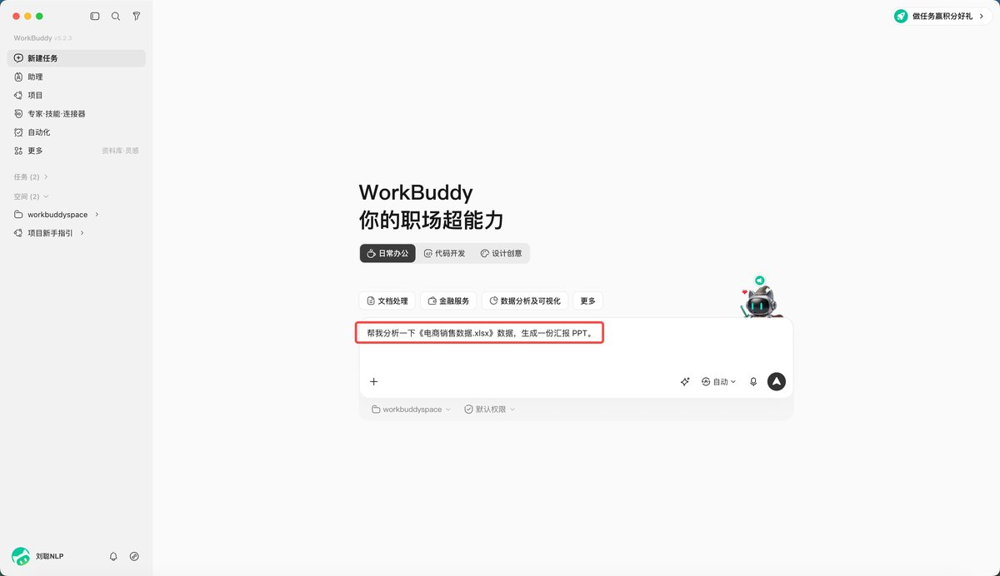

发送后观察计划、工具调用和文件变更：

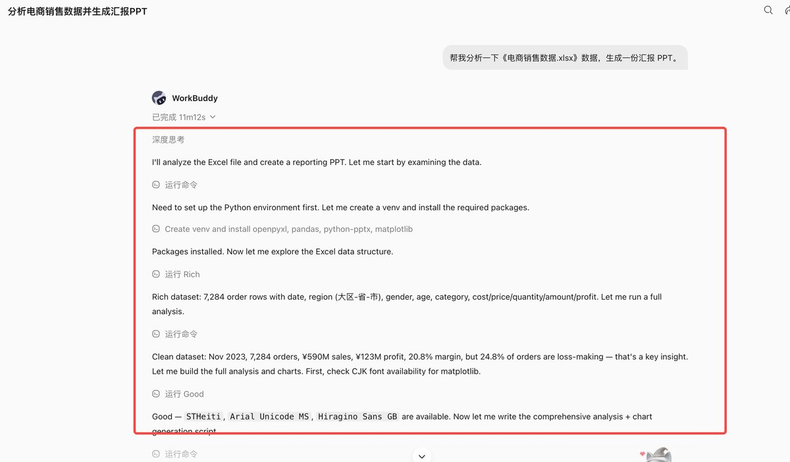

在结果区预览产物并验收：

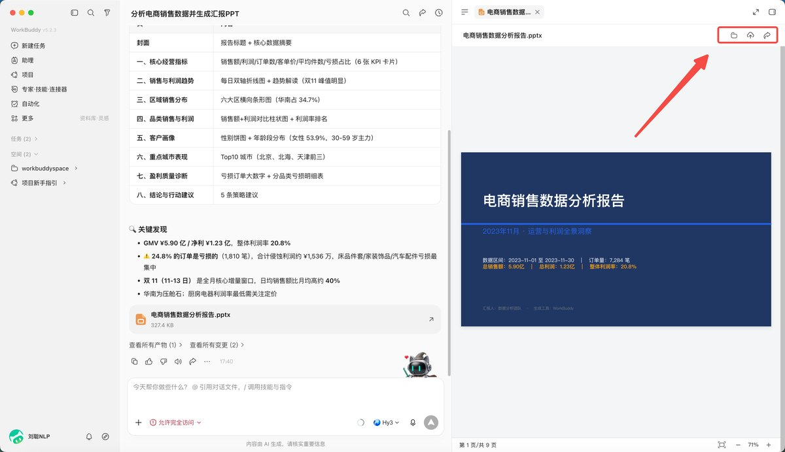

> 文件可以本地打开、上传云端或分享。**注意分享前先确认产物不含敏感或涉密信息**，按学校规范选择共享范围。学生成绩、名单、身份证号一律不要分享到校外。

### 一个任务说明该怎么写

这是全书最该背下来的表格。原书给出的六要素，我把它翻译成教师语言：

| 要素 | 要回答的问题 | 教师版举例 |
|---|---|---|
| 目标 | 最终要解决什么问题 | 让这节课的检测题覆盖三个层次 |
| 输入 | 使用哪些文件、目录或链接 | 工作区里2026秋_七年级/ 的单元测试卷 |
| 动作 | 需要分析、整理、转换还是生成 | 分析失分类型，生成变式题 |
| 约束 | 哪些不能改，采用什么规范 | 不超纲；不出现学生姓名；难度分布 3:5:2 |
| 输出 | 交付什么文件，放到哪里 | output/七年级_第三单元_变式练习.docx |
| 验收 | 用什么标准判断合格 | 每题标注考点；答案在最后一页 |

对照看三个原书的入门任务，你可以看出这个表格怎么落地：

**任务 A：整理文件**

```text
目标：整理 input 目录中的练习文件，便于按类型查找。
输入：仅处理当前工作区的 input 目录。
动作：识别文件类型，提出分类和重命名方案。
约束：不删除、不覆盖原文件；重名时保留两份并标记序号。
输出：先生成 inventory.xlsx 和 proposed-actions.md。
验收：清单文件数与input 实际文件数一致，所有动作可追溯。
在我确认 proposed-actions.md 前，不移动文件。
```

**任务 B：生成会议纪要**

```text
请把input/meeting.txt 整理为结构化会议纪要。
必须包含：会议结论、待办事项、负责人、截止日期、待确认问题。
不能从原文确认的负责人或日期写"待确认"，不要自行补全。
输出 output/会议纪要.md 和 output/待办清单.xlsx。
验收：每一项结论可以在原文找到依据；待办不遗漏负责人和时间状态。
```

**任务 C：Word 转 PPT**

```text
把 input/项目汇报.docx 转成 10 页以内的内部汇报 PPT。
受众：部门负责人；汇报时长：8 分钟。
保持原文事实和数字，不新增未经证实的数据。
结构：背景、现状、问题、方案、计划、需要决策。
使用 reference/brand-guide.pdf 中的颜色与字体规范。
输出 output/项目汇报_v1.pptx，同时提供逐页内容清单。
验收：每页只有一个核心观点，数字与原文一致，正文在投影状态可读。
```

**任务 C 换成教师场景就是**："把我的教案.docx 转成 12 页以内的公开课课件.pptx，受众是区级教研员，公开课 15 分钟，保持原文事实和数字不新增，每页一个核心观点，正文在投影状态可读。"

### 工作区的三条整理原则

**原则一：按"任务"分，不按"格式"分。**

不要建"Word 文件夹""PPT 文件夹"。要建"教学设计""课件""试题与作业"。**理由：你的任务会跨格式。** 一节公开课要 Word、要 PPT、要 Excel，如果按格式分，材料就被打散了，AI 也要到处找。

**原则二：原始材料和生成结果分开。**

```
03_试题与作业/
├─ _原始/        ← 学生卷子、扫描件、原题
└─ _产出/        ← AI 处理完的成品
```

这一条对**数据安全**尤其重要：原始材料里有学生姓名学号，你不会想让它在云端和产出之间到处跑。分开存放，是在文件系统层面就做了隔离。

**原则三：提示词单独放一个文件夹。**

这一条前面讲过了，但值得重复：`99_提示词库`。**每个提示词一个文件，文件名写成"场景-用途"格式**：

```
01_公开课备课-初版.md
02_分层作业设计-语文.md
03_学情分析-从成绩表到诊断.md
04_家长会通知-一小时版.md
```

到学期末，你的 `99_提示词库` 就是你个人的教学资产。**它比任何一份课件都值钱，因为它是你所有课件的生成方法。**

### 验收永远看文件

工作区里通常还有一个"文件/资料"视图，能看到 AI 动过哪些文件。

**这是你验收的唯一依据。** 不要相信它说"已完成"，去看它到底写了什么文件、内容对不对、有没有漏。

**验收永远看文件，不看它的汇报。** 这条适用于全书所有章节。

### 和它对话的三个忌讳

| 忌讳 | 为什么 | 改法 |
|---|---|---|
| 一句话扔个任务就跑 | 它只能猜，猜错你还要返工 | 用第 6 章的四要素补齐 |
| 说"你懂我意思吧" | 它没有你的上下文，"懂"是幻觉 |把背景、对象、标准都写出来 |
| 一次问十个问题 | 答案会互相稀释，每个都不到位 | 一次问一到三个，追问往下挖 |

---

## 第 5 章　加载一个真正用得上的 Skill

### Skill 是什么

WorkBuddy 本身负责理解任务和组织执行；**Skill 则是一组可复用的说明、脚本、参考资料和资源**，告诉 Agent 某类任务应该怎样做、调用什么工具、交付什么格式。

Anthropic 在 2025 年 10 月正式推出 Agent Skills，2025 年 12 月将其发布为开放标准。

一个最标准的 Skill，大概长这样：

```Plain Text
my-skill/
├── SKILL.md
├── scripts/
│   └── check.py
├── references/
│   └── guide.md
└── assets/
    └── template.pptx
```

其中只有 `SKILL.md` 是必须的。

```Markdown
---
name: tech-article-writing
description: 用于撰写AI 产品、模型评测和科技行业相关文章
---

收到写作任务后：

1. 先确认文章核心角度
2. 查找一手资料
3. 对核心事实交叉验证
4. 根据用户写作风格完成初稿
5. 检查禁用句式和 AI 味表达
```

### Skill 到底是怎么被"记住"的

**这是原书里最值得教师理解的一段技术 explanation。** Skill 最关键的设计不是 SKILL.md，而是 Progressive Disclosure（渐进式披露）。

假设你的Agent 装了 100 个 Skill。它不会一上来把 100 个 Skill 的完整内容全部塞进上下文——这样不仅浪费 Token，还会让模型被大量无关指令干扰。

标准做法分三层：

**第一层，Agent 启动时只看所有 Skill 的名称和 description。**

```Plain Text
pptx
处理 PowerPoint 创建、编辑、读取任务

pdf
处理 PDF 提取、合并、编辑、填写任务

tech-article-writing
撰写 AI 和科技行业文章
```

**第二层，当你说"帮我写一篇 WorkBuddy 的公众号文章"**，Agent 根据 description 判断`tech-article-writing` 可能相关，这时才加载完整的 `SKILL.md`。

**第三层，执行过程中发现需要模仿你的写作风格**，才继续读取 `references/style.md`；需要检查 AI 味，才执行 `scripts/check-ai-phrases.py`。

所以 Skill 解决了一个长期困扰 Agent 的问题：

> **怎么给 Agent 很多知识和工作方法，又不把所有东西永远塞在 Prompt 里。**

**对教师的实操含义**：你那个 `99_提示词库`，如果只是躺在文件夹里，它和"每次复制粘贴"没区别。**只有变成 Skill，它才会被自动触发。** 这是从"个人习惯"到"个人系统"的分水岭。

### Skill 跟 Prompt 到底有什么区别

这是最核心的问题，也是本书附录 A 存在的原因：

| 维度 | Prompt | Skill |
| --- | --- | --- |
| 核心作用 |描述当前任务 | 定义一类任务怎么做 |
| 生命周期 | 通常针对一次请求 | 长期复用 |
| 触发方式 | 用户主动输入 | Agent 自动选择或用户显式调用 |
| 载体 | 主要是文本 | 文件夹 |
| 内容 | 指令、上下文、示例 | 指令、脚本、资料、模板、资源 |
| 上下文占用 | 通常直接进入上下文 | 按需加载 |
| 复用 | 经常复制粘贴 | 原生可复用 |
| 分享 | Prompt 文本 | 完整能力包 |
| 执行 | 本身只是指令 | 可以调用附带脚本和工具 |
| 模型参数 | 不改变 | 同样不改变 |

最简单的理解是：

```Plain Text
Prompt = 任务
Skill   = 做法
```

### Skill 有哪些作用

**第一个作用，是给模型补充程序性知识。**

大模型往往知道大量知识，但未必知道你的事情具体应该怎么做。比如它知道怎么写一份好的教学设计，但不知道你们学校的教案模板长什么样、你们的命题组习惯用什么术语、教研组要求每节课必须包含哪个环节。

这些知识非常适合做成一个 Skill。

**第二个作用，是固定复杂工作流。**

普通 Prompt 可能是"帮我出一套单元检测题"，模型每一次都会重新思考：考什么、怎么配难度、题干怎么写、答案放哪里。

Skill 可以把流程固定下来，变成 Encoded Preference Skill（编码偏好型）——把步骤按照团队或个人的工作方式组织起来。

对教师来说，这类 Skill 最有价值的例子是：**你们学校自己的命题规范、你们教研组统一的作业设计格式、你们学区的常规评价模板。** 这些东西一旦固化，全组人都省事。

另一类是 Capability Uplift Skill，给模型补充它原本做不好或不稳定的能力，例如复杂文档、PDF 和 PPT 处理。

**第三个作用，是减少重复 Prompt。**

你现在跟 AI 合作，其实有大量内容是在重复说，比如你经常告诉它：

```Plain Text
不要写得太 AI
长短句结合
不要过度点列
要有自己的判断
不要编造例子
不要出现学生真实姓名
```

这些其实已经天然适合做成一个 `writing-style` Skill。以后你的 Prompt 只需要说"写一篇教学反思"，写作习惯、资料标准、禁用表达就都由 Skill 提供了。

**第四个作用，是把个人经验和组织经验资产化。**

传统 Prompt 最大的问题是容易散落在聊天记录、飞书文档、Notion、个人脑子里。Skill 是文件，所以它可以 Git 管理、版本回滚、团队共享、持续更新。

### 为什么教师要关心 Skill

不是技术原因，是**稳定性的原因**。

不装 Skill，你每次都要在指令里描述"我要做成什么样、什么格式、什么排版"。装了 Skill，很多要求就变成了默认。

**这就像学校里的模板。** 新教师写教案要自己从零想格式，老教师有现成的模板——不是老教师水平高，是他把标准固化下来复用了。

### 在哪里找到 Skill

> **⚠️ 入口改过（2026 年 9 月 28 日，5.7.0 版本）**
>
> **现在的路径是：左侧栏「插件」→ 技能搜索与安装。**
>
> | 你在哪见过 | 现在去哪 |
> |---|---|
> | 左侧「专家·技能·连接器」里的技能市场 | **左侧栏「插件」页** |
> | SkillHub技能市场 | **同一个地方，入口统一了** |
>
> **另外 5.6.0 起还多了两件对教师有用的事：**
> - **「应用管理」**：能查看已授权的第三方应用与 Buddy 应用，**支持一键撤销授权**——某天你发现某个应用不太对劲，从这里断掉。
> - **闲置能力提醒卡片**：长期没用的插件和技能会提示你，**可以一键关闭**——这解决了"装了一堆用不上的东西导致变慢"的老问题，**不用再自己一个个去数了。**

打开「插件」页，可以搜索技能，也可以用"查找技能"描述需求：

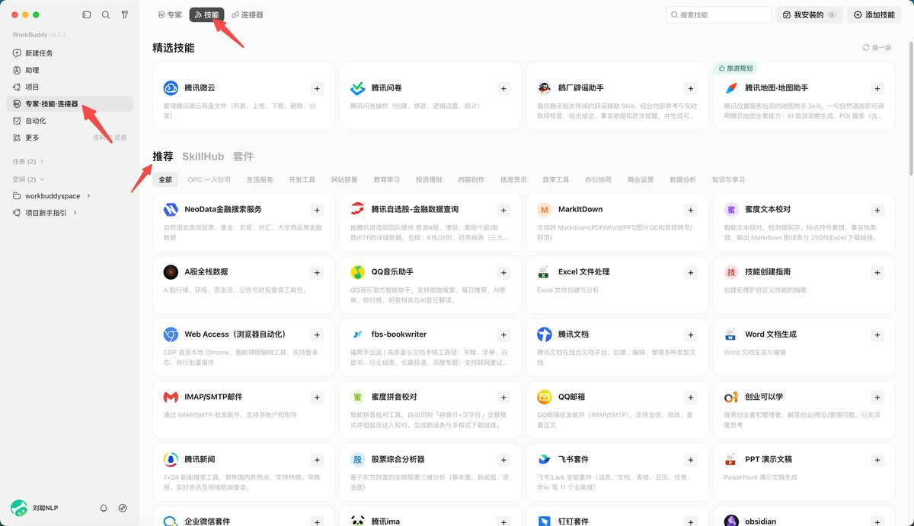

也可以在技能市场里找到合适的 Skill：

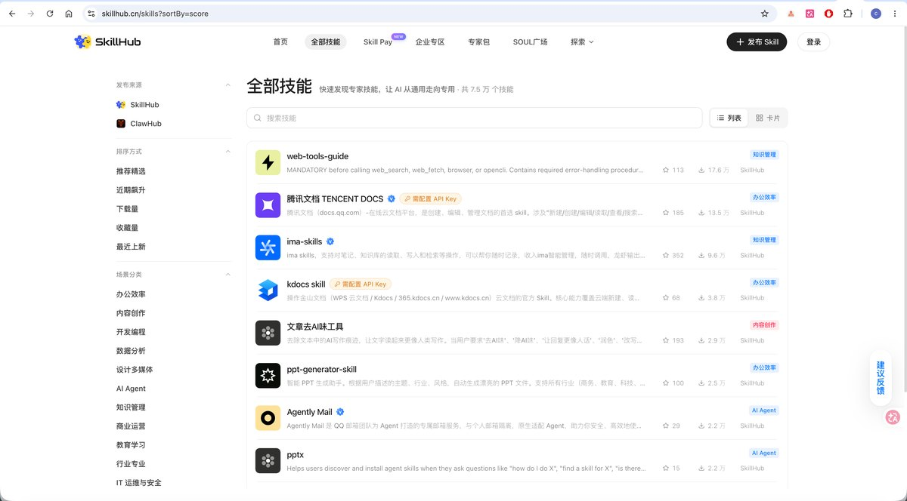

除了从推荐列表里直接安装，还可以**导入自己下载的技能**。比如你在网上看到一个好用的技能包，下载下来是一个 zip 压缩文件，点击"上传技能"加载即可：

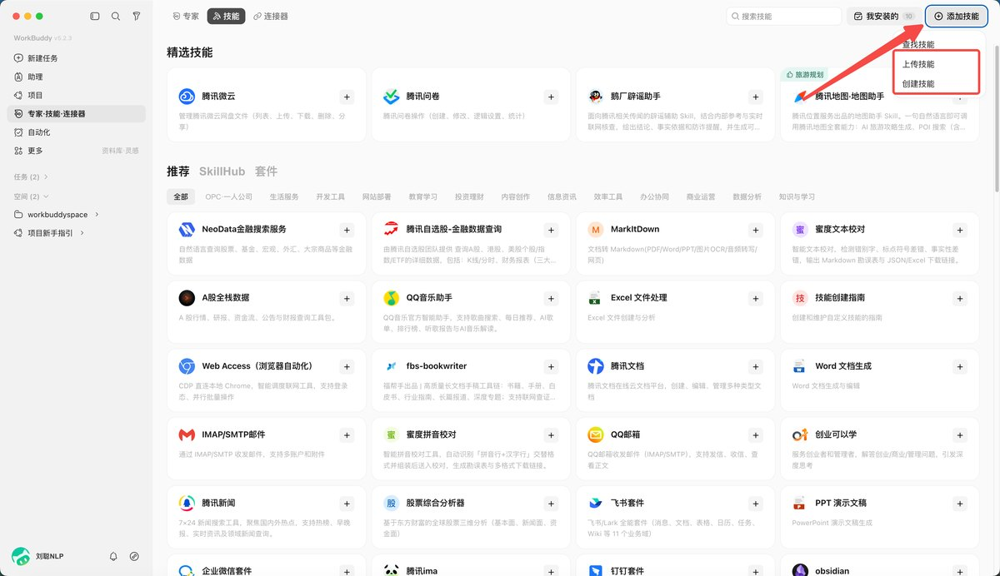

上传中的状态：

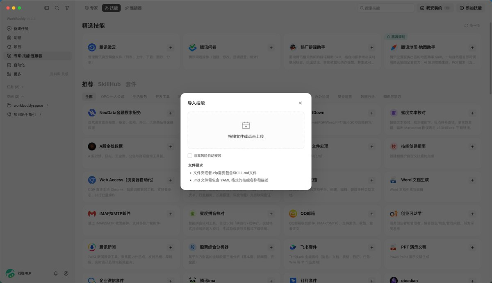

### 用 Skill 解决一个真实任务

这里用一个你一定会遇到的场景：**AI 写的东西有 AI 味，读着不像人写的。** 你可以把去 AI 味的规则做成一个 Skill，以后直接调用。

找到"文章去AI 味工具" Skill，安装之后，使用时直接用 `/` 唤出：

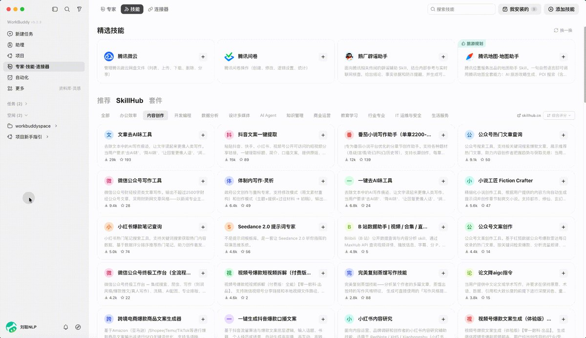

你只需要引用 Skill 内容，把文章给到即可：

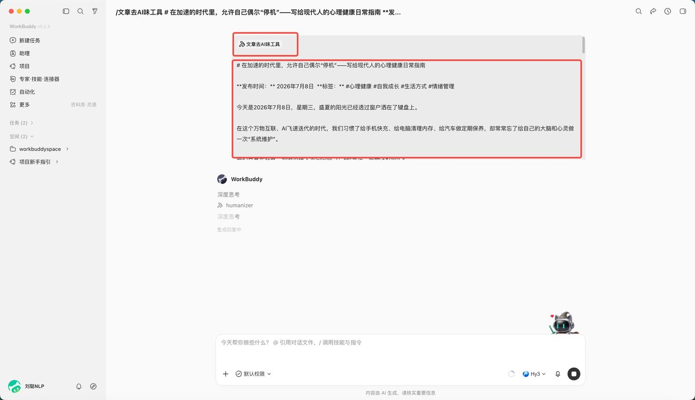

WorkBuddy 会先加载 skill 的内容：

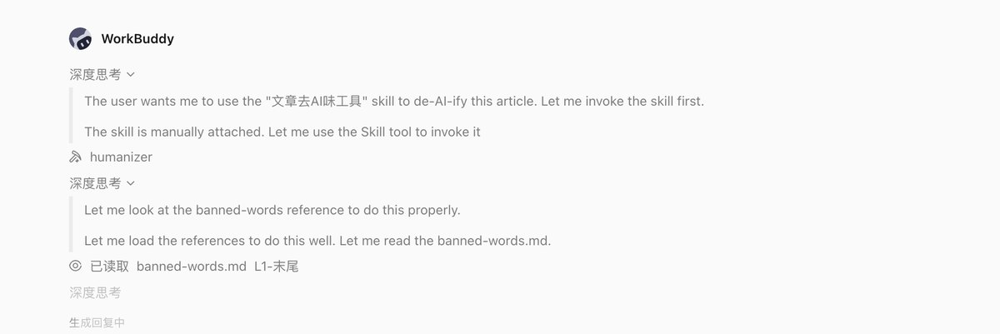

然后根据 skill 中的规则执行，比如要去除"不是……而是……"、双引号等表达：

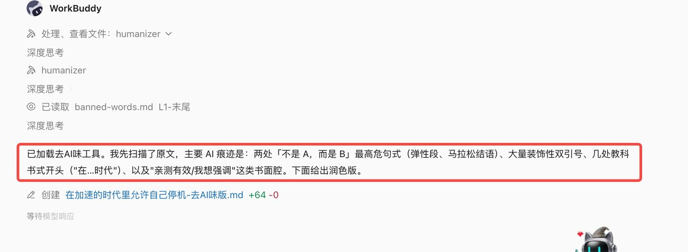

修改之后可以得到结果，确实去除了 AI 味：

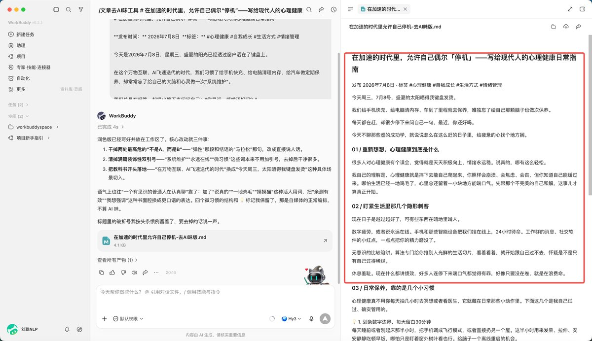

**这个流程你要记住，因为它是第 24 章（打造 Skill）的预演。** 你现在用别人的 Skill，第 24 章教你怎么把自己的方法做成 Skill。

### Skill 的关闭和卸载

从全部技能中，点击"我安装的"：

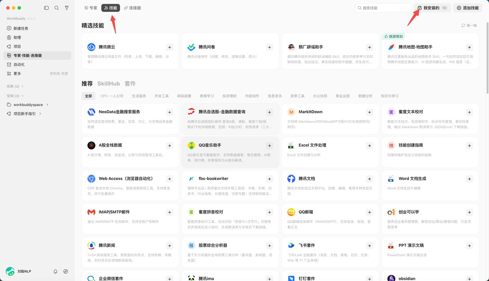

按钮关闭（则关闭该 Skill）：

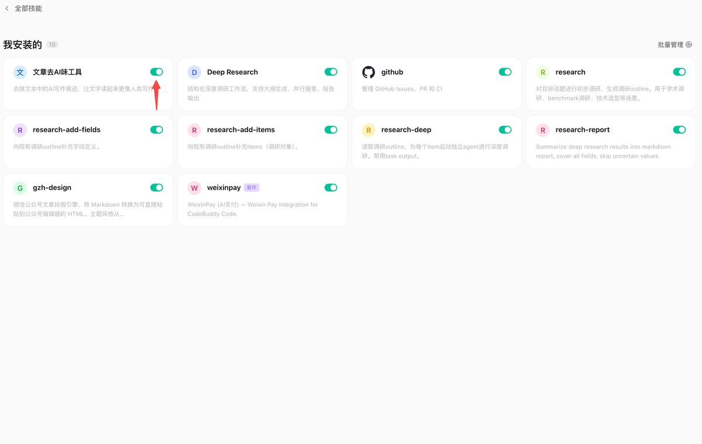

点击"···"，可以选择删除或编辑该 Skill：

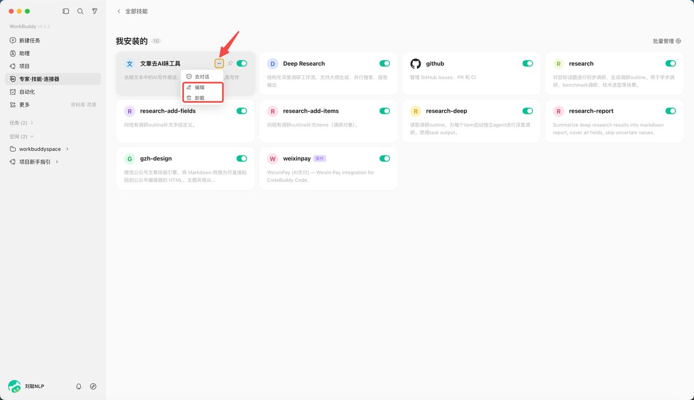

### 教育版已经帮你备好的现成资源

上面讲的是"怎么找 Skill"。这里要专门说一件事：**教育版里已经有一批现成的专家和 Skill，不用你从零研究。**

> **前提：你已经装了「企鹅教师助手」（第 3 章那一节）。** 装上之后，下面这些能力会直接出现在你的界面里，不用再单独配置。

据公开报道，WorkBuddy联合腾讯企鹅教师助手已上架 **33 位教育专家、15 个即插即用的教学 Skill**，覆盖备课、教研、学情管理、家校沟通全场景需求。已上线的示例包括小学科学命题专家、错题集生成器、学情分析专家等。

> **先把这些用起来，再想自己造。** 大多数教师的第一个瓶颈不是"不会造"，是"不知道已经有现成的"。

**桌面端有三个专门为教师切好的工作模式**，装上企鹅教师助手后就在界面顶部一键切换：


| 工作模式 | 覆盖什么 | 对应本书章节 |
|---|---|---|
| **教学设计** | 备课、出卷、课件、创意与剧本教学 | 第二篇第 7—11 章 |
| **家校共育** | 家长会材料、期末评语、个别学生沟通 | 第二篇第 16 章 |
| **专业成长** | 论文、课题、教研、培训材料 | 第三篇第 17—22 章 |

**四类开箱即用能力：**

| 能力类型 | 具体内容 | 你能直接拿到什么 |
|---|---|---|
| **课件制作** | 课前准备 → 课后复盘全流程 | 教案 + 课件 + 反思三件套 |
| **创意教学** | PBL 方案、辩论赛、分层任务单 | 活动设计 + 任务单 |
| **剧本教学** | 角色扮演、推理探案 | 互动剧本 + 实施流程 |
| **素材加工** | 优化教案、论文、课题、家长会材料 | 把已有材料改到可用 |

**专家和 Skill 到底有什么区别？** 这两个概念在第 25 章还会详细讲，这里先记住最实用的一句区分：

| | 定位 | 适合什么场景 | 交互方式 |
|---|---|---|---|
| **教育专家** | 顾问型 | 需要持续对话、需要专业判断 | 你问它答，来回打磨 |
| **教学 Skill** | 交付型 | 目标明确、要一个成品文件 | 一键触发，直接产出 |


**这张图其实是四种方式的完整对照**，第 25 章会展开讲。这里你要先记住的是：**它们不是同一层级的东西，不要混着用。**

### 这三个月还多了哪些能力（2026 年 8—10 月更新）

**这一节是给"觉得界面和书上不一样"的你。** 从 8 月到现在不到三个月，官方发布了 20 多个版本，下面挑**对教师真正有用**的说。

| 能力 | 什么时候能用 | 对教师的用处 |
|---|---|---|
| **独立文件浏览器** | 5.5.5 起，5.7.x 完善 | 右键打开本地文件直接改，**第 6 章整节在讲这个** |
| **定时任务改名 + 汇总页** | 5.5.4 改名，5.7.5 加汇总页 | 「自动化」改叫「定时任务」，历次运行按时间线看 |
| **任务完成通知** | 5.7.0 | 跑完在电脑和手机都收到提醒，**不用守着干等** |
| **全局搜索** | 5.7.0 | **能搜资料库内容和聊天记录**——去年问过的事忘了，直接搜关键词找回来 |
| **后台任务可查看/取消** | 5.5.5 | 长任务跑到一半发现方向不对，**能直接停掉**，不用等它跑完 |
| **资料库当参考** | 5.5.5 | 发起任务时可以直接把资料库里的文档当参考，**不用先下载到本地** |
| **图片处理** | 5.5.0 | 去文字/水印、修复、增强、美颜、**透明背景抠图**——做课件配图用得上 |
| **创意设计** | 5.5.5 | 图片生成、视频生成、品牌设计 |
| **3D 模型生成** | 5.4.0 | 理科教室模型、实验器材示意图 |
| **微信聊天记录直接转发** | 5.5.0（Windows/macOS 系统分享入口） | 群里收到的讨论、领导的语音整改要求，**直接转发进来当材料** |
| **锁屏运行三档** | 5.5.4 | 关闭 / 熄屏继续跑 / 屏幕常亮，**长任务不用守着电脑** |
| **腾讯文档读写增强** | 5.5.0 起多次 | 直接读改学校在腾讯文档上的教案、成绩表 |

> **其中对教师最实用的三个，我推荐优先用：**
>
> **① 全局搜索（5.7.0）** —— 教师一年下来问过几百个问题，
> **能搜到三个月前的对话，比重新问一遍省太多时间。**
>
> **② 后台任务可取消（5.5.5）** —— 以前只能等它跑完，现在发现方向错了随时停。
>
> **③ 微信记录直接转发（5.5.0）** —— 教研群里讨论的内容，
> **转发进来就能让它整理，不用自己复制粘贴。**

**至于版本号本身：** 官方从 3 月到现在发布了 91 个版本，**平均不到三天一版**。

> **所以本书给的不该是"某个版本的截图"，而是"这件事怎么做"。**
>
> **你的界面和这里不一样时，判断标准是：这个功能的核心动作是什么、风险在哪、有没有替代路径。**
> **界面会变，那三样不会变。**
>
> **本书凡是标了 ⚠️ 的地方，都是已知会过时的地方**——把旧截图换掉即可，文字部分仍然成立。

**典型用法对照：**

- **顾问型**——"读取我工作空间里的三次月考 Excel，按'材料—依据—待确认项—教学动作'的顺序，输出本班数学薄弱点诊断与下周教学建议。"（用学情分析专家，你和它来回讨论诊断结论）

  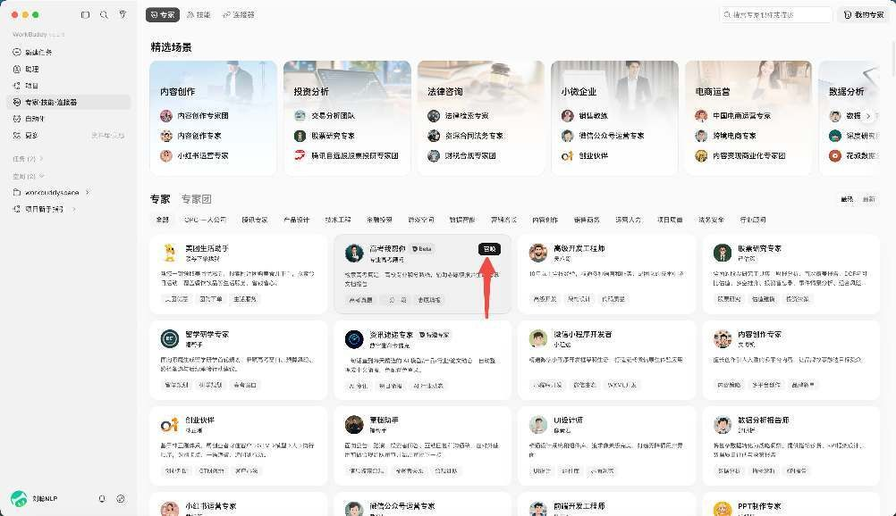

- **交付型**——"帮我出一套教科版三年级下册第一单元测试卷，含选择、填空、实验探究三类题型，配标准答案与评分标准，导出 Word。"（用命题专家 + 出卷 Skill，直接拿文件）

**一条判断：** 如果你还要跟它来回讨论、改三遍，选专家；**如果你要的是一个能发出去的成品文件，选 Skill。**

### 【2026 年 10 月增补】教师 Skill 生态全景：四份清单、一张去重表、两条新渠道

这一节回答老师们最常问的三个问题：**装哪些？去哪找？装多了怎么办？**（素材来自知识库近期多篇文章，来源随条目标注。）

**① 一线实测过的 12 个教学 Skill**（来源：《教师版WorkBuddy正式发布!12个Skill让备课出卷错题全搞定》，含完整提示词，详见增补篇）

| 环节 | Skill（英文标识照录） | 一句话用途 |
|---|---|---|
| 备课 | `lesson-pack` | "学科+年级+课题+课时长"一次产出教案/课件/学案/分层练习/作业五件套 |
| 备课 | `office-kejian` | 五种课型课件（新授/公开课/复习/说课/家长会），先大纲确认再出成品 |
| 备课 | `k12-lesson-design` | 固定教案结构 + 45 分钟分配基线 + 三层作业模板 |
| 备课 | `yueureka-lab-edu` | 21 个分支"全家桶"：评语、家长会、公开课打磨、课题等低频高烦任务 |
| 出卷 | `exam-generator` | 按教材版本/知识点出卷，产可打印试卷 + Word + 答案 |
| 出卷 | `tizhuang-question-bank` | **从 2000 万+ K12 真题库抽题**——"返回服务端真实题目，不虚构、不改写" |
| 出卷 | `chuti-zujuan` | 先建双向细目表，确认后再逐题编写 + 评分标准 |
| 错题 | `cuoti-fast` | 拍批改过的卷子照片 → 自动识别错题、重绘插图 → Markdown 错题集 |
| 学情 | `xueqing-analysis` | 试卷照片 → 带趋势仪表盘的 HTML 学情报告 |
| 学情 | `class-analysis-junior`（小学 primary / 高中 senior） | 考试数据 → 班级诊断报告 + "3-2-1 教学建议" |
| 管理 | `find-skills` | 帮你在市场里找 Skill |
| 管理 | `skill-creator` | 把你自己的重复流程封成 Skill |

**批量安装一句话**（原文摘录，直接粘给 WorkBuddy）：

```
请到技能市场帮我安装下面这些 skill，已经装过的跳过，不要重复装。
要装的名单：lesson-pack、office-kejian、k12-lesson-design、yueureka-lab-edu、
exam-generator、tizhuang-question-bank、chuti-zujuan、cuoti-fast、
xueqing-analysis、class-analysis-junior、find-skills、skill-creator
```

**② 重叠去重表——别重复安装**

| 重叠组 | 两个名字 | 实际关系 | 怎么选 |
|---|---|---|---|
| 学情分析 | `class-analysis-junior/primary/senior` ↔ 官方 15 Skill 里的「学情分析报告·初中 / 分析报告·小学 / 学情分析报告·高中」 | **同一功能两种叫法**（腾讯 SSV 与北大联合研发） | 认准一个装，按学段选 |
| 备课三件 | `lesson-pack` / `k12-lesson-design` / `yueureka-lab-edu` | 都产教案/课件 | 要全套五件套→lesson-pack；学校格式硬要求→k12-lesson-design；要评语/家长会等杂活→yueureka |
| 出卷三件 | `exam-generator` / `tizhuang-question-bank` / `chuti-zujuan` | 生成 / 抽真题 / 细目表组卷 | **实测建议：先抽真题，凑不齐的再用生成补——两种来源混着用，比全靠生成可信得多** |

**③ 官方市场之外的第二条渠道：教师 Skill 专属平台**

黎加厚教授团队的 **ESMS 教育 Skill 平台**（skill-ms.cn）专门面向教师，使用四步（来源：《终于找到了专属教师的 Skill 平台》）：

1. **FIND 先带着一件要做的事去找**（别一上来收藏几十个）；
2. **PREVIEW 看小样**——每个 Skill 详情页有真实作品小样可放映预览，比读介绍直观；
3. **USE 一键复制安装提示词**，粘到 WorkBuddy 对话框按提示装；
4. **SHARE** 把自己做的 Skill 上传给同行。

> 配套习惯值得养成：**每次准备让 AI 从零做课件之前，先去看看有没有老师已经做过类似的事情。能借鉴的先借鉴，把省下来的时间留给这节课真正需要自己想清楚的问题。**

另有高校教师李笃峰开源的 19 个教育理论 Skill（布卢姆目标设计、BOPPPS、PBL、5E 模型、量规设计等，skillhub 可搜，按 CC BY-NC-ND 协议共享——**引用/转发请注明原作者，不得未经许可用于训练 AI 或上传知识库**），其中 `bloom-taxonomy-master` 明确支持中小学"三维目标 + 核心素养"呈现，中小学教师可用。

**④ "管理比安装更重要"**

- 开着的 Skill 会常驻占用对话空间，装满几十个同时开会**响应变慢、误调用增多**。原则：**做什么开什么。**
- 一句量化提醒（来源：《写 Skill 实战手册》）：装 20 个 Skill，光名称和描述就要吃掉 1,000–3,000 Token 的常驻上下文。
- 找与造的"双地基"：`find-skills` 负责找，`skill-creator` 负责造——**这两件是 Skill 体系的基本零件，先装上。**

### 挑 Skill 的三步法

**第一步：从你的高频任务倒推，不要从 Skill 列表正推。**

正确做法：拿出你这一周的工作清单，标出"每周至少做一次"的事。**只有每周都做的事才值得装 Skill。**

一次性任务不值得——为它研究半天不划算。

**第二步：看三个信息，不要看介绍。**

- 它能处理什么类型的文件（输入输出格式）
- 它有没有前置条件（要不要先装别的东西、要不要联网）
- 它处理数据的方式（本地处理还是上传云端）——**第三个对涉及学生材料的 Skill 是硬要求**

**第三步：装一个，用三次，再判断要不要继续用。**

一次说明不了问题，三次才能看出它在你这儿的真实表现。

### 卸载 Skill 的一个提醒

从技能市场里装的 Skill 数量多了以后，模型每次启动都要读所有 Skill 的名称和描述。**装 50 个用不上的 Skill，不会让它更强，只会让它更慢更容易选错。**

定期清理：一个月没用上的，删掉或关掉。

> **现在有一件事帮上忙了（5.6.0 起）：闲置能力提醒卡片。**
>
> **长期没打开过的插件和技能，会在界面上提示你，并给你一个「一键关闭」的按钮。**
>
> **所以这件事不用再靠你自己记了。** 看到提示就顺手关掉——**每一次清理都是在让剩下的 Skill 更好用。**

---

## 第 6 章　先当通用文件助手用起来

**这一章是第二篇的地基。** 第二篇所有教学场景——备课、出卷、批改、课件——底下的动作都是"读文件、写文件、读表格、生成文档"。**这一章把这些动作单独拆出来讲一遍。**

如果你现在只想记住一件事，记住这个：

> **它不是一个只会聊天的地方，它是一个能真正读写你电脑里文件的助手。**
>
> **你能把文件拖进去，它就能读；你说清要什么格式，它就能写出来。**

### 【新版功能】独立文件浏览器：右键就能开

**这是最近更新的功能，也是本书出版后变化最大的一处。** 以前的用法是"把文件复制进工作区"；现在**更简单的路径是：右键 → 打开方式 → WorkBuddy**。

**三句话说完它是什么：**

| 一句话 | 说明 |
|---|---|
| **右键直接打开** | Word / Excel / PPT / PDF / Markdown / HTML / TXT / 图片 / 音频，以及腾讯文档在线文档，都能用它打开 |
| **左边看文件，右边聊 AI** | 打开后右侧是对话栏，**默认是收起的**，要说话再点「和 WorkBuddy 对话」 |
| **选中哪里，AI 就改哪里** | 在文档里选中一段，AI 只改这一段，改完用黄色标记显示 |

**它最大的价值是"人机双写"**——过去 AI 改完文件，你在另一个窗口看到它；现在你和 AI 在**同一份文件**上一起改，**不用再把文字贴来贴去**。

**这就是它打开后的样子：**

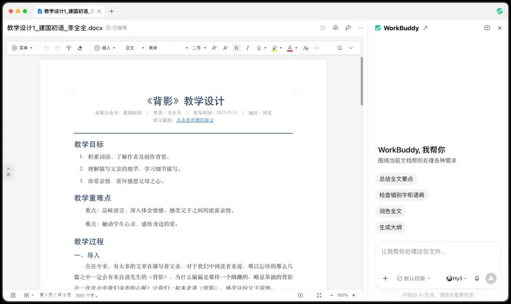

*图：文件浏览器界面。左边是文档正文，右边是「WorkBuddy，我帮你」对话栏。注意右上角那个按钮——对话栏默认收起，点它才展开。下方四个快捷按钮（总结全文要点 / 检查错别字和语病 / 润色全文 / 生成大纲）就是它对"当前这份文件"能做的事。*

> **对比一下第 4 章那张图。** 那是"对话界面"——中间是聊天框，产物在结果区。
> **这张是"文件界面"——中间是文档本身，AI 在旁边。**
>
> **要用哪一种，取决于你是"做一份新的"还是"改一份现有的"。**

#### 三种打开方式，你可以选一种

| 方式 | 怎么做 | 适合谁 |
|---|---|---|
| **右键打开**（推荐） | 右键文件 → 打开方式 → WorkBuddy | 手上正拿着一份文件要改 |
| **默认打开方式** | 设置里把 `.docx`/`.md` 的默认打开方式改成它 | 天天跟md、Word 打交道 |
| **微信里打开** | 微信收到 md/html → 用其他应用打开 → WorkBuddy 小程序 | 手机上收到的文件 |

**① 右键打开**——在文件上点右键，「打开方式」里选 WorkBuddy：

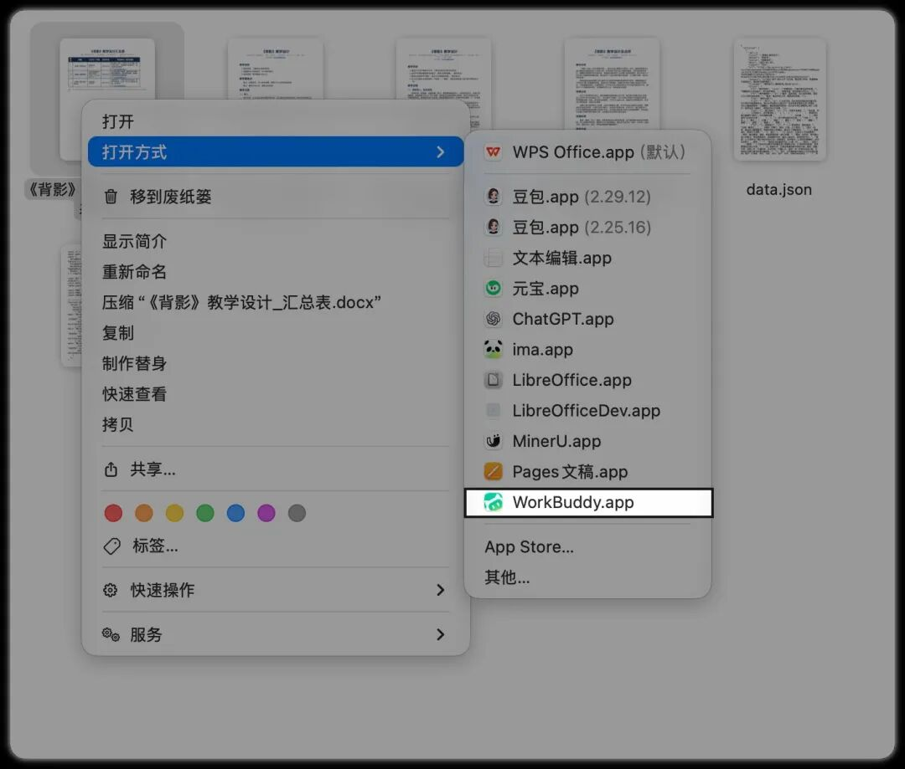

*图：右键菜单的「打开方式」子菜单，WorkBuddy.app 和 WPS Office.app 并列。这是 5.5.0 之后新增的入口。*

**② 设成默认打开方式**——之后双击就直接进来：

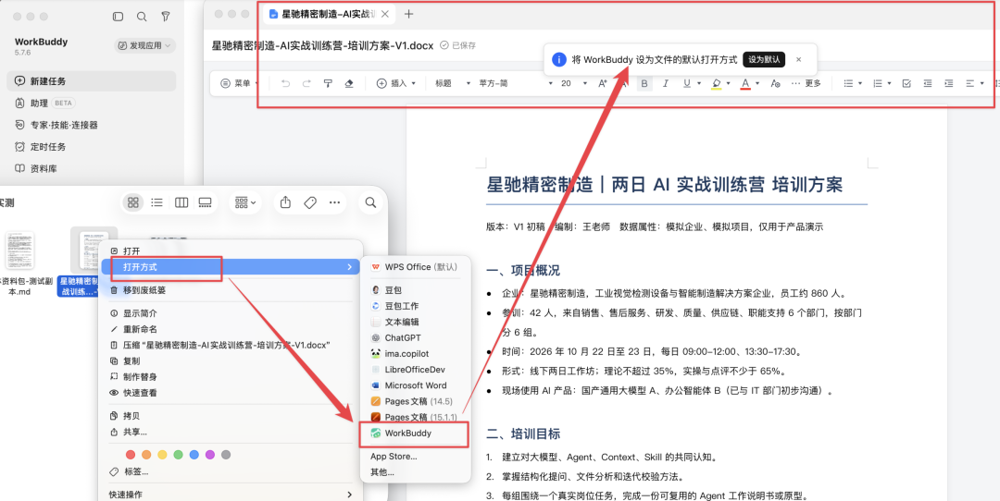

*图：文档打开时的提示条「将 WorkBuddy 设为文档的默认打开方式」，点「设为默认」即可。*

> **设成默认打开方式的价值：** 以后双击就进去，**省掉一次"复制到工作区"的动作**。如果你经常开 md 文件（AI 生成的东西一半是 md），强烈建议设上。

**③ 微信里打开**（手机上）：

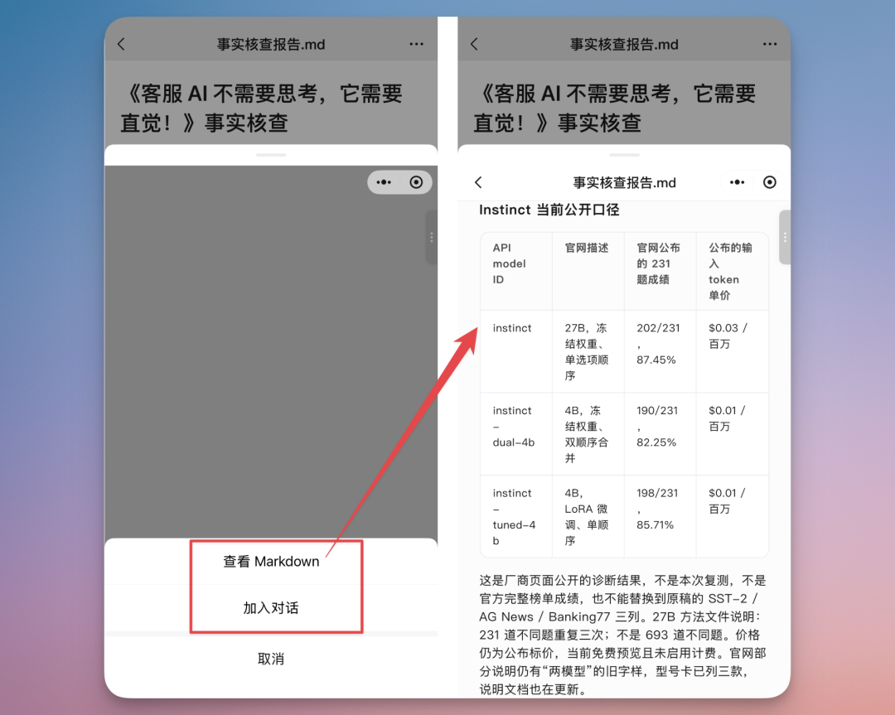

*图：微信里收到 markdown 文件 →「用其他应用打开」→ WorkBuddy 小程序 → 左边「查看 Markdown」、左边「加入对话」。*

#### 打开后能做什么：人机双写

**选中哪一段，就只改哪一段。**

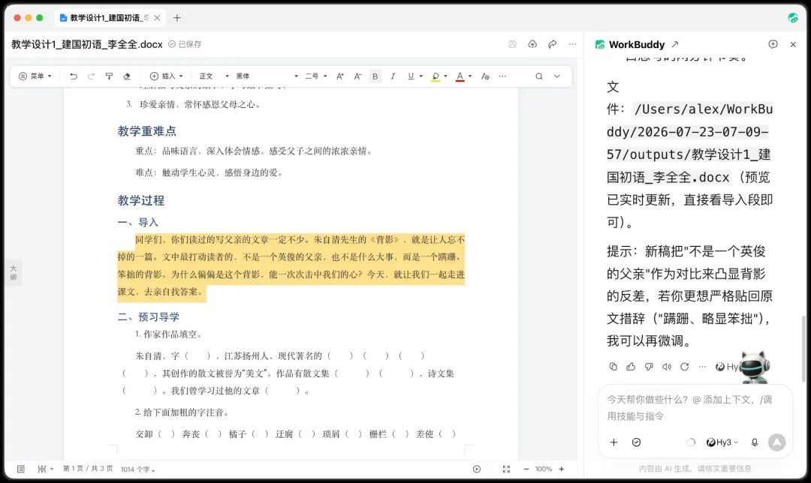

*图：选中「同学们，你们读过的写父亲的文章一定不少…」这一段，让 AI 缩短导入。右侧对话栏显示 AI 已完成，**文档里改动的地方用黄色高亮标出**，你可以对着原文判断要不要接受。*

**这个"黄色标记"很重要——它就是最直观的"改动对照"。**

> **对比本书第 6 章后面讲的「三件事：读、写、对照」：**
> 黄色标记告诉你"改了"，但不告诉你"为什么改"。
> **所以改动大的时候，还是让它补一句"我改了哪几处、为什么"。**

#### 一份文件配一份对话

**这个细节很重要，很多老师第一次用就发现了。**

一个窗口可以开多个文件，用**标签页切换**。切到哪个文件，右边就切到那份文件对应的对话——**每份材料各有自己的讨论，互不干扰。**

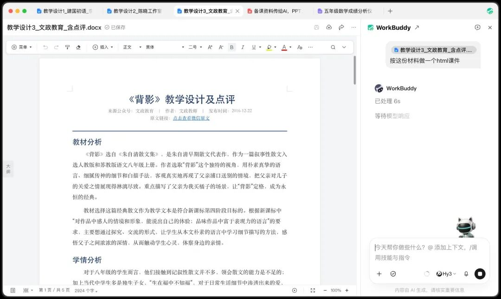

*图：一个窗口开了 5 个文件（教学设计 / 原文教材 / 备课资料 / 五年级成绩分析 / 骨架工作稿），顶部是标签页。**每个标签页都对应右侧自己的一份对话，互不干扰。***

**这意味着：** 你在A 教案里讨论怎么改导入，切到 B 成绩单里讨论统计口径，**两边的上下文不会串**。

**而且关闭文件再打开，之前的对话还在。** 下次课后发现练习要改，重新打开这份教案，**回看当时讨论过什么，再交代新的要求**。

> ⚠️ **但有一个必须知道的限制：聊天记录不是版本记录。**
>
> **它记得"当时说过什么"，不记得"文件当时长什么样"。**
>
> **想保留每一版，还是得自己另存副本。**

#### 它改的是"当前这份本地文件"，保存会写回原处

**这一条是本书反复强调的红线，现在尤其重要。**

| 文件类型 | 保存方式 |
|---|---|
| Word / Excel / PPT | 要点保存，或按 `Ctrl / Command + S` |
| Markdown | **自动保存**（没有单独的保存按钮） |
| HTML | 退出编辑状态时**自动保存** |

**"存回原文件"意味着：改错了，原文件就没了。**

> **⚠️ 动手前必做：先留副本。**
>
> **按 `Ctrl+S` 之前，先复制一份，改副本。**
> 学校模板、合同原件、只有一份的教案——**这些尤其不要直接动手。**

**两个保护机制要知道（这是新版的加分项）：**

| 情况 | 会发生什么 |
|---|---|
| 文件正被 Word / WPS 占着 | **只能看，不能改**（提示先关掉占用程序） |
| 文件在别处被改过 | 保存前**提示刷新或另存**，不会悄悄覆盖同事的修改 |

**第二个尤其重要**——它保护的是"同事正在同一份文档上协作"这种场景。**你不会把别人的修改静默盖掉。**

文件窗口右上角还有「打开文件夹」和「另存为」两个入口——**"另存为"就是最快的留副本方式**，改之前先点一下：

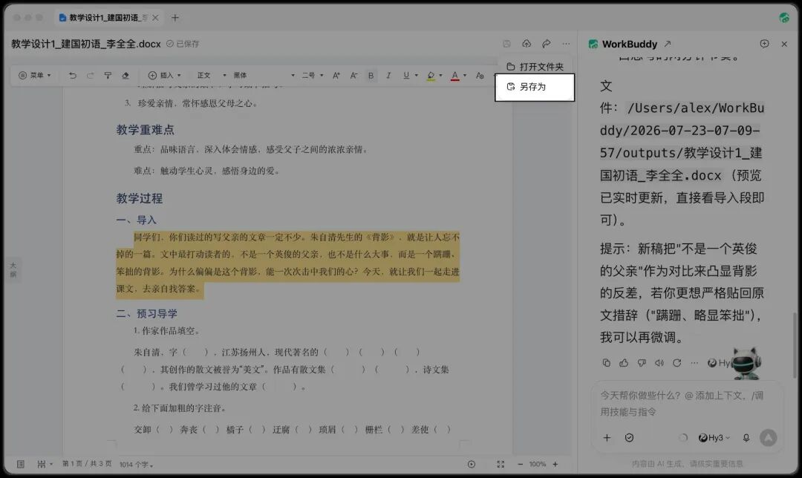

*图：文档右上角「⋯」菜单里的「打开文件夹」和「另存为」。改之前先「另存为」一份，是最省事的保险动作。*

#### 从材料接着做下一份成果

**这是新功能里最实用的一条：改完当前这份，还能接着往下做。**

```
按这份问卷做一个网页版训前调研报告：
各部门的 AI 基础、最耗时的任务、最该优先讲的 3 个场景（写清依据哪几份问卷）。
单页 HTML，手机也能看，数字必须能回到表里。
```

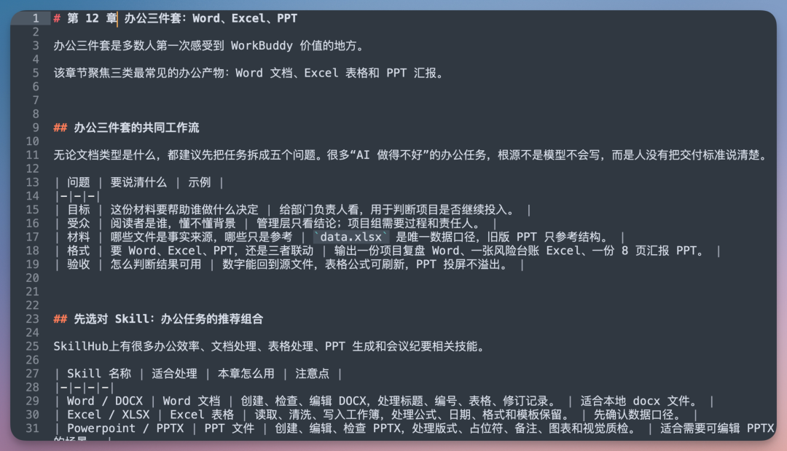

*图：把当前材料当附件传给右侧对话，让它"按这份材料做一个 html 课件"。**注意对话框里的附件卡片——这是当前这份文件的引用**，对话栏顶部也显示「已引用 我的文档 ...」。*

**生成的 HTML 默认放在原文件所在的目录**，在对话里点一下就在新标签打开。

> **注意这个提示词的写法，两处是关键：**
> - **"数字必须能回到表里"**——防止它编数据
> - **"写清依据哪几份问卷"**——让结论可追溯
>
> **这个思路可以用在任何材料上：** 先分析、核对，再根据确认过的结果做成果。**AI 不能替你决定这个班的真实情况。**

**再往前一步：从教案接着做说课稿。**

目标、活动定好了，让它据此拟说课稿、整理课件提纲——**你核对后，再继续往下做。**

#### 网页课件（.html）终于能改了

**这一条对做互动课件的老师价值最大。**

`.html` 就是网页文件。以前拖进浏览器**只能看不能改**，发现个错别字还得回代码里找。

现在用WorkBuddy 打开：进入编辑状态，**可以自己改，也可以让 AI 帮着改**。改完自动保存。

| 场景 | 具体做法 |
|---|---|
| 同事分享的互动练习 | 玩法合适、题目不合适 → 从这个文件改 |
| 以前存的网页课件 | 打开 → 点「编辑」→ 让 AI 换配色、补数据来源 |
| 换题 | **把答案和判断规则一起交代清楚** |

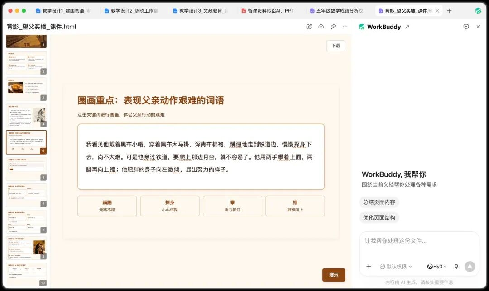

*图：html 课件在文件浏览器里打开的样子——**左边是 10 页课件缩略图，中间是页面预览**，右边对话栏可以直接让它改。右侧对话框里「总结页面内容」「优化页面结构」就是针对这份课件的。*

> **改完必须按学生使用的顺序试一遍。** 按钮、拖拽、反馈是否正常，**还是要拿实际课件检查**——AI 说改好了，不代表交互没坏。

**顺带一提：markdown 文件也一样能就地改。**

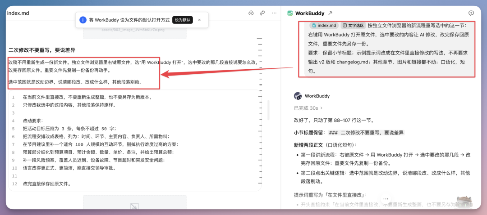

*图：md 文件打开后的样子——**左边是渲染好的正文，右边是源码视图**，改完存回文件。如果你天天跟 md 打交道，把它设成默认打开方式。*

#### 微信里也能看能处理

**手机上收到的文件，现在有出路了。**

以前微信收到 md/html 只会弹一句"暂不支持打开此类文件"。现在：

| 选项 | 能做什么 |
|---|---|
| **查看** | md 渲染成排版好的文档，html 渲染成网页，svg 也能看 |
| **加入对话** | 文件变成附件卡片，补一句要求就能让它干活 |

**预览页还能作为小程序卡片转发出去**，对方点开就能看：

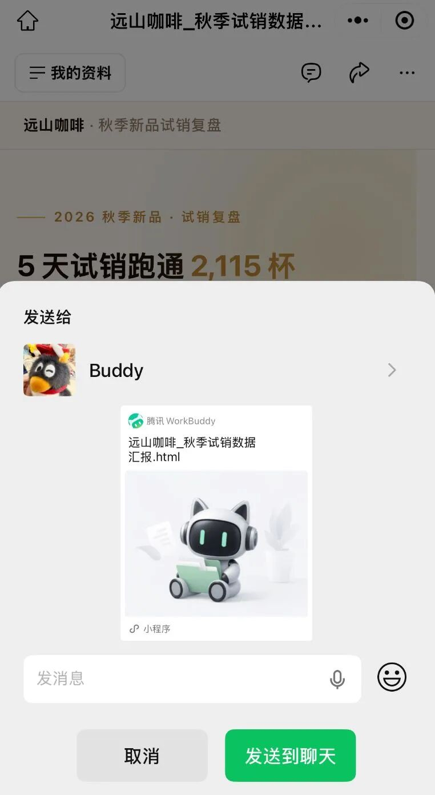

*图：微信里把 html 预览页作为小程序卡片转发给同事。截图里的文件名来自原始公众号文章，属第三方示例，与本书内容无关。*

> ⚠️ **两个限制必须知道：**
> - **小程序单次只处理一个文件**，多个得一个个来
> - **能预览 ≠ 所有动画、拖拽、音频都能正常运行**
>
> **准备在哪个设备上用，就在那个设备上试。**
>
> **含学生信息的，先处理掉再转发。**

#### 分享与积分：两条实用信息

| 想做什么 | 怎么做 |
|---|---|
| **分享给同事** | 文件窗口点「分享」→ 自动上传到资料库 → 生成在线链接 → 设"获得链接的人可查看" |
| **进团队协作** | 「上传」→ 选资料库 / 腾讯文档 / ima 知识库 / 乐享知识库 |

**分享时可以设置访问权限——这一步别跳过：**

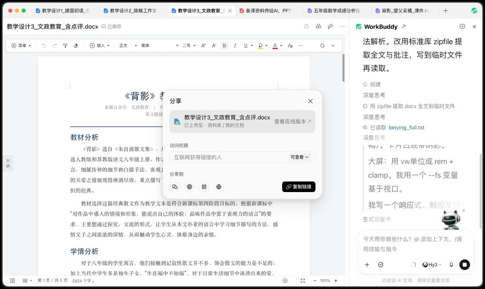

*图：分享对话框。「已上传至：资料库/我的文档」，下方是**访问权限**（这里设的是"互联网获得链接的人可查看"），旁边有「复制链接」。右侧对话栏显示工具的调用记录（创建 / 深度思考 / 用 zipfile 提取全文 / 已读取）。*

> ⚠️ **看仔细这个权限选项。** 默认可能是"互联网获得链接的人可查看"——
> **这意味着任何拿到链接的人都能打开。**
>
> **含学生信息的材料，务必改成指定人可见，或者干脆别分享。**


*图：生成在线链接后的分享卡片。*

**积分怎么算（很多老师会关心）：**

- **查看、手动编辑、预览 —— 不消耗积分**
- **让 AI 分析、改写、生成 —— 消耗积分**

> **所以"自己改"和"让 AI 改"是两回事。** 格式微调、错别字修正，你自己动手不花积分；**要 AI 大段生成的，才要花。**
>
> **版本 5.4.7 之后有「订阅和用量」设置页**，可以查看套餐概览、分类积分和资源包明细，在应用内直接购买积分。**在设置里就能查，不用回来问我。**

#### 一个必须澄清的误解

**这一点关系到数据安全，非常重要：**

> **"改完存回本地"说的是保存位置，不等于所有 AI 处理都离线进行。**
>
> **独立文件浏览器只读取你主动打开或添加的文件，不会扫描整个电脑。** 但这说的是**文件访问范围**，
>
> **不代表你让它调用 AI 处理时，内容不上传。**
>
> **涉及学生姓名、成绩、身份证的材料，请按附录 C-4 的三步法处理：**
> **文件用学号命名 → 去标识化 → 只让它处理脱敏后的版本。**

### 先建立一个认知：它和"在线版AI"的根本差别

| 你在做的事 | 用普通网页版 AI | 用 WorkBuddy |
|---|---|---|
| 改一份学生名单 | 复制粘贴到网页 → 复制回来 → 手动对齐格式 | **右键打开原文件**，在旁边让它改，存回原处 |
| 处理 40 份作业 | 一份一份传，一份一份下 | 一次性放进一个文件夹，说"按统一标准处理" |
| 生成 PPT | 得到一个大纲，自己做 | 直接得到能投屏的 `.pptx` |
| 改网页课件 | 只能看，改要回代码 | **打开就能改**，人机双写 |
| 批量改名/转格式 | 逐个操作 | 一句话说明规则 |
| 手机上收到的文件 | "暂不支持打开" | **微信小程序里直接看和对话** |
| 处理学生数据 | 材料要上传到第三方 | 可以明确要求**全程本地处理** |

**最后一行是老师最该在意的。** 涉及学生姓名、成绩、身份证的材料，**优先在本机处理**，这是本书对数据安全的基本要求（详见附录 C-4）。

> **一个转变值得留意：** 以前处理文件是"搬进工作区"，现在是"**在原地改**"。
>
> **方便了很多，但也更危险了——因为它真的会覆盖你的原文件。**
>
> **所以下面这一节尤其要看。**

### 第一步：认识它能读写的文件类型

不用背。按你手上真实有的文件试一遍就有感觉了。

**这批文件都可以直接右键 → 打开方式 → WorkBuddy：**

| 类型 | 常见格式 | 它能做什么 |
|---|---|---|
| **文档** | `.docx` `.md` `.txt` `.pdf` | 改写、续写、换格式、按模板重排 |
| **表格** | `.xlsx` `.csv` | 清洗、统计、算列、合并多表、导出 |
| **演示** | `.pptx` | 生成、改版、配图、加备注 |
| **图片** | `.png` `.jpg` | 识图取信息、插图、裁切压缩 |
| **数据** | `.json` `.sql` | 整理格式、转换结构 |
| **压缩包** | `.zip` | 批量解压、批量处理里面的文件 |

> **注意 Markdown 和 HTML 是重点。** AI 生成的东西一大半是这两种格式，
> **而它们在本地最难打开**（md 双击满屏井号、html 拖进浏览器只能看不能改）。
>
> **现在都能用WorkBuddy 正常打开并直接编辑了**——建议把 `.md` 设成默认打开方式。

**右键打开，直接问它：**

```
告诉我这个文件里有什么。
读得出来，说明它能读。

然后生成一份新文件放在我工作区，文件名叫 test_out.docx。
生成成功，说明它能写。
```

> **这两句建议试一遍。** 跑通了，你就知道后面所有任务它都能接。

### 文件处理三件事：读、写、对照

不管你处理什么文件，都逃不出这三步。

#### 一、读：先让它"看一遍"再说

**最常见的错误是：不看文件内容就下指令。**

比如你直接说"帮我改这份教案"，它可能改的是三年前的旧教案。**正确的做法是先让它复述。**

```
先读工作区里的 教案.docx，
然后告诉我：这份教案有哪几个部分？每个部分大概多长？有没有缺项？
先不要改。
```

**这一句话能省掉你后面十分钟的返工。**

#### 二、写：一定要说清输出格式

**最常见的错误是：不说要什么格式，它给你一段文字让你自己复制。**

正确的说法：

```
基于这份教案，生成一份新的教学设计，
存成 docx，放在我的工作区，文件名 教学设计_v2.docx。
用我原来这份的标题层级，不要改小标题的措辞。
```

**四个要素，缺一个都可能返工：**

| 要素 | 例子 | 少了会怎样 |
|---|---|---|
| **对象** | 基于哪份文件 | 它可能凭空生成 |
| **规格** | docx / pptx / xlsx、文件名 | 可能只给你一段文字 |
| **约束** | 沿用原格式、字数、不加内容 | 可能大改你不想动的地方 |
| **验收** | "改完告诉我改了哪几处" | 你看不出它到底动了什么 |

#### 三、对照：让它自己交代改动

**这一步是老师最该养成的习惯。**

```
改完之后，列一张对照表：
哪些地方改了、原文是什么、改成了什么、为什么改。
```

**为什么重要？** 因为 AI 改文件时经常"顺手"改掉你精心写的东西——比如把"三维目标"改成"知识与技能"（这是新课标术语，旧的写法才对），或者悄悄删掉一句过渡语。

> **不给对照表，你就是闭着眼睛验收。给了对照表，你才是编辑，不是读者。**

> **用了新功能之后，这一节要改一改说法：**
>
> **右键打开改文件时，AI 改过的地方会带黄色标记，你能直接对着原文看。**
>
> **黄色标记本身就是一种"对照"**——但它只告诉你"改了"，不告诉你"为什么改"。
>
> **所以改大段内容时，还是让它补一句改动说明。**

### Word / 文档：最常用的三种玩法

> **现在有两条路可选：**
> - **改完不动的**（如模板重排、批量格式化）→ **右键打开原文件，直接让它改**
> - **要保留原稿的**（如借鉴同事的教案）→ 走下面的"工作区 + 输出新文件"

#### 玩法一：按模板重排

教师手里往往有一份学校要求的格式模板。**不要重写内容，只让它套格式。**

**如果你就是要重排这份文件本身——直接右键打开：**

```
请把这份文档按下面的格式统一排版：
正文宋体小四号、行距 1.5、标题黑体、页面 A4、上下边距 2.54cm。
只改格式，一个字都不要改。
```

**如果你要保留原稿、另存一份——在工作区里这样写：**

```
工作区里有 两份文件：
- 学校模板.docx（格式要求）
- 我的教案.docx（内容）

请把 教案.docx 的内容，按 学校模板.docx 的标题层级和字体格式重排，
内容不要删改，输出 教案_按模板排版.docx。
```

**要点：说"内容不要删改"，它就只动格式。** 不说，它会顺手"优化"你的表述。

> **⚠️ 走右键这条路之前，先 `Ctrl+S` 留一份副本。**
> 因为保存会写回原文件——**改坏了没有后悔药。**

#### 玩法二：批量改格式

**这个必须走工作区**，因为要一次处理一整个文件夹：

```
把工作区里所有 docx 统一成：正文宋体小四号、行距 1.5、
标题黑体、页面 A4、上下边距 2.54cm。
逐个处理，处理完列清单。
```

#### 玩法三：长文档的结构化

```
读这份 20 页的方案，帮我生成一张表格：
章节标题 | 起止页 | 这一章主要说了什么 | 有没有具体数据支撑
```

**这在读长文件时特别有用**——它先给你一张地图，你再决定哪几段要细读。

> **不要一次让它"总结这份20 页文件"。** 直接要结构化表格，比要一段总结有用得多——**因为表格逼它逐节交代，不会漏。**

### Excel / 表格：三个高频场景

#### 场景一：成绩表清洗与统计

这是教师用得最多、也最容易出错的地方。

```
读 工作区/期中成绩.xlsx，只做三件事：
1. 检查缺失值，列出来，不要自己填
2. 算平均分、最高分、最低分、及格率，按班级分组
3. 把不及格的学生单独列一个 sheet

输出到 成绩分析.xlsx，原文件不要改。
```

**这里有三条必须写进指令的话：**

| 这句话 | 挡掉什么风险 |
|---|---|
| **"列出来，不要自己填"** | 它编造一个分数填进空格子 |
| **"原文件不要改"** | 它直接覆盖你的原始数据 |
| **"不确定的标'待核'，不要猜"** | 它推测出一个数看起来像真的 |

> **⚠️ 用了独立文件浏览器之后，这三条里的第二条要特别注意：**
>
> **右键打开 Excel 改文件，保存就是写回原文件。**
>
> **原始成绩数据是最不该被随手覆盖的东西。** 两个做法：
>
> | 做法 | 怎么做 |
> |---|---|
> | **推荐：改副本** | 先复制一份 `期中成绩_备份.xlsx`，再右键打开副本改 |
> | **只让它读** | 在指令里明确写"**只读，不要修改这个文件**"，把分析结果输出到新文件 |
>
> **无论哪种，都先确认原件还在。**

#### 场景二：多表合并

```
工作区里有 3 个 sheet，分别是三个班的学生名单。
按学号合并成一张总表，
缺失的标出来，重复的列出学号让我确认。
```

#### 场景三：数据转成材料

```
读 成绩分析.xlsx，
把及格率按从低到高排序，
做成一张可以直接放进 PPT 的对比表（要有标题、行标题列）。
```

**最后那句"可以直接放进 PPT"是关键**——它决定了输出是"表格数据"还是"可上投屏的材料"。

> **一个衔接：** 做出这张表之后，可以直接**在当前对话里让它接着做成网页或PPT**——
> 这就是本章前面讲的「从材料接着做成果」，不用把文件再导出去。

> **一张提醒：含学生姓名的表格，别丢到云端工具里。** 要处理就在本机跑，并按附录 C-4 的三步法去标识化（文件名用学号、输出不出现姓名）。

### PPT：分成两种情况处理

#### 情况一：从零做一份新 PPT

```
我要做一份公开课课件，主题是【课题】，时长【X】分钟，
面向【X】年级，风格【活泼/严谨】。

请生成 pptx，包含封面、导入、新课、练习、小结五部分。
每页要点不超过 5 条，配图用教育类实拍风格，不用花哨背景。
```

**要点：给"每页不超过 5 条"这种硬约束。** 不给，它会给你满屏文字——那种 PPT 投出来没人看。

#### 情况二：改一份已有的

**现在有两条路：**

**路A：改副本（推荐）**——把文件复制一份，右键打开副本：

```
读 工作区里的 公开课_改副本.pptx，
把第 7、8、9 页的文字压缩到每页 3 条以内，
保留原有的背景和配色，改完列清单。
```

**路 B：直接右键打开原文件**（就是那份投过的原件）：

```
只改第 7、8、9 页，文字压缩到每页 3 条以内。
保留原有的背景和配色。其他页不要动。
```

> **⚠️ 走路 B 之前，先 `Ctrl+S` 留副本。** 保存会写回原处。
>
> **而且 pptx 正被 PowerPoint / WPS 打开时，它只能看不能改**——先关掉放映窗口。

**"保留原有的背景和配色"这句必须加。** 否则它会重新设计一套风格，改完之后跟你原来的 PPT 拼不到一起。

**新功能对 PPT 最实用的两点：**

| 用途 | 怎么做 |
|---|---|
| **让它提建议**（不改） | 右键打开 → 点「和 WorkBuddy 对话」→ "这一页文字太多，按学生理解程度给修改建议" |
| **直接改** | 在页面里选中那段文字 → 让它改 → **黄色标记显示改了什么** |

### PDF：两类完全不同的用法

#### 用法一：读 PDF

```
读 工作区里的 课程标准.pdf，
提取其中关于【某章节】的原文要求，逐条列出，并标注页码。
```

**加"标注页码"很重要**——你要能回头核对，**AI 转述的标准有时候会有偏差**。

#### 用法二：PDF 输出

```
把这批教案导出成 PDF，合并成一个文件，按章节顺序排列，
每章从新页开始。
```

### 一个通用模板：所有文件任务都能套

**如果你记不住上面这么多条，就记这一个模板。**

```
【对象】读 工作区里的 【文件名】
【任务】我要 【做什么】
【规格】输出格式 【docx/pptx/xlsx/pdf】，文件名 【xxx】
【约束】保留 【哪些不能动】，不要 【禁止的操作】
【验收】做完告诉我改了哪里；不确定的地方标"待核"，不要猜
```

**填一次，能用几十次。** 建议现在就把它存进 `99_提示词库`，以后每次直接复制。

### 四个必须知道的坑

> **坑一（最重要）：它真的会覆盖你的原文件。**
> 右键打开改文件，保存就写回原处。
> 对策：**动手前先 `Ctrl+S` 复制一份副本，改副本。**
> 学校模板、合同原件、只有一份的教案、原始成绩数据——**这四类绝不直接动手。**
>
> 顺带记两个保护机制：**文件被 Word/WPS 占用时只能看不能改**；
> **文件在别处被改过会提示刷新或另存**，不会静默盖掉同事的修改。

> **坑二：它可能"顺手"改掉你不想动的地方。**
> 对策：**永远加一句"内容不要删改"或"只改格式"。**

> **坑三：它可能编造内容还编得很像真的。**
> 对策：**永远加一句"不确定的标'待核'，不要猜"。**
> 涉及政策、课标、数据的地方，必须自己回原文核对。

> **坑四：长任务中途可能偏离方向。**
> 对策：**分步来，不要一口气做完。**
> 先让它读 → 确认理解对了 → 再让它写 → 验收 → 再改。
> 一次做完的事，出错你都不知道错在哪一步。

### 安全提醒：三类文件不要丢进去

| 类型 | 例子 | 为什么 |
|---|---|---|
| **含学生身份信息** | 成绩单、点名册、身份证信息、家庭情况 | 有法律风险，也伤害学生 |
| **涉密文件** | 学校内部文件、涉密课题、未公开的教研材料 | 不该流出单位 |
| **原始档案** | 你的原始素材、留档文件 | 可能被覆盖或改坏 |

**处理含学生信息的正确做法**：文件名用学号代替姓名 → 在本机处理 → 明确要求"输出不出现姓名" → 抽 5 份对照原件。**完整步骤见附录 C-4。**

> **⚠️ 用新功能时，这一条要多想一层：**
>
> **"独立文件浏览器只读取你主动打开的文件，不会扫描整个电脑"——这句话说的是文件访问范围。**
>
> **它不等于"所有 AI 处理都离线进行"。**
>
> **你让它调用 AI 改内容时，内容是要送到模型那里的。**
>
> **所以规矩不变：** 含学生信息的材料，**先脱敏，再让它处理。**

> **另一个必须知道的：分享之前看清权限。**
>
> 用「分享」会把文件**自动上传到资料库**并生成在线链接，可以设"获得链接的人可查看"。
>
> **涉及学生信息的材料，分享前先脱敏，再确认谁能访问。**
>
> 另有一条好消息：**查看、手动编辑、预览都不消耗积分**，只有让 AI 分析、改写、生成才扣。

### 本章自测：五道题

学完这章，你应该能答上：

1. 怎么让它读一份文件？读之前该先说什么？
2. 让它写文件时，指令里必须包含哪四个要素？
3. **右键打开改文件，最大的风险是什么？你会怎么防？**
4. **"关闭文件再打开，对话还在"——这意味着什么？它不意味着什么？**
5. 含学生姓名的成绩表，应该怎么处理？

> **答不上来也没关系，这章最该做的是两件事：**
> **① 右键打开一份你不太重要的文件，改一段试试；**
> **② 把 Word 或 md 设成默认打开方式。**
> **跑通了，这一章就够了。**

### 下一章你要做什么

**你已经掌握了"让它读写文件"这件事。接下来第二篇所有教学场景，都是这一章的组合。**

| 你会的（本章） | 你要学的（第二、三篇） |
|---|---|
| 右键打开、就地改文件 | 第 7 章　备课：从课标和模板出发，出教学设计 |
| 按模板重排 docx | 第 8 章　课件：教学设计 → 能投屏的 pptx |
| 表格统计与清洗 | 第 11 章　批改与学情分析：成绩表 → 可汇报的结论 |
| 改网页课件 html | 第 15 章　理科图表与交互课件 |
| 批量处理 | 第 20 章　行政文书：通知、计划、总结的批量生成 |

> **所以现在直接进第二篇第 7 章。** 那一章会告诉你，一份合格的教学设计是怎么在几分钟内出来的。

---

## 本篇收尾　一张能力自测表：你现在在哪一格

读完前五章，你已经可以上手了。但"会用"和"用好"是两件事。

**这一节给你一个坐标。** 后面每一篇都会对应到这张表里的某一项，你可以随时回来对照。

### 教师 AI 的四个维度

这四个维度不是学术分类，是从一线实践中长出来的。**一个老师卡在哪里，这张表就能看出来。**

| 维度 | 是什么 | 典型表现（你在哪一格） |
|---|---|---|
| **指令力** | 把需求说清楚 | 能说出"做一份教案"是**不合格**的指令；能说清学科、年级、数量、风格、约束才是合格 |
| **拆解力** | 把复杂任务拆成可验收的子步骤 | 让 AI "帮我做一份期末复习方案"，它给你一个笼统的大纲；拆解力强的人会先问"这一步做完长什么样算对" |
| **判断力** | 识别 AI 的错、核对事实、做最终决策 | 能看出 AI 出的题超纲了、引的课文出处是错的、学生名单对不上 |
| **沉淀力** | 把做法变成可复用的指令、Skill、案例 | 每次都重新写一遍提示词；沉淀力强的人会把验证过的提示词存进 `99_提示词库` |

**这张表最值得看的是它的顺序。**

> **指令力是入门票，拆解力是主干，判断力是天花板，沉淀力是复利。**
>
> 绝大多数教师卡在"判断力"这一格——不是不会用，是**看不出它什么时候在胡说**。
>
> 而沉淀力，是唯一能让前三种能力随时间增长的。

### 三段进阶路径

| 阶段 | 特征 | 你大概在这里 |
|---|---|---|
| **单点提效** | 替代重复劳动，一件事一件事来 | "帮我排一下这节课的课件""帮我改一下这份通知" |
| **流程自动化** | 定时、批量，一次配置长期运行 | "每天晚上自动整理教学日志""每周五自动汇总周报" |
| **经验产品化** | 做成 Skill 或专家，让别人也能用 | "我们组的这套出卷流程我封装成了一个 Skill" |

**自动化是分水岭。** 从"单点提效"到"流程自动化"这一步，看起来只是省时间，实际上变了性质：

- **单点提效是"我做完一件事"** —— 明天还得再做一遍
- **流程自动化是"这件事以后都在跑"** —— 你今天配置一次，下周它还在

> **判断你有没有跨过这条线的方法很简单：问自己"我上次配置了一个持续运行的东西，是什么时候？"**
>
> 如果想不起来，你还在第一段。

### 关于经验：中年教师的优势

有一句话值得专门说：**AI 时代，经验可能重新成为优势。**

有经验的一线教师，脑子里有教学理解——什么时候该讲、什么时候该放、哪个学生一句话就懂。这些是 AI 替代不了的。**AI 能帮你把想法快速变成现实，但不能替你判断哪个想法是对的。**

所以这一章开头的三句话心态，第 3 句是最重要的：**不满意的不是它笨，是我没把标准说清。** 而"说清标准"这件事，恰恰只有懂教学的人做得到。

> **你不需要比 AI 更快，你需要比 AI 更准。而更准，靠的是你多年的教学积累。**

---

---

# 第二篇　教学全流程工作流（第 7-11 章）

# 第二篇 · 教学全流程工作流

> 这一篇是全书主体，九章覆盖一节课从准备到批改的完整链条。
> 每章的最后一栏"你校可以怎么改"留了空白，请填你自己的做法。

---

## 第 7 章　备课：从课标到一份能直接用的教学设计

### 这个场景的痛点

备课是老师最熟、也最耗时间的活。真正折磨人的不是"想设计"，而是下面这些：

- **找一个能用的教案要花半小时。** 搜到的要么是三年级的，要么是另一个版本的教材，要么写得再好也不合你班。
- **写教学目标最容易写空。** "培养学生的观察能力"——这句话谁都能写，但没法检验。
- **重难点凭经验。** 教了十几年书，你心里知道这节课的坎在哪，但写下来还是"理解并掌握"。
- **学情分析基本是套话。** "学生已掌握……"，但没有任何来自你这个班的数据。
- **写完还要改三遍。** 第一遍给自己看，第二遍给教研组看，第三遍给教导主任看。每一遍格式还不一样。

**最要命的一条**：备课的所有成果，最后都变成一段文字，**没有任何东西是可以被复用的。** 下学期教同一课，你还是从零开始。

### 备课五问

| 问题 | 要说清什么 | 教师场景示例 |
|-|-|-|
| 目标 | 这份材料要帮你做出什么决定 | 给区级教研员审的公开课设计，要体现课标落地和分层设计 |
| 受众 | 谁看？懂什么背景？ | 学科教研员 + 兄弟校骨干教师，他们熟悉教材，不懂我们班 |
| 材料 | 哪些是事实来源，哪些只是参考 | 课标原文和教材第 47-49 页是唯一依据，网上教案只参考结构 |
| 格式 | 交付什么 | Word 教案 1 份 + 逐字提问稿，含教材页码定位 |
| 验收 | 怎么算做好了 | 每条目标能对应到课标条目、能被观测；每个环节标明时长和师生活动 |

**第三条"材料"这一栏，教务主任审你的时候看的就是它。** 写清楚"哪些是唯一依据"，比写十句漂亮话有用。

### 先选对 Skill

| Skill 类型 | 本章怎么用 | 注意点 |
|---|---|---|
| 文档 / Word | 生成教学设计、逐字稿、评价量表 | 确认支持中文字体和表格样式 |
| PDF 处理 | 读课标原文、教材电子版 | **必须用它读原文，不要凭记忆生成课标条目** |
| 表格 / Excel | 学情统计、分层名单 | 涉学生数据时确认本地处理 |
| 材料解析 | 把教材 PDF 转成可检索文本 | 转换后人工核对关键段落 |

**"必须用它读原文"这一条要特别强调。** 课标条目编号、教材页码如果它记错了，整份教案就废了。所以流程应该是：**先把课标和教材页丢进去，让它读，再让它写。**

### 推荐流程

| 步骤 | WorkBuddy 做什么 | 人要确认什么 |
|---|---|---|
| 1 | 读取你提供的课标原文、教材页、教学参考，列出可用信息和缺失项 | **哪些是事实来源**，哪些是它可能记错的 |
| 2 | 生成教学设计的结构大纲，标明每一部分对应课标哪一条 | 目标能不能观测、课时分配合不合理 |
| 3 | 按大纲写正文，标注教材页码定位 | **页码是否真的对**（抽查 3 处） |
| 4 | 生成逐字提问稿、板书设计、检测题 | 提问的梯度、难度是否符合本班 |
| 5 | 按你上一版的格式输出成 Word，附修改说明 | 能不能直接发给教研组 |

**第 5 步"按你上一版的格式"是这本书反复出现的一个技巧** ——让它学你现有的格式，而不是给你一个陌生的漂亮模板。把你上学期最满意的一份教学设计丢进去，说"照这个格式"，效果立竿见影。

> **【新版功能】第 4-5 步可以并成一步：**
>
> **以前是"把上一版教案给它 → 它给你一份新的"。现在你可以直接右键打开那份教案，让它在原文件上改。**
>
> ```
> 打开这份教案，参考我自己另一份教学设计的格式（见附件），
> 把这节的内容补完整，存回这个文件。
> 只改教学设计部分，别的不要动。
> ```
>
> **好处是格式天然一致，不用再来回对齐。**
>
> ⚠️ **动之前先 `Ctrl+S` 复制一份副本**——保存会写回原文件。
>
> **详见第 6 章「独立文件浏览器」那一节。**

### 提示词示例：一份完整教案

```
我是初中历史老师，八年级下册。

我要备一节公开课：课题《改革开放'olar 意义》，人教版八下第 6 课第 2 框。
课时：1 课时 40 分钟。
听众：区级教研员 + 兄弟校骨干教师（他们熟悉教材，不了解我们班）。

材料（唯一事实来源，务必以这些为准）：
- 附件 1：课标原文（义务教育历史课程标准 2022 版）
- 附件 2：教材第 47-49 页扫描件
- 附件 3：我班上学期同类型的公开课教案（请照附件 3 的格式输出）

我们班的情况：城区普通班，46 人，中等水平偏上，5 名学生历史基础较弱，
课堂活跃度一般，需要明确的任务驱动。

请先给我一个教学设计大纲，不要生成文件，包含：
1. 教学目标（3 条，每条我要能看到"学生能……"的可观测动词）
2. 每一目标对应课标的哪一条（引用原文，注明在附件 1 的位置）
3. 重点、难点各一条，说明为什么
4. 教学环节与时间分配（每个环节标明：教师做什么、学生做什么、用时）
5. 逐字提问 6 处（标明提问目的和预设学生回答，其中 2 处要预设"没人回答"时的追问）
6. 板书设计分区
7. 5 道课堂检测题（3 基础 2 提高），标考查知识点
8. 课后分层作业（基础档 4 题 / 提高档 3 题）
9. 我要提供的辅助素材清单（比如需要一张 1978 年前后对比图）

我确认大纲后再生成 Word。
```

**这份指令里有四个值得学的写法：**

1. **"唯一事实来源"三个字必写。** 它决定了它会不会去编。
2. **"照附件 3 的格式输出"。** 一次解决格式问题。
3. **"我要能看到学生能……的可观测动词"。** 这是在解决教学目标写空的老问题。
4. **"预设没人回答时的追问"。** 这是懂课堂的细节，你不说它一定不会写。

### 二次修改：说差异，不重写

```
不要重新生成。在上一版基础上改：

1. 教学目标第 2 条"理解改革开放的意义"太笼统，
   改成可观测的表述：能结合至少两个具体事例，说明改革开放对
   人民生活和国家发展的改变。
2. 第 3 环节（合作探究）12 分钟太长，压缩到 8 分钟，
   省下的 4 分钟放到第 4 环节的面批面改。
3. 逐字提问第 3 处太浅，改成需要两层追问的。
4. 检测题第 4 题超纲了（本课还没讲城市经济体制改革），
   换成本课范围内的。
5. 加一条：标注每一处涉及历史结论的表述，需要教师自行核对教材原文的页码。

改完列一个修改清单，其他内容不要动。
```

### 常见错误与修正方式

| 常见错误 | 为什么会发生 | 更好的写法 |
|---|---|---|
| "帮我写一份教案" | 没有对象、规格、约束 | 用六段骨架补齐 |
| "参考网上最好的教案" | 网上教案的教材版本、课时、学情多半和你不一样 | 明确"课标+教材页是唯一依据" |
| 直接让它写目标 | 目标是最容易写空的部分，必须有约束 | 要求"每条含可观测动词 + 对应课标条目" |
| 不给课标原文 | 它会凭记忆写课标编号，错你很难发现 | **先给原文，让它读** |
| 生成完直接用 | 教材页码、史实、引用有错误你不知道 | 抽查 3 处页码和 2 处史实 |
| 每次都从零开始 | 没有把提示词和成果沉淀下来 | 存进 `99_提示词库`，下一届直接改 |

### 区域实践参照

**安徽长丰**（安徽青年报 2026 年报道）的备课环节做法是："教师利用 AI 生成初稿，再结合课标要求、教材内容与真实学情进行调整优化。"

**这八个字值得抄在教案模板的最上面。** 它明确了人机分工：AI 出初稿，教师做那三件事——对课标、对教材、对学情。少做一件，备课就白做了。

**广西贺州**（贺州市人民政府网 2026 年报道）给出了"本地化"的具体路径：八步区新城实验小学把昭平的茶叶包装箱搬进数学课讲"观察物体"，用贺州地标建筑讲"确定位置"。富川瑶族自治县第一小学杨青老师用瑶族长鼓舞、服饰、纹样设计周期数学课。

**这两条合起来是本章最实用的结论**：备课用 AI，最容易做出的成果是"一份网上到处都有的教案"。要让它不可替代，必须把**你班的情况**和**你地方的东西**放进去。这两样别人复制不了。

### 你校可以怎么改

> 请写下你所在学校的情况，备课时直接写进指令里：
>
> 1. 我班的情况（人数、分层、大致水平、课堂特点）：
> 2. 我们学校/地区有什么可以进课堂的本地素材（物产、地标、人物、非遗）：
> 3. 我校现行教案模板的特别要求（字数、必填栏目、格式）：
> 4. 我上一份最满意的教案文件名（作为格式参照）：

### 【2026 年 10 月增补】三个新武器：冷启动链路、六道质检、目标改写

**① 新教师"三份材料冷启动"全链路**（来源：《老师如何用 WorkBuddy 打通备课全流程｜线下培训万字分享》，承德职院教师培训现场跑通）

新接手一门课，手上只有课标、课程整体设计、前辈教案三份材料——怎么办？这套链路的核心心法是 **SGP 派活结构**：S=现状（我是谁、手上有什么材料）、G=目标（想知道什么）、P=过程（按什么顺序做、**先不要做什么**）。

七步：**让 Agent 先读材料判断下一步（不急着生成）→ 联网搜公开合法教学资源 → 做"参考资料→本校课程"映射对照表 → 先生成"备课包"（中间方案：环节安排、素材选用、过时案例替换）→ 老师确认方向后才生成完整教案 → 跑通后固化为 Skill → 延伸到课件、抽测、作业。**

其中两条反直觉指令，是教师保住判断权的关键（原文摘录）：

```
你先帮我把这三个材料看一遍，告诉我这门课大概是怎么安排的，第一单元的教案结构是什么样的。
我现在最想知道的是：在这种情况下，我第一步最应该干什么？
你按真实老师备课的顺序给我建议就行，不用直接帮我写教案。
```

```
然后你帮我梳理一个完整的第一单元备课包。这个备课包里面需要讲清楚：
这 90 分钟课堂大概怎么安排，每个环节讲什么东西，使用哪个素材，使用哪个案例。
先不用直接生成完整教案。
```

> 配套认知框架："**提示词决定 AI 下一步往哪里走；上下文决定 AI 在这个任务上能走多远。**"上下文就是"AI 不知道、但会真实影响结果的信息"——本班学情、学校模板、课程标准、实训条件。**直接生成教案，是把判断权交给 AI；先生成备课包再由老师确认，是让 AI 做准备、老师保留方向。**

**② 六道质检工作流**（来源：《一句话备课只能得到"通用教案"》）

一句话备课的病根：AI 给的教案"目标、重难点、过程、板书俱全"，上完课却是"教案是教案，课堂是课堂，两张皮"。解法是**不可跳步的六道质检**：①校准教学目标（核心概念+目标+前概念误解）→②设计课堂活动链（每环节对应目标）→③才写教案→④课件提纲（每页服务什么）→⑤作业（每题检查什么）→⑥一致性检查（一致性矩阵+问题清单）。**每步设检查点，教师确认后再推进。**

**③ 教学目标"三个依据、四个要素"改写提示词**（来源：一线青教赛案例，原文摘录）

很多老师的目标写着"让学生理解、让学生掌握"——不可测、主体也不对。这条提示词专治这个毛病：

```
教学目标的撰写要遵循"三个依据"和"四个要素"。三个依据即学科课程标准、教材具体要求、
学情研究。四个要素是指行为主体+行为表现+行为条件+行为程度。目标续写应采用可观察、
可操作、可检验的行为动词来描述，如"分析""推导""设计""评价""撰写""解决""验证""证明"等动词。
同时也应注意，目标设计有层次，遵循学生认知能力层级的逻辑关系。确保目标简洁、清晰，
不超过三条。依据上述教学目标撰写原则，请帮我对提供的文件中的教学目标进行修改。
```

---

## 第 8 章　课件：从教案到能投屏的 PPT

### 这个场景的痛点

- **做课件的时间常常比备教案还长。** 找图、调排版、改字号，一节课的课件耗掉两三个小时。
- **做出来的 PPT 不好看但说不清为什么。** 自己做的总觉得"差点意思"，看别人的觉得"这也没多复杂啊"。
- **文字太多。** 自己看没问题，投到教室后面学生看不清。
- **动画太多。** 公开课评委看到一堆飞入飞出，注意力在效果不在内容。
- **改一个内容要重做。** 第 7 页改句话，第 12 页的页码也要改。

最后一条是最要命的：**因为不能局部改，所以每次都是重做。** 这是很多人做完一次课件就不想再做第二次的原因。

### 备课五问

| 问题 | 要说清什么 | 教师场景示例 |
|---|---|---|
| 目标 | 课件要帮你完成什么 | 支撑 40 分钟的探究课，不是把教案搬上去 |
| 受众 | 学生看还是评委看 | 学生看（投屏在教室后排，距离 6 米） |
| 材料 | 依据是什么 | 依附件教案第 2 环节的流程，不另加内容 |
| 格式 | 多少页、什么文件 | PPTX 18 页，每页不超过 80 字 |
| 验收 | 怎么算做好了 | 投屏不溢出、字号≥24pt、无动画、图片真实、页码连续 |

**"字号 ≥24pt"这一条建议写进所有课件指令里。** 教室投影的实际可读性比电脑屏幕上差得多，很多人的课件在自己电脑上很好看，一投屏后排就看不见。

### 推荐流程

| 步骤 | WorkBuddy 做什么 | 人要确认什么 |
|---|---|---|
| 1 | 读你的教案，提取课件要承载的教学流程 | 课件是否只服务于教案，还是另起炉灶 |
| 2 | 生成 15-20 页的故事线和每页标题 | **每页是否只有一个核心结论** |
| 3 | 按确认后的大纲生成 PPTX | 文字量、字号、图片是否合适 |
| 4 | 补讲稿要点、课堂活动页、检测页 | 活动页能不能真的在课堂上用起来 |
| 5 | 自检：溢出、留白、字号、字体、页码、图片 | 投屏看一遍 |

**第 1 步"只服务于教案"是课件不跑偏的关键。** 很多课件做成"AI 重新讲了一遍这节课"，学生会觉得这是两节课。

### 提示词示例：从教案到课件

```
我是小学数学老师，我要做一节公开课的课件。

材料：
- 附件 1：教学设计.docx（这是唯一的内容依据，课件不要超出它的范围）
- 附件 2：板书设计.png（我手绘的，风格参考这个）

课题：五年级下册《观察物体（三）》
课时：40 分钟
听众：学生（投屏在教室后排）+ 3 位听课教师

请生成 PPT，18 页以内，要求：
1. 严格对应附件 1 的教学环节，每个环节对应 2-4 页
2. 每页只表达一个核心结论，标题直接写结论，不写"观察物体的方法"这种泛化标题
3. 每页正文不超过 80 字，字号不低于 24pt
4. 不使用飞入、擦除等动画，只用淡入
5. 需要图片的页面，标注【需配图：图片内容描述】，不要自己生成图片
6. 保留 2 页给课堂活动（一个动手操作页、一个同桌互检页）
7. 最后 1 页是课堂检测题（4 道，只留题干，答案不要放进去）
8. 每页备注写 2-3 句讲稿要点

风格：干净、留白多、配色不超过 3 种主色。不要渐变、发光、立体效果。

生成后请自检：文字是否溢出、字号是否达标、页码是否连续、
配色是否超过 3 种、是否有多余动画。列出自检结果。
```

**这段指令里有五处细节值得学：**

1. **"严格对应附件 1 的教学环节"** —— 防止课件自己跑偏。
2. **"标题直接写结论"** —— 这会显著提升课件的专业感。
3. **"每页正文不超过 80 字，字号不低于 24pt"** —— 可观测、可验收。
4. **"不要自己生成图片，标注需配图描述"** —— 图片涉及版权和真实性，教师自己把关更稳。
5. **"列出自检结果"** —— 让它自己先查一遍。

### 二次修改：改一处，不重做

```
不要重新生成。在上一版基础上改：

1. 第 7 页文字溢出，重排，删到 60 字以内，核心结论加粗
2. 第 11 页的活动页设计不合理：学生要围成一个圈才能做，
   改成一个学生站着就能完成的（用教室前 3 排就能做）
3. 全套配色偏暗，投屏会看不清，把主色调调亮一档
4. 最后一页检测题出现了一道超纲题，换成本单元范围内的
5. 删掉第 14 页（内容和第 6 页重复）
6. 备注补全：第 4、9、12 页没写讲稿要点

改完列出修改清单，其他页不要动。
```

**"改一处，不重做"的价值在这一章特别大。** 前面提到过：不能局部改是很多人放弃做课件的原因。**养成说差异的习惯，是把课件从"每次重做"变成"每次微调"的关键。**

### 常见错误与修正方式

| 常见错误 | 为什么会发生 | 更好的写法 |
|---|---|---|
| "做个高级感 PPT" | 没有受众、页数、字号约束 | 说明受众、时长、页数、每页字数、字号下限 |
| 课件内容另起炉灶 | 没给它教案，硬让它"讲这节课" | 明确"课件依据是这份教案，不要超出范围" |
| 不写字号 | 自己电脑好看，投屏看不清 | **硬性写"字号不低于 24pt"** |
| 不说动画 | 默认会加一堆飞入 | 明确"只用淡入"或"不加动画" |
| 一次给 40 页 | 页数越多越容易凑字数 | 明确"18 页以内" |
| 验收只看"生成成功" | 它说完成了不代表能用 | 要求它列出自检结果，投屏再看一遍 |

### 区域实践参照

**广东蓬江**（江门市蓬江区人民政府网报道）在数学课上用 AI 动态演示工具，让学生自主调整线段长度、实时观察能否构成三角形，用数据可视化呈现"两边之和大于第三边"。**语文阅读课上，学生用 AI 生成人物关系图谱和主题词云**，课堂讨论从表层理解转向深度探究。

**内蒙古准格尔旗**（鄂尔多斯市人民政府网 2026-05-21 报道）：地理课上用 DeepSeek 生成动态模型，数学课用智慧中小学、学科网 AI 助手生成教学资源与动态课件，语文课上用 AI 还原诗词场景、实现古人"隔空对话"。

**这两个案例回答了一个常见疑问："课件里要不要放 AI 生成的动态内容？"**

答案是可以，但注意一个共同点：**准格尔旗和蓬江的 AI 动态内容，都是为了解决一个具体的教学难点**——地球公转太抽象就做成动态，三角形三边关系太抽象就做成可调参数，古诗背景太远就还原场景。**不是为了炫技，是因为黑板和 PPT 讲不清这个知识点。**

这个判断标准可以拿去用：**问自己"这个知识点，用 PPT 静态图讲不清吗？"讲得清就别加动态，讲不清就加。**

### 【新版功能】互动课件（.html）：现在能改以前只能看的东西

**以前做互动课件，是这样的卡法：** 让 AI 生成一个 `.html` 网页课件，双击打开在浏览器里——**只能看，不能改**。想改个错别字，得回代码里找；想换个题目，得重新生成整个文件。

**现在这条路通了。** 右键 → 打开方式 → WorkBuddy，就能像改普通文档一样改它。

| 以前 | 现在 |
|---|---|
| 浏览器里只能看 | 打开就能改，AI 帮你改 |
| 改一个字要回代码 | 选中那段，让它改 |
| 换题要重新生成 | 直接改判断规则 |
| 只能自己一个人在电脑上用 | **微信里发出去，同事点开就能看** |

**三种最常见的用法：**

**① 同事分享的互动练习，题目不适合自己班**

```
右键打开这个练习，玩法保留，题目换成我们班的内容。
换题时把答案和判断规则一起改对，不要只改题干。
```

> ⚠️ **换题必须连答案和判断规则一起交代。** 只改题干不改答案，是这类课件最常见的错。

**② 以前存下来的网页课件，重新打磨**

```
打开后进入编辑状态，把配色换成学校统一的配色，
再给每道题补一行"数据来源"。
```

改完点「退出编辑」，**自动保存**。

**③ 从零做一个互动练习**

```
做一个五年级小数加减法互动练习，10 道题，
答对显示鼓励语，答错显示提示，底部显示进度条。
做成单页html，手机也能打开。
```

**生成的 html 默认放在原文件所在目录**，在对话里点一下就在新标签打开。

> **⚠️ 改完必须按学生使用的顺序试一遍。**
>
> **按钮、拖拽、反馈是否正常，还是要拿实际课件检查。**
>
> **"AI 说改好了"不等于"交互没坏"**——这是新功能省不掉的一步。

**另外两个很实用的点：**

| 用途 | 怎么做 |
|---|---|
| **发给同事看** | 点「分享」→ 自动上传资料库 → 生成在线链接 → 设"获得链接的人可查看" |
| **手机上也能看** | 微信里收到 html → 用其他应用打开 → WorkBuddy 小程序 |

> **一个好消息：查看、手动编辑、预览都不消耗积分**，只有让 AI 分析、改写、生成才扣。
>
> **所以格式微调、错别字修正，你自己动手不花积分。**

> **一个限制要知道：微信小程序单次只处理一个文件**，多个文件得一个个打开。
>
> **而且"能预览"不等于所有动画、拖拽、音频都能正常运行**——**准备在哪台设备上用，就先在那台设备上试一遍。**

> **安全提醒：** 含学生信息的互动课件，**分享前先脱敏**，并确认好"谁能看到这个链接"。

### 你校可以怎么改

> 1. 我学校教室的投影是多大尺寸？最后排学生能不能看清 24pt 的字？
> 2. 我校有没有现成的 PPT 模板（母版、配色、字体规定）？有的话可以让它照着做：
> 3. 我最常用的课件页型是哪几类？（例如：情境导入、探究任务、结论归纳、检测题）
> 4. 我做课件最容易出问题的地方是什么？（例如：图太多、文字太多、动画太花）

### 【2026 年 10 月增补】把课件直接做进希沃，和课堂互动的五个时刻

**① 希沃白板助手：从"生成一个 PPTX"到"做进教室里那块屏"**（来源：《让 WorkBuddy 直接做希沃课件，我跑通了》）

国内中小学希沃白板渗透率高，这条路径比"导出 PPTX 再导入"更贴一线。四步：**在 WorkBuddy 里装「希沃白板助手」技能 → 同一台 Windows 电脑同时打开希沃白板 5 并登录 → 告诉 WorkBuddy 用该技能连接希沃 → 它会先问清基本信息（课题/年级/用途/页数/图片方案）、教学目标、课件大纲，三步都由教师确认后才分段生成。** 可调用希沃原生组件：汉字卡、拼音卡、古诗词、函数图像、四线三格、思维导图，以及选择/分类/配对/判断四类课堂活动组件。

**一手踩坑记录（别处查不到）：**

| 坑 | 真相与解法 |
|---|---|
| 找不到"打开 MCP"开关 | 希沃 5.2.4 版本没有这个开关（连接服务随客户端内置启动）。**先把希沃打开、等它启动完，再让 WorkBuddy 重查连接** |
| 查询安装路径被拦截 | 换等效执行路径即可完成 |
| 云同步可能自动上传 | `--no-sync` 只能跳过脚本主动同步，**不能保证客户端不上传**——只想留本机试用的要留意 |

参考指令（原文摘录，制作模板）：

```
使用「希沃白板助手」技能，帮我制作一份希沃课件。
课题：[课题名称]　年级、学科：[填写]　用途：[新授/复习/练习]
依据：[我提供的教材图片、教学设计或讲稿]　学生情况：[已学内容、易错点]
教学重点：[最希望学生理解或完成的一件事]
页数：内容页 5—10 页。图片方案：[自己提供/允许生成/无图]
按技能流程，先确认基本信息，再让我看教学目标和大纲，确认后制作。
没有依据的教材内容不要补写，拿不准的地方标出来。
背景保持全册一致，教学文字保留可编辑，不画进背景图。
有适合的原生组件时按教学需要选用，不必每页都安排互动。
```

**② AI 做 PPT 的四条技术路线**（同源培训分享）：HTML 转 PPTX（版式转换可能不稳定）/ 直接生成 PPTX（可编辑但审美不稳）/ SVG 画页再转（可控但要求高）/ 生图型（好看但不便逐项编辑）。用 PPT 类 Skill 的关键：**让它优先复用内置模板、图标、图表资源，不要一上来就 Free Design**——"能复用就复用，不能就在原基础上微调"。

**③ 课堂互动的五个关键时刻**（来源：《教师AI工具全景指南（四）：课堂互动》，六年级《北京的春节》全案例）

情境导入（悬念>陈述）→ 互动答疑（微型辩论）→ 随堂速测（5 分钟 4 题，识记/判断/简答/应用配分）→ 差异化支持（一份班三种任务的分组任务单——**用颜色/动物名标记级别、允许随时换层，避免"差生"标签**）→ 多媒体展示（备课期生成配图，上课直接投屏）。随堂速测指令示例（原文摘录）：

```
刚讲完《北京的春节》第一课时，现出 4 道课堂速测（5 分钟）：
第 1 题（识记·20 分）按顺序写出六个时间节点；
第 2 题（判断·20 分）哪些是详写？
第 3 题（简答·30 分）为什么详写除夕，略写小年？
第 4 题（应用·30 分）如果你是老舍，会删掉元宵节吗？
附参考答案，语言简洁适合投屏。
```

> 一句立场（原文）：**"AI 负责把'热闹'做出来，老师负责把'温度'留下来。"**

---

## 第 9 章　作业与练习：分层设计而不是一份到底

### 这个场景的痛点

- **"分层"喊了很多年，作业还是一份。** 领进作业本，发下去，同一道题。
- **出变式题比出原题难。** 改数字不难，改情境不改考点、改编情境还能对应原方法，才难。
- **题目的难度梯度说不清。** 三个学优生说太简单，三个学困生说听不懂，你只能"再出一份"。
- **做完了不知道怎么用。** 作业发下去就收回来，很少有人真的分析哪类题全班错得最多。

**核心问题是：作业设计的成本全压在"出题"上，而出题最难的不是题目本身，是"知道每个孩子在哪一档"。**

### 备课五问

| 问题 | 要说清什么 | 教师场景示例 |
|---|---|---|
| 目标 | 这份作业要达成什么 | 让 70% 学生全对，让 20% 学生有提升，让 10% 的学生有挑战 |
| 受众 | 谁能做哪一档 | 按我班上期成绩分：A 档 20 人、B 档 20 人、C 档 6 人 |
| 材料 | 依据什么 | 上一单元第 3-5 课内容 + 课标要求 |
| 格式 | 多少题、什么文件 | 3 档共 12 题，Word，答案单独放最后 |
| 验收 | 怎么算做好了 | 每题标考查知识点；基础档有解题步骤提示；难度梯度可验证 |

**"让 70% / 20% / 10% 各自达到什么"这一条建议写进每一份分层作业的指令。** 它逼它给出可验证的难度目标，而不是随手分三档。

### 推荐流程

| 步骤 | WorkBuddy 做什么 | 人要确认什么 |
|---|---|---|
| 1 | 读你提供的教材范围、课标要求、学生分层名单 | **分层依据是什么**（成绩？基础？学习习惯？） |
| 2 | 先出一份"知识点—题量—难度"对应表 | 覆盖是否完整、难度梯度是否合理 |
| 3 | 按表出题，每题标知识点和预估难度 | **题目是否真的一题一考点** |
| 4 | 出基础档的详细解题步骤提示 | 提示会不会直接给出答案 |
| 5 | 出答案和评分建议，答案单独放最后 | 答案能不能独立使用 |

**第 2 步的"对应表"是这一步的核心。** 先看结构再出题，比出完 12 道题再发现有知识盲区省事得多。

### 提示词示例：分层作业

```
我是初中数学老师，八年级下册。

材料：
- 附件 1：课标对"一次函数"这一内容的要求
- 附件 2：教材第 24-31 页
- 附件 3：我班上期期末成绩分布（A 档 20 人 / B 档 20 人 / C 档 6 人）

我上一单元的作业全班错误率最高的三个点是：
① 读图找不���自变量和函数值
② 图象平移时忘记加/减
③ 分式方程增根判断

请设计《一次函数》单元分层作业：
规模：3 档共 12 题（基础 6 题 / 提高 4 题 / 挑战 2 题），
      单题 5 分，基础档 30 分、提高档 20 分、挑战档 20 分，

必须包含：
1. 每题标注考查的具体知识点，以及对应上面哪个易错点
2. 基础档：每题给 1-2 句解题思路提示（不要直接给答案）
3. 提高档：标注 2 道题的典型错因，并写清"如果学生这样想，错在哪"
4. 挑战档：2 道开放题，说明开放在哪里
5. 一张"哪类学生做哪一档"的分配建议表，说明依据
6. 附完整答案 + 每题的评分建议
7. 附"批改后如何用"的三条建议（我讲评课怎么用这份作业）

要求：不要超纲，难度梯度要真的能分出档——
基础档应该是"课内例题水平"，提高档是"课内 + 简单变式"，
挑战档是"需要两步思考的变式"。

先出"知识点—题量—难度"对应表和 12 道题的题干（不含答案），
我确认后再出答案。
```

**这段指令的三个关键设计：**

1. **把三个易错点明确给它。** 这样它出的题能精准打到你班的问题，而不是泛泛练。
2. **"基础档给思路提示但不给答案"** —— 分层作业最容易写错的地方，它会顺手把答案写进去。
3. **"附批改后如何用的三条建议"** —— 这一条把作业设计延伸到了讲评课，是专业和新手的分水岭。

### 进阶：生成变式题（打乱数据但保住考点）

数学、物理老师最需要的不是新题，是**变式题**：换数据、换情境、换设问方式，但考查的还是同一个方法。

```
针对上面基础档的第 2 题（读图确定自变量和函数值），生成 4 道变式题：

要求：
- 考查的知识点与原题完全相同，只是数据、情境或图表形式变化
- 难度保持基础档水平，不要拔高
- 变化方式分别尝试：① 只换数据 ② 换情境（换成班级跑步成绩/气温变化等生活数据）
  ③ 换图表形式（表格换折线图）④ 反向设问（已知函数值求自变量）
- 每道变式题标注"与原题的差异在哪里"
- 附答案和简短的思路提示

不要出得太花哨，我要的是干净、稳、可以印在练习卷上的题。
```

**这个"变式四式"（换数据 / 换情境 / 换形式 / 反向设问）是数学、物理通用的高级技巧。** 用熟了，一个知识点可以出十几道高质量变式题。

### 常见错误与修正方式

| 常见错误 | 为什么会发生 | 更好的写法 |
|---|---|---|
| "出一道分层作业" | 没给分层依据和难度目标 | 给出分层人数、各档目标、每档题数 |
| 基础档直接给答案 | 它以为"基础"就是"简单给出答案" | 明确"给 1-2 句思路提示，不要给答案" |
| 挑战档只是难题 | 没定义什么叫"挑战" | 明确"需要两步思考的变式" |
| 不说教材范围 | 容易超纲 | **明确"不要超纲"+ 给教材页码** |
| 不标知识点 | 讲评课时无法归类 | 每题标考查点和对应易错点 |
| 只出题不想怎么用 | 作业发下去就收回来 | 要求"附批改后如何用的建议" |

### 区域实践参照

**教育部《教师生成式人工智能应用指引》** 在"辅助教师教学"场景中明确写到了这件事：系统"根据学情自动生成分层作业"，并进行"写作检查、抄袭检查及作业批改"，"生成诊断反馈报告"。

**《中小学生成式人工智能使用指南（2025 年版）》** 按学段划了边界：**小学阶段禁止学生独自使用开放式内容生成功能**，初中可适度探索生成内容的逻辑性分析，高中允许结合技术原理开展探究性学习。

**这两段合起来是本章必须守住的一条线：分层作业的"档"是教师定的，不是 AI 定的。**

它可以帮你出题、标知识点、给建议，但**哪个孩子在哪一档、这一档的难度到底够不够、这份作业能不能代表真实水平——这三件事必须由你判断**。理由和第 12 章错题本里讲的完全一样：脱离真实学习情境的 AI 数据没有诊断价值。

### 你校可以怎么改

> 1. 我班上期最难的三道错题分别是什么（用来作为本单元的易错点输入）：
> 2. 我通常怎么分档？按成绩 / 按基础 / 按学习习惯 / 按自愿？
> 3. 我学校（或区里）有没有统一的作业要求？份数、题量、总分上限：
> 4. 我最想通过讲评课解决的一个问题：

### 【2026 年 10 月增补】分层的三层台阶、迁移桥、落地六步

**① "基础—提升—挑战"三层任务**（来源：《分层作业不是分学生，而是给学习搭台阶》）

三句辨析先立住口径：**基础任务不是简单，而是保底；提升任务不是加量，而是变式；挑战任务不是拔高，而是迁移。** 以及最关键的一句——**"老师不要先问'这个学生属于哪一层'，而要先问'这节课的学习目标可以搭成哪三层台阶'。"**

完整提示词（原文摘录，结构完整可直接用）：

```
你是一名经验丰富的一线教研员和作业设计专家，熟悉分层作业、课堂练习设计、
学习目标拆解和表现性评价。请根据我提供的教学内容，帮我设计"基础—提升—挑战"
三层学习任务。请注意：
1. 三层任务必须围绕同一个核心学习目标，不要变成三套互不相关的作业。
2. 基础任务不是简单抄写或机械重复，而是检查学生是否掌握本节课最核心的知识或方法。
3. 提升任务不是单纯增加题量，而是通过变式、比较、解释、辨析等方式检查学生是否真正理解。
4. 挑战任务不是故意出难题，而是让学生进行迁移应用、综合表达或创造性解决问题。
5. 不要把学生分成"差生、中等生、优生"，而是把任务设计成不同学习台阶。
6. 请控制作业量，避免分层变成学生负担。
7. 请给出教师如何批改、反馈和使用结果的建议。
按以下结构输出：一、本节课的核心学习目标；二、基础任务（内容/目的/完成后能证明什么/
教师如何快速判断达标）；三、提升任务（内容/提升在哪里/典型错误/如何反馈）；
四、挑战任务（内容/迁移或综合点/适合怎样的学生/能形成什么成果）；
五、任务选择建议（设计一种不贴标签的完成方式，如必做+选做组合）；
六、评价建议（已掌握/基本掌握需巩固/理解不深需再讲/可以进一步挑战）。
以下是我的教学内容：[年级/学科/课题/教材内容/本课目标/学生情况/作业时间限制]
```

**② 迁移桥：把"变式四式"升级为迁移路径设计**（来源：《课堂练习：学生会做例题，换个题就错，让 AI 帮你搭一座迁移桥》）

学生会做例题、换个题就错，缺的是四座桥：例题→变式之间的"相同点比较"、方法→应用之间的"使用条件"、会一道题→会一类题之间的"题型骨架"、课堂会做→课后会做之间的"自我提问"。让 AI 做的不是多出题，而是**设计"近迁移（只改少量条件）→中迁移（换情境换表述）→远迁移（新情境自己识别方法）"三级路径**，并额外产出方法使用条件、学生自我提问单和"伪迁移"提醒（学生只是换数字模仿、只是背步骤——这种要当场点破）。提示词全文见增补篇。

**③ 分层作业落地六步与三个坑**（来源：《用 AI 自动生成分层作业，到底是不是"偷懒"？》）

六步：**先分任务类型不分学生 → 用"证据"分层（近 3 次同类题正确率、完成用时、错误类型稳定度三个低成本指标，不用印象和总分）→ 做"解锁式作业"（基础层达标解锁提升层，学生感觉是通关不是惩罚）→ 老师只保留一个人工判定点（层级调整、特殊学生、异常数据——"AI 给建议，老师做裁决"）→ 周期分层（每周 1 次或单元 2-3 次，不追求每天）→ 给学生一句"被尊重的解释"（"你当前卡在这个点，这是最适合你进步的任务"）。**

三个坑：让 AI 自动"永久分层"（**最大雷区**，分层必须动态）；分层结果不解释（不解释=默认贴标签）；把分层当管理工具（它是教学工具）。

> 一个 45 人普通班跑这套流程 6 周后的三个变化（作者自述）：基础层完成率明显上升；中段学生开始主动挑战；老师批改时间下降但判断力上升。学生的话："第一次觉得作业是在'帮我'，而不是'卡我'。"

---

## 第 10 章　出卷与试题库：一次生成整套卷子

### 这个场景的痛点

出卷是所有老师最痛的任务之一，因为它同时要求：**覆盖面、难度梯度、格式规范、答案准确、印刷可用**。

- **手工出卷一个半小时起步。** 凑题、改数、排列、检查答案、誊答案。
- **格式总是出问题。** 分栏、题号、留白给答题的地方，Word 里调半天。
- **答案和题目总是分不开。** 想要的"题目卷 + 答案卷"要分两次弄。
- **A/B 卷没有。** 平行班要两套，总不能重排一次顺序。
- **每学期重复劳动。** 同一门课，每届都要重新凑。

**核心矛盾是：出卷的难不在"出题"，在"组织成一份规范的卷子"。** 而后者恰恰是纯劳动。

### 备课五问

| 问题 | 要说清什么 | 教师场景示例 |
|---|---|---|
| 目标 | 这份卷子要测出什么 | 测第 3-5 单元掌握情况 + 区分度 |
| 受众 | 谁做 | 本年级两个平行班，水平相当 |
| 材料 | 依据什么 | 课标 + 教材第 24-31 页 + 我自己出的往年期中卷 |
| 格式 | 多大、什么文件 | A4 双栏，Word 8 页，另出答案卷 4 页 |
| 验收 | 怎么算做好了 | 覆盖 3 个单元；难度比例 7:2:1；答案编号对齐；无超纲 |

**"难度比例 7:2:1"是通用做法**（基础 7 成、较难 2 成、较易 1 成），你也可以用"6:3:1"或按自己班的实际情况定。**写进指令里，它就会按这个比例配题。**

### 推荐流程

| 步骤 | WorkBuddy 做什么 | 人要确认什么 |
|---|---|---|
| 1 | 读你提供的往年期中卷，模仿其结构和难度 | **难度是否接近往年水平**（往年卷是唯一参照） |
| 2 | 生成双向细目表（知识点 × 题型 × 分值） | 覆盖是否完整、权重是否合理 |
| 3 | 按细目表出题，标考查点和预估难度 | 是否超纲、是否有重复考点 |
| 4 | 排版成 A4 双栏卷，答案单独成卷 | 答题空间是否够、排版是否规范 |
| 5 | 交叉核对答案和题目 | **逐题核对答案**（这一步绝不能省） |

**第 1 步"读往年卷"是这一章的技巧。** 出一份和往年难度一致的卷子，比出一份"自认为合理"的卷子有用得多。把往年期中卷丢进去，说"难度和结构照这份"，是提升卷子质量最省力的一招。

### 提示词示例：期中试卷

```
我是初中数学老师，八年级下册，我要出期中试卷。

材料（唯一依据）：
- 附件 1：课标对本册第 3-5 单元的要求
- 附件 2：教材第 24-31 页
- 附件 3：我校去年的期中试卷（难度和结构请照这份，题型比例参照它）

考试安排：闭卷，90 分钟，满分 100 分。

请先出一份双向细目表（不要出题），包含：
- 知识点 × 题型（选择/填空/解方程/证明/应用题）× 分值
- 每个知识点的分值权重
- 难度比例 7:2:1（基础:较难:较易）

我确认细目表后再出题。

出题时必须满足：
1. 不超纲，不出现本册未学内容
2. 一题只考一个主要知识点
3. 应用题有真实情境（数据要合理，情境要贴近八年级学生）
4. 难度梯度清晰：前 20 题是基础，20-25 题较难，最后 2-3 题较易或有探究性
5. 每题标注考查知识点和预估难度

排版要求：
- A4 纵向，双栏
- 选择题和填空题在前面，应用题在后面
- 每道解答题要留够答题空间（按答案长度估算，预留 3-5 行）
- 卷头写清学校、班级、姓名、考号、注意事项

输出两份文件：
- 附件 1：试题卷（只含题目，不含答案）
- 附件 2：答案卷（含答案和评分建议）

生成后请交叉核对：题号是否连续、答案编号是否对应、
总分是否等于 100 分、有没有超纲题。列出核对结果。
```

**这段指令里最要紧的两处：**

1. **"难度和结构请照附件 3"** —— 有了往年期中卷做锚，卷子难度一下就稳了。
2. **"只含题目，不含答案"和"答案卷分开"** —— 这是硬性要求。不写，它会习惯性地把答案放在题目后面，你还得删。

### 进阶：A/B 卷平行生成

```
基于刚才的细目表，再出一份 B 卷：
- 知识点、题型、分值、难度比例与 A 卷完全一致
- 但具体题目、数据、设问方式与 A 卷不同
- 难度要严格与 A 卷等值，不是简单换个数字
- 两卷的知识点覆盖要一致，这样两班成绩才可比
- 输出 B 卷试题卷和 B 卷答案卷

另外请给我一份"两卷等值性检查表"：
逐题标注 A 卷和 B 卷对应的知识点、题量、预估难度，
让我能核对两卷是否等值。
```

**"两卷等值性检查表"是这一招的灵魂。** 没有它，B 卷就是随便改改，改出来难度偏了，**两班平均分就不可比了**——而平均分恰恰是你唯一能拿出去讲的班际对比数据。

### 进阶：建立校本试题库

出完卷，把题目沉淀下来。下次出卷不用再凑。

```
把我这学期的期中卷和期末卷整理成一个校本试题库：

按以下维度分类：
- 学科 / 学期 / 单元 / 知识点 / 题型 / 难度档

每道题记录：
- 题干、答案、评分建议
- 考查知识点（精确到教材页码）
- 难度档（易/中/难）
- 使用记录：这个题在哪个学期哪份卷子用过

输出成 Excel 表格（试题库.xlsx），一题一行，字段清晰，
以后可以直接筛选"八下·一次函数·中等·选择"，批量抽题组卷。
```

**这是一件一开始觉得麻烦、半年后离不开的事。** 一个学年下来，试题库里会有两三百道**已经验证过难度、能追溯到教材页码**的题。**这比任何一份 AI 提示词都值钱，因为它是你们学校自己的资产。**

### 常见错误与修正方式

| 常见错误 | 为什么会发生 | 更好的写法 |
|---|---|---|
| "出一道期中卷" | 缺细目表，难度随机 | 先要双向细目表，确认后再出题 |
| 难度和往年不一致 | 没给参照卷 | **把往年卷丢进去，说"照这个难度"** |
| 答案混在题目里 | 没说清 | 硬性要求"题目卷和答案卷分开" |
| 排版拿到手很乱 | 没说排版要求 | 明确 A4 双栏、答题空间、卷头信息 |
| A/B 卷难度不等 | 只说"换个数" | 要求"等值不是改数字"+ 出等值性检查表 |
| 不核对答案直接印 | 省了一步，风险很大 | **逐题核对答案，这一步不能省** |
| 每学期从零凑题 | 没有沉淀机制 | 顺手把卷子存进校本试题库 |

### 区域实践参照

**安徽合肥**（中新网安徽频道 2026-09-23 报道）：合肥市四十八中望湖教育集团依托省市级课题，**建成 1300 余道区本试题库**，并搭建电子错题本体系，支持错题归集、相似题推送与配套微课助学。

**这是目前公开报道里规模最可核实的校本题库实践。** 它给出的启示很清楚：

> **试题库的价值不在"存了多少道题"，在"每道题能不能被精准捞出来"。**
>
> 1300 道题如果只是拍照存着，等于 0。只有当你能按"知识点 + 题型 + 难度"三个维度组合筛选时，题库才真正开始工作。

这也解释了为什么上面那个提示词里反复强调"精确到教材页码"和"难度档"——**没有这两个字段，题库就只是一堆图片。**

### 你校可以怎么改

> 1. 我校（或区）是否已有统一要求的考试结构？题型和分值比例：
> 2. 我手上最像样的两套往年期中卷文件名（作为难度参照）：
> 3. 我教的科目，本学期一共要出几次卷？打算建一个校本题库吗：
> 4. 我校对卷面格式有没有硬性规定（是否双栏、是否统一题号、是否要密封线）：

### 【2026 年 10 月增补】双向细目表之外：盲区雷达、压轴梯度、考后闭环

**① 考点分布雷达图——细目表之后的"查漏"环节**（来源：WorkBuddy × K12 数学教师 50 个工具清单，创意需自行生成验证）

细目表管"出卷时覆盖"，雷达图管"出完卷复盘"：**逐题标注考点 → 画出五维/六维雷达 → 与课标要求对比，找出"考了但课标不强调"和"课标强调但没考到"的盲区 → 多套试卷叠加对比，看连续几次考试的系统性偏差。** 配套还有"命题趋势板"：把近 3-5 年本地中/高考真题考点做成折线图，标出"高频新增"与"逐渐淡出"的考点。这两件事 WorkBuddy 读 PDF 真题就能做，是命题组复盘的好工具。

**② 压轴题难度梯度设计器**：一道压轴题内部做"第(1)问基础 → 第(2)问提升 → 第(3)问拔高"的递进，要求每问标注知识点、方法与难度变化——**"低门槛高天花板"**。单题内部的梯度设计，比整卷的 7:2:1 更容易被忽略。

**③ 考后闭环：归类—诊断—处方**（来源：《中小学一定要学会用 AI 分析试卷》，原文为家长视角，转译为教师用法）

三条短提示词，短而极强（原文摘录）：

```
把失分按知识点归类，列出每类扣了多少分。
```

```
逐题判断错误原因：概念不清/审题失误/计算失误/方法选择错误/表达不规范，并说明证据。
```

```
给出提分优先级：先补哪三块，为什么；每块给一个最小可执行训练。
```

第二句里"并说明证据"四个字是灵魂——**"没有证据的分析都是情绪。"** 归因结论要能指出"题目哪句话被忽略了""哪一步算错"，才能进讲评课。出卷的闭环到此才真正合上：**往年卷 → 细目表 → 盲区雷达 → 命题 → 考后归类诊断 → 回流下一次命题。**

---

## 第 11 章　批改与学情分析：从凭感觉到看数据

**这一章是全书最实用的一章。** 老师说"最痛的地方"，通常就是这里。

### 这个场景的痛点

- **批改量大。** 40 本作业，作文每本 20 分钟，就是 13 个小时。
- **改完不知道改出什么结论。** 打完勾、合上本，下学期还是凭印象讲。
- **想分析但无从下手。** "这单元学生哪里弱？"——能答"计算不行"，但具体到哪一类错、多少人错、怎么补，说不出来。
- **分数能算，但算完不会用。** 平均分 78 及格了，然后就不知道了。
- **评语写不过来。** 每人一句针对性评语，40 个人写一天。

**核心问题：批改这件事，机器做"发现"比人做得好，人做"判断"比机器好。** 但现状是全靠人做，机器的长处完全没用上。

### 备课五问

| 问题 | 要说清什么 | 教师场景示例 |
|---|---|---|
| 目标 | 要得到什么结论 | 找出本单元三个主要失分点及人数分布，用于下周讲评课 |
| 受众 | 谁看这个结果 | 我自己（备课用）+ 教研组（公开课发言） |
| 材料 | 哪些是数据，哪些是判断 | 40 份作业扫描件是数据；哪个点是"主要失分点"是我的判断 |
| 格式 | 交付什么 | 失分点统计表.xlsx + 一页讲评课建议.docx |
| 验收 | 怎么算做好了 | 每个失分点标明人数和失分率；识别不清的标"待人工核对" |

**第 3 行区分"数据"和"判断"，是这一章最重要的意识。** 数据可以交给它，**判断必须你自己做**。这就是"AI 初评—教师精评"的核心。

### 数据安全：这一章必须先说

学生作业、成绩、试卷属于敏感数据。教育部《教师生成式人工智能应用指引》明确：**严禁将个人信息、考试试题等敏感数据输入 AI 工具**，防止数据泄露与隐私侵害。

所以顺序很重要：**先确认处理方式，再开始。**

三条可行路径：

| 路径 | 做法 | 适用 | 风险 |
|---|---|---|---|
| **A. 本地处理（推荐）** | 在自己的电脑上批量处理，不上传云端 | 有 WorkBuddy 客户端的电脑 | 最低 |
| **B. 脱敏后处理** | 去掉姓名、改为学号，再处理 | 需要多人协作分析时 | 中，需先确认脱敏彻底 |
| **C. 不给原件** | 只让它分析你自己统计的汇总数字 | 只想要失分类型分析时 | 低 |

**关键一条：任何路径下，输出物里都不能出现学生姓名。** 后面每个提示词我都加了这条。

### 推荐流程

| 步骤 | WorkBuddy 做什么 | 人要确认什么 |
|---|---|---|
| 1 | 扫描或拍照收集作业，**用学号命名，不用姓名** | 文件是否齐全、是否清晰可辨 |
| 2 | 本地批量识别，提取答案 | **随机抽 5 份核对识别准确率** |
| 3 | 按知识点归类失分点，统计人数与失分率 | 分类是否合理、有没有漏掉的错误类型 |
| 4 | 生成失分点汇总表 + 讲评课建议 | **失分点排序是否符合你的教学判断** |
| 5 | 对识别不清的标"待人工核对" | **逐个处理待核对项** |

**第 2 步的"抽 5 份核对"绝不能省。** 识别准确率不达标，后面所有统计都是错的。**这是本地处理相对云端的核心优势——你能抽检，它就在你机器上。**

### 提示词示例：作文批改与学情分析

```
我有一个文件夹：D:/教学/期中/作文扫描件
里面是 40 份学生作文的扫描件（jpg/png），按学号命名（如 20260101.jpg），
没有姓名。

【重要：数据处理要求】
1. 全程在本地处理，不要上传到任何云端服务
2. 输出物中只能出现学号，绝对不要输出或推测任何学生姓名
3. 处理过程中不要修改、移动、重命名原始文件
4. 识别不清的，标为"待人工核对"，不要猜测内容

【第一步：先输出方案，等我确认】
请先给我：
1. 识别方案：怎么从扫描件里区分"题目区域"和"学生作答区域"
2. 分类方案：你会按哪些维度给学生作文分类和评分（比如内容/结构/语言/书写）
3. 输出表格的字段设计
4. 你预计哪些情况容易识别失败

我确认后再开始处理。

【第二步：确认后再执行】
执行时要求：
1. 逐份提取学生作文全文，按学号对应
2. 按我确认的维度分类，每篇给出：
   - 所属档次（一档/二档/三档）
   - 主要优点（具体引用学生的句子）
   - 主要问题（具体指出在哪一句、什么类型的问题）
   - 提升建议（一条，可执行）
3. 全班汇总：
   - 各档次人数和占比
   - 每个问题类型的人数和占比（按问题类型排序，人数多的在前）
   - 前三大问题类型各自的"典型例句"（匿名，只标学号）
   - 3 条讲评课建议（每条要说明：讲什么、怎么讲、大约几分钟）
4. 输出：
   - output/作文批改明细.xlsx（一篇一行，字段：学号、档次、优点、问题、建议）
   - output/班级学情分析.docx（含分布统计、前三大问题、讲评课建议）
5. 完成后随机挑 5 份，把"你的识别结果"和"我手头的原件"列在一起，
   让我核对准确性。
```

**这份指令里有五处关键设计：**

1. **"全程本地处理"** —— 数据安全的第一道闸。
2. **"绝对不要输出或推测任何学生姓名"** —— 第二道闸。
3. **"不要修改、移动、重命名原始文件"** —— 第三道闸。
4. **"主要优点/问题要具体引用学生的句子"** —— 这条决定了分析是空的还是实的。
5. **"完成后再抽 5 份核对"** —— 主动要求自检，而不是交差。

> **【新版功能的提醒】关于第 3 条闸，它现在变得更重要了。**
>
> **现在你能右键直接打开本地文件改，所以"别动原始文件"这件事有两条路守住：**
>
> | 做法 | 怎么做 |
> |---|---|
> | **靠指令约束** | 像上面那样写"不要修改、移动、重命名原始文件" |
> | **靠操作习惯**（更可靠） | **先把整个文件夹复制一份**，让它在副本上工作，原件连碰都不碰 |
>
> **为什么强调第二条：** 指令约束是"跟它说别动"，操作习惯是"它碰不到"。
>
> **对于含学生信息的材料，**用后者。**具体的四类高危文件见附录 C-4。**
>
> 还有一个新变化要提醒：**成绩单可以右键直接用 WorkBuddy 打开。** 这很方便，但——
>
> **原始成绩数据是最不该被随手覆盖的东西。** 处理前先复制一份，这是本书从头到尾反复强调的那句话。

### 进阶：把讲评课写出来

分析数据只是半件事，**另一半是这数据怎么变成一节课。**

```
基于刚才生成的班级学情分析，帮我设计一节讲评课：

课时：20 分钟（这是本单元的第一次讲评课）

必须包含：
1. 开场（2 分钟）：用一个具体例句引出本次讲评的核心问题
   （例句从"典型例句"里选，匿名处理）
2. 三个重点讲评环节（各 5 分钟），每个环节：
   - 讲哪个问题（用前三大问题类型）
   - 怎么处理（从"错在哪"到"下次怎么做"，要给出方法，不是只说答案）
   - 配 1 道当堂练习题（同类但不同数据，学生能立刻做）
   - 配 1 个学生互评环节
3. 结尾（3 分钟）：总结本次讲评要记住的一句话

要求：
- 不要逐题对答案，学生已经看过了
- 重点讲"为什么会错"，不是"正确答案是什么"
- 当堂练习题要标难度和预计用时
- 输出 Word 教案，并把讲评要点做成一页 PPT
```

**"重点讲为什么会错，不是正确答案是什么"** —— 这一句是讲评课质量的分水岭。**大部分讲评课在念答案，而学生答错的原因根本没碰。**

### 常见错误与修正方式

| 常见错误 | 为什么会发生 | 更好的写法 |
|---|---|---|
| 把学生作文直接传云端 | 没意识到这是敏感数据 | **本地处理 + 明确禁止上传** |
| 输出里出现学生姓名 | 它会"顺手"帮你对上 | 硬性写"只能出现学号" |
| 整份卷子直接让它改 | 不确定识别准确率 | 先抽 5 份核对准确率 |
| 抽出统计就结束 | 数据没有变成教学动作 | 追加"帮我设计一节讲评课" |
| 分析完直接用 | 错误类型分得对不对，你没验 | 确认分类是否合理、是否漏 |
| 评语让它批量生成 | 评语雷同，学生一看就知 | 要求"引用学生具体句子" |
| 用它给的"主要问题"直接讲评 | **这是把判断权交出去了** | **你排序、你选哪三个讲** |

### 区域实践参照：这一章的四种成熟做法

这一章的方法在多地已有验证，**都指向同一个核心原则：技术负责"量"，教师负责"读懂学生"。**

**浙江温州**（温州市教育局转载《潮新闻》2026-05-11）：昆阳二小建立"**智能初评 → 教师精批 → 学生互评 → 自主修改**"四步评改流程。教师先按作文主题制定批阅标准（如"写出人物心理""故事发生环境"），让 AI 承担机械批阅；**教师复评，剔除不必要的修改建议**；**引导学生对 AI 润色建议做批判性吸纳，学生可反驳 AI 批注、提出自己的个性化表达**。

> **成效：昆阳语文教师的批改时间由 70% 压缩至 5%，一对一辅导时间从 10% 扩充至 65%。**

**这一段里最值得抄的不是那个 70%→5% 的数字，是"学生可反驳 AI 批注"。** 让学生质疑 AI，比"用 AI 批改"本身更有教育价值——这正落在《指引》"引导学生规范使用"这条行为规范上。

**江苏连云港赣榆区**（《江苏教育报》2026-04-24）：作文智能批阅系统形成"数据监测—教研反馈—学校改进"闭环，依托"日监测、周通报、月评估"数据看板。**一年来全校学生作文平均分从 75.3 分提升至 78.0 分。** 赣榆高中杨广欣老师探索出"**AI 初评—教师精评—学生再创**"写作教学新模式。

**安徽合肥**（中新网安徽频道 2026-09-23）：合肥八中语文教师张宏波——作文批改后**学生可通过雷达图直观了解写作五个维度的能力分布**，清晰知晓短板与提升方向。四十八中望湖教育集团建成 1300 余道区本试题库，**搭建电子错题本体系，支持错题归集、相似题推送与配套微课助学**。

**山东临沭**（临沭县人民政府网，九年级教师反馈）："系统评价的有效性依托于学生的真实写作水平。**因此需在课堂上预留充足时间组织现场写作**，确保文稿真实反映学生能力。"

**把四地放在一起，本章的方法论就出来了：**

| 环节 | 谁做 | 依据 |
|---|---|---|
| 定批阅标准 | **教师** | 写作目标 + 学科规范 |
| 机械批阅、分类统计 | AI | 教师给的标准 |
| 剔除错误建议 | **教师** | 教师的教学判断 |
| 分析前三大问题 | AI 建议，**教师排序** | 教师的教学判断 |
| 讲评课设计 | **教师定重点**，AI 出方案 | 教学目标 |
| 学生批判性吸纳 | **学生** | 培养批判性思维 |
| 现场写作保证数据真实 | **教学安排** | 数据可信度 |

### 你校可以怎么改

> 1. 我校（或区）对批改数据有没有明确要求：本地处理还是可上传？是否要求脱敏？
> 2. 我最想通过批改数据回答的一个问题是什么（越具体越好）：
> 3. 我班上期最想改掉的一个批改习惯（比如"只打勾不写评语"）：
> 4. 我能不能在下周安排一次"现场写作"或"现场测验"，让数据更真实：

### 【2026 年 10 月增补】"抽 5 份"的学理依据、知识坐标先行、成绩分析指令组

**① 为什么必须抽检：三条硬证据**（来源：《从"批得好看"到"诊得明白"——用 WorkBuddy 自建学情分析系统的观察与反思》，6000 字技术反思长文）

本章正文要求"抽 5 份人工核对"，这篇一线反思给出了三条依据，把"要抽"变成"知道为什么抽、抽什么"：

1. **"手写税"**：ACL 2025 论文的 FERMAT 基准测试了 9 个主流视觉语言模型——批印刷体尚可，**面对真实手写作业，错误检测"常常接近随机猜测水平"**，小模型还会"幻觉"出根本不存在的错误。
2. **输出漂移**：作者实测**同一份数据跑两次错因分析，第一次结论"概念不清"、第二次变成"计算失误"**。"如果学情分析的每一次输出都可能不同，那它就无法成为教学决策的依据。"
3. **政策边界**：《教师生成式人工智能应用指引（第一版）》原文——"教师不得将生成式人工智能对作文、艺术作品、开放性作业等的自动批改结果，作为学生最终评价直接使用。"

**由此把"抽 5 份"细化为三查**：查客观题对错 + 查主观题错因归因 + **重要结论重跑一次比对稳定性**（"允许洞察有差异，但不允许维度与归因漂移"）。

**② "知识坐标先行"：从"哪题错得多"到"哪个知识点节点的错误率高"**（同源）

进阶做法是先让 AI 从教材/课标生成**知识点图谱**（编号、章节、难度、前置关系、"重点/难点/易错点"标签），再给试卷原题、题库、错题三端统一打同一套标签。好处：报告维度可追溯到课标，同类题检索真正打通。**但作者同时坦白：AI 生成的图谱只是"半成品"，必须教师审校**——这句话本身就是"教师守判断权"的注脚。配套判据一句话："一个能自动批改、自动出漂亮图表的系统，只是'批得好看'；一个能锚定课程标准、能追溯知识归因、能稳定输出评价结论的系统，才叫'诊得明白'。"

**③ 成绩分析指令组**（来源：《用 WorkBuddy 做学生成绩分析：从入门到精通》，原文摘录）

从入门到报告一组打完（替换方括号即可）：

```
这是[初二年级三个班]的期中成绩，请做完整分析，包括：
全年级和各班的统计汇总 / 分数段分布 / 各班对比分析 /
偏科学生识别 / 临界生分析（以[520]分为临界线）/ 生成 Word 版分析报告
```

```
请找出总分前 20 名中偏科的学生（单科低于平均分 15 分以上），并给出建议。
```

```
请把[数学]成绩低于[70]分的学生单独列出来，并分析他们共同的知识薄弱点。
```

```
请生成一份完整的期中考试成绩分析报告（Word 格式），包括：考试概况、
整体数据分析、班级对比、存在问题、教学建议五个部分。
```

```
请把成绩分析做成家长能看懂的版本，少用专业术语，多用图表，加上具体的建议。
```

**安全提醒**（原文）：分析结果对外分享时隐去学生姓名、用学号代替；学号列设为文本格式防前导零丢失。

---

**下一篇预告**：第 12 章（错题本）会接着这一章，讲怎么让 AI 处理的数据真正帮到学生个人，而不只帮到教师的统计表。


---

# 第二篇　教学全流程工作流（第 12-16 章）

## 第 12 章　错题本：让错题真的能被再用一次

这一章解决另一个问题：**怎么让每个学生自己的错题，变成他能反复用的东西。**

上一章解决的是"教师怎么从数据里看出问题"。这一章往下走一层：数据最终要帮到的是每个学生自己，而不只是教师的统计表。

### 这个场景的痛点

- **错题本抄了一遍，学生不会再看第二眼。** 关键是没有"再用一次"的动作。
- **抄错题占用了大量时间。** 抄一道应用题要三分钟，抄完那道题可能就再也不会碰。
- **只抄题，不标错因。** 过半年翻看，只知道"我又错了这道"，不知道"我为什么总是错在这里"。
- **没有配套练习。** 错题本的终点是"订正"，不是"再练一遍同类题"。**订正只是抄正确答案，和不做错题本的区别不大。**
- **教师端完全空白。** 错题本对学生有点用，对教师几乎没用——你不知道全班错题集中在哪里，只能看分数。

**核心问题：错题本的价值不在"记下来"，在"再被用一次"。** 而绝大多数错题本止步于"记下来"。

### 备课五问

| 问题 | 要说清什么 | 教师场景示例 |
|---|---|---|
| 目标 | 这份错题本要达成什么 | 学生能独立重做原题 + 完成 1 道同类题 + 说清错因 |
| 受众 | 谁用 | 我班 46 名学生，按学号不看姓名 |
| 材料 | 依据什么 | 从我的作业和测验里挑出的高频错题 |
| 格式 | 交付什么 | Excel 一人一表（供教师批改）+ 错题卡片（供学生使用） |
| 验收 | 怎么算做好了 | 每道错题有错因分类、1 道原题、1 道同类题、1 句方法总结 |

**第 4 行"Excel + 卡片"两种格式不是冗余**：Excel 给你（教师端，可汇总分析），卡片给学生（学生端，可剪贴）。**这一章最大的价值在教师端那个 Excel——它让错题本从学生的抄写本变成你的教学资源。**

### 推荐流程

| 步骤 | WorkBuddy 做什么 | 人要确认什么 |
|---|---|---|
| 1 | 汇总本周错题，按知识点归类 | **归类是否合理、是否漏了关键错误** |
| 2 | 对每类错题做错因分析（概念错、方法错、审题错、计算错、表达错） | **错因分类是否贴合你班实际情况** |
| 3 | 为每道错题配 1 道同类题（考点相同、数据不同） | 同类题难度是否合适 |
| 4 | 生成学生用错题卡片（可打印 A6 或 A4 裁切） | 排版是否适合学生使用 |
| 5 | 生成教师用汇总表（可筛选、可统计） | **是否定位到全班的共性问题** |

**第 2 步的"错因分类"是这一章的核心。** 只统计"哪道题错得多"价值有限——**知道"多少人错"没有用，知道"他们错在审题"才有用**，因为审题问题要教方法，计算问题要练速度，两者的干预完全不同。

### 提示词示例：错题本批量生成

```
我有两个文件夹：
- D:/教学/错题/本周错题  （本周测验和作业中做错的题，按学号截图）
- D:/教学/错题/学生错题照片（学生手写的错题照片）

【数据处理要求】
1. 全程本地处理，不上传云端
2. 只能出现学号，不能出现或推测学生姓名
3. 不修改、不移动、不重命名原始照片
4. 手写内容识别不清的，标为"待人工核对"，不要猜

请分两件事做：

【第一件：给学生的】
为本周错题生成"错题卡片"，每张卡片包含：
1. 错题原题（重新排版，打印清晰，不要截图）
2. 考查知识点（精确到教材章节）
3. 错因分类，从这五类里选：
   ① 概念不清 ② 方法不会 ③ 审题失误 ④ 计算失误 ⑤ 表达不规范
4. 学生自己填的错因（如果有）—— 我会另外告诉你哪些学生写了
5. 一句"下次怎么避免"的方法总结，不超过 30 字
6. 一道同类题（考点相同、数据不同、难度相当），附答案

排版成 A4，一页放 2 张卡片，每张卡片四周留出剪裁线，
学生可以剪下来贴到错题本上。

【第二件：给我的】
生成 output/本周错题汇总.xlsx，一行一道错题，字段：
学号 | 考查知识点 | 错因分类 | 错误描述 | 同类题编号 | 学生是否已订正

同时生成 output/班级错因分析.docx：
1. 各知识点错题数量（按数量降序）
2. 五类错因的人数分布和占比
3. 前三大错因，每一条要写：
   - 具体表现（举 2-3 个匿名例句或题目，只标学号）
   - 我判断的成因（你只给现象，成因这一栏留给我填）
   - 建议的干预方式（教学建议，不是惩罚建议）
4. 一个判断：如果下周只能讲一个点，建议讲哪个，为什么

生成前先给我看卡片排版样张和汇总表字段，我确认后再生成。
```

**这段指令里最要紧的两处设计：**

1. **"我判断的成因这一栏留给我填"** —— 它把"描述现象"和"判断原因"分开了。**这个分开是这一章的方法论核心**：AI 擅长描述（哪道题、哪类错），人擅长判断（为什么、会怎么持续）。**让它把判断栏留空，是把判断权还给你。**

2. **"打印样张先给我看"** —— 卡片是给学生用的，排版不对学生根本不想用。

### 进阶：错题的"同类题"怎么配得好

同类题配得好不好，直接决定错题本有没有用。配得差的题，和原题一模一样，学生一看就懂，等于没练。

**五步改写法**（数学、物理通用）：

| 改法 | 做什么 | 学生获得的训练 |
|---|---|---|
| 只换数据 | 情境不变，数字全变 | 熟悉度 |
| 换情境 | 换成生活、生产的真实情境 | 迁移能力 |
| 换图表形式 | 表格↔折线图↔文字描述↔图像 | 读题能力 |
| 反向设问 | 已知结果求条件 | 逆向思维 |
| 加一步 | 原来一步，现在要两步 | 思维深度 |

```
针对上面这 20 道错题，各配 1 道同类题。要求：

不要用"只换数据"的方式，最少要用到"换情境"或"反向设问"，
让题目和原题长得不一样但考的是同一个点。

每道同类题标注：用了哪几种改法。
附答案和 1-2 句思路提示（不要给完整步骤，留给学生想）。

另外，对其中错因是"审题失误"的 6 道题，
请在同类题旁边加一行"审题提醒"，用一句话点出这道题容易看错的地方。
```

**"对审题失误的题专门加审题提醒"** —— 这一条针对性极强，**它把错题本从"再做一遍"变成了"补上我缺的那一环"**。

### 进阶：让错题本进入下一天（真正关键的一步）

错题本最大的问题从来不是"做不做得完"，是"做完之后呢"。

```
为我的错题本设计一个"用一次"的机制，不要新增负担。

要求：
1. 三个固定动作，嵌入我现有的教学流程，不额外加时间：
   - 课前 3 分钟：2 道高频错题当堂小测
   - 课中：新课导入时用 1 道旧错题做变式
   - 课后：当天订正的学生自己挑 1 道做，不是全做
2. 每周一次"错题清零"：本周错题全部过一遍
3. 对连续两周同一知识点出错的学生，给一个单独的干预建议
4. 输出成一张"错题本使用流程图"（Word），贴在教室后面
5. 明确写出：哪些是学生的责任，哪些是我的责任

不要设计需要额外时间、额外材料、额外检查的动作，
我坚持不下去的设计一律不要。
```

**第 5 条约束是灵魂。** 任何错题本方案如果需要额外时间和额外材料，**最后都会变成教师单方面的负担，然后死掉**。**能嵌进现有流程的设计，才活得下去。**

### 常见错误与修正方式

| 常见错误 | 为什么会发生 | 更好的写法 |
|---|---|---|
| 学生只抄题不配练 | 没要求同类题 | 每道错题必须配 1 道同类题 |
| 不标错因 | 错因分析比题目难，看似麻烦 | 用五类固定分类（概念/方法/审题/计算/表达） |
| 同类题只是换数字 | 容易生成，最省事 | **明确"至少用到换情境或反向设问"** |
| 把学生照片传云端 | 不知道这是敏感数据 | 本地处理 + 只能出现学号 |
| 只给教师统计表 | 忘了学生那一端 | 两种格式都要：Excel 给你，卡片给学生 |
| 方案需要额外时间 | 设计时没考虑可行性 | 硬性写"不额外加时间，不额外加材料" |
| 让它判断错因成因 | 它会写得很像真的 | **成因那一栏留空，你填** |

### 区域实践参照

**安徽合肥**（中新网安徽频道 2026-09-23）四十八中望湖教育集团的做法是本章最完整的参照：**"搭建电子错题本体系，支持错题归集、相似题推送与配套微课助学"**，并依托省市级课题形成"作业布置 → 智能采集 → 学情诊断 → 精准备课 → 靶向辅导"的教学闭环，同时**建成 1300 余道区本试题库**。

**这段描述里有两个词组值得单独拎出来：**

**"相似题推送"** —— 印证了本章的核心主张：错题的价值在"再被用一次"，而"推送同类题"是这件事最有效的形式。**它和你的错题本最大的区别是：它是自动的、精准的、不需要老师额外时间的。**

**"配套微课助学"** —— 第二个词组。**同类题配有讲解视频或微课，学生的订正效率会大幅提升。** 这是你可以扩展的方向：错题 → 同类题 → 配套讲解，形成三件套。

**浙江温州**昆阳二小的"学生互评 → 自主修改"（详见第 11 章）也可以用在这里：**错题本不只是学生自己看，同伴互评环节能让学生说出"他这道为什么错"，比老师指出更有效。**

**"归集—推送—助学"这三步，是从"抄错题"到"用错题"的分界线。**

### 你校可以怎么改

> 1. 我班上期最集中的三个错因（概念/方法/审题/计算/表达）分别是：
> 2. 我校有没有现成的电子错题本系统或平台？能不能和它配合：
> 3. 我能接受每周额外花多少时间在这件事上（诚实回答，10 分钟和 2 小时是完全不同的方案）：
> 4. 我班上有没有"同伴互助"的习惯？能不能用上：

### 【2026 年 10 月增补】三级家教指令、错因给证据、艾宾浩斯复习表

**① 学生自主订正的"三级家教指令"**（来源：《42 年前就证明能打败 98% 学生的方法》，经真实家庭验证，原文完整摘录）

错题本的最后一环是"重做 + 讲题"，不是抄录。这组指令把 AI 从答案机变成苏格拉底——**错题和那句"我会了"，必须走第三级**：

```
【第一级 · 讲思路不给答案（新题型用）】
我马上要做一类新题。请你当我的老师，但守一个规矩：不许直接给答案，也不许替我算。
先给我讲这一类题的思路：从哪看起、先做什么、常见的坑在哪。讲完让我自己做。
我卡住了，会把卡住的那一步发给你，你再讲。这类题的例题是：……
```

```
【第二级 · 只提问不解释（卡死了、做错了想不通时用，作者称"我家效果最好的一级"）】
请你扮演一个苏格拉底式的老师，规矩更严：绝对不许给我答案，也不许替我算。
你一次只问我一个小问题，引导我自己往下想。我每回答一句，你根据我的回答
决定下一个问题问什么。直到我自己想出来为止。题目是：……
```

```
【第三级 · 出题验证（孩子说"我会了"时用）】
我给你讲一遍这道题我是怎么想的。你听完干三件事：
一、指出我讲错、或者讲含糊了的地方，别客气；
二、出三道同一类、但改了条件的变形题，从易到难；
三、等我做完，一道一道判对错，告诉我每道题在考什么。题目和我的想法是：……
```

作者的关键观察："**把 AI 直接给七年级儿子，第一周就变成'答案机'——答案回来之后，他没有停顿，没有皱眉，没有那句'等一下，我再想想'。**"所以规矩得人来立："AI 当答案机，等于请了个代写；AI 当家教，等于换了个苏格拉底。两个都是同一个 AI，差别全在你让它怎么说话。"

**② 错因诊断指令库**（来源：《DeepSeek"错题画像"》篇，方法可平移到 WorkBuddy）

```
请分析这道题的错误原因，并用提问引导我找到正确答案。
这道题涉及哪些知识点？我的解题步骤中哪一步逻辑有问题？
```

```
生成 3 道同类题：基础题（直接应用公式）、进阶题（结合 2 个知识点）、
挑战题（中考/高考真题改编）。附解题路线图。
```

错因结论要让学生本人确认（"是不是这个原因？"）——与第 11 章"归因会漂移"的证据呼应。

**③ 艾宾浩斯复习节律**：错题按"第 1 天 → 第 3 天 → 第 7 天 → 第 15 天"设复习节点，每题标"✔ 掌握 / ✖ 需强化"；✖ 的自动进入下一轮。本章正文"错题本用一次"的机制由此有了具体时间表。

---

## 第 13 章　阅读与写作：语文学科的两个深水区

语文学科和数学不同。数学的 AI 应用已经比较成熟（出题、批改、统计），**语文的难点在于"品味"**——而品味恰恰是最不能外包的。

这一章的写法因此和前面不同：**它更强调 AI 在哪里帮得上忙、在哪里必须停下来。**

### 这个场景的痛点

**写作教学：**
- 40 分钟一篇作文，改完要两三天。**改到后面越来越快，也越来越粗。**
- 评语千篇一律。"中心明确，语言通顺，结构完整"——写了三年，学生一看就知道你没认真看。
- 想给学生针对性的推荐，但不知道从哪些学生的什么句子里提取。

**阅读教学：**
- 找切入点花时间：这篇文章的主线是什么、学生的理解难点在哪、哪里可以设问。
- 群文阅读的对比阅读，资料要手工找齐。
- 名著阅读的整本书梳理，耗时极长。

### 备课五问

| 问题 | 要说清什么 | 教师场景示例 |
|---|---|---|
| 目标 | 要达成什么 | 让学生能说出"作者为什么这样写"，而不是"这段讲了什么" |
| 受众 | 谁 | 八年级，我班对文学鉴赏较弱，需要支架 |
| 材料 | 依据什么 | 教材 + 课标 + 我对这篇文章的理解（这是我判断的部分） |
| 格式 | 交付什么 | 教学设计 + 30 个可设问点 + 2 份阅读支架（学案） |
| 验收 | 怎么算做好了 | 每个设问点标明问的是什么、预期回答层次、追问方向 |

**第 3 行是关键："我对这篇文章的理解"也是材料。** AI 不了解你对这篇课的理解，**它必须以你的理解为起点，而不是自说自话生成一套"标准解读"。**

### 推荐流程（阅读）

| 步骤 | WorkBuddy 做什么 | 人要确认什么 |
|---|---|---|
| 1 | 读你提供的课文、课标、教材解读 | 材料是否齐全、有无版本差异 |
| 2 | 梳理文章结构、线索、关键句 | **结构梳理是否符合你的理解** |
| 3 | 生成设问点，标明问什么、预期几个回答层次 | **设问是否有深度梯度** |
| 4 | 生成阅读支架（学案），把难点变成可填的结构 | 学案是否真的能帮学生爬坡 |
| 5 | 生成群文阅读的对比表 | 对比的维度是否教学上有意义 |

**第 3 步"预期回答层次"是这一章的技巧。** 一般的设问设计只写"问什么"，但**真正有用的是：这个问题的答案分几个层次，学生的答案可能在哪一层，以及怎么追问能推上一层。** 让它把"追问方向"也写出来，你就有了一根教鞭。

### 提示词示例：阅读课设问设计

```
我教八年级语文，课文是《社戏》（鲁迅），教材人教版八上第三单元。

单元语文要素：学习从人物、事件、景物描写中读出情感，
              把握文章的叙事视角与情感变化。

我班情况：46 人，城区普通班，阅读理解能力中等偏低，
          多数学生能读懂情节，但不擅长体会作者的情感态度。

我自己的理解（请以此为准，不要替换成标准答案）：
这篇文章的核心不是"看社戏有多快乐"，而是"我"对童年生活的怀念，
以及成年后回望时的怅惘。社戏写得越美，那份怅惘越重。

请输出：
1. 文章结构梳理（用表格：段落—事件—情感—我的理解）
2. 30 个设问点，按难度分三档（基础 12 / 提高 12 / 探究 6），
   每个设问点写清楚：
   - 问题原文
   - 这个问的是什么（考点是什么）
   - 学生的回答可能分几个层次
   - 如果学生只答到第一层，追问方向是什么
   - 参考答案（简短）
3. 3 个可以放手让学生讨论的开放问题（没有标准答案，但有评价标准）
4. 2 份阅读支架学案（一份基础版给中下学生，一份提高版给中上学生），
   填空为主，每份不超过 1 页
5. 对比阅读建议：可以配哪一篇同主题的文章？对比维度是什么？

不要生成"标准答案式的文学鉴赏结论"。
我要的是能引导讨论的问题，不是结论。
```

**最后一条约束很重要。** **"不要生成标准答案式的文学鉴赏结论"** —— 这是在防它把语文课变成文学理论课。**教师的价值恰恰在于那个"标准答案"的判断：哪个解读是适合我班学生的，哪个不是。**

### 推荐流程（写作）

**核心原则：AI 负责"发现"，你负责"教"。**

具体做法是三步：

| 步骤 | WorkBuddy 做什么 | 你要做的 |
|---|---|---|
| 1 | 逐篇批改，**每篇给出具体优点（引用原句）和具体问题（指出在哪句、什么问题）** | 抽 5-8 份核对是否靠谱 |
| 2 | 按问题类型分类统计人数和占比 | **判断哪些是共性问题、哪些是个别问题** |
| 3 | 生成"这一类问题怎么教"的建议 | **从建议里挑你认同的，转化成你班的讲评方法** |

**第 1 步"引用原句""指出在哪句"是硬要求。** 没有这个要求，它会写出"语言优美、结构清晰"这种放之四海皆准的话——**对批改作文来说，等于什么都没说。**

### 提示词示例：作文批改（写作教学版）

```
我有一个文件夹：D:/教学/作文/本周随笔
里面是 42 名学生写的随笔照片（按学号命名，无姓名）。

【数据处理要求】
1. 本地处理，不上传云端
2. 只能出现学号，不得输出或推测学生姓名
3. 不修改原始照片
4. 识别不清标"待人工核对"

本次写作任务：记一次印象深刻的经历，600 字左右。

请先给我方案，我确认后再执行：
1. 你打算怎么分类和评价（我想看到你的评价维度设计）
2. 每篇你会输出哪些字段
3. 全班会输出哪些统计

执行时要求（每篇）：
1. 档次：一档/二档/三档，说明依据
2. 三个具体优点：每个必须引用学生原句，说明好在哪里
   （禁止出现"语言优美""结构完整"这类没有具体位置的评语）
3. 三个具体问题：每个必须指出在哪一句、是什么类型的问题
   （类型从：细节不真实/选材不典型/详略不当/结构松散/
     情感空洞/语言单调/结尾仓促 中选）
4. 一句提升建议：具体到"下一篇怎么改"，不超过 30 字
5. 这篇作文里最值得在全班面前读出来的一个句子（匿名，标学号）

输出：
- output/作文批改明细.xlsx（一篇一行，字段如上）
- output/班级问题分析.docx（各问题类型人数占比 + 前三大问题 + 每类 2 个匿名例句）
- output/优秀片段汇编.docx（按主题分类，供课堂朗读用，不出现学号）

最后：随机挑 5 份列出你的判断和我手头原件的对照，供我核对。
```

**三个技术要求值得单独强调：**

1. **"禁止出现语言优美结构完整这类没有具体位置的评语"** —— 直接堵住废话。
2. **"问题类型从这七类里选"** —— 给定分类，分类才有可比性。
3. **"最值得全班读出来的一个句子"** —— 这一条是意外收获：**批改顺便完成了朗读素材的收集**，讲评课直接用。

### 常见错误与修正方式

| 常见错误 | 为什么会发生 | 更好的写法 |
|---|---|---|
| "帮我批改这些作文" | 没说标准、没说要具体到哪 | 明确"每篇引用原句、指出问题在哪句" |
| 评语全是套话 | 没禁止它用泛化评价 | 硬性写"禁止没有具体位置的评语" |
| 分类不固定 | 每次分类不同，统计无意义 | 给定固定的类型清单 |
| 要它给"文学鉴赏结论" | 指令没说清 | 明确"不要标准答案式结论" |
| 用 AI 的判断直接讲评 | 把判断权交出去了 | **你排序、你选哪三个讲** |
| 忽略学生的主体性 | 忘了这节课的主角是学生 | 加入同伴互评、学生反驳环节 |
| 忽略你已有的理解 | 它自说自话生成"标准解读" | **把你自己的理解作为材料给它** |

### 区域实践参照

**江苏连云港赣榆区**（《江苏教育报》2026-04-24）：赣榆高中杨广欣老师探索出"**AI 初评—教师精评—学生再创**"的写作教学新模式。在一次"选择与坚守"主题的议论文训练中，学生潘佳恩在 AI 辅助下反复打磨文章，感受是："**AI 像一个随时在身边的老师，贴心指出我没发现的问题。**"

> **成效：一年来全校学生作文平均分从 75.3 分提升至 78.0 分。**

**"AI 初评—教师精评—学生再创"这九个字是本章的核心。** 注意"再创"两个字——**不是"订正"，是"再创"**。订正的目标是把错的地方改对，再创的目标是把它变成自己的表达。**这个差别决定了学生是变得更依赖 AI，还是变得更强。**

**浙江温州**昆阳二小（详见第 11 章）的"学生互评 → 自主修改"更进一步：**学生可反驳 AI 批注、提出自己的个性化表达**。这在本章的语境下特别值得强调——**语文课最重要的能力之一就是"我不同意，而且我能说出为什么"，这个能力必须在 AI 时代刻意保留。**

**广东蓬江**（江门市蓬江区人民政府网报道）：名著阅读课上，**学生用 AI 生成人物关系图谱和主题词云**，课堂讨论从表层理解转向深度探究。

**这是阅读教学里 AI 价值的一个新形态**：不是让 AI 替老师解读，而是**让 AI 生成一个"思考的脚手架"**——人物关系图谱帮学生看清结构，主题词云帮学生看见文本的重量。**脚手架用完就拆，学生爬完楼梯就自己走了。**

**山东临沭**九年级教师的那句话在本章同样成立："**需在课堂上预留充足时间组织现场写作，确保文稿真实反映学生能力**。"**作文课的价值在写，不在评。**

### 你校可以怎么改

> 1. 我班上期作文最突出的一个问题是什么（用你自己的话描述）：
> 2. 我有没有自己的一套评价标准（课内标准、教材单元要求、还是我自己的经验）？能不能写出来给它：
> 3. 我班上有没有"朗读优秀片段"的习惯？能不能用 AI 批改顺便积累素材：
> 4. 我自己有没有"备选解读"（不一定是标准答案，但更适合作者或我班学生的解读）：

### 【2026 年 10 月增补】语文 20 个真实课堂案例、量规先行、五步闭环

**① 一线语文 AI 玩法清单**（来源：《AI赋能初中语文教学的 20 个真实案例》，均为 2025-2026 真实课堂，原则是"先人后机"）

| 玩法 | 课堂实录 | 为什么有效 |
|---|---|---|
| **AI 图当思辨钩子** | 《湖心亭看雪》：AI 生成四幅不同风格雪景图，学生争论哪幅最像"雾凇沆砀，天与云与山与水，上下一白" | "**AI 生成的图不是标准答案，而是引发思辨的'钩子'**" |
| **先想象后对照** | 《登飞来峰》：先让学生闭眼想象画面并说出来，再用 AI 绘画对照（中国教育技术装备 2026 刊载研究） | 保护想象力不被技术"绑架" |
| **AI 拟人对话** | 《石壕吏》AI 模拟杜甫"亲口"讲述；《朝花夕拾》AI 模拟鲁迅口吻开场 | 名著阅读的入口体验 |
| **叙事路线图** | 《学会记事》：AI 把《散步》情节画成路线图 → 对比两种叙事结构 → 学生自己设计情节，AI 画图验证逻辑 | 学生反馈："原来写作文就像搭积木，结构搭好了，内容自然顺了" |
| **AI 初批 + 教师温度总评** | 豆包智能体 30 秒标注错别字语法、生成能力图谱，**教师只写一句有温度的红笔总评** | 教师判断权落在总评与人身上 |

给老师的实操建议（原文）：从一个小工具起步；**永远让学生先思考，再让 AI 验证或拓展**；上传作文前删除真实姓名和学校信息。

**② 量规先行：防 AI 评分漂移的锚**（来源：《崔佳｜关于形成性评价，这篇文章就够了》）

让 AI 批作文之前，先把量规写成文字喂给它——"凭感觉给分"变成"按量规给分"，既提高稳定性，也让教师抽核有了基准（核对基准就是量规）。链条：**先写阶段目标 → 每个目标至少对应一个评估任务 → 任务配量规 → AI 按量规初评 → 教师终审**。一位参赛教师的原话："我就是按照这个方式来给分的，但是我不知道写成量规的样子。"——你知道怎么给分，只是没把它写成 AI 能执行的标准。

**③ 写作教学五步闭环**（来源：北京中学科技分校英语写作教学，框架可迁移到语文）

**布置真实情境任务 → AI 批改与自主纠错（学生按报告自己改拼写语法）→ 教师指导（AI 承担批量批改，教师投向一对一辅导与共性问题集中讲）→ 巩固积累（每天 3-5 句仿写、优秀作文展示）→ 二次写作（对照第一次的不足重写）。** 该校效果自述：批改从按天计变为按分钟计，二次写作分数与错误率同向改善。**注意：原案例用商用平台上传学生作文，迁移到 WorkBuddy 时改为本机处理，满足数据安全。**

---

## 第 14 章　英语听说与词汇：开口难怎么破

英语学科有一个别科没有的困境：**教师的产出是"能力"，不是"文件"，所以传统的 AI 应用路径（出文件）在这里最不管用。**

这一章要解决的问题是：AI 在英语听说这件事上，到底能帮到什么程度？

### 这个场景的痛点

- **开口难。** 中国学生学了六七年英语，能听懂但不敢说、不会说。
- **不敢说是怕错。** 一说错了怕被笑，于是干脆不说。
- **口语陪练成本太高。** 一对一纠错，20 个学生排下来一学期排不完。
- **语音评测难做。** 自己听不出学生的音准语调问题。
- **词汇背了就忘。** 单词表默写，背了就考，考了就忘。
- **没有真实情境。** 课文里的对话，学生背下来了，遇到真实场景还是不会。

### 备课五问

| 问题 | 要说清什么 | 教师场景示例 |
|---|---|---|
| 目标 | 要达成什么 | 让学生敢开口、说对基本音、能用 20 个新词造句 |
| 受众 | 谁 | 七年级，词汇量 300 词左右，乡镇学校，没有外教 |
| 材料 | 依据什么 | 教材 Unit 3 + 我班上期的听说考试结果 |
| 格式 | 交付什么 | 情境脚本 3 个 + 单词表（音标+易混对比）+ 听说任务卡 |
| 验收 | 怎么算做好了 | 每个脚本有角色、有台词、能在 5 分钟内演完；单词表含易混词对比 |

**注意"乡镇学校，没有外教"这个条件。** 乡镇英语教师最缺的不是资料，是**开口机会**。任何方案如果需要额外的人力（外教、家长志愿者），就落不了地。**指令里必须写清你手上有什么、没有什么。**

### 推荐流程

| 步骤 | WorkBuddy 做什么 | 人要确认什么 |
|---|---|---|
| 1 | 读教材单元，梳理本单元核心句型和词汇 | 与我班实际水平是否匹配 |
| 2 | 生成情境脚本（对话），每个脚本配表演说明 | **学生能不能演出来**（不是读出来） |
| 3 | 生成单词表，含音标、词性、例句、易混词对比 | **易混词是不是我班真的容易错的** |
| 4 | 生成分层听说任务卡（每人一档） | 分层是否合理、任务是否可完成 |
| 5 | 生成课堂评价方式说明 | 评价是否可操作 |

**第 2 步"表演说明"是这一章的技巧。** 单纯给对话，学生会背，不会演。**加上"谁说、怎么说、做什么动作、什么表情、音量多大"，它才是一个能排练的剧本。**

### 提示词示例：听说任务包

```
我教七年级英语，教材人教版新起点 Unit 3 "My School Day"。

我班情况：
- 46 人，乡镇学校，没有外教，也没有英语角
- 词汇量约 300 词，语法基础弱，很多学生只能读不能写
- 最大问题是"不敢开口"，一提问就沉默，怕说错被笑
- 上期听说考试，全班能完整说出一个句子的只有 8 人

单元核心句型：What time do you ... ?  I usually ...
核心词汇：18 个（作息类日常动词和时间表达）

请输出一个"听说任务包"：

【1. 情境脚本 3 个】要求：
- 每个脚本一个真实生活情境（早起上学/周末安排/问路/约同学）
- 角色 2-3 人，标注谁说
- 每个角色标注：语气、音量、动作、表情
- 台词控制在 12 句以内，5 分钟内能演完
- 用词必须限定在我列出的 18 个核心词 + 教材已学词汇内，
  不要超纲（乡镇学生记不住生词就不开口了）
- 每个脚本后附"教师提示"：3 个可能卡住的点和怎么带
- 每个脚本后附"降级方案"：学生实在说不出来时，
  怎么用最少的话把它演完（保底方案，保证每个人都能参与）

【2. 单词表】要求：
- 18 个词，每个含：音标、词性、1 句最简例句（不超过 6 个词）
- 标出 3 组最容易混的词（如 look / see / watch），
  每组给出区别和一句话记忆法
- 标出 2 个中国学生最容易读错的音，说明怎么纠正

【3. 分层听说任务卡】三档：
- 第一档：跟读 + 填空（给 3-5 个关键词，学生补成句子）
- 第二档：看图说话（给 4 张图，学生用句型描述）
- 第三档：真实对话（不给提示，学生自主问答）
每档标明：这个档能练到什么能力、预计用时、常见错误

【4. 课堂评价方式】要求：
- 4 个维度（我建议：敢不敢说、说得对不对、说得完不完整、有没有听懂对方）
- 每个维度给出"怎么听"的具体方法（教师怎么判断）
- 每个维度给出学生互评的标准

要求：
- 所有内容聚焦"敢开口"，不要设计超出学生能力的任务
- 每项任务都必须有"保底完成方式"，
  确保基础最弱的学生也能完成、不被排除
```

**"降级方案"和"保底完成方式"是这段指令里最重要的两个设计。**

乡镇英语课堂最大的风险是：**任务设计得稍微超一点，基础弱的学生就彻底放弃开口了。** 一旦放弃，这一届学生的口语就没了。

**给每个任务设计一个"保底完成方式"，保证每个人都能完成**——这句话看似降低要求，实际上是**让更多学生开口的唯一办法**。

**"用词限定在 18 个核心词 + 已学词汇内"** 同理：**生词太多是学生沉默的首要原因。** 词汇量 300 的学生，给他 350 词的任务，他就闭嘴了。

### 进阶：利用 AI 陪练（谨慎使用）

AI 陪练有两种做法，风险差别很大，**必须区分清楚**：

| 做法 | 怎么做 | 风险 | 建议 |
|---|---|---|---|
| **A. 课后自主练习**（推荐） | 用对话式 AI 扮演对话伙伴，学生课后自己练 | 低 | 明确告诉学生这是练习工具，不是老师 |
| **B. 课上全班开口**（谨慎） | 用语音设备做全班跟读、齐答 | 中 | 需确认设备与技术支持 |
| **C. 一对一评测**（高风险） | 用 AI 评测学生口语并打分 | **高** | **不建议**：AI 语音评测有误判，且《指引》明确"不得直接使用 AI 生成内容评价学生" |

**C 类要特别警惕。** AI 语音评测在技术上还不成熟，学生的口音、语速、紧张都会导致误判。**而误判一个孩子的口语能力，伤害比不评更大。** 教育部《教师生成式人工智能应用指引》在"辅助心理支持"这类场景里也明确：**不得直接采用其生成内容作为最终解决方案**——同样的逻辑适用于语音评测。

**正确用法是：AI 陪练不评分，只陪练。** 学生的水平由你来判断。

```
帮我设计一份"课后英语口语陪练任务单"，供学生自愿使用。

说明：
1. 这个练习用的是对话式 AI，它扮演对话伙伴，
   只提供练习机会，不给分数、不做评价
2. 学生使用方式：用手机或电脑和它对话，
   可以让它纠正，也可以只让它陪练
3. 提供的对话场景脚本 3 个（我班学生能用的生活场景）
4. 每个场景给出"必说"和"可选"两档要求
5. 给出 3 个容易卡住的点和求助提示（怎么把话接下去）
6. 一张"陪练记录表"，让学生自己记录练了多久、
   哪个句型现在会说了（不是打分，是自查）

重要：
- 不要在任何地方设计"打分""评级""排名"相关内容
- 明确写上：口语水平由老师评价，AI 只是练习对象
- 明确写上：不要输入个人信息和家庭信息
```

**"不评分、不评级、不排名"三条明确排除，加上一句"口语水平由老师评价"** —— 这既是合规要求，也是对学生负责。**这句话必须出现在给学生的任务单上。**

### 常见错误与修正方式

| 常见错误 | 为什么会发生 | 更好的写法 |
|---|---|---|
| 任务超出学生词汇量 | 没写"用词限定范围" | 硬性写"用词限定在已学词汇内" |
| 只给对话不表演说明 | 脚本变成朗读 | 标注语气、动作、音量 |
| 没有保底方案 | 弱生直接放弃开口 | **每个任务必须有保底完成方式** |
| 用 AI 语音评测给学生打分 | 技术不成熟且违反指引 | **只陪练不评分，水平由教师评** |
| 学生输入个人信息 | 没提醒 | 任务单上写明"不要输入个人和家庭信息" |
| 任务量按优生设计 | 忽略沉默是最大的问题 | 以"敢开口"为第一目标 |
| 忽略乡镇学校的现实 | 没写"没有外教" | 指令里写清你手上有什么、没有什么 |

### 区域实践参照

**安徽长丰**（安徽青年报 2026 年报道）关于乡村学校的这段记载特别有价值：

> 在长丰县双墩镇中心学校、长丰县实验小学等学校的人工智能赋能课堂中，AI 智能语音评测与口语陪练系统也为乡村学生提供了**更低压力、更高频次的开口练习机会**。
>
> "**对一些乡村学校而言，AI 不是替代教师，而是在师资和语言环境有限的条件下，为学生多打开一扇练习与表达的窗口。**"
>
> 实验小学校长黄伟："以前学生们不敢开口，现在他们主动用英语和来访客人打招呼。"

**这段话有三个层次，值得逐层读：**

1. **"更低压力、更高频次"** —— 说明了 AI 陪练相对教师的独特价值：**AI 不会笑，不会催，可以无限次重来。** 它的"不怕"恰恰是学生开口的前提。**这在乡镇学校尤其珍贵，因为那里没有外教。**

2. **"不是替代教师"** —— 长丰的表述和本书的立场完全一致。**它替代的是"没有条件的练习机会"，不是"教师"。**

3. **校长的观察最有说服力**：**"以前不敢开口，现在主动打招呼。"** 这个变化的本质是**学生从"怕说错"变成了"敢说"**，而这正是英语学习最本质的门槛。

**同时要注意：长丰的表述里是"AI 语音评测**与**口语陪练系统"**——**评测和陪练是两件事。** 陪练的价值已经得到验证，评测的准确性仍需谨慎。**这两件事不要混为一谈。**

**广西贺州**（贺州市人民政府网 2026 年报道）关于英语的记载是另一条路径：平桂区第一初级中学的"**二元一次方程组**变成可视化'闯关游戏'"（数学），而英语则更多依赖平台资源和双师课堂。**贺州模式的价值是"双师课堂让乡村孩子同步听到了城里名师的讲课"**——**这是资源供给问题，不是技术能力问题，两者的解法不同。**

### 你校可以怎么改

> 1. 我班上期听说（或口语）考试，能完整说出一个句子的大概多少人：
> 2. 我班上学生最怕开口的原因，你观察到的具体表现是什么：
> 3. 我手上有什么资源（英语角？家长志愿者？听力设备？网络？手机？）
> 4. 我能接受的风险底线是什么（比如：绝不接受 AI 给学生打分，这一点我要写进任务单）：

### 【2026 年 10 月增补】"只陪练不评分"的现成落地：howard-exam-review 讲评 HTML

这一章的红线是"只陪练不评分"。知识库里有一个技能把它做成了**开箱即用的功能**（来源：《功能更加强大！英语试卷讲评skill更新至v1.4.8版本》）：

**what it does**：给一份试卷 + 答案的 Word 文稿，**一键生成单文件离线 HTML**——双击就能用、不联网、不装插件。功能里最贴合本章红线的是 **"▶跟读全文"：系统语音逐句朗读并高亮当前句，可单独朗读一句/一词，4 档语速（0.7×/0.85×/1×/1.15×）**——只陪读、不打分。另有：点任意英文词出音标+英英+中文释义（内置高考词库自动词形还原）、完形/语法填空空位一点自动填入、选项绿对红错自判（学生自查，不是教师评分）、自由划线批注自动保存。

**四步使用**（实测路径）：

1. 下载 howard-exam-review 技能包（zip，约 3MB）；
2. WorkBuddy → 技能入口 → 技能管理 → 导入 zip；
3. 新建对话说："**用 howard-exam-review 帮我做这份试卷的讲评 HTML**"；
4. 按提示把试卷 docx + 参考答案 docx 一起发给对话，等它打包出离线 HTML。

**三条配套提醒**：

- 离线单文件本身就是数据安全方案（无需把任何学生数据传平台，学生本地打开即用）；
- 市面"AI 朗读实时评分"类系统（如某些听说课堂产品）与本章立场相反——可作为对照组跟学生讲清楚：**练习可以，评分不作数**；
- 该技能作者持续更新（v1.4.8 修复了字号、断行、空白页等 12 项问题），属于第三方分享，使用前自己跑一份卷子验证。

**"守规矩陪练"的对话设计**（来源：《42 年前就证明能打败 98% 学生的方法》，第 12 章增补的三级指令同样适用于英语口头表达）：把第二级苏格拉底指令迁移到情景问答训练——"一次只问我一个小问题，引导我自己往下想，直到我自己说出来为止"。**只提思路不给答案，正是"陪练"的极致形态。**

---

## 第 15 章　理化生实验与图表：理科教师怎么用

理科教师的 AI 应用有一个别科没有的强项：**理科的结果可以被验证。** 数学题能算，实验数据能对，AI 出的题对不对可以检验。**所以理科是 AI 应用最不容易出事的学科。**

但理科也有自己的死穴：**它需要动手，而 AI 只会动嘴。**

### 这个场景的痛点

- **实验方案设计费时间。** 器材、步骤、注意事项、预期现象、结论，一份完整方案要写大半天。
- **实验报告批改量大。** 40 份报告，错别字、步骤缺失、结论不完整，重复劳动极多。
- **图表处理是纯体力活。** 录数据、画图、算平均值、算误差。**这一步几乎零创造性，但占的时间最多。**
- **数据处理工具不好用。** 学生用计算器按半天，不如一张表。
- **实验现象的描述靠自己想象。** 没见过的现象，描述得很空。

### 备课五问

| 问题 | 要说清什么 | 教师场景示例 |
|---|---|---|
| 目标 | 方案要达成什么 | 学生能在 45 分钟内完成实验并自己得出结论 |
| 受众 | 谁 | 九年级，实验室 4 人一组，共 12 组 |
| 材料 | 依据什么 | 教材实验 + 我校实验室现有器材（关键：只有这些器材） |
| 格式 | 交付什么 | 实验方案 1 份 + 学生报告单 1 份 + 数据处理表 1 张 |
| 验收 | 怎么算做好了 | 器材清单和实验室现有清单一致；每一步都有时间估算和安全提示 |

**第 3 行"只有这些器材"是理科教师必须写的一条。** AI 不知道你实验室有什么。**它给你设计一个用酒精灯和量筒的方案，你实验室没有酒精灯，这份方案就是废的。**

### 推荐流程（实验方案）

| 步骤 | WorkBuddy 做什么 | 人要确认什么 |
|---|---|---|
| 1 | 读教材实验要求和你提供的器材清单 | **器材是否真的都有** |
| 2 | 生成实验步骤，标明每步用时和关键操作 | 时间是否现实、安全提示是否充分 |
| 3 | 生成器材清单和替代方案 | 缺器材怎么办，有无替代路径 |
| 4 | 生成学生报告单（含数据表） | 报告单是否便于学生填写和批改 |
| 5 | 生成数据处理表（自动算平均、算误差） | **公式是否正确、单位是否统一** |

**第 3 步"替代方案"是理科特有的。** 实验课最怕的是"到实验室发现少一个器材"。让 AI 提前给替代方案，你就有两手准备。

### 提示词示例：实验方案

```
我教九年级物理，要上《测量小灯泡的电功率》实验课。

教材：人教版九年级物理第二十章第 2 节
课时：45 分钟（实验课）

【我实验室的器材清单】（只能用这些，不要设计用不上的）
- 学生用电源 1 台（可调）
- 电流表 0-3A 1 只
- 电压表 0-15V 1 只
- 小灯泡（3.8V 0.3A）4 只
- 滑动变阻器（20Ω 1A）1 只
- 导线若干、开关 1 个
- 毫安表 0-0.6A 1 只

分组：全班 48 人，4 人一组，共 12 组，每组一套器材

请输出：
1. 实验方案：
   - 完整步骤，每步标明用时（总共 45 分钟内）
   - 每一步的"为什么这么做"（一句）
   - 关键操作提示（哪些地方学生容易接错线）
   - 安全提示（哪些步骤要断开电源）
   - 预期现象与对应的数据记录点
2. 器材清单：核对上面的清单，指出哪些是必需的、哪些是可选的
3. 如果某组器材损坏（只有 11 组能上），给一个补位方案
4. 学生实验报告单（可打印）：
   - 实验目的（不超过 3 句）
   - 实验器材（填写栏）
   - 实验步骤（简写版，我会在课前讲解）
   - 数据记录表（要有"多次测量"的设计）
   - 数据处理栏（平均电阻、功率）
   - 结论与误差分析
   - 教师批改栏
5. 数据处理表：给我一张能直接录数据的表，
   包含多次测量、平均值、误差计算，公式要写出来
6. 3 个最可能出现的失败情况（如灯不亮、示数反偏、接线松动），
   每个给出现场处理方法

要求：
- 严格用我给的器材，不要用清单外的
- 45 分钟内能做完，不要设计 4 个小时的实验
- 数据处理表要能直接打印使用
```

**这份指令的三个关键点：**

1. **"只能用这些，不要设计用不上的"** —— 保证方案能落地。
2. **"45 分钟内能做完"** —— 保证时间现实。
3. **"3 个最可能出现的失败情况 + 现场处理方法"** —— **这一条价值最高。** 实验课的时间大量消耗在处理突发状况上，**提前准备三个预案，课堂会从容很多。**

### 图表与数据处理：理科教师的高回报场景

这一部分几乎是**纯体力活转自动**的典型。

```
我有一份实验数据（贴在下面/附件），帮我处理：

原始数据：
（小灯泡电阻的多次测量值，6 组，每组 3 次）

请输出：
1. 数据汇总表：每组的 3 次测量值、平均值
2. 误差计算：算出每个组的相对误差
3. 全班平均值（所有测量值的平均）
4. 画一张"电阻 vs 电压"的关系图：
   - 横轴电压、纵轴电阻
   - 每个组的数据点用不同颜色标出
   - 叠加一条理论值曲线（如果有 R=U²/P 的计算）
   - 图标题直接写结论，比如"小灯泡电阻随电压升高而增大"
5. 图表说明：这张图应该怎么讲给 students 听（3-5 句）
6. 异常值判断：
   - 标出明显偏离的数据点（给出判断依据，比如偏离超过几个标准差）
   - 但不要自动删除，标出来让我决定
   - 列出 2 个可能的物理原因供我判断

要求：
- 公式写出来，我要能自己验算
- 单位统一，不要混用
- 图要能直接打印，A4 尺寸，坐标轴要有刻度和单位
- 不要平滑曲线，数据点是实测的
```

**"不要自动删除异常值，标出来让我决定"是这一节最重要的原则。**

**理科实验里的异常值，可能是操作失误，也可能是真正有意义的物理现象。** 自动删掉，你就失去了发现问题的机会。**这和第 11 章"错因成因那一栏留给我填"是同一个原则：在有判断价值的地方，不让工具替你决定。**

### 进阶：把学生的实验数据横向汇总分析

```
我带了 12 个组的实验数据（附件，共 12 组 × 3 次测量）。

请做跨组分析：
1. 汇总表：每组的平均电阻、功率、相对误差
2. 找出误差最小和最大的 3 个组，标出误差范围
3. 误差最大的组，给出 3 个可能的操作原因（按可能性排序），
   并写明每个原因会导致数据偏大还是偏小
   （注意：这里只给"可能原因"，让我自己判断，
   不要告诉我"应该怎么改"，那是我的教学环节）
4. 全班数据的一致性评价：12 组结果吻合到什么程度？
   用 2-3 句话评价
5. 生成一张"误差分析对照表"，我可以用它组织讲评课

注意：
- 不要修改任何原始数据
- 不要删除任何组的数据，即使明显异常
- 任何"看起来不对"的地方，标出来让我确认
```

**第 3 条的"只给可能原因，不要告诉我应该怎么改"** ——这个约束的设计意图是：**原因分析是教师的专业判断（教学环节），工具做的是"呈现现象"。** 越界了，你就退化成在现场读 AI 生成的答案。

### 常见错误与修正方式

| 常见错误 | 为什么会发生 | 更好的写法 |
|---|---|---|
| "设计一个实验方案" | 不知道你有什么器材 | **给出器材清单，并说"只能用这些"** |
| 方案时间超了 | 没写课时 | 明确"45 分钟内能做完" |
| 图表分析自动删异常值 | 它认为异常就是错误 | **"不要删除，标出来让我决定"** |
| 数据处理出错 | 没让它写出公式 | 要求"公式写出来，我要能自己验算" |
| 误差原因让它定论 | 它不知道你的学生怎么操作 | 只给现象和可能原因，判断留给你 |
| 生成学生报告单太复杂 | 没写用途 | 明确"可打印""学生能填" |
| 忽略安全 | 没提 | 明确"哪些步骤要断开电源" |

### 区域实践参照

**安徽长丰**（《安徽青年报》2026 年报道）的课堂观察数据采集是理科方法论的一个延伸：课堂实录分析系统**自动采集教师提问频次、高阶提问占比、学生参与度等 20 余项数据，课后生成《课堂教学诊断报告》**。语文教研员曹婷婷据此整理出《基于 AI 数据的语文课堂观察 20 条》，成为全县语文教研员研修材料。

**这个案例对理科教师的意义在于**：**"课堂观察"这套方法，可以用在理科实验课上。**

具体说：实验课最容易忽略的数据是**学生实际动手参与的时间占比**。一个实验 45 分钟，如果学生自己操作只有 15 分钟、剩下 30 分钟都是教师演示和讲解，**那这个实验课的核心目标（让学生动手）就没有实现**。

**你可以这样做**：录一节自己的实验课（或用平台的课堂实录分析），看学生动手时间占比、高阶提问次数、提问覆盖了几个组。**数据会告诉你一个你凭感觉发现不了的事实。**

**再进一步：全组老师可以用同一套观察表。** 长丰的做法就是这个逻辑——**先做出 20 条的模板，再让全县语文教研员用同一份表**。统一模板的价值在于：**数据可比，教研才有依据。**

### 你校可以怎么改

> 1. 我实验室的器材清单（或者最常用的 10 件）：
> 2. 我上实验课时最常出问题的一个环节是什么：
> 3. 我的实验数据现在是怎么处理的（Excel？计算器？手算？）多长时间：
> 4. 我能不能录一节自己的实验课，看看学生动手时间占比是多少：

### 【2026 年 10 月增补】虚拟实验双重验证工序、"不删异常值"的正面案例、同源计算

**① AI 生成虚拟实验：双重验证 4+4 问清单**（来源：《AI虚拟实验：理科老师的第二间实验室》，The Physics Teacher 刊载研究的一线转述）

AI 生成的交互模拟**必须先过双重验证再进课堂**：

| 技术验证 4 问 | 学科验证 4 问 |
|---|---|
| 滑块调整时，动画和图表是否**实时更新**？ | 小角度周期是否等于 T=2π√(L/g)？ |
| 参数变化后图表是否自动重置？ | 函数图像的顶点/对称轴/交点是否正确？ |
| 刻度和图例是否清晰？ | 化学键角、杂化轨道、原子连接是否正确？ |
| 教室大屏上够不够大够不够清楚？ | 细胞器位置、DNA 碱基配对是否正确？ |

发现错误**不要重新生成**，直接一句话点着改（实测示例）："解析解的周期显示正好是正确时间的一半，请检查是否使用了公式 θ(t)=θ₀·cos(t·√(g/L))"。研究数据：从初版到可用版本，**平均只需修正 3-5 次**。生成参考（单摆完整提示词与 SCRAP 框架见增补篇；MG 专题的月相案例即同一套方法）。

**② "不要自动删除异常值"的三个正面案例**（来源：《ArchSight 科学实验室：438 个实验怎么用》）

这一章的红线"不要自动删除异常值"，在 ArchSight 的实验设计里有教科书级的示范：

- **蒙特卡洛估 π**：固定随机种子 2000 个点，估计值 3.184；学生记录 38 个数据点，其中 **13 次误差不降反升**——这不是坏数据，**是随机规律本身**。删掉它们等于删掉概念。留下的证据链（点数、种子、命中、区间）彼此对得上，"它让'随机有波动'变成可以看见、可以重算的事实，而不是一句安慰"。
- **滑轮实验**：只盯"拉力降为 25N"就会漏掉"绳端要移动 2m、输入功不变"——**成组读数，不能只报有利的那一个**。
- **指示剂变色**：pH 10 时酚酞变色，但**"颜色变了"推不出"到了中性"、更推不出"到达当量点"**——证据边界要讲明。

由此落成本章可执行的规范：**AI 帮学生处理实验数据时，异常值只标不删；先归因（读数错误？真实波动？模型边界？），再决定重测或保留。**

**③ "同源计算"防幻觉的架构级标准**（来源：edulab 开源立体几何解题工具）

理科交互工具防编造数字的终极办法是**让 AI 只做呈现、让确定性计算做数值**：该工具的答案、3D 坐标、每一步中间数值**全部来自同一份 sympy 精确计算**——"不存在幻觉"。你自制的理科 HTML 工具可以提出同样要求（提示词里加一句："所有数值必须由代码内的公式计算得出，禁止硬编码或编造任何数字"）。配套界面规范来自 ArchSight：**区分"结构示意 / 模拟结果 / 实际观察"**——"模型里画出的大小、颜色和粒子数，不会被当成真实测量。"

---

## 第 16 章　家校共育：家长会、沟通话术与家长学校

这一章的特殊性在于：**你的交付对象不是学生，是家长。** 而家长是高风险受众——一句表述不当，就可能引发投诉。

### 这个场景的痛点

- **家长会材料难做。** 说多了家长觉得你在推责任，说少了觉得你在走过场。
- **因人而异说不出口。** 同一个班，家长会讲同一套，这个"因材"的分寸最难拿捏。
- **沟通话术难组织。** 面对不同类型的家长（焦虑型、比较型、不参与型），说话方式完全不同。
- **表扬和批评都有风险。** 在群里点名表扬一个、批评一个，都可能出问题。
- **家长学校不知道讲什么。** 想做，缺素材；不做，怕跟不上别的学校。

**核心困难：家校沟通的风险不对称。** 你说十句话帮到了一句话，第九句说错了就是事故。**所以这一章的核心不是"怎么提高效率"，是"怎么降低风险"。**

### 备课五问

| 问题 | 要说清什么 | 教师场景示例 |
|---|---|---|
| 目标 | 这份材料要达成什么 | 让家长知道孩子这学期在哪儿、要配合什么、不用焦虑什么 |
| 受众 | 谁 | 46 位家长，初中生家长，焦虑比例约六成 |
| 材料 | 依据什么 | 本学期成绩数据 + 我班实际情况 + 上一届家长的常见问题 |
| 格式 | 交付什么 | 家长会发言稿 + 一页学情反馈单 + 常见问题应对手册 |
| 验收 | 怎么算做好了 | 每一页都不含具体学生姓名；家长看完知道"要做什么、不做什么" |

**第 5 行"不含具体学生姓名"是硬性要求。** 任何面向家长的材料，**逐一点名学生的表现都是风险**。要谈具体，用"匿名案例"或"整体描述"。

### 推荐流程

| 步骤 | WorkBuddy 做什么 | 人要确认什么 |
|---|---|---|
| 1 | 读你提供的班级实际情况和上届常见问题 | 数据是否准确、问题是否典型 |
| 2 | 生成家长会发言稿（分层次：成绩、习惯、亲子沟通） | **是否有居高临下的语气** |
| 3 | 生成学情反馈单（让家长带回家的那种） | **是否会被家长误解或对比** |
| 4 | 生成常见问题应对手册（20 个高频问题 + 回应） | **回应是否体现了教师的立场** |
| 5 | 你自己通读一遍，删掉所有你不认同的话 | **这是最后也是最重要的一步** |

**第 5 步"删掉所有你不认同的话"** —— 这一点要强调：**它写的每一句话，你都要用你的嘴说出来。** 如果有一句你说不出口或不认同，就删掉。**AI 写的稿子，说话的人是你。**

### 提示词示例：家长会材料

```
我教八年级（3）班，46 名学生，班主任。

班实际情况：
- 成绩分布：中上 18 人、中等 22 人、偏弱 6 人
- 学习习惯问题：约 15 名学生作业完成不及时，5 名学生上课注意力不集中
- 家长情况：约六成家长是初中学历，对学习方法不太懂，容易焦虑
- 特殊关注：3 名学生父母长期在外务工（隔代抚养），1 名学生单亲
- 本学期我班整体：数学、英语稳，物理是新学科偏弱，语文作文是强项

上一届家长会家长最常问的问题（我记了下来的）：
1. 我孩子是不是跟不上？
2. 老师我能给孩子加什么作业？
3. 为什么我家孩子这次退步了 5 分？
4. 别人家孩子都在学奥数，我们要不要也报？
5. 手机要不要收？

请生成一套家长会材料：

【1. 家长会发言稿】8 分钟，结构：
- 开头：感谢 + 本学期整体情况（2 分钟）
  用具体但匿名的例子说明本学期的进步
- 中间：三件事（4 分钟）
  ① 学习习惯（重点是"怎么陪"不是"怎么管"）
  ② 物理这门新学科怎么入门
  ③ 作文这一科我们抓什么
- 结尾：本学期我要做的三件事 + 请家长配合的三件事（2 分钟）
  "我做的"和"请您配合的"要分开列，措辞要客气但不卑微

要求：
- 语气：平等、具体、不说空话
- 不出现任何学生姓名、初次月考成绩单里能识别的成绩组合
- 不要用"望子成龙""家长朋友们"这类套话
- 不要承诺任何具体分数
- 讲"家长该做什么"时，要具体到动作（几点睡、怎么检查），
  不要抽象（要重视、要配合）

【2. 一页学情反馈单】（A4 单页，家长带回家）
- 不出现姓名，用学号，家长填写孩子那一栏
- 三个部分：① 本学期孩子的一个进步（具体）
  ② 需要继续努力的一个地方（具体、不负面）
  ③ 家里可以做的三件小事
- 底部：下学期我建议的沟通方式（可勾选：面谈/电话/微信/等）
- 请家长签字回执

【3. 家长会问答手册】20 个高频问题，每个给：
- 家长会怎么问的（原话）
- 我建议怎么回应（3-5 句，要体现教师立场，不能敷衍）
- 哪些回答方式要避免（举 1-2 个反面例句）

请特别注意这几个高风险问题：
- "别人家孩子都在学奥数"
- "为什么我家孩子退步了"
- "手机要不要收"
- "老师是不是有偏向"
这四个的回答要特别慎重，要写得能直接说出口。

【4. 隔代抚养家庭的建议】针对 3 名父母不在家的学生，
单独写一小段（约 300 字）给他们的爷爷奶奶/外公外婆，
语言要简单、可行，不要求他们辅导功课。
```

**这份指令里最值得学的五个细节：**

1. **"不要用'望子成龙''家长朋友们'这类套话"** —— 直接把最容易显得敷衍的表达禁掉。
2. **"讲家长该做什么时要具体到动作（几点睡、怎么检查）"** —— **这是家长会最实用的部分。** 绝大多数家长会的通病是讲了道理，家长回家还是不知道该干什么。
3. **"不要承诺任何具体分数"** —— 风险控制。
4. **"哪些回答方式要避免（举反面例句）"** —— 这一条很聪明，**教你不该怎么答，比只教怎么答更防出错。**
5. **"隔代抚养家庭建议，语言要简单可行，不要求他们辅导功课"** —— 这个细节能体现你是不是真的在为学生考虑。

### 数据安全：这一章的红线最严

**家校沟通涉及未成年人信息，是全书数据要求最严的一章。**

| 绝对不能做 | 原因 | 正确做法 |
|---|---|---|
| 在群里发学生成绩单（带姓名） | 违反隐私保护，可能被投诉 | 只发整体分布，不发个人 |
| 用 AI 生成对某个学生的评价发给其家长 | 《指引》明确"不得直接使用 AI 生成内容评价学生" | **AI 出素材，你改写成你自己的话** |
| 把学生成绩、排名传云端分析 | 敏感数据 | 本地处理 |
| 在家长群发 AI 生成的统一回复 | 容易被认为是敷衍 | 自己改写 |
| 用 AI 分析家长的聊天记录 | 涉及他人隐私，且无必要 | 不要做 |

**中间那条特别重要。** 你可以让 AI 帮你分析学生的作文、作业，帮你写出对学生的观察，**但发给家长的那段话必须是你自己写的**。**理由不只是合规——家长要的是老师的判断，不是一段生成的话。**

### 常见错误与修正方式

| 常见错误 | 为什么会发生 | 更好的写法 |
|---|---|---|
| 家长会稿子全是套话 | 没给具体材料 | 提供班级实际情况和真实问题 |
| 讲道理不讲动作 | 容易写成教育论文 | **要求"具体到动作：几点睡、怎么检查"** |
| 承诺具体分数 | 讨好家长 | 明确"不要承诺任何具体分数" |
| 群里点名比较学生 | 想让家长重视 | 匿名案例、整体描述 |
| 直接用 AI 写的评语发家长 | 省事 | **你改写成自己的话** |
| 问答手册只写怎么答 | 只想到了正面 | 加一栏"哪些回答要避免" |
| 忽略隔代抚养家庭 | 没想到 | 单独写一段给实际照顾者 |
| 一稿通吃 | 省事 | 分层：成绩、习惯、沟通各有侧重 |

### 区域实践参照

**浙江诸暨**（《绍兴日报》2026-02-25）城东小学的作文教学新流程里有一个环节很值得借鉴：**"AI 初诊 → 教师复核 → 学生修改 → 家长协同"**。

其中"家长协同"这一环，校长金国永的解释是：**"学生能够获得即时、多维的反馈，家长也能借助清晰的报告实现有效辅助。"**

**这里的关键是"借助报告"而不是"接收通知"。** 区别在于：

| 方式 | 家长收到什么 | 家长能做什么 |
|---|---|---|
| 通知 | "本次作文成绩 82 分" | 不知道说什么，只能干着急 |
| 报告 | "孩子这次在结构完整和细节描写上进步明显，情感表达仍偏抽象。这是本周的三篇对比。" | **有具体方向可以配合** |

**这和第 11 章的学情报告是同一件事，但用在家长身上。** 而且这里有一条重要的分寸：**报告要有"进步"和"待提升"两部分，且两部分都要具体。** 只说待提升，家长焦虑；只说进步，孩子没有方向。

**诸暨市教体局的表态也值得引用给教师听**（原文）：

> "智慧教育探索的目标不仅是'提质减负'，而是培养适应并引领智能时代的未来人才。**当教师从繁琐重复的劳动中解放，节省出的时间与精力才能更多地投向激发灵感的课堂设计与触及心灵的交流。**"

**最后半句是家长会真正的意义。** 用 AI 把批改、统计、填表的重复劳动省下来，省下的时间用来和家长说三分钟话、听孩子讲两分钟——**这件事的收益比省下的两小时大得多。**

**江苏连云港赣榆区**（详见第 11 章）的另一个做法可以作为补充：依托"日监测、周通报、月评估"数据看板形成闭环，**"多地教育部门组团考察"**。这说明**教师端的学情分析做好了，家校沟通的素材自然就足**——家长会不用临时凑数据。

### 你校可以怎么改

> 1. 上一届家长会，家长问得最多的三个问题是什么：
> 2. 我班上需要特殊关注的学生（父母不在、单亲、学业困难、身心问题），有几位？本学期我想给他们各自的家长/照顾者说什么：
> 3. 我学校的家长会通常多长时间？家长能坐得住吗：
> 4. 我最担心家长误解我的一句话是什么（提前想好怎么说）：

### 【2026 年 10 月增补】家访动线规划、"AI 起草—教师定稿"话术卡、成果出口

**① 家访路线规划：让 AI 排路线，让教师审情理**（来源：《优秀案例：workbuddy赋能家访案例完全教程》，一线教师真实复盘）

家访季的大麻烦是排路线。一位老师的做法：导入学生信息表（姓名/父母姓名/电话/住址/可访问时间），要求**"对导入的住址自动计算最优路线（时间最省和少跑路），一天家访最多访问 7 个"**，点一次生成出 3 套方案（天数/总里程/户数并列对比）。

关键在下一步——AI 给的第一版方案是"第一天 3 户、第二天 8 户、最后一天 1 户"，**逻辑通，情理不通**。教师提出质疑（原文摘录）：

```
三个方案中没有考虑家访的负担，一天访问 7 户和 1 户很不平均，
在考虑路程尽量少的情况下也要考虑每天的家访数量的平均。
```

AI 重新规划后人均负担才合理。这个案例的价值恰在于：**"情理不通"是由教师发现、而不是 AI 发现的**——这正是本章"必须自己写/自己审"的活例子。⚠️ 数据安全提醒：学生家庭住址、父母电话属敏感信息，**导入前先脱敏或确认处理环境合规**，切勿把真实全量名单粘贴给在线服务。

**② 家长话术卡：把"必须自己写"变成可执行流程**（来源：《WorkBuddy 中小学应用培训·90 分钟讲稿》附录 A）

本章正文说"发给家长的那段话必须你自己写"——但老师需要的是不违规的提效路径。这张卡把红线变成了三步流程：

```
【课后·家长话术】[某生情况]，请写一段给家长的私信，语气温和、先肯定后建议、
给可操作的家庭配合点，不超过 150 字。（老师过目再发）
```

操作要点（讲稿原文）：把方括号换成**真实但脱敏**的描述；写完**自己读一遍语气**再发。AI 起草，教师定稿——三个环节里"过目"和"读一遍"就是教师的判断权所在。

**③ 家校工作的成果出口：国家平台案例征集**（来源：《【智慧教育平台应用案例】不录课不评级，3000字就能报》）

国家中小学智慧教育平台"专题教育资源"应用案例征集**长期有效、无截止日、不设一二等奖**，其中**家庭教育版块**（家长会、家校沟通、亲子共读、习惯养成、家校社协同）是班主任最容易上手的切口：3000-5000 字 Word 报送，查重不超过 15%。四段骨架：背景与缘起 → 资源与设计（点名用了平台哪个版块哪些资源）→ 过程与做法 → 成效与反思。

一句自检口诀（原文摘录）：**"如果把'国家平台资源'抽掉，这篇文章还成立吗？如果照样成立，说明资源只是贴了个标签。"** 你按本章方法做的家长会材料，留好过程证据，就是现成的申报素材。

---

**第二篇结束。** 九章覆盖了从备课到批改到家校的一条完整链条。

**下一篇：第三篇 · 教研、行政与成长** —— 讲怎么从"一个人会用"变成"一个组会用"：教研组共用工作流、听评课与课堂观察、教师培训与微课、行政文书、课题与论文、校本档案。


---

# 第三篇　教研、行政与教师成长（第 17-22 章）

# 第三篇 · 教研、行政与成长

> 前两篇讲的是"你怎么用"。这一篇讲的是"**你怎么让身边的人也用起来**"。
> 这是县域教师培训最关键的一段：一个人会用不算会用，一个教研组会用才算真的落地。

---

## 第 17 章　教研：从个人备课到教研组共用

### 这个场景的痛点

- **教研活动形式化。** 每周一次集体备课，说的是"这节课我打算这样上"，然后就没有然后了。
- **成果留不下来。** 这学期打磨的单元设计，下学期换个人就没了。
- **重复劳动。** 同一份资料，六个老师各查一遍。
- **经验不流动。** 教了二十年的老教师和新教师，各干各的。
- **最难的是：教研时间被占。** 真正能坐下来的时间不多，每次一小时，还得应付检查材料。

**核心问题：教研不缺时间，缺的是"这次教研的产出能在下次被用上"。**

### 备课五问

| 问题 | 要说清什么 | 教师场景示例 |
|---|---|---|
| 目标 | 这次教研要产出什么 | 一份能直接用的单元教学设计（三课时，含分层任务） |
| 受众 | 谁用 | 我组 6 位老师，下周就要用 |
| 材料 | 依据什么 | 课标 + 教材 + 上届学生的问题 + 我们组已有的经验 |
| 格式 | 交付什么 | 单元设计 Word 1 份 + 配套课件 + 6 个分层任务 |
| 验收 | 怎么算做好了 | 组内 6 位老师能直接用，不需要再改结构 |

**第 2 行"谁用"和第 5 行"能直接用，不需要再改结构"** 是本章与前面所有章节最大的不同：**教研产物的验收标准是"别人能不能直接用"，不是"好不好"。**

### 先解决一件事：什么是"教研产出"

这是最容易被忽略、也最决定成败的一点。

**教研活动最常见的失败模式是：讨论得很好，什么都没留下。** 讨论了两小时，散会了，下次从头再来。

所以在开始之前，必须先回答：**这次教研结束时，桌面上要留下什么？**

| 教研类型 | 必须留下的东西 | 只留下"记录"的失败标志 |
|---|---|---|
| 单元集体备课 | 教学设计文档（可直接用的） | 一份活动签到表 |
| 专题研讨 | 问题清单 + 结论 + 待验证事项 | 一段"大家热烈讨论"的纪要 |
| 同课异构 | 三份教学设计 + 差异对照表 | 三份教案（没人比较） |
| 课例研究 | 课堂观察数据 + 前后测对比 | 一句"效果不错" |
| 课题研究 | 阶段性成果 + 下一步计划 | 一堆过程性材料 |

**"留下的东西"必须满足一个条件：下一个人拿到它，能直接接着干。**

### 推荐流程

| 步骤 | WorkBuddy 做什么 | 人要确认什么 |
|---|---|---|
| 1 | 读你提供的课标、教材、组内已有材料、上届问题清单 | 材料是否齐全、是否需要补充 |
| 2 | 生成单元教学设计初稿（结构先行） | **结构是否会被组内接受** |
| 3 | 分层任务与配套练习 | 难度梯度是否符合各班实际 |
| 4 | 课件与讲稿 | 是否留有教师自己的空间 |
| 5 | 生成"组内使用说明"（这个单元怎么用、可以怎么改） | 是不是真的能被其他老师直接用 |

**第 5 步"组内使用说明"是本章特有的、最容易被忽略的产出。** 一份设计如果只有作者能用，那它就不是组内资产。**要写清楚：哪些是必须统一的（教学目标、重难点），哪些是可以自己改的（例子、活动、作业）。**

### 提示词示例：教研组单元集体备课

```
我是一个初中数学教研组的组长，6 位老师，带 4 个平行班。
本周要集体备课：人教版八年级下册第 7 章《二次根式》，共 3 课时。

我们组的情况：
- 组长教了 15 年，另外 5 位分别是 3 年、5 年、8 年、11 年、14 年教龄
- 我们组的强项是例题设计，弱项是分层任务和课堂活动的设计
- 上一届学生的主要问题：① 二次根式的化简漏条件（最常见）
  ② 分母有理化的符号错误 ③ 分式与二次根式混合运算时顺序乱
- 我们组上学期做过一次类似的集体备课，
  产出是一份单元设计，但只用到一半就没人用了。
  原因后来复盘是：写得太笼统，各班情况不同，用不上。

【这次的目标】
产出一份 4 个平行班都能用的《二次根式》单元教学设计，
包含 3 个课时的完整设计 + 分层任务 + 配套练习 + 课件。
重点解决我们组弱项：分层任务和课堂活动。

要求：
1. 教学设计中必须明确区分：
   - 【必须统一】的部分（教学目标、重难点、课时分配、基础检测）
   - 【可自行调整】的部分（例子、生活情境、课堂活动形式、作业难度）
   这一条最重要，我们上次就是败在这里。
2. 针对上面三个学生易错点，每个都要有：
   - 课堂上怎么讲（讲在哪个环节、怎么举例）
   - 配套练习题（3-5 题，标难度）
   - 一个能让学生自己检查的判断标准（比如"先看非负"）
3. 分层任务设计 3 档（我们班差距较大）：
   - 基础档：全班必做
   - 提高档：面向中上，标注可替代的加题
   - 挑战档：面向学有余力，不计入常规考核
4. 课堂活动设计 4 个，要能在我校现有的教室条件下做
   （每班 46-50 人，普通教室，没有分组桌椅）
5. 附一份"组内使用说明"：
   - 这个单元怎么用（我建议的用法）
   - 各班可以怎么改（针对班额、班风、学生基础的差异）
   - 如果时间紧，优先砍哪部分（保底方案）

输出：
- 单元教学设计.docx（三课时）
- 分层任务与练习.docx
- 课件.pptx（三个课时）
- 组内使用说明.docx

生成前先给我目录和"必须统一/可自行调整"的划分方案，我确认后再生成。
```

**这份指令的核心是第 1 条要求。** "必须区分必须统一和可自行调整"——**这七个字是这次教研能不能活下去的关键。**

**为什么？** 因为教研产出失败的最常见原因不是质量不好，是**它假设所有人会照做**。而现实是：四个平行班的班风、班额、学生基础都不一样，**一份"完全统一"的设计必然有一部分人不用。**

**明确划出"可自行调整"的部分，等于给每个人留了活路。** 这不是降低标准，是让标准能被执行。

### 进阶：把教研组的东西沉淀成"资产"

教研组最有价值的产出不是这一次的单元设计，是**积累下来的那一堆东西**。

```
帮我为数学教研组建一个"组内资产库"的整理方案。

我们组手上有这些零散材料（我列给你）：
- 过去 5 年的单元教学设计（docx，散在每个人的电脑里）
- 往年试题和试卷分析
- 一些比较好的公开课课件
- 一些反复用得上的题目
- 零散的提示词（我一个人存了一些）

请设计一个整理方案，要求：
1. 目录结构怎么设计（既要在电脑里好用，也要方便共享）
   - 考虑：按单元分？按用途分（教学/练习/试卷）？按学期分？
2. 每一类材料用什么命名规范（要能排序、不能重名、要看得出学科和年级）
3. 每份材料要不要写"使用说明"？说明里应该写什么？
4. 谁负责维护、怎么维护（我不想让这件事变成某个人的额外负担）
5. 怎么让组员愿意贡献（不要变成"任务"）

另外：
- 请给出"提示词库"的具体做法：怎么存、怎么命名、怎么让组员能查到
- 提示词库要包含我们组已验证有效的，不要只是空架子
```

**第 4 条"我不想让这件事变成某个人的额外负担"值得单独说。**

**任何需要"某个热心人长期维护"的东西，最后都会随那个人调走、工作变动、倦怠而消失。** 教研组资产要能活下来，必须设计成**"每个人都在用，用的时候顺手就补"** 的模式，而不是**"某个人在维护"**。

### 常见错误与修正方式

| 常见错误 | 为什么会发生 | 更好的写法 |
|---|---|---|
| 教研后没留下东西 | 没定义产出 | 先问"结束时桌上要留什么" |
| 产出只有作者能用 | 假设所有人会照做 | **强制区分"必须统一/可自行调整"** |
| 设计太笼统导致没人用 | 没考虑班际差异 | 明确"各班可怎么改" |
| 时间不够就砍内容 | 没排优先级 | 要求"时间紧优先砍哪部分" |
| 资产库靠一个人维护 | 热心人机制不可持续 | 设计成"用的时候顺手补" |
| 收集了很多但找不到 | 没有命名规范和检索方式 | 先定命名规范和目录结构 |
| 提示词库只有我一个人有 | 私产，没共享 | 提示词入库，组员可查可改 |

### 区域实践参照

**这一章的方法，在两个地方的实践中被验证过，而且都指向"共享"这一个关键词。**

**广西永福**（永福县人民政府网报道）明德小学的做法是"**统筹语文、数学、英语三大学科教研组，常态化开展 AI 赋能课堂教学教研系列活动**"，并明确了集体备课环节的做法："老师们巧用 AI 豆包梳理教学脉络、打磨教学方案，借助智能平台制作趣味教学情境视频，将课本知识转化为生动直观的 3D 动画素材。"

**注意"常态化"和"系列"这两个词。** 一次培训只能教会工具，**持续的教研系列活动才能形成能力**。永福的做法是把 AI 嵌进日常的集体备课流程，而不是另外开一次会。

**安徽长丰**（《安徽青年报》2026 年报道）则走出了另一条路：**"同课异构活动 60 余次，形成对比报告 120 余份；立项 AI 相关微课题百余项"**。同时培养了包括**116 名种子教师、106 名三研教师培育站成员、81 名兼职教研员和 74 名名师工作室主持人**在内的骨干梯队。

**这两条放在一起，能得出一个关于教研的清晰结论：**

> **永福解决的是"教研活动常态化"，长丰解决的是"骨干带队伍 + 成果可对比"。**
>
> **前者保证教研不停，后者保证教研不停的同时有进步。**

**长丰那句"以前评课靠感觉，说这堂课气氛不错，到底哪里好、哪里不好，说不清。现在 AI 报告一出来，提问分布、学生参与热力图一目了然，建议也有了依据"**（语文教研员曹婷婷），是本节最值得反复引用的一句话。

**它的核心是"依据"两个字。** 教研从"我觉得"变成"数据显示"，**这才是 AI 对教研的真正价值**——不是帮你做材料，是让你的判断有了依据。

**具体到"对比报告"这个做法**：同课异构活动后形成对比报告，意味着**教师能看见"我这样上"和"他那样上"的差异在哪个维度上**（提问频次、高阶提问占比、学生参与度）。**这比听十次公开课都有用，因为它是数据，不是印象。**

### 你校可以怎么改

> 1. 我们教研组现在每次活动的产出是什么（如果只是签到表和照片，就是没有产出）：
> 2. 我们组手上有哪些零散材料可以整理成资产库：
> 3. 我们组的平行班之间，班额、班风、学生水平差异大不大（这决定"可自行调整"要留多宽）：
> 4. 谁适合做第一版"组内使用说明"（要选一个细心的，但不要设计成他一个人的活）：
> 5. 我们组有没有已经验证有效、值得沉淀的提示词（哪怕只有两三条）：

### 【2026 年 10 月增补】结构化集体备课：角色、流程、映射表、话术

**① 防跑偏的集体备课四维框架**（来源：《中小学备课组，如何实现集体智慧结构化？》，模板可直接打印使用）

- **角色结构化**（每人只戴一顶"认知帽子"）：教学法专家（资深教师，提学生认知难点）／技术专家（年轻教师，出工具方案、预判门槛）／学科专家（学科带头人，保学科逻辑）／整合者（备课组长，**唯一有权打断和追问的人**）／记录员（轮流，只记不说）。
- **流程结构化（50 分钟四步，不可跳过）**：锚定痛点 5'（投票选下周最难讲的知识点，写出学生具体误解）→ 映射连接 15'（填"学生难点→期望教学行为→技术工具"映射表）→ 压力测试 20'（一人扮学生、一人操作，模拟 5 分钟关键片段；**扮学生者必须提至少一个"不舒服"的点**）→ 沉淀产出 10'（技术增强版简案 + 掉链子 B 计划）。**环节 2 不填完不许进环节 3。**
- **工具结构化**：映射表六列（教学环节/学生难点/期望教学行为/技术工具/技术如何破解/门槛评估）——**"如果一栏写不出，说明该环节不需要技术。"** B 计划必须具体到"用黑板画什么、怎么讲"，不能只写"改用黑板"。
- **话术结构化**（整合者专用，错误问法→正确问法）："这单元哪里难？"→"请写出学生做哪类题时错误率超过 30%？"；"这个工具好用吗？"→"从打开软件到学生开始操作，需要几步？每步几秒？"

黄金追问一句（任何时候可用，原文摘录）：**"我们能不能不用技术来实现这个教学行为？如果能，为什么要用技术？"**

**② 教研组级资产化的制度工具**（来源：官方《04_教研组学校落地》培训模块，完整模板见增补篇）

建库五步法（分类→清洗→打标签→**先传 3 份验证召回**→每周抽 5 问校准）；五段式命名 `学科_年级_学期_类型_版本`；质量门禁六条（**未校对答案的习题、含学生个人信息、未终审的 AI 生成内容等六类不许入库**）；协同备课五环节（主备→互审→统稿锁版→试讲错因回流→升版）；《口径白皮书》先统一术语（"分层只用基础/提高/拓展三档"——防"同词不同义"）；**版本命名铁律：不用"最终版/真最终版"，统一 Vn_单元_状态_日期**。30/60/90 天落地路线图含各阶段验收标准（启动期只做 1 个单元最小闭环）。

> 一句话记住组织提效（培训材料原文）：**"个人提效让你今天少加点班；组织提效让下一届老师，站在你搭好的台上起步。"**

---

## 第 18 章　听评课与课堂观察：让数据代替感觉

### 这个场景的痛点

- **评课说不清。** "这节课气氛不错""教得挺好"——好在哪？依据是什么？说不出来。
- **听课记录流于形式。** 记的是"时间、环节、内容、方式"四栏，记完就归档。
- **同课异构比不出东西。** 上了两节不同的课，坐下来只说得出"风格不同"。
- **评课说不出改进建议。** 说得出问题，说不出怎么改。
- **最要命的：评课不敢说实话。** 面对同事、面对领导，评课话都往好处说。

**核心问题：课堂观察要么太主观（凭印象），要么太繁琐（填几十项表格填不完）。** 真正能用的做法是**找到三五个关键数据点，用数据说话，但不用做全套记录。**

### 备课五问

| 问题 | 要说清什么 | 教师场景示例 |
|---|---|---|
| 目标 | 观察要得出什么结论 | 这节课学生动手参与时间够不够（我的怀疑） |
| 受众 | 谁看 | 我自己 + 教研组 |
| 材料 | 依据什么 | 课标 + 我这节课的教学设计 + 一张简版观察表 |
| 格式 | 交付什么 | 观察表 1 张 + 诊断报告 1 份（含 3 条改进建议） |
| 验收 | 怎么算做好了 | 观察表不超过 6 项；建议具体到"下次怎么改" |

**第 5 行"观察表不超过 6 项"是这一章的生命线。** 长丰的经验是采集 20 余项数据，但那是**有平台自动采集**的前提。**手工观察，6 项是上限。超过 6 项就没人认真填。**

### 观察表怎么设计：只记"能改变行动"的项

**原则：每一项数据，必须能对应一个具体动作。** 观察了但不知道该干什么，就不要观察。

**6 项精简观察表（通用版）：**

| 观察项 | 怎么记 | 对应什么行动 |
|---|---|---|
| 1. 学生独立思考/操作的时长 | 看时间，估个区间（如 15 分钟里独立 8 分钟） | 太少 → 减少讲解，增加练习设计 |
| 2. 教师提问的总次数与高阶提问占比 | 数总次数，数"为什么/你怎么想/依据是什么"这类 | 高阶占比低 → 改问题设计 |
| 3. 有多少学生回答过 | 数被叫到的不同学生数 / 全班人数 | 低于 1/3 → 需要更多点名和小组机会 |
| 4. 学生动手时间占比 | 观察：听讲 vs 操作 | 目标应随课型定（实验课要求高） |
| 5. 小组活动是真讨论还是假热闹 | 看有没有明确产出（纸上有东西） | 假热闹 → 改小组任务和评价方式 |
| 6. 学生离堂时的状态 | 是有收获还是更累 | 疲劳 → 降低信息密度 |

**这 6 项的共同点：都能在听课过程中顺手记，不需要录音录像分析。**

**第 1 项和第 3 项是最值得优先看的两项。** 因为它们直接对应"学生有没有真的在学"。

### 推荐流程

| 步骤 | WorkBuddy 做什么 | 人要确认什么 |
|---|---|---|
| 1 | 读你的教学设计，标出你想观察的环节 | 观察点是否落在关键环节上 |
| 2 | 生成 6 项精简观察表 | **能否在听课现场记录** |
| 3 | 听课（你填表） | — |
| 4 | 输入数据，生成诊断报告 | **诊断是否符合你现场的真实感受** |
| 5 | 生成 3 条改进建议 | **建议是否具体、可操作** |

**第 4 步"诊断是否符合你现场的真实感受"是一次校准。** 如果报告和数据和你的现场观察冲突，**以你的观察为准**，回去查数据填错了还是判断标准有偏差。

### 提示词示例：课堂观察与诊断

```
我要听一节自己班的课（《二次根式》第一课时），并观察它。

材料：
- 附件 1：我的教学设计（含我设计的教学环节和时长分配）
- 附件 2：这节课的观察表（我用下面这 6 项）

观察项：
1. 学生独立思考/操作的时长（分钟）
2. 教师提问总次数、高阶提问次数（"为什么""你怎么想""依据是什么"这类）
3. 回答问题的不同学生数（我班 48 人）
4. 学生动手时间占比
5. 小组活动产出（有没有写在纸上的东西）
6. 学生状态（疲劳/正常/兴奋）

我的怀疑（请重点验证）：
这节课我讲得多、学生做得少，动手时间可能不够 10 分钟。
我希望学生能自己动起来，但可能没有设计好他们"动"的任务。

请输出：
1. 一张 6 项的观察表（A4 一页，能在听课现场手写填写）
2. 我填完数据后，你据此生成《课堂教学诊断报告》，
   包含：
   - 6 项数据的解读（哪些在合理区间，哪些偏离）
   - 我的怀疑是否成立（成立/部分成立/不成立，要给理由）
   - 3 条改进建议，每条要具体到：
     "下次上这节课时，某个环节改成什么动作"
     而不是"要增加学生参与"这种笼统建议
3. 针对"让学生动起来"这个目标，
   给 2 个具体的课堂活动设计（我班 48 人，普通教室，无分组桌椅）

要求：
- 观察表要能在听课现场填，不要超过 1 页
- 建议要具体到动作，不要写"加强引导"这类空话
- 如果数据不足以得出结论，明确说"数据不足"，不要硬给建议
```

**三个值得学的地方：**

1. **"我的怀疑"这一栏** —— **让 AI 去验证你的怀疑，而不是给你一堆泛泛的观察结论。** 这是最高效的用法：**你已经有判断了，让它帮你验证或推翻。**
2. **"如果数据不足以得出结论，明确说数据不足"** —— 防止它在数据少的时候硬编。这在观察 6 个数据点时特别重要。
3. **"建议具体到某个环节改成什么动作"** —— 和第 16 章"具体到动作"是同一个要求。

### 进阶：同课异构的对比分析

这是本章价值最高的用法，也是长丰验证过的做法。

```
我和我校另一位老师，同课异构，上了同一节《二次根式》第一课时。
两份教学设计、两份课堂观察数据、两次课后测成绩都在附件里。

请做对比分析：

1. 教学设计对比：两个设计在哪些环节不同？各自的优缺点是什么？
2. 观察数据对比：
   - 6 项观察数据逐项对比，哪几项差异最大
   - 差异最大的项，对应到教学设计的哪个环节不同
   （这一条最重要：把数据差异和设计差异对应起来）
3. 课后测对比：哪个班的哪个知识点得分率高？差距多大？
4. 综合判断：
   - 两个设计各自更适合什么样的班级
   - 哪些地方值得我吸收到自己的设计里
5. 3 条"下次同课异构我建议怎么做"的建议：
   - 比如：下次先约定"要对比哪个变量"，不要两个设计什么都不同，
     否则对比不出结论

重要：
- 不要评判谁的设计更好，只分析差异和各自的适用条件
- 结论要基于数据，不要推测
- 如果数据不足以支撑某个判断，直接说"数据不足"
```

**"不要评判谁的设计更好，只分析差异和各自的适用条件"** —— 这条约束很重要。**同课异构的目的是互相学习，不是评比。** 一旦变成评比，教研就死了。

**第 5 条建议更是实战经验**：同课异构最常见的失败是**两个设计什么都不同**（一个人讲得多一个人讲得少，一个用课件一个不用），这样对比完只能得出"他上得比我好"或"他上得比我随意"这种无意义的结论。**下次应该先约定"这次只对比一个变量"。**

### 进阶：把课堂观察变成教研组的标准动作

一个人做课堂观察是个人行为，教研组一起做是专业能力。

```
帮我为语文教研组设计一套"课堂观察"的标准流程。

背景：
我们组 12 位老师，每两周一次教研活动，每次 1 小时。
目前听课就是听课，记个笔记，没有统一标准。

请设计：
1. 观察维度：语文课的课堂观察应该看哪 6 项
   （要能手工现场记录，不超过 1 页）
   要覆盖：学生参与度、思维深度、语言积累、朗读/表达、
   目标达成、当堂检测
2. 观察表模板（A4 一页，可打印）
3. 听课流程：
   - 听课前要准备什么（提前看教学设计、看教材、看学情）
   - 听课时怎么记（记到什么程度）
   - 听课后怎么讨论（讨论的顺序、发言的规则）
4. 评课规则：
   - 讨论时先说观察到什么（事实），再说评价（判断）
   - 每人至少说一条"我观察到的事实"
   - 最后每人提一条建议，且建议要具体到动作
5. 观察数据的积累：每次观察的 6 项数据怎么存，
   半年后怎么用它发现共性问题
6. 骨干教师和新教师分别怎么用这套表
   （新教师重点看什么，骨干教师重点看什么）

要求：
- 流程要能在 1 小时的教研活动里跑完
- 不要增加额外负担（不要求提前写发言稿、不要求做 PPT）
- 每条规则都要说清"为什么"
```

**第 4 条"先说观察到什么（事实），再说评价（判断）"是这套流程最关键的一条规则。**

**它同时解决三个问题**：评课说不清、评课不敢说实话、评课给不出建议。**因为要求先说事实，评价就自动退到了第二位。** 而且这条规则有个额外好处：**它让年轻教师也能安全地指出问题——他只是在描述观察到的事实。**

### 常见错误与修正方式

| 常见错误 | 为什么会发生 | 更好的写法 |
|---|---|---|
| 观察表几十项 | 没考虑手工可行性 | **6 项是上限** |
| 观察了不知道该干什么 | 没有行动导向 | 每一项数据都要对应一个动作 |
| 评课只有评价没有事实 | 习惯直接下判断 | 规则要求"先说事实，再说判断" |
| 同课异构什么都对比 | 没约定变量 | **约定这次只对比一个变量** |
| 对比报告变成评比 | 没说清目的 | 明确"不评判谁更好，只分析适用条件" |
| 数据少还硬给结论 | 它想给你答案 | 明确"数据不足就说数据不足" |
| 观察数据用完就丢 | 没积累机制 | 存下来，半年后看共性 |
| 骨干和新教师用同一套表 | 关注点不同 | 分开设计 |

### 区域实践参照

**安徽长丰**（《安徽青年报》2026 年报道）是这一章最完整的实践参照，值得逐句读：

> 课堂观察，从凭感觉到拿数据。**课堂实录分析系统自动采集教师提问频次、高阶提问占比、学生参与度等 20 余项数据，课后生成《课堂教学诊断报告》。**
>
> 县教体局教研室**语文教研员曹婷婷**对此感触颇深："**以前评课靠感觉，说这堂课气氛不错，到底哪里好、哪里不好，说不清。现在 AI 报告一出来，提问分布、学生参与热力图一目了然，建议也有了依据。**"她据此整理出**基于 AI 数据的语文课堂观察 20 条**，成为**全县语文教研员的研修材料**。

**这段话有三层值得学的东西：**

**第一层：20 余项数据的清单本身就是教材。** "提问频次、高阶提问占比、学生参与度"——**这三项是课堂观察的经典指标，行业里一直在用。** 长丰把它变成了一个县的统一标准。

**第二层：曹婷婷那句话精确指出了两种评课方式的差别。**

| 凭感觉 | 拿数据 |
|---|---|
| "气氛不错" | 提问分布图 |
| "教得挺好" | 高阶提问占比 X% |
| 说不清好在哪 | 学生参与热力图 |
| 建议没依据 | 建议有依据 |

**第三层，也是最值得学的：她把 20 条观察标准整理成了研修材料。**

> **这就是本章的核心机制：一个教研员的一次改进，变成了全县的共同标准。**
>
> **个人经验变成了组织资产。**

**这正好回答了第 17 章提出的问题：教研产出怎么才能不随人走？** 长丰的答案是：**让骨干教师把经验显性化、标准化，然后进入教研员研修材料。**

**再回到 6 项 vs 20 项的问题。** 长丰的 20 项是**平台自动采集**的前提下做的，教师不用手工填。**你手工观察时，先从 6 项开始。** 等学校有平台了，再扩展到 20 项。**不要一开始就照抄 20 项——填不完的表，最后都是空表。**

**长丰另一个数据也值得记**：他们"立项 AI 相关微课题百余项"。**观察到的现象，变成可以研究的问题**——这是教研从"活动"走向"研究"的标志。

### 你校可以怎么改

> 1. 我们组现在听课记什么？有没有统一模板：
> 2. 我们学校/区有没有课堂实录分析平台？如果有，能采哪些数据：
> 3. 我们组的骨干教师是谁？他/她有没有什么"独门经验"值得被写成标准：
> 4. 下次同课异构，我们能约定"只对比一个变量"吗？对比哪个变量：
> 5. 我们组的教研活动是几点到几点？实际能拿出多少时间做深度讨论：

### 【2026 年 10 月增补】课堂录像转文字稿的 AI 分析法

**① 做法与关键经验**（来源：《手把手教你AI土法拆解反思教学视频》，一位老师的参赛录像实录）

把课堂录像转成文字稿（手机端的转写工具即可），交给 AI 分析。**关键经验一句话：不给框架，分析平庸；给了框架，分析精准。**

推荐的三层分析框架（可整段作为提示词）：

```
请按三层框架分析这份课堂文字稿：
一、教学设计层：问题链总体布局与逻辑递进（记忆→理解→应用→创造四个认知层级各占比多少）
二、课堂呈现层：问题类型分布、交互有效性、反馈策略
三、创作意图层：育人目标、文化渗透路径、创造性思维培养的缺口在哪里
输出证据链式诊断：每个结论引用文字稿原句作为证据，并给出具体补法。
```

**教师必须复核 AI 结论**——那位作者自己就推翻过 AI 的一个判断：AI 说"提问占比不合理"，他指出"**比例是手段，思维进阶才是目的**，提问占比没有绝对合理值，关键是低阶到高阶的认知阶梯有没有搭起来"。这个"AI 出证据、教师下判断"的分工就是本章的立场。

**落地注意两条**：含学生的录像/文字稿**不要传境外云服务**（原文用的境外工具链要换成本机或国内合规工具）；分析维度再多，进观察表时**仍收敛为 6 项上限**（建议：讲授占比／提问认知层级分布／互动类型与等待时间／重复口头禅频次／参与峰值点／目标达成证据）。

**② 从"评课"到"问课"**（来源：华南师大胡小勇教授"问课"教研框架）

传统课堂分析的三大痛点——学理片面、指导乏力、**评价标签化**（易引发教师抵触）。解决路径是问题化追问：不问"这节课好不好"，问"第三环节的提问在服务哪个目标""如果学生答偏了，你的第二落点是什么"。给评课定个规矩：**每条意见必须能变成一个追问，才算有效意见。**

**③ 赛课风险预设提示词**（来源：《赛课前最累的不是上课，而是磨课》，组内赛前模拟评课直接可用）

```
你是一位经验丰富的赛课评委，请从"课堂生成"和"现场风险"角度帮我检查这节课。
基本信息：学科：[ ] 课题：[ ] 我目前的课堂流程：[简述] 我最担心的地方：[如"小组讨论会超时"]
请你完成：
- 判断这节课最容易"翻车"的 3 个点；
- 预设学生可能出现的真实反应（答偏、答浅、沉默等）；
- 给出教师可直接使用的应对话术；
- 提醒哪些环节可能超时或空转；
- 给我一份"赛课当天的提醒清单"。
```

三条不可交给 AI 的边界（同文原文）：**学情判断、课堂节奏、教学风格。** AI 给的是预案素材，话术要按本班学生改写。

---

## 第 19 章　教师培训与微课：把会的东西变成课

**这一章的特殊性：你是老师，你的产出之一是"课"。**

如果你带过徒弟、做过校本培训、或者录过微课，这一章直接能用。**如果你没有这些任务，这一章也值得读——因为"把会的东西讲给别人听"本身就是最快的学习方式。**

### 这个场景的痛点

- **培训没时间准备。** 临时被安排讲个培训，从接到通知到上课可能只有两三天。
- **不知道讲给谁听。** 台下是新教师、是骨干、是领导，讲的东西完全不同。
- **讲了没用。** 讲完就忘，学员回去还是老样子。
- **微课录完没人看。** 录了一堆，播放量个位数。
- **最要命的：培训材料重复劳动。** 每年讲同样的内容，每年重新做 PPT。

**核心问题：教师做培训的最大障碍不是"不会讲"，是"准备一套结构化的培训材料太费时间"。** 而这恰恰是 AI 最擅长的部分。

### 备课五问

| 问题 | 要说清什么 | 教师场景示例 |
|---|---|---|
| 目标 | 培训后学员要能做到什么 | 独立完成一次分层作业设计，并在班级里用起来 |
| 受众 | 谁、学到什么程度 | 全校 45 岁以下教师，教龄 5-15 年，**用过 AI 但只用过"点"** |
| 材料 | 依据什么 | 课标要求 + 我这三年的实践 + 学员常见问题 |
| 格式 | 交付什么 | 培训 PPT 40 页 + 讲师手册 + 学员操作任务卡 |
| 验收 | 怎么算做好了 | 每个环节都有学员动手时间；结束时每人带走一份成品 |

**第 2 行"用过 AI 但只用过'点'"是个极其精准的学员画像。** 这批人**不缺工具，缺系统**。他们的典型状态是：知道 AI 能写东西，但不知道怎么把一个完整任务交给它。

**对这类学员，培训设计的核心不是"教工具功能"，是"教工作流"。** 这和你现在读的这本蓝皮书是同一件事——**你自己正在经历的学习过程，就是最好的培训素材。**

### 推荐流程

| 步骤 | WorkBuddy 做什么 | 人要确认什么 |
|---|---|---|
| 1 | 读你提供的学员画像和培训时长 | 画像是否准确 |
| 2 | 生成培训结构（每章目标、时长、形式） | **结构是否符合学员的实际困难** |
| 3 | 生成 PPT | 每页是否只有一个核心结论 |
| 4 | 生成讲师手册（逐页讲稿 + 提示词 + 应急话术） | 讲稿是否是你会说的话 |
| 5 | 生成学员任务卡（实操环节用） | 学员能不能在时间做完 |
| 6 | 你自己通读，删掉所有你不会说的话 | **最后一步最重要** |

**第 4 步"讲师手册"是这一章特有的、也是最省时间的产出。** 它不是讲稿，是**提示词库 + 演示脚本 + 应急话术**的集合。

**为什么它特别省时间：**

| 从零做 | 用它做 |
|---|---|
| 查资料找教学案例 | 案例从你的实践出（它帮你整理） |
| 写 PPT（2 小时） | 生成后改（30 分钟） |
| 写讲稿（2 小时） | 逐页提示词 + 要点，扩充（30 分钟） |
| 想学员可能问什么 | 问答手册已列 |
| 想演示失败怎么办 | 应急话术已备 |
| **合计 5 小时** | **合计 1 小时** |

**而且它可以复用。** 同一主题，第二年讲的时候，PPT 改一改、案例换一换、时长调一调，2 小时就能搞定。

### 提示词示例：一次教师培训

```
我要给本校教师做一次 AI 应用的校本培训。

【学员画像】（非常重要，决定内容深浅）
- 全校教师 68 人，本次参训 45 人
- 年龄 28-48 岁，教龄 3-25 年
- 绝大多数用过 AI，但用法是"点一下"：
  会问问题、会让它写一段文字、让它改一下句子
- 缺的正是：怎么把一整件事交给它做，怎么形成自己的工作流
- 有 6 位教师完全没用过
- 他们最可能的疑问：
  ① 这些工具会不会让我变懒、变不会思考？
  ② 学生会不会知道我在用 AI，会不会用 AI 糊弄作业？
  ③ 我的学生信息能不能给它？
  ④ 会不会被学校发现我用工具偷懒？
  ⑤ 会不会取代我？（这个疑虑几乎所有教师都有，但很少说出口）

【培训要求】
- 时长：3 小时（含 1 小时实操）
- 目标：培训后每位学员能独立完成一次完整任务，
  并带走一份可直接用的成品
- 原则：不做工具功能讲解（他们会自己点），做工作流讲解

请输出：
1. 培训结构方案：
   每个模块写清：模块名 / 时长 / 目标 / 形式（讲、演示、实操、讨论）
   要有一个"疑虑回应"模块，专门回应上面 5 个疑问
2. 培训 PPT（约 35-40 页）：
   - 每页一个核心结论，标题直接写观点
   - 每页备注写 2-3 句讲稿要点
   - 标出哪些页需要现场演示
3. 讲师手册：
   - 逐页：讲授要点、时长、演示动作、提醒
   - 5 个现场演示脚本（每个演示要写清：做什么、观众看什么、失败了怎么救）
   - 12 个预设问答（学员最可能问什么 + 建议怎么答）
   - 8 条风险预案（设备故障、网络中断、学员提问超出范围、时间超时、
     学员不动手、有人质疑、进度落后、工具功能变动）
4. 学员实操任务卡：
   - 3 个任务，由浅入深，每个标明预计用时
   - 每个任务要能带回一份成品
   - 附"如果我卡住了怎么办"
5. 21 天落地任务表（培训后怎么不白学）

要求：
- 面向"用过但没用深"的教师，不要从零讲起
- 疑虑回应模块要真诚，不要辩解——承认担忧是合理的，
  然后给出具体的解决办法
- 演示脚本要考虑"失败怎么办"，我需要真的能在课堂上救场
- 所有内容要符合教育部《教师生成式人工智能应用指引》的要求，
  尤其注意学生信息和评价学生这两条
```

**这份指令里最出彩的是那个"疑虑回应"模块。**

**第 5 个疑虑"会不会取代我"，几乎所有教师都有，但很少说出口。** 你把它写进指令里，让它专门做一个模块——**这个模块会帮你把培训从"教工具"变成"谈心"。**

教师培训最大的失败不是学员不会，是**学员心里有疙瘩但不敢说，于是表面上配合、回去不用。** 主动把疑虑摊开讲，反而能解决它。

**"承认担忧是合理的，然后给出具体的解决办法"** —— 这条要求保证了它不会写成辩解式的回应。

### 进阶：微课设计与录制

微课和培训不同：**微课是给"想学但没时间"的人准备的。** 所以微课的设计原则是"一个小问题讲透"，不是"覆盖一个知识点"。

```
我要做一组微课，面向初中数学教师，一共 5 节，每节 8 分钟。

主题：
1. 怎么把一份乱糟糟的试卷变成结构化数据
2. 怎么用 AI 读懂一本教材（不靠它背，靠它读）
3. 怎么让 AI 出的题不超纲
4. 怎么写出让 AI 做对事的提示词（四要素）
5. 学生信息的安全边界：什么能给它，什么不能

每节微课要求：
1. 结构（8 分钟）：
   - 0-30 秒：说清这节课解决什么问题（一句话）
   - 30 秒-2 分钟：演示做法（真实屏幕操作，不做 PPT 讲解）
   - 2-6 分钟：讲清关键点（不超过 3 个）
   - 6-8 分钟：常见错误 + 一个可直接抄的提示词
2. 每节配：
   - 一段文字说明（发在群里，200 字内，含可直接复制的提示词）
   - 一份操作步骤文档（Word，一页）
3. 5 节作为一个系列，要有连贯性：
   - 每一节都从上一节的成果接着往下做
   - 5 节结束时，参训教师能完成一个完整工作流

要求：
- 真实操作演示，不要 PPT 讲解式的微课
- 每节只解决一个问题，不要贪多
- 提示词要能直接复制使用，不要用变量或占位符
- 不要说"很简单""一看就会"这类话
```

**第 3 条"5 节是一个系列，每节从上一节的成果接着往下做"是这一节最重要的设计。**

**单节微课的问题：每集都讲一遍基础，学生 5 集听完还是没串起来。** 系列化的微课，**第一节的产出是第五节的输入**，五节下来是一个完整工作流——**这时候微课才真正产生了培训效果，而不是"看了五个视频"。**

**"真实操作演示，不要 PPT 讲解式的微课"** ——这一条决定了微课有没有用。**PPT 讲解式的微课就是录像的讲座，没人愿意看完。**

### 常见错误与修正方式

| 常见错误 | 为什么会发生 | 更好的写法 |
|---|---|---|
| 从零讲工具功能 | 不知道学员已经会什么 | **给准确的学员画像**（他们用过但没用深） |
| 忽略学员疑虑 | 觉得"讲技术就行" | 专门做"疑虑回应"模块 |
| 讲完就完 | 没有落地环节 | 必须有实操 + 21 天任务表 |
| 讲师手册写成讲稿 | 照着念会很假 | 写成"要点 + 提示词 + 应急话术" |
| 演示失败没预案 | 现场会出意外 | 要求"演示要写失败怎么救" |
| 微课做成 PPT 讲解 | 不知道微课不是讲座 | 要求"真实操作演示" |
| 微课每节独立 | 没考虑系列感 | 5 节要能接成工作流 |
| 培训材料每年重做 | 没沉淀 | 这次的 PPT + 手册就是明年的底稿 |

### 区域实践参照

**安徽长丰**（安徽青年报 2026 年报道）关于教师培养的机制设计，是这一章最直接的参照。

**一、梯队是完整的，不是单点。** 原文："区域培养了包含 **116 名种子教师、106 名三研教师培育站成员、81 名兼职教研员和 74 名名师工作室主持人**的骨干梯队。"

**这四个层级对应四种培养路径：**

| 层级 | 数量 | 角色 | 对应本蓝皮书的路径 |
|---|---|---|---|
| 种子教师 | 116 | 先行者，试点新方法 | 第 1-3 章，跑通第一个任务 |
| 三研教师培育站成员 | 106 | 深度研究，产出方法 | 第 17、23、24 章，做工作流和 Skill |
| 兼职教研员 | 81 | 教研组织者 | 第 17、18 章，带教研组 |
| 名师工作室主持人 | 74 | 引领方向 | 第 25、26 章，做系统设计 |

**这个设计有意思的地方在于：它把教师分成了"会用、研究、组织、引领"四种角色，而不是笼统的"骨干"。** 每个人知道自己该往哪走。

**二、培养的载体是"好课堂"评选，不是集中培训。** 原文：2026 年长丰好课堂评选活动覆盖 21 个学科，**要求至少使用一种 AI 工具**，206 名教师积极参与评选。

**这一点特别值得学。** 培训方式是"评选 + 赛课"，而不是"听讲座"。

**为什么这个设计更有效？**

| 集中培训 | 评选赛课 |
|---|---|
| 听的时候觉得有道理 | 做的时候必须用上 |
| 不用也没关系 | 不用就进不了决赛 |
| 效果滞后半年 | 效果当场可见 |
| 参与是自愿的 | 参与是被筛选的 |

**这就是第 1 章说的"把使用变成硬性条件"的具体做法。**

**三、第一季度的示范课就辐射了 1200 人次。** 42 节示范课，**辐射 1200 人次**——平均每节课 28 人次。**这说明示范课后面还有"听课人"，也就是"传帮带"的机制在运转。**

**给个人的启示：如果你在自己学校里想推 AI，最有效的第一步不是办培训，是"上一次公开课，让全校来听"。** 一次成功的示范，比十次讲座有用。

**四、晋级的产出是可量化的。** 116 名种子教师这个数字是硬的。**"培养了 XX 名骨干"是软的，"116 名"是硬的。** 数字本身不重要，重要的是**可核实的数字会倒逼培养过程扎实**。

### 你校可以怎么改

> 1. 我校有校本培训任务吗？我大概要讲什么主题：
> 2. 我校老师用 AI 的现状属于哪一档（完全没用过 / 用过但只用"点" / 有几个人用得比较深）：
> 3. 我猜台下最想听但不好意思问的问题是什么（写 3 个）：
> 4. 我有没有一个"可以拿出来讲"的真实案例（哪怕很小）：
> 5. 如果只能让全校看一节示范课，我选哪一节、为什么：

### 【2026 年 10 月增补】一套现成的 90 分钟培训脚本 + 演示前检查清单

**① 为什么值得直接借一份现成讲稿**（来源：《WorkBuddy 中小学教师应用培训详实版·90 分钟讲稿》，含时间表、控场提示、12 问答疑预案、21 天路线）

这份讲稿自带"失败预案"的全部要素，本章正文的演示脚本可以直接升级：

- **时间分配表**：开场破冰 5'→工作流思维 9'→提示词进阶 11'→单元备课闭环 22'（核心）→课前课中课后 15'→办公协作 11'→组合拳与三道红线 9'→收尾 8'。**标 \* 的环节为可压缩项**，模块超时就只讲概念不演示。
- **高频 12 问答疑预案**（附录 B，逐条给建议回答）——台下最常问的"要不要花钱""数据安全吗""会不会被封"提前备好答案。
- **每张实操卡附"预判出错点"**：换会话导致"看不到上面的蓝图"、漏拖文件报"找不到表"、理科错题本必须验算——**实操前先念一遍出错点，能救回 80% 的举手**。
- **开场即告知"今天的产出会被评分"**（对应官方培训闭环模块的实测经验：有产出要求的批次，6 个月后使用保持率 61%，无要求的只有 23%）。

**② 演示前检查清单：五条保命项**（含一线真实翻车教训）

一位参训教师（余克尚，2026 夏教师培训记录）的真实教训：头晚试发成功的定时早报，次日没收到——**因为早上 6 点笔记本电脑处于关机状态**。"**再厉害的 AI，也敌不过关机断网。**"由此形成演示前 30 分钟自检清单：

- [ ] 授课账号登录正常，网络与上行带宽测过
- [ ] 核心素材就位（脱敏的单元设计、学情表、校本课程 PDF）
- [ ] 演示全流程预演一遍（课件翻页、知识库调用、自动化零卡顿）
- [ ] **定时任务/自动化演示确认设备不会被锁屏休眠**
- [ ] 应急方案：断网切换本地样例 HTML；备用截图

**③ 培训怎么设计才有效：产出导向工作坊**（来源：《产出导向式工作坊：第四代教师培训模式》）

四代培训的差别一句话：讲座式"听着激动回家不动"→ 研讨式聊完没产出 → 技能工作坊练个半成品 → **产出导向工作坊：学员离场时带走一份真实、完整、可直接使用的成果作品**。四环节螺旋：讲授→现场创作（讲师巡回支架）→对照量规互评→代表作品点评。**适用边界也写明了：适合教学设计、资源开发、作业设计这类能出作品的主题；教育哲学、政策思辨类不适合。**

**④ 一天工作坊的议程模板**（来源：官方《00_内容矩阵总纲》，30-50 人有机房）

08:30 破冰（收集"最耗时的三个工作环节"写上白板）→ 09:00 提示词工程（公共底座）→ 10:25 学科端到端工作流 → 13:30 BeforeAfter 案例（学员自带素材改写）→ 14:30 学生端应用 → 16:00 教研组落地 → 16:50 考核认证说明与作品提交。配比：**讲授 40% + 实操 60%**；无机房降级为"同屏跟做+手机演示"。**避坑：单日最多覆盖 3 个模块，贪多的结果是教师只记住截图、记不住工作流。**

---

## 第 20 章　行政文书：通知、计划、总结、简报

**这一章是全书最"不性感"但最省时间的一章。**

教师的时间被行政文书吃掉的比例远超想象：**计划、总结、简报、通知、申请、方案、报表、发言稿、报道稿。** 每一份都不难，但每一份都要花时间，而它们全部挤占的是备课和批改的时间。

### 这个场景的痛点

- **格式要求死。** 标题层级、行文格式、称谓、落款，错了要退回重写。
- **内容重复。** 这学期写过了，下学期改个年份又能用。
- **写起来不难，写出彩很难。** 领导要求"有亮点"，但亮点不是编出来的。
- **时间特别紧。** 明天上午要交，今天才想起来。
- **最烦的：不知道什么该写什么不该写。** 报喜不报忧的分寸、政策口径的分寸。

**核心问题：行政文书的核心成本不在"写得快"，在"格式和口径的准确性"。** 而这两样恰恰是可标准化的。

### 备课五问

| 问题 | 要说清什么 | 教师场景示例 |
|---|---|---|
| 目标 | 这份文书要达成什么 | 让教师知道下周三教研会怎么开（通知）/ 让上级看到我们做了什么（总结） |
| 受众 | 谁看 | 全体教师 / 校长 / 教育局 / 家长 |
| 材料 | 依据什么 | 上级文件 + 学校实际情况 + 我做过的具体事 |
| 格式 | 什么文件 | 通知：标题+正文+落款，一页内 |
| 验收 | 怎么算做好了 | 格式符合学校惯例、说清时间地点人员要求、发给谁 |

**第 3 行"我做过的具体事"是所有总结类文书的关键。** 写总结最大的坑是**写成空话**（"认真贯彻落实、积极开展、取得显著成效"）。**要写得有料，唯一的办法是有具体的事。**

### 先建一个"格式底座"

这是这一章最省力的技巧：**把你学校过去的公文格式整理成一个模板文件。**

```
我先给你我们学校公文的常用格式（你照这个写）：

【通知格式】
标题：关于XXX的通知（居中，字体 二号方正小标宋）
正文：
  一、XXX
  二、XXX
  三、XXX
落款：XX学校（右下角）
日期：2026年X月X日（右下落款下方）

【通知的常用表述】
- 时间地点："定于2026年X月X日（星期X）下午X时，在XX会议室"
- 参加人员："请XX全体教师参加" / "请XX年级教师准时参加"
- 具体要求分条列，每条用"1. 2. 3."或者"一是、二是、三是"
- 结尾常用："请各组认真组织落实。" / "特此通知。"

【我需要你写的通知】
主题：关于开展本学期第一次教学常规检查的通知
时间：2026年10月15日（周三）上午8:00
地点：各班教室
参加人员：全体语文、数学、英语教师 + 教务处
检查内容：教案、作业批改、听课记录
要求：
- 教案要提前准备好，课标对应条目要标清楚
- 作业批改要有日期和等第
- 听课记录本学期至少 4 次

请按上面的格式写一份正式通知。
要求：
- 严格按我给的格式，不要自创
- 语言简洁，不说套话
- 三条要求要写清楚"什么标准算合格"
- 不要超过一页
```

**"我先给你我们学校公文的常用格式，你照这个写"** —— 这九个字能把行政文书的成本降一半以上。**第一次做完之后，把这个格式存进 `99_提示词库`，以后所有公文都直接用。**

### 进阶：把"做过的事"变成总结和简报

总结类文书的核心是**素材整理**，而这正是 AI 能帮大忙的地方。

```
我要写一份学期的教学工作总结（这是材料，你帮我整理成正式总结）。

材料（我口述的原始素材，比较乱，你帮我梳理）：
- 这学期我教了 3 个班，语文，平均分从上学期 76 提到 81
- 班里有个学生小林，原来上课完全不听，后来我让他负责
  课前朗读，慢慢愿意开口了，期末考了 78
- 我这学期搞了个"课前十分钟朗读"，坚持了一学期
- 帮年轻教师李老师改了两轮教案，她后来在校级公开课获了二等奖
- 参加了区里的教研活动三次
- 我自己开发了一个错题整理的小流程，用着还行

【总结的写作要求】
- 正式公文风格，但不要太套话
- 结构：一、主要做法（3-4 条）；二、取得成效（有数据）；
  三、存在不足（2-3 条，真实的）；四、下一步打算（2-3 条）
- 关键要求：
  ① "主要做法"要具体到可被别人学习，不能写"认真备课"这种
  ② "取得成效"要有数据支撑，除了分数还可以有别的（学生变化、
     指导青年教师、教研参与）
  ③ "存在不足"要写真问题，不要写"理论学习还需加强"这种万金油
  ④ 不要虚构任何我没说的事
- 篇幅 1200 字左右
- 涉及具体学生信息的地方，用"一名学生"这样的匿名表述

请先给我一个"主要做法"的提纲（每条一句话 + 支撑材料），
我确认后再写全文。
```

**第 ③ 条"存在不足要写真问题，不要写万金油"和第 ④ 条"不要虚构"是这一节的关键约束。**

**总结里的"存在不足"是最难写也最有用的部分。** 写实质的不足（比如"分层作业的设计还比较粗，基础档和基础档之间区分不明显"），**对领导是加分的，对自己是真实的**。

**而"不要虚构"这一条必须写。** 因为它会很容易地帮你把 1200 字写满——**而你不能让它编。**

### 进阶：把常规文书变成一次性做完

```
我教 6 个班的语文，每个月要写：教学常规检查记录、月度教学小结、
期末教学总结。格式都是学校定的，很重复。

请帮我建一个"教学文书模板库"：

1. 教学常规检查记录表：
   - 字段：授课教师、班级、科目、检查日期、检查项（教案/作业/听课/辅导）、
     检查结果（合格/待改进）、问题描述、整改要求、检查人签字
   - 输出 Excel，一行一条记录，可按教师和月份筛选

2. 月度教学小结模板：
   - 结构：本月主要工作、发现问题、下月改进
   - 留出填空位（哪些内容需要我每月自己填，哪些可以自动带出）

3. 期末教学总结模板：
   - 用上面那个总结的结构，但做成填空模板
   - 标出哪些部分需要我填具体事例（因为每学期不一样）

要求：
- 格式按我们学校惯例（我附件给你的是去年的）
- 模板要能反复用，不要一次性
- 空白处用【】标出来，方便我知道要填什么
```

**这一招是"把文书从任务变成模板"。** 一次性做完模板，以后每学期填内容就行——**这是行政文书唯一的省时办法。**

### 常见错误与修正方式

| 常见错误 | 为什么会发生 | 更好的写法 |
|---|---|---|
| "帮我写个通知" | 没给格式 | 先给学校格式底座，照着写 |
| 总结写成空话 | 没有具体素材 | **口述原始素材，让它帮你梳理** |
| 不注意发不发得出去 | 忘了格式规范 | 严格按格式，不自创 |
| 政策口径表述不准 | 不确定政策原文 | **把上级文件丢给它，照原文口径** |
| 每次重新写 | 没沉淀 | 建"文书模板库" |
| 写着写着它开始编 | 没设防 | 明确"不要虚构任何我没说的事" |
| 存在不足写成万金油 | 不知道怎么写 | 要求"写真问题"，并给例子 |

### 区域实践参照

**这一章没有特别典型的区域案例**，但有一个政策文件相关的要求值得注意。

**教育部《中小学生成式人工智能使用指南（2025 年版）》** 在"支撑教育管理"场景中明确写到：可"辅助事务处理与资源整合。通过生成式人工智能快速起草会议纪要、工作报告、活动方案等文本内容，支持多语言翻译及格式标准化，减轻人力负担。"

**注意这段表述的定位：它把 AI 定位在"起草"，不是"定稿"。** 同一份文件的"保障措施"部分又明确要求教师"应确保教学内容的适宜性和准确性"。

**所以用 AI 写行政文书的原则很清楚：**

| 可以交给它 | 必须你自己做 |
|---|---|
| 起草、梳理、格式整理 | 定稿前的审核 |
| 从口语素材整理成书面材料 | 政策口径的最终确认 |
| 提纲和结构调整 | 敏感表述的删改 |
| 从往年材料套格式 | 涉及个人评价的表述 |

**尤其"涉及个人评价的表述"这一条要特别注意。** 任何写给上级看的、关于教师或学生评价的内容，**都要自己写、自己把关。** 这既是《指引》"不得直接使用 AI 生成内容评价学生"的延伸，也是对同事负责。

**一个实用建议：把学校往年的公文（通知、总结、简报）整理成一个文件丢给它。** 这比自己描述格式准确得多——**它能看到真实的样本，包括学校特有的行文习惯。**

### 你校可以怎么改

> 1. 我们学校公文有固定格式吗？能不能找一份去年的样本存着：
> 2. 我每个月要写的固定文书有哪些（列出来，这些应该做模板）：
> 3. 我写总结最大的困难是什么（没素材？写得空？格式老错？）：
> 4. 有哪些政策文件的口径我不能写错（需要重点核对的）：

### 【2026 年 10 月增补】市级培训现场演示过的行政三场景 + 自动化周期文书

**① 行政三场景**（来源：2026-09-29 东莞市级种子教师 AI 培训现场实机演示，不是虚构示例）

1. **批量读 OA 通知**：一学期收到的 OA 文件让 WorkBuddy 批量读、整理输出成表格——"完整读下来半天就没了"的活变成十分钟。
2. **学生数据与成绩报告**：报名数据整理、成绩分析自动生成班级报告（平均分/及格率/优秀率/班级对比/各科对比）。⚠️ 演示用的是脱敏样表，真实学生数据按附录 C 红线处理。
3. **公众号排版**：排版交给 AI，"人只做审核和发布"——学校的宣传工作从此不难找人。

**② 自动化周期文书：设完就自己跑，人在节点把关**（来源：90 分钟培训讲稿）

```
每周五下午 5 点，读取本周考勤表，生成班级周报并写入腾讯文档；
每天下午 4 点提醒我批改待办。
```

配套提醒（讲稿"五个误区"之一）：**"自动化设完就不管"是最大的坑——定期看产出**。写自动化提示语时记住一个口诀：**提示语要自包含**（执行时你不在旁边回答追问，任务描述、筛选标准、输出格式都要写进指令里）。

**③ 通用办公提示词三条**（来源：官方《WorkBuddy 职场提效手册 50 个实用提示词》，教师可直接用）

```
我今天要处理这些事：[把脑子里所有待办一股脑列出来]。请帮我：1）拆成具体可执行的小步骤；
2）按"重要且紧急/重要不紧急/紧急不重要/都不"四象限归类；3）给出建议的处理顺序，
并标注每项预估耗时。用表格输出，最后告诉我今天最该先啃哪一件。
```

```
帮我改写这段文字，去掉"AI 味"：[粘贴原文]。具体要求：删掉套话和空洞形容词
（如"在当今时代""值得注意的是"）；长短句交错；该用短句、口语、反问的地方就用；
保留原意和信息量，读起来像一个真人在说话。
```

```
帮我对比这几份 [方案/版本]：[分别粘贴或说明]。对比维度：[价格、周期、功能、条款，可让 AI 补充]。
请用表格逐项对照，标出各自的优势和短板，最后给一个基于我需求 [说明] 的倾向性建议。
```

---

## 第 21 章　课题与论文：选题、提纲、文献综述

**这一章要处理一个尴尬的现实：中小学教师的课题和论文，大部分是"被要求"的，不是自己想做的。**

所以这一章的写法有两层：
- **第一层是应付型**：怎么把常见类型的选题、提纲、文献综述快速做出符合规范的初稿。
- **第二层是正路型**：怎么让课题真的成为一次深度学习。

**建议先看第二层。应付型的技巧，第三年你自然就会了。**

### 这个场景的痛点

- **选题太大。** "基于核心素养的初中语文教学研究"——这个题目一个老师做不完。
- **没有理论支撑。** 写出来的都是自己的经验，没有理论和文献。
- **文献综述写不出来。** 不知道该看什么，看了一堆记不住。
- **数据收集难。** 想做前后测对比，数据不够或不可靠。
- **写出来像论文，但没结论。** 通篇在讲我怎么做，看完不知道有没有用。
- **最要命的：没有时间。** 教学任务已经满负荷。

### 备课五问

| 问题 | 要说清什么 | 教师场景示例 |
|---|---|---|
| 目标 | 这个课题要解决什么问题 | 我班学生写作提纲经常不完整，导致作文结构乱 |
| 受众 | 谁看 | 县里结题评审 / 市级评比 |
| 材料 | 依据什么 | 课标 + 我两年的实践数据 + 20 篇已读文献 |
| 格式 | 交付什么 | 课题申报书 + 研究方案 + 参考文献 |
| 验收 | 怎么算做好了 | 问题聚焦到一节课/一个环节；文献真实且相关 |

**第 1 行"要解决什么问题"是最关键的一栏。** 课题能不能做，取决于**问题有多小、多具体、多真实**。

### 第一件事：把选题缩到能做的程度

```
我是一个县级中学的语文教师，教龄 12 年。

我最初的想法是："基于核心素养的初中语文写作教学研究"。

请帮我判断：
1. 这个题目太大还是合适？太大在哪？
2. 从我描述的实际情况出发，把它缩小 2-3 个版本，
   每个版本要说明：研究对象是什么、核心问题是什么、
   要收集什么数据、大概要多长时间、可行吗
3. 三个版本分别适合什么级别（县级/市级/省级）的课题
4. 选题的常见陷阱有哪些（我要避开哪些）

我的实际情况（供你判断可行性）：
- 我教 3 个班，写作是最让我头疼的部分
- 过去两年，我收集了学生的作文约 300 篇，有简单的分数记录
- 我尝试过"课前十分钟朗读"和"同伴互评"，有一些不完整的数据
- 我校是县级中学，近三年没有教师做过省级课题
- 我能投入的时间：每周 3-4 小时
```

**"把它缩小 2-3 个版本"是这一节最实用的技巧。**

教师做课题最常见的问题就是**题目大到无法完成**。**一个具体的做法是：把它缩小到"一节课、一个环节、一个学期"的范围。** 上面的提示词让你自己提供可行性信息，它负责给方案——**这个分工是对的，因为只有你知道你能投入多少时间。**

### 第二件事：文献综述——让 AI 帮你"读"，不是帮你"写"

**文献综述最大的误区是让 AI 生成。** 生成出来的文献是**看起来像真的**——标题存在、作者存在、期刊可能不存在。**这在评审时是致命的。**

正确用法是：**它帮你找到该读什么、帮你读懂读过的、帮你把读过的组织成结构。** 但**每一条文献必须是你真的读过的**。

```
我正在做一个课题：初中语文写作教学中"提纲训练"对作文结构完整性的影响。

我需要文献综述。请帮我做三件事，注意边界：

【第一件：给我检索方向】（不是给我现成的综述）
1. 这个主题涉及哪几个研究方向？分别检索什么关键词？
2. 中文的关键词和英文的关键词分别是什么？
3. 我应该优先读哪 5-10 篇？给出：
   - 检索思路（在哪个数据库、用什么关键词组合）
   - 判断这篇值不值得读的标准
   - 我这类背景（县域中学语文教师）应该重点看什么类型的文献
4. 哪些方向明显不是我需要的（排除项）

【第二件：帮我读我读过的文献】
我接下来会把我读过的文献摘要发给你，你帮我：
1. 判断每篇和我的研究有多相关（高度相关/部分相关/关系不大）
2. 提取每篇的研究问题、方法、结论
3. 指出这些文献之间的一致和分歧在哪里
4. 我的研究在哪些地方有空间

【第三件：帮我搭结构】
给我一个文献综述的框架（不是内容），包括：
- 这个主题的研究脉络（怎么发展的）
- 主要研究分歧有哪几个方面
- 我的研究站在哪个位置
- 参考文献该怎么分类组织

重要提醒：
- 不要直接给我写综述正文
- 不要生成具体文献的标题、作者、期刊名
  我要自己查证每一篇的真实存在
- 如果你觉得我某个研究问题已经有大量成熟研究，
  直接告诉我，让我调整方向
```

**"不要生成具体文献的标题、作者、期刊名，我要自己查证"** —— 这条约束是这一章的命门。

**AI 编造参考文献是公开的秘密**：它会生成非常逼真的中文期刊名、作者名、甚至卷期号，**但那些文献根本不存在**。**在评审面前，这是致命的。**

**第二件"帮我读我读过的文献"是正确用法** —— 你读，它帮你提取和比较。**工作量和可靠性都是对的。**

**"如果某个研究问题已经有大量成熟研究，直接告诉我，让我调整方向"** —— 这一句可能会让你少走半年弯路。**有时候"发现这个题目已经做透了"本身就是最有价值的研究结论。**

### 第三件事：数据收集与分析

中小学课题的数据，来源主要是作业、测验、问卷、课堂观察。**这一部分的伦理要求最高**（涉及学生数据）。

```
我有一个课题需要收集数据，帮我设计数据收集方案。

【必须遵守】
1. 学生数据全程本地处理，不上传云端
2. 只能出现学号，不能出现姓名
3. 所有数据要先征得学校和家长的同意
4. 不做会影响学生评价的数据收集

课题：提纲训练对初中生作文结构完整性的影响

研究设计：
- 对象：我校七年级两个班，96 名学生
- 时间：一个学期，20 周
- 干预：实验班（48 人）每两周一次提纲训练，对照班（48 人）正常教学
- 测量：前测（第 1 周）、中测（第 10 周）、后测（第 20 周）
- 主要指标：作文结构完整性评分（用我自己制定的 0-10 分评分表，由我评分）

请输出：
1. 这套设计有没有明显的问题（我担心的是：两个班不是随机分班，
   实验班恰好是重点班，这个偏差怎么办）
2. 数据收集的完整方案：
   - 什么时候收集什么数据
   - 怎么编号（保证过程匿名）
   - 评分表应该包含哪些维度（我要能论证评分的可靠性）
3. 数据分析的思路：
   - 三个时间点的数据怎么比
   - 如果两个班基础不同，怎么在分析时控制这个差异
   - 哪些结果算有效、哪些算无效
4. 伦理与合规清单：需要做哪些、找谁批准、怎么告知家长
5. 3 个我要提前想清楚的"如果结果不支持我的假设怎么办"的预案
```

**第 1 条它会指出"实验班恰好是重点班"这个偏差** —— **这是真实存在的研究硬伤，而且只有外行才会毫不客气地说出来。** 教师自己做研究时，往往会不自觉地回避这个问题。

**第 5 条"如果结果不支持我的假设怎么办"是这一节最成熟的设计。** **不支持假设的诚实研究，价值远大于支持假设的虚假研究。** 而且真出现了这种情况，研究本身反而更有价值——**"我们试了，没用"是一个完全可以发表的结论。**

### 常见错误与修正方式

| 常见错误 | 为什么会发生 | 更好的写法 |
|---|---|---|
| 选题太大做不完 | 没意识到范围问题 | **让它给 2-3 个缩小版** |
| 让它写文献综述 | 效率诱惑 | 只让它给检索方向和搭框架 |
| **参考文献是它编的** | 不知道它会伪造 | **硬性禁止生成文献标题/作者/期刊** |
| 研究设计有硬伤 | 自己看不出来 | 明确问"这套设计有没有明显问题" |
| 实验班和对照班有偏差 | 分班方式决定的 | 提前问"怎么控制这个差异" |
| 数据收集违规 | 不知道边界 | 本地处理 + 匿名 + 征得同意 |
| 不敢面对负面结果 | 怕白做 | 提前想"如果不支持假设怎么办" |
| 课题做成"教学经验总结" | 没有数据和结论 | 强调"要有可比较的数据" |

### 区域实践参照

**山东临沭**（临沭县人民政府网报道）在作文智能批改项目的报道中，九年级教师提出的那条意见，实际上是**一个关于研究严谨性的提醒**：

> "系统评价的有效性依托于学生的真实写作水平。因此，**需在课堂上预留充足时间组织现场写作**，确保文稿真实反映学生能力，使系统的**问题定位、评分分析具有参考价值**。"

**这句话放到课题研究里，意思是一样的：数据必须在真实情境中产生。** 如果作文是学生课外自由写、随便应付的，那么所有的"结构完整性评分"都是无效数据。

**这对课题设计的直接启示是：测量环节的设计，要保证数据来自真实的学习情境。** 这听起来是废话，但很多课题恰恰栽在这里——**数据是在"配合老师做课题"的特殊情境下产生的，和日常教学情境不一样。**

**另一个值得记的是临沭县报道中的一句话**：该系统"是初中作文教学的**'高效辅助工具'，而非替代人工**"，教师同时提出"未来期待系统进一步适配初中应试评分标准、优化文体批改逻辑、提供更贴合初中生认知的素材范例"。

**这三句"期待"，其实就是一个课题的三个研究点。** **用现有工具做研究，最容易找到的切入点是"这个工具在我的场景下哪里不够用"。** 具体的、真实的不足，才是小课题的好起点。

**安徽长丰**（《安徽青年报》2026 年报道）则提供了另一个视角：**"立项 AI 相关微课题百余项"**。

**注意"微课题"这个词。** 微课题的特点是：
- 小（一个学期甚至更短能完成）
- 实（问题来自真实课堂）
- 成果可见（能形成可推广的做法）

**这和前面"把选题缩小"是同一个思路。** 县域学校做不了大课题，但可以做一百个扎实的微课题——**而这恰恰是"校本教研走向精准化、实证化"的路径。** 长丰的 120 份同课异构对比报告和 100 余项微课题，是同一件事的两个面。

### 你校可以怎么改

> 1. 我现在（或者想）做的课题题目是什么：
> 2. 我能投入多少时间（每周几小时，能做多久）：
> 3. 我手上有什么现成数据（作文本、测验成绩、课堂记录）：
> 4. 我做课题最大的困难是什么（选题？文献？数据？坚持不下来？）：
> 5. 我们学校/区有没有能带我做课题的人（教研员？教科室？）：

### 【2026 年 10 月增补】行动研究五阶段 AI 用法、四段式案例模板、申报合规红线

**① AI 赋能行动研究的五阶段工作流**（来源：《讲座笔记：一线教师如何借助 AI 工具高质量赋能教科研》）

选题（**现象转学术题目**——"学生知道答案却不举手"→《初中语文课堂"知而不言"现象的心理归因与干预研究》）→ 文献（AI 检索综述初稿，**自己补批判性分析**）→ 设计（AI 基于理论设计干预策略、开发量表）→ 实施（AI 记录观察数据、生成可视化图表）→ 反思（AI 对比你的结果和既往研究，提炼创新点）。配套**提示词六原则**：拆解、情境、目的、身份、框架、迭代——其中"框架原则"（先给 AI 你的初步思路，让它在框架上优化而非凭空创造）是与本书"先看计划再看产出"同源的一条。

**本章红线在这里的落地（硬规则）**：AI 给出的文献**一律回到知网等数据库逐条核验，未亲见原文不入参考文献**。官方培训材料（模块 04）的说法更狠："**文献综述绝不能让 AI 编 Cite——编出来的参考文献是学术事故，一票否决。**"

**② 获奖案例的四段式写法**（来源：《融合创新应用教学案例怎么写？拆了 3 个获奖案例》）

| 段落 | 占比 | 写什么 | 忌 |
|---|---|---|---|
| 问题情境 | 15-20% | 具体+数据（"课后测验发现 60% 的学生分不清提取公因式和公式法的适用场景"） | "教学效果不好"万能套话 |
| 技术介入 | 20-25% | "我用了 XX 技术解决了 XX 问题"，每种工具说清分工；**用 AI 必须写清是"辅助"不是"替代"** | 报菜名式罗列 |
| 教学转变 | 35-40% | "课前→课中→课后"三段式，写**转变**不写流程 | "以前是教师讲，现在还是教师讲" |
| 效果证据 | 20-25% | 前后对比数据、具体行为变化、学生作品佐证 | "显著提升"类形容词 |

五个必死写法：写成教案合集／技术堆砌／效果全是形容词／创新点写参赛要求／没写反思（"写一个真实不足 + 改进思路，比写'完美实现预期目标'强一百倍"）。

**③ 申报的合规红线三条**（来源：《教师研修专项》攻略，视频类材料通用）

**AI 生成内容须标注"AI 生成"；不得使用完全由 AI 合成的配音（解说必须本人声音）；不得出现学生正面画面。** 另有时序提醒：先写报告定框架 → 再做 PPT → 最后按逐字稿录视频（"先录视频后补报告，逻辑一定是散的"）。时效信息（届次、文号、各省截止日）申报前重新核对当期通知。

---

## 第 22 章　校本档案与教师成长记录

**这一章讲一件很少有人做、但做了之后价值极高的事：给自己的专业工作留下记录。**

为什么单列一章？因为**教师的专业成长缺乏证据**。教了十五年，说不清自己成长了多少；而"我这十五年留下了 300 份改过的教案、50 份课堂观察数据、20 篇反思"——**这就是证据。**

### 这个场景的痛点

- **成长说不清。** 评职称要材料，写的都是重复的日常。
- **经验留不下。** 好的做法用过就忘，两年后重新摸索。
- **材料要临时凑。** 职称评审前一个月翻箱倒柜。
- **教学没有沉淀。** 每年的教案都重新写，格式每次不一样。
- **AI 用完就没了。** 提示词在对话框里，关掉就没了。

**核心问题：教师的经验是靠"重复劳动"积累的，但没有系统沉淀。** AI 恰好能给一个低成本沉淀的方法——**前提是你从今天开始记。**

### 备课五问

| 问题 | 要说清什么 | 教师场景示例 |
|---|---|---|
| 目标 | 这份档案要达成什么 | 三年内有一份完整的、可以拿出来评职称和带新人的记录 |
| 受众 | 谁看 | 我自己 / 评委会 / 青年教师 |
| 材料 | 依据什么 | 我三年里的教案、课件、反思、公开课材料 |
| 格式 | 交付什么 | 一个本地文件夹 + 索引文档 |
| 验收 | 怎么算做好了 | 任何一项材料能在 2 分钟内找到 |

**第 5 行"2 分钟内找到"是这一章的实用标准。** 档案不是为了存，是为了用。**存了找不到等于没存。**

### 推荐做法：三层结构

不要一上来就设计复杂的体系。**从三层开始，简单到能坚持。**

```
我的专业档案/
├─ 01_教学设计/          按学期分，每份带日期和版本
├─ 02_课件与学案/        对应上面每一份
├─ 03_课堂观察/          观察表和诊断报告
├─ 04_教学反思/          ← 最重要的一层
├─ 05_学习记录/          培训、读书、笔记
├─ 06_成果/              公开课、课题、论文、荣誉
└─ 07_提示词库/          ← 复利资产
```

**第 04 层和第 07 层是两本书最推荐你先建的两层。** 理由在下面。

### 教学反思：让 AI 帮你问，而不是帮你写

**这一节是本章最有价值的部分。**

教师的反思最大的问题是：**写成了工作总结。** "这学期我认真备课，认真批改作业，认真对待学生"——这不是反思，这是自述。

**真正的反思要回答三个问题，而这三个问题应该由别人来问：**

```
请你扮演一个严格的教研员，帮我做一次课后反思。

背景（我先说清楚）：
- 课题：《二次根式》第一课时
- 班级：八年级（3）班，48 人
- 我设计的意图：让学生自己动手化简，减少我的讲解
- 结果：课堂观察发现学生独立操作时间只有 8 分钟（我预期 20 分钟）
- 课后测：基础题正确率 62%，比平行班低 8 个百分点

请不要安慰我，也不要说"下次注意"这种话。
请问我 5 个问题，一次问一个，等我回答后再问下一个。

要求：
1. 每个问题都要能引出我没意识到的问题
2. 追问我的回答：如果我说"学生基础差"，就继续问"那你怎么在
   前一节课上就能知道他们基础差，而不是这一节课才发现"
3. 最后不要给我总结，让我自己写
```

**"请问我 5 个问题，一次问一个"是这一节的核心技巧。**

**为什么这个方法有效？** 因为**被追问比被提问有价值得多**。教师一个人想，容易想到自己已经知道的东西。**被人追问，才会碰到自己回避的地方。**

**"最后不要给我总结，让我自己写"** —— 这一条也很重要。**如果它给了总结，你就不用想了。** 而反思的价值恰恰在你自己想通的那个过程里。

**它问完 5 个问题之后，你可以让它帮你做另一件事：**

```
这是我刚才回答的 5 个问题的内容（贴在下面）。

请不要帮我写反思。
请只做一件事：指出我 5 个回答里，有哪些是"自我解释"，
有哪些是"真正的反思"。

自我解释的例子："学生基础差""时间不够""他们不配合"
真正的反思的例子："我在导入环节用了 8 分钟，超过设计的 2 分钟，
导致后面的动手环节被压缩"

然后告诉我：下一个问题应该问自己什么。
```

**"指出哪些是自我解释"是一个极其锋利的工具。** 教师的反思 90% 是自我解释——**把机制性的原因归因于外部（学生、家长、时间、设备），而不是自己的决策。**

**这个工具的价值在于：它不会让你自我批评，它只是帮你区分"解释"和"反思"。**

### 提示词库：这本书里最值得先做的一件事

前面反复提到 `07_提示词库`，这一节给出具体做法。

```
帮我整理一份提示词库的使用规范和模板。

背景：
我教初中语文，教龄 12 岁。我从今天开始要建自己的提示词库。
我已经在用的一些提示词，效果参差不齐，我自己也说不清哪个好。

要求：
1. 提示词库的存储方式：
   - 文件夹怎么组织（按学科？按场景？按学期？）
   - 命名规范（要能排序、不能重名、要看得出用途）
   - 一条提示词一个文件，还是一个文件放多条
2. 每条提示词要记录的信息：
   - 名称
   - 场景（什么时候用）
   - 提示词原文
   - 效果评估（怎么打分？什么算好？）
   - 适用条件（什么班、什么教材版本、什么学情下有效）
   - 不适用条件（什么时候别用）
   - 更新记录
3. 怎么判断一条提示词"好"：
   - 给出可观察的判断标准
   - 怎么区分"提示词好"和"这次凑巧效果好"
4. 怎么让提示词库产生复利：
   - 怎么把每学期的经验沉淀进去
   - 怎么定期清理
5. 怎么让这个库能被同事用（不只是我自己的）

请给出一套可以直接用的模板和一份"提示词库规范"文档。
```

**第 3 条"怎么区分'提示词好'和'这次凑巧效果好'"是这一节最难也最重要的一问。**

区分方法其实不复杂：**同一提示词用三次，三次都稳定发挥，才是好提示词；一次好用不算。**

**而"适用条件/不适用条件"这两个字段，是提示词库从"收藏夹"变成"工具库"的关键。** 一个提示词在五年级好使，在七年级不好使——**不记录这个，你会在错误的情境下用它，然后否定整个库。**

**第 4 条"怎么让提示词库产生复利"**：每完成一次真实任务，就花两分钟把这次的提示词和效果存进去。**一年 20 次，就是 20 条经过验证的资产。三年就是 60 条。**

**这个复利在第 26 章会变成学校级的能力。**

### 常见错误与修正方式

| 常见错误 | 为什么会发生 | 更好的写法 |
|---|---|---|
| 反思写成工作总结 | 不知道反思是什么 | 让它**问你问题**，你回答 |
| 自己问自己问题 | 容易想到已知的东西 | **让它扮演教研员追问** |
| 反思全是自我解释 | 归因外部更轻松 | 明确"不要安慰我，不要说下次注意" |
| 档案建了找不到 | 没有索引 | 建索引文档，标准是"2 分钟内找到" |
| 提示词只存不用 | 没有评估字段 | 每条必须记效果和适用条件 |
| 提示词库只给自己用 | 意识不到复利 | 半年内至少给同事用一次 |
| 什么都要记 | 太麻烦坚持不下来 | **只建两层：教学反思 + 提示词库** |

### 区域实践参照

**这一章的方法在长丰的机制里有一个非常清晰的对应。**

**安徽长丰**（《安徽青年报》2026 年报道）：区域培养了包含 116 名种子教师、106 名三研教师培育站成员、81 名兼职教研员、74 名名师工作室主持人的骨干梯队；**"立项 AI 相关微课题百余项"**；**"校本教研逐步走向精准化、实证化"**。

**把这段话拆开，对应本章的三层：**

| 长丰的做法 | 对应本章的哪一层 |
|---|---|
| 116 名种子教师、74 名名师工作室主持人 | 成长记录：有成果可查，所以能认定 |
| 百余项 AI 相关微课题 | 教学反思：反思变成了可立项的研究问题 |
| 120 余份同课异构对比报告 | 课堂观察：有数据可查，所以能沉淀 |

**核心是最后一句"校本教研逐步走向精准化、实证化"。** **"实证化"这三个字的前提是"有实证"——而"有实证"的前提是有人把观察和反思记录下来了。**

**换句话说：长丰能拿出 120 份对比报告，是因为有老师在上课时认真记了观察表。** 那些观察表，就是本章说的"课堂观察档案"。

**另一个值得注意的细节**：长丰的骨干梯队是**四个不同层级**（种子教师、三研教师、兼职教研员、名师工作室主持人），**每个层级有明确的产出要求**。

**这对个人的启示是：成长要分层，且每层要有可核实的产出。**

| 层级 | 本章的对应产出 |
|---|---|
| 种子教师 | 跑通第一个工作流，存进提示词库 |
| 三研教师 | 做出组内可复用的工作流（第 17 章） |
| 兼职教研员 | 带教研组做课堂观察（第 18 章） |
| 名师主持人 | 做学校级系统设计（第 26 章） |

**你现在大概在第一层。** 往上一层，最需要的就是**把做过的事记下来**。

### 你校可以怎么改

> 1. 我现在有没有在记录教学反思？记在哪儿（笔记本？手机？脑子里？）：
> 2. 我电脑上有没有一个"教学相关文件"的文件夹？大概有多少材料：
> 3. 我有没有存过自己觉得好用的提示词？存了多少条：
> 4. 我最想留下的一件"专业证据"是什么（一节成功的课？一份被采用的材料？一个学生的变化？）：
> 5. 从今天开始，我愿意先建哪一层（建议：教学反思 + 提示词库，不要一次建全套）：

### 【2026 年 10 月增补】经验变 Skill、素养五层次、平时留痕

**① "经验变 Skill，再迭代 2.0、3.0"——教师档案从"存材料"升级为"存能力"**（来源：余克尚《当AI走进课堂，一次培训带给我的三个没想到》，真实完整流程）

一位语文教师的四步，值得全组照做：①遇到痛点（从网页下载小视频，以前要装插件或录屏）→ ②用 WorkBuddy 一句话解决（"**请把这个网页上的小视频下载到我的桌面**"，不到 2 分钟存好）→ ③**把成功经验连同失败的弯路一起做成 Skill**（在对话框里让 AI 把这条路径封装、命名，下次直接调用）→ ④遇到新场景（换到 B 站）再测，把新经验写回同一个 Skill，**升级成 2.0、3.0 版**。

这就是本章"教师成长记录"的最新形态：**档案里存的不只是文章和证书，还有可调用、可分享、会升级的能力。** 教师离开，Skill 留下——这同时是第 17 章"资产不随人走"的答案。

**② 教师 AI 素养五层次**（来源：张安仁《教师AI素养的五个层次》，《星教师》2024 年第 4 期，校本框架供参照）

理解与应用（通识共读 + "我是谁/你是谁/我要做什么/你要怎么做"四问提示语）→ 创造与协同（训练个性化 AI 助手，**训练过程本身就是最有价值的教学反思**）→ 领导（"AI 船长计划"）。配套的 CRAFT 训练框架：明确角色和任务 / 设定边界 / 分步流程 / 规范输出 / 优化呈现——与第 24 章做 Skill 的流程可以互译。用于校本档案时可作评价维度参考（注明：学校自建框架，非国家标准）。

**③ "平时留痕"的证据档案习惯**（来源：国家平台案例征集攻略）

学习记录、过程照片、典型作业、学生反馈、班会方案——**证据要靠平时留痕，申报时是找不到的**。同一批留痕同时服务三件事：职称材料、案例申报（第 16/21 章的成果出口）、教学反思。**注意：含学生信息的留痕，归档前脱敏、存放于校内认可的存储。**

---

**第三篇结束。** 六章覆盖了教研组共用、课堂观察、教师培训、行政文书、课题论文、专业档案。

**下一篇：第四篇 · 进阶** —— 讲四件更"远"但更"值钱"的事：自动化任务、打造自己的 Skill、多 Agent 与专家团、从个人到区域。


---

# 第四篇　进阶：从个人到区域（第 23-26 章）

# 第四篇 · 进阶：把工具变成你的系统

> 前三篇讲的是"用"。这一篇讲的是"**让它替你做重复的事**"。
> 四章，从自动任务到打造自己的 Skill，到多 Agent，最后到把工作流交给学校。
> 这一篇是全书杠杆最长的地方——**前面所有章节的投入，都在这一篇变成可复用的资产。**

---

## 第 23 章　定时任务：把每天都要做的事交给它

> **⚠️ 名称已更新（2026 年 9 月 8 日，5.5.4 版本）**
>
> **这个功能原来的名字叫「自动化」，现在统一改叫「定时任务」。**
>
> | 你可能在哪见过旧名字 | 现在叫什么 |
> |---|---|
> | 左侧栏「自动化」 | **左侧栏「定时任务」** |
> | 「添加自动化」按钮 | **「新建定时任务」** |
> | 「自动化任务列表」 | **「定时任务」页面** |
>
> **老资料、老截图、别人的教程里还写着"自动化"，指的是同一个东西。**
> **你在新版界面上找不到"自动化"，不是功能没了，是改名了。**
>
> **这一章统一用新名字「定时任务」，但概念上还叫"自动化"——把重复的事交给机器做，这个做法本身就是自动化。**

### 这个场景的痛点

- **有些事天天做、天天一样。** 每天整理今天的作业、每周汇总一次、每学期更新一次教学计划。
- **手工做很枯燥。** 不难，但没意思，而且容易出错。
- **老是忘记。** 不是不想做，是压根想不起来。
- **别人也在做同样的事。** 全组老师每天都在干同一件重复劳动。

**核心判断：不是所有重复劳动都值得自动化。** 值得的标准是三个同时满足：

| 标准 | 说明 | 不满足会怎样 |
|---|---|---|
| **高频** | 每周至少一次 | 低频的事手工更快 |
| **规则明确** | 步骤可以写清楚 | 规则不明确会做错 |
| **输入输出清楚** | 有明确的文件进、有文件出 | 不清楚就做不了 |

**三个都满足，才值得自动化。** 很多"自动化"失败，是因为把一个还没跑顺的流程自动化了——**结果是把一个混乱的流程，变成了一个高速的混乱流程。**

> **一个已经内置好的能力：每月多日期执行周期（5.4.0 起）**
>
> 以前"每月第 1 天"只能设一个日子，现在**可以一个月设多个日期**。
> **对教师最实用的场景：** "每月 1 日、15 日、25 日"分别汇总三次月考情况——
> **以前要建三个任务，现在一个就够。**

### 先看：教师最值得自动化的五类事

| 类别 | 具体例子 | 为什么值得 |
|---|---|---|
| **1. 周期性汇总** | 每周把学生错题汇总成教研组用表 | 高频 + 规则明确 |
| **2. 定期提醒** | 每周一早提醒本组交听课本 | 高频 + 规则明确 |
| **3. 批量加工** | 每月把一批材料转成统一格式 | 高频 + 输入输出清楚 |
| **4. 定期检查** | 每月检查我存了多少条提示词、效果如何 | 需要人主动做，容易忘 |
| **5. 素材追踪** | 每月收集一次公开可用的教学素材 | 高频 + 输入输出清楚 |

**注意：这五类里，没有一类是"备课"或"批改"。** 备课和批改**不适合自动化**——它们需要你的专业判断，自动化了反而坏事。

**自动化的对象应该是"搬运"和"提醒"，不是"判断"和"设计"。**

### 推荐流程：先手动做，再自动化

**这个顺序不能颠倒。**

| 步骤 | 做什么 | 为什么 |
|---|---|---|
| 1 | **手动做 3 次** | 你才知道完整的流程是什么样的 |
| 2 | 把这 3 次的过程写下来 | 写下来才发现原来有这么多隐含规则 |
| 3 | 找出"每次都一样"的部分 | 这才是能自动化的 |
| 4 | 做成自动化任务 | |
| 5 | **检查前 3 次输出对不对** | 自动化最怕"一直在跑但一直跑错" |

**第 2 步是很多人跳过、但最关键的一步。** 你以为自己会了，写下来才发现"哦，原来每次我都要先检查一下有没有重复的"——**这些隐含的规则不写下来，自动化任务里就没有，然后它每次都做错。**

### 提示词示例：设置周期任务

```
我需要设置几个周期任务。请先帮我设计，不要直接设置。

【任务一：每周错题汇总】
- 时间：每周五下午 5 点
- 任务：把我本周的错题文件汇总成一份教研组用的表
- 输入：D:/教学/错题/本周错题/ 目录下的新文件
- 输出：D:/教学/错题/周汇总/ 目录，文件名为"第X周错题汇总.xlsx"
- 要求：
  1. 只处理本周新增的文件，不动之前的
  2. 汇总表包含：学号、考查知识点、错因分类、错误描述
  3. 只能出现学号，不能出现姓名
  4. 新增 0 个文件时，发一条提示，不要生成空表
- 失败处理：出错了告诉我，不要重试三次

【任务二：教研组提醒】
- 时间：每周一上午 8:00
- 任务：给我一条提醒
- 内容：提醒我今天下班前收齐本组三个人的听课本，
  并附一句话：听课本的三个要点（提前听课、记录观察、
  当天反馈）
- 注意：不要发给别人，只提醒我自己

【任务三：每月提示词库盘点】
- 时间：每月最后一天下午 6 点
- 任务：盘点我的提示词库
- 位置：D:/教学/99_提示词库/
- 要求：
  1. 统计：共多少条？多少条标了"适用条件"？多少条超过 3 个月没更新？
  2. 找出：有 3 条以上重复效果的，提示我可能该合并
  3. 找出：标了"效果差"但还在用的，提示我确认
  4. 输出一份简短的盘点报告

先给我看这几个任务的配置方案（时间、做什么、失败怎么办），
我确认后你再设置。
```

**这段设计里有四个值得学的地方：**

1. **"出错了告诉我，不要重试三次"** —— **这是自动化的黄金规则。** 自动化任务失败时最危险的行为是"默默重试三次"：一是浪费时间，二是可能产生三份重复的错数据。
2. **"新增 0 个文件时发提示，不要生成空表"** —— 防止产生一堆无意义的空文件。
3. **"只提醒我自己，不要发给别人"** —— 自动化涉及"发出去"的东西，要格外谨慎。
4. **"先给我看配置方案，我确认后你再设置"** —— 和全书反复出现的模式一致：**先看计划，再执行。**

### 实际怎么设置：跟着界面走一遍

上面这段提示词，落到界面上是这样几步。

**打开左侧栏的「定时任务」页面**，可以查看已安排任务和历史执行记录：


> **⚠️ 这张图是旧版界面（5.3.x），按钮上写的是「添加自动化」。**
> **新版按钮叫「新建定时任务」**，位置略有不同，但配置项基本一致。
> **你手上如果有更新的截图，替换掉这一张更好。**

点击「新建定时任务」，就可以自定义你的任务：


> **同样，这张也是旧版界面。** 新版的界面在 5.7.0 又"焕新"过一次（见下面「定时任务页面长什么样」）。

填好名称、工作目录、提示词、模型与技能、定时规则。比如做一个"每日AI 资讯新闻推送"，定时 8 点发送：


配置项逐项的填写建议：

| 配置项 | 作用 | 填写建议 |
|---|---|---|
| 名称 | 区分不同定时任务 | 写清对象和频率，如"每周错题汇总" |
| 工作空间 | 限定执行目录和文件保存位置 | 为每项任务使用独立目录，避免互相覆盖 |
| 提示词 | 描述目标、步骤、输出和边界 | 用上面的任务模板，不只写一句口号 |
| 模型和技能 | 决定可用的理解与执行能力 | 只选择任务真正需要的 Skill 和连接器 |
| 定时规则 | 设置频率和生效日期 | **先低频试运行，再逐步提高频率** |
| 推送到小程序 | 完成后在手机查看结果 | 开启前确认哪些结果会通过安全链路同步到云端 |

**最后一行对教师尤其关键。** "推送到小程序"意味着结果会离开你的电脑。涉及学生数据的任务，**这一格不要开**。

#### 定时任务页面长什么样（5.7.0 起焕新）

**如果你现在的界面和上面的图对不上，看这里。**

| 版本 | 变化 |
|---|---|
| **5.7.0（2026-09-28）** | 定时任务页面**焕新**：集中查看任务模板、配置与运行记录，**任务失败时更容易找到原因** |
| **5.7.5（2026-10-03）** | 新增**汇总页**：同一任务的历次运行按**时间线**展示，可集中查看执行结果和产物 |
| **5.7.5（2026-10-03）** | 新增**产物系统通知**，点击提醒即可打开对应产物 |
| **5.7.3（2026-09-30）** | 修复 Windows 上从模板创建定时任务失败的问题 |

> **对教师最有用的一条是「汇总页」。**
>
> 以前要判断"上周那次定时任务到底跑没跑、跑出来什么"，得翻历史记录。
> **现在同一任务的历次运行按时间线摆在一起，点开就能看产物。**
>
> **这对"每月汇总三次月考"这类任务特别有用——你能一眼看出三次的结果有没有差别。**

> **另一个对教师友好的改动：任务通知（5.7.0 起）**
>
> 任务完成后**在电脑和关联移动端都能收到提醒**，点提醒直接打开产物。
>
> **它的价值在于"不用守着"。** 以前你只能开着电脑干等，现在跑完了它会叫你。

### 不想从零写，可以先用模板

官方任务模板覆盖新闻推送、周报生成、体检预约和学习计划等常见场景。模板的价值是提供基本字段和任务结构，**但它不是最终答案**。


选用后仍应修改**数据来源、时间范围、输出位置、验收标准和禁止动作**这五项。对教师来说，最需要改的是"数据来源"和"禁止动作"——模板里不会有"不能出现学生姓名"这种话。

下面是官方给出的完整配置项清单和填写建议，可以逐项对照着设：


如果你还想要"设好就忘"的效果，可以打开"推送到小程序"，每天早上在手机上直接看结果：


**开这一格之前先确认一件事：哪些结果会通过安全链路同步到云端。** 涉及学生数据的自动化，这一格不要开。


**除了新闻推送，官方还列了一批更值得尝试的场景**，这张表建议直接对照你的工作：


**这张表最值得看的是最后一列——"建议保留的人工检查"。** 周报汇总要"确认进度和风险表述后再发送"，费用报销要"提交前核对税额、重复票据"，自媒体选题要"人工判断品牌立场"。

> **这条比任何一句"你要小心"都管用。** 连工具作者都在模板里默认"这一步需要人看一眼"，你就更不该指望它自己判断。

### 原书给的一份完整自动化配置示例

这份配置写得很规范，可以直接当模板改：

```text
任务名称：每日AI 行业简报
触发时间：每天 08:00，时区 Asia/Shanghai
工作目录：automation/ai-daily

输入：
- 检索过去 24 小时的 AI 产品、模型和行业新闻
- 仅使用可以访问并保留链接的公开来源

处理规则：
1. 合并重复事件，按产品、技术、商业三类整理
2. 每条包含标题、100 字摘要、来源、发布时间和链接
3. 无法确认发布时间或来源的内容放入"待核验"，不要编造

输出：
- 保存为 YYYY-MM-DD-ai-daily.md
- 正文最多 10 条，最后附来源清单
```

**注意第 3 条规则："无法确认的放入待核验，不要编造"。** 这条在教师场景里要写成"无法确认的知识点归属，放进待人工核实，不要猜"。

**另外要注意，这份配置里没有写"失败怎么办"。** 上一节你自己写的那句"出错了告诉我，不要重试三次"，是必须自己补上的——原书模板不会替你写。

### 进阶：自动化任务的可靠性设计

**自动化的核心风险不是"不跑"，是"一直跑错但你不知道"。**

**四条可靠性规则：**

| 规则 | 说明 | 反例（不要这样） |
|---|---|---|
| **1. 失败要响** | 出错必须通知，不能默默跳过 | "失败了重试三次，都失败就跳过" |
| **2. 输出要能查** | 每次运行留日志：处理了什么、生成在哪 | 不留任何记录 |
| **3. 破坏性操作要先确认** | 删文件、覆盖文件前要停下来 | 直接覆盖已有文件 |
| **4. 定期人工抽查** | 每隔一段时间，亲眼确认一次结果 | 假设它一直在对 |

**第 3 条要重点说。** 自动化任务如果会覆盖或删除文件，**必须设成"先预览、再执行"**。我见过太多"跑了一个学期突然发现提示词库被清空了"的情况。

**第 4 条是最反直觉的：** 即使前面三条都做了，**你仍然需要定期亲眼看一次结果。** 因为自动化会随环境变化失效——文件夹改名了、文件格式变了、软件更新了。**定期抽查是唯一的发现方式。**

### 进阶：五个必须提前知道的坑

这一节是教师自动化最容易踩的地方。前四个坑都会让任务"跑错了但你不发现"，第五个会让任务"根本不跑"。

| 坑 | 会发生什么 | 怎么避开 |
|---|---|---|
| **1. 忽略时区** | 默认可能是 UTC，你设的"9:00"实际下午才跑，或者凌晨突然执行 | **勾选「使用本机时区」，或在指令里写明"北京时间 21:00"** |
| **2. 工作区路径错** | 自动化默认在工作区根目录执行，要读子文件夹却没写路径，直接读不到 | **在指令里写明完整路径**，如"读取工作区 `教学日志/原始/2026-08-25.md`" |
| **3. 记录不持续** | 平时不写、周五才补，AI 无米下锅，生成一堆空话 | **日报周报的前提是"平时随手记"**，不是周五回忆 |
| **4. 一上来就全自动外发** | 内容直接推到群里，错一次全校可见 | **首次上线先保存文件人工检查**，确认稳定再接通知渠道 |
| **5. 混淆全局与项目级** | 找不到或选错触发范围 | **搞清楚当前自动化属于全局还是当前项目**，两者作用范围不同 |

**第 3 条是根本性的。** 它和第 4 章开头那条"记录不持续是最大的坑"是同一件事，只是换成了自动化的场景。

> **自动化的前提永远是"上游已经有结构化的输入"。**
>
> **AI 不替你凭空发明课堂，它负责把你的碎片变成结构。** 如果原始记录本来就没有，自动化只会把"没有"变成"看起来有"——**这比不自动化更危险，因为它掩盖了问题。**

**第 4 条要特别强调，因为它是不可逆的。** 一次错误外发到群里，是需要解释、需要挽回、可能影响信任的事。**先在本地跑两周，确认稳定了再开外发。**

### 进阶：一条完整的三级流水线

这是自动化在教师工作里最实用的一种形态。**它的核心不是某个定时任务，是三级之间的衔接。**

```
随手记 → 每晚结构化 → 每周汇总
（碎片）    （规范日志）    （周报）
```

**第一级：随手记（降低记录成本）**

**这一级的唯一目标是让你愿意记。** 所以不要一上来就要求写规范日志，用最省力的方式：

- **课间 30 秒语音**（推荐）——"高二3班今天《导数》讲太快，一半人没跟上，下周重练基础题。"
- 腾讯文档按日期追加条目
- 本地工作区建 `教学日志/原始/` 文件夹，每天丢一个 `2026-08-25.md`

**注意那个例子——"一半人没跟上"就是最有价值的信息。** 它同时是学情、节奏问题、下一周的备课依据。**AI 帮你整理日志，价值不在于让它变好看，在于让你三个月后还能想起这句话。**

**第二级：每晚结构化（定时任务）**

触发器选 Daily，时间设在**一天教学结束之后**（比如 21:00，确保记录已写完）。执行体描述可以这样写：

> 读取工作区"教学日志/原始/2026-08-25.md"（或腾讯文档《教学日志-原始》今日条目），按以下结构整理成规范教学日志并保存到"教学日志/已整理/"：
> ① 日期与时段 ② 教学内容与进度 ③ 学生表现（共性/个性，**用代号或"学生A"替代真实姓名**）④ 教学得失与反思 ⑤ 待办。
> **若某条目信息不足，保留原文并标注"[待补充]"，不要编造。**

**加粗的两处不能省。** 学生用代号是隐私红线，"信息不足不要编造"是数据质量红线——**这两条写进指令里，比事后检查可靠得多。**

**第三级：每周汇总（接周报）**

在周报任务里，把"读取《教学日常工作记录》"改成"**读取工作区'教学日志/已整理/'本周全部文件**"。这样周报直接吃整理好的日志，**不用再翻原始碎片。**

**这条流水线的价值在于它闭环了：** 平时不额外花时间，周五不用现凑，学期末还自动攒下了一份可检索的教学档案。

**含学生姓名、成绩的日志，建议在本地工作区处理。** 确需云协作时，再回写云端文档。**这是附录 C 红线的一条实操落法。**

### 常见错误与修正方式

| 常见错误 | 为什么会发生 | 更好的写法 |
|---|---|---|
| 把手工流程直接自动化 | 流程本身还没跑顺 | **先手动做 3 次** |
| 自动化"判断"类工作 | 想省事 | 只自动化"搬运"和"提醒" |
| 失败默默重试 | 怕麻烦 | **失败要通知，不要重试** |
| 自动覆盖文件 | 没意识到风险 | 覆盖删除前必须确认 |
| 建了不看 | 以为它一直在对 | 定期人工抽查 |
| 定时太密 | 想"多干点" | 宁少勿多，先跑对一个 |
| 任务互相干扰 | 没规划好 | 一个任务只干一件事 |

### 区域实践参照

**这一章的方法在区域实践中有一个很清晰的对应：周期性任务的"集中统一"和"个人自定"两种模式。**

**江苏连云港赣榆区**（《江苏教育报》2026-04-24）：依托中小学作文智能批阅系统普及应用，**形成"数据监测—教研反馈—学校改进"闭环机制，依托"日监测、周通报、月评估"数据看板**。

校长陈涛的评价是："系统的核心价值在于**用技术手段攻克了传统作文教学中'数据难采集、学情难量化'的顽疾**。"

**"日监测、周通报、月评估"这三个频率，正是自动化的理想形态。** 三个不同周期的工作，频率明确、规则明确、输入输出清楚——**完全符合本章开头那三个标准。**

**而且这个设计有一个很值得学的点：三个频率的产出，用途不同。**

| 频率 | 产出 | 给谁用 | 特点 |
|---|---|---|---|
| 日监测 | 当天的问题 | 任课教师本人 | 及时、量小 |
| 周通报 | 本周整体情况 | 教研组 | 粗、趋势 |
| 月评估 | 月度改进建议 | 学校管理层 | 指向管理改进 |

**这和第 11 章"数据监测—教研反馈—学校改进"是一个闭环。** 自动化负责"监测"和"汇总"，**人的判断在"反馈"和"改进"这两个环节。**

**另一个值得学的点：这个系统是"区域统一建设"的，不是个别教师自己搭的。** **教师个人的自动化任务只能解决自己那一小块；区域统一建设才能让"学情可量化"成为可能。** 这也提示了一个重要的事实：

> **自动化任务的真正价值，不是省你一个人的时间，而是让"数据"这件事在一个区域内成为可能。**
>
> 你手工整理三个班的错题，是个人效率问题；全区教师的数据都沉淀下来，才可能看到"哪个年级普遍卡在二次根式化简"这种**只有大规模数据才能看到的规律**。

**安徽合肥**（中新网安徽频道 2026-09-23）四十八中望湖教育集团的"作业布置 → 智能采集 → 学情诊断 → 精准备课 → 靶向辅导"闭环，以及 1300 余道区本试题库，也是同一个逻辑的体现——**单次任务自动化容易，长期沉淀形成资产才有价值。**

### 你校可以怎么改

> 1. 我每周都要做的重复劳动有哪些（列出来，看哪些满足"高频+规则明确+输入输出清楚"）：
> 2. 我每个月要做的重复劳动有哪些：
> 3. 我最想自动化的"搬运"工作是哪个（把每周发同一份通知这类也算）：
> 4. 我有没有"一直没想起来做"的定期任务（说明它可能值得自动化）：
> 5. 哪些工作绝对不能自动化（我判断哪些必须自己做的）：

---

## 第 24 章　打造属于你的 Skill

**这一章是全书"复利"最直接的一章。**

前面第 5 章讲了"加载一个用得上的 Skill"。这一章反过来：**当你发现某个流程你做第 4 次还嫌烦，就把它做成自己的 Skill。**

### 什么时候该做自己的 Skill

**三个信号，任意一个就够了：**

| 信号 | 说明 |
|---|---|
| **1. 同一段提示词，第 4 次了** | 你已经有现成的提示词了，加个壳就能固化 |
| **2. 每次都要说"照这个格式"** | 你有一个稳定的格式要求，值得固化 |
| **3. 别人问你要"你那个怎么做的"** | 你的方法有价值，可以给别人用 |

**最常见的起点是第 1 个。** 大多数人做 Skill 都是从"我把这段提示词用腻了"开始的，而不是从"我要做一个很厉害的 Skill"。

### 核心理解：Skill 是什么

**一句话：Skill 就是一个"把你的工作方法打包成可以反复调用的东西"。**

它包含四样东西：

| 组成 | 说明 | 例子 |
|---|---|---|
| **触发说明** | 什么时候该用它 | "当需要出一套分层作业时" |
| **输入要求** | 用之前要准备什么 | 教材范围、学生分层、已有易错点 |
| **执行步骤** | 具体怎么做 | 先出细目表 → 确认 → 出题 → 出答案 |
| **输出标准** | 做成什么样算对 | 每题标知识点、答案单独成页 |

**第 4 样最容易被忽略，但它是 Skill 质量的决定因素。** 没有输出标准，Skill 只会生成"看起来像"的东西。

### 做 Skill 的完整流程

```
我想做一个 Skill，用来出一套分层作业。

我先说清楚我每次做这件事的实际流程，你帮我把它整理成一个 Skill。

【我的实际流程】
1. 我先看教材，确定这节课考哪几个知识点
2. 我想好这次要重点解决学生哪个易错点（我上期统计出来的）
3. 我按我班的情况分档（我班是 48 人，两极分化比较明显）
4. 我出题，每题标了知识点
5. 基础档我给解题思路提示，不给答案
6. 提高档我标典型错因
7. 挑战档是开放题
8. 最后出答案，答案单独放最后

【我每次都要说但很烦的话】
- "我是初中数学老师"
- "面向八年级，两极分化明显"
- "题量：3 档共 12 题"
- "必须包含：知识点标注、易错点覆盖、基础档思路提示、挑战档说明"
- "答案单独放最后"

请帮我把这个流程做成一个 Skill，要求：

1. 触发说明怎么写（什么情况下我会想起用它）
2. 需要我提前准备什么（要列成清单，我要能照着准备）
3. 执行步骤（分步，每步有确认点）
4. 输出标准（做成什么样算合格，我要能验收）
5. 一个可以直接用的完整提示词模板
   （要留出填空位，我每次改填空位就行）
6. 一份"使用说明"，给以后的我自己看，
   要写清楚：这套东西解决什么问题、什么时候别用

另外：
- 这个 Skill 我打算给同组老师用，所以要写得像别人也能看懂
- 不要把它写成只有我能懂的（我怕以后自己都看不懂）
```

**"不要把它写成只有我能懂的"这一条要求，是这一章最重要的设计原则。**

**Skill 做成"只有自己能看懂"，等于没做。** 因为：
- 三个月后你自己也忘了
- 给别人用不了
- 一旦你调岗、退休，就彻底失效

**"给以后的我自己看""给同组老师用"这两个约束，会强迫你把它写成通用文档。**

### 进阶：不止沉淀自己的经验，还可以"蒸馏"一本书

上面这一节讲的是**把你已经会的东西固化下来**。但有的时候你想固化的是**别人写的方法论**——比如一本讲教学设计的书、一份课标解读、一个你看了觉得好的公开课实录。

这时候要用到**知识蒸馏（Knowledge Distillation for Skills）**。

**先说它要解决什么问题。** 读完一本书，笔记做了、金句划了，合上书以为升级了。**两周后遇到真实问题，那些方法论却抓不住。** 知识在记忆里，但激活路径不清晰。

> **知识蒸馏要解决的就是"学了用不上"这个问题。**

它的定义是：**从书本或视频中，提取出具有独立触发条件和执行步骤的原子化知识单元（Skill），让 AI 在遇到对应场景时能够自动激活并给出可落地的行动路径。**

**这里的关键区别**，三条笔记工具和知识蒸馏的差别：

| 做法 | 产出 | 遇到问题时会怎样 |
|---|---|---|
| 读书笔记 | 结构化原文 | 需要你自己回想、翻找 |
| RAG 索引 | 存储原文片段供检索 | 能检索到原文，但不会自动执行 |
| **知识蒸馏** | **可自动触发的执行单元** | **遇到场景自动激活，给出操作步骤** |

**对教师来说，这有一个非常实际的用法。** 教研组里如果有专家做的专题讲座、有你自己整理的《中考命题趋势研究》，都可以蒸馏成 Skill，之后遇到相关任务就自动调用，**而不需要每次都重新翻资料。**

### 六阶段蒸馏 SOP

官方推荐的开源工具是 `cangjie-skill`，它用六个阶段把一本书或一组视频蒸馏成一套 Skill。


**阶段 0：整书/整片理解**

**这一步决定后续提取的质量上限。** 不是从摘取金句开始，而是先读清整本书的骨架——全书主旨是什么、核心论证链怎么走、关键术语作者如何定义和使用、作者自身的局限与盲点在哪里。


**跳过这一步直接提取，容易把作者反对的观点当成他支持的方法论。**

**阶段 1：五个 Agent 并行提取**

五个 Agent 同时从五个维度扫描全文，独立工作、互不干扰：

| Agent | 提取目标 |
|---|---|
| 框架提取 Agent | 作者构建的分析或决策框架 |
| 原则提取 Agent | 可跨场景复用的行为原则 |
| 案例提取 Agent | 作者援引的正面案例和成功路径 |
| **反例提取 Agent** | **作者援引的失败案例和反面教训** |
| 术语词典 Agent | 作者专有术语及其定义 |


**注意第三个和第四个是成对的。** 只提取正面案例，蒸馏出来的 Skill 会显得很完美、很正确；**把失败案例也提取进来，Skill 才真正有用**——因为教师用 Skill 的时候，缺的往往不是"应该怎么做"，是"哪些坑别踩"。

**阶段 1.5：三重验证筛选**

每个候选知识单元必须通过三关，未通过直接淘汰：

| 验证类型 | 检查内容 |
|---|---|
| **跨域验证** | 该方法论在书中至少两个独立场景出现过，不是孤证 |
| **预测力测试** | 能用它推导出书中没有直接讨论的问题吗 |
| **独特性检验** | 是不是任何人都能说出来的常识？常识不构成 Skill |


**宁缺毋滥。** 一本书通常有 50–100 个候选单元，通过三重验证后**只保留 10–25 个。**

> **"独特性检验"这一条对教师特别有用。** "上课要认真"、"要关注学生差异"——这些是常识，不是 Skill。**过不了这一关的候选单元，蒸馏出来只是把常识换了个说法。**

**阶段 2：构造 Skill**

每个通过验证的知识单元被构造成一个 Skill，核心是设计**触发条件**：

- 什么场景下自动激活
- 激活后执行什么步骤
- 什么时候不该用（边界）
- 质量验证标准是什么


**触发条件的设计是最难也最关键的一步。** 没有触发条件的 Skill，在实际使用中无法被 AI 正确识别和调用。

**阶段 4：链接**

找出 Skill 之间的关系，形成知识网络：

- **依赖**：Skill A 的执行需要先调用 Skill B 的输出
- **对比**：Skill A 和 Skill B 适用于相似场景但方向相反
- **组合**：Skill A 和 Skill C 联合使用效果更好


链接层让 AI 在遇到复杂问题时，**能够选择一组 Skill 而不只是单个 Skill。**

**阶段 5：压力测试**

两种测试，缺一不可：

- **诱饵测试**：故意给不该触发的场景，检验 Skill 是否能"忍住"不激活。**一个没有边界的 Skill，在错误场景下调用反而帮倒忙。**
- **执行验证**：给出真实问题，验证 Skill 是否能输出可落地的步骤，**而不是正确的废话**。


**"正确的废话"这个说法很准。** 输出"要精心设计教学、因材施教"——这句话没错，但没有任何可操作性。**判断标准很简单：看完之后你能不能立刻开始做？**

### 做 Skill 的四条设计原则

**原则一：从你真实做过 3 次的流程里提取，不要凭空设计。**

**凭空设计的 Skill 一定不好用**，因为你会漏掉很多隐含规则。**只有做过 3 次以上，你才知道真正的流程是什么样的。**

**原则二：一个 Skill 只解决一件事。**

不要做一个"教学全能 Skill"。做"分层作业出题 Skill"、"家长会问答手册 Skill"、"课堂观察报告 Skill"。

**一个 Skill 干一件事，它才能被复用；干三件事，它就只能被你一个人在一个场景下用。**

**原则三：留填空位，不要留判断题。**

**好的提示词模板是"填空题"，不是"作文题"。**

| 写法 | 评价 |
|---|---|
| "请为我班学生出一套分层作业" | ❌ 作文题，每次结果都不一样 |
| "面向【年级】，共【N】人，分层情况【描述】，重点解决易错点【列出】，题量 3 档共【N】题" | ✅ 填空题，输出稳定 |

**原则四：加"不适用条件"。**

这一条很多 Skill 漏了，但它极其重要：

```
这个 Skill 不适用于以下情况：
1. 题目涉及跨单元综合（这个 Skill 只处理单课时范围）
2. 我需要做"整册复习卷"（这个 Skill 是针对单课时的）
3. 我班没有明显分层（那就该用第 9 章的三档默认设计）
4. 我需要竞赛题（这个 Skill 出的是课内水平）
```

**"不适用条件"的作用是防止你在错误的情境下用它，然后否定整个 Skill。** 这句话是本书反复出现的一个原则。

### 进阶：把 Skill 变成教研组的资产

```
我想把我自己做的"分层作业出题 Skill"给数学教研组用，
让全组 6 位老师都能用。

请帮我设计推广方案：

1. 推广方式：
   - 我该怎么做，才不会变成"我教你们用"？
   - 我该用什么方式让老师愿意试？
   - 如果有人不想用，怎么尊重这个选择？

2. 需要准备的材料：
   - 除了 Skill 本身，还要准备什么
   - 要不要做一个"3 分钟上手"的说明

3. 收集反馈：
   - 我该问什么问题，才知道它好不好用
   - 反馈要问哪些方面（易用性、效果、稳定性、边界）

4. 维护机制（重点）：
   - 这个 Skill 由谁维护
   - 多久复核一次
   - 组员改了怎么办（版本管理）
   - **如何避免它变成只有我在维护的负担**
   - 如果我调走了，这个 Skill 怎么办

5. 三个月后的目标：
   - 我希望三个月后，这个组是什么状态
   - 用什么指标衡量（几个人在用？用了多少次？有没有人改进了它？）

要求：
- 不要设计成"某个热心人长期负责"的机制，
  我可能会调走，不能依赖我
- 维护要低到"顺手就做了"，不要设成"定期专门整理"
```

**第 4 条"如何避免它变成只有我在维护的负担"是这一节最实际的问题。**

**答案在第 22 章说过，但值得重复：设计成"用的时候顺手就补"，不是"定期专门整理"。**

具体来说：
- 有人用得好、发现一个问题 → 顺手改
- 有人想改 → 自己改，改完告诉大家
- 每月教研活动花 5 分钟问一句"最近有人用吗？有什么问题？"
- **不做"季度整理版本"这种大动作**

**第 5 条"三个月后的目标"建议用一个可核实的指标：**

> **"改进了它的人有几个"** —— 这个指标比"几个人在用"好，因为它说明这个 Skill 是活的，不是被束之高阁的。

### 常见错误与修正方式

| 常见错误 | 为什么会发生 | 更好的写法 |
|---|---|---|
| 凭空设计 Skill | 还没做过 3 次 | **从真实做过的流程里提取** |
| 一个 Skill 干很多事 | 想一次做完 | 一个 Skill 只解决一件事 |
| 模板留的是"作文题" | 懒得分 | 改成填空题 |
| 没写不适用条件 | 想不到 | 明确列出 4 条不适用情况 |
| 只写给自己看 | 习惯 | 按"给同组用"来写 |
| 靠一个人维护 | 想省事 | **用的时候顺手就补** |
| 推广变成"我教你们" | 表达欲 | 让老师自己试，你只答疑 |
| 三个月没复盘 | 忘了 | 设一个月度 5 分钟检查 |

### 区域实践参照

**这一章在区域实践中对应的是长丰的"种子教师—三研教师"培养路径，以及微课题机制。**

**安徽长丰**（《安徽青年报》2026 年报道）培养了 116 名种子教师和 106 名三研教师培育站成员，**"立项 AI 相关微课题百余项"**，"校本教研逐步走向精准化、实证化"。

**这个培养路径和 Skill 建设的关系是：**

| 长丰的层级 | 做什么 | 对应本书第几层 |
|---|---|---|
| 种子教师（116 名） | 跑通自己的第一个工作流 | L1→L2：单次辅助 → 固定模板 |
| 三研教师（106 名） | 做出组内可复用的工作流/Skill | L2→L3：固定模板 → 工作流 |
| 兼职教研员（81 名） | 带教研组落地 | L3 |
| 名师工作室主持人（74 名） | 做学校/区域系统 | L4：团队能力 |

**这条路径和本书第 17 章讲的长丰"四个层级"完全一致。** 它的意义在于：**成长是有台阶的，每个人知道自己现在在第几级、下一步往哪走。**

**而"微课题百余项"是这条路径里最值得学的一环。** 为什么？

> **微课题的本质是"一次小规模的工作流改进尝试"。**
>
> 而"做 Skill"和"做微课题"本质上是同一件事：**都是把一个自己反复做的工作，变成一个可复用的改进。**
>
> 区别只是：微课题写成文章，Skill 做成工具。**但两者的思维是一样的——找到那个"每次都要重复做、每次都做得不够好"的环节，把它改进并固化。**

**所以如果你要做微课题，最好的选题来源就是你的提示词库。** 你的提示词库里那些"效果不稳定""每次都要重新调整"的提示词，**背后就是一个真实的、值得研究的教学问题。**

**另一个值得注意的细节**：长丰的骨干培养和"好课堂"评选是**同时推进**的——评选要求至少使用一种 AI 工具，参与者是 206 名教师，最后认定种子教师 116 名。**也就是说，通过率约 56%。**

**这个比例说明：认定标准是筛过的，不是人人有份。** 这对个人的启示是：**不要把"学了 AI"当成荣誉，要把它当成能力。** 有没有做出东西，是唯一可靠的标志。

### 你校可以怎么改

> 1. 我现在有哪些流程已经做过 3 次以上（列出来，这些是 Skill 候选）：
> 2. 我最想固化的一段提示词是哪一条：
> 3. 我做这件事时，每次都要重复说的话是什么（这些是模板的填空位）：
> 4. 这个 Skill 有什么"不适用"的情况（我什么时候不该用它）：
> 5. 如果给同组用，谁最可能第一个愿意试：

### 【2026 年 10 月增补】六步法骨架、工程化评估、数据规律、蒸馏捷径

**① 高质量 Skill 写作六步法**（来源：《skill你会写吗？从会到精通只差这一步》，与本章"知识蒸馏六阶段"逐条对应）

| 六步 | 一句话要点 |
|---|---|
| 一、明确边界与定位 | 聚焦"高频、重复、规则明确"，明确输入与期望产出格式 |
| 二、打磨触发词与描述 | description 是触发开关；写"何时触发"也要写"**不适用于 XX**"；用第三人称 |
| 三、构建执行流程 | 输入→校验→执行→输出；**关键节点设自检，边界情况设断点主动问用户** |
| 四、提供示例与规则 | 3-5 个示例覆盖正常/边界/错误场景；**规则与理由并重**；拿 3 份成熟材料反复测试对比 |
| 五、优化结构渐进加载 | 主文件 500 行以内；详细资料拆到 references/ 按需读取 |
| 六、建立迭代与验收 | 末尾设验收清单让 AI 输出前自检；把每次踩的坑转化为新规则或示例 |

一句话制作法（原文）："把制作过程流程走完，顺便加一句'**帮根据上面的制作框架细节要求制作 skill**'，workbuddy 就主动调用 skill-creator 完成封装。"

**② 工程化评估：给 Skill 做"单元测试"**（来源：《写 Skill 实战手册》）

- 触发评估：自造 20 个问题（一半该触发一半不该），**触发准确率 ≥85%** 算达标；
- 效果评估：拿测试用例对比"有 Skill / 无 Skill"两组，**通过率 ≥80%、相对提升 ≥30%**；
- Token 账：装 20 个 Skill 光描述就吃 1,000-3,000 Token 常驻上下文——第 5 章"做什么开什么"的量化依据；
- 调试经验：**70% 的问题出在"没加载成功"或"description 写得不好"**；多 Skill 冲突时，"把'什么不做'写清楚，比把'做什么'写得更详细更有效"。

**③ 数据说话：好 Skill 的四条工程规律**（来源：《Skill 蓝皮书 2026》对 67,196 条 Skill 的数据分析）

Agent 视角的描述平均质量分高 7.7 分；**含 MISTAKES.md（踩坑记录）的高 8.6 分——但只有 1.2% 的作者这么做**；10-20KB 大小质量最高（"太长太短都是死"）；持续迭代的 Skill 涨星率 58.8%，冷冻的只有 3.8%。给教师的启示：**你的 Skill 配一份"踩坑记录"，就已经赢过 98% 的作者**；"好的 Skill 像一把锋利的刀，不是瑞士军刀"。

**④ 知识蒸馏的捷径：把一本教学书编译成 Skill**（来源：pdf2skill 工具体验文）

"**总结是读后感，编译是可执行的能力**"——PDF 书进、Skill 包出（方法论书/操作手册最适配，文学作品不推荐）。限制：500 页以内，第三方内测服务**PDF 会上传服务端编译——只用于公开出版物，涉学生数据与校本保密资料禁用**；教师自建 Skill 走 skill-creator（本地）更安全。适用场景：把一本备课方法论书、一份校本教研手册变成全组可调用的能力。

**⑤ 安全检查（分享给同事前过一遍）**：Skill 里的脚本是会被真实执行的——不硬编码密钥；危险操作必须加确认；**"数据永远不应该被当成指令来执行"**（防提示词注入）。

---

## 第 25 章　多 Agent 与专家团：一个教研组配一支 AI 团队

**这一章是全书最"高阶"的一章。** 如果前三篇是"你一个人用起来"，这一章是"**组织一支 AI 团队**"。

**先说结论：多 Agent 不是必须的。** 如果你的日常任务就是备课、批改、改作业，**用不到这一章。** 那一半的内容是关于"什么时候该上多 Agent"的判断。

### 什么情况下真的需要多 Agent

**只有一个理由：当一件事需要几种不同的专业判断，而且它们必须来回对话才能收敛。**

| 场景 | 是不是真需要 | 为什么 |
|---|---|---|
| 出一套分层作业 | **不需要** | 一个任务，一次判断 |
| 批改并分析学情 | **不需要** | 数据 → 分类 → 统计，一条链 |
| 上一节完整的公开课 | 弱需求 | 一个精心设计的提示词就够了 |
| 做一个学期的整体教学规划 | **可能需要** | 要同时考虑课标、学情、进度、资源、变化 |
| 设计一个校本课程体系 | **需要** | 要同时考虑目标、内容、课时、评价、教师负担 |
| 做一个跨学科的综合实践项目 | **需要** | 不同学科的视角必须碰撞 |
| 做一个校本研修方案 | **需要** | 要同时考虑教师需求、内容设计、组织方式、评估 |

**判断标准：这件事是一次性的还是持续性的？工作流是一条链还是需要来回讨论？**

- **一次性 + 一条链** → 不用多 Agent
- **持续性 + 需要来回讨论** → 考虑多 Agent

### 专家团是什么意思

**"专家团"就是让 AI 扮演多个不同角色的专家，一起完成一件事。**

听起来玄学，但实际很有用。**因为它解决的是一个真实问题：单一视角的方案有明显盲区。**

**举个例子：设计一个校本研修方案。**

单一角色的局限很明显：
- 让它做"教学专家" → 只关心内容，做出来的研修全是讲座
- 让它做"学校管理专家" → 只关心组织，做出来的研修学员没兴趣
- 让它做"培训专家" → 只关心形式，安排得满满当当但学员没收获

**多个角色一起讨论，会自然暴露这些盲区。**

### 专家和专家团：先搞清楚这两个概念

这一节补一个原书里讲得很清楚的基础区分，很多人到这一步还是糊的。

WorkBuddy 本身是一个通用 Agent，什么任务都能接。但**通用不意味着每个领域都应该用同一种方式处理。**

同样是分析一份销售数据，普通 Agent 可能会读取数据、生成图表、总结趋势。数据分析专家会先理解业务目标，再确定核心指标，检查数据质量，寻找异常变化，分析可能原因，最后给出可以执行的业务建议。

**专家 = 有明确岗位和专业经验的 AI 同事。**

而专家团是**一种协作执行机制**：一个专家团由多位专家组成，由团长自动拆解任务、分配工作、并行执行，最后整合交付。你只需要告诉团长学校背景、当前需求和预期成果，不需要自己挑选团员，也不需要自己拆分任务。

| 方式 | 本质 | 教师场景里什么时候用 |
|---|---|---|
| 普通任务 | 通用理解与执行 | 一次性的清楚任务，比如改个格式 |
| Skill | 特定工具能力 | 需要稳定执行某个动作，比如每次都做同一套卷 |
| 专家 | 人设 + 方法论 + 工具链 | 明确领域的单点专业问题，比如"帮我评这个教学设计" |
| 专家团 | 多位专家 + 协作流程 | 需要拆解、并行、汇总的复杂项目，比如设计校本研修方案 |

**判断要不要用专家团的一个简单标准：这件事是不是有明显的立场冲突。**

如果几个方面都指向同一个答案（比如整理错题表），普通任务就够。**只有当"教学上该这么设计"和"现实上能不能做到"需要同时被说出来的时候，才需要多角色。**

### 进阶：单 Agent 和多 Agent 到底差在哪

这一节补一组官方对照，看完你就不会再问"多开几个是不是就更强"。

| 维度 | 单 Agent | 多 Agent |
|---|---|---|
| **上下文** | 所有信息在一个任务里 | 按角色分头持有 |
| **工具** | 同一组权限 | **可按角色隔离工具和权限** |
| **质量** | 自己生成、自己检查 | **可设置独立评审者** |
| **成本** | 较低 | 协调、模型和工具调用更多 |
| **风险** | 一处错误影响整体 | **错误可能在角色间传播** |


**这张表里最重要的两行是"质量"和"风险"。**

多 Agent 的质量优势来自**"可设置独立评审者"**——这是单 Agent 做不到的。单 Agent 自己写、自己检查，天然有盲区；**多 Agent 可以让一个角色专门做挑错，它的任务就是找茬。**


但代价写在最后一行：**错误可能在角色间传播。** 一个角色理解错了任务，团长会把错误的结果继续往下传，最后整合出一个"看起来完整但方向全错"的成果。**所以多 Agent 的可靠性取决于团长，团长的拆解质量决定一切。**

> **官方这句话说得非常准：**
>
> **多 Agent 的价值来自专业分工、并行、权限隔离或独立评审，不来自角色数量。**
>
> 换句话说，**加三个角色不一定比一个强，加对了才行。**

### 什么任务值得拆成多 Agent

官方给了六个判断条件，**满足越多越适合多 Agent：**

| 条件 | 说明 |
|---|---|
| **1. 至少两个子任务可以独立进行** | 不拆就没法并行 |
| **2. 子任务需要不同方法、资料或工具** | 同一个方法做不出差异 |
| **3. 输出可以定义清楚的交接格式** | 团长才能整合 |
| **4. 并行能显著缩短等待** | 有时间收益 |
| **5. 有明确总负责人和最终验收** | 有人拍板 |
| **6. 预算允许多轮调用** | 成本能承受 |


**第 3 条最容易被忽略，但它决定成败。** **如果两个子任务的输出没法定义清楚的格式，团长就没法整合，只能把两段文字拼在一起**——那就是"生成一堆文字"，不是"完成一个项目"。

**第 5 条更实际：多 Agent 必须有一个人（或者说一个角色）负责最终验收。** 没有这个角色，就是"多个人一起做但没人管对不对"。

**反过来看，什么时候绝对不要拆？**

> **只改一封邮件、总结一份 PDF 或格式化一个表格，不需要专家团。**

**这一条对教师特别重要。** 很多教师一听说"专家团"就觉得"我要用它做大事"，其实你的日常任务——改个通知格式、整理一份成绩单——**用单 Agent 更快、更稳、更便宜。** **多 Agent 是留给真正复杂的任务的。**

### 一个真实案例：专家团是怎么干活的

官方给了一个产品宣传片专家团的案例，**它的流程对教师设计校本研修特别有参考价值。**


**第一步：团长拆解任务。** 团长把"做一支宣传片"拆成了一串子任务——先搞清楚这个产品到底是什么、卖给谁、核心价值是什么；再决定叙事结构、镜头数量、节奏；然后分头做素材、剪辑、配乐。

**第二步：角色各干各的。** brief 角色去翻官网、产品介绍，输出一份 brief；分镜师接着 brief 干活，把 60 秒拆成 7 个镜头，每个镜头细到时间码、画面。


**第三步：人在关键节点拍板。** 原话是"整个过程我基本就是个旁观者：偶尔在关键节点拍一下板，比如分镜要不要这么排、BGM 喜不喜欢、字幕文案要不要改"。

> **注意"偶尔"这个词。** 人的介入是**稀疏的、精准的、只在关键决策点上**。
>
> **这正是"多 Agent + 人的判断"该有的样子：AI 负责执行密度，人负责决策质量。**
>
> 这条和第 26 章那条红线完全一致——**成长不是把判断权交给 AI，而是用 AI 放大你的专业判断。**

**这个案例搬到学校场景，就是这样：**

| 专家团角色 | 对应学校的谁 | 产出什么 |
|---|---|---|
| 团长 | 教务主任 | 拆解研修需求、统筹节奏 |
| brief 角色 | 课程标准研究者 | 梳理政策依据与目标 |
| 设计角色 | 骨干教师代表 | 把目标转成可执行环节 |
| 评估角色 | 教务/教科室 | 设计观察表与验收标准 |

### 实际怎么召唤

打开"专家·技能·连接器"，选择"专家"，可以看到可用的专家：


点击"召唤专家"，比如选一个教育类专家：


然后直接给任务内容，比如"帮我查一下2026 年高考数学真题"：


如果你要做成自己的专家，可以点"我的专家"创建，比如创建一个专门做教学设计的专家：


设定它的关注点和说话风格：


生成完成后可以先测试：


之后在"我的专家"里就能找到它：


**这一步对教研组特别有价值。** 一个学科组长可以把"我们组的教学设计标准"做成一个专属专家，全组统一用它——**这比在群里反复强调"教案要写什么"有效得多。**

召唤专家团则是选择"专家团"后点击召唤：


**专家团由团长负责拆解和汇总，成员按角色并行或串行执行。** 任务开始前先确认四件事：成员分工是否覆盖完整、哪些步骤依赖前一步、什么时候需要人来拍板、最终由谁整合。

**这四个问题的答案，就是下面那段提示词要写的东西。**

### 提示词示例：用专家团设计校本研修

```
我需要设计一个校本研修方案，请用专家团的方式来做。

【背景】
- 我校是县域初级中学，68 名教师
- 教师队伍结构：35 岁以下 22 人，35-50 岁 31 人，50 岁以上 15 人
- 最大问题：
  ① 年轻教师想用 AI 但不知道从哪开始
  ② 老教师觉得"用不上"，抵触
  ③ 全校没有统一的规范，个别老师用得很随意
- 我们的优势：教研活动一直坚持了 8 年，有固定时间
- 我们的困难：教师普遍很忙，不愿意额外投入时间
- 硬约束：不能占用上课时间，只能用现有的教研活动时间（每周五下午，1 小时）

【请你扮演以下四个专家，一起完成这个方案】

专家 A：教学 theorist（教学理论专家）
- 关注：研修内容有没有理论支撑、是否符合课标和学科核心素养
- 说话风格：会追问"这个做法背后的教育学依据是什么"

专家 B：学校管理者（校长/教研主任视角）
- 关注：能不能执行、教师愿不愿意、时间够不够、会不会流于形式
- 说话风格：务实，会直接指出"这个方案老师不会参加"

专家 C：教师发展专家
- 关注：不同年龄段教师的差异、成长路径设计、怎么让老教师接受
- 说话风格：温和，会关注人的感受

专家 D：AI 应用实践者
- 关注：AI 具体怎么用、用到什么程度、哪些环节 AI 不能碰
- 说话风格：具体，喜欢给可操作的步骤

【工作方式】
1. 先让四位专家**各自独立**说一遍他们的方案要点（不要互相参考，
   避免一开始就趋同）
2. 再让他们**互相质疑**：每个专家要指出其他专家方案里的一个问题
3. 最后形成综合方案，要说明：
   - 采用了谁的哪些建议
   - 拒绝了哪些建议，为什么
   - 分歧最大的地方是什么，怎么折中的

【方案必须包含】
1. 研修目标（可观测，不要"提升专业素养"这种空话）
2. 分层设计：35 岁以下 / 35-50 岁 / 50 岁以上，三类教师分别怎么安排
3. 60 分钟的单次活动设计（时间轴，要具体到每个环节几分钟）
4. 一学期的 16 次安排（每次的主题和形式）
5. 需要教师额外投入的时间（要诚实，不能假装零负担）
6. 风险预案：最可能的三种失败情况
7. 一个"怎么判断这次研修有没有用"的评估方法

【最后的硬要求】
- 整个方案不能增加教师额外负担（硬约束：只用现有时间）
- 必须让 50 岁以上教师觉得"这和我有关"，
  不能只对年轻教师有用
- 不要用"赋能""抓手""闭环"这类词
```

**这份指令里有五处高阶设计，值得逐个说：**

**一、"先让四位专家各自独立说一遍（不要互相参考，避免一开始就趋同）"**

这是最关键的一个技巧。**如果让他们依次发言，先发言的会影响后面的，最后四个人说出来的基本是同一个东西。**

**"独立先说一遍"保证了真实的分歧。** 分歧才是多 Agent 的价值所在。

**二、"再让他们互相质疑：每个专家要指出其他方案里的一个问题"**

**"互相质疑"这一步产出的东西，通常比"各自说方案"更有价值。** 因为它逼每个专家跳出自己的立场。

**三、"最后说明采用了谁的建议、拒绝了哪些建议、为什么"**

**这一条让多 Agent 讨论产生可解释的结论，而不是一团和气。** 而且它对你特别有用——**你能看到不同立场各自的道理，在做决定时多一个视角。**

**四、硬约束写清楚（不能占用上课时间、只用现有教研时间）"**

**多 Agent 特别容易产出"理论上好、执行起来难"的方案。** 因为 AI 不知道你们学校真实的约束。**约束必须你来写死。**

**五、"不要用'赋能''抓手''闭环'这类词"**

这一条看似小事，但很实用。**这类词在教育系统里是"正确的废话"，写进方案里会让方案显得很套路。** 避开它们，方案的语言会更实在。

### 进阶：多 Agent 设计的四个注意点

| 注意点 | 说明 | 反例 |
|---|---|---|
| **1. 角色要有真实分歧** | 四个角色如果观点一致，就是浪费 | 找四个真的会吵起来的视角 |
| **2. 人数 3-5 个最好** | 太多则讨论发散，太少则盲区多 | 10 个角色 |
| **3. 必须有人在环** | AI 讨论完你要做判断 | 直接采纳 AI 的综合方案 |
| **4. 记录讨论过程** | 争论的地方往往是最有价值的 | 只保存最终结果 |

**第 4 条值得多说一句。** 专家团讨论里，**争议最大的那个点，通常就是你方案里最脆弱的地方。** 把争论过程记下来，比记结论有用得多。

**这也和第 22 章的提示词库逻辑一致：过程中的判断比最终的结果更值钱。**

### 常见错误与修正方式

| 常见错误 | 为什么会发生 | 更好的写法 |
|---|---|---|
| 什么事都用多 Agent | 觉得高级 | 先问"是不是一次性+一条链" |
| 四个角色观点一样 | 角色定得太像 | **找真的会吵起来的视角** |
| 角色太多 | 想全面 | 3-5 个最好 |
| 不给硬约束 | 忘了 AI 不知道你校的限制 | **把不能违反的写死** |
| 直接采纳 AI 的综合方案 | 省事 | **你在环，你做判断** |
| 只存最终方案 | 省事 | 记录争论过程 |
| 用"赋能""抓手"这类词 | 顺口 | 明确禁用这类套话 |

### 区域实践参照

**这一章的方法，在教研共同体层面已经被验证过了，只是形式不同。**

**安徽长丰**（《安徽青年报》2026 年报道）培养了四个层级的骨干梯队：**116 名种子教师、106 名三研教师培育站成员、81 名兼职教研员、74 名名师工作室主持人**。

**这四个层级恰好构成了一种"人类多 Agent 结构"：**

| 层级 | 人数 | 在这个结构里的角色 |
|---|---|---|
| 名师工作室主持人 | 74 | 定方向（像"专家 A"：理论与方向） |
| 兼职教研员 | 81 | 组织落地（像"专家 B/C"：管理与人的因素） |
| 三研教师培育站成员 | 106 | 研究方法（像"专家 D"：具体怎么做） |
| 种子教师 | 116 | 一线试验（提供真实反馈） |

**这个结构有意思的地方是：它把"定方向""管组织""做研究""做实验"分给了不同的人。**

**而任何一个教师，都不可能同时是这四种角色。** 这就是多 Agent 思路在真人组织里的体现——**不是因为人多好，而是因为不同的视角必须有人替它说话。**

**这里有一个数字很有意思：116 名种子教师，第一季度示范课 42 节，辐射 1200 人次。**

**42 节示范课 / 116 名种子教师 = 每人不到 0.4 节。** 也就是说，**116 人不是每人都上了公开课，而是少数人上、多数人学。**

**这正是多 Agent 结构的现实形态：不是所有人都在台上，是台上有几个人，台下有几十个人在学。**

**长丰还说了一句很有价值的话**：

> "越来越多的教师开始意识到，**AI 赋能不是简单的'会操作工具'，而是要让工具真正服务教学目标、学生发展和课堂改进**。"

**这句话点出了多 Agent 的真正意义：不是为了用几个 Agent 而用，是为了"服务教学目标"这个目的。** 手段和目的的区分，是这一章最需要记住的东西。

### 你校可以怎么改

> 1. 我手上有一件"需要几种不同专业判断"的工作吗（列出来）：
> 2. 如果有，这几种判断分别会吵起来吗（会吵才值得做多 Agent）：
> 3. 我校有没有"能撑起一个团队"的几个人（哪怕只有三个愿意折腾的）：
> 4. 我做决定时，AI 给的建议我一般怎么用（参考？启发？还是直接采纳）：

### 【2026 年 10 月增补】专家团成本账、成绩分析专家团、一次真实跑通的参考

**① 用专家团之前，先算这笔账**（来源：《WorkBuddy 从入门到精通》系列）

专家团的机制：**团长自动拆任务 → 分给不同专家并行跑 → 跑完整合交付**。软件开发的例子：交付总监主理 + 产品经理、架构师、工程师、QA 各司其职。**关键数字：多个专家同时跑，积分消耗大约是单个专家的 3 到 5 倍**——教师场景先问一句"这活值不值得 3 倍成本"，多数日常任务（备课、出卷）单专家+Skill 就够，专家团留给真正需要多视角打磨的场合（公开课终审、校本研修方案设计——正是本章正文的判断）。

**② 教育场景的专家团实例**（来源：2026 年 9 月武汉《WorkBuddy 赋能智慧课程》工作坊模块）

成绩分析/教学评价专家团的分工设计：成绩清洗 → 分布统计 → 得分率分析 → 学生分层 → 达成度诊断 → 改进闭环，各环节交给对应专家，教师只看汇总结论与做最终决策。同场工作坊还有"创建课程 AI 工具平台"模块（HTML 交互课件 + 3D 演示聚合）——专家团不止出报告，还能出"看得见的成品"。

**③ 一次"AI 军团"跑完培训交付的参照**（来源：《分享我的 AI 培训军团》，工具为商汤小浣熊，取其流程思想）

两支专家团串起"需求诊断→教研设计→课件→物料归档"整条链，一句话启动："**为澜山家居交付一场企业 AI 培训，资料在客户工作区**"。两个可迁移的细节：**缺资料时"它不会硬编，会老老实实标上'推断'两个字"**（对 AI 输出的品格要求，可写进你给专家团的指令里）；定时任务每天 8 点自动生成行业动态晨报"喂给诊断顾问当弹药"（专家团+自动化的组合拳，对应第 23 章）。

---

## 第 26 章　从个人到区域：把工作流交给学校

**全书最后一章。** 前面 25 章讲的是"你"，这一章讲的是"**一个学校、一个区域**"。

**这一章的判断标准不是"技术上能不能做到"，而是"这个方案在县域学校能不能活下来"。**

### 真实的层级现实

**县域推进 AI 落地，通常会遇到四种状态：**

| 状态 | 特征 | 风险 |
|---|---|---|
| **1. 自发探索** | 几个老师自己在用，方式各异 | 走不远，因为没有沉淀 |
| **2. 集中培训** | 办几场讲座，全员参加 | 培训完就没了 |
| **3. 机制推动** | 有制度、有评比、有考核 | 可能变成"为应付而应付" |
| **4. 机制 + 生态** | 机制推动 + 有沉淀资产 + 有同伴支持 | **这才是能活下来的状态** |

**大多数县域卡在 2 和 3 之间。** 培训办完了，机制建立了，但**没有资产沉淀**（提示词、题库、工作流都没留下），所以过两年又从零开始。

**长丰走到了第 4 层。** 它的证据不只是"116 名种子教师"这个数字，而是**同课异构 60 余次、对比报告 120 余份、微课题百余项、课堂观察 20 条、1300 道试题库**——**这些是资产，不是活动。**

### 三个层次的实际推动

### 层次一：让工作流成为资产（最重要，也最容易被忽略）

**判断标准：一个学校有没有"资产"，看它能不能回答这三个问题：**

| 问题 | 有资产的学校 | 没资产的学校 |
|---|---|---|
| 新来一个年轻教师，学校能给他什么？ | 有 30 条验证过的提示词、5 份单元设计 | "你自己摸索一下" |
| 我们学校最好的教学做法是什么？ | 写在文件里、有人能用 | 在某个老师脑子里 |
| 我们这届学生和上届比有什么变化？ | 有数据可查 | 说不清 |

**第一个问题最能说明问题。** **"新老师来了能得到什么"是学校最大的隐性资产指标。**

**推动方法（成本从低到高）：**

| 层次 | 做法 | 成本 | 效果 |
|---|---|---|---|
| **1. 建一个共享提示词库** | 全校贡献，教研组长维护 | 极低 | 立刻可见 |
| **2. 沉淀单元设计** | 每学期每单元一份，教研组用 | 低 | 高 |
| **3. 建校本题库** | 几年积累 | 中 | 高 |
| **4. 建课堂观察标准** | 统一观察表 + 积累数据 | 中 | 高 |
| **5. 建校本研修序列** | 三年一规划 | 高 | 最高 |

**从第 1 项做起。** 它成本最低、见效最快，而且**"每个人贡献一条提示词"这个动作本身就有价值**——它让人意识到自己可以贡献东西。

### 层次二：让骨干带队伍（机制层面）

**长丰的四层结构（种子教师—三研教师—兼职教研员—名师工作室主持人）是一条可参考的路径。**

**但如果你的学校没有 116 人，缩小版本是什么？**

**一个 68 人的学校版本：**

| 角色 | 人数 | 做什么 | 怎么认定 |
|---|---|---|---|
| **先行者** | 2-3 人 | 跑通工作流，拿出可展示的东西 | 自愿 + 有一点成果 |
| **骨干** | 5-8 人 | 承担组内指导，收集问题 | 先行者自然成长 |
| **全员** | 全体 | 使用 + 贡献 | 不设门槛 |

**关键设计：先行者的认定标准不是"会用工具"，而是"做出了能被看到的东西"。**

比如：
- 一份被同学直接用的分层作业设计
- 一次被听过的示范课
- 一个提示词被 5 个人以上用过

**这个标准很重要，因为它把"会用 AI"变成了"做出了成果"。** 前者无法验证，后者可以。

### 层次三：让数据可用（区域层面）

这一层是教研员和教育局的事，但教师要理解它的逻辑，因为**它决定了教师每天在做什么。**

**核心问题：区域的教育数据能不能支持"精确的教学决策"？**

**赣榆区的做法**（《江苏教育报》2026-04-24）是：**"数据监测—教研反馈—学校改进"闭环，"日监测、周通报、月评估"数据看板。**

**校长陈涛说的核心价值是**："系统的核心价值在于**用技术手段攻克了传统作文教学中'数据难采集、学情难量化'的顽疾**。"

**这四句话里的"学情难量化"是关键。** 在没有数据的情况下，教师的判断只能来自经验；**有了数据，判断才有依据。**

**温州的做法又是另一种路径**（温州市教育局 2026-05-11）：**"智能初评 → 教师精批 → 学生互评 → 自主修改"四步评改流程**，并提出了"到 2027 年形成 100 个可复制推广的 AI 赋能教育教学创新案例"的目标。

**赣榆是"数据先行"，温州是"流程先行"。** 两条路径都可以，但都不跳过"教师精批/复核"这一环。

### 一张清单：判断你的学校到了哪一级

**用这张表自查，每一项打勾。**

| 层次 | 判断标准 | 我们学校有吗 |
|---|---|---|
| **L1 有工具** | 知道有这个工具 | □ |
| **L2 有人用** | 至少 3 个老师在真实工作中用 | □ |
| **L3 有沉淀** | 有共享的提示词库或单元设计 | □ |
| **L4 有机制** | 有固定的活动时间（如教研活动） | □ |
| **L5 有标准** | 有统一的观察表或评价标准 | □ |
| **L6 有资产** | 新老师来了有东西可用 | □ |
| **L7 有数据** | 能回答"我们学校/年级哪里最弱" | □ |
| **L8 有机制 + 生态** | 有机制推动，也有同伴支持和资产沉淀 | □ |

**请诚实回答，不要拔高。**

**这个清单的价值在于它能告诉你下一步做什么。** 绝大多数学校在 L2-L3 之间，**卡住的原因不是没有工具，是没有沉淀。**

**从 L2 到 L3 最简单的一步：建一个共享的提示词库。** 下次教研活动，分 10 分钟，每个人贡献一条自己验证过的提示词，存进共享文件夹。**一个学期后，这个文件夹就是学校的第一个资产。**

### 一个可以照着走的成长模型：四阶段

上面讲的是学校层面。这一节讲**你个人**该怎么走。

有一个已经跑起来的完整样本：**山东莱州**。2026 年秋季"开学 AI 第一课"上，莱州市教育和体育局张勇局长提出三个转变——**从"找工具"到"工具找教师"，从"人人应用"到"全场景融入"，从"会用 AI"到"用好 AI"。**

**他们走出来的路径分四个阶段，你可以对照自己现在在哪一格：**

| 阶段 | 特征 | 判断标准 | 大概多久 |
|---|---|---|---|
| **体验者** | 敢用 | 知道有这个工具，试过几次 | 一个月 |
| **使用者** | 常用 | **每周稳定用 3 次以上** | 三到六个月 |
| **创造者** | 会封装 | 把自己的做法做成提示词库、Skill 或专家 | 一年 |
| **引领者** | 能带人 | 带动同事用起来，输出可复制经验 | 两年以上 |

> **这条路径最关键的一句话是：不要一上来就想"做个 Skill"，先从"每周稳定用 3 次"开始。**
>
> 几乎所有失败案例都死在跳过第二阶段——**造了一个自己都不常用的 Skill，然后束之高阁。**

**莱州的几个数据值得看：**

- **2024 年**先组建"人工智能教育小组"，由**乐于探索、有分享精神的骨干教师**组成——注意这个前提，不是全员
- 走的是渐进路径：基础应用 → 课程短视频 → **至少熟练掌握一个智能体**
- **2026 年 7 月**正式组建人工智能教育工作室，遴选首批实验校
- **2026 年暑假，推荐使用 WorkBuddy 的教师比例达到 76.5%**，在接触过的智能体中认可度领先

**76.5% 这个数字怎么解读？** 它最值得看的不是数值大小，而是**它建立在什么基础上**——三年时间、从十几人的小组起步、有人带、每周都在用。**换来的，不是一时的热度。**

**任军涛主任的那句话，是这套实践里最值钱的一句：**

> **"有经验的一线教师是充满才智的。"**

**他特别看重中年教师和管理者**，理由是经验在 AI 时代可能重新成为优势——**因为你多年的教学理解，正是 AI 拿不走、也无法替代的部分。**

这也回答了本章开头那个问题：**为什么学校推动 AI，最该动的不是最年轻的那批人。** 最该动的是**教学经验最厚的那批人**——他们一旦动起来，效果比年轻人大一倍。

### 机制：为什么光靠热情不行

莱州这条路能走通，还有一个机制层面的原因：**它从一开始就不是"个人兴趣"，而是"组织行为"。**

张勇局长的话点得很准：**要通过学校负责人制、骨干教师带动和积分激励，让 AI 应用"从个别人的兴趣逐渐变成一种组织行为"。**

**这句话点破了一个关键现实：如果没有激励，AI 很容易沦为"少数人玩、多数人观望"的摆设。**

对应的机制是**双轮设计**：

| 机制 | 面向谁 | 作用 | 逻辑 |
|---|---|---|---|
| **积分普惠** | 全体教师 | 人人可参与、人人能得分 | **入场券**——降低参与门槛，让大多数人在参与中获得正向反馈 |
| **AI 先锋教师激励计划** | 真正沉淀经验、带动他人的教师 | 专属激励、培训支持，有望成为区域"AI 先锋教育者"代表 | **放大器**——让优秀实践被放大 |

腾讯 SSV 数字教育实验室杨京表示，腾讯将发起 AI 先锋教师激励计划，为在教学办公领域利用 AI 提效创新的先锋代表提供专属激励、培训支持等。

**"普惠 = 入场券，激励 = 放大器"这个设计值得抄。** 它解决的是一个很实际的问题：**如果只有少数人得奖，多数人会觉得"那跟我没关系"。** 先用普惠让所有人进来，再用激励让真正做事的人被看见。

**还有一条最容易被忽略的机制：组织兜底。** 激励不能是"线上发奖"，要**嵌入学校工作安排**——学校负责人制 + 骨干教师带动。**没有这一条，激励就只是平台上的一个数字，跟你的实际工作没关系。**

**最后是"沉淀即收益"这条：把优质互动课件、教学应用、学情管理应用沉淀为可复制、可共享的专家和 Skill，本身就是激励计划鼓励的方向。**

> **换句话说，你把东西留下来这件事本身就有价值。**
>
> 这条正好呼应第 24 章：**做 Skill 的最大回报不是省了自己的时间，是别人开始用你的东西。**

### 一条不能越过的红线

前面所有内容都在讲"怎么往前走"。这一节讲"走到哪都要守住的那条线"。

腾讯 SSV 数字教育实验室何嘉珞明确提醒：

> **"老师自己一定要严守人工审核的最后一关。"**

**这句话应该被贴在任何一份 AI 使用手册的第一页。**

**怎么理解这句话？回到第 2 章那张表：**

| 交给它的 | 必须你来 |
|---|---|
| 从课标和教材整理出教学框架 | **决定这节课的核心目标** |
| 生成课件初稿、检测题初稿 | **判断题目是否超纲、是否符合学情** |
| 批量处理文件、转换格式 | **决定哪些信息可以进系统** |

**成长不是把判断权交给 AI，而是用 AI 放大你的专业判断。** 这两句话看起来矛盾，其实是一件事：

> **AI 让你的产出速度变快十倍，但你的判断决定了这十倍值不值。**
>
> **一个用了 AI 但没有判断力的教师，产出的垃圾也是十倍。**

**具体到操作层面，这条红线有三个必须落到的地方：**

| 环节 | 红线 | 怎么落地 |
|---|---|---|
| **内容出口** | 学生要看的，必须过你一遍 | AI 出的题、写的评语，**发出去之前必须自己读一遍** |
| **数据入口** | 涉及学生的，不随便出本地 | 批改、成绩分析走本地处理，见第 11 章 |
| **外发环节** | 群发、通知类，必须先预览 | 见第 23 章那五个坑的第 4 条 |

**第三条尤其要强调，因为它最不可逆。** 学生看到的不对，改不回来；家长群里发出去的错话，收不回来。

### 常见错误与修正方式

| 常见错误 | 为什么会发生 | 更好的写法 |
|---|---|---|
| 办完培训就结束 | 以为培训 =落地 | 培训后必须有沉淀环节 |
| 认定标准是"会用工具" | 无法验证 | 改成"做出了能被看到的成果" |
| 没有共享资产 | 各干各的 | 先建提示词库，成本最低 |
| 资产靠一个人维护 | 靠热心人 | 用的时候顺手补 |
| 追求活动数量 | 政绩思维 | 看资产不看活动 |
| 跳过"教师复核"环节 | 效率优先 | **必须保留人的判断环节** |
| 一步到位建完整体系 | 不现实 | 从 L2→L3 做起 |
| 拔高自查结果 | 自我评价失真 | 诚实回答才有价值 |

### 区域实践参照：五个地方的完整对照

**这本书里所有案例，到这一章可以合成一张表。** 这是全书最有价值的一页。

| 地方 | 切入点 | 核心机制 | 可迁移的做法 | 来源 |
|---|---|---|---|---|
| **安徽长丰** | 教研与课堂评价 | 评选要求至少用一种 AI 工具 + 20 余项课堂数据 + 20 条观察标准 | **把使用变成硬性条件；骨干把经验标准化** | 安徽青年报 2026 |
| **广西贺州** | 培训与本土化 | 覆盖全市的深度应用培训 + "从找资源到建资源" | **把本地元素放进课，让 AI 课件不可替代** | 贺州市政府网 2026 |
| **江苏赣榆** | 作文批改 | 日监测/周通报/月评估数据看板 + AI初评-教师精评-学生再创 | **数据三频分层，用途不同** | 江苏教育报 2026-04-24 |
| **浙江温州** | 评改流程 | 智能初评→教师精批→学生互评→自主修改 + 100 个可复制案例目标 | **让学生能反驳 AI 批注** | 温州市教育局 2026-05-11 |
| **山东临沭** | 作文批改 | 现场写作 → 智能批改 → 针对性辅导 → 优化提升 | **现场写作保证数据真实** | 临沭县政府网 |
| **安徽合肥** | 作业与题库 | 1300 余道区本试题库 + 电子错题本（归集/相似题推送/微课） | **错题要配同类题和讲解** | 中新网安徽 2026-09-23 |
| **内蒙古准格尔** | 学科全流程 | 课前搭资源/课中做可视化/课后自动补讲解 | **三段式分工** | 鄂尔多斯市政府网 2026-05-21 |
| **广东蓬江** | 阅读与数学 | AI 文本分析 + 动态演示工具 | **AI 用来解决"静态讲不清的知识点"** | 蓬江区政府网 |
| **浙江诸暨** | 作文 + 家校 | AI 初诊→教师复核→学生修改→家长协同 | **家长要"借助报告"而不是"接收通知"** | 绍兴日报 2026-02-25 |
| **广西永福** | 教研常态化 | 语文数学英语三组常态化 AI 教研系列活动 | **一次培训只能教会工具，持续教研才形成能力** | 永福县政府网 |

**从这张表能读出五条结论：**

**一、所有地方都保留"人"的判断环节。** 长丰"教师复核"、温州"教师精批"、赣榆"教师精评"、临沭"现场写作"——**没有一个地方把判断交给 AI。** **这不是巧合，这是这类技术能被学校接受的前提。**

**二、所有地方都从"某个具体环节"切入，不是一上来全面铺开。** 长丰从课堂观察切、赣榆和温州从作文切、合肥从作业切、准格尔从地理和数学切。

> **切口的共同特征：那里已经"痛"了，而且数据可采集。**
>
> **选切口的标准不是"哪个最容易用 AI"，是"哪个最痛、最好验证"。**

**三、几乎所有地方都做了"本土化"。** 贺州的茶叶和地标、永福的瑶族元素、蓬江的 AI 动态演示——**AI 生成的通用内容很快会变成新的"千篇一律"。**

**四、"可持续"的都是常态机制，不是专项活动。** 长丰的 60 余次同课异构、永福的常态化教研系列、温州的 100 个案例目标——**都是可以重复一年的机制，而不是办完就结束的活动。**

**五、成功的地方都有一个"骨干梯队"。** 长丰 116/106/81/74 四层、合肥的四十八中集团模式、诸暨的"创客空间"——**没有例外。**

> **这五条合起来，是这本书想说的话：**
>
> **AI 进学校这件事，工具只占很小一部分。真正决定成败的，是有没有"痛的地方可以切"、"人还留着判断"、"做完留下了东西"、"有人愿意带"。
>
> **这四句话里，一个都不需要技术支持，但每一个都需要有人去做。**

### 你校可以怎么改

> 1. 对照那张 L1-L8 清单，我们学校到了第几级（诚实回答）：
> 2. 我们学校现有的"资产"有哪些（提示词、单元设计、题库、观察表、其他）：
> 3. 如果只能做一件事提升一个层级，我做哪件（提示：从 L2→L3 建提示词库开始）：
> 4. 我们学校谁是"先行者"（愿意折腾、做出东西的人）：
> 5. 新来的年轻教师，现在能得到什么（这个问题最能暴露问题）：
> 6. 我能影响的那一级判断，哪一项我不同意（写下你的理由，这可能就是你推动的起点）：

### 【2026 年 10 月增补】政策链条、莱州案例、学生端研究与家校对策

**① 2026 年 9 月政策链条（完整版）**（来源：教育部 9 月 4 日新闻发布会多方报道互证）

```
国务院《关于深入实施"人工智能+"行动的意见》
  └→ 2026 年 4 月 教育部等五部门《"人工智能+教育"行动计划》（教科信〔2026〕1号）
       └→ 9 月 4 日 教育部发布会：实施"人工智能+教师发展"行动（教师工作司司长王磊）
            ├→ 抓手一：国家智慧教育平台教师中心上线 AI 素养专区（免费课程包+实操案例）
            ├→ 抓手二：依托"国培计划"线下示范培训，覆盖城乡全体教师
            │          "拒绝悬浮、脱离教学的 AI 培训，坚持'拿来就能用，用了就管用'"
            └→ 抓手三：万名 AI 素养先锋计划（种子教师、课堂方案全国共享）
操作层配套：《教师生成式人工智能应用指引（第一版）》30 个场景示例 + 18 个行为边界
国际参照：UNESCO《教师人工智能能力框架》（5 维度 15 项能力，习得—深化—创造三级进阶）
```

官方表态三句话值得抄进学校的推进方案："**希望人工智能成为教师手中的'智慧烛台'，而不是压在肩头的负担**""让技术成全教师，而不是为难教师""人工智能+教师发展，不等于把教师训练成 AI 工程师"。

**平衡视角也要讲**（来源：《全国 1870.1 万教师的 AI 素养培训，教的是工具，缺的是教学》）：AI 素养培训已并入继续教育学时刚性指标（5 年 240 学时），基层担忧"培训变新负担"；《中国教育报》的药方是**"AI 初稿生成—教师重构优化—课堂实践检验—复盘迭代升级"** 的完整闭环——从"会用工具"到"善用育人"。学校推动时把这句话写进方案，能避掉"为学时而学"的形式化。

**② 区域新样本：山东莱州**（来源：多篇公开报道互证）

莱州给全市 **6000 多名中小学教师人手配一台 WorkBuddy**——全国首个区域全员部署。教体局局长张勇："人工智能不会取代教师，但善用人工智能的教师，必将走在前列。"一线实测的对比（一线教师原话）："以前：'均分掉了 3 分。'现在：'第 14 题全班失分率 68%，对应知识点是二次函数图像平移，低分段 12 人里 9 人卡在这一步。'"——与本章已有的区域案例表可并列使用。

**③ 学生端滥用的硬证据与家校对策**（来源：CEPR 工作论文 DP21577，26,811 名中国学生 30 个月追踪）

给家长会和教师培训引用的数据：用 AI 的学生**作业分数上涨 18%，但闭卷考试分数下跌 20%**；其中 81% 属"外包型"（作业用时不到 50 分钟、作业分高、考试分极低）；**延迟显化：月考 6 个月内显化，中考高考的惩罚要 2 年才完全显现**。

教师侧与家长侧的三个动作（家校沟通材料可直接用）：

1. **红线信号**："作业用时 < 30 分钟 + 作业分数 > 95%"——不要骂，先"诊断性断食一周"（停用 AI 写作业）；
2. **AI 使用三层分级**：L1 辅导（讲思路，可用）／L2 校对（写完检查，可用）／**L3 外包（直接问答案，禁用）**；
3. **家庭作业契约五条**："作业是自己的事。先想，卡了再问。／AI 是工具，不是答案。问'为什么'，不问'答案是啥'。／作业用时是真实用时，不是'AI 用时'。／每周日晚 8 点，和家长一起看本周作业时间表。／排名掉的时候，我们聊'学到了什么'，不聊'分丢了'。"

教师侧的启示：**作业设计要降低"AI 可外包性"**——课堂限时完成、口头讲题、过程性任务（这正好与第 9、12 章的方法闭环）。配学生智能体的设计原则一句话（来源：《老师应该给学生准备哪些AI智能体》）："**用教学逻辑替代 AI 的答案思维**——解题辅导不说'解题给答案'，说'解题导学'。"

---

# 全书完

**26 章，四篇，三个附录。**

**从第 1 章的"这工具和豆包有什么不一样"，到第 26 章的"我们学校到了第几级"。**

**回到最开始的那句话：**

> **AI 给你答案，WorkBuddy 给你成品。**
>
> 这个差别在第 2 章。
>
> 但真正把 AI 变成教育生产力的，不是这个差别——
>
> **是你有没有把工作方法沉淀下来。**
>
> **一个人会用 AI，是一个人的效率；一个教研组会把工作流沉淀成资产，那是一个学校的产能。**
>
> **这中间的距离，就是这本书想陪你走的那段路。**

---

**下一步建议**

1. **不要一次做完。** 回到附录 B 场景速查表，找一个你明天就要做的任务，做完那一章。
2. **今天就开始建提示词库。** 哪怕只有两条。这是复利的起点。
3. **给一个同事看这本书。** 两个人用和一个人用，差别在第三周就会出现。
4. **一个学期后回来看第 26 章的 L1-L8 清单。** 看看你们学校升了几级。

**祝你在教育里用上工具，也不丢掉教育本身。**


---

# 附录 A　常用指令模板

# 附录 A　常用指令模板

> **使用说明**
> 1. 所有模板都可以直接复制使用，**把【】里的内容换成你的实际情况**。
> 2. 模板的骨架是"我是【学科】老师，面向【对象】…"，**不要随意删掉前半句**——那半句决定输出的专业口径。
> 3. **每个模板都可以加一句"先给我清单/计划，我确认后再生成"**，强烈建议加上。
> 4. 使用后请把有效的版本存进 `99_提示词库`，并记录效果（见第 22 章）。
> 5. **涉及学生数据的模板，务必保留"本地处理"和"不能出现姓名"两句。**
> 6. **A-0 是新版功能专用模板**（右键直接打开文件改），**动手前务必先复制一份副本。**

---

## A-0　【新版】文件浏览器专用模板

> **这一组模板的前提是：你已经右键打开了本地文件，正和它"人机双写"。**
>
> ⚠️ **动手前第一件事：`Ctrl+S` 复制一份副本。** 保存会写回原文件。
>
> **不确定该走哪条路时看这张表：**

| 你要做的事 | 走哪条路 |
|---|---|
| 改完这份文件就是要留用（而且有副本） | 右键打开，原地改 |
| 想保留原稿，或者原件只有一份 | **复制副本**，右键打开副本 |
| 要一次处理一整个文件夹 | 走对话界面 + 工作区 |
| 只想让AI 给建议、不想它动文件 | 右键打开，说"**只给建议，不要修改文件**" |

### A-0-1 改一份已有文件（最常用）

```
【目标】只修改我选中的这一部分，不要动其他内容。

【要求】
1. 保留原来的【问题情境/ 原有结论 / 关键表述】
2. 缩短到课堂约【X】分钟能讲完
3. 不要提前说出本课结论
4. 不要修改其他环节

改完告诉我改了哪几处。
```

### A-0-2 改一份已有文件（没说选中范围时）

```
请只改这份文件里的【某一部分】，
其他部分一个字都不要改。
先告诉我你打算改哪几处，我确认后再动手。
```

> **"先说打算怎么改，我确认后再动手"** 这一句能避免大部分返工。

### A-0-3 只要建议，不要动文件

```
这份文档先不要修改。
请按【学生的理解程度】给我提修改建议，
尤其是第【X】部分，文字偏多/偏难。
```

> **批改前、给别人看之前，用这个。**

### A-0-4 按格式要求统一排版

```
请把这份文档按下面的格式统一排版：
正文宋体小四号、行距 1.5、标题黑体、页面 A4、上下边距 2.54cm。

只改格式，一个字都不要改。
改完列清单。
```

### A-0-5 从这份材料接着做下一份

```
读这份【文件名】，先告诉我里面有哪些字段/内容，哪些地方需要我确认。

我的标准是：【填写你要看的指标和计算标准】
只按这个标准分析，不补造数据，数据之外的推测单独标出。

等我核对结果后，再根据确认的数据做【下一份成果】，
数字要能对应回原表。
```

> **这个模板的价值在于"先核对、再生成"。** 顺序反了，AI 会替你决定这个班的真实情况。

### A-0-6 改网页课件（.html）

```
打开后进入编辑状态：
1. 保留原来的玩法和交互方式
2. 把题目换成我们班的内容
3. 换题时把答案和判断规则一起改对，不要只改题干
4. 配色换成【学校统一配色】

改完退出编辑会自动保存。
```

> ⚠️ **改完必须按学生使用的顺序试一遍。** 按钮、拖拽、反馈是否正常，要拿实际课件检查。

### A-0-7 只读分析，绝不改文件

```
这份文件只读，不要修改、移动、重命名。
我需要你：【要它做什么】

输出到【新文件名】，原文件保持不动。
```

> **处理含学生信息的文件时，用这一条。** 加上"只读"，比只写一句"请不要修改"可靠。

---

## 一、教学设计类

### A-1 单元教学设计（通用）

```
我是【学科】老师，教【年级】。

我要准备【单元名称】的单元教学设计，共【N】课时。

材料（唯一事实来源）：
- 附件 1：课标对本单元的要求
- 附件 2：教材第【X-X】页
- 附件 3：我班上学期同类型的教学设计（请照附件 3 的格式输出）

我班情况：【人数】人，【大致水平】，【课堂特点】。

请输出：
1. 单元目标（分课时写，每条含可观测动词 + 对应课标条目）
2. 每一课时的教学设计（教学环节、师生活动、时间分配）
3. 重点难点及处理策略
4. 分层任务设计（3 档）
5. 配套练习
6. 单元评价方式

要求：所有内容能追溯到教材页码，不确定的标"待我确认"。
先出目录和结构划分，我确认后再生成 Word。
```

### A-2 公开课全套备课（九件套）

```
我是【学科】老师，我要准备一节【公开课/赛课】。

课题：【课题名】
教材版本：【人教/北师大/苏教…】，【年级】第【X】单元第【X】课
课时：【X】分钟
听众：【学科教研员 + 兄弟校骨干教师 / 家长 / 校领导】

请给我一套完整备课材料：
1. 教学设计（含时间节点、师生活动）
2. PPT（【N】页以内，每页一个核心结论，含 3 处课堂活动页）
3. 逐字提问稿（不少于【N】处，含预设学生回答与追问）
4. 板书设计（主板书 + 副板书分区）
5. 课堂检测题【N】道（分基础/提高两档，答案放最后）
6. 评价量表（学生互评用，【N】个维度，可打印）
7. 3 个意外情况的应急话术（时间超时/设备故障/学生冷场）
8. 板书/课件素材清单（需配图的标注图片内容描述）

要求：
- 所有内容必须能追溯到教材第几页
- 不确定的标"待我确认"，不要自行补充事实
- 先输出材料清单和每份的页数/字数预览，我确认后再生成文件
- 最后导出：教案 Word、课件 PPTX、检测题与答案 Word
```

### A-3 教案二次修改（不说重写）

```
不要重新生成。在上一版基础上改：

1. 【具体问题1】
2. 【具体问题2】
3. 【具体问题3】
4. 加一条：【要补充的内容】

改完列一个修改清单，其他内容不要动。
```

---

## 二、作业与试题类

### A-4 分层作业

```
我是【学科】老师，面向【年级】（【班额】人，班内【分层情况】）。

请设计一份【课题/单元】的分层作业：
规模：3 档共【N】题（基础【X】/ 提高【X】/ 挑战【X】），
      单题【X】分，各档分值【X/X/X】

必须包含：
1. 每题标注考查的具体知识点
2. 基础档：每题给 1-2 句解题思路提示（不要直接给答案）
3. 提高档：标注 2 道题的典型错因，写清"如果学生这样想，错在哪"
4. 挑战档：【N】道开放题，说明开放在哪里
5. 一张"哪类学生做哪一档"的分配建议表，说明依据
6. 附完整答案 + 每题评分建议
7. 附"批改后如何用"的三条建议（我讲评课怎么用这份作业）

要求：不要超纲，难度梯度要真的能分出档——
基础档 = 课内例题水平；提高档 = 课内 + 简单变式；挑战档 = 需要两步思考的变式。

先出"知识点—题量—难度"对应表和题干（不含答案），我确认后再出答案。
```

### A-5 变式题生成（数理化通用）

```
针对上面【题干编号】这道题，生成 4 道变式题：

要求：
- 考查知识点与原题完全相同，只变数据、情境、图表形式或设问方式
- 难度保持【原题档次】水平，不要拔高
- 四道题分别尝试：① 只换数据 ② 换情境（换成【本班学生熟悉的生活场景】）
  ③ 换图表形式（表格↔折线图↔文字）④ 反向设问（已知结果求条件）
- 每道标注"与原题的差异在哪里"
- 附答案和 1-2 句思路提示（不要给完整步骤）

不要出得太花哨，我要的是干净、稳、可以印在练习卷上的题。
```

### A-6 期中/期末试卷

```
我是【学科】老师，【年级】，我要出【X】试卷。

材料（唯一依据）：
- 附件 1：课标对本册第【X-X】单元的要求
- 附件 2：教材第【X-X】页
- 附件 3：我校去年的【X】卷（难度和结构请照这份，题型比例参照它）

考试安排：【闭卷/开卷】，【X】分钟，满分【X】分

请先出一份双向细目表（不要出题）：
- 知识点 × 题型 × 分值
- 难度比例 7:2:1（基础:较难:较易）

我确认细目表后再出题。

出题要求：
1. 不超纲，一题只考一个主要知识点
2. 应用题有真实情境（数据合理，贴近【学段】学生）
3. 每题标注考查知识点和预估难度

排版要求：A4 【单栏/双栏】，卷头写清学校、班级、姓名、考号、注意事项，
解答题要留够答题空间

输出两份文件：
- 试题卷（只含题目，不含答案）
- 答案卷（含答案和评分建议）

生成后请交叉核对：题号连续、答案编号对应、总分等于【X】分、有无超纲题。
```

### A-7 校本试题库整理

```
把我这学期的【X】份试卷整理成一个校本试题库：

分类维度：学科 / 学期 / 单元 / 知识点 / 题型 / 难度档

每题记录：
- 题干、答案、评分建议
- 考查知识点（精确到教材页码）
- 难度档（易/中/难）
- 使用记录：在哪个学期哪份卷子用过

输出 Excel（试题库.xlsx），一题一行，字段清晰，
以后要能按"年级·单元·知识点·题型·难度"组合筛选。
```

---

## 三、批改与学情类

> **以下模板全部包含数据安全条款，请勿删除。**

### A-8 作文/试卷批改与学情分析

```
我有一个文件夹：【D:/教学/…】
里面是【N】份【学生作文/试卷】的扫描件（jpg/png），按学号命名，无姓名。

【重要：数据处理要求】
1. 全程在本地处理，不要上传到任何云端服务
2. 输出物中只能出现学号，绝对不要输出或推测任何学生姓名
3. 处理过程中不要修改、移动、重命名原始文件
4. 识别不清的，标为"待人工核对"，不要猜测内容

【第一步：先输出方案，等我确认】
请先给我：
1. 识别方案：怎么区分题目区域和学生作答区域
2. 分类方案：你会按哪些维度分类和评分
3. 输出表格的字段设计
4. 你预计哪些情况容易识别失败

【第二步：确认后执行】
每份输出：
1. 档次：【一档/二档/三档】，说明依据
2. 三个具体优点：每个必须引用学生原句，说明好在哪里
   （禁止出现"语言优美""结构完整"这类没有具体位置的评语）
3. 三个具体问题：每个必须指出在哪一句、是什么类型的问题
   （类型从【概念不清/方法不会/审题失误/计算失误/表达不规范】中选）
4. 一句提升建议：具体到"下一篇怎么改"，不超过 30 字
5. 【可选】这篇里最值得全班读出来的一个句子（匿名，只标学号）

全班汇总：
- 各档次人数和占比
- 每个问题类型的人数和占比（按人数降序）
- 前三大问题类型各附 2 个匿名例句
- 3 条讲评课建议（讲什么、怎么讲、几分钟）
- 一个判断：如果下周只能讲一个点，建议讲哪个，为什么

输出：
- 明细.xlsx（一篇一行）
- 班级学情分析.docx

最后随机挑 5 份列出你的判断和我手头原件的对照，供我核对。
```

### A-9 讲评课设计

```
基于刚才生成的班级学情分析，帮我设计一节讲评课：

课时：【X】分钟（这是本单元第【X】次讲评课）

必须包含：
1. 开场（2 分钟）：用一个具体例句引出核心问题（匿名）
2. 三个重点讲评环节（各【X】分钟），每个环节：
   - 讲哪个问题（用前三大问题类型）
   - 怎么处理（从"错在哪"到"下次怎么做"，要给方法，不是只说答案）
   - 配 1 道当堂练习题（同类但不同数据）
   - 配 1 个学生互评环节
3. 结尾（3 分钟）：总结要记住的一句话

要求：
- 不要逐题对答案（学生已经看过了）
- 重点讲"为什么会错"，不是"正确答案是什么"
- 当堂练习题标难度和预计用时
- 输出 Word 教案，并把讲评要点做成一页 PPT
```

### A-10 错题本批量生成

```
我有两个文件夹：
- 【D:/教学/错题/本周错题】本周做错的题（按学号截图）
- 【D:/教学/错题/学生错题照片】学生手写的错题照片

【数据处理要求】
1. 本地处理，不上传云端
2. 只能出现学号，不能出现或推测姓名
3. 不修改、不移动、不重命名原始照片
4. 手写内容识别不清的，标"待人工核对"

请分两件事做：

【第一件：给学生的】
生成"错题卡片"，每张包含：
1. 错题原题（重新排版，打印清晰，不要截图）
2. 考查知识点（精确到教材章节）
3. 错因分类（五类之一：概念不清/方法不会/审题失误/计算失误/表达不规范）
4. 一句"下次怎么避免"的方法总结（不超过 30 字）
5. 一道同类题（考点相同、数据不同、难度相当），附答案

排版 A4，一页 2 张，四周留剪裁线。

【第二件：给我的】
生成 output/本周错题汇总.xlsx，字段：
学号 | 考查知识点 | 错因分类 | 错误描述 | 同类题编号 | 是否已订正

生成 output/班级错因分析.docx：
1. 各知识点错题数量（降序）
2. 五类错因的人数分布和占比
3. 前三大错因，每条写：
   - 具体表现（2-3 个匿名例句，只标学号）
   - 我判断的成因（这一栏留空，我来填）
   - 建议的干预方式
4. 一个判断：如果下周只能讲一个点，建议讲哪个，为什么

生成前先给我看卡片排版样张和汇总表字段。
```

### A-11 错题的"同类题"专项

```
针对上面这【N】道错题，各配 1 道同类题。要求：

- 不要用"只换数据"的方式，最少要用到"换情境"或"反向设问"
- 每道标注用了哪几种改法
- 附答案和 1-2 句思路提示（不要给完整步骤）

另外，对其中错因是"审题失误"的【N】道题，
请在同类题旁边加一行"审题提醒"，用一句话点出容易看错的地方。
```

### A-12 错题本"用一次"机制

```
为我的错题本设计一个"用一次"的机制，不要新增负担。

要求：
1. 三个固定动作，嵌入我现有的教学流程，不额外加时间：
   - 课前 3 分钟：【N】道高频错题当堂小测
   - 课中：新课导入时用 1 道旧错题做变式
   - 课后：当天订正的学生自己挑 1 道做，不是全做
2. 每周一次"错题清零"
3. 对连续两周同一知识点出错的学生，给单独的干预建议
4. 输出一张"错题本使用流程图"（Word），贴在教室后面
5. 明确写出：哪些是学生的责任，哪些是我的责任

不要设计需要额外时间、额外材料、额外检查的动作，
我坚持不下去的设计一律不要。
```

---

## 四、学科专项类

### A-13 阅读课设问设计（语文）

```
我教【年级】语文，课文是【课文名】（【教材版本】）。

单元语文要素：【填写】

我班情况：【人数】人，【阅读能力特点】，【需要什么支架】。

我自己的理解（请以此为准，不要替换成标准答案）：
【写下你对这篇课的核心理解】

请输出：
1. 文章结构梳理（表格：段落—事件/描写—情感—我的理解）
2. 【N】个设问点，按难度分三档（基础/提高/探究），
   每个设问点写清楚：
   - 问题原文
   - 这个问的是什么（考点）
   - 学生的回答可能分几个层次
   - 如果学生只答到第一层，追问方向是什么
   - 参考答案（简短）
3. 【N】个可以放手让学生讨论的开放问题（有评价标准，无标准答案）
4. 【N】份阅读支架学案（基础版/提高版），填空为主，每份不超过 1 页
5. 对比阅读建议：配哪一篇？对比维度是什么？

不要生成"标准答案式的文学鉴赏结论"。
我要的是能引导讨论的问题，不是结论。
```

### A-14 作文批改（语文，写作教学版）

见 A-8（作文部分已含），额外要求补充：

```
补充要求：
- 本次写作任务：【任务描述】，【字数】字左右
- 评价维度设计请先给我看，我要能提出修改意见
- 额外输出：output/优秀片段汇编.docx（按主题分类，供课堂朗读，不出现学号）
```

### A-15 听说任务包（英语）

```
我教【年级】英语，教材【版本】Unit 【X】"【标题】"。

我班情况：
- 【N】人，【乡镇学校/城区】，有没有外教：【有/没有】
- 词汇量约【X】词，语法基础【描述】
- 最大问题："不敢开口"，一提问就沉默
- 上期听说考试，能完整说出一个句子的只有【N】人

单元核心句型：【列出】
核心词汇：【列出 N 个】

请输出"听说任务包"：
1. 情境脚本 3 个，每个：
   - 真实生活情境（早起上学/周末安排/问路/约同学）
   - 角色 2-3 人，标注谁说
   - 每角色标注：语气、音量、动作、表情
   - 台词 12 句以内，5 分钟内演完
   - 用词限定在核心词汇 + 已学词汇内，不要超纲
   - 附"教师提示"：3 个可能卡住的点和怎么带
   - 附"降级方案"：学生实在说不出来时，怎么用最少的话演完
2. 单词表：每个词含音标、词性、1 句最简例句（不超过 6 个词）；
   标出 3 组最易混词（给区别和记忆法）；标出 2 个中国学生最易读错的音
3. 分层听说任务卡 3 档：
   - 第一档：跟读 + 填空
   - 第二档：看图说话
   - 第三档：真实对话
   每档标明：练到什么能力、预计用时、常见错误
4. 课堂评价方式：4 个维度，每个维度给出"教师怎么听"的具体方法
   和学生互评标准

要求：所有内容聚焦"敢开口"，每个任务都必须有"保底完成方式"，
确保基础最弱的学生也能完成、不被排除。
```

### A-16 英语口语陪练任务单（课后自主使用）

```
帮我设计一份"课后英语口语陪练任务单"，供学生自愿使用。

说明要点（请写进任务单）：
1. 这个练习用的是对话式 AI，它扮演对话伙伴，
   只提供练习机会，不给分数、不做评价
2. 使用方式：用手机或电脑和它对话，可以让它纠正，也可以只让它陪练
3. 不要在任何地方设计"打分/评级/排名"相关内容
4. 明确写上：口语水平由老师评价，AI 只是练习对象
5. 明确写上：不要输入个人信息和家庭信息

内容：
- 对话场景脚本 3 个（我班学生能用的生活场景）
- 每个场景给出"必说"和"可选"两档要求
- 3 个容易卡住的点和求助提示
- 一张"陪练记录表"（记录练了多久、哪个句型现在会说了，不是打分）
```

### A-17 实验方案（理化生）

```
我教【年级】【学科】，要上《【课题】》实验课。

教材：【版本】【册次】，课时：【X】分钟（实验课）

【我实验室的器材清单】（只能用这些，不要设计用不上的）
- 【逐条列出】

分组：全班【N】人，【X】人一组，共【X】组，每组一套器材

请输出：
1. 实验方案：
   - 完整步骤，每步标明用时（总计【X】分钟内）
   - 每一步的"为什么这么做"（一句）
   - 关键操作提示（哪些地方学生容易出错）
   - 安全提示（哪些步骤要断开电源 / 注意什么）
   - 预期现象与对应的数据记录点
2. 器材清单：核对上面的清单，指出必需的和可选的
3. 如果只有【X-1】组能上，给一个补位方案
4. 学生实验报告单（可打印）：
   - 实验目的（不超过 3 句）
   - 实验器材（填写栏）
   - 实验步骤（简写版）
   - 数据记录表（要有"多次测量"的设计）
   - 数据处理栏（平均值、误差计算）
   - 结论与误差分析
   - 教师批改栏
5. 数据处理表：能直接录数据的表，含多次测量、平均值、误差计算，
   公式要写出来
6. 3 个最可能出现的失败情况，每个给现场处理方法

要求：严格用我给的器材；【X】分钟内能做完；数据表能直接打印。
```

### A-18 实验数据处理与作图

```
我有一份实验数据（贴在下面/附件），帮我处理：

原始数据：【粘贴或说明文件位置】

请输出：
1. 数据汇总表：每组的多次测量值、平均值
2. 误差计算：算出每组的相对误差
3. 全班平均值
4. 画一张"【X】 vs 【Y】"的关系图：
   - 横轴【X】、纵轴【Y】
   - 各组数据点用不同颜色
   - 图标题直接写结论（如"【Y】随【X】增大而增大"）
   - 坐标轴要有刻度和单位，A4 可打印
5. 图表说明：这张图应该怎么讲给学生听（3-5 句）
6. 异常值判断：
   - 标出明显偏离的数据点（给出判断依据）
   - **不要自动删除，标出来让我决定**
   - 列出 2 个可能的物理原因供我判断

要求：公式写出来（我要能自己验算）；单位统一；
不要平滑曲线（数据点是实测的）。
```

---

## 五、教研与行政类

### A-19 教研组单元集体备课

```
我是一个【学科】教研组的组长，【N】位老师，带【N】个平行班。
本周要集体备课：【教材版本】【单元】，共【N】课时。

我们组的情况：
- 教龄结构：【描述】
- 我们组的强项是【】，弱项是【】
- 上一届学生的主要问题：①【】②【】③【】
- 上学期做过类似集体备课，产出是【】，但只用到【程度】。
  原因复盘是：【】
- 我校/班的现实条件：【班额、教室条件、是否有分组桌椅等】

【这次的目标】
产出【N】个平行班都能用的单元教学设计，
包含【N】个课时的完整设计 + 分层任务 + 配套练习 + 课件。
重点解决我们组弱项：【】

要求：
1. 教学设计中必须明确区分：
   - 【必须统一】的部分（教学目标、重难点、课时分配、基础检测）
   - 【可自行调整】的部分（例子、生活情境、课堂活动形式、作业难度）
   这一条最重要，我们上次就是败在这里。
2. 针对上面【N】个学生易错点，每个都要有：
   - 课堂上怎么讲（讲在哪个环节、怎么举例）
   - 配套练习题（3-5 题，标难度）
   - 一个能让学生自己检查的判断标准
3. 分层任务设计 3 档（我们班差距较大）
4. 课堂活动设计【N】个，要能在我校现有教室条件下做
5. 附一份"组内使用说明"：
   - 这个单元怎么用（我建议的用法）
   - 各班可以怎么改（针对班额、班风、学生基础的差异）
   - 如果时间紧，优先砍哪部分（保底方案）

生成前先给我目录和"必须统一/可自行调整"的划分方案。
```

### A-20 课堂观察与诊断

```
我要听一节【自己班/别人班】的课（《【课题】》），并观察它。

材料：
- 附件 1：教学设计（含教学环节和时长分配）
- 附件 2：观察表

观察项（只用这 6 项，手工可记录）：
1. 学生独立思考/操作的时长（分钟）
2. 教师提问总次数、高阶提问次数
3. 回答问题的不同学生数（我班【N】人）
4. 学生动手时间占比
5. 小组活动产出（有没有写在纸上的东西）
6. 学生状态（疲劳/正常/兴奋）

我的怀疑（请重点验证）：
【写出你的怀疑】

请输出：
1. 一张 6 项的观察表（A4 一页，能在听课现场手写填写）
2. 我填完数据后，生成《课堂教学诊断报告》：
   - 6 项数据的解读（哪些在合理区间、哪些偏离）
   - 我的怀疑是否成立（成立/部分成立/不成立，要给理由）
   - 3 条改进建议，每条具体到：
     "下次上这节课时，某个环节改成什么动作"
3. 针对我的目标，给【N】个具体的课堂活动设计
   （我班【N】人，【教室条件】）

要求：
- 观察表能在听课现场填，不超过 1 页
- 建议要具体到动作，不要写"加强引导"这类空话
- 如果数据不足以得出结论，明确说"数据不足"，不要硬给建议
```

### A-21 同课异构对比分析

```
我和我校另一位老师，同课异构，上了同一节《【课题】》。
两份教学设计、两份课堂观察数据、两次课后测成绩都在附件里。

请做对比分析：
1. 教学设计对比：两个设计在哪些环节不同？各自优缺点？
2. 观察数据对比：
   - 6 项数据逐项对比，哪几项差异最大
   - 差异最大的项，对应到教学设计的哪个环节不同
   （这一条最重要：把数据差异和设计差异对应起来）
3. 课后测对比：哪个班的哪个知识点得分率高？差距多大？
4. 综合判断：两个设计各自更适合什么样的班级；哪些值得我吸收
5. 3 条"下次同课异构我建议怎么做"的建议
   （比如：先约定"要对比哪个变量"，不要什么都不同）

重要：
- 不要评判谁的设计更好，只分析差异和各自的适用条件
- 结论要基于数据，不要推测
- 数据不足以支撑某个判断时，直接说"数据不足"
```

### A-22 教研组课堂观察标准流程

```
帮我为【学科】教研组设计一套"课堂观察"的标准流程。

背景：
- 我们组【N】位老师，每【周期】一次教研活动，每次【X】分钟
- 目前听课就是听课，记个笔记，没有统一标准

请设计：
1. 观察维度：【N】项（要能手工现场记录，不超过 1 页）
   要覆盖：【学生参与度、思维深度、目标达成、当堂检测等，按学科调整】
2. 观察表模板（A4 一页，可打印）
3. 听课流程：
   - 听课前准备什么
   - 听课时怎么记（记到什么程度）
   - 听课后怎么讨论（讨论顺序、发言规则）
4. 评课规则：
   - 讨论时先说观察到什么（事实），再说评价（判断）
   - 每人至少说一条"我观察到的事实"
   - 最后每人提一条建议，具体到动作
5. 观察数据的积累：每次的【N】项数据怎么存，
   半年后怎么用它发现共性问题
6. 骨干教师和新教师分别怎么用这套表

要求：
- 流程要能在【X】分钟的教研活动里跑完
- 不增加额外负担（不要求提前写发言稿、不要求做 PPT）
- 每条规则都要说清"为什么"
```

### A-23 校本研修方案（多专家协作）

```
我需要设计一个校本研修方案，请用多专家协作的方式来做。

【背景】
- 我校是【县域/城区】【学段】学校，【N】名教师
- 教师队伍结构：【各年龄段人数】
- 最大问题：①②③
- 我们的优势：【】
- 我们的困难：【】
- 硬约束：不能占用上课时间，只能用【现有时间】

【请你扮演以下四个专家，一起完成】
专家 A：教学理论专家
- 关注：研修内容有没有理论支撑、是否符合课标和核心素养
- 风格：会追问"这个做法背后的教育学依据是什么"

专家 B：学校管理者（校长/教研主任视角）
- 关注：能不能执行、教师愿不愿意、时间够不够、会不会流于形式
- 风格：务实，会直接指出"这个方案老师不会参加"

专家 C：教师发展专家
- 关注：不同年龄段教师的差异、成长路径、怎么让老教师接受
- 风格：温和，关注人的感受

专家 D：AI 应用实践者
- 关注：AI 具体怎么用、用到什么程度、哪些环节 AI 不能碰
- 风格：具体，喜欢给可操作的步骤

【工作方式】
1. 先让四位专家各自独立说一遍方案要点（不要互相参考，
   避免一开始就趋同）
2. 再让他们互相质疑：每个专家指出其他方案里的一个问题
3. 最后形成综合方案，说明：
   - 采用了谁的哪些建议
   - 拒绝了哪些建议，为什么
   - 分歧最大的地方是什么，怎么折中的

【方案必须包含】
1. 研修目标（可观测，不要"提升专业素养"这种空话）
2. 分层设计：三类教师分别怎么安排
3. 【X】分钟的单次活动设计（时间轴，具体到每个环节几分钟）
4. 一学期的【N】次安排（每次主题和形式）
5. 需要教师额外投入的时间（要诚实，不能假装零负担）
6. 风险预案：最可能的三种失败情况
7. 一个"怎么判断这次研修有没有用"的评估方法

【硬要求】
- 不能增加教师额外负担（只用现有时间）
- 必须让 50 岁以上教师觉得"这和我有关"
- 不要用"赋能""抓手""闭环"这类词
```

### A-24 行政通知

```
我先给你我们学校公文的常用格式（你照这个写）：

【通知格式】
（粘贴你学校真实的通知样本，或粘贴格式说明）

【我需要你写的通知】
主题：【】
时间：【】
地点：【】
参加人员：【】
内容/要求：【】
- 要求 1：
- 要求 2：
- 要求 3：

要求：
- 严格按我给的格式，不要自创
- 语言简洁，不说套话
- 几条要求要写清楚"什么标准算合格"
- 控制在【X】页以内
```

### A-25 学期总结（从口语素材整理）

```
我要写一份【学期/学年】的【教学/工作】总结。

材料（我口述的原始素材，比较乱，你帮我梳理）：
【把做过的事、口头说的、想到的都写下来，不用组织】

【总结的写作要求】
- 正式公文风格，但不要太套话
- 结构：一、主要做法（3-4 条）；二、取得成效（有数据）；
  三、存在不足（2-3 条，真实的）；四、下一步打算（2-3 条）
- 关键要求：
  ① "主要做法"要具体到可被别人学习，不能写"认真备课"这种
  ② "取得成效"要有数据支撑（分数、学生变化、指导青年教师、教研参与等）
  ③ "存在不足"要写真问题，不要写"理论学习还需加强"这种万金油
  ④ **不要虚构任何我没说的事**
- 篇幅【X】字左右
- 涉及具体学生信息的地方，用"一名学生"这样的匿名表述

请先给我"主要做法"的提纲（每条一句话 + 支撑材料），
我确认后再写全文。
```

---

## 六、成长与进阶类

### A-26 教学反思（让它问你）

```
请你扮演一个严格的教研员，帮我做一次课后反思。

背景（我先说清楚）：
- 课题：【】
- 班级：【】
- 我设计的意图：【】
- 结果：【我观察到什么，或数据是什么】
- 与我预期的差距：【】

请不要安慰我，也不要说"下次注意"这种话。
请问我 5 个问题，一次问一个，等我回答后再问下一个。

要求：
1. 每个问题都要能引出我没意识到的问题
2. 追问我的回答：如果我说"学生基础差"，就继续问
   "那你怎么在前一节课上就能知道他们基础差"
3. 最后不要给我总结，让我自己写
```

### A-27 区分"自我解释"和"真正的反思"

```
这是我刚才回答的 5 个问题的内容（贴在下面）。

请不要帮我写反思。
请只做一件事：指出我 5 个回答里，有哪些是"自我解释"，
哪些是"真正的反思"。

自我解释的例子："学生基础差""时间不够""他们不配合"
真正的反思的例子："我在导入环节用了 8 分钟，超过设计的 2 分钟，
导致后面的动手环节被压缩"

然后告诉我：下一个问题应该问自己什么。
```

### A-28 自动化周期任务

```
我需要设置几个周期任务。请先帮我设计，不要直接设置。

【任务一】
- 时间：【每周五下午 5 点】
- 任务：【】
- 输入：【文件位置/条件】
- 输出：【文件位置 + 命名规则】
- 要求：
  1. 【】
  2. 【】
  3. 【】
- 失败处理：出错了告诉我，不要重试三次

【任务二】
- 时间：【】
- 任务：【】
- 注意：【不要发给别人，只提醒我自己】

先给我看这几个任务的配置方案（时间、做什么、失败怎么办），
我确认后你再设置。
```

### A-29 做自己的 Skill

```
我想做一个 Skill，用来【解决什么问题】。

我先说清楚我每次做这件事的实际流程，你帮我把它整理成一个 Skill。

【我的实际流程】
1. 【】
2. 【】
（N 步，把真实的做法写出来）

【我每次都要说但很烦的话】
- 【】
- 【】

请帮我把这个流程做成一个 Skill：

1. 触发说明怎么写（什么情况下我会想起用它）
2. 需要我提前准备什么（列成清单，我要能照着准备）
3. 执行步骤（分步，每步有确认点）
4. 输出标准（做成什么样算合格，我要能验收）
5. 一个可以直接用的完整提示词模板（要留出填空位）
6. 一份"使用说明"，给以后的我自己看，
   要写清楚：这套东西解决什么问题、什么时候别用
7. 一份"不适用条件"清单（至少 4 条）

另外：
- 这个 Skill 我打算给【同组老师/我自己】用，要写得像别人也能看懂
- 不要把它写成只有我能懂的
```

### A-30 课题选题缩小

```
我是一个【学段】【学科】教师，教龄【N】年。

我最初的想法是："【大题目】"。

请帮我判断：
1. 这个题目太大还是合适？太大在哪？
2. 从我描述的实际情况出发，把它缩小 2-3 个版本，
   每个版本说明：研究对象、核心问题、要收集什么数据、
   大概要多长时间、可行吗
3. 三个版本分别适合什么级别（县级/市级/省级）的课题
4. 选题的常见陷阱有哪些

我的实际情况（供你判断可行性）：
- 我教【N】个班，【最头疼的问题是什么】
- 我手上已有的数据/材料：【】
- 我尝试过【哪些做法】，有一些【不完整的数据】
- 我校/区的情况：【】
- 我能投入的时间：每周【X】小时
```

### A-31 文献综述（只求方向不求代写）

```
我正在做一个课题：【课题名称】。

我需要文献综述。请帮我做三件事，注意边界：

【第一件：给我检索方向】（不是给我现成的综述）
1. 这个主题涉及哪几个研究方向？分别检索什么关键词？
2. 中文和英文的关键词分别是什么？
3. 我应该优先读哪 5-10 篇？给出：
   - 检索思路（在哪个数据库、用什么关键词组合）
   - 判断这篇值不值得读的标准
4. 哪些方向明显不是我需要的（排除项）

【第二件：帮我读我读过的文献】
我接下来会把我读过的文献摘要发给你，你帮我：
1. 判断每篇和我的研究有多相关（高度相关/部分相关/关系不大）
2. 提取每篇的研究问题、方法、结论
3. 指出这些文献之间的一致和分歧
4. 我的研究在哪些地方有空间

【第三件：帮我搭结构】
给我一个文献综述的框架（不是内容），包括：
- 研究脉络（怎么发展的）
- 主要研究分歧有哪几个方面
- 我的研究站在哪个位置
- 参考文献该怎么分类组织

重要提醒：
- **不要直接给我写综述正文**
- **不要生成具体文献的标题、作者、期刊名**
  我要自己查证每一篇的真实存在
- 如果你觉得我某个研究问题已经有大量成熟研究，
  直接告诉我，让我调整方向
```

### A-32 课题数据收集方案

```
我有一个课题需要收集数据，帮我设计数据收集方案。

【必须遵守】
1. 学生数据全程本地处理，不上传云端
2. 只能出现学号，不能出现姓名
3. 所有数据要先征得学校和家长的同意
4. 不做会影响学生评价的数据收集

课题：【课题名称】
研究设计：
- 对象：【】
- 时间：【】
- 干预：【实验组怎么干预，对照组怎么做】
- 测量：【前测/中测/后测的时间点和指标】
- 主要指标：【怎么测，谁来测】

请输出：
1. 这套设计有没有明显的问题
   （我担心的是：两个班不是随机分班，实验班恰好是重点班，
   这个偏差怎么办）
2. 数据收集的完整方案：什么时候收集什么、怎么编号（保证匿名）、
   评分表应该包含哪些维度
3. 数据分析思路：三个时间点怎么比、班际差异怎么控制、
   哪些结果算有效
4. 伦理与合规清单：需要做哪些、找谁批准、怎么告知家长
5. 3 个"如果结果不支持我的假设怎么办"的预案
```

### A-33 家长会材料

```
我教【年级】（【X】）班，【N】名学生，班主任。

班实际情况：
- 成绩分布：【】
- 学习习惯问题：【】
- 家长情况：【】
- 特殊关注：【父母不在/单亲/身心问题等，人数】
- 本学期我班整体：【哪科稳、哪科弱、哪科是强项】

上一届家长会家长最常问的问题：
1. 【】
2. 【】
3. 【】
4. 【】
5. 【】

请生成一套家长会材料：

【1. 家长会发言稿】【X】分钟，结构：
- 开头：感谢 + 本学期整体情况（2 分钟）
- 中间：三件事（4 分钟），每件说明"家长能做什么"
- 结尾：我做的三件事 + 请家长配合的三件事（2 分钟）
  "我做的"和"请您配合的"分开列，措辞客气但不卑微

要求：
- 语气：平等、具体、不说空话
- 不出现任何学生姓名、成绩组合
- 不要用"望子成龙""家长朋友们"这类套话
- 不要承诺任何具体分数
- 讲"家长该做什么"时要具体到动作（几点睡、怎么检查），
  不要抽象（要重视、要配合）

【2. 一页学情反馈单】（A4 单页）
- 不出现姓名，用学号
- 三个部分：① 本学期孩子的一个进步（具体）
  ② 需要继续努力的一个地方（具体、不负面）
  ③ 家里可以做的三件小事
- 底部：下学期沟通方式（可勾选）
- 请家长签字回执

【3. 家长会问答手册】20 个高频问题，每个给：
- 家长会怎么问的（原话）
- 我建议怎么回应（3-5 句，要体现教师立场）
- 哪些回答方式要避免（举 1-2 个反面例句）

请对这几个高风险问题特别慎重：
【列出 3-4 个高风险问题】

【4. 特殊家庭建议】针对【N】名【父母不在/单亲】的学生，
单独写一段（约 300 字）给实际照顾者，
语言要简单、可行，不要求他们辅导功课。
```

### A-34 教学反思存档与提示词库规范

见第 22 章正文中的两个提示词（A-26、A-27），以及：

```
帮我整理一份提示词库的使用规范和模板。

背景：
我教【学科】，教龄【N】年。我从今天开始要建自己的提示词库。
我已经在用的一些提示词，效果参差不齐，我自己也说不清哪个好。

要求：
1. 存储方式：
   - 文件夹怎么组织（按学科？按场景？按学期？）
   - 命名规范（要能排序、不能重名、要看得出用途）
   - 一条提示词一个文件，还是一个文件放多条
2. 每条提示词要记录的信息：
   - 名称 / 场景 / 提示词原文
   - 效果评估（怎么打分？什么算好？）
   - 适用条件（什么班、什么教材版本、什么学情下有效）
   - 不适用条件（什么时候别用）
   - 更新记录
3. 怎么判断一条提示词"好"：
   - 给出可观察的判断标准
   - 怎么区分"提示词好"和"这次凑巧效果好"
4. 怎么让提示词库产生复利：
   - 怎么把每学期的经验沉淀进去
   - 怎么定期清理
5. 怎么让这个库能被同事用（不只是我自己的）

请给出一套可以直接用的模板和一份"提示词库规范"文档。
```

---

## 七、微课与培训类

### A-35 教师培训全套材料

```
我要给本校教师做一次 AI 应用的校本培训。

【学员画像】（非常重要，决定内容深浅）
- 全校教师【N】人，本次参训【N】人
- 年龄【范围】，教龄【范围】
- 绝大多数用过 AI，但用法是"点一下"：
  会问问题、会让它写一段文字、让它改一下句子
- 缺的正是：怎么把一整件事交给它做，怎么形成自己的工作流
- 有【N】位教师完全没用过
- 他们最可能的疑问：
  ① 这些工具会不会让我变懒、变不会思考？
  ② 学生会不会知道我在用 AI，会不会用 AI 糊弄作业？
  ③ 我的学生信息能不能给它？
  ④ 会不会被学校发现我用工具偷懒？
  ⑤ 会不会取代我？（这个疑虑几乎所有教师都有，但很少说出口）

【培训要求】
- 时长：【X】小时（含【X】小时实操）
- 目标：培训后每位学员能独立完成一次完整任务，
  并带走一份可直接用的成品
- 原则：不做工具功能讲解（他们会自己点），做工作流讲解

请输出：
1. 培训结构方案：每个模块写清
   模块名 / 时长 / 目标 / 形式（讲、演示、实操、讨论）
   要有一个"疑虑回应"模块，专门回应上面 5 个疑问
2. 培训 PPT（约【N】页）：
   - 每页一个核心结论，标题直接写观点
   - 每页备注写 2-3 句讲稿要点
   - 标出哪些页需要现场演示
3. 讲师手册：
   - 逐页：讲授要点、时长、演示动作、提醒
   - 5 个现场演示脚本（每个写清：做什么、观众看什么、失败了怎么救）
   - 12 个预设问答（学员最可能问什么 + 建议怎么答）
   - 8 条风险预案（设备故障、网络中断、提问超范围、时间超时、
     学员不动手、有人质疑、进度落后、工具功能变动）
4. 学员实操任务卡：
   - 3 个任务，由浅入深，每个标明预计用时
   - 每个任务要能带回一份成品
   - 附"如果我卡住了怎么办"
5. 21 天落地任务表（培训后怎么不白学）

要求：
- 面向"用过但没用深"的教师，不要从零讲起
- 疑虑回应模块要真诚，不要辩解——承认担忧是合理的，
  然后给出具体的解决办法
- 演示脚本要考虑"失败怎么办"，我需要真的能在课堂上救场
- 所有内容要符合教育部《教师生成式人工智能应用指引》的要求，
  尤其注意学生信息和评价学生这两条
```

### A-36 微课系列设计

```
我要做一组微课，面向【学段】【学科】教师，一共【N】节，每节【X】分钟。

主题：
1. 【】
2. 【】
3. 【】
4. 【】
5. 【】

每节微课要求：
1. 结构（【X】分钟）：
   - 0-30 秒：说清这节课解决什么问题（一句话）
   - 30 秒-2 分钟：演示做法（真实屏幕操作，不做 PPT 讲解）
   - 2-6 分钟：讲清关键点（不超过 3 个）
   - 6-8 分钟：常见错误 + 一个可直接抄的提示词
2. 每节配：
   - 一段文字说明（发在群里，200 字内，含可直接复制的提示词）
   - 一份操作步骤文档（Word，一页）
3. 【N】节作为一个系列，要有连贯性：
   - 每一节都从上一节的成果接着往下做
   - 【N】节结束时，参训教师能完成一个完整工作流

要求：
- 真实操作演示，不要 PPT 讲解式的微课
- 每节只解决一个问题，不要贪多
- 提示词要能直接复制使用，不要用变量或占位符
- 不要说"很简单""一看就会"这类话
```

---

## 八、通用指令模板（不依赖学科）

### 模板 U-1 万能骨架

```
我是【学科】老师，面向【年级/对象，水平】，
请【动作】一个【成品类型】，
规模【数量/页数/时长】，
必须包含【要素1、2、3】，
风格【生动/严谨/温暖】，
最后【导出格式】。
```

### 模板 U-2 四要素自检

| 要素 | 问自己 |
|---|---|
| 对象 | 给谁看的？什么水平？ |
| 规格 | 多长？多少页？多少题？ |
| 约束 | 必须包含什么？不能出现什么？ |
| 验收 | 怎样算做好了？ |

### 模板 U-3 追问四招

```
第 1 层：这个设计的依据是什么？（对应课标/教材第几页）
第 2 层：这个环节如果时间不够，最先砍哪个？为什么？
第 3 层：如果班上有个基础很弱的学生，他会卡在哪一步？
第 4 层：生成前你自己检查一遍：【你的具体标准】
```

### 模板 U-4 二次修改（通用）

```
不要重新生成。在上一版基础上改：

1. 【具体问题 1 → 改成什么】
2. 【具体问题 2 → 改成什么】
3. 【具体问题 3 → 改成什么】
4. 加一条：【要补充的内容】

约束：【不能动的内容】
改完列一个修改清单，其他内容不要动。
```

### 模板 U-5 先看计划再执行

```
请先给我一份"材料清单"或"执行计划"，我确认后再生成文件。

清单里要写清：
1. 有哪几项，各自解决什么
2. 每项的页数/字数/格式
3. 你需要我回答什么问题
4. 有哪些信息是工作区里没有的、你要标为"待确认"的
5. 输出的文件路径和命名

我确认后再开始生成。
```

### 模板 U-6 数据安全条款（凡涉及学生数据必加）

```
【数据处理要求】
1. 全程在本地处理，不要上传到任何云端服务
2. 输出物中只能出现学号，绝对不要输出或推测任何学生姓名
3. 处理过程中不要修改、移动、重命名原始文件
4. 识别不清的，标为"待人工核对"，不要猜测内容
5. 生成完成后随机抽 5 份列出你的判断，供我核对
```

### 模板 U-7 验收清单（生成后逐条打勾）

- [ ] 标题层级完整，能直接打印/使用
- [ ] 内容能追溯到教材第几页 / 数据能回到源文件
- [ ] 没有任何编造的事实、数据、引用
- [ ] 风格和我的习惯一致
- [ ] 有一个地方比我自己做的**更好**（找到它，下次主动加这个要求）


---

# 附录 B　场景速查表

# 附录 B　场景速查表

> **用法**：从"我要做什么"出发，找到对应章节和提示词模板编号，直接去用。
> 建议把这一页单独打印，贴在办公桌上。

---

## 〇、【新版】独立文件浏览器速查（2026 年 10 月更新）

**这一节是新增功能，用法见第 6 章。**

### 怎么打开

| 方式 | 怎么做 |
|---|---|
| **右键（推荐）** | 右键文件 → 打开方式 → WorkBuddy |
| **默认打开方式** | 设置里把 `.docx` / `.md` 改成它，以后双击就进 |
| **微信里（手机）** | 微信收到 md/html → 用其他应用打开 → WorkBuddy 小程序 |

### 四条必须记住的

| # | 规则 | 原因 |
|---|---|---|
| 1 | **动手前先 `Ctrl+S` 复制副本** | 保存会**直接覆盖原文件** |
| 2 | **这四类文件绝不直接动手** | 学校模板、合同原件、只有一份的教案、原始成绩数据 |
| 3 | **分享前先脱敏、再看权限** | 「分享」会**自动上传资料库**并生成链接 |
| 4 | **别把"存回本地"当"完全离线"** | 文件访问范围 ≠ AI 处理是否上传 |

### 按文件类型选做法

| 我要改的文件 | 走哪条路 | 用哪个模板 |
|---|---|---|
| **Word 教案**（有副本） | 右键打开，原地改 | A-0-1 / A-0-2 |
| **Word 教案**（唯一一份） | **复制副本**再打开 | A-0-1 |
| **Word 排版/格式** | 右键打开 | A-0-4 |
| **Excel 成绩单** | **复制副本**再打开，或只读 | A-0-7 |
| **PPT 某几页** | 复制副本，打开后只说改那几页 | A-0-2 |
| **PPT 只要建议** | 打开但说"不要修改" | A-0-3 |
| **网页课件 .html** | 右键打开 → 编辑状态 | A-0-6 |
| **md 文字稿** | 右键打开（建议设成默认打开方式） | A-0-1 |
| **一整个文件夹** | 走对话界面 + 工作区，不用右键 | — |
| **从材料接着做成果** | 在当前对话里直接说 | A-0-5 |

### 三个机制要知道

| 情况 | 会发生什么 |
|---|---|
| 文件正被 Word/WPS 占着 | **只能看，不能改** |
| 文件在别处被改过 | 保存前**提示刷新或另存**，不会静默覆盖 |
| 关闭文件再打开 | **对话还在**——但这是聊天记录，**不是版本记录** |

### 积分怎么算

| 操作 | 消耗积分 |
|---|---|
| 查看、手动编辑、预览 | **不消耗** |
| 让 AI 分析、改写、生成 | **消耗** |

> **所以格式微调、错别字修正，你自己动手不花积分。**

---

## 一、按任务查（我要做什么 → 去哪里）

| 我要做什么 | 去第几章 | 用哪个提示词 | 预计耗时 |
|---|---|---|---|
| 备一节课（常规） | 第 7 章 | A-1 单元教学设计 | 25 分钟 |
| 备公开课/赛课 | 第 7、8 章 | A-2 公开课九件套 | 60-90 分钟 |
| 改一版教案 | 第 7 章 | A-3 二次修改 | 10 分钟 |
| 做课件 | 第 8 章 | 第 8 章提示词 | 30 分钟 |
| 改课件（只改几页） | 第 8 章 | 第 8 章"改一处不重做" | 10 分钟 |
| 设计分层作业 | 第 9 章 | A-4 分层作业 | 25 分钟 |
| 给一道题配变式 | 第 9 章 | A-5 变式题生成 | 10 分钟 |
| 出期中/期末卷 | 第 10 章 | A-6 试卷生成 | 40 分钟 |
| 出 A/B 卷平行卷 | 第 10 章 | 第 10 章"等值性检查" | 30 分钟 |
| 建校本试题库 | 第 10 章 | A-7 试题库整理 | 首次 2 小时，后每月 30 分钟 |
| 批改作文并做学情分析 | 第 11 章 | A-8 批改与学情 | 首次 60 分钟，之后每周 20 分钟 |
| 设计讲评课 | 第 11 章 | A-9 讲评课设计 | 20 分钟 |
| 做错题本（学生用） | 第 12 章 | A-10 错题本生成 | 首次 50 分钟 |
| 给错题配同类题 | 第 12 章 | A-11 同类题专项 | 15 分钟 |
| 让错题本真正用起来 | 第 12 章 | A-12 "用一次"机制 | 30 分钟设计，之后 0 |
| 备阅读课（设问设计） | 第 13 章 | A-13 阅读设问 | 30 分钟 |
| 批改作文（教学版） | 第 13 章 | A-14 + A-8 | 40 分钟 |
| 备英语听说课 | 第 14 章 | A-15 听说任务包 | 40 分钟 |
| 设计口语陪练任务 | 第 14 章 | A-16 陪练任务单 | 20 分钟 |
| 备实验课 | 第 15 章 | A-17 实验方案 | 30 分钟 |
| 处理实验数据 | 第 15 章 | A-18 数据处理与作图 | 20 分钟 |
| 准备家长会 | 第 16 章 | A-33 家长会材料 | 50 分钟 |
| 教研组集体备课 | 第 17 章 | A-19 单元集体备课 | 60 分钟 |
| 听课/评课 | 第 18 章 | A-20 观察表与诊断 | 30 分钟（含听课） |
| 同课异构对比 | 第 18 章 | A-21 同课异构分析 | 40 分钟 |
| 建教研组课堂观察标准 | 第 18 章 | A-22 观察标准流程 | 首次 2 小时 |
| 做校本研修方案 | 第 19 章 | A-23 多专家协作 | 60 分钟 |
| 写行政通知 | 第 20 章 | A-24 通知模板 | 15 分钟 |
| 写学期总结 | 第 20 章 | A-25 总结整理 | 40 分钟 |
| 做课题/选题 | 第 21 章 | A-30 选题缩小 | 30 分钟 |
| 写文献综述 | 第 21 章 | A-31 检索方向 | 持续 |
| 设计课题数据收集 | 第 21 章 | A-32 数据方案 | 60 分钟 |
| 做教学反思 | 第 22 章 | A-26 让它问你 | 20 分钟 |
| 检查反思质量 | 第 22 章 | A-27 区分自我解释 | 10 分钟 |
| 建提示词库 | 第 22 章 | A-34 提示词库规范 | 首次 60 分钟 |
| 设置周期任务 | 第 23 章 | A-28 自动化任务 | 30 分钟 |
| 做自己的 Skill | 第 24 章 | A-29 Skill 制作 | 60 分钟 |
| 设计一个复杂方案 | 第 25 章 | A-23 多专家协作 | 60 分钟 |
| 推动全校/全组 | 第 26 章 | 第 26 章 L1-L8 清单 | — |
| 做教师培训 | 第 19 章 | A-35 培训全套 | 2-3 小时 |
| 做微课 | 第 19 章 | A-36 微课系列 | 2 小时/节 |

---

## 二、按学科查（我是教什么的 → 先看哪几章）

### 语文

| 优先章节 | 核心能力 | 关键模板 |
|---|---|---|
| 第 13 章 | 阅读设问、作文批改 | A-13、A-14、A-8 |
| 第 7、8 章 | 教案与课件 | A-1、A-2 |
| 第 9 章 | 作文题与阅读题设计 | A-4、A-5 |
| 第 11 章 | 作文批改与学情 | A-8 |
| 第 21 章 | 作文教学课题研究 | A-30~A-32 |

**语文老师特别注意**：第 13 章的"不要生成标准答案式的文学鉴赏结论"和"把你自己的理解作为材料"这两条，是语文学科用 AI 的关键分寸。

### 数学

| 优先章节 | 核心能力 | 关键模板 |
|---|---|---|
| 第 9 章 | 分层作业、变式题 | A-4、A-5 |
| 第 10 章 | 出卷、题库、AB 卷 | A-6、A-7 |
| 第 11 章 | 阅卷与错因分析 | A-8 |
| 第 12 章 | 错题本与同类题 | A-10~A-12 |
| 第 15 章 | 实验方案 | A-17 |

**数学老师特别注意**：第 9 章的"变式四式"（换数据/换情境/换形式/反向设问）用熟了，一个知识点能出十几道高质量变式题。

### 英语

| 优先章节 | 核心能力 | 关键模板 |
|---|---|---|
| 第 14 章 | 听说任务、词汇、陪练 | A-15、A-16 |
| 第 7、8 章 | 单元备课包、课件 | A-1、A-2 |
| 第 9 章 | 分层练习 | A-4 |
| 第 10 章 | 试卷 | A-6 |

**英语老师特别注意**：第 14 章的两个约束是英语学科的生命线——**"用词限定在已学词汇内"** 和 **"每个任务必须有保底完成方式"**。

### 物理 / 化学 / 生物

| 优先章节 | 核心能力 | 关键模板 |
|---|---|---|
| 第 15 章 | 实验方案、数据处理、作图 | A-17、A-18 |
| 第 9 章 | 分层练习、变式题 | A-4、A-5 |
| 第 10 章 | 试卷、题库 | A-6、A-7 |
| 第 11 章 | 实验报告批改 | A-8 |

**理科老师特别注意**：第 15 章的 **"不要自动删除异常值，标出来让我决定"** 和 **"只能用我给的器材"** 这两条，是理科用 AI 的安全线。

### 道德与法治 / 品德 / 综合实践

| 优先章节 | 核心能力 | 关键模板 |
|---|---|---|
| 第 7、8 章 | 常规教学 | A-1、A-2 |
| 第 20 章 | 行政与活动方案 | A-24 |
| 第 25 章 | 复杂活动方案设计 | A-23 |

**特别注意**：涉及民族、宗教、意识形态的内容，**按附录 C 的要求必须提交学校管理部门审查**，不能直接用 AI 生成的内容上课。

### 特殊教育 / 心理健康

**特别注意**：这类工作属于《指引》明确划出的"必须由教师主导"的领域。**AI 可以辅助准备材料，但不能替代你的专业判断，也不能用于评价学生。** 请先读附录 C 的第 1、2 条。

---

## 三、按角色查（我是什么身份 → 我的重点）

### 学科教师（最常见）

**第一个月**：第 1-3 章（会用）→ 第 6 章（会下指令）→ 第 7 章（备课）
**第二个月**：第 8 章（课件）→ 第 9 章（作业）→ 第 11 章（批改）
**第三个月**：第 12 章（错题本）→ 第 10 章（出卷）→ 第 22 章（建提示词库）
**半年后**：第 17 章（组内共用）→ 做自己的第一个 Skill（第 24 章）

**最先做的三件事**：
1. 建 `99_提示词库` 文件夹
2. 用第 3 章的方法跑通一次真实任务
3. 把成功的提示词存进去

### 教研组长 / 教研员

**重点章节**：第 17 章（组内共用）、第 18 章（课堂观察）、第 24 章（Skill）、第 26 章（从个人到区域）

**最先做的三件事**：
1. 用 A-19 做一次有"必须统一/可自行调整"划分的集体备课
2. 用 A-20 设计一张 6 项精简观察表，给全组用
3. 盘点组里现有的"资产"（提示词、单元设计、题库）

**核心提醒**：**不要让自己成为唯一的维护者。** 见第 17、24 章。

### 班主任

**重点章节**：第 16 章（家校共育）、第 11 章（批改与学情）、第 12 章（错题本）、第 20 章（行政文书）

**最先做的三件事**：
1. 用 A-33 做一份家长会材料（先用上一届的真实素材）
2. 用 A-8 做一次全班学情分析
3. 建一份"家校沟通问答手册"（把自己常被问的问题列出来）

**核心提醒**：**发给家长的那段话必须你自己写。** AI 可以给素材，不能给结论。

### 学校管理者 / 校长

**重点章节**：第 26 章（从个人到区域）、第 19 章（教师培训）、第 18 章（课堂观察）

**最先做的三件事**：
1. 用第 26 章的 L1-L8 清单做一次诚实自评
2. 做一个学期教师用 AI 现状的简单摸底（谁能做什么）
3. 从 L2→L3 做起：建一个共享提示词库

**核心提醒**：**认定标准要是"做出了能被看到的成果"，不是"会用工具"。** 见第 26 章。

---

## 四、按难度查（我先从简单的开始）

### 入门级（第一次用，30 分钟内能出成果）

| 任务 | 章节 | 说明 |
|---|---|---|
| 让它按我的格式重做一份教学设计 | 第 3 章 | 参照物是你已有的，最安全 |
| 出一份课堂检测题 | 第 9 章 | 范围小、验证快 |
| 生成一份家长会发言稿初稿 | 第 16 章 | 材料是你口述的 |
| 把一份杂乱笔记整理成结构化文档 | 第 7 章 | 风险几乎为零 |
| 写一条通知 | 第 20 章 | 格式固定 |

### 进阶级（有明确材料，效果可验证）

| 任务 | 章节 | 说明 |
|---|---|---|
| 一节完整教案 | 第 7 章 | 需要课标+教材原文 |
| 一套课件 | 第 8 章 | 需要照你原有格式 |
| 分层作业 | 第 9 章 | 需要班级情况 |
| 一份试卷 | 第 10 章 | 需要往年卷做参照 |
| 阅读课设问设计 | 第 13 章 | 需要你提供理解 |

### 高级（需要数据处理或专业判断）

| 任务 | 章节 | 注意 |
|---|---|---|
| 作文批改与学情分析 | 第 11 章 | **必须本地处理 + 抽 5 份核对** |
| 错题本批量生成 | 第 12 章 | **必须本地处理** |
| 课题数据收集方案 | 第 21 章 | 涉及伦理合规 |
| 自动化周期任务 | 第 23 章 | 需要先手动做 3 次 |
| 做自己的 Skill | 第 24 章 | 需要有 3 次以上实践 |
| 多专家协作 | 第 25 章 | 需要有明确约束 |

---

## 五、五个最常被跳过的章节

**如果你只读了一部分，请至少读这五个：**

| 章节 | 为什么不能跳过 |
|---|---|
| **第 2 章** WorkBuddy 和豆包/DeepSeek 的区别 | 不理解这个，你始终在用错工具、用错方式 |
| **第 6 章** 通用文件处理与万能指令模板 | 这是全书技术含量最高的一章，跳过就用不好 |
| **第 7 章** 备课五问 | 五个问题贯穿全书，每个场景都在用 |
| **第 11 章** 批改与学情（**含数据安全三条**） | 这一章的红线部分必须先看 |
| **附录 C** 红线清单 | **不是"建议看"，是"必须看"** |

---

## 六、一页纸：三个问题

**如果这本书你只记住三件事，就记这三件：**

### 第一件：先想清楚"我要什么"，再打开工具

> "我是【学科】老师，面向【对象】，请【动作】一个【成品】，
> 规模【X】，必须包含【X】，风格【X】，最后【格式】。"

（详见第 6 章，这句话决定你用得好不好）

### 第二件：先看计划，再看产出

> 重要任务第一句永远是"先给我清单，我确认后再生成"。

（详见第 3、4、7 章，1 分钟的确认省 30 分钟的返工）

### 第三件：判断留给你，搬运交给它

> AI 负责"发现"（哪道题错、哪个知识点弱），你负责"判断"
> （成因是什么、怎么处理、下次怎么避免）。

（详见第 11、12、21 章，这是 AI 时代教师不可替代的部分）

---

**最后一句**：

> **这本书的所有内容，都可以归结为一句话——**
> **工具负责"量"，教师负责"读懂学生"。**


---

# 附录 C　红线清单

# 附录 C　红线清单

> **这一章不是建议，是底线。**
>
> 本蓝皮书所有工作流的设计，都建立在这一章之上。**在开始任何 AI 应用之前，请先读完 C-1 和 C-2。**

---

## C-1　三部政策文件的关系

**很多人把 AI 红线搞混了，因为没有分清这三份文件各自管谁。**

| 文件 | 发布单位 | 管的对象 | 核心作用 |
|---|---|---|---|
| **《教师生成式人工智能应用指引》（第一版）** | 教育部教师队伍建设专家指导委员会（2025 年 11 月） | **教师** | 管教师怎么用：六类场景鼓励，六类行为规范划边界 |
| **《中小学生成式人工智能使用指南（2025 年版）》** | 教育部基础教育教学指导委员会 | **中小学生** | 管学生怎么用：分学段划边界 |
| **《关于加强中小学人工智能教育的通知》**及配套 | 教育部及各级教育行政部门 | **学校与区域** | 管进校准入、白名单、监管机制 |

**它们的关系是：教师的行为规范 + 学生的使用边界 + 学校的准入责任，三者配套。**

**一个容易混淆的点：**
- 「指引」说的"六类行为规范"是**对教师的约束**——你不能做什么
- 「使用指南」说的分学段要求是**对学生的约束**——学生不能做什么
- **两者不能互相替代。** 你自己能用 AI 出题，不等于可以让学生用 AI 写作业。

---

## C-2　教师红线：六类行为规范（必须记住）

**《教师生成式人工智能应用指引》明确六类行为规范。这是不可逾越的边界。**

### 规范一：坚持育人主体地位

> 教师应始终发挥育人主导作用，将生成式人工智能仅作辅助工具使用。
> **在价值观引导、道德教育、情感培养、心理支持等关键育人环节，教师必须主导完成，不得交由技术替代。**

**具体行为示例：**

| 示例 | 要求 |
|---|---|
| **思想价值引领** | 在解决学生思想困惑、情感问题或复杂伦理抉择时，**不得将 AI 生成内容作为最终答案或解决方案**，必须强化人文关怀与正面引导 |
| **开展德育活动** | 可借助 AI 搜集整理案例、新闻等背景素材，但**要对素材的真实性、适用性、价值导向进行审核与把关**，同时具体主导完成德育活动实施 |
| **辅助心理支持** | 可借助 AI 模拟对话情境或生成心理辅导案例，用于识别学生情绪或辅助引导，**但不得直接采用其生成内容作为最终解决方案**。应基于教育经验与专业判断，给予学生人文关怀与科学引导 |

**实操提醒**：这一条是本书第 16 章（家校共育）和所有涉及学生情绪、心理、道德议题的场景的总红线。**遇到这些场景，先问自己"这件事能不能由我主导完成"——如果不能，就不该用。**

### 规范二：加强内容审查把关

> AI 生成内容可能存在科学性错误、过时信息、偏见或不当信息，教师使用生成内容时须进行事实核查、价值审查、适切评估，**严禁未经审查直接使用**。
> **涉及民族、宗教、意识形态等高敏感内容，应提交学校相关管理部门审查。**

**具体行为示例：**

| 示例 | 要求 |
|---|---|
| **审核教学内容** | 教师须对生成的**教学设计、课件、习题**等内容进行审核和校正，确保其符合课程标准、学科专业规范，及时修正错误、过时、存在逻辑偏差等内容。**对高敏感度或存在风险的内容，应经多人审核确认后使用**，并将发现的问题反馈技术提供方 |
| **评估适用适配** | 须评估生成内容是否适合本班学情、年龄特点、教学目标 |

**实操提醒**：**这一条是本书所有章节"验收清单"的政策依据。**

第 3 章的验收清单、第 7 章的"抽查 3 处页码和 2 处史实"、第 11 章的"抽 5 份核对识别准确率"——**这些不是流程上的谨慎，是政策要求。**

**特别注意"民族、宗教、意识形态"这一项**：这类内容**不能由你个人审查后直接使用，必须提交学校相关管理部门。**

### 规范三：恪守学术创作伦理

> 教师应在学术活动中坚持自主创作，尊重知识产权、弘扬学术诚信。

**具体要求：**
- **未经授权不得利用 AI 复制传播他人作品**，避免著作权侵权
- 避免过分依赖 AI 抄袭工具
- 课题、论文中的文献**必须是你真实读过的**（见第 21 章和 A-31 模板）

**实操提醒**：**第 21 章反复强调"不要生成具体文献的标题、作者、期刊名"，就是因为 AI 会编造看起来真实的文献。** 在评审面前，这是致命的。

### 规范四：引导学生规范使用

> 教师应根据学生特点明确人工智能使用规范，培养学生正确技术观，防范技术依赖风险。

**《中小学生成式人工智能使用指南（2025 年版）》按学段划定了明确边界：**

| 学段 | 要求 |
|---|---|
| **小学阶段** | **禁止学生独自使用开放式内容生成功能**；教师可在课内适当使用辅助教学 |
| **初中阶段** | 可适度探索生成内容的逻辑性分析 |
| **高中阶段** | 允许结合技术原理开展探究性学习 |

**《指引》同时明确：教师不得将生成式人工智能作为替代性教学主体，禁止直接使用 AI 回答学生问题或提供咨询。**

**实操提醒**：
- 学生用 AI 做作业，**属于违规**
- 你用 AI 给学生讲题，**属于违规**
- 学生自己注册账号使用，**小学阶段属于违规**
- **学生是否可用 AI，不取决于"用得好不好"，取决于学段规定**

### 规范五：合规合法处理数据

> 教师应保护师生隐私，筑牢数据安全防线。

**《指引》明确教师负面清单：严禁将个人信息、考试试题等敏感数据输入 AI 工具，防止数据泄露与隐私侵害。**

**实操提醒**：见下方 C-4 的数据安全操作规范。

### 规范六：践行技术智能向善

> 教师应以促进学生发展为宗旨，依法依规应用人工智能，实现技术赋能与教书育人有机统一。

---

## C-3　学生红线：五个"避免"和四个"不得"

**《中小学生成式人工智能使用指南（2025 年版）》对学生的要求：**

| 类别 | 具体要求 |
|---|---|
| **避免**简单复制 | 避免在作业中简单复制生成式 AI 工具生成的内容 |
| **避免**考试作弊 | **避免使用生成式人工智能参加考试与测验，不得利用生成式人工智能作弊** |
| **避免**滥用 | 避免在展现创造性或个性化表达的学习任务中轻易滥用，丧失个人思考与观点 |
| **避免**轻信信息 | 避免在未查阅高质量教材或权威资料前，贸然使用 AI 获取信息 |
| **避免**泄露隐私** | 避免将个人信息输入 AI 工具，泄露数据和隐私 |
| **不得**侵权 | 避免在未经授权的情况下利用 AI 复制或传播作品，侵犯著作权 |

**这六条要教给学生，不只是自己知道。** 第 13 章的语文教学、第 14 章的英语教学，都涉及如何和学生讨论这些边界。

---

## C-4　数据安全操作规范（照做即可）

**这一节把 C-2 规范五翻译成可执行的步骤。**

### 三个禁止

| 禁止 | 为什么 | 正确做法 |
|---|---|---|
| **禁止**把学生姓名、学号、身份证、成绩、家庭信息输入任何 AI 工具 | 泄露即不可挽回 | 只用学号，且**优先本地处理** |
| **禁止**把考试试题、未公开的答案输入云端工具 | 可能泄题 | 用教材和课标原文，不用泄题材料 |
| **禁止**把 AI 生成的内容直接作为对学生的评价 | 违反《指引》明确要求 | **AI 出素材，你自己改写成自己的话** |

### 敏感数据对照表

| 数据类型 | 敏感度 | 能不能给它 | 正确做法 |
|---|---|---|---|
| 学生姓名、身份证、学籍号 | **极高** | **不能** | 用学号代替 |
| 学生的照片、声音 | **极高** | **不能** | 不上传 |
| 学生的作文、作业扫描件 | **高** | **有条件** | **本地处理**；必须用学号命名 |
| 成绩单、排名、评价记录 | **高** | **不能上传** | 本地处理；输出只出现学号 |
| 心理测评、谈话记录 | **极高** | **不能** | 不使用 AI 处理 |
| 家访记录、家庭情况 | **极高** | **不能** | 不使用 AI 处理 |
| 未公开的考试题、答案 | **高** | **不能** | 不输入 |
| 已公开的教材、课标内容 | **低** | **可以** | 正常提供 |
| 你自己写的教学设计 | **低** | **可以** | 放心使用 |
| 公开的教育政策文件 | **低** | **可以** | 正常提供 |

### 【新增】用「独立文件浏览器」的四条红线

**现在你能右键直接打开本地文件改，效率高了，但风险也高了。以下四条必须守住：**

| 红线 | 为什么 | 正确做法 |
|---|---|---|
| **① 改之前先 `Ctrl+S` 复制副本** | 保存会**直接覆盖原文件** | 改副本；原件只读 |
| **② 这四类文件绝不直接动手** | 覆盖后无法挽回 | 学校模板、合同原件、只有一份的教案、原始成绩数据 |
| **③ 分享前先脱敏、再看权限** | 「分享」会**自动上传到资料库**并生成在线链接 | 含学生信息的先脱敏；确认"谁能看到"再发 |
| **④ 别把"存回本地"当成"完全离线"** | **文件访问范围 ≠ AI 处理是否上传** | 含学生信息的先脱敏再让它处理 |

**两个机制要知道（新版加分项）：**

| 情况 | 会发生什么 |
|---|---|
| 文件正被 Word / WPS 占着 | **只能看，不能改**（先关掉占用程序） |
| 文件在别处被改过 | 保存前**提示刷新或另存**，不会静默盖掉同事的修改 |

**一个必须知道的限制：**

> **聊天记录不是版本记录。** 关闭文件再打开，对话还在，但它记的是"当时说过什么"，**不记得"文件当时长什么样"。**
>
> **想保留每一版，必须自己另存副本。**

> **微信里收到 md / html 也能用小程序打开，但：**
> - **单次只处理一个文件**，多个得一个个来
> - **能预览 ≠ 所有动画、拖拽、音频都能正常运行**
> - **准备在哪个设备上用，就在那个设备上先试**

### 本地处理三步法

**当确实需要用 AI 处理含学生信息的数据时（比如批改作业）：**

```
第 1 步：去标识化
  - 文件用学号命名，不用姓名
  - 原始材料不动，单独放在 _原始/ 目录

第 2 步：本地处理
  - 明确告诉工具"全程本地处理，不上传云端"
  - 明确告诉工具"输出只能出现学号，不能推测姓名"

第 3 步：抽检验收
  - 随机抽 5 份，把处理结果和原件对照
  - 识别不清的，标"待人工核对"，不猜测
  - 处理完确认原始文件没被修改、移动、重命名
```

**对应本书第 11、12 章的所有提示词，请确认其中的数据安全条款没有被删掉。**

---

## C-5　三条"必须由人做"的判断

**以下三件事，AI 可以给素材，但结论必须你自己下。这是本书所有章节的共同底线。**

| 判断 | AI 能做什么 | 必须你做什么 | 依据 |
|---|---|---|---|
| **1. 学生的错因是什么** | 描述现象：哪道题、哪类错、多少人 | **判断成因**：是审题、方法、概念还是习惯 | 「指引」规范二：教师须审核校正 |
| **2. 学生的评价结论** | 归纳表现、提供依据 | **给出评价**：结论必须是你说的 | 「指引」：**不得直接使用 AI 生成内容评价学生** |
| **3. 育人相关的判断** | 准备材料、提供案例 | **主导完成**：价值观、道德、心理、情感 | 「指引」规范一：**关键育人环节教师必须主导完成** |

**第 3 条最重要，也最容易被忽略。** 涉及学生的思想困惑、情感问题、心理状态时，**AI 生成的任何内容都不能作为最终答案。** 这不是能力问题，是职责问题。

---

## C-6　自检清单（每次重要任务前过一遍）

**在任何涉及学生数据或教学结论的任务前，用这 12 条自查：**

- [ ] 1. 我处理的数据里有没有学生姓名？有的话去掉，用学号
- [ ] 2. 我用的是本地处理吗？（涉及学生材料时）
- [ ] 3. 我有没有把未公开的试题、答案输进去？（有的话删掉）
- [ ] 4. 这份 AI 生成的内容，我核对过事实和页码吗？
- [ ] 5. 这份内容里有没有涉及民族、宗教、意识形态？（有 → 报学校审查）
- [ ] 6. 我有没有用 AI 直接给学生的作文/作业打分？（有 → 改成 AI 初评 + 我精评）
- [ ] 7. 我要发给家长的评语，是我自己的话吗？
- [ ] 8. 如果这份内容涉及学生的心理、道德、情感判断，我是主导完成的吗？
- [ ] 9. 原始文件我保留了吗？有没有被修改/移动/重命名？
- [ ] **10. 我是右键直接打开改的吗？动手前复制副本了吗？**
- [ ] **11. 我要分享出去的文件，脱敏了吗？谁能访问我确认了吗？**
- [ ] 12. 这份成品，我能对它的每一句话负责吗？

**第 12 条是总括。** 如果有一个字你说不出口、不认同，**删掉它，或者改到你认同为止。**

> **第 10、11 条是后来加的**——因为现在能右键直接打开本地文件改，
> **"保存覆盖原文件"和"分享自动上传"这两件事，必须每次都问自己一遍。**

**AI 写的稿子，说话的人是你。**

---

## C-7　政策原文要点（供查证）

**本附录的要点均来自以下文件，如需引用请核对原文：**

### 《教师生成式人工智能应用指引》（第一版）

- **发布**：教育部教师队伍建设专家指导委员会，2025 年 11 月
- **定位**：我国首份专门针对教师群体的生成式人工智能应用规范

**六类应用场景（鼓励用）**
1. 深化学习方式创新
2. 推进教学质量提升
3. 促进育人工作进阶
4. 增强教育评价效能
5. 优化教育管理模式
6. 变革教研科研范式

**六类行为规范（划边界）**
1. 坚持育人主体地位
2. 加强内容审查把关
3. 恪守学术创作伦理
4. 引导学生规范使用
5. 合规合法处理数据
6. 践行技术智能向善

**教师负面清单（不可做）**
- 不得将 AI 作为替代性教学主体
- 禁止直接使用 AI 回答学生问题或提供咨询
- 避免直接使用 AI 生成内容评价学生
- 严禁将个人信息、考试试题等敏感数据输入 AI 工具
- 未经授权不得利用 AI 复制传播他人作品

### 《中小学生成式人工智能使用指南（2025 年版）》

- **发布**：教育部基础教育教学指导委员会

**应用原则**
- 坚持育人导向，强化素养本位
- 坚持教育公平，尊重学生差异
- 坚持价值引领，确保技术向善
- 坚持需求驱动，持续稳步推进
- 坚持底线思维，保障安全可控

**分学段要求**
- **小学**：禁止学生独自使用开放式内容生成功能；教师可在课内适当使用辅助教学
- **初中**：可适度探索生成内容的逻辑性分析
- **高中**：允许结合技术原理开展探究性学习

**三大保障主体**：教育行政部门（白名单制度、进校准入）、中小学校（进校准入机制、差异化策略）、教师（监督指导学生使用）

### 引用注意

**本蓝皮书引用上述文件时，为便于教师理解做了转述和归纳。**

**如需在正式材料（课题申报、论文、评审）中引用，请核对政策原文。** 这是「指引」规范三"恪守学术创作伦理"的要求，**对我们自己同样适用。**

---

## C-8　最后的话

**这本书从头到尾讲的是"怎么用 AI 提高效率"。**

**但这一章讲的是"不能做什么"。**

**把它们放在一起，才是完整的答案：**

> **工具负责"量"，教师负责"读懂学生"。**
>
> **而"读懂学生"这件事，永远不能外包。**

**红线清单存在的意义，不是限制你，是保护你。**

**因为当你在课堂上说"这是 AI 帮我的"的时候，真正决定后果的，还是你。**

---

**全书完**

- 26 章，四篇正文
- 附录 A：36 个可直接使用的指令模板
- 附录 B：场景速查表（按任务/学科/角色/难度四种查法）
- 附录 C：红线清单（三部政策文件 + 数据安全规范 + 自检清单）


---

# 附录 D　增补素材库与提示词总集（2026 年 10 月）

# 附录 D　增补素材库与提示词总集（2026 年 10 月）

> **这一册是什么**：2026 年 10 月，作者从 ima 知识库「学AI的李老师」（1180 条内容）中系统检索了**最近一个月的重点文章 + 官方培训文件夹全部材料 + 两本 AI 教育专著**，把其中"蓝皮书正文还没讲透"的方法、模板、真实案例整理成这份总集。26 章正文各章末尾的「2026 年 10 月增补」小节引用的材料，完整版都在这里。
>
> **可信度标注约定**：
> - 📌 **实测/一手**——本人在本机跑通过（如 MG 专题三案例），或官方文件、官方发布会原文
> - ✅ **一线分享**——一线教师/教研员公开发表的实践复盘（已注明作者/来源）
> - 📊 **数据引用**——研究报告或统计数据（已注明出处，转引需核对原文）
> - 💡 **创意参考**——工具清单/方案创意（未经大规模验证，使用前自行测试）

---

## 一、教师 Skill 全景清单与逐条提示词

### 1.1 四层清单总览

| 层 | 清单 | 数量 | 适用 |
|---|---|---|---|
| 官方 | 教师版 WorkBuddy 内置（企鹅教师助手，北大共建） | 33 专家 + 15 Skill | 装好企鹅教师助手即有 |
| 实测 | 一线教师实测教学 Skill（AI-老骆整理） | 12 个 | 备课/出卷/错题/学情主力 |
| 通用 | 办公底座 Skill | 7 个 | 所有老师 |
| 扩展 | 高校教育理论 Skill（李笃峰，CC BY-NC-ND 协议） | 19 个 | 深入教学设计时 |

**重叠去重三张表**（防止重复安装）：

1. **学情分析**：`class-analysis-junior/primary/senior` = 官方 15 Skill 的「学情分析报告·初中/分析报告·小学/学情分析报告·高中」——**同一功能两种叫法**，认准一个装。
2. **备课三件**：要全套五件套 → `lesson-pack`；学校格式硬要求 → `k12-lesson-design`；评语/家长会等杂活 → `yueureka-lab-edu`。
3. **出卷三件**：先 `tizhuang-question-bank` 抽真题（2000 万+ 真题库，"不虚构、不改写"），凑不齐再用 `exam-generator` 生成补——**两种来源混用，比全靠生成可信得多**；要双向细目表流程用 `chuti-zujuan`。

### 1.2 实测 12 Skill 逐条提示词（✅ 全套照录，可直接复制）

**批量安装（一次粘贴）**：

```
请到技能市场帮我安装下面这些 skill，已经装过的跳过，不要重复装。
要装的名单：lesson-pack、office-kejian、k12-lesson-design、yueureka-lab-edu、
exam-generator、tizhuang-question-bank、chuti-zujuan、cuoti-fast、
xueqing-analysis、class-analysis-junior、find-skills、skill-creator
```

**备课四件**：

```
【lesson-pack · 五件套】
请使用 lesson-pack，备一节八年级物理《牛顿第一定律》，45 分钟，人教版。
要产出教案、课件、学案、分层练习(含答案)和课后作业。
练习分基础/提高/拓展三层，每层标注预计用时。
（技巧：先说课时长，再让它排环节。反过来做，它经常给你一份"讲不完的完美教案"）
```

```
【office-kejian · 课件】
请使用 office-kejian，做一节八年级物理《牛顿第一定律》45 分钟，人教版新授课课件。
先给我大纲，我确认后再出可编辑的 PPT。图少字少，一页只讲一个点。
（"一页只讲一个点"一定要加）
```

```
【k12-lesson-design · 学校格式教案】
请使用 k12-lesson-design，写一节七年级生物《细胞的结构》的教案。
按标准教案章节结构写：教学目标、重难点、教学过程、板书设计、作业。
作业分基础/提高/拓展三层。写完后自己按自查清单过一遍，把不合格的地方标出来。
```

```
【yueureka-lab-edu · 期末评语】
请使用 yueureka-lab-edu，为这 8 名学生各写一段期末评语。
每人 80 字左右，要有具体事例(事实在我给的素材里)，不要套话，
不要用「该生」开头，不要出现排名和分数。
写完逐条标注这条评语依据的是素材里的哪件事。
```

**出卷三件**：

```
【exam-generator · 生成】
请使用 exam-generator，出一份七年级英语(人教版)Unit 1-3 的单元测试卷。
60 分钟，满分 100。题型：单项选择 15 题、完形填空 1 篇、阅读理解 3 篇、
词汇运用、书面表达 1 篇。附详细答案和评分标准。
```

```
【tizhuang-question-bank · 抽真题】
请使用 tizhuang-question-bank，帮我抽题。
条件：初中数学、八年级上册、人教版、第二章「全等三角形」、中等难度、
选择题和填空题各 8 道。先列出你抽到的题目清单(题干 + 来源)，我看过再组卷。
```

```
【chuti-zujuan · 细目表组卷】
请使用 chuti-zujuan，出一份高一数学上学期期中卷。
先给我双向细目表：知识点 × 题型 × 难度，我确认后再逐题编写。
满分 150 分，考试时长 120 分钟，难度分布 7:2:1。
输出完整试卷 + 参考答案 + 评分标准。
```

**错题与学情三件**：

```
【cuoti-fast · 错题集】
请使用 cuoti-fast，从我上传的这批改过的物理试卷照片里，
识别并整理出全班高频错题。按知识点归类，输出成 Markdown 错题集。
公式用 LaTeX，插图重新画清楚。识别不确定的地方标出来，不要猜。
```

```
【xueqing-analysis · 学情报告】
请使用 xueqing-analysis，分析我上传的这几次数学单元测验卷。
输出一份 HTML 学情报告：知识点掌握情况、薄弱点定位、错题归因、
三次测验的成绩趋势。不要出现学生姓名，用学号代替。
```

```
【class-analysis-junior · 班级诊断】
请使用 class-analysis-junior，根据我上传的期中数学成绩表，
生成一份班级诊断报告。要包含高/中/低三段学生画像、失分率最高的 5 道题、
对应薄弱知识点，以及 3-2-1 教学建议。
注意：不要出现学生排名，不要点名任何一个学生。
```

**两条安全句式（凡涉及学生数据的指令，建议固定加在末尾）**：

- "**不确定的地方标出来，不要猜**"（防幻觉）
- "**不要出现学生姓名/排名**"（守隐私）

### 1.3 高校扩展 19 Skill 速查（💡 协议：CC BY-NC-ND 3.0 CN，署名使用，不得用于训练 AI 或上传知识库）

布卢姆教学目标设计（bloom-taxonomy-master，**明确支持中小学"三维目标+核心素养"**）／高效能教学设计（罗森海因直导教学）／五步法教案（麦克·贝尔）／对分课堂／五星教学模式／新课型教案／BOPPPS 生成器／PBL 教学设计（内置 373 项各学段 PBL 创意）／5E 模型／授课讲稿生成器（RPEP/SCQA/苏格拉底诘问等）／课堂教学创意大师／量规设计专家／OBE 达成度计算／毕业论文批阅／混合式教学设计大赛小帮手／智慧课程设计大赛小帮手 等。获取：skillhub 搜索作者主页（李笃峰，"玩转教学创新"）。

### 1.4 Skill 平台与获取渠道

- **WorkBuddy 技能市场**：主渠道；`find-skills` 帮你找，`skill-creator` 帮你造。
- **ESMS 教育 Skill 平台**（skill-ms.cn，黎加厚教授团队）：教师专属，详情页有作品小样可预览，一键复制安装提示词；也可上传自己的 Skill 分享给同行。使用四步：**带着一件要做的事去找 → 看小样 → 复制安装 → 分享**。
- **一条习惯**：每次让 AI 从零做课件之前，先看看有没有老师已经做过类似的事——能借鉴先借鉴，省下的时间留给真正需要自己想的问题。

---

## 二、官方培训材料总集（ima 知识库培训文件夹，✅）

> 来源：「WorkBuddy 中小学教师基础班+高阶版应用培训」系列（00-06 内容矩阵 + 培训 PPT）。这是市面上少见的一套完整进阶体系：**初级（会用）→ 高阶（用好）→ 内容矩阵（用出成果、用出差异）**。以下摘录其中最可复用的模板与数据；完整体系建议培训组织者按 00 总纲排课。

### 2.1 一节课的端到端工作流：同源五形态（模块 01）

**痛点**：教师 6 人同备一课，平均 5.2 小时/人，其中"五形态之间搬运与对齐"占 2.1 小时（40%）。**"教师的累，从来不是'做一件'，而是同一份内容要在五个形态之间反复搬运。"**

| 环节 | 输入 | AI 产出 | 教师把关点 | 参考耗时 |
|---|---|---|---|---|
| ①教案 | 课标+班级学情 | 目标·流程·评价一体教案 | 目标可观测、评价点嵌入 | 15' |
| ②课件 | 已确认的教案 | 同构网页课件 | 画风统一、互动服务目标 | 20' |
| ③学案 | 教案+课件 | 三层学案 | 分层符合本班学情 | 10' |
| ④作业 | 学案分层标准 | 作业+初评规则 | 题量、难度、事实性答案 | 10' |
| ⑤批改反馈 | 脱敏作答 | 错因报告+补救提示 | 终审定分、正向话术 | 15' |

合计约 70 分钟（传统 5.2 小时）。**立场句（化解教师抵触的关键）："AI 省的是搬运时间，不是专业判断时间——这一点必须讲清。"**

五张提示词卡（《水调歌头》版）与学科迁移模板原文较长，核心结构为：角色（学段学科教师）→ 班级学情 → 四点产出要求（可观测目标/重难点突破/逐环节表/嵌入教学评一致评价点）→ 输出 Markdown 表格。**通用替换式模板**：

```
我是[学段][学科]教师，执教[年级][课题]。
班级学情：[人数、水平、具体学情]。
请生成一份 1 课时教案，含：
① 核心素养目标（[本学科维度]各 1 条，可观测）；
② 教学重难点与突破策略；
③ 逐环节流程表（环节/时间/教师活动/学生活动/设计意图）；
④ 嵌入"教学评一致"的课堂评价点（至少 3 处）。
输出为 Markdown 表格。
```

踩坑四条：配图风格漂移→锁定"画风+主色+辅色+禁用项"四参数；批改跑偏→**把评分量规原样贴进提示词并要求"引用量规原文"**；学情未脱敏→固定动作去姓名/身份证/家庭信息；一次性索取逐字稿→先要结构确认再补细节。

### 2.2 Before/After 案例工作坊（模块 02）

**改造三标准**：保真（不出现原稿没有的事实）/ 增量可用（能投影能发布）/ 可迁移但不可替代（保留只有你经历过的翻车与班情）。

**两条万能约束句**（改任何稿子都加上）：

- "只做结构重组，**不新增我不曾讲过的内容**"
- "**不得编造数据，缺失处标【待填：____】**——宁可留空，不可假数"

三案例量化对比（培训方示例值）：流水账教案→结构化课件（追问响应 9→23 人，练笔达标率 54%→81%）；泛盘点推文→硬货爆款（收藏/阅读比 2.1%→11.4%）；模糊学情→诊断报告（可定位到人/题 0%→76%，干预完成率 38%→89%）。

**两张通用校验卡**：质量复核官（比对改造稿与原稿：新增了什么/删了什么/哪些不可执行）、保真校验（逐段标注新增/删减/改写，判断语义是否一致）。

### 2.3 学生端应用三件事（模块 03）

**落地顺序铁律**：先作文批改（见效最快）→ 再错题本（沉淀数据）→ 最后个性化辅导 agent（依赖前两步数据）。**"三件事同时铺开，最常见的结局是三件都停在演示层面。"** 一学期三步走：1-4 周只做作文批改跑顺量规 → 5-10 周接入错题本 → 11 周起再上辅导 agent。

**开场必说的一句话**："首次使用前，教研组内统一口径：**'AI 给的是初评与建议，不是最终分数。'**——这句话提前说清，能省掉后面九成的家长沟通成本。"

**作文批改四维量规**：内容/立意 30%、结构/逻辑 25%、语言/表达 25%、书写/规范 20%，每维三档可观察描述。**量规批改前锁定、同批存档、中途不得改尺**（否则分差不可比）。

**AI 批改三类偏差与校准**：

| 偏差 | 表现 | 校准 |
|---|---|---|
| 宽松偏差 | 分数扎堆 80-88，区分度低 | 每批前置 2-3 篇教师定分样卷对齐 |
| 锚定偏差 | 开头好即整体高分；连批递减 | 逐维独立打分；批前随机打乱顺序 |
| 格式偏好 | 偏爱长句排比"高级词汇" | 量规写明"真诚具体优先于华丽" |

**防代写五条（过程性留痕）**："防代写不靠'查'，靠让代写无利可图"：课堂限时写作（首稿即证据）→ 构思提纲前置 → 草稿痕迹留存（原句→改句→改因）→ 变式题先做后对 → 抽检与限长（抽 3-5 人口头复述）。

### 2.4 教研组/学校落地制度工具（模块 04）

- **建库五步法**：分类（5 个子库）→ 清洗（补元数据表头）→ 打标签（知识点/难度/课型/班型四维）→ **先传 3 份验证召回质量再扩量** → 每周抽 5 问校准。
- **五段式命名**：`学科_年级_学期_类型_版本`（禁空格、斜杠、"最终版"）。
- **质量门禁六条**：未校对答案的习题／来源不明资料／含学生个人信息／质量缺陷件／版权存疑件／未终审的 AI 生成内容——**六类不许入库**。
- **协同备课五环节**：主备（agent 核课标条目）→ 互审（2 人 + 特级教师 agent 出修订清单）→ 统稿（组长锁 V1）→ 试讲回流（错因回填班本错题库）→ 升版（V2 只改标注处）。
- **《口径白皮书》**：协同前先统一术语——"核心素养表述统一用课标语""分层只用基础/提高/拓展三档"。
- **30/60/90 天路线图**：启动期只做 1 个单元最小闭环（验收：召回≥80%、命名合规 100%）；推广期全组覆盖+错因回流≥300 条；固化期制度入册、新人 30 分钟独立组卷。

> 金句："知识库的质量上限，等于你上传资料的质量下限——先有'干净的家底'，才有'靠谱的 AI'。"

### 2.5 提示词工程：五条铁律与四步迭代（模块 05）

**盲评数据（12 位教师同课题）**：一句话指令 vs 五要素提示词——可直接印刷使用比例 25%→83%，返工轮次 3.8→1.3。

五条铁律：**角色**（"15 年经验的初三语文备课组长"而非"你是 AI"）／**任务**（动词开头、写明数量与交付物）／**约束**（学段/难度/篇幅/禁用内容）／**示例**（"风格无法用形容词传递，只能用样板传递"）／**迭代**（"第一次效果差，不是 AI 不行，是你还没把需求说到位"）。

四步调试循环：试跑→评估（对照教学目标逐条核对）→**修正（一轮只改 1-2 处关键指令）**→沉淀（存为学科提示词卡，命名 `学科_用途_v版本号_日期.md` 配迭代记录表）。**"一轮就将就用，是大多数老师提示词水平卡住的主因。"** 组级目标：**教研组沉淀 30 张定稿卡片，覆盖日常备课八成场景**。

六张学科提示词卡（语文阅读分层/作文升格/数学错题讲解/思维外显/英语情景对话/作文反馈）全文见模块 05 原文，均可直接复制。

### 2.6 培训闭环：教—考—证—养（模块 06）

- **核心数据**：无闭环的培训 6 个月后仅 23% 教师保持每周使用；设"回校后提交真实案例"硬门槛的批次保持率 61%。
- **三级能力画像 + 9 条可观察行为指标**（"教师能够……"句式取证）。
- **3 道分层限时实操考题**：初级 30 分钟出复习课三件套；高阶 25 分钟从本校知识库检索出卷（**须注明每题来源，防"凭空生成"**）；专家 40 分钟课堂实录升格论文提纲。
- **评分铁律**："优秀档必须'可复用'——能直接被同事拿去改改就用，才是真用好，而不是炫技。"
- **双轨认证**：过程性 50% + 成果性 50%；校本应用证明 = 回校后 1 份真实使用案例（截图/学生反馈），**不接受"仅体验"描述**。
- **运营口诀**：画像定位→实操验真→双轨发证→社群养习惯→案例库沉淀→复训自循环。社群节奏：周一案例、周三提问、周五晒成果。

### 2.7 高阶版 PPT 的"用→串→造"三级与六武器

- **三级跳**：L1 用（单点指令）→ L2 串（全流程闭环）→ L3 造（专属 Skill、私有知识库、智能体；如"构建作文自动分层批改、训练校本错题知识库、搭建成绩趋势预警"）。
- **六武器**：多智能体专家协同／自定义 Skill／**私有 RAG 知识库**（"让 AI 学习校本教材与班本错题，只基于你的专属资料回答，拒绝通用化"，问答自动标注来源页码）／MCP 连接器（报告写入腾讯文档、推送班级群）／自动化工作流（每周一 8:00 自动读学情数据生成预警推企微）／低代码 + 多模态（一句话生成班级知识点闯关系统：学生端答题闯关、实时积分榜，教师端正确率看板可导出）。
- **三阶段成长路线**：跟练期 1-2 周（1 个优质资源 + 1 个知识库）→ 内化期 1-2 月（1 项高频任务自动化）→ 构建期一学期（学科 AI 技能包 + 教研组共享）。**第 6 个月是回落风险高发点**，对策：坚持打卡、周投入 1 小时。
- **四道红线**（高阶 PPT 原文）：学生隐私（脱敏、分级授权、全程留痕）／学术诚信（AI 只出初稿，最终评审教师独立完成）／事实核查与版权（AI 生成图文视频必须标注"AI 辅助创作"）／家校沟通边界（话术教师把关，AI 不能替代面对面）。

---

## 三、两本 AI 教育书籍的可用精华

### 3.1 《AI 赋能教师实操手册》（刘子韬，电子工业出版社 2026.4，78 个场景）✅

- **提示词母版**（全书 78 场景通用的四段式）："**角色设定 → 让 AI 先反问补全信息 → 输出规范（数量/长度/结构）→ 边界约束（拒绝无关话题）**"。其中"让 AI 先反问"与蓝皮书"先看计划再看产出"同源，但更具体：**把"AI 提问"做成了标准环节**。
- **可直接引用的量化标准**：出题难度配比（基础 50-60%／中等 30-35%／提高 10-15%）；课件页数公式（40 分钟课 15-20 页、45 分钟 18-25 页）；评语 80-120 字"先肯定—再指不足—后鼓励"三段式；大单元子单元 3-5 个；跨学科勾选 2-4 个关联学科。
- **零代码 HTML 课堂工具**（与本书 MG 专题同一思路）：文字生成交互式单摆实验动画、早读氛围监测器——导出 HTML 离线运行。
- **观课议课数字化**：课堂录音转写 → 章节速览 → 要点回顾 → 按"目标达成/师生互动/教学方法"三维出改进建议（配多角色分离、自定义词库、时间戳回放）。
- **AI 幻觉控制清单**（可做成全书统一的"AI 产出校验卡"）：文献逐条验证／政策对照原文／"严格依据上传资料生成，不虚构"／学情数据匿名化。

### 3.2 《AI 助力教学：让中小学教师工作更高效》（58 讲）✅

- 提供约 20 款工具的**按钮级操作地图**（每步点哪里、填什么），适合完全零基础的老师照着点。
- **模板要素清单**：教案、评语、演讲稿、志愿咨询等场景"该填哪些字段"的一览表——与蓝皮书附录 A 的模板互补（A 给了完整指令，这里给字段拆解）。
- 与 3.1 重叠的 40+ 个场景可互为印证；两本书均为**对话式 AI 用法**，蓝皮书的差异化正在于把每一步都落到"WorkBuddy 直接产出文件成品"。

---

## 四、政策与数据速查（2026 年 9-10 月）

### 4.1 教育部"人工智能+教师发展"行动（📌 2026-09-04 发布会）

三大抓手：①国家智慧教育平台教师中心 AI 素养专区（免费课程包+实操案例）；②"国培计划"线下示范培训，覆盖城乡全体教师（"拿来就能用，用了就管用"）；③万名 AI 素养先锋计划。官方边界划分：AI 擅长批改统计、素材生成、信息整理；**"学生品格塑造、情感交流、价值引领、课堂临场启发，永远只能由教师完成"**。

### 4.2 《中国教师生成式人工智能应用报告·2026》数据（📊 教育部教师工作司指导、中央电化教育馆组编）

- 96.1% 教师愿意"学习并尝试更多 AI 工具"；96.9% 已在用通用对话式 AI；
- **三大困难：没有合适的资源 67.4%、技术不稳定 62.9%、学习成本高 44.8%**；
- 担忧第一位的不是自己被替代，是"**学生过度依赖导致丧失独立思考能力**"（86.0%）；
- 区域差异"东部领先、中部居中、西部相对滞后"，高阶能力差距比基础判断类更明显。

### 4.3 学生端研究：生成式 AI 的"学习惩罚"（📊 CEPR DP21577，26,811 名中国学生 30 个月追踪）

作业分 +18% 但闭卷考试 -20%（约 1.4 个标准差）；81% 学生属"外包型"使用；月考 6 个月内显化，中高考惩罚 2 年才完全显现；**低年级、高成就学生受伤更深**。对策见第 26 章增补（三层分级 + 家庭契约五条 + 作业设计降可外包性）。

### 4.4 《教师生成式人工智能应用指引（第一版）》要点回扣

- "教师不得将生成式人工智能对作文、艺术作品、开放性作业等的**自动批改结果，作为学生最终评价直接使用**"（→ 第 11 章抽检的依据）；
- 30 个应用场景示例 + 18 个行为边界（→ 附录 C）。

---

## 五、其余高价值单篇速览（✅ 一线分享）

| 主题 | 来源 | 一句话精华 |
|---|---|---|
| 学情分析系统反思 | 6000 字技术反思长文 | "批得好看"≠"诊得明白"：锚定课标、归因可溯、结论稳定，三者缺一不可 |
| 实时学情大屏 | 两套方案实测 | "有网用云端，省心不费劲；无网用本地，自主又踏实"；先 5 题跑通最小版本 |
| 磨课五步法 | 《AI 赛课磨课法》 | AI 帮的五步是：找准打点→压目标→磨问题链→磨活动→做生成预设；学情/节奏/风格三条不交 |
| 韧性教学 | 芝加哥大学法学院 | 设计"AI 进入前—进入时—使用后—退出时"四阶段，先看学生正在形成什么能力 |
| 产出导向工作坊 | 第四代培训模式 | 学员离场时带走一份真实、完整、可直接使用的成果作品 |
| IMA 个人知识库 | 中小学教师实战指南 | "过去建知识库读者是自己；现在读者是 AI"——先写 15 分钟"个人教学说明书" |
| 三位一体工作流 | IMA+WorkBuddy+Marvis | 备课 IMA 主导、批改 WorkBuddy 主力、答疑 AI 助教辅助（数据为作者自述，引用需标注） |
| 讲题红线 | 初中生自主学习系统 | "不要直接告诉我答案"是绝对红线——三周从"监工"变"投资人"（完成率 68%→85%→94%） |

---

## 六、本册使用建议

1. **先装 12 个实测 Skill**（1.2 节），跑一节端到端工作流（2.1 节）——这是最快见效的路径。
2. **提示词库从今天开始攒**：每条验证过的指令按 `学科_用途_v版本号_日期` 存进 `99_提示词库`，一学期后你就有自己的"30 张定稿卡"。
3. **教研组长重点看 2.4 和 2.6**：制度工具（命名/门禁/口径/路线图）和培训闭环（画像—实操—认证—社群）是"从个人到组织"的两把钥匙。
4. **所有引用照规矩来**：数据标注来源、第三方内容注明协议、时效信息（政策届次/截止日/版本号）使用前重新核对。

> **可信度再次提醒**：本册 💡 标记的内容（工具创意清单、营销号方案合集）未经独立验证，用前必测；✅ 标记的一线分享数据为作者自述，写进正式材料时保留"作者自述"字样；📊 标记的研究数据转引前核对原文。


---

# 专题　MG 动画与代码生成视频

# 专题　MG 动画与代码生成视频：知识讲解类视频，一句话开工

> **一句话**：不用摄像机、不用视频模型，WorkBuddy 直接用代码"画"出讲解视频——单文件网页动画，课上投屏即放，录屏即得 MP4。
>
> **本专题三个案例全部实测**：产物在 `mg_cases/` 目录，截图全部来自真实运行画面。跟着做，60 分钟内你能拥有第一条自己"编"出来的知识讲解视频。

---

## 〇、为什么是"代码生成视频"，而不是"AI 生成视频"

2026 年下半年，"不用视频模型、靠代码堆出惊艳短片"的做法火了（社区称之为 MG 动画 / Motion Graphics，或"代码生成视频"）。对教师来说，它比 AI 视频模型更适合课堂，原因有四个：

| | AI 视频模型（文生视频） | 代码生成 MG 动画 |
|---|---|---|
| **内容准确性** | 常有物理错误、文字乱码，理科不敢用 | 代码画的，角度、数值、公式想多准有多准 |
| **文字呈现** | 画面里的汉字经常写错 | 字幕、公式、标注完全可控 |
| **成本** | 按秒计费，一条几十积分起步 | 只耗一次生成的积分，改字免费 |
| **可改性** | 不满意只能重新抽卡 | 一句话改颜色、改数值、改时长 |

**技术路线三条**（按上手难度）：

1. **单文件网页动画（本专题主线）**：WorkBuddy 生成一个 HTML，浏览器打开就播，带播放/暂停/进度条。投屏直接用；想发群里，用录屏或浏览器录制导出 MP4。
2. **Remotion（代码生成 MP4）**：用 React 代码渲染真视频文件，社区有现成 Skill（参考飞书「AGI之路」知识库 waytoagi.feishu.cn 的视频生成教程合集，以及《MiniMax M2.5+Remotion Skills》等分享）。适合要"一个 MP4 文件"的场合，需要装 Node 环境。
3. **Manim（数学动画专用）**：3Blue1Brown 同款，公式推导动画的天花板，学习成本最高。

**教师结论：先走路线 1。** 零依赖、零安装、随改随播；等有固定需求（比如学校视频号每周更新）再升级路线 2。

---

## 一、案例 A（实测）：勾股定理·拼图证明——初中数学

**选题理由**：a² + b² = c² 每个老师都会讲，但"为什么"靠嘴说很难。拼图证明（出入相补）天生适合动画——三角形滑动的那一瞬间，学生"看见"了定理。34 秒动画，替代黑板上画三遍还画不齐的图。

**你将得到**：`gougu_theorem.html`（单文件，34 秒六幕：开场 → 认识 a/b/c → 拼法一空出 c² → 三角形滑动重排 → 结论 → 3-4-5 验证），带字幕、进度条、可点击跳转。

### 第 1 步：把提示词发给 WorkBuddy

新建任务，粘贴下面这段（**这就是本次用到的完整提示词，一字不改可用**）：

```
请帮我制作一个勾股定理拼图证明的讲解动画，单文件 HTML，Canvas 绘制，要求：

【总长】约 34 秒，自动播放，循环；底部有播放/暂停、重播按钮和可点击的进度条，
左上角显示"第几幕·幕名"，顶部显示当前阶段标题，底部有字幕区（每幕的话显示在字幕里）。

【六幕脚本】（a=3、b=4、c=5，比例尺清晰，配色：深蓝底、亮色三角形）
第1幕 开场：标题"勾股定理：为什么 a² + b² = c²？"
第2幕 认识直角三角形：画一个直角三角形，标 a=3、b=4、c=?（虚线），字幕讲"不靠计算，靠拼图"。
第3幕 拼法一：边长 (a+b) 的大正方形，4 个彩色直角三角形摆成风车状，
       中间空出的歪正方形高亮为黄色，标注"c²"。
第4幕 拼法二：同样的 4 个三角形平滑滑动重排（上带两个、下带两个），
       空出的两块分别高亮标注"a²"（绿色）和"b²"（蓝色）。
第5幕 结论：左侧出现推导面板：(a+b)² − 4×(½ab) = c² = a² + b²。
第6幕 验证：满屏验证页"3² + 4² = 9 + 16 = 25 = 5²"，留一句"换成 5、12、13 试试？"

【字幕文案】（直接用，放在对应幕）
- 两千多年前，人们发现：直角三角形三条边之间，藏着一个永远成立的关系。
- 两条直角边是 a 和 b，斜边是 c。古人怎么"看见"a²+b²=c²？——不靠计算，靠拼图。
- 取 4 个完全一样的直角三角形，拼进一个边长为 (a+b) 的大正方形。
- 中间空出来的，是一个边长为 c 的歪放正方形——它的面积就是 c²。
- 现在，让 4 个三角形换个位置滑动：竖着排两条、横着排两条。
- 空出来的变成了两块：一个 a×a，一个 b×b——面积正好是 a² + b²。
- 大正方形没变、4 个三角形没变，所以剩下的面积当然也没变：c² = a² + b²。
- 这就是"出入相补"原理：图形搬家，总面积不变。
- 代入最经典的 3、4、5：3² + 4² = 9 + 16 = 25，正好等于 5²。

【技术要求】1280×720 固定画布；三角形滑动用缓动函数过渡；全部中文；
不要用任何外部图片和网络资源，纯代码绘制；单文件保存为 gougu_theorem.html。
```

### 第 2 步：验收（对照实测截图）

生成后浏览器打开，逐幕核对。**下面 5 张是真实运行截图**（本次实测产物，你在自己电脑上跑出来应该一样）：

**第 2 幕 · 认识 a、b、c**——三角形与三条边的标注：


**第 3 幕 · 拼法一**——四个三角形风车状拼入大正方形，中间黄色区域就是 c²：


**第 4 幕 · 滑动重排**——三角形搬家后，空出绿色的 a² 和蓝色的 b²。**这一帧是全片的"啊哈时刻"，课堂就在这里停：**


**第 5 幕 · 结论面板**——同一块面积、两种数法的推导：


**第 6 幕 · 代入验证**——3、4、5 与留给课堂的 5、12、13：


**验收清单**（逐条打勾）：

- [ ] 六幕顺序完整，进度条可点跳
- [ ] 第 4 幕三角形滑动平滑，不是瞬移
- [ ] a²、b²、c² 三个标注位置正确（黄色 c² 在中间时是歪的，绿色 a² 小于蓝色 b²）
- [ ] 字幕与画面同步，无错别字
- [ ] 1280×720 画面在投影上最后一排能看清

### 第 3 步：课堂用法（3 分钟）

1. **课前**：浏览器打开 HTML，按 F11 全屏，试播一遍。
2. **课中**：播到第 4 幕前按暂停——先让学生猜"三角形挪走后会空出什么形状"，再点播放揭晓。这个"猜—看"结构是这条视频的教学价值所在。
3. **要 MP4**：Win+G（Windows 自带 Game Bar）或 OBS 录屏一遍即得；或者升级 Remotion 路线直出。

> **想改？一句话的事**："把 a 和 b 换成 5 和 12"、"字幕第 5 条改成……"、"配色换成白底深蓝"。这是代码生成相对 AI 视频模型的最大优势。

---

## 二、案例 B（实测）：月相变化——小学科学 / 初中地理

**选题理由**："月亮为什么会变脸"是跨学科科普的经典题，也是《中国教师生成式人工智能应用报告·2026》里被点名的真实案例方向（高中地理"月相"动态演示）。月相的难点是空间关系——俯视图（日地月）和地面视角（看到的月亮）要**同屏对照**才讲得清，黑板画不了，动画正好。40 秒六幕，覆盖两个常见误区（月食≠月相、暗面≠背面）。

### 第 1 步：提示词（原位复制）

```
请帮我制作一个月相变化的科普讲解动画，单文件 HTML，Canvas 绘制，要求：

【总长】约 40 秒，自动播放循环；播放/暂停、重播、可点击进度条；
左上角幕标签、顶部标题、底部字幕。

【画面布局】左侧是太空俯视图：最左边太阳（黄色发光圆+光线虚线），
中间地球（蓝色），环绕地球的椭圆虚线轨道，轨道上一个小月亮
（朝太阳的一半亮、背太阳的一半暗——这点必须画对）。
右侧一个圆角面板"从地球看"：一个大月亮圆盘，实时渲染当前月相
（蛾眉月/半月/凸月的明暗形状要正确：上弦月右半亮、下弦月左半亮）。

【六幕脚本】
第1幕 开场："月亮为什么会'变脸'？"
第2幕 月亮不发光：字幕讲反射太阳光、永远半边亮。
第3幕 绕地球转：月亮沿轨道开始转（约29.5天一圈），视线虚线连接地月，
       右侧面板同步变化。
第4幕 八相巡礼：顶部出现 8 个圆点时间轴（初一/十五/廿九标注），
       月亮匀速转一圈，右上角依次显示：新月(朔)→蛾眉月→上弦月→盈凸月→
       满月(望)→亏凸月→下弦月→残月，每个附农历日期和一句观察提示
       （如"上弦月：正午升起半夜落下，右半亮""残月：黎明前东方一弯细钩"）。
第5幕 两个误会：两行红色卡片——
       "月食=地球挡光（几分钟到几小时，满月深夜才可能发生），不是月相！"
       "'暗面'不等于'背面'——背面永远背对地球，但背面也会被太阳照亮。"
第6幕 收尾："今晚的作业：抬头·记农历·画月相。连续记录一周，
       你能预测下周一的月亮吗？"

【技术要求】1280×720；深蓝太空底色+星星闪烁；月相明暗用椭圆弧正确绘制
（不是简单盖黑圆）；全中文；无外部资源；单文件保存为 moon_phases.html。
```

### 第 2 步：验收（对照实测截图）

**第 2 幕 · 半边亮的关键认知**——太阳、光线、地球、轨道上"半明半暗"的小月亮：


**第 4 幕 · 八相巡礼**——俯视图与"从地球看"面板同屏对照，右上角是当前月相名与观察提示，顶部 8 点时间轴高亮当前位置：


**第 5 幕 · 破除两个误区**：


**第 6 幕 · 观察作业收尾**：


**验收清单**：

- [ ] 小月亮亮面**始终朝太阳**（这是科学性红线，错了必须让它改）
- [ ] 右侧面板上弦月右半亮、下弦月左半亮（北半球视角）
- [ ] 八相名称与农历日期对应正确
- [ ] 两个误区卡片文字无歧义

> **理科动画的双重验证**（第 15 章的方法用上了）：技术验证——进度条能拖、动画不卡；学科验证——**亮面朝向、月相左右、日期对应**三处最容易错，逐一对。发现错误别重新生成，一句话点着改："轨道上小月亮的亮面应该始终朝着左边的太阳，请修正。"

### 第 3 步：课堂用法

播第 4 幕时暂停在"上弦月"，让学生先说"接下来月亮会变胖还是变瘦"再继续；第 6 幕的观察作业直接布置——**动画的价值不在播放，在暂停提问的那一下。**

---

## 三、案例 C（实测）：课堂随机点名器——不是视频，但同一套思路的"第二天就能用"工具

MG 动画思路的近亲是"单文件网页小工具"。这个点名器来自一线教师的公开提示词（见第 8 章增补），我们照着做了一遍并实测：**名单 localStorage 本地保存、滚动点名、已点/未点分区、未点过的孩子概率加倍、空格键快捷启停。**

### 第 1 步：提示词（原文照录，可直接用）

```
请创建一个HTML智能点名器：输入班级学生名单；点击"开始点名"随机滚动显示姓名；
点击"停止"选中一名学生；显示"已点到"和"未点到"名单。卡通风格，被点中学生名字
放大动画，已点到灰色。使用localStorage保存名单和点名记录，统计每个学生被点次数。
```

实测中我们在它基础上加了一句（**建议你也加**）：

```
补充要求：从未被点过的学生，被抽中的概率加倍——避免"总也点不到同一个孩子"；
页面注明"名单只存在本机浏览器里，不上传任何服务器"。
```

### 第 2 步：实测过程（三张真实截图）

**填入 12 人名单，点"开始点名"，姓名高速滚动：**


**点击"停止"，选中一人，自动记入"已点到"，底部显示进度统计：**


**连点三轮后的状态——已点/未点分区清晰，统计"已点 3/12（25%）"：**


### 第 3 步：课堂用法与提醒

- **投屏点名**：浏览器打开即用，空格键启停，一节课点三轮毫无负担。
- **数据安全**：名单存在本机浏览器 localStorage，不联网——但换电脑要重新粘贴名单。
- **公平性**：概率加倍的设定要在班里讲明，让孩子知道"点到"是均匀的、有补偿的，不是针对谁。

---

## 四、从案例到你自己的课：选题四问与提示词骨架

三个案例跑通后，换成你自己的知识点。**选题先过四问**：

1. **这个东西"动起来"才讲得清吗？**（空间运动、过程变化、累积生长——如几何变换、地图演变、细胞分裂；"作者生平"就别动画了）
2. **学生常见的错误直觉是什么？**（动画第 5 幕的"误区卡片"专治它）
3. **哪里是"啊哈时刻"？**（先暂停让学生猜，再播放揭晓——勾股定理的三角形滑动就是）
4. **要不要交互？**（纯播放 → HTML 动画；要学生动手调参数 → 参考 VR 专题的做法）

**提示词骨架**（把方括号填上，就是一条完整指令）：

```
请帮我制作一个【知识点】的讲解动画，单文件 HTML，Canvas 绘制。
【总长】约【30-40】秒，自动播放循环；播放/暂停、重播、可点击进度条；
左上角幕标签、顶部标题、底部字幕。
【画面布局】【描述主体画面：什么在左、什么在右、怎么对照】
【分幕脚本】【3-6 幕，每幕写清：画面发生什么 + 字幕说什么】
【结尾】一个课堂思考题：【留白的问题】
【技术要求】1280×720；【配色要求】；关键科学关系【如"亮面朝太阳"】必须画对；
全中文；无外部资源；单文件保存为【文件名】.html。
```

**改造方向举例**（都是一句话）：

- 语文：《题西林壁》——"横看"到"侧看"的视角切换动画（与 VR 专题联动）
- 物理：光的折射——入射角变化时折射光线的实时走向
- 地理：季风的形成——海陆气压差与风向箭头的季节切换
- 化学：溶解平衡——溶解与结晶的动态平衡示意
- 英语：现在进行时——动作持续的时间轴演示

---

## 五、导出真视频与进阶路线

| 需求 | 做法 | 难度 |
|---|---|---|
| 课上播放 | 浏览器全屏（F11），拖进度条跳幕 | ⭐ |
| 要 MP4 文件 | Windows：Win+G 录屏；Mac：⌘⇧5；或 OBS（免费） | ⭐⭐ |
| 逐帧精确的 MP4 | Remotion（代码渲染视频，社区有 Skill 和教程，参考飞书「AGI之路」知识库） | ⭐⭐⭐ |
| 数学公式推导长片 | Manim（3Blue1Brown 同款） | ⭐⭐⭐⭐ |

**两个提醒**：

1. **视频别超过 60 秒。** 讲解视频的黄金时长是 30-45 秒——再长就该拆成两条，或者改成互动网页让学生自己点。
2. **每条视频留一个暂停点。** 做成"先猜—再看"的结构，否则动画只是更漂亮的板书。工具负责"动"，教师负责在关键帧上停一停、问一句——这是本专题和全书一致的底线。

---

## 附：文件清单

| 文件 | 说明 |
|---|---|
| `mg_cases/gougu_theorem.html` | 案例 A：勾股定理拼图证明（34s / 六幕） |
| `mg_cases/moon_phases.html` | 案例 B：月相变化科普（40s / 六幕） |
| `mg_cases/roll_call.html` | 案例 C：课堂随机点名器（localStorage 本地保存） |
| `assets_opt/mg_*.png` | 本专题全部实测截图（12 张） |

> 本地查看：在 `教师版蓝皮书` 目录起一个本地服务（`python -m http.server 8765`），浏览器打开 `http://127.0.0.1:8765/mg_cases/gougu_theorem.html` 即可；直接双击 HTML 文件也能运行。


---

# 专题　360° 全景互动网页·教师极简流程

# 360° 全景互动网页 · 教师极简流程

> 本文件面向一线教师。与完整版的关系：《专题_360VR全景互动网页.md》完整版讲原理与设计规则（给培训讲师/教研组长）；本文件是**教师极简流程**（推荐大多数老师用）。核心原则：步骤一步不少，老师动手压到最少；**生图环节保留老师挑图**（AI 生图有随机性，不合适的图直接毁掉沉浸感，老师肉眼把关）。

---

## 全程只有 5 步，老师真正动手的只有「挑图」这一件技术活

| 步骤 | 老师做什么 | 用时 | WorkBuddy 做什么 |
|---|---|---|---|
| **1 报课题** | 复制一段话，改成自己的课文 | 1 分钟 | 按教材课标分析，设计场景和交互，写出每张图的生图提示词 |
| **2 生图挑图** | 把提示词复制到即梦/豆包生图，挑满意的图存好 | 20-30 分钟 | 提供提示词、文件夹、文件名对照表 |
| **3 说一声生成** | 说"图好了，生成网页" | 1 句话 | 生成互动网页，本地预览 |
| **4 说修改** | 看着改，说人话 | 几轮对话 | 按话改 |
| **5 要链接** | 说"发布成链接" | 1 句话 | 部署上线，链接发班级群 |

**全程不需要**：写代码、装软件、敲命令行、找全景相机。**全程不省略**：设计方案确认、老师挑图——这两步是效果的保证。

---

## 第 1 步　报课题：复制这段话给 WorkBuddy

```
我要做 360° 全景互动网页。
课文/知识点：【《题西林壁》，五年级语文上册】
教学目标：【让学生从不同角度观察庐山，理解"横看成岭侧成峰"】
学段：【五年级】
请按教材和课标分析，设计场景和交互内容，并为每个场景写好生图提示词，
我把图生好后再让你生成网页。
```

**WorkBuddy 会返回三样东西：**

1. **场景方案**：几个场景、每个场景看什么、热点怎么摆（点哪里、弹什么）
2. **生图提示词清单**：每个场景一条，复制就能用，不用你改一个字
3. **图片任务单**：文件夹路径 + 每张图的文件名（比如 `scene1_front.jpg`）

**你要做的**：看一眼方案。觉得行就说"可以"，觉得不行直接说——"第三个场景换成山顶俯瞰""场景太多了，做三个就行"。**方案定了再进第 2 步。**

---

## 第 2 步　生图挑图（唯一需要你亲手做的环节）

**为什么这步留给你**：AI 生图有随机性，画面不对、风格不对、构图不对，网页做得再好也白搭。你用肉眼挑图，是最可靠的质量把关。

**怎么做：**

1. 打开**即梦**或**豆包**（手机 App 或网页版都行）
2. 复制 WorkBuddy 给的**第一条提示词** → 粘贴 → 生成
3. 挑一张最满意的 → 按图片任务单上的**文件名**保存到指定文件夹
4. 换下一条提示词，重复，直到全部生完

**三条经验：**

| 情况 | 怎么办 |
|---|---|
| 生成的图都不满意 | 不用改提示词，**再点几次生成**，多出几张挑最好的 |
| 想换风格 | 回到第 1 步说"风格换成水墨插画"，WorkBuddy 重发提示词（风格必须整课统一，别一张一个风格） |
| 挑图没把握 | 优先挑：构图对（全景是横长条）> 风格统一 > 细节精致。细节后期可以让 WorkBuddy 换图 |

**存图注意：**

- 全景图是**横长条**（宽是高的 2 倍），别用竖图或方图
- 文件名照抄任务单，一个字都不要改（网页靠文件名找图）
- 放到 WorkBuddy 指定的文件夹里（它会先把文件夹建好给你）

---

## 第 3 步　说一声，生成网页

```
图都放好了，在【D:\我的VR\assets】里，生成网页。
```

WorkBuddy 读取图片、生成完整互动网页、打开预览。你在预览里拖着转一圈，点一点热点。

---

## 第 4 步　说修改（说人话就行）

| 你觉得 | 就这么说 |
|---|---|
| 热点上的字太多 | "热点文字压到 20 字以内" |
| 讲解太难懂 | "讲解改成三年级能听懂的话" |
| 热点位置挡视线 | "热点挪到画面右下角" |
| 某张图不合适 | "第二张图换一张，我重新生" |
| 想加东西 | "每个场景加一个思考题热点" |

---

## 第 5 步　要链接，发出去

```
发布成链接，我要发到班级群。
```

手机、电脑、平板都能直接打开。以后想改，回来说要改什么，改完重新发布，还是同一条链接。

---

## 一键流程（可选）：全程在 WorkBuddy 里完成

不想自己生图，就用这段启动词：

```
图片不用我挑，你直接 AI 生成并做好网页。做完把每张图发给我确认，
不合适的重新生成，我说可以了再定稿。
```

**但有一条不能省：图片必须你确认后再定稿。** 让 AI 一口气做完直接发布，十有八九要在群里翻车。流程变成：WorkBuddy 自动生图 → **你看图（不合格重生成，一句话的事）** → 定稿 → 发布。省的是复制粘贴，不省的是你的眼睛。

---

## 附 1　场景与交互设计规则（WorkBuddy 遵守，透明给你看）

| 项 | 规则 | 为什么 |
|---|---|---|
| 场景数量 | 每课 2-4 个 | 少而深，学生记得住 |
| 场景顺序 | 按课文空间顺序或知识递进 | 顺着课文走，不做无主题漫游 |
| 热点分三类 | 导航点 1-2 个（传送下一场景）、讲解点 2-4 个（弹知识卡）、观察点 1-2 个（弹细节图） | 各司其职，学生一眼懂哪个能点 |
| 热点数量 | 每场景 3-7 个封顶 | 超过 7 个就没人点了 |
| 热点内容 | 标题 ≤10 字；说明 ≤50 字；配图可选；一个动作 | 课堂上没时间读小作文 |
| 知识准确性 | 说明里的数字、定义只来自教材，不编造 | 面向学生的内容不能错 |
| 风格 | 一节课一个风格块（写实/水墨/绘本/渲染 四选一） | 一图一画风会出戏 |
| 画面文字 | 生成的图里**不出现文字**（防乱码），文字全放在热点卡片里 | 生图模型画中文必乱码 |

## 附 2　生图提示词规则（五槽公式，WorkBuddy 自动拼好）

每条提示词由五个槽位拼成，你不用自己写，看懂是为了会挑图：

```
任务声明 + 投影格式 + 场景主体 + 风格块 + 负面清单
```

| 槽位 | 写什么 | 例子 |
|---|---|---|
| 任务声明 | 让 AI 知道这是全景素材 | "生成一张等矩形投影的 360° 全景图" |
| 投影格式 | 全景=2:1 长条；特写=4:3 | "宽高比 2:1，左右边缘无缝首尾相接" |
| 场景主体 | 站在哪、看到什么 | "站在庐山脚下正面仰望，群峰连绵，云雾缭绕" |
| 风格块 | 四选一，全课统一 | "风格：水墨插画，留白构图，淡青色调" |
| 负面清单 | 不许出现的东西 | "无文字、无水印、无人物、无扭曲变形" |

**一条现成的例子**（挑图时对照看五槽都在）：

> 生成一张等矩形（equirectangular）投影的 360° 全景图，适合作为网页全景查看器的素材。场景：站在庐山脚下远处正面仰望整座山脉，群峰连绵，云雾缭绕，晨光初照。风格：水墨插画，留白构图，淡青色调，写意山石。画面是完整 360°×180° 球面展开，宽高比 2:1，左右边缘无缝首尾相接；天顶是天空，天底是地面。无拼接缝、无扭曲变形、无文字、无水印、无人物。

**特写图**（热点弹层配图）多一个构图槽：

> 生成一张水墨插画特写图，用于课文热点讲解卡。主体：石松从岩缝中斜生，枝干遒劲。构图：主体占画面 60% 以上，横构图 4:3。无文字、无水印、无人物。

## 附 3　整体总控提示词（一段话带全套规则，进阶用）

把下面这段设为你的"启动词"，每次只改课题部分，规则不用重复交代：

```
你是我的 360° 全景互动网页设计师。请按以下固定规则为我服务：

一、我只提供：课文/知识点、教学目标、学段。你负责其余全部。
二、设计规则：每课 2-4 个场景，按课文空间顺序或知识递进排列。
   热点分三类：导航 1-2 个（传送）、讲解 2-4 个（知识卡）、观察 1-2 个（细节图），
   每场景 3-7 个。热点标题 ≤10 字，说明 ≤50 字，数字与定义只来自教材。
   风格全课统一（写实/水墨/绘本/渲染 四选一，默认水墨）。生成图中一律无文字。
三、每轮输出三样东西：场景方案表、生图提示词清单（五槽公式拼好，复制即用）、
   图片任务单（文件夹路径 + 文件名对照表）。
四、我把图生好放进文件夹后，你生成单文件 A-Frame 互动网页并让我预览。
   修改只用我说人话，技术细节你处理。最后一步一键发布成链接。

本次课题：【《题西林壁》，五年级语文上册】
教学目标：【让学生从不同角度观察庐山，理解"横看成岭侧成峰"】
```

## 附 4　老师最常问的问题

| 问题 | 答案 |
|---|---|
| 要买 VR 眼镜吗？ | 不用。手机拖着看就是标准用法 |
| 学生家里没电脑能看吗？ | 能。链接手机就能打开 |
| 要买全景相机吗？ | 不需要。即梦/豆包生图是默认路线；学校有真全景照片更好 |
| 生图要付费吗？ | 即梦/豆包每天有免费额度，一节课的图通常免费额度就够 |
| 挑图要用电脑吗？ | 手机就行。生完图发到电脑上存进文件夹，或直接手机传给 WorkBuddy |
| 这个网页会收集学生信息吗？ | 不会。纯展示网页，学生不用登录、不填任何个人信息 |
| 发出去以后还能改吗？ | 能。回来继续说，改完重新发布，还是同一条链接 |


---

# 专题　360° 全景互动网页·完整版（原理与设计规则）

# 专题　360° VR 全景互动网页：从一张全景图到一条能分享的链接

> 【编辑说明 · 并入蓝皮书时删除本段】
> 本文件 2026-10-23 整理：主体来自根目录《360vr全景互动网页制作教程.txt》（两份重叠草稿合并去重、修正错乱代码行）；操作案例与教育专用提示词来自《360VR全景互动网页_教育案例教程》（原始版存于 `参考资料/`）；「设计规则」一节与 `vr_cases/gen_images.py`、`scenes.example.json` 为新增（知识点→热点→生图 key 批量配图的规则化流程）。
> 提示词 P1–P8 沿用原始资料或整理补充；P9–P10、S1–S4、E1–E5 为新增。
> 两个操作案例**已实跑验证**：素材由 `vr_cases/gen_placeholder_assets.py` 程序化生成（示意画风，正式使用按案例提示词或「设计规则」流程用生图 API 生成同名覆盖即可），页面在本地服务器实测通过，文中截图为实机截图（`assets_opt/vr_*.png`）。
> 并入蓝皮书：把本文件加进 `build_official.py` 的 `FILES` 列表；`vr_cases/` 是否随书打包自行决定。

---

## 这一讲你会做出什么

一个发链接就能打开的网页：手机或电脑拖动就能环顾四周，点到热点图标弹出讲解，走到门口可以"走进"下一个空间——几个全景图连成一场漫游。

**教师用得上的场景：**

| 场景 | 做成什么样 |
|---|---|
| 校园开放日 | 校门 → 操场 → 图书馆 → 实验楼的线上漫游，家长手机点开就走 |
| 虚拟研学 | 实地研学的点位做成全景，配讲解热点，去不成也先"走一遍" |
| 课文场景还原 | 课文里描写的地方做成全景，学生自己环顾、点热点读批注 |
| 学生作品展 | 美术、手工作品贴在全景墙面上，办一场线上展厅 |
| 实验安全预览 | 实验室全景 + 每个危险点位一个提示热点，进实验室前先走一遍 |
| 校史馆 / 德育基地 | 平时不开放的场馆，做成常驻线上展 |

> 本教程自带两个**已实跑验证**的完整操作案例（见「操作案例」一节），每个案例都按「教学设计 → 生成素材 → 生成页面 → 运行验证 → 课堂使用」五步走：
> **案例一 语文《题西林壁》· 四个视角观庐山**、**案例二 数学《分数的初步认识》· 分数城堡五关闯关**。
> 代码和示意素材在 `vr_cases/` 目录，克隆即跑（`python -m http.server` 起服务即可）；文中运行截图均为实机截图。

### 你需要准备什么

- 一台电脑（Windows / Mac 均可），Chrome 或 Edge 浏览器
- 全景素材——第 1 步里"实拍 / 免费素材库 / AI 生成"三条来路任选其一
- **推荐用 WorkBuddy**：本教程的提示词都按"发给 WorkBuddy、它直接把文件写进你的文件夹"设计。用网页版 AI 也行，只是拿到代码后要自己新建文件、粘贴保存

### 这一讲里 WorkBuddy 负责什么

| 环节 | 你说什么 | 它做什么 |
|---|---|---|
| 生成文件 | 把第 X 步的提示词发过去 | 直接在 `vr-tour/` 里写出 `index.html`、`tour.json`，不用你建文件粘贴 |
| 改文件 | 右键打开 `index.html`，说"把图书馆的开放时间改成…" | 人机双写，保存写回原文件（⚠️ 动手前先 `Ctrl+S` 复制副本） |
| 起预览 | "帮我起一个本地预览服务" | 在项目目录跑 `python -m http.server 8080` 并告诉你地址 |

### 全程路线图

| 步骤 | 做什么 | 产出 | 大约用时 |
|---|---|---|---|
| 0 | 懂原理：把人装进球里 | 看得懂后面每一步在干嘛 | 5 分钟 |
| 1 | 准备全景素材 | 若干张 2:1 全景图 + 热点图标 | 10–30 分钟 |
| 2 | 建项目文件夹 | `vr-tour/` 目录 | 5 分钟 |
| 3 | 第一个全景页 | 能拖拽环顾的 `index.html` | 15 分钟 |
| 4 | 加热点弹信息 | 可点击的信息点 | 30 分钟 |
| 5 | 多场景漫游 | 几个空间连成一片，能互相跳转 | 45 分钟 |
| 6 | Three.js 原理课（选学） | 懂"为什么这样写" | 20 分钟 |
| 备选 | Pannellum 零代码路线 | 不写代码的替代方案 | 按需 |
| 扩展 | 视频全景 / VR 直播 | 动态全景 | 按需 |
| 7 | 部署上线 | 一条能发出去的 https 链接 | 30 分钟 |
| 8 | 兼容、降级与性能 | 手机、头显、低端机都能用 | 收尾 |

---

## 第 0 步　先懂一个原理：把人装进一个球里

360° 全景网页只有三个关键词，后面所有步骤都是在摆弄这三样东西：

| 关键词 | 一句话解释 |
|---|---|
| 等矩形投影（Equirectangular） | 把整个球面摊平成一张 **2:1 的长图**：左右边缘无缝相接，正中间是地平线，最上一条边是天顶，最下一条边是脚底 |
| 球内观看 | 网页把这张长图重新贴回一个巨大球体的**内壁**，把相机（你的眼睛）放在球心——拖拽鼠标，就是转头 |
| 热点（Hotspot） | 贴在球壁上的可点击图标，点它弹信息，或者跳进另一个球（另一个场景） |

⚠️ **全景图不是普通宽图。** 手机"全景模式"拍出来的是宽条图，不是等矩形投影，直接用画面会扭曲，需要先转换。

---

## 技术选型：五套方案一张表

| 方案 | 定位 | 上手难度 | 交互能力 | 适用场景 |
|---|---|---|---|---|
| **A-Frame** | 基于 Three.js 的 HTML 声明式 VR 框架 | ⭐ 低 | 热点 / 动画 / WebXR 原生支持 | 快速出 Demo、VR 看房、教育漫游 |
| Three.js | 底层 WebGL 3D 引擎 | ⭐⭐⭐ 中高 | 完全自定义（射线 / 着色器 / 多场景） | 商业级展厅、复杂交互、自研系统 |
| Pannellum | 轻量全景查看器 | ⭐⭐ 低 | 基础热点 + 场景跳转、JSON 驱动 | 单图展示、官网嵌入 |
| Pano2VR | 可视化全景制作工具 | ⭐ 低 | 热点 / 多场景 / 皮肤化输出 | 不写代码、交付静态漫游站点 |
| krpano | 商业级全景内核 | ⭐⭐⭐⭐ 高 | 极强（多边形热点 / 深度缩放 / 3D 高斯溅射） | 大型地产、文旅项目（需授权） |
| 720云 | 在线全景平台 | ⭐ 低 | 模板、热点、一键发布 | 零代码教师，先看别人怎么做 |
| Nibiru Creator | VR 课件创作软件 | ⭐ 低 | AI 全景导入、一键生成 VR 课件 | 零代码教师做交互课件 |

**选型结论：**

- 新手 / 教学演示 → **A-Frame**（几行 HTML 出效果）
- 要完全掌控渲染与交互 → Three.js
- 不想写代码做交付 → Pano2VR / Pannellum
- 大型商业项目 → krpano（需授权）
- 完全不想碰代码 → 720云 / Nibiru Creator / Pano2VR（先逛平台，见第 1 步）

**本教程主线：A-Frame 做基础（第 3–5 步），Three.js 讲原理（第 6 步，选学），Pannellum 作零代码备选。**

---

## 第 1 步　准备全景素材

### 三条来路

| 来路 | 工具 / 渠道 | 说明 |
|---|---|---|
| 实拍拼接 | Insta360 X4 / RS（消费级）、Ricoh Theta Z1（地产专业级）；双鱼眼原片用 Insta360 Studio / PTGui 合成等矩形图 | 最真实，适合拍自己的校园 |
| 免费素材库 | Poly Haven（CC0 可商用）、Pixabay、Unsplash、Pannellum 官方示例库、360Cities（非商用可嵌入） | 没设备时，先用别人的图把流程跑通 |
| AI 生成 | 提示词 P6（见下） | 十分钟出一张能用的图，适合课文场景、想象中的场景 |

### 先逛现成的：四个资源平台

自己做之前，先看有没有现成的——尤其国家平台是官方免费资源：

| 平台 | 特点 | 适合 |
|---|---|---|
| 国家中小学智慧教育平台 | 教育部官方、免费，31 省市博物馆 / 科技馆 / 宇宙星空 / 古建筑 VR 场景 | 直接嵌进 PPT / 希沃白板 |
| 720云 | 在线全景平台，200 万+创作者作品 | 找校园 / 博物馆 / 文旅漫游参考 |
| 红幻无界课堂 | 2000+ 全景图，紧扣新课标知识点 | 语文《海底世界》、科学《观测风》这类课文 |
| 如视（贝壳系） | 自研空间采集设备，毫米级还原文物纹理 | 数字博物馆进校园 |

> 教学提示：平台上找不到贴合课文的场景时，再走上面三条来路自己做。

### 素材规范

| 项 | 规范 |
|---|---|
| 格式 | 等矩形（Equirectangular）投影，宽高比**严格 2:1** |
| 分辨率 | 推荐 4096×2048 或 5760×2880 |
| 体积 | 单张 ≤8MB，用 TinyPNG / squoosh 压图 |
| 命名 | 每个空间一张，全小写英文，不用中文和空格：`gate.jpg`、`library.jpg`、`lab.jpg` |
| 热点图标 | 透明 PNG，512×512 以内 |

### 提示词 P6：用 AI 生成全景图

```
生成一张等矩形（equirectangular）投影的 360° 全景室内环境图，宽高比严格 2:1（4096×2048）。

场景：【现代极简客厅，落地窗，午后阳光，浅木地板——换成你的场景描述】

要求：
1. 画面必须是完整 360°×180° 球面展开，左右边缘能无缝首尾相接（左右边界像素连续）
2. 天顶（顶部）是天花板、天底（底部）是地板，正中是视平线
3. 不要出现明显的拼接缝、扭曲变形、三脚架或拍摄设备影子
4. 适合作为网页全景查看器的 skybox 素材
```

### 素材自查

- 拖进浏览器看一眼：左右边缘能不能接上、有没有明显扭曲
- 宽高比是不是 2:1
- 单张是不是 ≤8MB

> 要按课文知识点**批量**生成全景和热点配图（用即梦 / 豆包等生图 API），直接看「设计规则」一节的六条规则 + `vr_cases/gen_images.py` 批量脚本，不必一张张手工生成。

---

## 第 2 步　建好项目文件夹

目标结构：

```
vr-tour/
├── index.html
├── css/style.css
├── js/main.js
└── assets/
    ├── gate.jpg        ← 第 1 步准备的全景图
    ├── library.jpg
    └── hotspot.png     ← 热点图标
```

> `css/`、`js/` 前几步用不到，可以先不建。

**在 WorkBuddy 里一句话搞定**（在工作区根目录发）：

```
在当前工作区新建文件夹 vr-tour，结构如上；把 assets 里先放好我给你的全景图和热点图标。
```

---

## 第 3 步　3 分钟出第一个全景页（A-Frame）

### 提示词 P1：让 AI 生成基础查看器

```
你是一名 WebXR 前端工程师。请用 A-Frame 1.5.0（CDN 引入）写一个 360° 全景查看器 HTML 单文件。

要求：
1. 全景图为等矩形（equirectangular）格式，资源 id 为 #pano，src 留占位符 {{panoUrl}}
2. 用 <a-sky> 承载全景，rotation 初始值 0 -90 0
3. 相机高度 1.6m，启用 look-controls，禁止平移、缩放，rotateSpeed -0.3（负值 = 抓住画面拖，符合直觉），开启阻尼 dampingFactor 0.08
4. 预加载资源用 <a-assets>，全景图必须带 crossorigin="anonymous"
5. 页面带加载进度条（用 A-Frame 内置 loading-screen 组件）
6. 移动端自动支持陀螺仪，桌面端鼠标拖拽环顾
7. 输出完整可直接运行的 HTML，不要省略任何标签
```

发给 WorkBuddy 时补一句："文件写到 vr-tour/index.html，全景图路径用 assets/gate.jpg。"

### 也可以自己新建：最小可用页面

新建 `vr-tour/index.html`，整段复制：

```html
<!DOCTYPE html>
<html lang="zh-CN">
<head>
  <meta charset="UTF-8" />
  <meta name="viewport" content="width=device-width, initial-scale=1, maximum-scale=1, user-scalable=no" />
  <title>360VR 全景 Demo</title>
  <script src="https://aframe.io/releases/1.5.0/aframe.min.js"></script>
</head>
<body>
  <a-scene>
    <!-- 资源：全景图先在 <a-assets> 里登记，拿到 id -->
    <a-assets>
      
    </a-assets>

    <!-- 全景天空：把图贴到球内壁 -->
    <a-sky src="#lobby" rotation="0 -90 0"></a-sky>

    <!-- 相机：1.6m 是人眼高度；look-controls = 鼠标拖拽 / 手机陀螺仪 -->
    <a-entity camera look-controls position="0 1.6 0"></a-entity>
  </a-scene>
</body>
</html>
```

> **A-Frame 官方 `<a-sky>` 标准写法**：`<a-sky>` 本质是一个贴了纹理的大球，相机在其内部观看内表面。纯色背景用 `color`，全景图用 `src`（引用 `<a-assets>` 里的 **#id**，不是直接写路径）。

### 本地预览（必须走 HTTP）

```bash
cd vr-tour
python -m http.server 8080
# 或：npx serve vr-tour
```

浏览器打开 `http://localhost:8080`。

⚠️ **不要直接双击 index.html（file:// 方式）**——会报 CORS / 纹理加载失败，图出不来。WorkBuddy 用户直接说"帮我起本地预览服务"即可。

### 验收标准

- 鼠标按住拖拽，能环顾四周
- 手机（同一局域网）打开，转动身体视角跟着转（陀螺仪自动生效）
- `rotation="0 -90 0"` 是初始朝向：如果"正前方"不对，调这个值

---

## 第 4 步　加热点，点开弹信息

> 热点不是点了才有内容——**热点该放哪、放几个、每个说什么、配不配图**，要回溯到课文知识点来规划。规则见「设计规则」一节的规则一、规则二；本步只讲实现。

### 提示词 P2：加热点 + 信息弹层

```
基于下面的 A-Frame 场景，给全景添加一个信息热点。

热点要求：
1. 用 <a-image> 做可视热点，贴图为 {{hotspotIcon}}，position 用球面坐标占位 {{x y z}}，look-at="[camera]" 始终面向相机
2. 默认显示；鼠标进入放大到 1.2 倍，离开还原
3. 点击后切换一个 3D 信息面板的显隐：面板用 <a-plane>+<a-text>，半透明深色底，文字为 {{hotspotText}}，支持中文
4. 用 <a-cursor> 实现注视约 1.5 秒触发（fuse:true, fuse-timeout:1500），同时兼容鼠标点击
5. 加一个呼吸动画让热点持续缩放提示可交互
6. 用事件委托，不要用内联 onclick
7. 输出只含 <a-scene> 内增量片段 + 对应的 <script> 初始化代码
```

### 完整可运行示例（在最小页面基础上加）

```html
<!DOCTYPE html>
<html lang="zh-CN">
<head>
  <meta charset="UTF-8" />
  <meta name="viewport" content="width=device-width, initial-scale=1, maximum-scale=1, user-scalable=no" />
  <title>360VR 全景 · 带信息热点</title>
  <script src="https://aframe.io/releases/1.5.0/aframe.min.js"></script>
  <!-- ⚠️ look-at 不是 A-Frame 自带组件，必须加这一行，否则热点不朝向相机 -->
  <script src="https://unpkg.com/aframe-look-at-component@1.0.0/dist/aframe-look-at-component.min.js"></script>
</head>
<body>
  <a-scene>
    <a-assets>
      
      
    </a-assets>

    <a-sky src="#lobby"></a-sky>

    <!-- 热点：一个始终面向相机的图标 -->
    <a-image id="infoHotspot" src="#pin"
             position="-2 1.5 -3" width="0.6" height="0.6"
             look-at="[camera]"></a-image>

    <!-- 信息面板（默认隐藏）：半透明深色底 + 中文文字 -->
    <a-entity id="infoPanel" visible="false" position="-2 2.2 -3">
      <a-plane color="#222" opacity="0.85" width="2" height="0.6"></a-plane>
      <a-text value="图书馆：开放时间 8:00-17:30" align="center" color="#fff" width="3"></a-text>
    </a-entity>

    <a-entity camera look-controls position="0 1.6 0">
      <!-- fuse=true：注视约 1.5 秒触发，兼容 VR 头显；桌面鼠标照常点击 -->
      <a-cursor fuse="true" fuse-timeout="1500"></a-cursor>
    </a-entity>
  </a-scene>

  <script>
    const hotspot = document.querySelector('#infoHotspot');
    const panel = document.querySelector('#infoPanel');

    hotspot.addEventListener('click', () => {
      const v = panel.getAttribute('visible');
      panel.setAttribute('visible', !v);
    });

    hotspot.addEventListener('mouseenter', () => hotspot.setAttribute('scale', '1.2 1.2 1.2'));
    hotspot.addEventListener('mouseleave', () => hotspot.setAttribute('scale', '1 1 1'));
  </script>
</body>
</html>
```

### 要点

- `a-image` 做可视热点，`position` 用球面坐标调试（见下面"调坐标"）
- `a-cursor` 支持"注视约 1.5 秒触发"，是为 VR 头显准备的；不用头显也不影响鼠标点击
- 面板用 `a-plane` + `a-text` 组合，在 3D 场景里显示，**不要依赖浏览器弹窗**（VR 模式下看不到弹窗）
- ⚠️ `look-at` 是社区组件，**A-Frame 不自带**，`<head>` 里必须多引一行 CDN（上面代码已带）

### 热点坐标怎么调

**热点位置靠"目测坐标 + 实时刷新"调，别指望一次写对。** 三条路：

1. 手调：改 `position="x y z"` → 保存 → 浏览器刷新 → 再改。x 左右、y 上下、z 前后，单位是米
2. A-Frame 官方 360° 漫游模板自带 **hotspot-helper 组件**：拖动热点实时显示坐标、支持复制，省掉手调
3. 走 Pannellum 路线的话，用 `hotSpotDebug: true` 在控制台直接点出 pitch/yaw（见备选路线一节）

懒办法：让 AI 直接给你生成一个可视化调试页（提示词 P8），拖动热点实时看坐标。

### 提示词 P8：热点坐标可视化调试器

```
给我生成一个单文件 HTML 热点调试工具：
1. 用 A-Frame 加载 assets/ 里的全景图（文件名我自己改）
2. 场景里放一个可拖动的热点图标，拖动时页面角标实时显示它的 position（x y z）
   和换算出的 pitch/yaw 角度，配"复制坐标"按钮
3. 鼠标点击场景任意位置，也在角标显示该位置的坐标
4. 完整可运行单文件 HTML，除 A-Frame CDN 外不依赖任何库
```

---

## 第 5 步　多场景跳转：把几个空间连成漫游

**思路一句话：热点点击 → 切换 `<a-sky>` 的 src。**

### 简版核心代码（看得懂原理用）

```html
<a-scene id="tour">
  <a-assets>
    
    
  </a-assets>

  <a-sky id="sky" src="#room1"></a-sky>

  <!-- 去图书馆的热点：data-target 写目标场景的 #id -->
  <a-image class="nav-hotspot" data-target="#room2"
           src="assets/arrow.png"
           position="0 1.2 -4" width="0.8" height="0.8"></a-image>

  <a-entity camera look-controls position="0 1.6 0">
    <a-cursor></a-cursor>
  </a-entity>
</a-scene>

<script>
  const sky = document.querySelector('#sky');
  document.querySelectorAll('.nav-hotspot').forEach(h => {
    h.addEventListener('click', () => {
      sky.setAttribute('src', h.dataset.target);
    });
  });
</script>
```

### 正式做法：用 JSON 配置驱动

场景一多，不要把热点写死在 HTML 里。把"有哪些场景、每个场景里有哪些热点、跳到哪"全放进一个配置文件（如 `tour.json`），页面读配置渲染——以后加减场景只改 JSON，不动代码：

```json
{
  "firstScene": "gate",
  "scenes": [
    { "id": "gate", "title": "校门", "pano": "assets/gate.jpg",
      "hotspots": [
        { "pitch": -5, "yaw": 120, "target": "library", "text": "前往图书馆" }
      ]
    },
    { "id": "library", "title": "图书馆", "pano": "assets/library.jpg",
      "hotspots": [
        { "pitch": 0, "yaw": -60, "target": "gate", "text": "返回校门" }
      ]
    }
  ]
}
```

> `pitch`（上下俯仰）和 `yaw`（左右方位）都是度数：站在场景中央，水平看是 0，顺时针为正 yaw。

### 提示词 P3：多场景漫游（含淡入淡出）

```
写一个 A-Frame 多场景 360° 漫游，场景数据用 JSON 配置驱动，不要写死在 HTML 里。

场景配置结构：
{
  "scenes": [
    {"id":"room1","title":"大厅","pano":"assets/room1.jpg","hotspots":[
      {"pitch":-5,"yaw":120,"target":"room2","text":"前往展厅"}
    ]}
  ]
}

要求：
1. 初始加载 firstScene，其余场景图片用 <a-assets> 预加载，未加载完不给跳转
2. 切换时先淡出当前 <a-sky>（opacity 1→0 动画 dur:800），加载完目标贴图后淡入
3. 用 Raycaster 点击热点触发，鼠标 hover 热点放大 1.15 倍
4. 左上角加小地图/场景标题 DOM 浮层，显示当前场景名
5. 加一个「返回上一场景」的导航栈（数组实现，可连续后退）
6. 切场景时把相机视角重置为初始 yaw，避免朝向错位
7. 输出 index.html + tour.js 两个文件，ES Module 规范
```

### 交互功能菜单（想加效果时查这张表）

| 交互类型 | 实现方式 | 建议 |
|---|---|---|
| 信息标签 | 3D 面板 / DOM 浮层 | 内容少就用 `a-text` |
| 场景跳转 | 换贴图 / 换 sky 的 src | 加淡入淡出过渡 |
| 热点高亮 | scale 变化 / 呼吸动画 | 用 animation 组件 |
| 声音引导 | 全景旁白 audio | 首次交互后再播放（绕过自动播放限制） |
| VR 模式 | A-Frame 自带 WebXR / Three.js 加 VRButton | 手机 2D 拖拽是保底 |
| 小地图 | 2D DOM 叠加 | 标当前所处场景 |

**事件速记**：A-Frame 热区事件有 `click` / `mouseenter` / `mouseleave` / `mouseup`；Three.js 热区统一走 Raycaster。

---

## 设计规则　从一篇课文到热点与配图

前面的步骤解决"网页怎么做"；这一节解决"内容怎么来"。老师手上是**一篇课文、一个知识点**，要变成**若干场景 + 每个场景的热点 + 每个热点的配图**——提示词设计的难点，用下面六条规则变成填表题。配图用即梦 / 豆包（豆包 Seedream 与即梦同源）等生图模型的 API 批量生成，规则同样适用于网页版手工生成。

### 规则一　热点从哪来：三类分净，一热一动作

拿到课文先圈三样东西：**名词**（实体 → 信息点）、**问句/任务**（→ 观察点）、**段落间的过渡**（→ 导航点）。一个热点只承载一个教学动作：

| 热点类型 | 承载什么 | 数量配比（每场景） | 点击后 |
|---|---|---|---|
| 导航点 | 去下一个场景 | 1–2 个 | 跳场景（淡入淡出） |
| 信息点 | 讲一个知识 | 2–4 个 | 弹详情卡：标题 + 说明 + 配图 |
| 观察点 | 提一个问题让学生找答案 | 1–2 个 | 弹问题卡，答案可留白给老师 |

**数量红线：每场景 3–7 个。** 少于 3 个没得探索，多于 7 个记不住。热点在球面上要错开方位（yaw 间隔 ≥ 45°），不许扎堆在一处。

### 规则二　每个热点长什么样：内容四要素

| 要素 | 规范 |
|---|---|
| 标题 | ≤10 字，名词短语（"迎客松""云海"），不带标点 |
| 说明 | ≤50 字；**数字和事实只许来自教材**，不许编（这是附录 C 红线在配图上的延伸） |
| 配图 | 可选。观察点一般不配图（逼学生看全景本身）；信息点建议配 |
| 动作 | 弹详情卡 / 跳场景 / 朗读（低年级加朗读） |

UI 规范：热点图标屏幕上约 0.5–0.8 米大小，带呼吸动画提示可点，注视触发 fuse ≥ 1.5 秒（低年级 2 秒）。

规则一、二自己圈也行，更省事的写法是**把规则交给 AI 执行**——提示词 P9：

### 提示词 P9：知识点 → 场景与热点规划

```
我是【学段】【学科】老师，准备教《【课文/知识点】》，要做一组 360° 全景互动网页。

请按下面的规则帮我做热点规划：
1. 场景：拆成【N】个全景场景，每个场景一句话说明是什么地方、承担什么教学任务
2. 热点：每个场景 3–7 个热点，分三类——导航点（跳别的场景）、信息点（讲知识）、
   观察点（提问题）；三类都要有，位置在球面上错开
3. 每个热点给出四要素：标题（≤10字）、说明（≤50字，只许用教材内容，不许编数字）、
   类型、是否配图
4. 风格判断：对每个场景和每个需要配图的热点，按"现实里存在的用写实、
   现实里没有的用插画"给出风格判断和理由
5. 输出一张总表：场景 / 热点标题 / 类型 / 说明 / 配图(是/否) / 风格 / 生图提示词
   （生图提示词按五槽公式拼好，负面清单带全）
```

> P9 的输出表就是 `scenes.json` 清单的前身：把"生图提示词"列复制进清单、核对规则六的四查、跑 `gen_images.py`，图就齐了。**AI 出草稿，老师把关事实**——说明里的知识点必须自己核对教材后再用。

### 规则三　风格决策：一句话规则 + 一个兜底问句

> **一句话规则：现实里存在的，用写实；现实里没有的，用插画。**

| 内容性质 | 例子 | 风格 | 用哪个风格块 |
|---|---|---|---|
| 现实存在的场景 | 庐山、校园、实验室、博物馆、动植物 | 写实照片感（学生才有"真去过"的感觉） | S1 |
| 课文的意境场景 | 古诗意境、神话传说 | 中国水墨 / 国风插画 | S2 |
| 抽象知识的拟化 | 分数城堡、语法小镇、分数王国 | 儿童绘本插画（明示是隐喻，避免低年级混淆现实） | S3 |
| 微观 / 宏观 | 细胞、太阳系、地质剖面 | 3D 科研渲染（学科严谨优先） | S4 |

**兜底问句：这个东西能拍到真实照片吗？** 能 → 写实；不能 → 插画。数学城堡拍不到照片，所以用绘本——这就是案例二的选法。

**一致性铁律：同一节课的所有图，用同一个风格块，一个字不改。** 风格漂移比风格不高级更伤课堂。

### 规则四　提示词公式：五个槽位，查表拼装

> **提示词 = ① 任务声明 + ② 投影格式（全景专用） + ③ 场景主体（从课文提炼） + ④ 风格块（查表抄） + ⑤ 负面清单（固定）**

**② 投影格式槽**（全景图必带，特写图换成"构图槽"）：

```
等矩形（equirectangular）投影的 360° 全景图，宽高比 2:1，完整 360°×180° 球面展开，
左右边缘无缝首尾相接；天顶是【天空/天花板】，天底是【地面/地板】
```

**④ 风格块 S1–S4**（整段照抄，不要改写）：

| 编号 | 风格块（直接抄进提示词） |
|---|---|
| S1 写实 | 写实摄影风格，真实场景质感，自然光影，细节丰富，广角实拍 |
| S2 水墨 | 中国水墨山水画风格，青绿淡雅色调，雾气朦胧，意境悠远 |
| S3 绘本 | 儿童绘本插画风格，色彩明亮饱和，线条圆润可爱，画面温暖 |
| S4 渲染 | 3D 科学渲染风格，结构准确，博物馆展陈质感 |

**⑤ 负面清单**（每次都带）：

```
无拼接缝、无扭曲变形、无文字、无水印、无标志、无人物
```

> ⚠️ **"无文字"是铁律**：生图模型画中文必乱码。需要文字标注的地方，生成后用 PPT / 图片编辑器人工加。

**拼装示范**（案例一"侧面仰望"全景图）：

> 生成一张 ① 等矩形投影的 360° 全景图……（② 投影格式槽） ③ 场景：站在庐山山峰侧面仰望，陡峭岩壁直插云霄，松树从石缝中生长，云雾在崖腰流动。 ④ 风格：写实摄影风格，真实山川质感，自然光影，细节丰富，广角实拍。 ⑤ 无拼接缝、无扭曲变形、无文字、无水印、无人物。

**热点特写图（提示词 P10）**（弹窗里那张小图）不用投影格式槽，换成**构图槽**：

```
生成一张【用 S 风格块】特写图，用于课件热点详情卡。
主体：【这个东西】，位于【哪里】；画面重点突出【教学关注点】。
构图槽：主体占画面 60% 以上，横构图 4:3，自然光线。+ ⑤ 负面清单
```

### 规则五　批量生成：清单驱动 + 一个脚本

一张张手工生成慢且容易漏。写成**清单文件 + 批量脚本**：提示词拼好存进 `scenes.json`，脚本逐条调生图 API、自动把比例修正到 2:1、输出成败报告。

清单格式（`vr_cases/scenes.example.json` 有完整示例，提示词已按五槽公式拼好）：

```json
{
  "output_dir": "lushan/assets",
  "items": [
    { "file": "lushan_front.jpg", "type": "panorama", "size": "2048x1024", "prompt": "……" },
    { "file": "spot_front_pine.jpg", "type": "image", "size": "1152x864", "prompt": "……" }
  ]
}
```

运行（`vr_cases/gen_images.py`，标准库实现、无额外依赖）：

```bash
export GEN_API_KEY=你的key          # CMD: set GEN_API_KEY=你的key
cd vr_cases
py gen_images.py scenes.json        # 已存在的文件自动跳过，--force 强制重生成
```

**key 安全三条**：key 只放环境变量，不写进代码；不提交仓库（`.gitignore` 已含产物类文件，key 永远不入库）；共享清单文件给别人前检查 prompt 里没顺手粘过 key。

**厂商适配**（都只改环境变量或一处函数）：

| 厂商 | 接入方式 |
|---|---|
| 豆包 Seedream（火山方舟，即梦同源） | 脚本默认，开箱即用；key 在火山方舟控制台建 |
| 即梦官方 API / 通义万相 / 智谱 CogView | 改 `GEN_BASE_URL`、`GEN_MODEL`，请求体字段不同时改 `call_api()` 一处 |
| 不想碰 API | 把清单里的提示词逐条贴进即梦 / 豆包网页版，下载后按文件名放进 assets/，效果相同 |

尺寸说明：脚本向模型请求 `size` 字段的尺寸，模型不支持 2:1 时会自动兜底——按最近支持的尺寸生成，再拉伸（全景）或裁切（特写）到目标比例。全景轻微拉伸肉眼不可感；介意的话选支持 2:1 的模型版本。

### 规则六　生成后四查（不合格就重生成，别硬凑）

| 查什么 | 全景图 | 热点特写图 |
|---|---|---|
| 形制 | 宽高比 2:1？左右边缘接得上？ | 4:3 或 16:9？主体占 60% 以上？ |
| 风格 | 和同组其它图放一起看，是否同一风格块出来的 | 同左 |
| 内容 | 天顶天底符合球面展开？无 人物/现代物件穿帮（拍古代场景时） | 对题？教学关注点在画面重心？ |
| 卫生 | 无文字乱码、无水印、无签名 | 同左 |

重生成时**只改一个槽位**（通常是场景主体描写不够具体，或风格块被手改过），改完重跑——一次改多处，你不知道是哪处起效。

### 尺寸与命名规范

| 类型 | 尺寸 | 体积 | 命名 |
|---|---|---|---|
| 全景图 | 2048×1024 起（模型支持则 4096×2048） | ≤8MB | `pano_<场景名>.jpg`（案例沿用 `lushan_front` 等既有名） |
| 热点特写 | 1152×864 或 1024×576 | ≤800KB | `spot_<场景>_<序号>.jpg` |
| 热点图标 | 512×512 透明 PNG | ≤100KB | `hotspot.png`（全项目共用一份） |

---

## 第 6 步　原理补一课（选学）：Three.js 球体反向贴图

**什么时候需要 Three.js？** A-Frame 满足不了的自定义交互（射线检测、自定义着色器、多场景管理）、要自研系统的时候。只做漫游，用不着这一步——但读懂它，前面所有"为什么"就都通了。

### 核心原理

把一张等矩形全景图贴到一个大球的**内壁**，把相机放在球心。关键动作是 `geometry.scale(-1, 1, 1)`——把球体翻转，贴图朝内。**翻转法线，而不是偷懒用 `side: BackSide`**：翻转是把几何体的内外面对调，渲染和拾取都最干净；BackSide 只是让渲染器"顺便也画背面"，两者效果相近，但翻转是官方推荐的写法。

### 关键代码（可直接跑，importmap 引入）

```js
import * as THREE from 'three';
import { OrbitControls } from 'three/addons/controls/OrbitControls.js';

const scene = new THREE.Scene();
const camera = new THREE.PerspectiveCamera(75, innerWidth / innerHeight, 0.1, 1000);
camera.position.set(0, 0, 0.1);

const renderer = new THREE.WebGLRenderer({ antialias: true });
renderer.setPixelRatio(Math.min(devicePixelRatio, 2));   // 移动端 DPR 上限 2，防发热
renderer.setSize(innerWidth, innerHeight);
document.body.appendChild(renderer.domElement);

// 全景球：半径 500，细分 60×40 是清晰度与性能的平衡点
const geometry = new THREE.SphereGeometry(500, 60, 40);
geometry.scale(-1, 1, 1);   // 翻转：让贴图朝内，相机在球内看内侧

const texture = new THREE.TextureLoader().load('assets/gate.jpg');
texture.colorSpace = THREE.SRGBColorSpace;   // 不设会发灰

const material = new THREE.MeshBasicMaterial({ map: texture });   // 不受光照影响，颜色最准
const sphere = new THREE.Mesh(geometry, material);
scene.add(sphere);

const controls = new OrbitControls(camera, renderer.domElement);
controls.enableZoom = false;    // 关缩放：防止穿出球体
controls.enablePan = false;     // 关平移
controls.rotateSpeed = -0.3;    // 负值 = 拖拽方向符合直觉（抓住画面拖）

function animate() {
  requestAnimationFrame(animate);
  controls.update();
  renderer.render(scene, camera);
}
animate();

addEventListener('resize', () => {
  camera.aspect = innerWidth / innerHeight;
  camera.updateProjectionMatrix();
  renderer.setSize(innerWidth, innerHeight);
});
```

### 加热点（Raycaster 点击）

```js
const raycaster = new THREE.Raycaster();
const mouse = new THREE.Vector2();

// 热点：一个小球挂在场景里，userData 记目标
const hotGeo = new THREE.SphereGeometry(2, 16, 16);
const hotMat = new THREE.MeshBasicMaterial({ color: 0xff6b6b });
const hotspot = new THREE.Mesh(hotGeo, hotMat);
hotspot.position.set(20, 5, -40);
hotspot.userData.target = 'library.jpg';
scene.add(hotspot);

renderer.domElement.addEventListener('click', (e) => {
  // 屏幕坐标 → 归一化设备坐标（-1 ~ 1）
  const rect = renderer.domElement.getBoundingClientRect();
  mouse.x = ((e.clientX - rect.left) / rect.width) * 2 - 1;
  mouse.y = -((e.clientY - rect.top) / rect.height) * 2 + 1;
  raycaster.setFromCamera(mouse, camera);
  const hit = raycaster.intersectObject(hotspot);
  if (hit.length) {
    const tex = new THREE.TextureLoader().load(hotspot.userData.target);
    tex.colorSpace = THREE.SRGBColorSpace;
    sphere.material.map = tex;
    sphere.material.needsUpdate = true;
  }
});
```

### 提示词 P4：Three.js 原理级全景球（带逐行注释）

```
用 Three.js（importmap 引入）写一个 360° 全景查看器，必须用原生 WebGL 实现，不要用任何上层框架。

要求：
1. 场景 + 透视相机（fov75，近平面 0.1，远平面 1000）+ WebGLRenderer（antialias 开启）
2. 全景用 SphereGeometry(500, 64, 40)，必须用 geometry.scale(-1, 1, 1) 翻转法线让贴图朝内；不要用 side:BackSide 的偷懒写法，要解释为什么翻转
3. 材质用 MeshBasicMaterial，无需光照；纹理加载完必须设置 texture.colorSpace = THREE.SRGBColorSpace
4. 控制器用 OrbitControls：禁止 zoom 和 pan，rotateSpeed -0.3（负值 = 抓住画面拖，符合直觉），enableDamping true
5. 自适应窗口 resize，DPR 上限 2：renderer.setPixelRatio(Math.min(devicePixelRatio,2))
6. 加 loading 进度回调，用 THREE.LoadingManager
7. 加一个用 Raycaster 实现的可点击 3D 热点（Sphere 精灵），点击后切换全景贴图
8. 代码逐行中文注释，解释每一句在「把用户包进一个球里看内侧」这件事上的作用
```

---

## 备选路线　一行代码不写：Pannellum

**适合**：不想写代码、要快速嵌入学校官网、单图或少场景展示。
**限制**：交互能力比 A-Frame 弱，复杂定制做不了。

### 提示词 P5：生成 Pannellum 配置

```
给我一份 Pannellum 2.5 的 JSON 配置文件，实现 3 个场景的虚拟漫游。

要求：
1. 顶层 default：firstScene 为 entrance，autoLoad true，sceneFadeDuration 1500
2. 每个场景配 hotSpots 数组，热点用 pitch/yaw（度数）定位，type 为 scene，配 sceneId 和中文 text
3. 打开 hotSpotDebug:true 方便我在控制台点出坐标，交付前删掉这句
4. 加罗盘 compass:true、northOffset 0
5. 输出完整 JSON，字段名严格按 Pannellum 官方文档
```

### 多场景漫游配置结构（官方字段）

```json
{
  "default": {
    "firstScene": "gate",
    "autoLoad": true,
    "sceneFadeDuration": 1500,
    "compass": true,
    "northOffset": 0
  },
  "scenes": {
    "gate": {
      "type": "equirectangular",
      "panorama": "assets/gate.jpg",
      "hotSpots": [
        { "pitch": -5, "yaw": 120, "type": "scene", "text": "前往图书馆", "sceneId": "library" }
      ]
    },
    "library": {
      "type": "equirectangular",
      "panorama": "assets/library.jpg",
      "hotSpots": [
        { "pitch": 0, "yaw": -60, "type": "scene", "text": "返回校门", "sceneId": "gate" }
      ]
    }
  }
}
```

### 单场景 + 信息热点（Pannellum 官方示例）

```json
{
  "type": "equirectangular",
  "panorama": "/images/bma-1.jpg",
  "hotSpotDebug": true,
  "hotSpots": [
    { "pitch": 14.1, "yaw": 1.5,   "type": "info", "text": "Baltimore Museum of Art", "URL": "https://artbma.org/" },
    { "pitch": -9.4, "yaw": 222.6, "type": "info", "text": "Art Museum Drive" },
    { "pitch": -0.9, "yaw": 144.4, "type": "info", "text": "North Charles Street" }
  ]
}
```

> **调坐标神器**：`hotSpotDebug: true` 会把你每次点击位置的 pitch/yaw 打到浏览器控制台（F12 看），照着抄进配置就行。**交付前务必删掉这一行**，不然观众点哪都会在控制台冒坐标。

---

## 扩展　视频全景 / VR 直播

把静态全景图换成视频：用 `VideoTexture` 把 `<video>` 贴到球内壁，其余和图片全景一样。

### 提示词 P7：360° 视频全景播放器

```
用 Three.js 写一个 360° 视频全景播放器。

要求：
1. 用 VideoTexture 把 <video> 贴到 SphereGeometry(500,60,40) 内壁，geometry.scale(-1,1,1) 翻转
2. video 必须设 muted、loop、playsInline、crossOrigin="anonymous"，规避移动端自动播放限制
3. 默认静音自动播放；页面上放一个显眼的「点击开启声音」按钮（首次交互后才能恢复音频）
4. 支持 m3u8 直播流（用 hls.js 降级，不支持时提示用户换浏览器）
5. 手机陀螺仪旋转视角：用 DeviceOrientationControls 或手动监听 deviceorientation
6. 输出单文件 HTML，依赖全用 CDN
```

### 视频核心代码

```js
const video = document.createElement('video');
video.src = "vr-video.mp4";
video.loop = true; video.muted = true;
video.playsInline = true; video.crossOrigin = "anonymous";
video.play();
const texture = new THREE.VideoTexture(video);
const material = new THREE.MeshBasicMaterial({ map: texture });
material.side = THREE.BackSide;   // 相机在球内，必须渲染背面
```

> 注：视频这例沿用官方示例的 `BackSide` 写法，与第 6 步的 `scale(-1,1,1)` 翻转法效果等价，二选一即可。直播流同理，把 `<video>` 的源换成 hls.js 拉取的 m3u8。

---

## 第 7 步　部署上线

### 上线前检查

- 手机、电脑各完整走一遍：每个热点可点、每次跳转正确
- 首屏有加载提示，不是长时间白屏
- 发布地址是 **https**（原因见第 8 步：WebXR 和陀螺仪只在安全上下文可用）

### 方案 A：静态托管（最常用）

| 平台 | 做法 | 适合 |
|---|---|---|
| Vercel | `vercel deploy` | 最快，自动 https |
| Netlify | 网页上拖文件夹上传 | 不想装任何工具 |
| GitHub Pages | push 到 gh-pages 分支 | 已有代码仓库 |
| 腾讯云 COS + CDN / 阿里云 OSS | 开静态托管，绑域名 | 面向国内访问的学校/单位站点 |

### 方案 B：嵌进现有官网

```html
<iframe src="https://your-vr-site.com" style="width:100%;height:80vh;border:0"></iframe>
```

### 方案 C：WordPress / 低代码平台

- 用自定义字段存场景 JSON
- 前端用 A-Frame 渲染，后台可视化编辑热点

---

## 第 8 步　兼容、降级与性能

### 浏览器支持（资料实测口径，2025）

| 浏览器 / 设备 | VR 支持 | 说明 |
|---|---|---|
| Chrome 79+ / Edge 79+ | ✅ 完整 | 桌面 + Android，无需 flag |
| Meta Quest Browser | ✅ 完整 | 主力 VR 浏览器，支持手势追踪 |
| Samsung Internet 12+ | ✅ 强 | 三星手机优化 |
| Firefox | ⚠️ 部分 | 需开 `dom.vr.webxr.enabled` flag |
| Safari（iOS / iPad / Mac） | ❌ 不支持 | 仅 visionOS 2+ 支持 |
| Safari 26.2+（试验） | ⚠️ 部分 | 仅特定上下文 |

**结论：iOS Safari 仍是最大缺口。** 所以必须保留非 VR 的 2D 交互降级——鼠标/手指拖拽环顾（A-Frame 的 `look-controls` 本身就支持，等于天然降级）；关键信息不要只放在 VR 模式里。

### 性能优化清单

- 全景图转**渐进式 JPEG**，并备一份 WebP
- 大图用**多分辨率瓦片切片**（Pannellum multiresolution / krpano tile）替代单张大图
- 移动端限制 DPR：`renderer.setPixelRatio(Math.min(devicePixelRatio, 2))`
- 加 loading 进度条（A-Frame 用 loading-screen 组件）
- 视频全景必须用户点击后再 `play()`，绕过自动播放限制

---

## 避坑清单

| 坑 | 现象 | 正确做法 |
|---|---|---|
| 全景图不是等矩形 | 画面扭曲、边缘接不上 | 严格 2:1 等矩形；手机全景模式的宽条图要先转换 |
| A-Frame 的 src 直接写路径 | 图不显示 | 引用 `<a-assets>` 里登记过的 **#id** |
| look-at 没引组件 | 热点不朝相机 / 报错 | `<head>` 加 aframe-look-at-component 的 CDN 一行 |
| 想一次写对热点坐标 | 反复返工 | 目测 + 实时刷新；用 hotspot-helper / `hotSpotDebug:true` 校准 |
| 双击 index.html 打开 | CORS / 纹理加载失败 | 本地预览必须走 HTTP 服务 |
| 跨域图没带 crossorigin | 纹理加载失败 | `crossorigin="anonymous"` + 服务器配 CORS 头 |
| 只做了 VR 模式 | iPhone 用户全打不开 | iOS Safari 无 WebXR，必须有 2D 拖拽降级 |
| 视频不能自动播放 | 黑屏 | `muted` + `playsInline`；声音等首次交互后再开 |
| 自动旋转开太久 | 观众头晕 | 少用；移动端干脆关掉 |
| 移动端发热掉帧 | 手机烫、卡 | 关自动旋转、限帧率、DPR ≤ 2 |
| 纯 Canvas 页面 | 搜索引擎不收录 | SEO：关键信息用 DOM 浮层写文字 |

### 教学层面的坑（技术全对，课也可能砸在这里）

| 坑 | 解法 |
|---|---|
| "为用技术而用技术"，偏离教学目标 | 先设计教学再选技术；每个环节问一句"没有 VR 能达成吗？" |
| 学生沉迷新鲜感，忽略学习内容 | 每个场景配明确的观察任务和思考题（见两个案例的任务面板） |
| VR 设备使用时间过长伤眼 | 单次 ≤15 分钟，2D 屏幕与小组讨论交替进行 |
| 技术故障打断课堂 | 永远准备无 VR 降级方案：图片 / 视频 / PPT |
| 制作成本高、复用率低 | 用 JSON 配置驱动场景与热点，一次开发多次复用 |
| 素材版权不清 | 优先 CC0 资源（Poly Haven、Pixabay）或 AI 生成 |
| 偏远地区 / 机房网络条件差 | 整包拷 U 盘 + 本地服务器，离线运行 |

---

## 操作案例

> 两个案例都是"教学设计在前、技术表达在后"的完整走法：**案例一是最短路径**（第 3–5 步全部走通），**案例二是进阶**（第 5 步多场景 + 页面交互）。可运行代码在 `vr_cases/` 目录，补齐 `assets/` 全景图即可本地跑。

### 案例一　语文《题西林壁》：四个视角观庐山（A-Frame）

**案例定位**：零基础 10 分钟起步，走通"全景页 → 热点 → 多场景切换"全流程的最短路径。
**成品位置**：`vr_cases/lushan/`（index.html + 4 张示意全景图 + 热点图标，拿到就能跑）。
**下面按五步走完整流程**，每一步的产物都看得见。

#### 第 1 步　教学设计：先想清楚课再动手

技术在后、教学在前的意思：**如果"四个视角对比"这个设计不成立，网页做得再漂亮也没用。**

| 项 | 内容 |
|---|---|
| 教材 | 统编版四年级上册第三单元《古诗三首·题西林壁》 |
| 语文要素 | "感受作者连续细致的观察" |
| 教学痛点 | 学生没见过庐山，"横看成岭侧成峰，远近高低各不同"只能靠想象 |
| 公开实践参照 | 广州东风东路小学《题西林壁》VR 课（2021 年融合创新应用教学案例）；桂林良丰农场子弟学校用数字人"穿越时空云游庐山"创设情境 |

**课堂环节**（四个环节，VR 只承担第 2 环节）：

| 环节 | 做什么 |
|---|---|
| 1 诵读入境 | 学生诵读全诗，初步感知庐山之美 |
| 2 VR 观景（核心） | 打开全景网页，从正面、侧面、山间、山顶四个视角观察庐山，体验"不识庐山真面目，只缘身在此山中" |
| 3 思辨明理 | 小组讨论：为什么同一个庐山，看到的却不一样？→ 观察角度不同，结论不同 |
| 4 生活迁移 | 联系生活举例："换个角度看问题" |

由设计倒推技术需求：**4 个场景**（四个视角）、**每场景一道思考题**（底部任务面板）、**顺序切换 + 淡入淡出**（避免画面突变打断观察）、**1 个诗句热点**（点击复习）。

#### 第 2 步　生成全景素材

素材清单：4 张 2:1 等矩形全景图 + 1 个热点图标，放进 `vr_cases/lushan/assets/`：

| 场景 | 视角 | 文件名 |
|---|---|---|
| 正面远观 | 山脚远处仰望，层峦叠嶂、云雾缭绕 | lushan_front.jpg |
| 侧面仰望 | 侧面仰视，峭壁直插云霄 | lushan_side.jpg |
| 山间漫步 | 站在山道上，两侧峭壁松林 | lushan_inside.jpg |
| 山顶俯瞰 | 峰顶俯视群山云海，远眺鄱阳湖 | lushan_top.jpg |

素材怎么来（三条路任选，教程自带的示意版已可直接跑）：

- **AI 生成**：用下面的提示词，4 张一次生成——风格锁定很重要，不统一会在切换视角时"出戏"
- **实拍 / 素材库**：第 1 步的三条来路（Poly Haven、720云 等）
- **示意版**：仓库里 `py gen_placeholder_assets.py` 可重新生成，画风为扁平插画，仅供跑通流程

生成的素材长这样（以"正面远观"为例，2:1 等矩形，左右边缘无缝相接）：


**① 生成素材的提示词：**

```
你是一名数字内容创作专家。请生成 4 张等矩形（equirectangular）投影的 360° 全景图，
宽高比严格 2:1（4096×2048），主题为江西省庐山，分别对应以下 4 个视角：

1. 正面远观：站在庐山脚下远处，正面仰望整座山脉，群峰连绵，云雾缭绕，晨光初照
2. 侧面仰望：站在山峰侧面仰视，只见陡峭岩壁直插云霄，松树从石缝中生长
3. 山间漫步：站在庐山山道上，两侧是茂密的树木和陡峭的山壁，石板路延伸向前
4. 山顶俯瞰：站在庐山最高峰，俯视脚下的群山和云海，远处可见鄱阳湖

要求：
- 每张图必须是完整 360°×180° 球面展开，左右边缘无缝首尾相接
- 中国水墨山水画风格，色调青绿淡雅，有雾气朦胧感
- 天顶是蓝天白云，天底是地面/山道
- 画面中不出现人物、文字、水印
- 适合作为小学语文古诗教学的全景展示素材
```

**自查**：每张图拖进浏览器看一眼——2:1？左右边缘接得上？色调统一？单张 ≤8MB？

#### 第 3 步　生成网页代码

把 P1（查看器）+ P2（热点）+ P3（场景切换）组合成一段话发给 WorkBuddy（也是 E3 的实例化）：

```
用 A-Frame 1.5.0 写一个《题西林壁》VR 观庐山单文件网页：
四张全景图对应四个视角（正面远观/侧面仰望/山间漫步/山顶俯瞰），
底部任务面板显示当前视角名称、观察提示、思考题和一个"查看解析"按钮，
顶部显示对应诗句（金色斜体），
"下一视角"按钮顺序切换，切换时全景淡入淡出（opacity 动画），
场景里放一个信息热点，点击弹出当前视角的诗句与解析。
输出完整可运行单文件 HTML，CSS/JS 全部内联。
```

产出：一个 `index.html`（完整代码见 `vr_cases/lushan/index.html`）。实现上的三个关键决定：

- 教学信息走 **DOM 浮层**（顶部诗句条 + 底部任务面板），不放进 3D 场景——改文字不用进场景调坐标，也顺手解决了 SEO 问题
- 切换动画用 `components.material.material.opacity` 从 1→0 再 0→1，600ms 动画 + 650ms 定时器，等淡出完成再换图
- 注视触发 `fuse-timeout: 1500`，低年级可调长避免误触

#### 第 4 步　本地运行验证

```bash
cd vr_cases/lushan
python -m http.server 8080     # 或 npx serve；WorkBuddy 里直接说"帮我起本地预览服务"
```

浏览器打开 `http://localhost:8080`。**打开的第一眼**（全景球 + 顶部诗句条 + 底部任务面板 + 橙色热点，鼠标拖拽可环顾）：


点「切换到下一视角 →」，淡出淡入后切到"侧面仰望"——崖壁拔地而起，诗句和思考题同步换成本段的内容（"同一个庐山，为什么看起来变成了'峰'？"）：


继续切到"山顶俯瞰"——云海群峰，对应"远近高低各不同"：


**验收清单**（每条都试过再进课堂）：

- [ ] 鼠标拖拽能环顾四周，手机陀螺仪生效
- [ ] 四个视角都能切到，切换有淡入淡出、无白屏
- [ ] 面板标题、观察提示、思考题、顶部诗句四者同步更新
- [ ] 热点点击弹出诗句解析（`a-cursor` 注视 1.5 秒也能触发，兼容头显）

#### 第 5 步　部署与课堂使用

部署到校内服务器或 Vercel（见第 7 步）。40 分钟课堂这样用：

1. VR 体验 10 分钟：四人一组、每组一台设备，依次走四个视角，每个视角停留 2 分钟、小组记录观察结果
2. 小组讨论 10 分钟：四个视角、四种感受
3. 全班交流 10 分钟：汇总引出"观察角度决定认知"
4. 课后作业："我眼中的庐山"小短文

**教学要点**：核心目标是让学生通过身体体验理解哲理，不是炫技；连续使用 VR 设备不超过 15 分钟；没有 VR 眼镜时，2D 拖拽环顾同样有效。

#### 踩坑与解法（含实跑遇到的）

| 坑 | 解法 |
|---|---|
| 四张 AI 图风格不一致，切换时出戏 | 素材提示词锁定"中国水墨山水、青绿淡雅、有雾气"，一次生成 4 张 |
| 淡入淡出看不出效果 | 给 a-sky 加 `material="transparent: true"`，否则透明度动画不生效 |
| **切场景后相机朝向不对**（实跑遇到：切到新场景看到的不是"正前方"） | 切场景代码里把 look-controls 的 yaw/pitch 重置为初始值（P3 提示词第 6 条就是防这个） |
| 低年级学生乱点热点 | fuse-timeout 调到 2000，或干脆只保留按钮切换 |
| 课堂网络不稳 | 整包提前拷到本地，起本地服务离线跑 |

#### 你校可以怎么改

- 把庐山换成本地的山、甚至校园四角（校门 / 操场 / 教学楼顶 / 花园），带学生"横看"自己的学校
- 同样的四视角结构：《登飞来峰》（塔底 / 塔顶）、《望天门山》（两岸夹江）
- 留白给学生：第四个视角的"解析"留空，让学生写完再填进页面（右键 index.html 人机双写，⚠️ 先复制副本）

### 案例二　数学《分数的初步认识》：分数城堡五关闯关（A-Frame + 页面交互）

**案例定位**：第 5 步多场景漫游的进阶——全景做"导航壳"和"情境串联"，真正的数学操作放在页面小游戏里。
**成品位置**：`vr_cases/fraction_castle/`（index.html + 6 张示意全景图，拿到就能跑）。

#### 第 1 步　教学设计：先把闯关路线画出来

| 项 | 内容 |
|---|---|
| 教材 | 人教版三年级上册《分数的初步认识》第一课时 |
| 教学痛点 | "平均分""一份与整体的关系"太抽象，靠口述和板书难以建立直观 |
| 参照 | 商业课件《分数城堡·二维全景 VR360°》五关探索路线；本案例用 A-Frame 自己实现一遍 |

**闯关路线**（一条线串五个知识点，每关一个场景、一个交互、一颗星）：

| 关 | 场景 | 知识点 | 交互 |
|---|---|---|---|
| 入口 | 森林入口全景 | 情境导入 | 环顾四周找 5 个小屋 |
| 第一关 分享工坊 | 温馨厨房 | 平均分 → 1/2 | 点按钮把饼切成 2 份 / 4 份 |
| 第二关 分数小屋 | 魔法图书馆 | 分子 / 分母含义 | 拖数字块拼出 1/2 |
| 第三关 涂色花园 | 明亮画室 | 等份与部分 | 4 片饼图涂 1 片 |
| 第四关 折纸工坊 | 手作教室 | 折纸验证 1/2 = 2/4 | 点"对折"看折痕两次 |
| 第五关 终极城堡 | 城堡大厅 | 回到生活应用 | 选择题：蛋糕平均分 4 人 |

由设计倒推技术需求：**6 个场景**、**顺序解锁**（防跳关）、**每关一个 DOM 小游戏**（不放 3D 场景里，理由见踩坑表）、**星星 HUD**（进度可见）。

#### 第 2 步　生成全景素材

素材清单：6 张全景图（森林入口 + 5 个室内）+ 热点图标，放进 `vr_cases/fraction_castle/assets/`，文件名：`forest_entrance / share_workshop / fraction_house / color_garden / origami_room / final_castle .jpg`。

生成的素材长这样（以"森林入口"为例——小路 + 5 个彩顶小屋，孩子一眼能看出"有 5 个地方要去"）：


**生成素材的提示词**（6 张一次生成，儿童绘本风格）：

```
你是一名教育数字内容设计师。请生成 6 张等矩形（equirectangular）投影的 360° 全景图，
宽高比严格 2:1（4096×2048），主题为"分数城堡"——一个童话风格的魔法森林中的数学城堡，
用于小学三年级数学《分数的初步认识》教学。

1. 森林入口：阳光透过树叶洒落，一条小路通向森林深处，路边有 5 个风格各异的小木屋
   （各木屋门口挂着不同图案的图标牌匾：圆形饼图、条形图、调色板、折纸、王冠图案），
   画面温暖明快，适合儿童，有蝴蝶和松鼠点缀。

2. 分享工坊（室内）：温馨的厨房场景，木质长桌上放着一个大圆饼、一把刀、几个盘子，
   墙上挂着圆饼被切成 2 等份和 4 等份的卡通图示，暖黄色灯光。

3. 分数小屋（室内）：魔法图书馆风格，墙上和书架上摆着各种分数图示（圆饼等分图、条形等分图），
   中央有一张大桌子，上面散落着可拖动的几何方块，旁边有发光的饼图展示。

4. 涂色花园（室内）：像画室一样明亮，墙壁是可擦写的黑板，上面画着各种几何图形，
   桌上有彩色笔和颜料，阳光从彩色玻璃窗透进来投射出彩虹光斑。

5. 折纸工坊（室内）：手作教室风格，长桌上铺着彩色折纸，墙上展示着各种折纸作品
   （飞机、青蛙、星星），架子上摆着纸鹤和千纸鹤。

6. 终极城堡（室内）：宏伟的城堡大厅，水晶吊灯，石墙上挂着王冠与盾徽图案的旗帜，
   中央有一个宝座，周围摆放着蛋糕、披萨等食物的模型。

要求：
- 每张图必须是完整 360°×180° 球面展开，左右边缘无缝首尾相接
- 儿童绘本插画风格，色彩明亮饱和，线条圆润可爱
- 画面中不出现任何文字（关卡名、知识文字一律放在热点卡片里），不出现真实人物
- 天顶是天花板/树冠，天底是地面
```

#### 第 3 步　生成网页代码

发给 WorkBuddy 的话（E2 的实例化）：

```
用 A-Frame 1.5.0 写一个"分数城堡"360° 全景五关闯关单文件网页：
入口全景里有 5 个关卡热点，按顺序解锁（点错提示"请按顺序闯关"）；
进入关卡时切换到对应场景全景；
底部任务面板承载每关小游戏：切饼（点选切成 2/4 份）、拖数字块拼 1/2、
涂色（4 片涂 1 片）、折纸（点对折两次验证 1/2=2/4）、选择题（蛋糕平均分 4 人）；
答对亮一颗星并解锁下一关；顶部 HUD 显示关卡名和星星数；
输出完整可运行单文件 HTML，CSS/JS 全部内联。
```

产出：一个 `index.html`（完整代码见 `vr_cases/fraction_castle/index.html`）。实现上的两个关键决定：

- **全景只承担两件事：空间导航 + 情境串联**；数学操作全部放底部 DOM 任务面板
- 星星系统（顶部 HUD）+ 顺序解锁（点错给提示），形成闯关感和成就感

#### 第 4 步　本地运行验证

```bash
cd vr_cases/fraction_castle
python -m http.server 8080
```

**打开的第一眼**——入口全景：小路两侧 5 个彩顶小屋，路中和路边的橙色热点钉清晰可见，顶部星星 HUD：


点「开始闯关！」进入第一关"分享工坊"——全景切到厨房，底部面板出切饼小游戏：


点「切成 2 份」→「提交答案」——第一颗星点亮，按钮变「前往第 2 关」，下一关解锁：


**验收清单**：

- [ ] 入口能看到 5 个热点，环顾时位置合理
- [ ] 顺序解锁生效：点第 2 关钉子会被拦下并提示
- [ ] 每关小游戏可完成、答对必得星、星星数正确累计
- [ ] 切关后全景、面板标题、游戏区三者一致（都对应同一关）

#### 第 5 步　部署与课堂使用

课前部署 → 导入 3 分钟（展示入口全景激发兴趣）→ 分组闯关 25 分钟（四人一组一台设备，每关约 5 分钟，教师巡视重点盯"平均分"的理解）→ 全班交流 7 分钟（各组汇报）→ 回教材总结 5 分钟。

**比代码更重要的设计原则：**

- 教师可在关键处暂停，组织讨论，按本班节奏推进
- 允许学生犯错：错误操作保留在屏幕上，全班观察、讨论、修正
- 永远准备无 VR 降级方案（本案例 2D 拖拽即可，不需要头显）

#### 踩坑与解法（含实跑遇到的）

| 坑 | 解法 |
|---|---|
| 想把切饼、涂色做进 3D 场景 | 别——放 DOM 面板，一节课的可靠性远比"更沉浸"重要 |
| **切场景后相机朝向不重置**（实跑遇到：进厨房先看到一片墙） | 切场景时重置 look-controls 的 yaw/pitch，或在任务面板加一个"环顾小屋"提示按钮 |
| 课堂上学生乱点跳关 | 顺序解锁 + 提示语，学生会自然互查 |
| 6 张图生成风格漂移 | 提示词锁定"儿童绘本插画、色彩明亮、线条圆润"，一次生成 |
| 网络不稳 / 机房不能上网 | 整包拷 U 盘 + 本地服务器，离线运行 |

#### 你校可以怎么改

- 知识点平移：认识方向（东南西北）用校园全景"找北"；一年级识字寻宝；科学课"校园植物图鉴"
- 把星星换成小组积分，五关变五个小组接力赛
- 让学生出题：第五关的选择题换成学生自己写的题（右键改 index.html，⚠️ 先复制副本）

> **两个案例共同的底线**：先问"没有 VR 能不能达成教学目标"——能，就用更省的方式；VR 只用在其真正加分的地方。

---

## 附 1　提示词速查表

| 编号 | 用途 | 在本教程的位置 |
|---|---|---|
| P1 | A-Frame 基础全景查看器（单文件） | 第 3 步 |
| P2 | 加热点 + 信息弹层 | 第 4 步 |
| P3 | 多场景漫游（JSON 驱动 + 淡入淡出 + 导航栈） | 第 5 步 |
| P4 | Three.js 原理级全景球（逐行注释） | 第 6 步 |
| P5 | Pannellum 零代码 JSON 配置 | 备选路线 |
| P6 | AI 生成等矩形全景图 | 第 1 步 |
| P7 | 360° 视频全景播放器 | 扩展 |
| P8 | 热点坐标可视化调试器 | 第 4 步 |
| P9 | 知识点 → 场景与热点规划（规则化） | 设计规则·规则一/二 |
| P10 | 热点特写图提示词（五槽公式 + 构图槽） | 设计规则·规则四 |
| S1–S4 | 风格块（写实 / 水墨 / 绘本 / 科研渲染） | 设计规则·规则三 |
| E1 | 生成教材配套全景图（学科参数化） | 附 2 |
| E2 | 生成 VR 交互课件（闯关 / 小游戏型） | 附 2 |
| E3 | 生成 VR 语文情境课件（诗句 / 视角型） | 附 2 |
| E4 | 把全景嵌入 PPT / 希沃白板 | 附 2 |
| E5 | VR 课堂评价方案设计 | 附 2 |

> P1–P8 全文在正文对应步骤里；E1–E5 是教育场景专用提示词，全文见附 2。

## 附 2　教育场景专用提示词（E1–E5）

> P 系列解决"网页怎么做"，E 系列解决"课怎么教"：素材、课件、嵌入、评价各一条，**把【】换成你的实际情况**。

### E1　生成教材配套全景图

```
你是一名 K12 教育数字内容设计师。请生成【N】张等矩形（equirectangular）投影的
360° 全景图，宽高比严格 2:1（4096×2048），用于【学科】《【教材篇目】》教学。

场景描述：【详细场景描述】

要求：
1. 每张图必须是完整 360°×180° 球面展开，左右边缘无缝首尾相接
2. 风格：【儿童绘本插画 / 中国水墨 / 实景照片质感】
3. 画面中不出现任何文字、水印、真实人物（名称与知识文字一律放在热点卡片里）
4. 天顶是【天花板/天空】，天底是【地面/地板】
5. 色彩【明亮饱和/淡雅】，适合【小学/初中】学生认知特点
6. 适合作为 VR 全景教学素材，能承载【N】个可交互热点
```

### E2　生成 VR 交互课件（数学 / 任务闯关型）

```
你是一名教育技术专家。请用 A-Frame 1.5.0 写一个 360°VR 全景交互课件，
用于【学段】【学科】《【知识点】》教学。

教学设计要求：
1. 用【N】张全景图串联【N】个学习环节，学生按顺序闯关
2. 每个环节对应一个知识点：【知识点列表】
3. 交互方式：【拖拽/点击/折纸/涂色/拼装】，必须原生手势操作
4. 正确时亮绿光+弹出星星；错误时回弹抖动+文字提示
5. 每个环节完成后，切换全景图并点亮一颗星
6. 页面顶部显示当前关卡名+累计星星数
7. 底部弹出任务面板（标题+描述+操作区+反馈区+按钮）
8. 输出完整可运行单文件 HTML，包含全部 CSS 和 JS
9. 不要使用任何外部依赖（除 A-Frame CDN），不要使用内联事件
```

### E3　生成 VR 语文情境课件

```
你是一名语文教育技术专家。请用 A-Frame 1.5.0 写一个 360°VR 全景课件，
用于【学段】语文《【课文名】》教学。

教学设计要求：
1. 全景场景：【场景描述，如"庐山四个视角"】，共【N】个场景
2. 每个场景对应一个教学环节：【环节列表】
3. 场景切换时，顶部显示对应诗句（金色的字），营造诗意氛围
4. 底部任务面板显示：当前视角名称、观察提示、思考题
5. 配一个"💡 查看解析"按钮，点击弹出该视角的教学解析
6. 在场景中放置【N】个信息热点（图标 + 标签），点击弹出对应诗句
7. 加一个"下一视角"按钮，顺序切换，切换时有淡入淡出过渡
8. 输出完整可运行单文件 HTML
9. 页面风格：中国风，配色以青绿、金色为主
```

### E4　把全景嵌入 PPT / 希沃白板

```
我是一名【学段】【学科】教师。我想把【AI工具名】生成的 360°VR 全景图
嵌入到我的【PPT/希沃白板】课件中，用于《【课文/知识点】》教学。

请提供：
1. 具体操作步骤（含截图位置描述）
2. 全景图的格式要求（尺寸、比例）
3. 如何将全景图转化为可交互的网页链接
4. 如何将链接以超链接形式插入 PPT/希沃白板
5. 课堂演示时的注意事项（设备要求、网络要求）
```

### E5　VR 课堂评价设计

```
你是一名教育评价专家。请为以下 VR 全景课堂设计一份评价方案：

课程信息：【学科】《【课文/知识点】》
VR 形式：【全景漫游/交互闯关/头显沉浸】
教学目标：【目标列表】

请提供：
1. 过程性评价量表（含维度、指标、等级描述）
2. 学生自评表（3-5 项，含星级评分）
3. 小组互评表
4. 教师观察记录表
5. 课后检测题（5 道，覆盖知识、能力、情感三个维度）
```

## 附 3　做成培训课 / 视频的分集建议（10 集）

| 集 | 主题 | 时长 | 核心演示 / 用哪个提示词 |
|---|---|---|---|
| 1 | 为什么要把 VR 搬进课堂 | 3 min | 两个操作案例的真实课堂效果 |
| 2 | AI 生成教材配套全景图 | 5 min | E1（以案例一素材提示词为例） |
| 3 | A-Frame 基础：3 分钟出全景查看器 | 8 min | P1、写 HTML、跑本地服务 |
| 4 | 案例一实操：四个视角观庐山 | 12 min | 完整搭建 `vr_cases/lushan` |
| 5 | 全景加热点 + 信息弹层 | 8 min | P2、P8（坐标调试） |
| 6 | 案例二实操：五关闯关学分数 | 15 min | 完整搭建 `vr_cases/fraction_castle` |
| 7 | 多场景跳转 + 闯关进度管理 | 10 min | P3、星星系统、顺序解锁 |
| 8 | 零代码方案 | 8 min | P5 / Pano2VR / 720云 |
| 9 | 部署上线 + 嵌入 PPT / 希沃 | 6 min | 第 7 步 + E4 |
| 10 | 课堂注意事项 + 总结 | 5 min | 避坑清单（技术 + 教学两层） |

> **一句话收束**：好的 VR 课件是"教师教学设计的技术表达"，不是"技术的炫技展示"。先用教材知识点驱动教学设计，再用 VR 增强表达。
