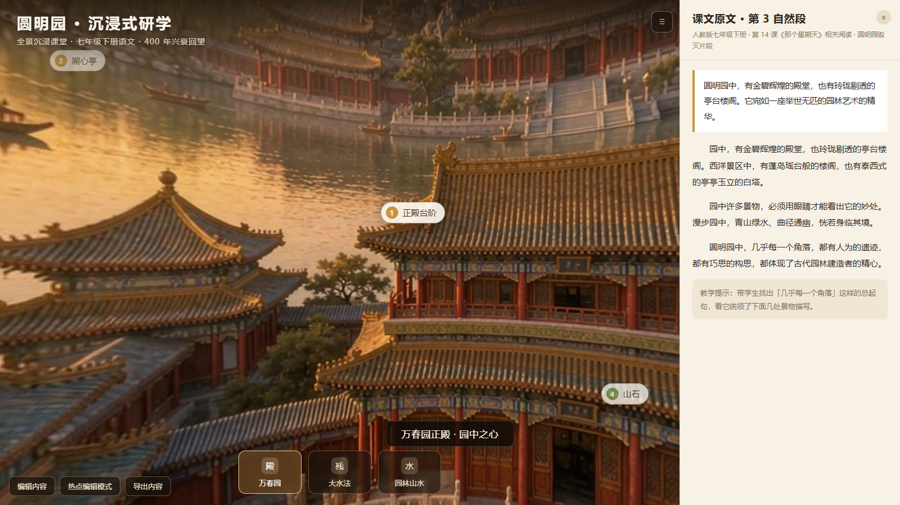
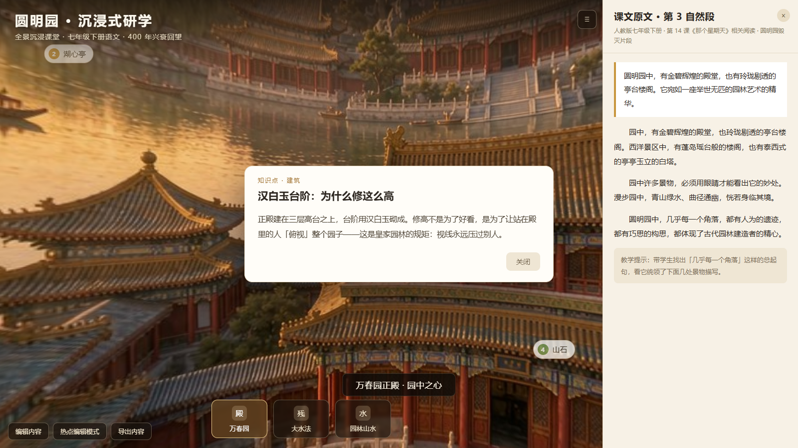
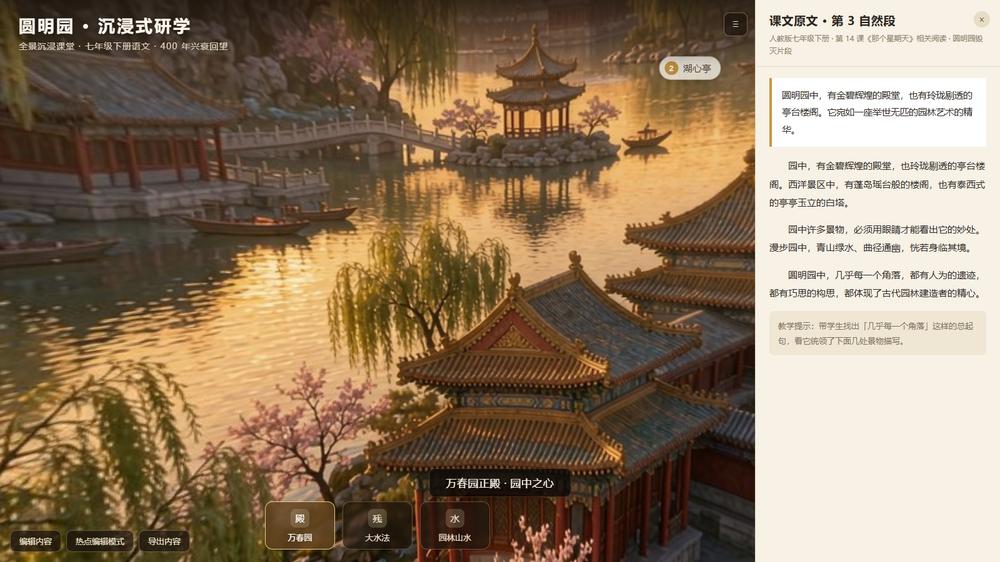
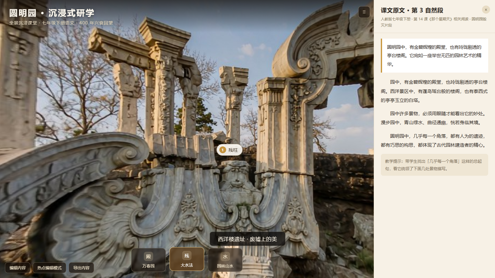
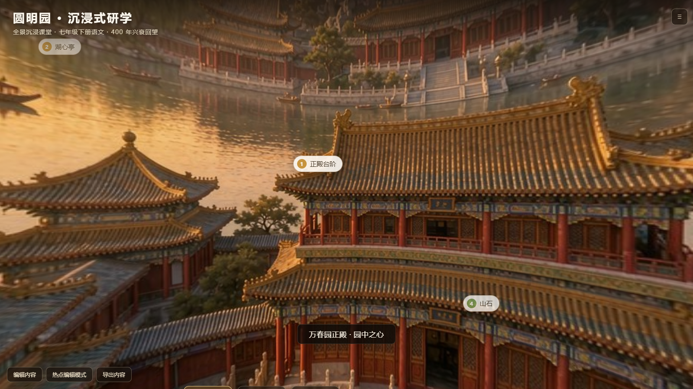
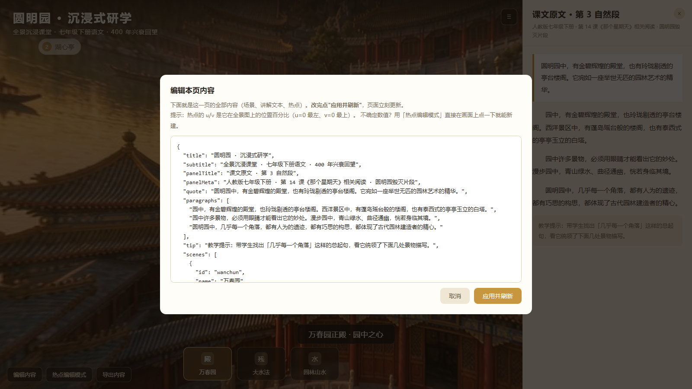
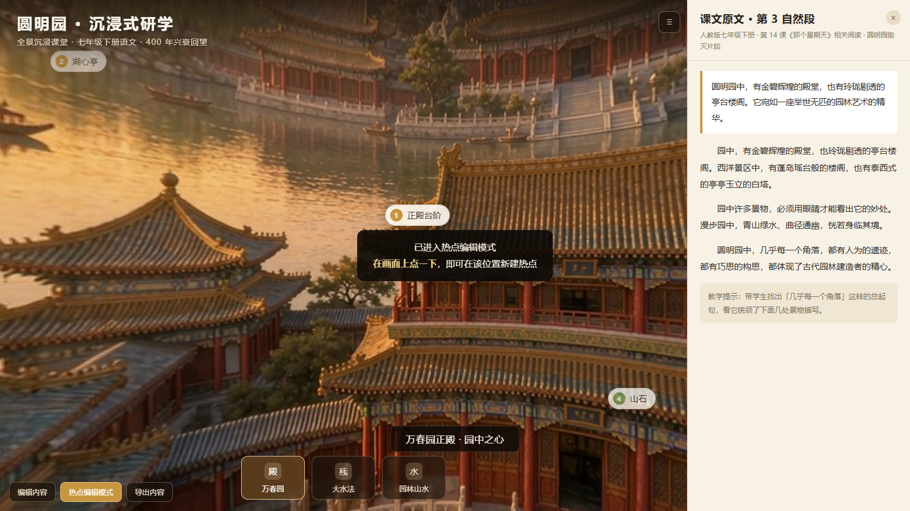
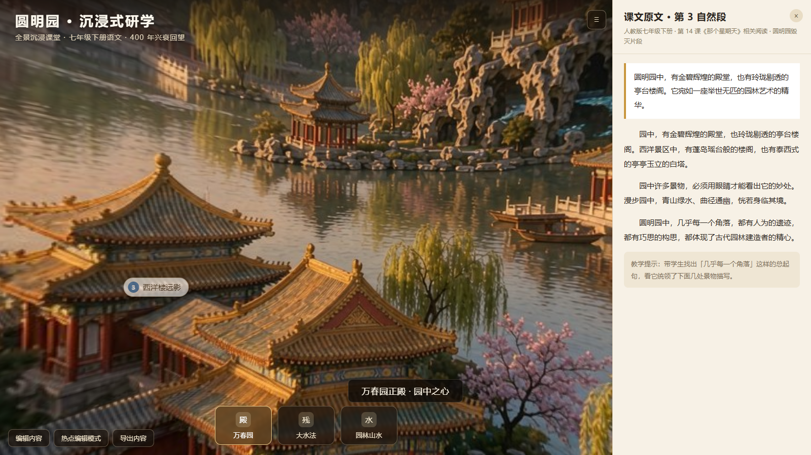

# 360° 全景互动网页 · 零依赖手工作坊

> **这份教程写给谁**：想在电脑上亲手做一个、能完全掌控、还不愿装任何环境的一线老师。
>
> **和已有那份《360° 全景互动网页 · 教师极简流程》怎么分工**：
> - **极简流程**＝把活儿全交给 WorkBuddy（报课题 → 生图 → 说一声生成 → 说修改 → 自测 → 要链接），老师只需要挑图和说效果。**推荐大多数老师走这条。**
> - **本文（手工作坊）**＝把成品拆开给你看：它由哪几层组成、每一行代码在干什么、四个会导致"全黑"的坑藏在哪里、你换一个课题要改哪几处。**适合想自己能改、能讲给同事听、想彻底不依赖 AI 的一次性生成的老师。**
>
> **本文所有截图、所有数据，都是在这台机器上真实跑出来的**，不是示意图。

---

## 〇、先看成品：40 分钟能拿到的东西

**《圆明园 · 沉浸式研学》**——七年级语文《圆明园》片段，一个可以拖着脑袋转、点上热点就弹出讲解的 360 网页。

| 指标 | 实测值 |
|---|---|
| 交付形态 | **一个 HTML 文件**，双击即开，没有第二个文件要管 |
| 文件体积 | 2.08 MB（含 3 张全景图，已内嵌） |
| 依赖 | **零**。不装 Node、不装 Python、不联网、不引用任何 CDN |
| 支持 | Chrome / Edge / 微信内置浏览器 / 各类教学一体机 |
| 全景图 | 3 张，2048×1024（标准 2:1 全景比例） |
| 知识点 | 8 个热点，带分类标签（建筑 / 水景 / 历史 / 造园手法…） |
| 交互 | 拖动转视角、滚轮俯仰、点热点弹讲解、切场景、收面板、**页面内直接改内容** |

### 8 张真实截图

**① 主界面**：全景 + 右侧课文原文讲解面板 + 底部场景切换 + 屏幕上的知识点标签



**② 点热点 → 弹出讲解卡片**（分类标签 / 标题 / 正文 / 关闭）



**③ 拖动视角**：画面真的转到了全景图的另一个区域，不是平移贴图



**④ 切换场景**：万春园 → 大水法 → 园林山水，三个独立全景



**⑤ 收起讲解面板**：投屏时全屏看画面



**⑥ 页面内编辑内容**：不用改代码，直接在弹窗里改 JSON，改完点"应用并刷新"



**⑦ 热点编辑模式**：在画面上点一下，自动算出该点的全景坐标并新建热点



**⑧ 转到边缘热点**：初始视野里只有 3 个热点，转一下视角，"西洋楼远影"才出现——这就是 360 的交互价值



---

## 一、拆解：一张 360 互动网页 = 四层

很多人以为 360 网页是个"大工程"。拆开看，其实就是四层，**每层都可以独立替换**：

| 层 | 干什么 | 本案例怎么实现 | 你要改吗 |
|---|---|---|---|
| **① 内容层** | 所有文字、场景、热点坐标，存一份 JSON | `<script id="content" type="application/json">`，页面里直接可编辑、可导出 | ✅ **主要改这里** |
| **② 界面层** | 标题栏、讲解面板、场景切换条、字幕条、编辑按钮 | 纯 HTML + CSS，普通 `<div>` | 🔸 改样式时才动 |
| **③ 热点层** | 悬浮在画面上的知识标签，随视角移动、转到背面自动隐藏 | DOM 元素，每帧用投影函数算出屏幕坐标 | 🔸 一般不动 |
| **④ 渲染层** | 把一张 2:1 的全景图贴到一个球面上，让你"身处其中" | **手写 WebGL**，72×36 网格球面 + 两个着色器 | ❌ 不用动 |

> **关键认知**：教师真正要动的只有 ①内容层。第 ④ 层是一段 200 行的固定代码，抄一次用一辈子。

### 为什么不用现成框架？

| 方案 | 结论 |
|---|---|
| **手写 WebGL（本文）** | ✅ **选它**。0 行外部依赖，2.08 MB 单文件，断网能跑，十年后照样打开 |
| A-Frame | ❌ 要引 CDN（断网白屏）；要引本地文件就是几百 KB 的教学资源负担 |
| Three.js | ❌ 同一个 CDN 问题；且它的 API 对老师来说是黑盒，改不动 |
| CSS 3D 柱面拼片 | ❌ 柱面近似在赤道附近能看，但高纬度会明显露缝；还得处理 3D 层级与 `overflow` 的打架 |
| 图片 + 滑块翻页 | ❌ 那不叫 360，只是滑动窗口 |

---

## 二、动手：5 步做出来

### 第 1 步　准备全景图（唯一需要外部素材的环节）

- **必须是 2:1**（宽是高的两倍）。本案例用 2048×1024。
- 三条来源路线，按"真实度"排：

| 来源 | 怎么来 | 适合谁 | 坑 |
|---|---|---|---|
| **专业 360 相机** | 淘宝搜"360 相机"，几千到上万；或用手机全景模式拍 | 真实场馆、自己的学校、实验室 | 最真实，**唯一没有畸变的方案** |
| **照片拼接软件** | 把几十张普通照片拼成全景（`Hugin` 免费 / 手机全景模式 / `RICOH` 工具） | 校园、教室、乡村、实习基地 | 免费，但要会拍 |
| **AI 生成"伪全景"** | 生图工具出一张 2:1 风景图 | 历史题材、地理景观、抽象概念 | ⚠️ **透视不对，转到边缘会穿帮**（见下） |

> **⚠️ 必须说清楚的实话**：本案例用的 3 张图是 **AI 生成的伪全景**。它是一张普通的 2:1 风景图，被硬映射到球面上——**正前方看着很自然，转到左右边缘（水平 90° 附近）就会出现明显拉伸和"接缝"**，因为图里根本没有那个方向的真实信息。
>
> 这不影响课堂使用（多数课时学生主要看正前方和近处），但**如果你要讲的是"现场实景"（比如自己的实验室、真实的文物），必须用真 360 相机拍**，否则一旦有学生转到边缘问"这后面是什么"，会露馅。
>
> 伪全景的正确用法：**历史场景、地理景观重建、抽象空间**。真全景的正确用法：**实地参观、实验室、校园**。

### 第 2 步　HTML 骨架：四层各占其位

```html
<div id="stage"><canvas id="cv"></canvas></div>   <!-- ④ 渲染层 -->
<div id="hots"></div>                              <!-- ③ 热点层（空容器，JS 填） -->
<div class="titlebar">…</div>                     <!-- ② 界面层 -->
<aside class="panel">…</aside>
<div class="scenes" id="scenes"></div>

<!-- ① 内容层：老师只需要认识这一个块 -->
<script id="content" type="application/json">
{
  "title": "圆明园 · 沉浸式研学",
  "scenes": [
    {
      "name": "万春园",
      "image": "assets/pano_1_wanchun.jpg",
      "subtitle": "万春园正殿 · 园中之心",
      "startYaw": 22,
      "hotspots": [
        { "u": 42, "v": 46, "kind": 1, "label": "正殿台阶",
          "tag": "知识点 · 建筑",
          "title": "汉白玉台阶：为什么修这么高",
          "body": "正殿建在三层高台之上…" }
      ]
    }
  ]
}
</script>
```

### 第 3 步　WebGL 球面渲染（核心，但只有两段）

**① 两个着色器**（顶点着色器把球面上的点投到屏幕，片元着色器只负责贴图）

```glsl
// 顶点着色器
attribute vec3 aPos; attribute vec2 aUv;
uniform mat4 uRot; uniform mat4 uProj;
varying vec2 vUv;
void main(){
  vUv = aUv;
  gl_Position = uProj * uRot * vec4(aPos, 1.0);
}

// 片元着色器
precision mediump float;
uniform sampler2D uTex; varying vec2 vUv;
void main(){ gl_FragColor = texture2D(uTex, vUv); }
```

**② 把 2:1 图片变成球面网格**（72×36 个格子，约 2600 个顶点，2.6 万个三角形）

```js
const LON = 72, LAT = 36;                 // 经度格数、纬度格数
for (let i = 0; i <= LAT; i++){
  const phi = i / LAT * Math.PI;          // 纬度角 0→π（顶→底）
  for (let j = 0; j <= LON; j++){
    const th  = j / LON * Math.PI * 2;    // 经度角 0→2π（左→右）
    pos.push(-Math.sin(th)*Math.sin(phi),  Math.cos(phi),  Math.cos(th)*Math.sin(phi));
    uvs.push(j / LON, i / LAT);            // 纹理坐标：和图片一一对应
  }
}
```

> **坐标约定（改代码前务必记住）**
> | 记号 | 含义 | 范围 |
> |---|---|---|
> | `u` | 图片**横向**位置百分比，0=图片最左，50=初始正前方 | 0–100 |
> | `v` | 图片**纵向**位置百分比，0=图片最上 | 0–100 |
> | `yaw` | 当前左右转的角度，弧度 | — |
> | `pitch` | 当前上下俯仰，限制在 ±0.62 弧度 | — |

### 第 4 步　热点投影：让 HTML 标签"钉"在球面上

这是整个技术里最需要动脑的一段，但结论很短：**先把球面上的点算出来，再把旋转和透视套上去，最后除以深度得到屏幕坐标**。

```js
function project(u, v){
  // ① 球面坐标（u/v 百分比 → 三维点）
  const th = (u/100)*Math.PI*2, ph = (v/100)*Math.PI, s = Math.sin(ph);
  const px = -Math.sin(th)*s, py = Math.cos(ph), pz = Math.cos(th)*s;

  // ② 套用旋转矩阵 Ry(yaw)·Rx(pitch)——必须和着色器里的 uRot 完全一致
  const cy=Math.cos(yaw), sy=Math.sin(yaw), cp=Math.cos(pitch), sp=Math.sin(pitch);
  const rx = cy*px - sy*pz;
  const ry = sp*sy*px + cp*py + sp*cy*pz;
  const rz = cp*sy*px - sp*py + cp*cy*pz;

  if (rz > -0.02) return null;            // ③ 在身后 → 不显示
  // ④ 透视除法 → 屏幕坐标
  const t = 1/Math.tan(FOV/2), asp = cv.width/cv.height;
  return {
    x: ((rx*t/asp)/-rz*0.5 + 0.5) * innerWidth,
    y: (1 - ((ry*t)/-rz*0.5 + 0.5)) * innerHeight
  };
}
```

**反向也要有**：热点编辑模式要"点画面 → 算出该点的 u/v"，这叫反投影，是上面公式的逆：

```js
function unproject(cx, cy){                    // 屏幕点 → 球面坐标
  const t = 1/Math.tan(FOV/2), asp = cv.width/cv.height;
  const nx = (cx/innerWidth)*2-1, ny = 1-(cy/innerHeight)*2;
  let dx = nx*asp*t, dy = ny*t, dz = -1;
  const L = Math.hypot(dx,dy,dz); dx/=L; dy/=L; dz/=L;
  // 反向套用逆旋转：Rx(-pitch)·Ry(-yaw)
  const cyw=Math.cos(yaw), syw=Math.sin(yaw), cpp=Math.cos(pitch), spp=Math.sin(pitch);
  const ax=cyw*dx+syw*dz, ay=dy, az=syw*dx+cyw*dz;
  const bx=ax, by=cpp*ay+spp*az, bz=-spp*ay+cpp*az;
  const ph = Math.acos(Math.max(-1, Math.min(1, by)));
  const th = Math.atan2(-bx, bz);
  let u = (th/(Math.PI*2))*100; u = ((u%100)+100)%100;
  return { u:+u.toFixed(1), v:+((ph/Math.PI)*100).toFixed(1) };
}
```

### 第 5 步　打包成"双击即开"的成品（这一步决定了它能不能发给学生）

**为什么必须打包**：见下面的「坑 ①」。一句话版本——在 `file://` 协议下，Chrome 把每个本地文件都当成独立来源，WebGL 会拒绝把 `` 当纹理上传。

所以整个工程只有两个 HTML 文件，职责必须分清：

| 文件 | 是什么 | 打开会怎样 |
|---|---|---|
| `index.src.html` | **源文件**（图片用 `assets/` 外链） | 本地双击打开是**占位图 + 顶部红色提示条**，不会黑屏 |
| `index.html` | **成品**（图片已内嵌 base64） | **双击即用**，发给学生的就是它 |

源文件里留了三个空的占位块，打包时把图片塞进去：

```html
<!-- 源文件里这三块是空的 -->
<script id="pano_1" type="text/plain"></script>
<script id="pano_2" type="text/plain"></script>
<script id="pano_3" type="text/plain"></script>
```

内容层里只写短 ID，**不会被 2 MB 的 base64 淹掉**，老师照样看得懂：

```json
{ "image": "pano_1", "startYaw": 22, "hotspots": [ … ] }
```

打包脚本（要点：**闭标签必须用命名组取**，见下面的坑 ⑤）：

```python
# build.py —— 把 assets/*.jpg 转成 base64 填进占位块，输出 index.html
BLOCK_PAT = re.compile(
    r'(<script\s+id="(?P<id>[^"]+)"\s+type="text/plain"\s*>)(?P<body>.*?)(?P<close></script>)',
    re.S)

def repl(m):
    uri = "data:image/jpeg;base64," + base64.b64encode(open(p, 'rb').read()).decode()
    return m.group(1) + uri + m.group("close")   # ← group(3) 是 body，不是闭标签！

html = BLOCK_PAT.sub(repl, html)
assert html.count("</script>") == before          # 标签配对自检
```

跑一次 `python build.py`，就得到 2.08 MB 的 `index.html`。

---

## 三、五个致命坑（每一个都真实卡住过一轮）

> 这一节是本文最有价值的部分。**这四个坑有一个共同特征：控制台一条错误都不报，画面就是黑的。** 光看报错信息永远找不到根因。

### 坑 ①　`file://` 跨源 → 纹理上传失败 → 全黑

**现象**：UI 层（标题、面板、按钮、热点标签）全部正常，**只有全景画面是纯黑**。控制台有且只有一条错误：

```
Failed to execute 'texImage2D' on 'WebGLRenderingContext':
The image element contains cross-origin data, and may not be loaded.
```

**根因**：Chrome 对 `file://` 下的每个文件分配独立的不透明来源（opaque origin）。同目录的 `assets/x.jpg` 在 `` 里能正常显示，但**交给 WebGL 当纹理时，浏览器判定它是"跨源数据"，直接拒绝上传**。

**诊断过程**（这个方法值得记住）：

```js
// 在浏览器控制台跑，就能区分"WebGL 不可用"和"纹理没传上去"
const c = document.querySelector('#cv'), g = c.getContext('webgl');
const dbg = g.getExtension('WEBGL_debug_renderer_info');
console.log(g.getParameter(dbg.UNMASKED_RENDERER_WEBGL));   // 显卡/渲染器名
console.log(g.getError());                                   // 0 = 没有 GL 错误
const px = new Uint8Array(4);
g.readPixels(c.width/2, c.height/2, 1, 1, g.RGBA, g.UNSIGNED_BYTE, px);
console.log(px);                                             // [0,0,0,255] = 黑
```

结果：渲染器是 `ANGLE (SwiftShader)` 或 `ANGLE (Intel Iris Xe)`，`getError()` 返回 **0**，但中心像素是黑的 → **WebGL 好好的，是纹理没传上去**。

**解法**：图片转 base64 内嵌（见第 5 步）。

> **顺带排除的三个"疑似元凶"**（排查时都查过，都不是）：
> - headless 环境不支持 WebGL？→ 不是。`--use-angle=swiftshader` 和真实显卡 ANGLE 都能出图。
> - 图片文件损坏？→ 不是。`` 正常加载，`naturalWidth = 2048`。
> - 着色器编译失败？→ 不是。编译失败会抛异常，控制台有明确报错。

### 坑 ②　顶点属性绑错缓冲区 → 三角形退化 → 全黑

**现象**：图片已经内嵌、坑 ① 解决，仍然全黑。

**根因**：WebGL 里 `vertexAttribPointer` 会**记住调用那一刻绑定的 ARRAY_BUFFER**。正确写法必须一个属性配一次绑定：

```js
// ❌ 错误：两个属性都绑到了最后一个 ARRAY_BUFFER（vb2 = UV 数据）
gl.bindBuffer(gl.ARRAY_BUFFER, vb);
gl.bindBuffer(gl.ARRAY_BUFFER, vb2);
gl.enableVertexAttribArray(aPos);
gl.vertexAttribPointer(aPos, 3, gl.FLOAT, false, 0, 0);   // ← 读到的其实是 UV！
gl.vertexAttribPointer(aUv,  2, gl.FLOAT, false, 0, 0);

// ✅ 正确：每个属性先绑自己的缓冲
gl.bindBuffer(gl.ARRAY_BUFFER, vb);
gl.enableVertexAttribArray(aPos);
gl.vertexAttribPointer(aPos, 3, gl.FLOAT, false, 0, 0);
gl.bindBuffer(gl.ARRAY_BUFFER, vb2);
gl.enableVertexAttribArray(aUv);
gl.vertexAttribPointer(aUv, 2, gl.FLOAT, false, 0, 0);
```

顶点位置读到了 UV 数据 → 三角形全部塌成线 → 什么也画不出，**且 `getError()` 依然是 0**。

### 坑 ③　透视矩阵深度项符号写反 → 被深度范围裁掉 → 全黑

**现象**：改了顶点绑定，还是黑。

**根因**：我最初写的透视矩阵是 OpenGL 教科书里的形式（`clip.z` 用正号、`clip.w` 用正号）：

```js
// ❌ 错误
return new Float32Array([t/asp,0,0,0, 0,t,0,0, 0,0,(f+n)/(n-f),-1, 0,0,2*f*n/(n-f),0]);
```

代入 `n=0.1, f=100`：算出来 `ndc.z = clip.z / clip.w = 5.0`，**远超合法范围 [-1, 1]**，所有片元被深度范围裁掉 → 全黑。

而且这个矩阵的 `clip.w` 也不等于 `-z`，导致**画面位置和热点投影公式对不上**（画面转了，热点不转）。

**解法**：自己构造矩阵，同时保证 ① `clip.w = -z` ② `ndc.z ∈ [-1,1]`：

```js
// ✅ 正确
function perspective(fov, asp, n, f){
  const t = 1/Math.tan(fov/2);
  const m22 = -(f+n)/(f-n);
  const m23 = -2*f*n/(f-n);
  return new Float32Array([
    t/asp, 0, 0, 0,
    0, t, 0, 0,
    0, 0, m22, -1,     // 第四行第三列 = -1 → clip.w = -z
    0, 0, m23, 0
  ]);
}
```

验证：`z = -1`（正前方 1 单位）时 `clip.w = 1`，`ndc.x = (t/asp)·x/(-z)`，**与 `project()` 里的公式一字不差** ✓

### 坑 ④　`UNPACK_FLIP_Y_WEBGL` 设错 → 画面上下颠倒

**现象**：终于出图了，但**屋檐朝下、天在脚底**。

**根因**：WebGL 的纹理坐标 `t=0` 默认对应图片的**顶行**（不是 GL 教科书写的那样在底部）。我们用 `s = 纬度/π` 采样，`s=0` 是北极 = 图片顶部，正好对上——所以 `FLIP_Y` 必须是 `false`。

```js
gl.pixelStorei(gl.UNPACK_FLIP_Y_WEBGL, false);   // ✅
gl.pixelStorei(gl.UNPACK_FLIP_Y_WEBGL, true);    // ❌ 画面上下颠倒
```

### 坑 ⑤　正则分组索引取错 → `</script>` 丢失 → 整段脚本被吞

**现象**：打包后打开，**画面上一个热点都没有**，场景按钮也不出现，但**控制台一条报错都没有**。图片却"好像"加载了（占位块里确实有 2 MB 数据）。

**根因**：给占位块填 base64 时，替换函数把闭标签写丢了：

```python
# 正则里的捕获组顺序：
#   group(1) = 开标签    group(2) = id
#   group(3) = body     ← base64 的容器
#   group(4) = </script> ← 闭标签
return m.group(1) + uri + m.group(3)      # ❌ group(3) 是空的 body！闭标签被丢掉
return m.group(1) + uri + m.group("close") # ✅ 命名组，不看编号
```

少了 `</script>`，HTML 解析器就从 `<script id="pano_1">` 一路往下找结束标签，**把后面所有内容（pano_2、pano_3、整个引擎脚本）都当成了 pano_1 的纯文本内容**。引擎脚本压根没执行，所以：

- `typeof DATA === 'undefined'`、`resolveSrc is not defined`
- 热点 0 个、场景按钮 0 个
- **但** `document.getElementById('pano_1').textContent.length` 是 200 多万（因为吞了整个文件），看起来"图确实内嵌了"

**30 秒自检法**（任何往 HTML 里塞内容的脚本都应该加这一条）：

```python
assert html.count("<script") == before_open and html.count("</script>") == before_close
```

**浏览器端的快速判据**：

```js
// 脚本没执行 vs 图片没加载，用这两个字段一秒钟分开
typeof DATA                 // 'undefined' → 引擎脚本没执行（看标签配对）
document.getElementById('pano_1').textContent.length   // 远大于图片本身 → 闭标签被吞
```

> 这个坑和前面四个是**同一族**：功能完全失效，但控制台干干净净。
> 通用规律：**凡是"打包/拼接 HTML"的环节，一定要校验标签配对数**；凡是"不报错的失败"，先查**变量有没有被定义**，再查图、查矩阵。

---

### 附：另外三个不致命但会浪费时间的小坑

| 现象 | 根因 | 处理 |
|---|---|---|
| 热点标签全部不显示，点不上 | 投影时把旋转矩阵**按列**读了（`ROT[0]*x + ROT[4]*y + ROT[8]*z`）。WebGL 的 `uniformMatrix4fv` 是**列主序**，按行取才对：`ROT[0]*x + ROT[1]*y + ROT[2]*z` | 矩阵行列读法必须和着色器一致 |
| 控制台 `readPixels` 读出全黑，但截图明明有画面 | WebGL 默认 `preserveDrawingBuffer: false`，帧缓冲在合成后就被清空了，程序化读像素拿不到 | 判定"是否黑屏"要**看截图**，别信 `readPixels` |
| 自动化截图时拖动视角没反应 | 画面中央的提示浮层挡住了鼠标按下事件 | 拖动起点避开中央，或等提示自动消失 |

---

## 四、内容层怎么改（三种改法，从易到难）

### 改法 ①　页面内直接改（推荐给老师，零门槛）

左下角 **「编辑内容」** → 弹窗里就是完整的 JSON → 改文字 → 点「应用并刷新」→ 页面立刻更新。

### 改法 ②　页面内新建热点（推荐给老师，不知道 u/v 也能做）

左下角 **「热点编辑模式」** → **在画面上点一下** → 依次填"名称 / 标题 / 讲解 / 标签" → 完事。系统自动算出该点的全景坐标并写进 JSON。

### 改法 ③　直接改 JSON 文件（推荐给懂点技术的老师 / 做批量替换）

内容层的字段表：

| 字段 | 类型 | 说明 |
|---|---|---|
| `title` / `subtitle` | 字符串 | 页面左上角大标题、副标题 |
| `panelTitle` / `panelMeta` / `quote` | 字符串 | 右侧讲解面板的标题、小字、引用框 |
| `paragraphs` | 字符串数组 | 右侧正文的段落，每条一段 |
| `tip` | 字符串 | 面板底部的"教学提示"灰色块 |
| `scenes[]` | 数组 | 每个场景一个全景 |
| `scenes[].name` / `icon` | 字符串 | 底部按钮的文字和小图标字 |
| `scenes[].image` | 字符串 | 全景图路径（打包后变成 data URI） |
| `scenes[].subtitle` | 字符串 | 画面中下方的字幕条 |
| `scenes[].startYaw` | 数字 | **初始朝向**（度）。正数=向右转。这个值决定学生打开时第一眼看到哪 |
| `scenes[].hotspots[]` | 数组 | 知识点列表 |
| `hotspots[].u` / `v` | 数字 | 热点在全景图上的位置百分比 |
| `hotspots[].kind` | 1/2/3 | 标签颜色（棕 / 蓝 / 绿），用来区分"知识点 / 拓展 / 赏析" |
| `hotspots[].label` | 字符串 | 画面上的小标签文字 |
| `hotspots[].tag` | 字符串 | 弹窗里的小分类标签 |
| `hotspots[].title` / `body` | 字符串 | 弹窗标题、正文 |

> **排布小经验**：`startYaw` 决定初始视角，而 `u = 50 - startYaw/3.6` 是初始正前方对应的 u 值。
> 例：`startYaw = 22` → 初始正前方是 `u ≈ 44`。
> **把最重要的那个热点的 u 设成 44 左右**，学生一打开就看到它。

---

## 五、课堂怎么用：三个已经想好的课例

| 课型 | 怎么用这个网页 | 学生真正做的事 |
|---|---|---|
| **语文·实地场景还原** | 圆明园、苏州园林、杜甫草堂……把课文里"移天缩地""曲径通幽"变成能转的画面 | 转动视角找景 → 找到课文写的那一处 → 读讲解 → 回到原文找对应句子 |
| **地理/科学·空间尺度** | 一条河流、一个流域、一处地质构造的全景 | 站在"山顶"俯瞰 → 说出最高点在哪 → 对照等高线判断坡度 |
| **历史·现场证据** | 遗址、纪念地、博物馆展陈 | 在废墟里找"残柱"→ 点开看那年发生了什么 → 用废墟证据推翻"完整时更好看"的直觉 |

**投屏时的两个小动作**：
- 按 **≡** 收起右侧面板，画面全屏，更好讲；
- 讲到一个点，就**拖动画面把它带到学生面前**，比翻 PPT 有冲击力得多。

---

## 六、迁移到你自己的课题：一张清单

照着这张表填，填完就能出成品：

- [ ] **课题与学段**：______（例：七年级语文《圆明园》）
- [ ] **场景数**：建议 2–4 个（多了学生会乱）
- [ ] **每个场景一张 2:1 全景图**：文件名 `scene1.jpg` …，放在 `assets/`
- [ ] **每个场景 3–5 个热点**：每个热点一句话讲解（**别写超过 80 字**，投屏要读得完）
- [ ] **标好 `kind`**：知识点 / 拓展 / 赏析，用颜色分开
- [ ] **定 `startYaw`**：让最重要的热点出现在初始视野
- [ ] **写右侧面板**：课文原文 + 2–3 段解读 + 1 条教学提示
- [ ] **跑 `python build.py`** → 生成/覆盖 `index.html`（成品）
- [ ] **自己走一遍**：转一圈、点开每个热点、切三个场景、收面板、编辑内容 → 30 秒
- [ ] **发出去**：单文件可以直接微信发；大文件用腾讯文档/微云传

---

## 七、文件清单（都在 `vr_teach/` 目录里）

| 文件 | 作用 |
|---|---|
| **`index.html`** | **成品**。2.08 MB，图片已内嵌，**双击即用、发给学生的就是它** |
| `index.src.html` | **源文件**。改内容、改样式都在这里改，图片走 `assets/` 外链；本地双击打开会显示占位图 + 红色提示条（这是预期行为，不是坏了） |
| `build.py` | 打包脚本：把 `assets/*.jpg` 转 base64 填进占位块 → 输出 `index.html`，**带标签配对自检** |
| `assets/pano_1.jpg` `pano_2.jpg` `pano_3.jpg` | 2048×1024 全景图（2:1） |
| `shoot.js` | 自动化截图脚本（Playwright），出教程插图 + 全流程自检 |
| `diagnose.js` | WebGL 故障诊断（渲染器 / `getError` / 中心像素 / 图片加载） |
| `check.js` | 引擎状态自检：`DATA` 是否定义、热点数、纹理是否上传、内嵌路径是否生效 |
| `shots/01–08*.png` | 8 张教程插图 |

**完整复现命令**：

```bash
# 1. 改内容 → 编辑 index.src.html 里的 JSON 块（或直接用成品页面里的「编辑内容」）
# 2. 打包（自动生成/覆盖 index.html）
python build.py
# 3. 自检并出图
node check.js       # 看 DATA / 热点数 / 纹理是否都正常
node shoot.js       # 出 8 张截图 + 全流程点一遍
```

---

## 八、最后三条实在话

**① 这东西的真价值不是"360"，是"可转动的课本"。**
PPT 上的圆明园只能看不能转；学生用手一拖就转到"湖心亭"，那个"身临其境"是自己长出来的，不是老师说的。

**② 伪全景够用，真全景更好。**
AI 生成的图转到边缘会露馅。讲历史、地理、抽象空间，伪全景完全够；讲"我们学校""我们的实验室"，一定要真拍。

**③ 五个坑都表现为"控制台不报错、功能全失效"。**
如果你也做这类东西，记住这条排查路径，按顺序查，五个全中：
**① 先看变量有没有被定义**（`typeof DATA`）→ 通则：脚本根本没执行就去看标签配对；
**② 再看渲染器在不在**（`getParameter(RENDERER)`）→ WebGL 没起来是环境问题；
**③ 再看 `getError()`** → 是 0 就别怀疑 GL 调用本身；
**④ 再看图片有没有 load** → 卡住多半是 `file://` 跨源；
**⑤ 最后才查矩阵和缓冲区绑定** → 画面在但错位/全黑，多半是这层。

记住这条规律：**凡是"打包/拼接 HTML"的脚本，一定要校验标签配对数；凡是"不报错的失败"，先查定义、再查图、最后才查矩阵。**

---

*本文所有截图与数据均来自 `vr_teach/` 的真实运行；配套的《360° 全景互动网页 · 教师极简流程》（把活儿交给 WorkBuddy）与《专题_360VR全景互动网页》（完整原理与设计规则）可对照阅读。*
