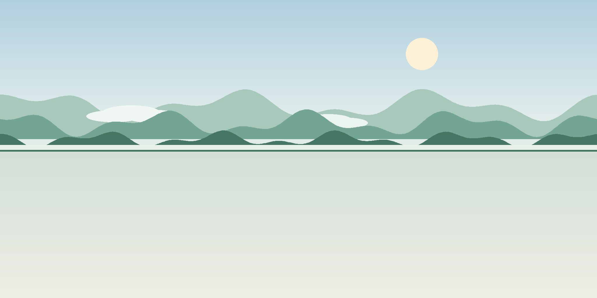
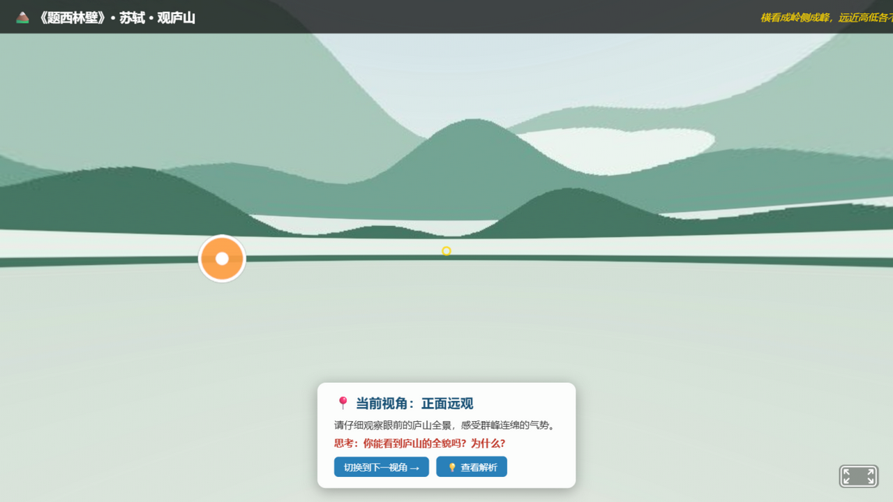
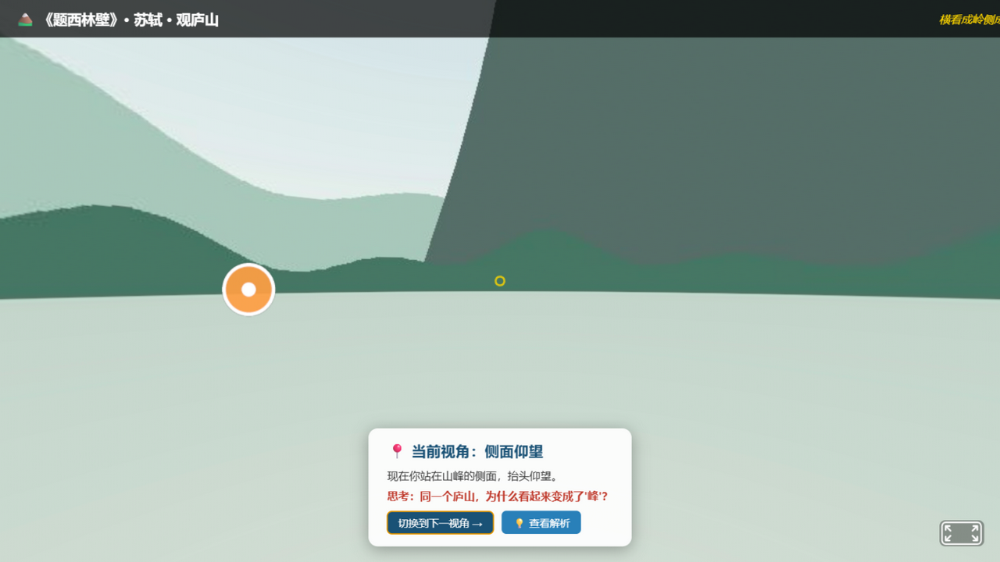
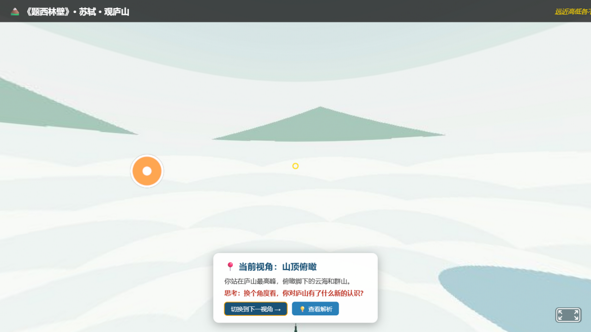
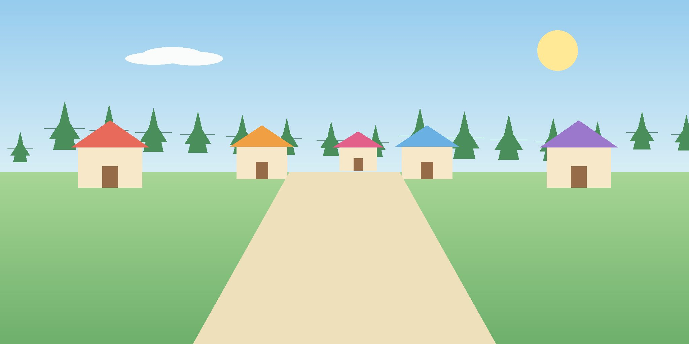
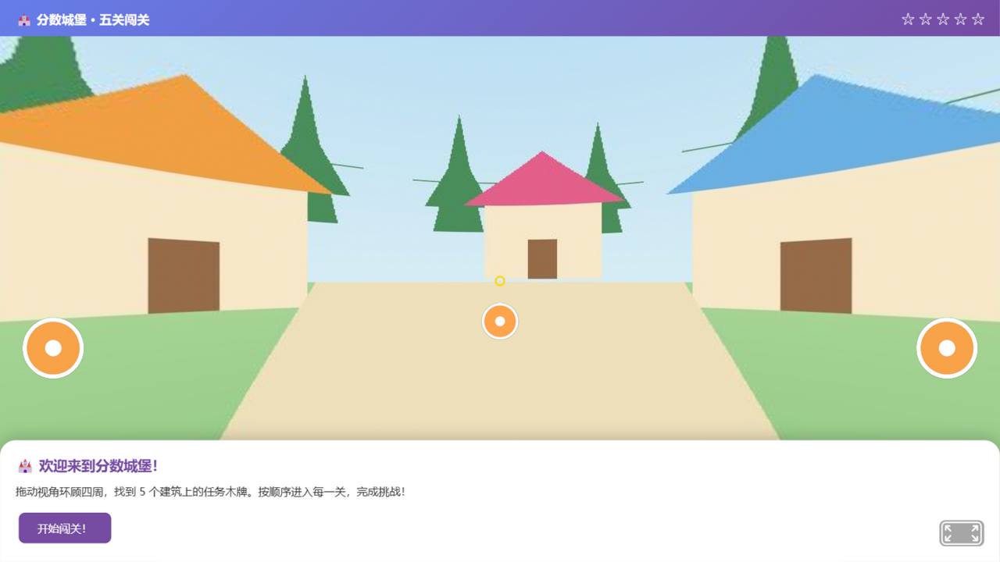
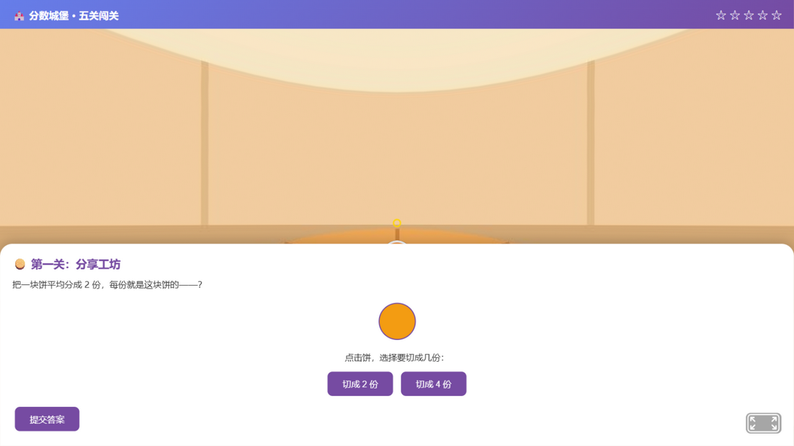
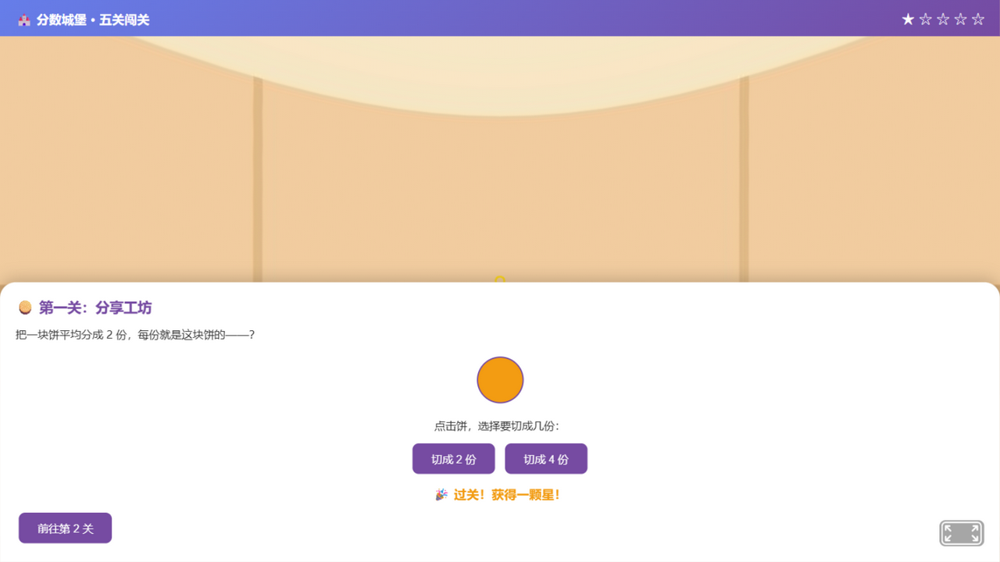

# 专题　360° VR 全景互动网页：从一张全景图到一条能分享的链接

> 【编辑说明 · 并入蓝皮书时删除本段】
> 本文件 2026-10-23 整理：主体来自根目录《360vr全景互动网页制作教程.txt》（两份重叠草稿合并去重、修正错乱代码行）；操作案例与教育专用提示词来自《360VR全景互动网页_教育案例教程》（原始版存于 `参考资料/`）；「设计规则」一节与 `vr_cases/gen_images.py`、`scenes.example.json` 为新增（知识点→热点→生图 key 批量配图的规则化流程）。
> 提示词 P1–P8 沿用原始资料或整理补充；P9–P10、S1–S4、E1–E5 为新增。
> 两个操作案例**已实跑验证**：素材由 `vr_cases/gen_placeholder_assets.py` 程序化生成（示意画风，正式使用按案例提示词或「设计规则」流程用生图 API 生成同名覆盖即可），页面在本地服务器实测通过，文中截图为实机截图（`assets_opt/vr_*.png`）。
> 并入蓝皮书：把本文件加进 `build_official.py` 的 `FILES` 列表；`vr_cases/` 是否随书打包自行决定。

---

## 这一讲你会做出什么

一个发链接就能打开的网页：手机或电脑拖动就能环顾四周，点到热点图标弹出讲解，走到门口可以"走进"下一个空间——几个全景图连成一场漫游。

**教师用得上的场景：**

| 场景 | 做成什么样 |
|---|---|
| 校园开放日 | 校门 → 操场 → 图书馆 → 实验楼的线上漫游，家长手机点开就走 |
| 虚拟研学 | 实地研学的点位做成全景，配讲解热点，去不成也先"走一遍" |
| 课文场景还原 | 课文里描写的地方做成全景，学生自己环顾、点热点读批注 |
| 学生作品展 | 美术、手工作品贴在全景墙面上，办一场线上展厅 |
| 实验安全预览 | 实验室全景 + 每个危险点位一个提示热点，进实验室前先走一遍 |
| 校史馆 / 德育基地 | 平时不开放的场馆，做成常驻线上展 |

> 本教程自带两个**已实跑验证**的完整操作案例（见「操作案例」一节），每个案例都按「教学设计 → 生成素材 → 生成页面 → 运行验证 → 课堂使用」五步走：
> **案例一 语文《题西林壁》· 四个视角观庐山**、**案例二 数学《分数的初步认识》· 分数城堡五关闯关**。
> 代码和示意素材在 `vr_cases/` 目录，克隆即跑（`python -m http.server` 起服务即可）；文中运行截图均为实机截图。

### 你需要准备什么

- 一台电脑（Windows / Mac 均可），Chrome 或 Edge 浏览器
- 全景素材——第 1 步里"实拍 / 免费素材库 / AI 生成"三条来路任选其一
- **推荐用 WorkBuddy**：本教程的提示词都按"发给 WorkBuddy、它直接把文件写进你的文件夹"设计。用网页版 AI 也行，只是拿到代码后要自己新建文件、粘贴保存

### 这一讲里 WorkBuddy 负责什么

| 环节 | 你说什么 | 它做什么 |
|---|---|---|
| 生成文件 | 把第 X 步的提示词发过去 | 直接在 `vr-tour/` 里写出 `index.html`、`tour.json`，不用你建文件粘贴 |
| 改文件 | 右键打开 `index.html`，说"把图书馆的开放时间改成…" | 人机双写，保存写回原文件（⚠️ 动手前先 `Ctrl+S` 复制副本） |
| 起预览 | "帮我起一个本地预览服务" | 在项目目录跑 `python -m http.server 8080` 并告诉你地址 |

### 全程路线图

| 步骤 | 做什么 | 产出 | 大约用时 |
|---|---|---|---|
| 0 | 懂原理：把人装进球里 | 看得懂后面每一步在干嘛 | 5 分钟 |
| 1 | 准备全景素材 | 若干张 2:1 全景图 + 热点图标 | 10–30 分钟 |
| 2 | 建项目文件夹 | `vr-tour/` 目录 | 5 分钟 |
| 3 | 第一个全景页 | 能拖拽环顾的 `index.html` | 15 分钟 |
| 4 | 加热点弹信息 | 可点击的信息点 | 30 分钟 |
| 5 | 多场景漫游 | 几个空间连成一片，能互相跳转 | 45 分钟 |
| 6 | Three.js 原理课（选学） | 懂"为什么这样写" | 20 分钟 |
| 备选 | Pannellum 零代码路线 | 不写代码的替代方案 | 按需 |
| 扩展 | 视频全景 / VR 直播 | 动态全景 | 按需 |
| 7 | 部署上线 | 一条能发出去的 https 链接 | 30 分钟 |
| 8 | 兼容、降级与性能 | 手机、头显、低端机都能用 | 收尾 |

---

## 第 0 步　先懂一个原理：把人装进一个球里

360° 全景网页只有三个关键词，后面所有步骤都是在摆弄这三样东西：

| 关键词 | 一句话解释 |
|---|---|
| 等矩形投影（Equirectangular） | 把整个球面摊平成一张 **2:1 的长图**：左右边缘无缝相接，正中间是地平线，最上一条边是天顶，最下一条边是脚底 |
| 球内观看 | 网页把这张长图重新贴回一个巨大球体的**内壁**，把相机（你的眼睛）放在球心——拖拽鼠标，就是转头 |
| 热点（Hotspot） | 贴在球壁上的可点击图标，点它弹信息，或者跳进另一个球（另一个场景） |

⚠️ **全景图不是普通宽图。** 手机"全景模式"拍出来的是宽条图，不是等矩形投影，直接用画面会扭曲，需要先转换。

---

## 技术选型：五套方案一张表

| 方案 | 定位 | 上手难度 | 交互能力 | 适用场景 |
|---|---|---|---|---|
| **A-Frame** | 基于 Three.js 的 HTML 声明式 VR 框架 | ⭐ 低 | 热点 / 动画 / WebXR 原生支持 | 快速出 Demo、VR 看房、教育漫游 |
| Three.js | 底层 WebGL 3D 引擎 | ⭐⭐⭐ 中高 | 完全自定义（射线 / 着色器 / 多场景） | 商业级展厅、复杂交互、自研系统 |
| Pannellum | 轻量全景查看器 | ⭐⭐ 低 | 基础热点 + 场景跳转、JSON 驱动 | 单图展示、官网嵌入 |
| Pano2VR | 可视化全景制作工具 | ⭐ 低 | 热点 / 多场景 / 皮肤化输出 | 不写代码、交付静态漫游站点 |
| krpano | 商业级全景内核 | ⭐⭐⭐⭐ 高 | 极强（多边形热点 / 深度缩放 / 3D 高斯溅射） | 大型地产、文旅项目（需授权） |
| 720云 | 在线全景平台 | ⭐ 低 | 模板、热点、一键发布 | 零代码教师，先看别人怎么做 |
| Nibiru Creator | VR 课件创作软件 | ⭐ 低 | AI 全景导入、一键生成 VR 课件 | 零代码教师做交互课件 |

**选型结论：**

- 新手 / 教学演示 → **A-Frame**（几行 HTML 出效果）
- 要完全掌控渲染与交互 → Three.js
- 不想写代码做交付 → Pano2VR / Pannellum
- 大型商业项目 → krpano（需授权）
- 完全不想碰代码 → 720云 / Nibiru Creator / Pano2VR（先逛平台，见第 1 步）

**本教程主线：A-Frame 做基础（第 3–5 步），Three.js 讲原理（第 6 步，选学），Pannellum 作零代码备选。**

---

## 第 1 步　准备全景素材

### 三条来路

| 来路 | 工具 / 渠道 | 说明 |
|---|---|---|
| 实拍拼接 | Insta360 X4 / RS（消费级）、Ricoh Theta Z1（地产专业级）；双鱼眼原片用 Insta360 Studio / PTGui 合成等矩形图 | 最真实，适合拍自己的校园 |
| 免费素材库 | Poly Haven（CC0 可商用）、Pixabay、Unsplash、Pannellum 官方示例库、360Cities（非商用可嵌入） | 没设备时，先用别人的图把流程跑通 |
| AI 生成 | 提示词 P6（见下） | 十分钟出一张能用的图，适合课文场景、想象中的场景 |

### 先逛现成的：四个资源平台

自己做之前，先看有没有现成的——尤其国家平台是官方免费资源：

| 平台 | 特点 | 适合 |
|---|---|---|
| 国家中小学智慧教育平台 | 教育部官方、免费，31 省市博物馆 / 科技馆 / 宇宙星空 / 古建筑 VR 场景 | 直接嵌进 PPT / 希沃白板 |
| 720云 | 在线全景平台，200 万+创作者作品 | 找校园 / 博物馆 / 文旅漫游参考 |
| 红幻无界课堂 | 2000+ 全景图，紧扣新课标知识点 | 语文《海底世界》、科学《观测风》这类课文 |
| 如视（贝壳系） | 自研空间采集设备，毫米级还原文物纹理 | 数字博物馆进校园 |

> 教学提示：平台上找不到贴合课文的场景时，再走上面三条来路自己做。

### 素材规范

| 项 | 规范 |
|---|---|
| 格式 | 等矩形（Equirectangular）投影，宽高比**严格 2:1** |
| 分辨率 | 推荐 4096×2048 或 5760×2880 |
| 体积 | 单张 ≤8MB，用 TinyPNG / squoosh 压图 |
| 命名 | 每个空间一张，全小写英文，不用中文和空格：`gate.jpg`、`library.jpg`、`lab.jpg` |
| 热点图标 | 透明 PNG，512×512 以内 |

### 提示词 P6：用 AI 生成全景图

```
生成一张等矩形（equirectangular）投影的 360° 全景室内环境图，宽高比严格 2:1（4096×2048）。

场景：【现代极简客厅，落地窗，午后阳光，浅木地板——换成你的场景描述】

要求：
1. 画面必须是完整 360°×180° 球面展开，左右边缘能无缝首尾相接（左右边界像素连续）
2. 天顶（顶部）是天花板、天底（底部）是地板，正中是视平线
3. 不要出现明显的拼接缝、扭曲变形、三脚架或拍摄设备影子
4. 适合作为网页全景查看器的 skybox 素材
```

### 素材自查

- 拖进浏览器看一眼：左右边缘能不能接上、有没有明显扭曲
- 宽高比是不是 2:1
- 单张是不是 ≤8MB

> 要按课文知识点**批量**生成全景和热点配图（用即梦 / 豆包等生图 API），直接看「设计规则」一节的六条规则 + `vr_cases/gen_images.py` 批量脚本，不必一张张手工生成。

---

## 第 2 步　建好项目文件夹

目标结构：

```
vr-tour/
├── index.html
├── css/style.css
├── js/main.js
└── assets/
    ├── gate.jpg        ← 第 1 步准备的全景图
    ├── library.jpg
    └── hotspot.png     ← 热点图标
```

> `css/`、`js/` 前几步用不到，可以先不建。

**在 WorkBuddy 里一句话搞定**（在工作区根目录发）：

```
在当前工作区新建文件夹 vr-tour，结构如上；把 assets 里先放好我给你的全景图和热点图标。
```

---

## 第 3 步　3 分钟出第一个全景页（A-Frame）

### 提示词 P1：让 AI 生成基础查看器

```
你是一名 WebXR 前端工程师。请用 A-Frame 1.5.0（CDN 引入）写一个 360° 全景查看器 HTML 单文件。

要求：
1. 全景图为等矩形（equirectangular）格式，资源 id 为 #pano，src 留占位符 {{panoUrl}}
2. 用 <a-sky> 承载全景，rotation 初始值 0 -90 0
3. 相机高度 1.6m，启用 look-controls，禁止平移、缩放，rotateSpeed -0.3（负值 = 抓住画面拖，符合直觉），开启阻尼 dampingFactor 0.08
4. 预加载资源用 <a-assets>，全景图必须带 crossorigin="anonymous"
5. 页面带加载进度条（用 A-Frame 内置 loading-screen 组件）
6. 移动端自动支持陀螺仪，桌面端鼠标拖拽环顾
7. 输出完整可直接运行的 HTML，不要省略任何标签
```

发给 WorkBuddy 时补一句："文件写到 vr-tour/index.html，全景图路径用 assets/gate.jpg。"

### 也可以自己新建：最小可用页面

新建 `vr-tour/index.html`，整段复制：

```html
<!DOCTYPE html>
<html lang="zh-CN">
<head>
  <meta charset="UTF-8" />
  <meta name="viewport" content="width=device-width, initial-scale=1, maximum-scale=1, user-scalable=no" />
  <title>360VR 全景 Demo</title>
  <script src="https://aframe.io/releases/1.5.0/aframe.min.js"></script>
</head>
<body>
  <a-scene>
    <!-- 资源：全景图先在 <a-assets> 里登记，拿到 id -->
    <a-assets>
      
    </a-assets>

    <!-- 全景天空：把图贴到球内壁 -->
    <a-sky src="#lobby" rotation="0 -90 0"></a-sky>

    <!-- 相机：1.6m 是人眼高度；look-controls = 鼠标拖拽 / 手机陀螺仪 -->
    <a-entity camera look-controls position="0 1.6 0"></a-entity>
  </a-scene>
</body>
</html>
```

> **A-Frame 官方 `<a-sky>` 标准写法**：`<a-sky>` 本质是一个贴了纹理的大球，相机在其内部观看内表面。纯色背景用 `color`，全景图用 `src`（引用 `<a-assets>` 里的 **#id**，不是直接写路径）。

### 本地预览（必须走 HTTP）

```bash
cd vr-tour
python -m http.server 8080
# 或：npx serve vr-tour
```

浏览器打开 `http://localhost:8080`。

⚠️ **不要直接双击 index.html（file:// 方式）**——会报 CORS / 纹理加载失败，图出不来。WorkBuddy 用户直接说"帮我起本地预览服务"即可。

### 验收标准

- 鼠标按住拖拽，能环顾四周
- 手机（同一局域网）打开，转动身体视角跟着转（陀螺仪自动生效）
- `rotation="0 -90 0"` 是初始朝向：如果"正前方"不对，调这个值

---

## 第 4 步　加热点，点开弹信息

> 热点不是点了才有内容——**热点该放哪、放几个、每个说什么、配不配图**，要回溯到课文知识点来规划。规则见「设计规则」一节的规则一、规则二；本步只讲实现。

### 提示词 P2：加热点 + 信息弹层

```
基于下面的 A-Frame 场景，给全景添加一个信息热点。

热点要求：
1. 用 <a-image> 做可视热点，贴图为 {{hotspotIcon}}，position 用球面坐标占位 {{x y z}}，look-at="[camera]" 始终面向相机
2. 默认显示；鼠标进入放大到 1.2 倍，离开还原
3. 点击后切换一个 3D 信息面板的显隐：面板用 <a-plane>+<a-text>，半透明深色底，文字为 {{hotspotText}}，支持中文
4. 用 <a-cursor> 实现注视约 1.5 秒触发（fuse:true, fuse-timeout:1500），同时兼容鼠标点击
5. 加一个呼吸动画让热点持续缩放提示可交互
6. 用事件委托，不要用内联 onclick
7. 输出只含 <a-scene> 内增量片段 + 对应的 <script> 初始化代码
```

### 完整可运行示例（在最小页面基础上加）

```html
<!DOCTYPE html>
<html lang="zh-CN">
<head>
  <meta charset="UTF-8" />
  <meta name="viewport" content="width=device-width, initial-scale=1, maximum-scale=1, user-scalable=no" />
  <title>360VR 全景 · 带信息热点</title>
  <script src="https://aframe.io/releases/1.5.0/aframe.min.js"></script>
  <!-- ⚠️ look-at 不是 A-Frame 自带组件，必须加这一行，否则热点不朝向相机 -->
  <script src="https://unpkg.com/aframe-look-at-component@1.0.0/dist/aframe-look-at-component.min.js"></script>
</head>
<body>
  <a-scene>
    <a-assets>
      
      
    </a-assets>

    <a-sky src="#lobby"></a-sky>

    <!-- 热点：一个始终面向相机的图标 -->
    <a-image id="infoHotspot" src="#pin"
             position="-2 1.5 -3" width="0.6" height="0.6"
             look-at="[camera]"></a-image>

    <!-- 信息面板（默认隐藏）：半透明深色底 + 中文文字 -->
    <a-entity id="infoPanel" visible="false" position="-2 2.2 -3">
      <a-plane color="#222" opacity="0.85" width="2" height="0.6"></a-plane>
      <a-text value="图书馆：开放时间 8:00-17:30" align="center" color="#fff" width="3"></a-text>
    </a-entity>

    <a-entity camera look-controls position="0 1.6 0">
      <!-- fuse=true：注视约 1.5 秒触发，兼容 VR 头显；桌面鼠标照常点击 -->
      <a-cursor fuse="true" fuse-timeout="1500"></a-cursor>
    </a-entity>
  </a-scene>

  <script>
    const hotspot = document.querySelector('#infoHotspot');
    const panel = document.querySelector('#infoPanel');

    hotspot.addEventListener('click', () => {
      const v = panel.getAttribute('visible');
      panel.setAttribute('visible', !v);
    });

    hotspot.addEventListener('mouseenter', () => hotspot.setAttribute('scale', '1.2 1.2 1.2'));
    hotspot.addEventListener('mouseleave', () => hotspot.setAttribute('scale', '1 1 1'));
  </script>
</body>
</html>
```

### 要点

- `a-image` 做可视热点，`position` 用球面坐标调试（见下面"调坐标"）
- `a-cursor` 支持"注视约 1.5 秒触发"，是为 VR 头显准备的；不用头显也不影响鼠标点击
- 面板用 `a-plane` + `a-text` 组合，在 3D 场景里显示，**不要依赖浏览器弹窗**（VR 模式下看不到弹窗）
- ⚠️ `look-at` 是社区组件，**A-Frame 不自带**，`<head>` 里必须多引一行 CDN（上面代码已带）

### 热点坐标怎么调

**热点位置靠"目测坐标 + 实时刷新"调，别指望一次写对。** 三条路：

1. 手调：改 `position="x y z"` → 保存 → 浏览器刷新 → 再改。x 左右、y 上下、z 前后，单位是米
2. A-Frame 官方 360° 漫游模板自带 **hotspot-helper 组件**：拖动热点实时显示坐标、支持复制，省掉手调
3. 走 Pannellum 路线的话，用 `hotSpotDebug: true` 在控制台直接点出 pitch/yaw（见备选路线一节）

懒办法：让 AI 直接给你生成一个可视化调试页（提示词 P8），拖动热点实时看坐标。

### 提示词 P8：热点坐标可视化调试器

```
给我生成一个单文件 HTML 热点调试工具：
1. 用 A-Frame 加载 assets/ 里的全景图（文件名我自己改）
2. 场景里放一个可拖动的热点图标，拖动时页面角标实时显示它的 position（x y z）
   和换算出的 pitch/yaw 角度，配"复制坐标"按钮
3. 鼠标点击场景任意位置，也在角标显示该位置的坐标
4. 完整可运行单文件 HTML，除 A-Frame CDN 外不依赖任何库
```

---

## 第 5 步　多场景跳转：把几个空间连成漫游

**思路一句话：热点点击 → 切换 `<a-sky>` 的 src。**

### 简版核心代码（看得懂原理用）

```html
<a-scene id="tour">
  <a-assets>
    
    
  </a-assets>

  <a-sky id="sky" src="#room1"></a-sky>

  <!-- 去图书馆的热点：data-target 写目标场景的 #id -->
  <a-image class="nav-hotspot" data-target="#room2"
           src="assets/arrow.png"
           position="0 1.2 -4" width="0.8" height="0.8"></a-image>

  <a-entity camera look-controls position="0 1.6 0">
    <a-cursor></a-cursor>
  </a-entity>
</a-scene>

<script>
  const sky = document.querySelector('#sky');
  document.querySelectorAll('.nav-hotspot').forEach(h => {
    h.addEventListener('click', () => {
      sky.setAttribute('src', h.dataset.target);
    });
  });
</script>
```

### 正式做法：用 JSON 配置驱动

场景一多，不要把热点写死在 HTML 里。把"有哪些场景、每个场景里有哪些热点、跳到哪"全放进一个配置文件（如 `tour.json`），页面读配置渲染——以后加减场景只改 JSON，不动代码：

```json
{
  "firstScene": "gate",
  "scenes": [
    { "id": "gate", "title": "校门", "pano": "assets/gate.jpg",
      "hotspots": [
        { "pitch": -5, "yaw": 120, "target": "library", "text": "前往图书馆" }
      ]
    },
    { "id": "library", "title": "图书馆", "pano": "assets/library.jpg",
      "hotspots": [
        { "pitch": 0, "yaw": -60, "target": "gate", "text": "返回校门" }
      ]
    }
  ]
}
```

> `pitch`（上下俯仰）和 `yaw`（左右方位）都是度数：站在场景中央，水平看是 0，顺时针为正 yaw。

### 提示词 P3：多场景漫游（含淡入淡出）

```
写一个 A-Frame 多场景 360° 漫游，场景数据用 JSON 配置驱动，不要写死在 HTML 里。

场景配置结构：
{
  "scenes": [
    {"id":"room1","title":"大厅","pano":"assets/room1.jpg","hotspots":[
      {"pitch":-5,"yaw":120,"target":"room2","text":"前往展厅"}
    ]}
  ]
}

要求：
1. 初始加载 firstScene，其余场景图片用 <a-assets> 预加载，未加载完不给跳转
2. 切换时先淡出当前 <a-sky>（opacity 1→0 动画 dur:800），加载完目标贴图后淡入
3. 用 Raycaster 点击热点触发，鼠标 hover 热点放大 1.15 倍
4. 左上角加小地图/场景标题 DOM 浮层，显示当前场景名
5. 加一个「返回上一场景」的导航栈（数组实现，可连续后退）
6. 切场景时把相机视角重置为初始 yaw，避免朝向错位
7. 输出 index.html + tour.js 两个文件，ES Module 规范
```

### 交互功能菜单（想加效果时查这张表）

| 交互类型 | 实现方式 | 建议 |
|---|---|---|
| 信息标签 | 3D 面板 / DOM 浮层 | 内容少就用 `a-text` |
| 场景跳转 | 换贴图 / 换 sky 的 src | 加淡入淡出过渡 |
| 热点高亮 | scale 变化 / 呼吸动画 | 用 animation 组件 |
| 声音引导 | 全景旁白 audio | 首次交互后再播放（绕过自动播放限制） |
| VR 模式 | A-Frame 自带 WebXR / Three.js 加 VRButton | 手机 2D 拖拽是保底 |
| 小地图 | 2D DOM 叠加 | 标当前所处场景 |

**事件速记**：A-Frame 热区事件有 `click` / `mouseenter` / `mouseleave` / `mouseup`；Three.js 热区统一走 Raycaster。

---

## 设计规则　从一篇课文到热点与配图

前面的步骤解决"网页怎么做"；这一节解决"内容怎么来"。老师手上是**一篇课文、一个知识点**，要变成**若干场景 + 每个场景的热点 + 每个热点的配图**——提示词设计的难点，用下面六条规则变成填表题。配图用即梦 / 豆包（豆包 Seedream 与即梦同源）等生图模型的 API 批量生成，规则同样适用于网页版手工生成。

### 规则一　热点从哪来：三类分净，一热一动作

拿到课文先圈三样东西：**名词**（实体 → 信息点）、**问句/任务**（→ 观察点）、**段落间的过渡**（→ 导航点）。一个热点只承载一个教学动作：

| 热点类型 | 承载什么 | 数量配比（每场景） | 点击后 |
|---|---|---|---|
| 导航点 | 去下一个场景 | 1–2 个 | 跳场景（淡入淡出） |
| 信息点 | 讲一个知识 | 2–4 个 | 弹详情卡：标题 + 说明 + 配图 |
| 观察点 | 提一个问题让学生找答案 | 1–2 个 | 弹问题卡，答案可留白给老师 |

**数量红线：每场景 3–7 个。** 少于 3 个没得探索，多于 7 个记不住。热点在球面上要错开方位（yaw 间隔 ≥ 45°），不许扎堆在一处。

### 规则二　每个热点长什么样：内容四要素

| 要素 | 规范 |
|---|---|
| 标题 | ≤10 字，名词短语（"迎客松""云海"），不带标点 |
| 说明 | ≤50 字；**数字和事实只许来自教材**，不许编（这是附录 C 红线在配图上的延伸） |
| 配图 | 可选。观察点一般不配图（逼学生看全景本身）；信息点建议配 |
| 动作 | 弹详情卡 / 跳场景 / 朗读（低年级加朗读） |

UI 规范：热点图标屏幕上约 0.5–0.8 米大小，带呼吸动画提示可点，注视触发 fuse ≥ 1.5 秒（低年级 2 秒）。

规则一、二自己圈也行，更省事的写法是**把规则交给 AI 执行**——提示词 P9：

### 提示词 P9：知识点 → 场景与热点规划

```
我是【学段】【学科】老师，准备教《【课文/知识点】》，要做一组 360° 全景互动网页。

请按下面的规则帮我做热点规划：
1. 场景：拆成【N】个全景场景，每个场景一句话说明是什么地方、承担什么教学任务
2. 热点：每个场景 3–7 个热点，分三类——导航点（跳别的场景）、信息点（讲知识）、
   观察点（提问题）；三类都要有，位置在球面上错开
3. 每个热点给出四要素：标题（≤10字）、说明（≤50字，只许用教材内容，不许编数字）、
   类型、是否配图
4. 风格判断：对每个场景和每个需要配图的热点，按"现实里存在的用写实、
   现实里没有的用插画"给出风格判断和理由
5. 输出一张总表：场景 / 热点标题 / 类型 / 说明 / 配图(是/否) / 风格 / 生图提示词
   （生图提示词按五槽公式拼好，负面清单带全）
```

> P9 的输出表就是 `scenes.json` 清单的前身：把"生图提示词"列复制进清单、核对规则六的四查、跑 `gen_images.py`，图就齐了。**AI 出草稿，老师把关事实**——说明里的知识点必须自己核对教材后再用。

### 规则三　风格决策：一句话规则 + 一个兜底问句

> **一句话规则：现实里存在的，用写实；现实里没有的，用插画。**

| 内容性质 | 例子 | 风格 | 用哪个风格块 |
|---|---|---|---|
| 现实存在的场景 | 庐山、校园、实验室、博物馆、动植物 | 写实照片感（学生才有"真去过"的感觉） | S1 |
| 课文的意境场景 | 古诗意境、神话传说 | 中国水墨 / 国风插画 | S2 |
| 抽象知识的拟化 | 分数城堡、语法小镇、分数王国 | 儿童绘本插画（明示是隐喻，避免低年级混淆现实） | S3 |
| 微观 / 宏观 | 细胞、太阳系、地质剖面 | 3D 科研渲染（学科严谨优先） | S4 |

**兜底问句：这个东西能拍到真实照片吗？** 能 → 写实；不能 → 插画。数学城堡拍不到照片，所以用绘本——这就是案例二的选法。

**一致性铁律：同一节课的所有图，用同一个风格块，一个字不改。** 风格漂移比风格不高级更伤课堂。

### 规则四　提示词公式：五个槽位，查表拼装

> **提示词 = ① 任务声明 + ② 投影格式（全景专用） + ③ 场景主体（从课文提炼） + ④ 风格块（查表抄） + ⑤ 负面清单（固定）**

**② 投影格式槽**（全景图必带，特写图换成"构图槽"）：

```
等矩形（equirectangular）投影的 360° 全景图，宽高比 2:1，完整 360°×180° 球面展开，
左右边缘无缝首尾相接；天顶是【天空/天花板】，天底是【地面/地板】
```

**④ 风格块 S1–S4**（整段照抄，不要改写）：

| 编号 | 风格块（直接抄进提示词） |
|---|---|
| S1 写实 | 写实摄影风格，真实场景质感，自然光影，细节丰富，广角实拍 |
| S2 水墨 | 中国水墨山水画风格，青绿淡雅色调，雾气朦胧，意境悠远 |
| S3 绘本 | 儿童绘本插画风格，色彩明亮饱和，线条圆润可爱，画面温暖 |
| S4 渲染 | 3D 科学渲染风格，结构准确，博物馆展陈质感 |

**⑤ 负面清单**（每次都带）：

```
无拼接缝、无扭曲变形、无文字、无水印、无标志、无人物
```

> ⚠️ **"无文字"是铁律**：生图模型画中文必乱码。需要文字标注的地方，生成后用 PPT / 图片编辑器人工加。

**拼装示范**（案例一"侧面仰望"全景图）：

> 生成一张 ① 等矩形投影的 360° 全景图……（② 投影格式槽） ③ 场景：站在庐山山峰侧面仰望，陡峭岩壁直插云霄，松树从石缝中生长，云雾在崖腰流动。 ④ 风格：写实摄影风格，真实山川质感，自然光影，细节丰富，广角实拍。 ⑤ 无拼接缝、无扭曲变形、无文字、无水印、无人物。

**热点特写图（提示词 P10）**（弹窗里那张小图）不用投影格式槽，换成**构图槽**：

```
生成一张【用 S 风格块】特写图，用于课件热点详情卡。
主体：【这个东西】，位于【哪里】；画面重点突出【教学关注点】。
构图槽：主体占画面 60% 以上，横构图 4:3，自然光线。+ ⑤ 负面清单
```

### 规则五　批量生成：清单驱动 + 一个脚本

一张张手工生成慢且容易漏。写成**清单文件 + 批量脚本**：提示词拼好存进 `scenes.json`，脚本逐条调生图 API、自动把比例修正到 2:1、输出成败报告。

清单格式（`vr_cases/scenes.example.json` 有完整示例，提示词已按五槽公式拼好）：

```json
{
  "output_dir": "lushan/assets",
  "items": [
    { "file": "lushan_front.jpg", "type": "panorama", "size": "2048x1024", "prompt": "……" },
    { "file": "spot_front_pine.jpg", "type": "image", "size": "1152x864", "prompt": "……" }
  ]
}
```

运行（`vr_cases/gen_images.py`，标准库实现、无额外依赖）：

```bash
export GEN_API_KEY=你的key          # CMD: set GEN_API_KEY=你的key
cd vr_cases
py gen_images.py scenes.json        # 已存在的文件自动跳过，--force 强制重生成
```

**key 安全三条**：key 只放环境变量，不写进代码；不提交仓库（`.gitignore` 已含产物类文件，key 永远不入库）；共享清单文件给别人前检查 prompt 里没顺手粘过 key。

**厂商适配**（都只改环境变量或一处函数）：

| 厂商 | 接入方式 |
|---|---|
| 豆包 Seedream（火山方舟，即梦同源） | 脚本默认，开箱即用；key 在火山方舟控制台建 |
| 即梦官方 API / 通义万相 / 智谱 CogView | 改 `GEN_BASE_URL`、`GEN_MODEL`，请求体字段不同时改 `call_api()` 一处 |
| 不想碰 API | 把清单里的提示词逐条贴进即梦 / 豆包网页版，下载后按文件名放进 assets/，效果相同 |

尺寸说明：脚本向模型请求 `size` 字段的尺寸，模型不支持 2:1 时会自动兜底——按最近支持的尺寸生成，再拉伸（全景）或裁切（特写）到目标比例。全景轻微拉伸肉眼不可感；介意的话选支持 2:1 的模型版本。

### 规则六　生成后四查（不合格就重生成，别硬凑）

| 查什么 | 全景图 | 热点特写图 |
|---|---|---|
| 形制 | 宽高比 2:1？左右边缘接得上？ | 4:3 或 16:9？主体占 60% 以上？ |
| 风格 | 和同组其它图放一起看，是否同一风格块出来的 | 同左 |
| 内容 | 天顶天底符合球面展开？无 人物/现代物件穿帮（拍古代场景时） | 对题？教学关注点在画面重心？ |
| 卫生 | 无文字乱码、无水印、无签名 | 同左 |

重生成时**只改一个槽位**（通常是场景主体描写不够具体，或风格块被手改过），改完重跑——一次改多处，你不知道是哪处起效。

### 尺寸与命名规范

| 类型 | 尺寸 | 体积 | 命名 |
|---|---|---|---|
| 全景图 | 2048×1024 起（模型支持则 4096×2048） | ≤8MB | `pano_<场景名>.jpg`（案例沿用 `lushan_front` 等既有名） |
| 热点特写 | 1152×864 或 1024×576 | ≤800KB | `spot_<场景>_<序号>.jpg` |
| 热点图标 | 512×512 透明 PNG | ≤100KB | `hotspot.png`（全项目共用一份） |

---

## 第 6 步　原理补一课（选学）：Three.js 球体反向贴图

**什么时候需要 Three.js？** A-Frame 满足不了的自定义交互（射线检测、自定义着色器、多场景管理）、要自研系统的时候。只做漫游，用不着这一步——但读懂它，前面所有"为什么"就都通了。

### 核心原理

把一张等矩形全景图贴到一个大球的**内壁**，把相机放在球心。关键动作是 `geometry.scale(-1, 1, 1)`——把球体翻转，贴图朝内。**翻转法线，而不是偷懒用 `side: BackSide`**：翻转是把几何体的内外面对调，渲染和拾取都最干净；BackSide 只是让渲染器"顺便也画背面"，两者效果相近，但翻转是官方推荐的写法。

### 关键代码（可直接跑，importmap 引入）

```js
import * as THREE from 'three';
import { OrbitControls } from 'three/addons/controls/OrbitControls.js';

const scene = new THREE.Scene();
const camera = new THREE.PerspectiveCamera(75, innerWidth / innerHeight, 0.1, 1000);
camera.position.set(0, 0, 0.1);

const renderer = new THREE.WebGLRenderer({ antialias: true });
renderer.setPixelRatio(Math.min(devicePixelRatio, 2));   // 移动端 DPR 上限 2，防发热
renderer.setSize(innerWidth, innerHeight);
document.body.appendChild(renderer.domElement);

// 全景球：半径 500，细分 60×40 是清晰度与性能的平衡点
const geometry = new THREE.SphereGeometry(500, 60, 40);
geometry.scale(-1, 1, 1);   // 翻转：让贴图朝内，相机在球内看内侧

const texture = new THREE.TextureLoader().load('assets/gate.jpg');
texture.colorSpace = THREE.SRGBColorSpace;   // 不设会发灰

const material = new THREE.MeshBasicMaterial({ map: texture });   // 不受光照影响，颜色最准
const sphere = new THREE.Mesh(geometry, material);
scene.add(sphere);

const controls = new OrbitControls(camera, renderer.domElement);
controls.enableZoom = false;    // 关缩放：防止穿出球体
controls.enablePan = false;     // 关平移
controls.rotateSpeed = -0.3;    // 负值 = 拖拽方向符合直觉（抓住画面拖）

function animate() {
  requestAnimationFrame(animate);
  controls.update();
  renderer.render(scene, camera);
}
animate();

addEventListener('resize', () => {
  camera.aspect = innerWidth / innerHeight;
  camera.updateProjectionMatrix();
  renderer.setSize(innerWidth, innerHeight);
});
```

### 加热点（Raycaster 点击）

```js
const raycaster = new THREE.Raycaster();
const mouse = new THREE.Vector2();

// 热点：一个小球挂在场景里，userData 记目标
const hotGeo = new THREE.SphereGeometry(2, 16, 16);
const hotMat = new THREE.MeshBasicMaterial({ color: 0xff6b6b });
const hotspot = new THREE.Mesh(hotGeo, hotMat);
hotspot.position.set(20, 5, -40);
hotspot.userData.target = 'library.jpg';
scene.add(hotspot);

renderer.domElement.addEventListener('click', (e) => {
  // 屏幕坐标 → 归一化设备坐标（-1 ~ 1）
  const rect = renderer.domElement.getBoundingClientRect();
  mouse.x = ((e.clientX - rect.left) / rect.width) * 2 - 1;
  mouse.y = -((e.clientY - rect.top) / rect.height) * 2 + 1;
  raycaster.setFromCamera(mouse, camera);
  const hit = raycaster.intersectObject(hotspot);
  if (hit.length) {
    const tex = new THREE.TextureLoader().load(hotspot.userData.target);
    tex.colorSpace = THREE.SRGBColorSpace;
    sphere.material.map = tex;
    sphere.material.needsUpdate = true;
  }
});
```

### 提示词 P4：Three.js 原理级全景球（带逐行注释）

```
用 Three.js（importmap 引入）写一个 360° 全景查看器，必须用原生 WebGL 实现，不要用任何上层框架。

要求：
1. 场景 + 透视相机（fov75，近平面 0.1，远平面 1000）+ WebGLRenderer（antialias 开启）
2. 全景用 SphereGeometry(500, 64, 40)，必须用 geometry.scale(-1, 1, 1) 翻转法线让贴图朝内；不要用 side:BackSide 的偷懒写法，要解释为什么翻转
3. 材质用 MeshBasicMaterial，无需光照；纹理加载完必须设置 texture.colorSpace = THREE.SRGBColorSpace
4. 控制器用 OrbitControls：禁止 zoom 和 pan，rotateSpeed -0.3（负值 = 抓住画面拖，符合直觉），enableDamping true
5. 自适应窗口 resize，DPR 上限 2：renderer.setPixelRatio(Math.min(devicePixelRatio,2))
6. 加 loading 进度回调，用 THREE.LoadingManager
7. 加一个用 Raycaster 实现的可点击 3D 热点（Sphere 精灵），点击后切换全景贴图
8. 代码逐行中文注释，解释每一句在「把用户包进一个球里看内侧」这件事上的作用
```

---

## 备选路线　一行代码不写：Pannellum

**适合**：不想写代码、要快速嵌入学校官网、单图或少场景展示。
**限制**：交互能力比 A-Frame 弱，复杂定制做不了。

### 提示词 P5：生成 Pannellum 配置

```
给我一份 Pannellum 2.5 的 JSON 配置文件，实现 3 个场景的虚拟漫游。

要求：
1. 顶层 default：firstScene 为 entrance，autoLoad true，sceneFadeDuration 1500
2. 每个场景配 hotSpots 数组，热点用 pitch/yaw（度数）定位，type 为 scene，配 sceneId 和中文 text
3. 打开 hotSpotDebug:true 方便我在控制台点出坐标，交付前删掉这句
4. 加罗盘 compass:true、northOffset 0
5. 输出完整 JSON，字段名严格按 Pannellum 官方文档
```

### 多场景漫游配置结构（官方字段）

```json
{
  "default": {
    "firstScene": "gate",
    "autoLoad": true,
    "sceneFadeDuration": 1500,
    "compass": true,
    "northOffset": 0
  },
  "scenes": {
    "gate": {
      "type": "equirectangular",
      "panorama": "assets/gate.jpg",
      "hotSpots": [
        { "pitch": -5, "yaw": 120, "type": "scene", "text": "前往图书馆", "sceneId": "library" }
      ]
    },
    "library": {
      "type": "equirectangular",
      "panorama": "assets/library.jpg",
      "hotSpots": [
        { "pitch": 0, "yaw": -60, "type": "scene", "text": "返回校门", "sceneId": "gate" }
      ]
    }
  }
}
```

### 单场景 + 信息热点（Pannellum 官方示例）

```json
{
  "type": "equirectangular",
  "panorama": "/images/bma-1.jpg",
  "hotSpotDebug": true,
  "hotSpots": [
    { "pitch": 14.1, "yaw": 1.5,   "type": "info", "text": "Baltimore Museum of Art", "URL": "https://artbma.org/" },
    { "pitch": -9.4, "yaw": 222.6, "type": "info", "text": "Art Museum Drive" },
    { "pitch": -0.9, "yaw": 144.4, "type": "info", "text": "North Charles Street" }
  ]
}
```

> **调坐标神器**：`hotSpotDebug: true` 会把你每次点击位置的 pitch/yaw 打到浏览器控制台（F12 看），照着抄进配置就行。**交付前务必删掉这一行**，不然观众点哪都会在控制台冒坐标。

---

## 扩展　视频全景 / VR 直播

把静态全景图换成视频：用 `VideoTexture` 把 `<video>` 贴到球内壁，其余和图片全景一样。

### 提示词 P7：360° 视频全景播放器

```
用 Three.js 写一个 360° 视频全景播放器。

要求：
1. 用 VideoTexture 把 <video> 贴到 SphereGeometry(500,60,40) 内壁，geometry.scale(-1,1,1) 翻转
2. video 必须设 muted、loop、playsInline、crossOrigin="anonymous"，规避移动端自动播放限制
3. 默认静音自动播放；页面上放一个显眼的「点击开启声音」按钮（首次交互后才能恢复音频）
4. 支持 m3u8 直播流（用 hls.js 降级，不支持时提示用户换浏览器）
5. 手机陀螺仪旋转视角：用 DeviceOrientationControls 或手动监听 deviceorientation
6. 输出单文件 HTML，依赖全用 CDN
```

### 视频核心代码

```js
const video = document.createElement('video');
video.src = "vr-video.mp4";
video.loop = true; video.muted = true;
video.playsInline = true; video.crossOrigin = "anonymous";
video.play();
const texture = new THREE.VideoTexture(video);
const material = new THREE.MeshBasicMaterial({ map: texture });
material.side = THREE.BackSide;   // 相机在球内，必须渲染背面
```

> 注：视频这例沿用官方示例的 `BackSide` 写法，与第 6 步的 `scale(-1,1,1)` 翻转法效果等价，二选一即可。直播流同理，把 `<video>` 的源换成 hls.js 拉取的 m3u8。

---

## 第 7 步　部署上线

### 上线前检查

- 手机、电脑各完整走一遍：每个热点可点、每次跳转正确
- 首屏有加载提示，不是长时间白屏
- 发布地址是 **https**（原因见第 8 步：WebXR 和陀螺仪只在安全上下文可用）

### 方案 A：静态托管（最常用）

| 平台 | 做法 | 适合 |
|---|---|---|
| Vercel | `vercel deploy` | 最快，自动 https |
| Netlify | 网页上拖文件夹上传 | 不想装任何工具 |
| GitHub Pages | push 到 gh-pages 分支 | 已有代码仓库 |
| 腾讯云 COS + CDN / 阿里云 OSS | 开静态托管，绑域名 | 面向国内访问的学校/单位站点 |

### 方案 B：嵌进现有官网

```html
<iframe src="https://your-vr-site.com" style="width:100%;height:80vh;border:0"></iframe>
```

### 方案 C：WordPress / 低代码平台

- 用自定义字段存场景 JSON
- 前端用 A-Frame 渲染，后台可视化编辑热点

---

## 第 8 步　兼容、降级与性能

### 浏览器支持（资料实测口径，2025）

| 浏览器 / 设备 | VR 支持 | 说明 |
|---|---|---|
| Chrome 79+ / Edge 79+ | ✅ 完整 | 桌面 + Android，无需 flag |
| Meta Quest Browser | ✅ 完整 | 主力 VR 浏览器，支持手势追踪 |
| Samsung Internet 12+ | ✅ 强 | 三星手机优化 |
| Firefox | ⚠️ 部分 | 需开 `dom.vr.webxr.enabled` flag |
| Safari（iOS / iPad / Mac） | ❌ 不支持 | 仅 visionOS 2+ 支持 |
| Safari 26.2+（试验） | ⚠️ 部分 | 仅特定上下文 |

**结论：iOS Safari 仍是最大缺口。** 所以必须保留非 VR 的 2D 交互降级——鼠标/手指拖拽环顾（A-Frame 的 `look-controls` 本身就支持，等于天然降级）；关键信息不要只放在 VR 模式里。

### 性能优化清单

- 全景图转**渐进式 JPEG**，并备一份 WebP
- 大图用**多分辨率瓦片切片**（Pannellum multiresolution / krpano tile）替代单张大图
- 移动端限制 DPR：`renderer.setPixelRatio(Math.min(devicePixelRatio, 2))`
- 加 loading 进度条（A-Frame 用 loading-screen 组件）
- 视频全景必须用户点击后再 `play()`，绕过自动播放限制

---

## 避坑清单

| 坑 | 现象 | 正确做法 |
|---|---|---|
| 全景图不是等矩形 | 画面扭曲、边缘接不上 | 严格 2:1 等矩形；手机全景模式的宽条图要先转换 |
| A-Frame 的 src 直接写路径 | 图不显示 | 引用 `<a-assets>` 里登记过的 **#id** |
| look-at 没引组件 | 热点不朝相机 / 报错 | `<head>` 加 aframe-look-at-component 的 CDN 一行 |
| 想一次写对热点坐标 | 反复返工 | 目测 + 实时刷新；用 hotspot-helper / `hotSpotDebug:true` 校准 |
| 双击 index.html 打开 | CORS / 纹理加载失败 | 本地预览必须走 HTTP 服务 |
| 跨域图没带 crossorigin | 纹理加载失败 | `crossorigin="anonymous"` + 服务器配 CORS 头 |
| 只做了 VR 模式 | iPhone 用户全打不开 | iOS Safari 无 WebXR，必须有 2D 拖拽降级 |
| 视频不能自动播放 | 黑屏 | `muted` + `playsInline`；声音等首次交互后再开 |
| 自动旋转开太久 | 观众头晕 | 少用；移动端干脆关掉 |
| 移动端发热掉帧 | 手机烫、卡 | 关自动旋转、限帧率、DPR ≤ 2 |
| 纯 Canvas 页面 | 搜索引擎不收录 | SEO：关键信息用 DOM 浮层写文字 |

### 教学层面的坑（技术全对，课也可能砸在这里）

| 坑 | 解法 |
|---|---|
| "为用技术而用技术"，偏离教学目标 | 先设计教学再选技术；每个环节问一句"没有 VR 能达成吗？" |
| 学生沉迷新鲜感，忽略学习内容 | 每个场景配明确的观察任务和思考题（见两个案例的任务面板） |
| VR 设备使用时间过长伤眼 | 单次 ≤15 分钟，2D 屏幕与小组讨论交替进行 |
| 技术故障打断课堂 | 永远准备无 VR 降级方案：图片 / 视频 / PPT |
| 制作成本高、复用率低 | 用 JSON 配置驱动场景与热点，一次开发多次复用 |
| 素材版权不清 | 优先 CC0 资源（Poly Haven、Pixabay）或 AI 生成 |
| 偏远地区 / 机房网络条件差 | 整包拷 U 盘 + 本地服务器，离线运行 |

---

## 操作案例

> 两个案例都是"教学设计在前、技术表达在后"的完整走法：**案例一是最短路径**（第 3–5 步全部走通），**案例二是进阶**（第 5 步多场景 + 页面交互）。可运行代码在 `vr_cases/` 目录，补齐 `assets/` 全景图即可本地跑。

### 案例一　语文《题西林壁》：四个视角观庐山（A-Frame）

**案例定位**：零基础 10 分钟起步，走通"全景页 → 热点 → 多场景切换"全流程的最短路径。
**成品位置**：`vr_cases/lushan/`（index.html + 4 张示意全景图 + 热点图标，拿到就能跑）。
**下面按五步走完整流程**，每一步的产物都看得见。

#### 第 1 步　教学设计：先想清楚课再动手

技术在后、教学在前的意思：**如果"四个视角对比"这个设计不成立，网页做得再漂亮也没用。**

| 项 | 内容 |
|---|---|
| 教材 | 统编版四年级上册第三单元《古诗三首·题西林壁》 |
| 语文要素 | "感受作者连续细致的观察" |
| 教学痛点 | 学生没见过庐山，"横看成岭侧成峰，远近高低各不同"只能靠想象 |
| 公开实践参照 | 广州东风东路小学《题西林壁》VR 课（2021 年融合创新应用教学案例）；桂林良丰农场子弟学校用数字人"穿越时空云游庐山"创设情境 |

**课堂环节**（四个环节，VR 只承担第 2 环节）：

| 环节 | 做什么 |
|---|---|
| 1 诵读入境 | 学生诵读全诗，初步感知庐山之美 |
| 2 VR 观景（核心） | 打开全景网页，从正面、侧面、山间、山顶四个视角观察庐山，体验"不识庐山真面目，只缘身在此山中" |
| 3 思辨明理 | 小组讨论：为什么同一个庐山，看到的却不一样？→ 观察角度不同，结论不同 |
| 4 生活迁移 | 联系生活举例："换个角度看问题" |

由设计倒推技术需求：**4 个场景**（四个视角）、**每场景一道思考题**（底部任务面板）、**顺序切换 + 淡入淡出**（避免画面突变打断观察）、**1 个诗句热点**（点击复习）。

#### 第 2 步　生成全景素材

素材清单：4 张 2:1 等矩形全景图 + 1 个热点图标，放进 `vr_cases/lushan/assets/`：

| 场景 | 视角 | 文件名 |
|---|---|---|
| 正面远观 | 山脚远处仰望，层峦叠嶂、云雾缭绕 | lushan_front.jpg |
| 侧面仰望 | 侧面仰视，峭壁直插云霄 | lushan_side.jpg |
| 山间漫步 | 站在山道上，两侧峭壁松林 | lushan_inside.jpg |
| 山顶俯瞰 | 峰顶俯视群山云海，远眺鄱阳湖 | lushan_top.jpg |

素材怎么来（三条路任选，教程自带的示意版已可直接跑）：

- **AI 生成**：用下面的提示词，4 张一次生成——风格锁定很重要，不统一会在切换视角时"出戏"
- **实拍 / 素材库**：第 1 步的三条来路（Poly Haven、720云 等）
- **示意版**：仓库里 `py gen_placeholder_assets.py` 可重新生成，画风为扁平插画，仅供跑通流程

生成的素材长这样（以"正面远观"为例，2:1 等矩形，左右边缘无缝相接）：



**① 生成素材的提示词：**

```
你是一名数字内容创作专家。请生成 4 张等矩形（equirectangular）投影的 360° 全景图，
宽高比严格 2:1（4096×2048），主题为江西省庐山，分别对应以下 4 个视角：

1. 正面远观：站在庐山脚下远处，正面仰望整座山脉，群峰连绵，云雾缭绕，晨光初照
2. 侧面仰望：站在山峰侧面仰视，只见陡峭岩壁直插云霄，松树从石缝中生长
3. 山间漫步：站在庐山山道上，两侧是茂密的树木和陡峭的山壁，石板路延伸向前
4. 山顶俯瞰：站在庐山最高峰，俯视脚下的群山和云海，远处可见鄱阳湖

要求：
- 每张图必须是完整 360°×180° 球面展开，左右边缘无缝首尾相接
- 中国水墨山水画风格，色调青绿淡雅，有雾气朦胧感
- 天顶是蓝天白云，天底是地面/山道
- 画面中不出现人物、文字、水印
- 适合作为小学语文古诗教学的全景展示素材
```

**自查**：每张图拖进浏览器看一眼——2:1？左右边缘接得上？色调统一？单张 ≤8MB？

#### 第 3 步　生成网页代码

把 P1（查看器）+ P2（热点）+ P3（场景切换）组合成一段话发给 WorkBuddy（也是 E3 的实例化）：

```
用 A-Frame 1.5.0 写一个《题西林壁》VR 观庐山单文件网页：
四张全景图对应四个视角（正面远观/侧面仰望/山间漫步/山顶俯瞰），
底部任务面板显示当前视角名称、观察提示、思考题和一个"查看解析"按钮，
顶部显示对应诗句（金色斜体），
"下一视角"按钮顺序切换，切换时全景淡入淡出（opacity 动画），
场景里放一个信息热点，点击弹出当前视角的诗句与解析。
输出完整可运行单文件 HTML，CSS/JS 全部内联。
```

产出：一个 `index.html`（完整代码见 `vr_cases/lushan/index.html`）。实现上的三个关键决定：

- 教学信息走 **DOM 浮层**（顶部诗句条 + 底部任务面板），不放进 3D 场景——改文字不用进场景调坐标，也顺手解决了 SEO 问题
- 切换动画用 `components.material.material.opacity` 从 1→0 再 0→1，600ms 动画 + 650ms 定时器，等淡出完成再换图
- 注视触发 `fuse-timeout: 1500`，低年级可调长避免误触

#### 第 4 步　本地运行验证

```bash
cd vr_cases/lushan
python -m http.server 8080     # 或 npx serve；WorkBuddy 里直接说"帮我起本地预览服务"
```

浏览器打开 `http://localhost:8080`。**打开的第一眼**（全景球 + 顶部诗句条 + 底部任务面板 + 橙色热点，鼠标拖拽可环顾）：



点「切换到下一视角 →」，淡出淡入后切到"侧面仰望"——崖壁拔地而起，诗句和思考题同步换成本段的内容（"同一个庐山，为什么看起来变成了'峰'？"）：



继续切到"山顶俯瞰"——云海群峰，对应"远近高低各不同"：



**验收清单**（每条都试过再进课堂）：

- [ ] 鼠标拖拽能环顾四周，手机陀螺仪生效
- [ ] 四个视角都能切到，切换有淡入淡出、无白屏
- [ ] 面板标题、观察提示、思考题、顶部诗句四者同步更新
- [ ] 热点点击弹出诗句解析（`a-cursor` 注视 1.5 秒也能触发，兼容头显）

#### 第 5 步　部署与课堂使用

部署到校内服务器或 Vercel（见第 7 步）。40 分钟课堂这样用：

1. VR 体验 10 分钟：四人一组、每组一台设备，依次走四个视角，每个视角停留 2 分钟、小组记录观察结果
2. 小组讨论 10 分钟：四个视角、四种感受
3. 全班交流 10 分钟：汇总引出"观察角度决定认知"
4. 课后作业："我眼中的庐山"小短文

**教学要点**：核心目标是让学生通过身体体验理解哲理，不是炫技；连续使用 VR 设备不超过 15 分钟；没有 VR 眼镜时，2D 拖拽环顾同样有效。

#### 踩坑与解法（含实跑遇到的）

| 坑 | 解法 |
|---|---|
| 四张 AI 图风格不一致，切换时出戏 | 素材提示词锁定"中国水墨山水、青绿淡雅、有雾气"，一次生成 4 张 |
| 淡入淡出看不出效果 | 给 a-sky 加 `material="transparent: true"`，否则透明度动画不生效 |
| **切场景后相机朝向不对**（实跑遇到：切到新场景看到的不是"正前方"） | 切场景代码里把 look-controls 的 yaw/pitch 重置为初始值（P3 提示词第 6 条就是防这个） |
| 低年级学生乱点热点 | fuse-timeout 调到 2000，或干脆只保留按钮切换 |
| 课堂网络不稳 | 整包提前拷到本地，起本地服务离线跑 |

#### 你校可以怎么改

- 把庐山换成本地的山、甚至校园四角（校门 / 操场 / 教学楼顶 / 花园），带学生"横看"自己的学校
- 同样的四视角结构：《登飞来峰》（塔底 / 塔顶）、《望天门山》（两岸夹江）
- 留白给学生：第四个视角的"解析"留空，让学生写完再填进页面（右键 index.html 人机双写，⚠️ 先复制副本）

### 案例二　数学《分数的初步认识》：分数城堡五关闯关（A-Frame + 页面交互）

**案例定位**：第 5 步多场景漫游的进阶——全景做"导航壳"和"情境串联"，真正的数学操作放在页面小游戏里。
**成品位置**：`vr_cases/fraction_castle/`（index.html + 6 张示意全景图，拿到就能跑）。

#### 第 1 步　教学设计：先把闯关路线画出来

| 项 | 内容 |
|---|---|
| 教材 | 人教版三年级上册《分数的初步认识》第一课时 |
| 教学痛点 | "平均分""一份与整体的关系"太抽象，靠口述和板书难以建立直观 |
| 参照 | 商业课件《分数城堡·二维全景 VR360°》五关探索路线；本案例用 A-Frame 自己实现一遍 |

**闯关路线**（一条线串五个知识点，每关一个场景、一个交互、一颗星）：

| 关 | 场景 | 知识点 | 交互 |
|---|---|---|---|
| 入口 | 森林入口全景 | 情境导入 | 环顾四周找 5 个小屋 |
| 第一关 分享工坊 | 温馨厨房 | 平均分 → 1/2 | 点按钮把饼切成 2 份 / 4 份 |
| 第二关 分数小屋 | 魔法图书馆 | 分子 / 分母含义 | 拖数字块拼出 1/2 |
| 第三关 涂色花园 | 明亮画室 | 等份与部分 | 4 片饼图涂 1 片 |
| 第四关 折纸工坊 | 手作教室 | 折纸验证 1/2 = 2/4 | 点"对折"看折痕两次 |
| 第五关 终极城堡 | 城堡大厅 | 回到生活应用 | 选择题：蛋糕平均分 4 人 |

由设计倒推技术需求：**6 个场景**、**顺序解锁**（防跳关）、**每关一个 DOM 小游戏**（不放 3D 场景里，理由见踩坑表）、**星星 HUD**（进度可见）。

#### 第 2 步　生成全景素材

素材清单：6 张全景图（森林入口 + 5 个室内）+ 热点图标，放进 `vr_cases/fraction_castle/assets/`，文件名：`forest_entrance / share_workshop / fraction_house / color_garden / origami_room / final_castle .jpg`。

生成的素材长这样（以"森林入口"为例——小路 + 5 个彩顶小屋，孩子一眼能看出"有 5 个地方要去"）：



**生成素材的提示词**（6 张一次生成，儿童绘本风格）：

```
你是一名教育数字内容设计师。请生成 6 张等矩形（equirectangular）投影的 360° 全景图，
宽高比严格 2:1（4096×2048），主题为"分数城堡"——一个童话风格的魔法森林中的数学城堡，
用于小学三年级数学《分数的初步认识》教学。

1. 森林入口：阳光透过树叶洒落，一条小路通向森林深处，路边有 5 个风格各异的小木屋
   （各木屋门口挂着不同图案的图标牌匾：圆形饼图、条形图、调色板、折纸、王冠图案），
   画面温暖明快，适合儿童，有蝴蝶和松鼠点缀。

2. 分享工坊（室内）：温馨的厨房场景，木质长桌上放着一个大圆饼、一把刀、几个盘子，
   墙上挂着圆饼被切成 2 等份和 4 等份的卡通图示，暖黄色灯光。

3. 分数小屋（室内）：魔法图书馆风格，墙上和书架上摆着各种分数图示（圆饼等分图、条形等分图），
   中央有一张大桌子，上面散落着可拖动的几何方块，旁边有发光的饼图展示。

4. 涂色花园（室内）：像画室一样明亮，墙壁是可擦写的黑板，上面画着各种几何图形，
   桌上有彩色笔和颜料，阳光从彩色玻璃窗透进来投射出彩虹光斑。

5. 折纸工坊（室内）：手作教室风格，长桌上铺着彩色折纸，墙上展示着各种折纸作品
   （飞机、青蛙、星星），架子上摆着纸鹤和千纸鹤。

6. 终极城堡（室内）：宏伟的城堡大厅，水晶吊灯，石墙上挂着王冠与盾徽图案的旗帜，
   中央有一个宝座，周围摆放着蛋糕、披萨等食物的模型。

要求：
- 每张图必须是完整 360°×180° 球面展开，左右边缘无缝首尾相接
- 儿童绘本插画风格，色彩明亮饱和，线条圆润可爱
- 画面中不出现任何文字（关卡名、知识文字一律放在热点卡片里），不出现真实人物
- 天顶是天花板/树冠，天底是地面
```

#### 第 3 步　生成网页代码

发给 WorkBuddy 的话（E2 的实例化）：

```
用 A-Frame 1.5.0 写一个"分数城堡"360° 全景五关闯关单文件网页：
入口全景里有 5 个关卡热点，按顺序解锁（点错提示"请按顺序闯关"）；
进入关卡时切换到对应场景全景；
底部任务面板承载每关小游戏：切饼（点选切成 2/4 份）、拖数字块拼 1/2、
涂色（4 片涂 1 片）、折纸（点对折两次验证 1/2=2/4）、选择题（蛋糕平均分 4 人）；
答对亮一颗星并解锁下一关；顶部 HUD 显示关卡名和星星数；
输出完整可运行单文件 HTML，CSS/JS 全部内联。
```

产出：一个 `index.html`（完整代码见 `vr_cases/fraction_castle/index.html`）。实现上的两个关键决定：

- **全景只承担两件事：空间导航 + 情境串联**；数学操作全部放底部 DOM 任务面板
- 星星系统（顶部 HUD）+ 顺序解锁（点错给提示），形成闯关感和成就感

#### 第 4 步　本地运行验证

```bash
cd vr_cases/fraction_castle
python -m http.server 8080
```

**打开的第一眼**——入口全景：小路两侧 5 个彩顶小屋，路中和路边的橙色热点钉清晰可见，顶部星星 HUD：



点「开始闯关！」进入第一关"分享工坊"——全景切到厨房，底部面板出切饼小游戏：



点「切成 2 份」→「提交答案」——第一颗星点亮，按钮变「前往第 2 关」，下一关解锁：



**验收清单**：

- [ ] 入口能看到 5 个热点，环顾时位置合理
- [ ] 顺序解锁生效：点第 2 关钉子会被拦下并提示
- [ ] 每关小游戏可完成、答对必得星、星星数正确累计
- [ ] 切关后全景、面板标题、游戏区三者一致（都对应同一关）

#### 第 5 步　部署与课堂使用

课前部署 → 导入 3 分钟（展示入口全景激发兴趣）→ 分组闯关 25 分钟（四人一组一台设备，每关约 5 分钟，教师巡视重点盯"平均分"的理解）→ 全班交流 7 分钟（各组汇报）→ 回教材总结 5 分钟。

**比代码更重要的设计原则：**

- 教师可在关键处暂停，组织讨论，按本班节奏推进
- 允许学生犯错：错误操作保留在屏幕上，全班观察、讨论、修正
- 永远准备无 VR 降级方案（本案例 2D 拖拽即可，不需要头显）

#### 踩坑与解法（含实跑遇到的）

| 坑 | 解法 |
|---|---|
| 想把切饼、涂色做进 3D 场景 | 别——放 DOM 面板，一节课的可靠性远比"更沉浸"重要 |
| **切场景后相机朝向不重置**（实跑遇到：进厨房先看到一片墙） | 切场景时重置 look-controls 的 yaw/pitch，或在任务面板加一个"环顾小屋"提示按钮 |
| 课堂上学生乱点跳关 | 顺序解锁 + 提示语，学生会自然互查 |
| 6 张图生成风格漂移 | 提示词锁定"儿童绘本插画、色彩明亮、线条圆润"，一次生成 |
| 网络不稳 / 机房不能上网 | 整包拷 U 盘 + 本地服务器，离线运行 |

#### 你校可以怎么改

- 知识点平移：认识方向（东南西北）用校园全景"找北"；一年级识字寻宝；科学课"校园植物图鉴"
- 把星星换成小组积分，五关变五个小组接力赛
- 让学生出题：第五关的选择题换成学生自己写的题（右键改 index.html，⚠️ 先复制副本）

> **两个案例共同的底线**：先问"没有 VR 能不能达成教学目标"——能，就用更省的方式；VR 只用在其真正加分的地方。

---

## 附 1　提示词速查表

| 编号 | 用途 | 在本教程的位置 |
|---|---|---|
| P1 | A-Frame 基础全景查看器（单文件） | 第 3 步 |
| P2 | 加热点 + 信息弹层 | 第 4 步 |
| P3 | 多场景漫游（JSON 驱动 + 淡入淡出 + 导航栈） | 第 5 步 |
| P4 | Three.js 原理级全景球（逐行注释） | 第 6 步 |
| P5 | Pannellum 零代码 JSON 配置 | 备选路线 |
| P6 | AI 生成等矩形全景图 | 第 1 步 |
| P7 | 360° 视频全景播放器 | 扩展 |
| P8 | 热点坐标可视化调试器 | 第 4 步 |
| P9 | 知识点 → 场景与热点规划（规则化） | 设计规则·规则一/二 |
| P10 | 热点特写图提示词（五槽公式 + 构图槽） | 设计规则·规则四 |
| S1–S4 | 风格块（写实 / 水墨 / 绘本 / 科研渲染） | 设计规则·规则三 |
| E1 | 生成教材配套全景图（学科参数化） | 附 2 |
| E2 | 生成 VR 交互课件（闯关 / 小游戏型） | 附 2 |
| E3 | 生成 VR 语文情境课件（诗句 / 视角型） | 附 2 |
| E4 | 把全景嵌入 PPT / 希沃白板 | 附 2 |
| E5 | VR 课堂评价方案设计 | 附 2 |

> P1–P8 全文在正文对应步骤里；E1–E5 是教育场景专用提示词，全文见附 2。

## 附 2　教育场景专用提示词（E1–E5）

> P 系列解决"网页怎么做"，E 系列解决"课怎么教"：素材、课件、嵌入、评价各一条，**把【】换成你的实际情况**。

### E1　生成教材配套全景图

```
你是一名 K12 教育数字内容设计师。请生成【N】张等矩形（equirectangular）投影的
360° 全景图，宽高比严格 2:1（4096×2048），用于【学科】《【教材篇目】》教学。

场景描述：【详细场景描述】

要求：
1. 每张图必须是完整 360°×180° 球面展开，左右边缘无缝首尾相接
2. 风格：【儿童绘本插画 / 中国水墨 / 实景照片质感】
3. 画面中不出现任何文字、水印、真实人物（名称与知识文字一律放在热点卡片里）
4. 天顶是【天花板/天空】，天底是【地面/地板】
5. 色彩【明亮饱和/淡雅】，适合【小学/初中】学生认知特点
6. 适合作为 VR 全景教学素材，能承载【N】个可交互热点
```

### E2　生成 VR 交互课件（数学 / 任务闯关型）

```
你是一名教育技术专家。请用 A-Frame 1.5.0 写一个 360°VR 全景交互课件，
用于【学段】【学科】《【知识点】》教学。

教学设计要求：
1. 用【N】张全景图串联【N】个学习环节，学生按顺序闯关
2. 每个环节对应一个知识点：【知识点列表】
3. 交互方式：【拖拽/点击/折纸/涂色/拼装】，必须原生手势操作
4. 正确时亮绿光+弹出星星；错误时回弹抖动+文字提示
5. 每个环节完成后，切换全景图并点亮一颗星
6. 页面顶部显示当前关卡名+累计星星数
7. 底部弹出任务面板（标题+描述+操作区+反馈区+按钮）
8. 输出完整可运行单文件 HTML，包含全部 CSS 和 JS
9. 不要使用任何外部依赖（除 A-Frame CDN），不要使用内联事件
```

### E3　生成 VR 语文情境课件

```
你是一名语文教育技术专家。请用 A-Frame 1.5.0 写一个 360°VR 全景课件，
用于【学段】语文《【课文名】》教学。

教学设计要求：
1. 全景场景：【场景描述，如"庐山四个视角"】，共【N】个场景
2. 每个场景对应一个教学环节：【环节列表】
3. 场景切换时，顶部显示对应诗句（金色的字），营造诗意氛围
4. 底部任务面板显示：当前视角名称、观察提示、思考题
5. 配一个"💡 查看解析"按钮，点击弹出该视角的教学解析
6. 在场景中放置【N】个信息热点（图标 + 标签），点击弹出对应诗句
7. 加一个"下一视角"按钮，顺序切换，切换时有淡入淡出过渡
8. 输出完整可运行单文件 HTML
9. 页面风格：中国风，配色以青绿、金色为主
```

### E4　把全景嵌入 PPT / 希沃白板

```
我是一名【学段】【学科】教师。我想把【AI工具名】生成的 360°VR 全景图
嵌入到我的【PPT/希沃白板】课件中，用于《【课文/知识点】》教学。

请提供：
1. 具体操作步骤（含截图位置描述）
2. 全景图的格式要求（尺寸、比例）
3. 如何将全景图转化为可交互的网页链接
4. 如何将链接以超链接形式插入 PPT/希沃白板
5. 课堂演示时的注意事项（设备要求、网络要求）
```

### E5　VR 课堂评价设计

```
你是一名教育评价专家。请为以下 VR 全景课堂设计一份评价方案：

课程信息：【学科】《【课文/知识点】》
VR 形式：【全景漫游/交互闯关/头显沉浸】
教学目标：【目标列表】

请提供：
1. 过程性评价量表（含维度、指标、等级描述）
2. 学生自评表（3-5 项，含星级评分）
3. 小组互评表
4. 教师观察记录表
5. 课后检测题（5 道，覆盖知识、能力、情感三个维度）
```

## 附 3　做成培训课 / 视频的分集建议（10 集）

| 集 | 主题 | 时长 | 核心演示 / 用哪个提示词 |
|---|---|---|---|
| 1 | 为什么要把 VR 搬进课堂 | 3 min | 两个操作案例的真实课堂效果 |
| 2 | AI 生成教材配套全景图 | 5 min | E1（以案例一素材提示词为例） |
| 3 | A-Frame 基础：3 分钟出全景查看器 | 8 min | P1、写 HTML、跑本地服务 |
| 4 | 案例一实操：四个视角观庐山 | 12 min | 完整搭建 `vr_cases/lushan` |
| 5 | 全景加热点 + 信息弹层 | 8 min | P2、P8（坐标调试） |
| 6 | 案例二实操：五关闯关学分数 | 15 min | 完整搭建 `vr_cases/fraction_castle` |
| 7 | 多场景跳转 + 闯关进度管理 | 10 min | P3、星星系统、顺序解锁 |
| 8 | 零代码方案 | 8 min | P5 / Pano2VR / 720云 |
| 9 | 部署上线 + 嵌入 PPT / 希沃 | 6 min | 第 7 步 + E4 |
| 10 | 课堂注意事项 + 总结 | 5 min | 避坑清单（技术 + 教学两层） |

> **一句话收束**：好的 VR 课件是"教师教学设计的技术表达"，不是"技术的炫技展示"。先用教材知识点驱动教学设计，再用 VR 增强表达。
