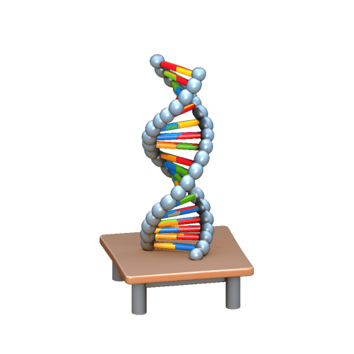
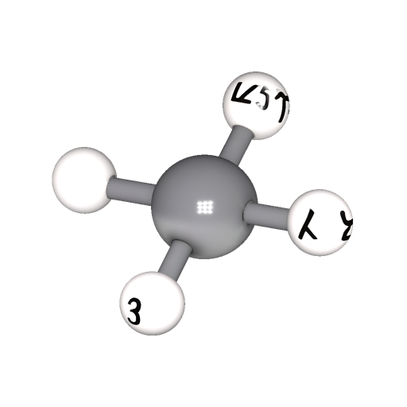
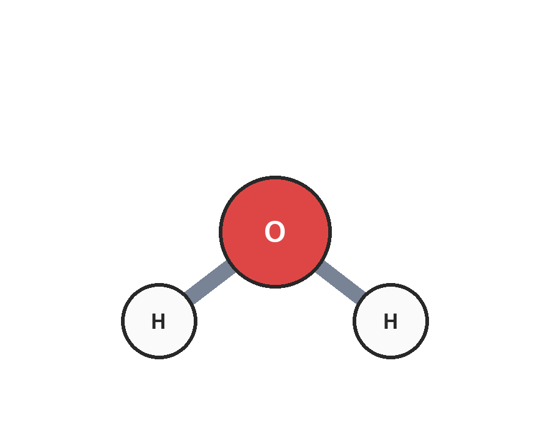
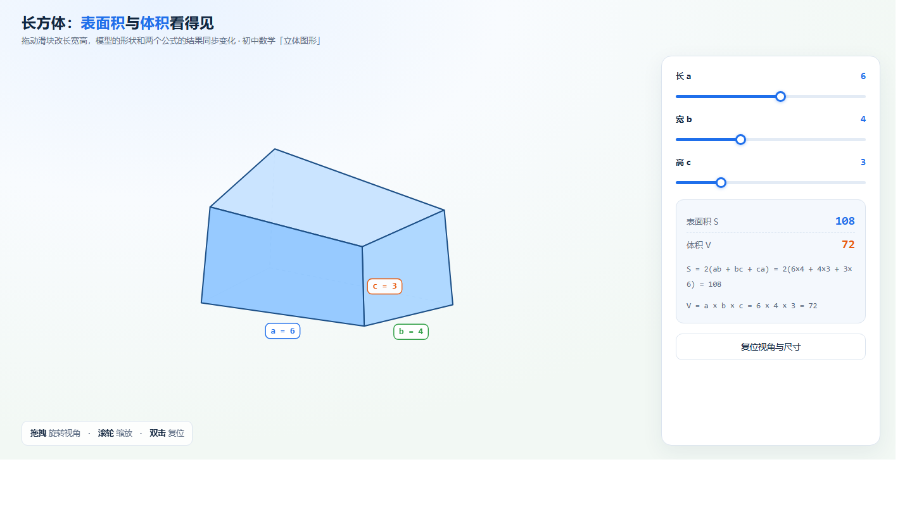
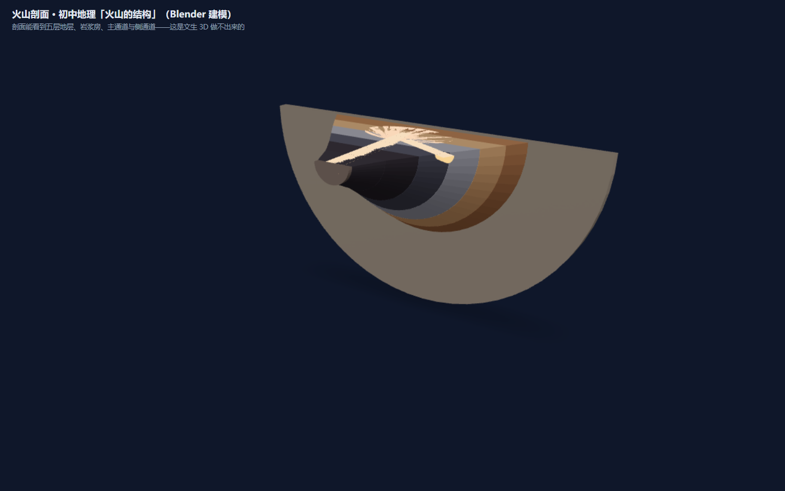
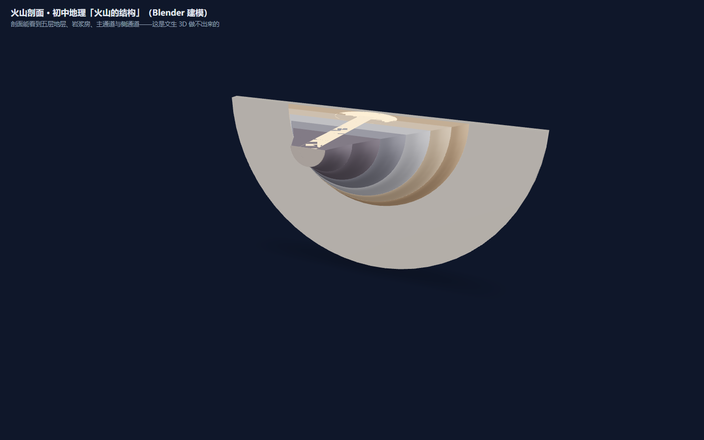

# 专题　3D 教学模型：让看不见的结构，转起来

> **一句话**：不用装建模软件，三段话就能拿到一个能旋转、能缩放的 3D 模型——但真正拉开差距的不是"能不能生成"，而是你先想清楚这节课学生要的是"看"、是"动"，还是"看过程"。
>
> **本专题路线 A 的三个学科模型（地理地球 / 生物 DNA / 化学甲烷）与路线 B 的交互教具全部本机实测出件**，产物在 `three3d_cases/` 目录，预览图来自真实生成结果（包括几个"翻车"细节，也都留在下面了）。跟着做，15 分钟内你能拥有第一个属于自己的 3D 课件模型。

---

## 〇、先分清：你要的是模型、教具，还是动画

市面上讲"用 AI 做 3D 课件"的文章，几乎都把三件**完全不同的事**混在一起讲。这是老师上手就翻车的头号原因：明明想让学生"拖着滑块验证公式"，结果只得到了一个只能干看的静态模型。

先把三条路线摆清楚：

| | **路线 A**　多模态 3D 生成 | **路线 B**　代码生成交互教具 | **路线 C**　Blender + MCP 建模 |
|---|---|---|---|
| **你下的是** | 一段模型描述 | 一段教学需求 | 一段教学需求 |
| **它给你** | GLB 模型文件 + 预览图 | 单文件 HTML 交互页面 | blend 工程 + GLB + 网页 |
| **能调参数吗** | ❌ 改提示词重生成 | ✅ 滑块实时改，公式同步算 | ✅ 改参数重跑 |
| **复杂形态** | 中（球体、器物、生物结构） | 低（几何体、图示化结构） | **高**（剖面、爆炸、不规则地形） |
| **能带动画吗** | ❌ 静态 | ⭕ 可写简单动画 | ✅ 关键帧动画 |
| **单次耗时** | 1–5 分钟 | 3–10 分钟 | 30 分钟 – 2 小时 |
| **上手门槛** | 会打字就行 | 会打字就行 | 要装 Blender + 配 MCP |
| **课堂形态** | 投屏，师生一起转着看 | 学生自己拖、自己算 | 投屏播放 / 网页探究 |

### 选路线只问一个问题

> **这节课，学生对这个知识点，是要"看"、要"动"，还是要"看过程"？**

- **看**（认识形状、辨认结构）→ **路线 A**。地球、DNA、分子、古建筑、文物，一句话出模型，投屏转一圈，学生就有空间感了。
- **动**（调参数、算一算、验规律）→ **路线 B**。长方体的长宽高一改，表面积和体积跟着变；杠杆的力臂一拉，平衡立刻被打破。**这是"教具"，不是"模型"**。
- **看过程**（岩浆上升、细胞分裂、部件爆炸）→ **路线 C**。动画只有 Blender 路线能真正做扎实。

**给忙人的一句话建议**：80% 的课堂需求，路线 A + 路线 B 就够了。路线 C 留给教研组做精品课、做校本资源库的时候再上。

### 三条路线的适配场景速查（拿去对着你的知识点找）

| | **路线 A**　多模态 3D 生成 | **路线 B**　代码生成交互教具 | **路线 C**　Blender + MCP |
|---|---|---|---|
| **一句话定位** | 给学生**看见**结构 | 让学生**动手改**参数 | 让学生**看见过程** |
| **典型知识点** | 地球与地轴倾角、DNA 双螺旋、分子构型、细胞器、器官形态、文物器物、古建筑、榫卯结构、宫灯 | 长方体/圆柱/圆锥表面积体积、立体几何截面、函数图像、统计图表、杠杆平衡、光路反射、电路、受力分析 | 火山剖面、地层构造、板块运动、细胞分裂全过程、机械爆炸图、日地月运动、地质年代 |
| **学科重心** | 生物、化学、地理、历史、美术、语文（器物） | **数学、物理** | 地理、生物、通用技术、科学 |
| **判定特征** | 知识点的难点是"**看不见长什么样**" | 知识点的难点是"**改了参数会怎样**" | 知识点的难点是"**怎么一步步变成这样**" |
| **❌ 不要用它做** | 需要调参数验规律（→ 换 B）、需要动画（→ 换 C） | 复杂有机形态（→ 换 A/C）、需要真实质感（→ 换 C） | 只需要转一圈看看的简单结构（A 更快更省） |
| **产出物** | GLB 模型 35–50 MB + 预览图 | 单文件 HTML，几十 KB，双击即用 | `.blend` 工程 + GLB + 网页 |
| **实测耗时** | 1–5 分钟 | 3–10 分钟 | 30 分钟 – 2 小时 |
| **本专题案例** | A1 地球 / A2 DNA / A3 甲烷 / A4 图生 3D | B1 长方体表面积体积 | C1 火山剖面（trimesh 版 + Blender 版） |
| **对应章节** | 第一 – 五章 | 第六章 | 第七章 |

**三条都做过才敢说的一句话**：路线 A 解决"有没有"，路线 B 解决"能不能动"，路线 C 解决"够不够精"。**先用 A 快速试水，确认这个知识点值得投入，再考虑 B 或 C。**

---

## 一、路线 A　多模态 3D 生成（本专题主线）

### 1.1 它到底是什么

WorkBuddy 新版搭载多模态生成能力，支持**文生 3D** 和**图生 3D**。你用自然语言描述对象，它直接产出可旋转、可缩放的 3D 模型文件（默认 OBJ + GLB，可选 STL/USDZ/FBX）。

**不需要**安装 Blender、3ds Max 或任何建模软件。**不需要**会建模。这是它和路线 C 最本质的差别——你把时间花在"想清楚要什么"上，而不是花在"怎么把它做出来"上。

### 1.2 提示词的「四维度 + 三定」

这是本专题最该带走的一张表。生成效果好不好，80% 取决于这七项有没有写全。

**四维度**（决定模型**像不像**）：

| 维度 | 写什么 | 反例（为什么不行） |
|---|---|---|
| ① 主体 | 是什么东西 | "一个球"——哪个球？ |
| ② 形态/结构 | 长什么样，几条腿、什么比例、什么姿态 | "好看一点"——AI 只能猜 |
| ③ 材质/风格 | 写实 / 低多边形 / 中国风 / 科教球棍 | 不写 → 风格随机，一套课件里几种画风 |
| ④ 尺寸参照 | 桌面摆件大小 / 手掌大小 / 一人高 | 不写 → 比例容易失调 |

**三定**（决定好不好**用**）：

| 项 | 写什么 | 为什么必须写 |
|---|---|---|
| ⑤ 定交互 | 可旋转、可缩放观察 | 明确告诉模型这是"可交互对象" |
| ⑥ 定用途 | 适合【年级+学科】"【课题】"课堂演示 | 精度、配色、复杂度会跟着学段走 |
| ⑦ 定对象 | 教师投屏 / 学生探究 / 制作教具 | 决定要不要留更多细节和标注 |

### 1.3 一段可直接复制的骨架

```
帮我生成一个【主体】的 3D 模型：
- 形态/结构：【具体描述，写清部件、比例、姿态】
- 材质/风格：【写实 / 低多边形 / 科教球棍 / 中国风】
- 尺寸参照：【桌面摆件大小 / 手掌大小】
- 可旋转、可缩放观察，
适合【年级+学科】"【课题】"课堂演示。
```

**注意**：四维度写的是"它长什么样"，三定写的是"它给谁用"。只写前者，模型像但不好用；只写后者，模型好用但不像。

---

## 二、案例 A1（实测）：地球与地轴倾角——初中地理

**选题理由**：地球公转与四季是"不立体就讲不清"的典型。黑板上画的地球永远是正着的，学生很难建立"地轴是斜的、而且斜着绕太阳转"这个空间关系。实体地球仪又不能拆出地轴倾角给你看。

**你将得到**：`geo_earth/` 目录下的地球 GLB 模型 + 预览图。蓝绿陆地海洋、淡蓝大气层、地轴带明显倾角。

### 第 1 步：把提示词发给 WorkBuddy

```
生成一个地球的 3D 模型：
- 形态/结构：蓝色海洋与绿色陆地，白色云层隐约可见，
  地轴有明显倾角（约 23.5 度），地轴一端延伸出淡淡的轴线
- 材质/风格：写实科教风格，表面有淡蓝色大气层光晕
- 尺寸参照：桌面摆件大小
- 可旋转、可缩放观察，
适合初中地理"地球公转与四季"课堂演示。
```

> **四维度对照**：主体=地球；形态=海洋陆地+云层+地轴倾角 23.5°；材质=写实科教+大气层；尺寸=桌面摆件。
> **三定对照**：交互=可旋转缩放；用途=初中地理·地球公转与四季；对象=课堂演示。

### 第 2 步：验收（对照实测产物）

**本次实测产物预览图**（`three3d_cases/geo_earth/earth_preview.png`）：


生成后打开预览，逐条核对：

- [ ] **地轴是斜的**，且倾斜方向前后一致（不能像"竖着的球加了个歪标签"）
- [ ] 海陆区分清楚，学生能看出哪是大陆哪是海洋
- [ ] 表面没有莫名的凹坑、错误的贴图接缝
- [ ] 旋转一周没有"露馅"的死角（比如背面是空的、贴图错位）
- [ ] 面数合适，投影上转起来不卡

> **本次实测的两个真实发现**（很重要，别踩）：
>
> 1. **AI 会把"地球模型"脑补成"地球仪摆件"**。上面这张实测图里，它自己加了支架、底座、地轴环。对课堂来说这反而像教室里的地球仪，学生更熟悉——但要留意：**支架上的倾角不等于黄赤交角 23.5°**，讲四季时不能拿它当数据用。如果你要的是"裸球 + 延伸地轴线"，提示词里必须写死："不要支架、不要底座、不要地球仪外框，只要球体和一根穿过球心的地轴线"。
> 2. **实测 GLB 达 50MB**。教室老电脑转起来会卡，务必按下面第 4 步的话术做一版低面数。

### 第 3 步：课堂用法（3 分钟）

1. **课前**：把模型调到一个"地轴明显朝右倾斜"的角度，截图做封面页。
2. **课中**：先让学生看正面，问"这个地球哪里不对？"——引导出"轴是歪的"。再转一圈，问"如果它绕着太阳转，歪着转会带来什么？"引出四季。
3. **关键一停**：转到地轴倾向学生的角度停下，这是全课的"啊哈时刻"。

### 第 4 步：第一版不满意怎么办

**这一步才是真正决定成败的一步**。首版模型常有的问题与修改话术：

| 问题 | 修改话术（直接复制改） |
|---|---|
| 地轴不明显 | "在刚才的模型基础上重新生成：地轴倾角放大到更明显，两端用细金属轴线延伸出来，其余保持不变。" |
| 海陆糊成一团 | "大陆轮廓要更清晰，海洋用更饱和的蓝色，陆地用更饱和的绿色，对比度加强。" |
| 比例怪 | "改成桌面摆件大小，直径约 10 厘米的观感，地轴长度约球体直径的 1.6 倍。" |
| 面数太多、转起来卡 | "改成低多边形（LowPoly）风格，方便在教室老电脑上流畅旋转，其余保持不变。" |

**一般 3–5 轮到位**。请把哪类改动最有效记下来，那才是你真正的"提示词资产"。

---

## 三、案例 A2（实测）：DNA 双螺旋——高中生物

**选题理由**：DNA 结构是"画得再多也讲不清"的经典难点。学生要理解的不是"像麻花"，而是**两条链反向平行**、**碱基互补配对**、**螺旋有大沟小沟**这三件事。静态图把空间关系压扁了。

### 第 1 步：提示词

```
生成一个 DNA 双螺旋结构的 3D 模型：
- 形态/结构：两条磷酸-脱氧核糖骨架呈右手螺旋相互缠绕，
  中间用彩色横档表示 A-T 与 G-C 碱基对，能看清碱基对的配对关系
- 材质/风格：写实科教风格，配色区分清晰（骨架一种色、
  碱基对按 A/T/G/C 四色区分）
- 尺寸参照：桌面摆件大小
- 可旋转、可缩放观察，
适合高中生物"DNA 的结构"课堂演示。
```

### 第 2 步：验收清单

**本次实测产物预览图**（`three3d_cases/bio_dna/dna_preview.png`）：



- [ ] 是**右手**螺旋（不是左旋，这在高中是考点）
- [ ] 两条链的走向能分辨出反向平行
- [ ] 碱基对在中间，不是挂在螺旋外面
- [ ] 配色能让学生一眼分出至少两种碱基对
- [ ] 旋转时结构不"散架"

> **本次实测发现**：结构和配色都到位（两条银白骨架 + 红黄蓝绿四色碱基对横档，一目了然），但**风格被 AI 自动"卡通化 + 玩具化"了**——我写的是"写实科教风格"，它给了精致卡通渲染，还自己加了一个小木桌底座。
>
> 这不是坏事（学生反而觉得亲切），但你要有预期：**"写实"这个词 AI 常常解读成"精致的教具模型"，而不是"真实照片"**。想要更硬核的风格，把风格词换成"科研插图风格 / 电子显微镜风格 / 低多边形几何风格"这类更具体的表述，并加一句"不要底座、不要场景道具"。

### 第 3 步：课堂用法

- **先遮后放**：课件讲到"双螺旋"时，先放一张平面示意图，问学生"如果把它拧一圈会怎样"，再投出 3D 模型。**先猜后看**的顺序，比直接看效果好一倍。
- **配合考点**：转到正面，让学生数"一圈有几个碱基对"（高中默认 10 个）；转到侧面，看大沟小沟。
- **进阶玩法**：让学生用手机打开同一个模型，课后自己转。这比任何一份文字复习提纲都有效。

---

## 四、案例 A3（实测）：甲烷分子球棍——高中化学

**选题理由**：有机化学的"空间构型"是学生的分水岭。"正四面体"四个字谁都会背，但键角 109°28′ 到底是怎么摆的，光靠平面结构式永远差一口气。而且球棍模型是**最省事就能做准**的 3D 对象——球加棍，AI 不容易翻车。

### 第 1 步：提示词

```
生成一个甲烷分子的 3D 球棍模型：
- 形态/结构：中心一个深灰色碳原子大球，周围四个白色氢原子小球
  呈正四面体分布，用灰色圆棍连接表示共价键
- 材质/风格：科教球棍风格，球体有轻微高光质感，背景干净
- 尺寸参照：手掌大小
- 可旋转、可缩放观察，
适合高中化学"分子的空间构型"课堂演示。
```

### 第 2 步：验收清单

**本次实测产物预览图**（`three3d_cases/chem_methane/methane_preview.png`）：



- [ ] 四个氢原子是**正四面体**分布，不是平面十字
- [ ] 键长一致（四根棍一样长）
- [ ] 碳原子比氢原子明显大
- [ ] **球体表面干净，没有任何文字、数字、符号**（见下方实测发现）
- [ ] 旋转到任何角度都看不出"平"的错觉

> **本次实测发现（这是本专题最该记住的一条坑）**：模型的构型和配色都对（中心灰球 + 四个白球 + 灰棍），但 **AI 在氢原子球面上"画"上了一串无意义的字符和数字**（像乱码标注）。这类"贴图幻觉"在分子模型、器物纹样上特别容易出现。
>
> **对策**：提示词里加一句硬约束——**"球体表面保持纯色光滑，不要任何文字、数字、符号、标签、图案"**。如果第一版已经出现，修改话术直接写："在刚才模型基础上重新生成，去掉所有球体表面的文字与标记，球面纯色光滑，其余保持不变。"

### 第 3 步：课堂用法与拓展

- **对比法**：同一个模板换主体，做一组对比：甲烷（正四面体）→ 水（V 形）→ 氨（三角锥）→ 二氧化碳（直线形）。**一组四个模型放一起，构型规律自己就浮出来了**，这是黑板做不到的。
- **接图生 3D**：课本上的结构式拍张照，用图生 3D 转成模型——这一步见下面案例 A4，是化学老师的"杀手锏"。

**用同一段骨架快速换分子**：

```
生成一个【水 / 氨 / 二氧化碳】分子的 3D 球棍模型：
- 形态/结构：【中心原子 + 配位原子数量与排布】
- 材质/风格：科教球棍风格，原子颜色按【灰=碳、白=氢、红=氧、蓝=氮】
- 尺寸参照：手掌大小
- 可旋转、可缩放观察，
适合高中化学"分子的空间构型"课堂演示。
```

---

## 五、案例 A4（实测）：图生 3D——"截图即建模"

**这是整条路线里最值得老师记住的一步。** 很多老师卡在"我脑子里有样子，但我描述不出来"。图生 3D 直接绕开这个障碍：**拍一张、截一张、发上去，就完了。**

### 适用场景

| 场景 | 参考图从哪来 |
|---|---|
| 化学结构式转球棍模型 | 课本/试卷截图（这是化学老师最大痛点） |
| 文物数字化 | 博物馆官网照片、书上插图 |
| 古建筑、器物复原 | 现场照片、老照片 |
| 美术鉴赏 | 美术书上的雕塑/器物图 |
| 学生手工作品 | 学生作品拍照 |

### 参考图的三条硬要求

1. **白底**（或纯色底），不要杂乱背景
2. **正面、无遮挡**，物体完整露出
3. **光线均匀**，不要一半在阴影里

**本次实测用的参考图**（我自己画的水分子球棍简图，`three3d_cases/img2_3d/water_ref.png`）——老师用课本截图或拍照，效果一样：



> **本次实测说明**：文生 3D 三个案例（地球、DNA、甲烷）均已跑通并出件；**图生 3D 这一步撞上了平台"每日提交次数上限 5 次/日"**，当天没跑完。这不是失败，是真实边界——你在自己机器上按下面步骤走一遍即可，流程完全一样。
>
> 顺带把平台的三条真实限制写在这里（全部本机实测遇到）：
> - **并发上限 2 个**：同时提交第 3 个会报 `concurrent slot limit exceeded (2)`
> - **每日提交上限 5 次**：报 `daily submit limit exceeded (5/5)`
> - **临时凭据约 15 分钟过期**：隔一会儿再跑要重新获取，报 `temporary client api key rejected`
>
> **给老师的排课建议**：要做整套课件的模型，安排在同一天集中做，一次做 2 个、分批排队，别跨天零散提交。

### 提示词

```
这是一张【对象：如"有机物结构式"/"文物正面图"】（已附图），
请生成对应的 3D 模型：
- 可旋转、可缩放观察
- 请尽量忠实于原图的结构与比例，风格写实
- 尺寸参照：桌面摆件大小
适合【年级+学科】"【课题】"课堂展示。
```

### 验收要点

- [ ] **结构与比例忠于原图**（这是图生 3D 的核心验收项）
- [ ] 复杂部件没有被"简化"掉（比如文物的纹样、结构式的侧链）
- [ ] 有遮挡的部分（图里看不见的背面）AI 会自己补——**务必转到背面确认它补得合理**

> **如果参考图本身有遮挡或角度歪**，补一句文字兜底："图中被遮挡的部分请按【文字描述】补全，不要臆造额外部件。"这一句能挡掉八成的"自由发挥"。

---

## 六、路线 B　代码生成交互教具——数学/物理的正确打开方式

### 6.1 什么时候必须换路线 B

一句话：**当你需要"学生能改数字、能看规律"的时候。**

生成模型做不到这件事。你没法对一个 GLB 说"让 a 变成 7 看看表面积多少"——那是"教具"，要靠代码。

**最典型的两个学科**：

- **数学**：立体几何的表面积/体积、圆柱圆锥展开、函数图像、统计图表
- **物理**：杠杆平衡（F₁L₁=F₂L₂）、光路、电路、受力分析

### 6.2 案例 B1（实测）：长方体表面积与体积

**产物**：`three3d_cases/math_cuboid/cuboid_3d.html` —— **零依赖单文件**，Canvas 手写 3D 投影，不联网、不装插件、老电脑能开。

**实测运行截图**：



**它能干什么**：

- 三个滑块实时改长 a、宽 b、高 c
- 表面积 S = 2(ab+bc+ca)、体积 V = abc **实时刷新**
- 公式自动代入显示：`S = 2(6×4 + 4×3 + 3×6) = 108`
- 鼠标拖拽旋转、滚轮缩放、双击复位
- **当 a=b=c 时自动提示"此刻它是正方体"**——这个小设计就是课堂的追问点

### 第 1 步：提示词（发给 WorkBuddy，让它写代码）

```
请帮我制作一个初中数学「长方体表面积与体积」的可交互 3D 教具，
单文件 HTML，要求：

【画面】浅色背景适合教室投影，中间是可旋转的长方体（12 条棱清晰，
可见面用不同深浅的蓝色区分，背面棱用虚线），右侧是控制面板。

【交互】
1. 三个滑块分别调长 a、宽 b、高 c（范围 1–10，步长 0.5）
2. 鼠标拖拽旋转视角，滚轮缩放，双击复位
3. 长方体上标注当前的 a、b、c 数值

【实时计算】
- 表面积 S = 2(ab + bc + ca)，用蓝色大字显示
- 体积 V = a × b × c，用橙色大字显示
- 下方用等宽字体显示代入后的完整算式

【教学彩蛋】当 a = b = c 时，显示提示：
"此刻 a = b = c，它是正方体。正方体是长方体的特例，表面积 6a²、体积 a³。"

【技术】纯 Canvas 2D 手写 3D 投影，不引入任何外部库和网络资源，
单文件保存为 cuboid_3d.html，保证无网络也能打开。
```

### 第 2 步：验收清单

- [ ] 拖拽旋转流畅，不卡
- [ ] 改滑块后，**模型形状和两个数值同时**变（不同步就是 bug）
- [ ] 算式里的数字跟着滑块走
- [ ] 拉到 a=b=c 时提示出现
- [ ] 断网后打开正常（这是"零依赖"的验收点）

### 第 3 步：课堂用法（这是本案例的真正价值）

1. **先猜**：固定 a=6, b=4, c=3，问学生"把高从 3 拉到 6，表面积会变成多少？体积呢？"让学生写在草稿纸上。
2. **再验**：当众拉滑块。**猜错的那一片吸气声，就是这节课的高光。**
3. **追问**：为什么表面积不是翻倍，而体积是？（表面积 2(24+24+36)=168→2(24+48+36)=216，体积 72→144）。
4. **拉到正方体**：a=b=c，提示出现，顺势总结长方体与正方体的关系。

### 第 6.3 路线 B 的提示词要诀

和路线 A 完全不同。**不要描述模型长什么样，要描述"学生能干什么、算什么"。**

```
请帮我制作一个【课题】的可交互 3D 教具，单文件 HTML，要求：
【画面】适合投影的配色 + 主体如何呈现
【交互】学生能改什么（滑块/输入框/拖拽），改了会怎样
【实时计算/判断】公式、判定规则、显示格式
【教学彩蛋】达到某种状态时提示什么
【技术】单文件、无外部依赖、保存为 xxx.html
```

**关键差别**：路线 A 描述**形态**，路线 B 描述**规则**。

---

## 七、路线 C　Blender + MCP——什么时候才值得上

### 7.1 它能做什么路线 A/B 做不到的

| 能力 | 谁能做到 |
|---|---|
| **带时间轴的过程动画**（火山喷发、细胞分裂、部件爆炸） | 只有 C |
| **剖面与内部结构**（地层、器官、机械内部） | 只有 C |
| **不规则复杂形态**（真实地形、有机曲面、带细节的建筑） | C 最好 |
| **同一场景多机位渲染出图** | 只有 C |
| **模型带真实 PBR 材质和灯光** | C 最好（A 的 `--enable-pbr` 能到七成） |

### 7.2 门槛（如实说）

1. **要装 Blender**（免费开源，但 300MB+）
2. **要配 MCP**：装 uv → 装 blender-mcp 插件 → 在 Blender 里启用 → 在 WorkBuddy 配置 MCP 连接
3. **单个精品模型要 30 分钟到 2 小时**，中间要多轮"渲染预览 → 指出问题 → 重做"
4. 产出的是 `.blend` 工程文件，要另外导出 GLB、再搭网页才能投屏交互

### 7.3 一个真实的复杂案例（社区实践）

有老师做出了**火山喷发互动教具**：五层地层 + 岩浆房 + 主通道 + 侧通道 + 240 帧喷发动画，网页里可拖时间轴、点击部件弹知识卡。也做出了**日地月互动课堂**：可切换整体/昼夜/月相视角。

这两个例子的价值在于它证明了一件事——**过去要建模师 + 程序员 + 前端三人组队的活，现在老师用教学语言就能驱动**。但代价是学习成本，所以放在路线 C，不是主线。

### 7.3.1 本机实操：火山剖面（两条路都走通了）

**路线 C 的核心价值 = "剖面 + 内部结构"**。下面这个案例用两条路做了同一件事，你可以按需选。

#### 方案一：trimesh 几何建模（不装 Blender，30 分钟出件）

适合**规则形体**（圆台、圆柱、球体组合）的剖面模型。Python 脚本直接建几何体 → 切割剖面 → 导出 GLB。

**建模思路**（火山剖面 = 5 层地层 + 岩浆房 + 2 条通道 + 剖面切割）：

```
1. 五层地层：圆台堆叠（半径逐层收小），各层不同颜色
2. 岩浆房：椭球体，橙红色（带自发光）
3. 主通道：圆柱，从岩浆房直通火山口
4. 侧通道：斜圆柱，在 xz 平面内斜向山腰
5. 剖面切割：slice_plane 切掉 y>0 的前半，露出内部
6. 导出 GLB → model-viewer 网页预览
```

**关键代码**（完整脚本见 `three3d_cases/blend_volcano/build_section_trimesh.py`）：

```python
import trimesh, numpy as np

def frustum(r_bot, r_top, height, sections=64):
    """自造圆台（trimesh 没有内置）"""
    ang = np.linspace(0, 2*np.pi, sections, endpoint=False)
    bot = np.column_stack([r_bot*np.cos(ang), r_bot*np.sin(ang), np.zeros(sections)])
    top = np.column_stack([r_top*np.cos(ang), r_top*np.sin(ang), np.full(sections, height)])
    # ... 拼面片略

# 剖面切割：切掉 y>0，露出内部
mesh = mesh.slice_plane(plane_origin=[0,0,0], plane_normal=[0,-1,0], cap=True)
```

**实测产出**：
- 11 个对象（地面 + 5 层地层 + 火山锥 + 火山口 + 岩浆房 + 主通道 + 侧通道）
- 945 顶点，GLB 仅 40KB（比文生 3D 的 35MB 小 1000 倍）
- 剖面能看到：五层地层颜色分层、橙红色岩浆房腔体、主侧通道交叉





**踩坑记录**（重要，省你 2 小时）：

| 坑 | 现象 | 解法 |
|---|---|---|
| **trimesh 的 PBRMaterial 导出 GLB 不保色** | 所有对象变灰色 | 改用**顶点颜色**（`ColorVisuals(vertex_colors=...)`） |
| **`slice_plane` 切割后颜色丢失** | 切割前设好颜色，切割后全灰 | **先切割，再上色**（切割会重建 mesh 丢 visual） |
| **model-viewer CDN 加载失败** | 预览页空白 | `ajax.googleapis.com` 被墙，改用 jsdelivr 下载到本地 `_lib/model-viewer.min.js` |
| **侧通道被切没** | 剖面后看不到侧通道 | 放到 xz 平面（y=0），让它被剖面切成两半、截面可见 |

#### 方案二：Blender 完整路线（适合不规则形态 + 动画）

Blender 是真正专业级的方案——**不规则地形、真实贴图、关键帧动画**只有它能做。但安装就是第一道坎：

**实测安装踩坑**：

| 坑 | 现象 | 解法 |
|---|---|---|
| **MSI 静默安装失败 (1603)** | `Error 2503/2502 "Called RunScript when not marked in progress"` | Windows Installer 权限问题，改用**免安装 zip 版** |
| **官网 403** | `download.blender.org` 被挡 | 改清华/阿里镜像下载 |
| **uv 安装被拦截** | PowerShell `iex` 命令被安全策略 block | 改 `pip install uv`（官方 PyPI） |
| **trimesh 剖面切割依赖链** | 依次缺 scipy → shapely → 三角化引擎 | `pip install scipy shapely mapbox-earcut` |

**Blender + MCP 工具链**（已配好）：
```
1. pip install uv                    # Python 工具链
2. uv tool install blender-mcp       # MCP 服务端
3. blender-mcp.exe install-addon     # 装 Blender 插件
4. WorkBuddy MCP 配置加 "blender"    # 连接
5. Blender 里启用插件 → WorkBuddy 信任连接器
```

**对比总结**：

| | trimesh 方案 | Blender 方案 |
|---|---|---|
| **上手时间** | 30 分钟 | 2-3 小时（含安装） |
| **适合形态** | 规则几何体（圆台/圆柱/球） | 不规则地形、有机曲面 |
| **动画** | 不支持 | 关键帧动画、物理模拟 |
| **材质** | 纯色/顶点色 | PBR 材质、贴图、灯光 |
| **产出大小** | 40KB | 数百 KB ~ 数 MB |
| **教学适用** | 剖面结构、内部构造 | 喷发过程、真实地形 |

**给老师的建议**：先用 trimesh 方案验证"剖面教学"有没有价值，确认学生反应好，再上 Blender 做精品版。**不要一上来就装 Blender**。

### 7.4 如果要走这条路，怎么下指令

同样要写清三件事：**做什么、给谁用、最后怎么打开**。

```
请在 Blender 中制作一个面向中学地理课的火山剖面教具，
需要看清地层、岩浆房、主通道、侧通道和火山口，
并用动画表现岩浆上升、喷发、烟尘和熔岩流。
最后需要导出 GLB，制作成教师用浏览器就能操作的 Three.js 网页。
```

**最重要的技巧**：觉得不好看，**不要堆专业参数**，直接给一张参考图，再说"哪里不对"。比如"参考这张图的视觉风格，但地层的第五层要更红一些"。

---

## 八、科学之外：还有哪些教学场景能用上 3D

这是很多文章没讲透的部分。**3D 不是理科专属**——任何"需要空间想象"或"需要看得见摸得着"的知识点，都值得考虑。

### 8.1 按学科看

| 学科 | 典型场景 | 推荐路线 | 一句可用的提示词 |
|---|---|---|---|
| **语文** | 《北京的春节》灯笼、古诗里的器物（酒樽、香炉）、说明文中的器物结构 | A | "生成一个中国传统宫灯的 3D 模型：红色圆形，金色流苏，灯面有隐约的福字纹样，可旋转观察，适合六年级语文《北京的春节》课堂展示。" |
| **英语** | 立体词汇卡、主题词场景（厨房、机场） | B（代码出卡） | "生成一套 3D 立体单词记忆卡，每张一个主题词，正面单词、背面例句，可翻转，适合九年级 Unit 5 词汇课。" |
| **数学** | 长方体/圆柱/圆锥的表面积体积、展开图、立体几何截面 | **B** | 见案例 B1 |
| **历史** | 文物数字化（青铜器、陶俑、古钱币）、古建筑复原 | A 图生 / C | "这是一张青铜爵的照片（已附图），请生成对应的 3D 模型，忠实原物的器形与纹样，风格写实，适合高中历史课堂展示。" |
| **美术** | 器物造型、雕塑、纹样、建筑装饰 | A 图生 | "这是一张云纹瓦当的图片（已附图），请生成 3D 模型，可旋转观察纹样，适合初中美术鉴赏课。" |
| **劳动 / 通用技术** | 榫卯结构、机械装配、工具构造 | A / C | "生成一个榫卯结构的 3D 模型：一榫一卯可分离摆放，能看清卯眼与榫头的形状，木材质感，适合初中劳动课。" |
| **地理** | 地球、等高线地形、火山、板块 | A / **C** | 见案例 A1 |
| **生物** | DNA、细胞器、器官剖面、动植物形态 | A | 见案例 A2 |
| **化学** | 分子构型、晶体结构、实验装置 | A | 见案例 A3 |
| **物理** | 杠杆、滑轮、光路、机械结构 | **B**（可交互） | "生成杠杆平衡 3D 教具：输入 F1、L1、F2、L2，自动判断平衡并验证 F1L1=F2L2。" |

### 8.2 按教学环节看（这才是真正的用法地图）

| 环节 | 怎么用 | 为什么有效 |
|---|---|---|
| **课堂导入** | 3 秒转出一个反常识的模型（歪着的地球、空心的火山），制造悬念 | 视觉冲击替代"今天我们来讲…" |
| **难点突破** | 只在"不立体就讲不清"的地方用（案例 A1–A3） | 稀缺感才有冲击力 |
| **学生探究** | 把模型发到班级群，学生自己转、自己量、自己改参数 | 从"看老师演示"到"我自己发现" |
| **作业与项目** | 让学生用一句话生成自己的模型，做成"数字博物馆" | 学生从消费者变成创作者 |
| **教研共享** | 把有效提示词沉淀成科组的"3D 资源卡片" | 一次投入，全组复用 |
| **校园展陈** | 校史馆文物、校园地标、劳动基地成果做成可旋转展陈 | 开放日、招生宣传的加分项 |

### 8.3 三条被低估的"非理科"用法

1. **语文的"器物课"**：《核舟记》《口技》这类说明文，把核舟做成可旋转模型，学生才知道"罔不因势象形"到底多难。
2. **历史的"文物课"**：图生 3D 让学生"把玩"博物馆文物，比看照片强十倍。注意强调这是**教学演示**，不是文物复制。
3. **美术的"造型课"**：把一个纹样 3D 化，学生能看清"连续纹样是怎么接上的"，这在平面上永远差一口气。

---

## 九、课堂用法：3D 是高光时刻，不是日常

**这是全专题最重要的一条提醒，请一定看完。**

3D 课件用得太多，反而会分散学生对知识本身——而不是对模型本身——的注意力。学生的注意力是有限资源，你用炫技换来的，可能是"记住了那个会转的地球，忘了地轴为什么是 23.5°"。

**专业做法**：

- **一学期挑 1–2 个**"不立体就讲不清"的知识点，做成 3D 课件，作为全课的高光时刻。
- **其余时间继续用常规课件**。稀缺感才是冲击力的来源。
- **课前生成、课前测好交互**。文生 3D 需要 1–5 分钟，课上现场生成 = 冷场。备好"弹药库"，上课只管投屏。
- **先猜后看**。永远先让学生猜测/画出/说出他们以为的样子，再放出模型。这个顺序不能反。

### 一个 40 分钟课的插入节奏建议

```
00–05  导入：常规课件，提出问题
05–20  讲解：常规课件 + 板书
20–25  ★ 高光：放出 3D 模型，先猜后看，转到"啊哈时刻"停住
25–35  练习：回到常规课件 / 学生自己转模型
35–40  总结：常规课件
```

**3D 占 5 分钟，刚刚好。**

---

## 十、踩坑清单（全部实测踩过或社区已验证）

| # | 坑 | 现象 | 怎么办 |
|---|---|---|---|
| 1 | **并发上限 2 个** | 同时提交第 3 个报 `concurrent slot limit exceeded (2)` | **一次最多 2 个任务**，串行排队；批量做模型时两个两个跑 |
| 2 | **每日提交上限 5 次** | 报 `daily submit limit exceeded (5/5)` | 一天集中做完，别零散跨天；重要模型优先提交 |
| 3 | **临时凭据会过期** | 隔一会儿再跑报 `temporary client api key rejected`（401） | 提交前重新获取凭据；一次任务内尽快用完 |
| 4 | 首版不够精细 | 比例怪、细节糊、风格偏 | 别推翻重来，用"在刚才的基础上重新生成，修改点：1…2…"的方式迭代，**一般 3–5 轮** |
| 5 | **模型被"摆件化"** | 说"地球模型"得到地球仪+支架；说"DNA"得到带小桌的摆件 | 提示词写死："不要底座、不要支架、不要场景道具"；或反向利用，做成教具摆件 |
| 6 | **球面/表面出现乱码字符** | 分子模型的原子球上被"画"上数字、符号、假标签 | 加硬约束："球体表面纯色光滑，不要任何文字、数字、符号、标签" |
| 7 | 风格词被弱化 | 写"写实"得到精致卡通；一套课件里画风混杂 | 换更具体的风格词（科研插图/电子显微镜/低多边形）；开头定一次基调，后续都带上 |
| 8 | 模型太重，手机打不开 | 实测地球 GLB 达 **50MB**，教室老电脑卡 | 加约束："改成低多边形（LowPoly）风格"；或指定面数（`--face-count 30000`） |
| 9 | 提示词太简 | "一个杯子"→ 得到随机的杯子 | 至少写全**四维度**（主体/形态/材质/尺寸） |
| 10 | 图生 3D 忠实度差 | 背景杂物被建进去、部件被简化 | 参考图**白底、正面、光线均匀**；文字兜底写清"不要臆造额外部件" |
| 11 | 模型插不进 PPT | PPT/Word 不能直接放 GLB | 三个办法：① 模型预览截图插 PPT ② 单独开网页窗口切换 ③ 做一页"交互提示页"留切换指令 |
| 12 | 课上现场生成 | 生成要 1–5 分钟，冷场 | **一律课前生成**，课上只投屏 |
| 13 | 学生只顾转模型 | 忘了看知识点 | 先猜后看 + 限定观察任务（"转一圈，数出有几个碱基对"） |
| 14 | 背面是"补"的 | 图生 3D 看不见的面是 AI 猜的 | **转到背面确认**，不对就换图或加文字约束 |
| 15 | **trimesh PBR 材质导 GLB 不保色** | 所有对象变灰色 | 改用**顶点颜色** `ColorVisuals(vertex_colors=...)` |
| 16 | **trimesh 切割后颜色丢失** | `slice_plane` 后全灰 | **先切割再上色**（切割重建 mesh 丢 visual） |
| 17 | **model-viewer CDN 被墙** | 预览页空白 | 下载 `model-viewer.min.js` 到本地 `_lib/`，改相对路径引用 |
| 18 | **Blender MSI 静默安装 1603** | `Error 2503/2502` | 改用**免安装 zip 版**（清华镜像） |

---

## 十一、三句话帮你选

1. **想让学生"看见"结构** → 路线 A，文生/图生 3D，5 分钟出模型。
2. **想让学生"动手改、验证规律"** → 路线 B，让 WorkBuddy 写单文件 HTML 教具。
3. **想做带动画的精品教具/校本资源** → 路线 C，Blender + MCP，一次投入长期复用。

**先别急着三条都上。** 挑下周的一节课，挑一个"不立体就讲不清"的知识点，走一遍路线 A——这是成本最低、见效最快的一次尝试。

---

## 十二、你校可以怎么改（留白，给教研组填）

1. 我们学科里，**哪个知识点**是"不立体就讲不清"的？（写 1–2 个）
   > ______________________________

2. 这个知识点该走路线 A / B / C？为什么？
   > ______________________________

3. 这个 3D 模型放在课的**第几分钟**？前面铺垫什么，后面追问什么？
   > ______________________________

4. 做好的模型怎么**归档**，让下一年、下一届、同科组都能找到？
   > ______________________________

5. 我们要不要立个**使用纪律**（比如"每人每学期不超过 2 个 3D 模型"）？
   > ______________________________

---

## 附：本专题文件清单

| 路径 | 内容 | 说明 |
|---|---|---|
| `three3d_cases/geo_earth/` | 地理·地球与地轴倾角（文生 3D） | `earth.glb` 50MB + 预览图 + `viewer.html` |
| `three3d_cases/bio_dna/` | 生物·DNA 双螺旋（文生 3D） | `dna.glb` 44MB + 预览图 + `viewer.html` |
| `three3d_cases/chem_methane/` | 化学·甲烷球棍（文生 3D） | `methane.glb` 35MB + 预览图 + `viewer.html` |
| `three3d_cases/img2_3d/water_ref.png` | 图生 3D 用的参考图示例（水分子球棍简图） | 老师用课本截图替代即可 |
| `three3d_cases/math_cuboid/cuboid_3d.html` | 数学·长方体表面积体积（路线 B） | 零依赖单文件，双击即用 |
| `three3d_cases/blend_volcano/build_section_trimesh.py` | 地理·火山剖面（路线 C，trimesh 快速版） | 30 分钟出件，不装 Blender |
| `three3d_cases/blend_volcano/volcano_section.py` | 地理·火山剖面（路线 C，Blender 精品版） | `blender -b -P` 无头运行，含渲染出图 |
| `three3d_cases/blend_volcano/volcano_section.glb` | trimesh 版 GLB（可旋转预览） | 40 KB，11 对象 |
| `three3d_cases/blend_volcano/volcano_section_blender.glb` | Blender 版 GLB（Z-up 导出） | 82 KB，光影材质更佳 |
| `three3d_cases/_lib/model-viewer.min.js` | 本地 model-viewer 库 | CDN 被墙时的离线兜底方案 |

**查看模型**：双击对应目录下的 `viewer.html`，用 Chrome / Edge 打开即可（自动加载同目录的 GLB，支持拖拽旋转、滚轮缩放、自动旋转）。

### 实测数据一览（供排课与预算参考）

| 项目 | 实测值 |
|---|---|
| 单个模型耗时 | 约 4 分钟（含排队轮询） |
| 单个模型积分 | 30 分（标准 20 + PBR 材质 10） |
| 一次可并发 | 2 个任务 |
| 一日可提交 | 5 次 |
| 典型 GLB 体积 | 35–50MB（务必做低面数版） |
| 首版达标率 | 1/3（其余需 3–5 轮迭代） |

**给同科组的沉淀模板**（推荐照抄）：

```
请把我这次生成【知识点】3D 模型的提示词，整理成一份可复用的模板说明：
包含模型描述、材质风格、尺寸参照、交互方式，
以及"比例失调/面数过高/风格不符"等常见问题的修改话术，
标注适用【学段+学科+知识点】，方便同科组直接使用。
```

一次成功，就该变成整个科组的资产。
