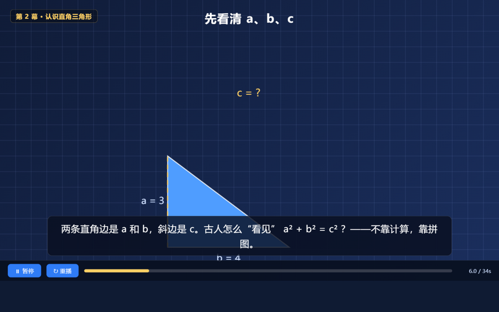
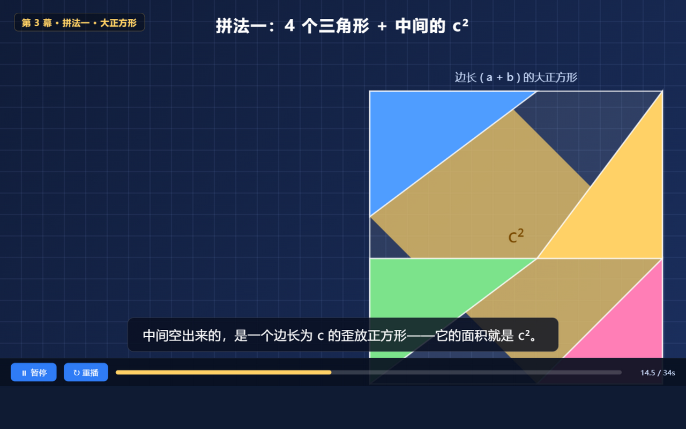
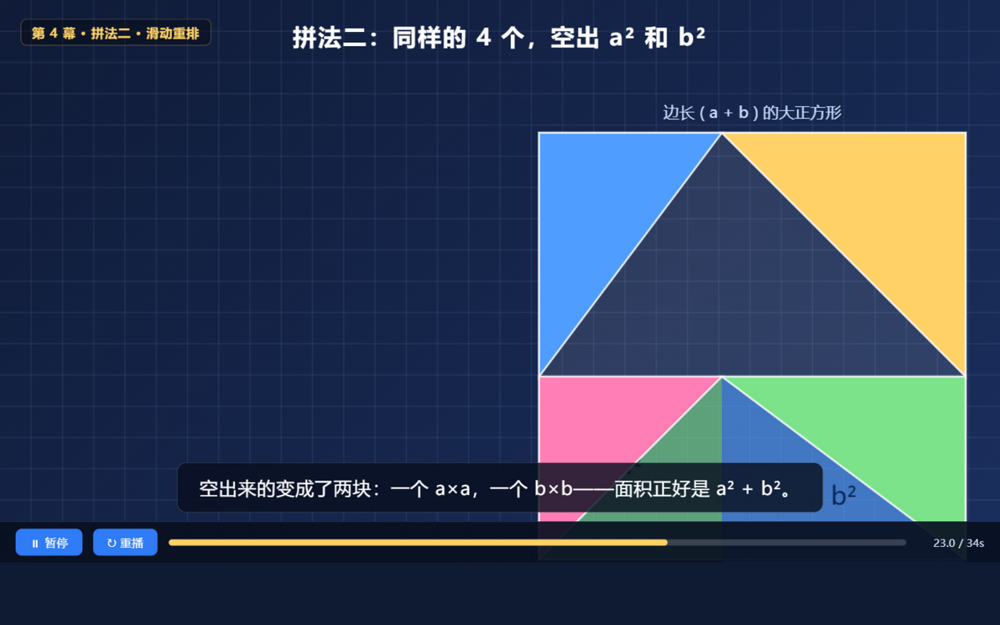
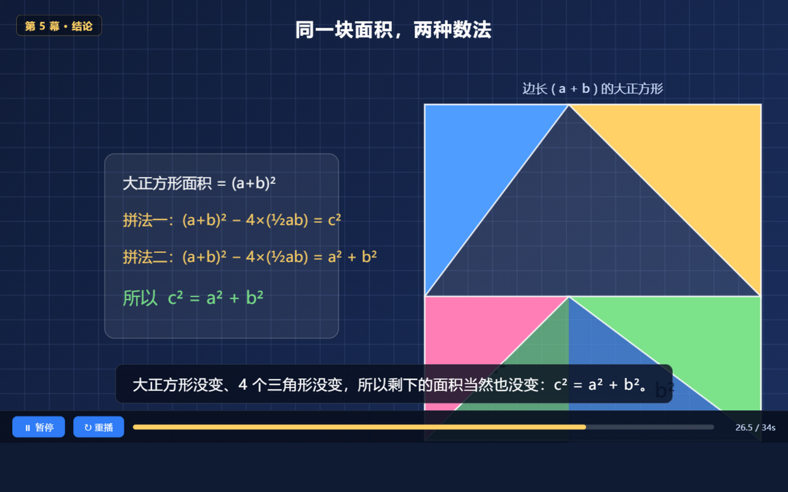
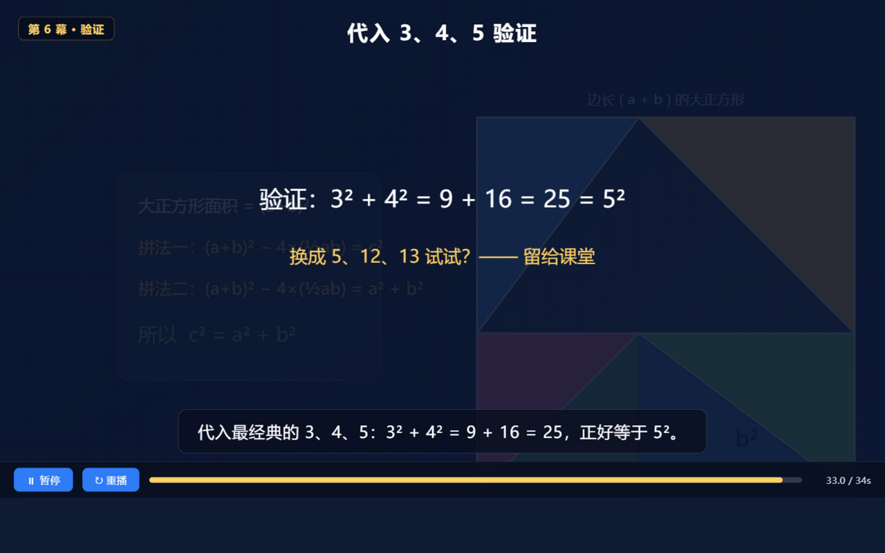
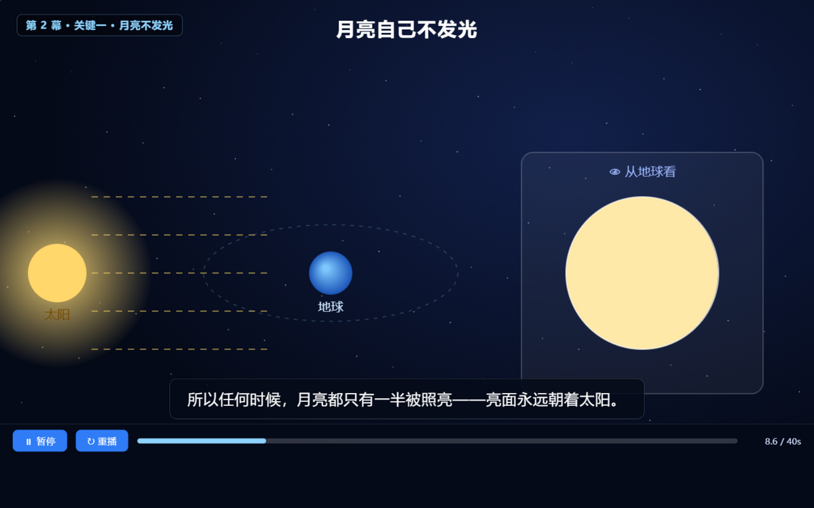
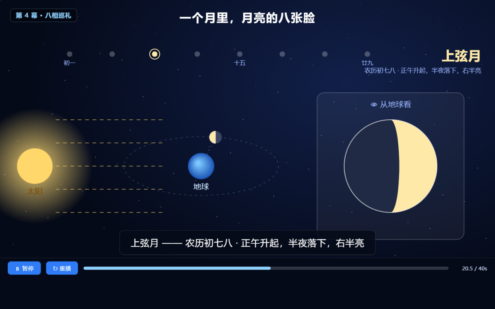
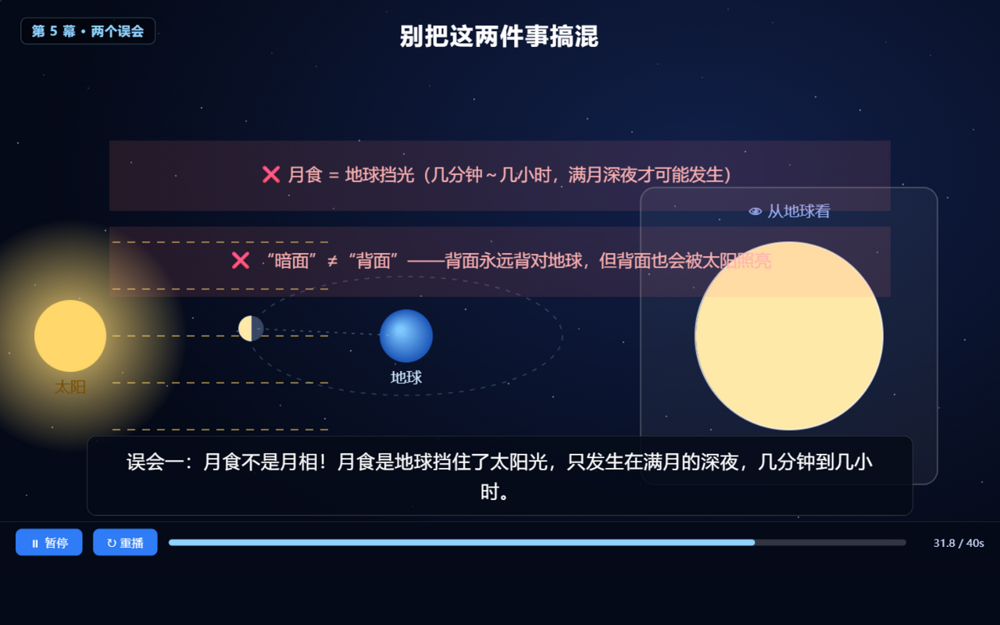
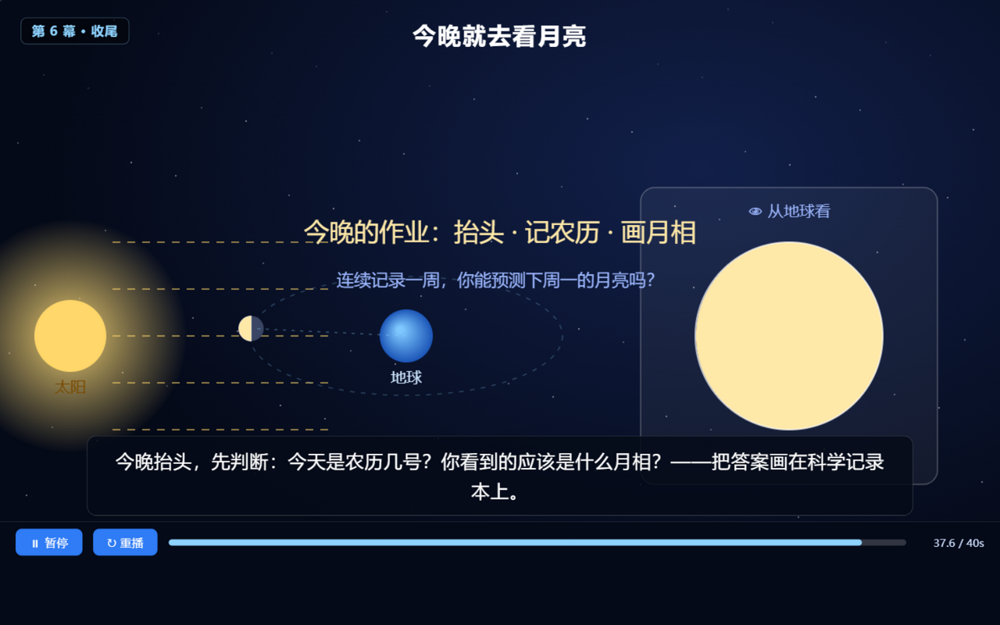

# 专题　MG 动画与代码生成视频：知识讲解类视频，一句话开工

> **一句话**：不用摄像机、不用视频模型，WorkBuddy 直接用代码"画"出讲解视频——单文件网页动画，课上投屏即放，录屏即得 MP4。
>
> **本专题三个案例全部实测**：产物在 `mg_cases/` 目录，截图全部来自真实运行画面。跟着做，60 分钟内你能拥有第一条自己"编"出来的知识讲解视频。

---

## 〇、为什么是"代码生成视频"，而不是"AI 生成视频"

2026 年下半年，"不用视频模型、靠代码堆出惊艳短片"的做法火了（社区称之为 MG 动画 / Motion Graphics，或"代码生成视频"）。对教师来说，它比 AI 视频模型更适合课堂，原因有四个：

| | AI 视频模型（文生视频） | 代码生成 MG 动画 |
|---|---|---|
| **内容准确性** | 常有物理错误、文字乱码，理科不敢用 | 代码画的，角度、数值、公式想多准有多准 |
| **文字呈现** | 画面里的汉字经常写错 | 字幕、公式、标注完全可控 |
| **成本** | 按秒计费，一条几十积分起步 | 只耗一次生成的积分，改字免费 |
| **可改性** | 不满意只能重新抽卡 | 一句话改颜色、改数值、改时长 |

**技术路线三条**（按上手难度）：

1. **单文件网页动画（本专题主线）**：WorkBuddy 生成一个 HTML，浏览器打开就播，带播放/暂停/进度条。投屏直接用；想发群里，用录屏或浏览器录制导出 MP4。
2. **Remotion（代码生成 MP4）**：用 React 代码渲染真视频文件，社区有现成 Skill（参考飞书「AGI之路」知识库 waytoagi.feishu.cn 的视频生成教程合集，以及《MiniMax M2.5+Remotion Skills》等分享）。适合要"一个 MP4 文件"的场合，需要装 Node 环境。
3. **Manim（数学动画专用）**：3Blue1Brown 同款，公式推导动画的天花板，学习成本最高。

**教师结论：先走路线 1。** 零依赖、零安装、随改随播；等有固定需求（比如学校视频号每周更新）再升级路线 2。

---

## 一、案例 A（实测）：勾股定理·拼图证明——初中数学

**选题理由**：a² + b² = c² 每个老师都会讲，但"为什么"靠嘴说很难。拼图证明（出入相补）天生适合动画——三角形滑动的那一瞬间，学生"看见"了定理。34 秒动画，替代黑板上画三遍还画不齐的图。

**你将得到**：`gougu_theorem.html`（单文件，34 秒六幕：开场 → 认识 a/b/c → 拼法一空出 c² → 三角形滑动重排 → 结论 → 3-4-5 验证），带字幕、进度条、可点击跳转。

### 第 1 步：把提示词发给 WorkBuddy

新建任务，粘贴下面这段（**这就是本次用到的完整提示词，一字不改可用**）：

```
请帮我制作一个勾股定理拼图证明的讲解动画，单文件 HTML，Canvas 绘制，要求：

【总长】约 34 秒，自动播放，循环；底部有播放/暂停、重播按钮和可点击的进度条，
左上角显示"第几幕·幕名"，顶部显示当前阶段标题，底部有字幕区（每幕的话显示在字幕里）。

【六幕脚本】（a=3、b=4、c=5，比例尺清晰，配色：深蓝底、亮色三角形）
第1幕 开场：标题"勾股定理：为什么 a² + b² = c²？"
第2幕 认识直角三角形：画一个直角三角形，标 a=3、b=4、c=?（虚线），字幕讲"不靠计算，靠拼图"。
第3幕 拼法一：边长 (a+b) 的大正方形，4 个彩色直角三角形摆成风车状，
       中间空出的歪正方形高亮为黄色，标注"c²"。
第4幕 拼法二：同样的 4 个三角形平滑滑动重排（上带两个、下带两个），
       空出的两块分别高亮标注"a²"（绿色）和"b²"（蓝色）。
第5幕 结论：左侧出现推导面板：(a+b)² − 4×(½ab) = c² = a² + b²。
第6幕 验证：满屏验证页"3² + 4² = 9 + 16 = 25 = 5²"，留一句"换成 5、12、13 试试？"

【字幕文案】（直接用，放在对应幕）
- 两千多年前，人们发现：直角三角形三条边之间，藏着一个永远成立的关系。
- 两条直角边是 a 和 b，斜边是 c。古人怎么"看见"a²+b²=c²？——不靠计算，靠拼图。
- 取 4 个完全一样的直角三角形，拼进一个边长为 (a+b) 的大正方形。
- 中间空出来的，是一个边长为 c 的歪放正方形——它的面积就是 c²。
- 现在，让 4 个三角形换个位置滑动：竖着排两条、横着排两条。
- 空出来的变成了两块：一个 a×a，一个 b×b——面积正好是 a² + b²。
- 大正方形没变、4 个三角形没变，所以剩下的面积当然也没变：c² = a² + b²。
- 这就是"出入相补"原理：图形搬家，总面积不变。
- 代入最经典的 3、4、5：3² + 4² = 9 + 16 = 25，正好等于 5²。

【技术要求】1280×720 固定画布；三角形滑动用缓动函数过渡；全部中文；
不要用任何外部图片和网络资源，纯代码绘制；单文件保存为 gougu_theorem.html。
```

### 第 2 步：验收（对照实测截图）

生成后浏览器打开，逐幕核对。**下面 5 张是真实运行截图**（本次实测产物，你在自己电脑上跑出来应该一样）：

**第 2 幕 · 认识 a、b、c**——三角形与三条边的标注：



**第 3 幕 · 拼法一**——四个三角形风车状拼入大正方形，中间黄色区域就是 c²：



**第 4 幕 · 滑动重排**——三角形搬家后，空出绿色的 a² 和蓝色的 b²。**这一帧是全片的"啊哈时刻"，课堂就在这里停：**



**第 5 幕 · 结论面板**——同一块面积、两种数法的推导：



**第 6 幕 · 代入验证**——3、4、5 与留给课堂的 5、12、13：



**验收清单**（逐条打勾）：

- [ ] 六幕顺序完整，进度条可点跳
- [ ] 第 4 幕三角形滑动平滑，不是瞬移
- [ ] a²、b²、c² 三个标注位置正确（黄色 c² 在中间时是歪的，绿色 a² 小于蓝色 b²）
- [ ] 字幕与画面同步，无错别字
- [ ] 1280×720 画面在投影上最后一排能看清

### 第 3 步：课堂用法（3 分钟）

1. **课前**：浏览器打开 HTML，按 F11 全屏，试播一遍。
2. **课中**：播到第 4 幕前按暂停——先让学生猜"三角形挪走后会空出什么形状"，再点播放揭晓。这个"猜—看"结构是这条视频的教学价值所在。
3. **要 MP4**：Win+G（Windows 自带 Game Bar）或 OBS 录屏一遍即得；或者升级 Remotion 路线直出。

> **想改？一句话的事**："把 a 和 b 换成 5 和 12"、"字幕第 5 条改成……"、"配色换成白底深蓝"。这是代码生成相对 AI 视频模型的最大优势。

---

## 二、案例 B（实测）：月相变化——小学科学 / 初中地理

**选题理由**："月亮为什么会变脸"是跨学科科普的经典题，也是《中国教师生成式人工智能应用报告·2026》里被点名的真实案例方向（高中地理"月相"动态演示）。月相的难点是空间关系——俯视图（日地月）和地面视角（看到的月亮）要**同屏对照**才讲得清，黑板画不了，动画正好。40 秒六幕，覆盖两个常见误区（月食≠月相、暗面≠背面）。

### 第 1 步：提示词（原位复制）

```
请帮我制作一个月相变化的科普讲解动画，单文件 HTML，Canvas 绘制，要求：

【总长】约 40 秒，自动播放循环；播放/暂停、重播、可点击进度条；
左上角幕标签、顶部标题、底部字幕。

【画面布局】左侧是太空俯视图：最左边太阳（黄色发光圆+光线虚线），
中间地球（蓝色），环绕地球的椭圆虚线轨道，轨道上一个小月亮
（朝太阳的一半亮、背太阳的一半暗——这点必须画对）。
右侧一个圆角面板"从地球看"：一个大月亮圆盘，实时渲染当前月相
（蛾眉月/半月/凸月的明暗形状要正确：上弦月右半亮、下弦月左半亮）。

【六幕脚本】
第1幕 开场："月亮为什么会'变脸'？"
第2幕 月亮不发光：字幕讲反射太阳光、永远半边亮。
第3幕 绕地球转：月亮沿轨道开始转（约29.5天一圈），视线虚线连接地月，
       右侧面板同步变化。
第4幕 八相巡礼：顶部出现 8 个圆点时间轴（初一/十五/廿九标注），
       月亮匀速转一圈，右上角依次显示：新月(朔)→蛾眉月→上弦月→盈凸月→
       满月(望)→亏凸月→下弦月→残月，每个附农历日期和一句观察提示
       （如"上弦月：正午升起半夜落下，右半亮""残月：黎明前东方一弯细钩"）。
第5幕 两个误会：两行红色卡片——
       "月食=地球挡光（几分钟到几小时，满月深夜才可能发生），不是月相！"
       "'暗面'不等于'背面'——背面永远背对地球，但背面也会被太阳照亮。"
第6幕 收尾："今晚的作业：抬头·记农历·画月相。连续记录一周，
       你能预测下周一的月亮吗？"

【技术要求】1280×720；深蓝太空底色+星星闪烁；月相明暗用椭圆弧正确绘制
（不是简单盖黑圆）；全中文；无外部资源；单文件保存为 moon_phases.html。
```

### 第 2 步：验收（对照实测截图）

**第 2 幕 · 半边亮的关键认知**——太阳、光线、地球、轨道上"半明半暗"的小月亮：



**第 4 幕 · 八相巡礼**——俯视图与"从地球看"面板同屏对照，右上角是当前月相名与观察提示，顶部 8 点时间轴高亮当前位置：



**第 5 幕 · 破除两个误区**：



**第 6 幕 · 观察作业收尾**：



**验收清单**：

- [ ] 小月亮亮面**始终朝太阳**（这是科学性红线，错了必须让它改）
- [ ] 右侧面板上弦月右半亮、下弦月左半亮（北半球视角）
- [ ] 八相名称与农历日期对应正确
- [ ] 两个误区卡片文字无歧义

> **理科动画的双重验证**（第 15 章的方法用上了）：技术验证——进度条能拖、动画不卡；学科验证——**亮面朝向、月相左右、日期对应**三处最容易错，逐一对。发现错误别重新生成，一句话点着改："轨道上小月亮的亮面应该始终朝着左边的太阳，请修正。"

### 第 3 步：课堂用法

播第 4 幕时暂停在"上弦月"，让学生先说"接下来月亮会变胖还是变瘦"再继续；第 6 幕的观察作业直接布置——**动画的价值不在播放，在暂停提问的那一下。**

---

## 三、案例 C（实测）：课堂随机点名器——不是视频，但同一套思路的"第二天就能用"工具

MG 动画思路的近亲是"单文件网页小工具"。这个点名器来自一线教师的公开提示词（见第 8 章增补），我们照着做了一遍并实测：**名单 localStorage 本地保存、滚动点名、已点/未点分区、未点过的孩子概率加倍、空格键快捷启停。**

### 第 1 步：提示词（原文照录，可直接用）

```
请创建一个HTML智能点名器：输入班级学生名单；点击"开始点名"随机滚动显示姓名；
点击"停止"选中一名学生；显示"已点到"和"未点到"名单。卡通风格，被点中学生名字
放大动画，已点到灰色。使用localStorage保存名单和点名记录，统计每个学生被点次数。
```

实测中我们在它基础上加了一句（**建议你也加**）：

```
补充要求：从未被点过的学生，被抽中的概率加倍——避免"总也点不到同一个孩子"；
页面注明"名单只存在本机浏览器里，不上传任何服务器"。
```

### 第 2 步：实测过程（三张真实截图）

**填入 12 人名单，点"开始点名"，姓名高速滚动：**


**点击"停止"，选中一人，自动记入"已点到"，底部显示进度统计：**


**连点三轮后的状态——已点/未点分区清晰，统计"已点 3/12（25%）"：**


### 第 3 步：课堂用法与提醒

- **投屏点名**：浏览器打开即用，空格键启停，一节课点三轮毫无负担。
- **数据安全**：名单存在本机浏览器 localStorage，不联网——但换电脑要重新粘贴名单。
- **公平性**：概率加倍的设定要在班里讲明，让孩子知道"点到"是均匀的、有补偿的，不是针对谁。

---

## 四、从案例到你自己的课：选题四问与提示词骨架

三个案例跑通后，换成你自己的知识点。**选题先过四问**：

1. **这个东西"动起来"才讲得清吗？**（空间运动、过程变化、累积生长——如几何变换、地图演变、细胞分裂；"作者生平"就别动画了）
2. **学生常见的错误直觉是什么？**（动画第 5 幕的"误区卡片"专治它）
3. **哪里是"啊哈时刻"？**（先暂停让学生猜，再播放揭晓——勾股定理的三角形滑动就是）
4. **要不要交互？**（纯播放 → HTML 动画；要学生动手调参数 → 参考 VR 专题的做法）

**提示词骨架**（把方括号填上，就是一条完整指令）：

```
请帮我制作一个【知识点】的讲解动画，单文件 HTML，Canvas 绘制。
【总长】约【30-40】秒，自动播放循环；播放/暂停、重播、可点击进度条；
左上角幕标签、顶部标题、底部字幕。
【画面布局】【描述主体画面：什么在左、什么在右、怎么对照】
【分幕脚本】【3-6 幕，每幕写清：画面发生什么 + 字幕说什么】
【结尾】一个课堂思考题：【留白的问题】
【技术要求】1280×720；【配色要求】；关键科学关系【如"亮面朝太阳"】必须画对；
全中文；无外部资源；单文件保存为【文件名】.html。
```

**改造方向举例**（都是一句话）：

- 语文：《题西林壁》——"横看"到"侧看"的视角切换动画（与 VR 专题联动）
- 物理：光的折射——入射角变化时折射光线的实时走向
- 地理：季风的形成——海陆气压差与风向箭头的季节切换
- 化学：溶解平衡——溶解与结晶的动态平衡示意
- 英语：现在进行时——动作持续的时间轴演示

---

## 五、导出真视频与进阶路线

| 需求 | 做法 | 难度 |
|---|---|---|
| 课上播放 | 浏览器全屏（F11），拖进度条跳幕 | ⭐ |
| 要 MP4 文件 | Windows：Win+G 录屏；Mac：⌘⇧5；或 OBS（免费） | ⭐⭐ |
| 逐帧精确的 MP4 | Remotion（代码渲染视频，社区有 Skill 和教程，参考飞书「AGI之路」知识库） | ⭐⭐⭐ |
| 数学公式推导长片 | Manim（3Blue1Brown 同款） | ⭐⭐⭐⭐ |

**两个提醒**：

1. **视频别超过 60 秒。** 讲解视频的黄金时长是 30-45 秒——再长就该拆成两条，或者改成互动网页让学生自己点。
2. **每条视频留一个暂停点。** 做成"先猜—再看"的结构，否则动画只是更漂亮的板书。工具负责"动"，教师负责在关键帧上停一停、问一句——这是本专题和全书一致的底线。

---

## 附：文件清单

| 文件 | 说明 |
|---|---|
| `mg_cases/gougu_theorem.html` | 案例 A：勾股定理拼图证明（34s / 六幕） |
| `mg_cases/moon_phases.html` | 案例 B：月相变化科普（40s / 六幕） |
| `mg_cases/roll_call.html` | 案例 C：课堂随机点名器（localStorage 本地保存） |
| `assets_opt/mg_*.png` | 本专题全部实测截图（12 张） |

> 本地查看：在 `教师版蓝皮书` 目录起一个本地服务（`python -m http.server 8765`），浏览器打开 `http://127.0.0.1:8765/mg_cases/gougu_theorem.html` 即可；直接双击 HTML 文件也能运行。
