# 专题　用 WorkBuddy 连接希沃白板做原生课件（完整实操教程）

> **一句话**：不让 AI 交一份 PPT，而是让它通过本地 MCP 连进希沃客户端，把汉字卡、思维导图、课堂活动这些「只有希沃才有」的东西，直接做成教室里的 `.enbx` 课件。
>
> **本专题是实测记录**：全部命令、返回 JSON、页数、尺寸、耗时与截图，来自 2026-11-05 至 11-06 在本机的真实运行（Windows 11 / 希沃白板 5.2.4 / `seewo-easinote-assistant-skill` v1.0.2 / WorkBuddy）。含 **20 条踩坑清单**，每一条都是当场撞出来的。
>
> **2026-11-09 同步**：按已发布推文《workbuddy+希沃：4步直接在希沃里做出原生课件》把四步对齐到「技能市场装技能 → @ 技能连客户端 → 一句话生成 → 点开始授课验收」，并补入本机真实界面截图。详解与排障保持不变。
>
> **和另外两篇的分工**：
> - `专题_希沃白板课件_简版教程.md`——三分钟看懂，讲「说哪句话、点哪里」，适合第一次上手；
> - `公众号_希沃课件/AI做的课件为什么在希沃里点不动.md`——给老师看的传播版，只讲一个观点；
> - **本篇**——完整教程：原理、连接排障、组件契约、可运行的 `pages.json`、生成与回读、全部踩坑。适合培训讲师、教研组长，以及想搞明白「为什么这样做」的人。
>
> **读法**：第一次上手照着做 → 读〇、**二**（**技能市场装技能 2.1** → **连接确认 2.2（最易卡住）** → 调用 → 生成，含特有功能点名）、八、九；要给别人讲或改参数 → 重点读四、五、六、七。**所有可复制提示词集中在 2.5 与附录 B**。


---

## 〇、三分钟看懂

| 项目 | 说明 |
|---|---|
| **能做什么** | 新建 `.enbx` 原生课件、改已有课件、逐页写入背景、叠加希沃原生组件与课堂活动 |
| **靠什么做** | 本地 MCP（`http://127.0.0.1:7916/mcp`）连希沃白板客户端，直接操作软件里的元素 |
| **做出来的东西** | 文字可编辑、组件可交互的 `.enbx`，**不是 PPT，也不是一张张图片** |
| **前提** | 装好希沃白板 5、登录账号、**客户端完全启动**（5.2.4 没有 MCP 开关，见 2.2）；技能从**技能市场（SkillHub）搜「希沃」**装，见 2.1 |
| **本次实测规模** | 9 页《赵州桥》第一课时，8 页原生背景，4 类原生组件，生成耗时 31 秒 |
| **成品落点** | 希沃客户端里已打开的课件，备课 Edit 模式，课件库可检索 |
| **特有功能怎么点名** | 见 **2.5** 与 **附录 B**：汉字卡 / 思维导图 / 判断对错等 11 类，每类都有可复制提示词 |

### 三条路线，先选对再动手

| 路线 | 做法 | 汉字卡 | 思维导图 | 课堂活动 | 适合 |
|---|---|---|---|---|---|
| A | AI 生成 PPTX | 静态文字 | 画出来的图 | 截图 | 只要投屏展示、不用交互 |
| B | PPTX 再导入希沃 | **退化成图片** | 不会展开 | 静态页面 | 手上已有现成 PPT，能接受交互丢失 |
| C | **MCP 原生直出 `.enbx`** | 能发音、能分步笔顺 | 逐级展开 | 学生真能上台点选 | 要用希沃特有功能 |

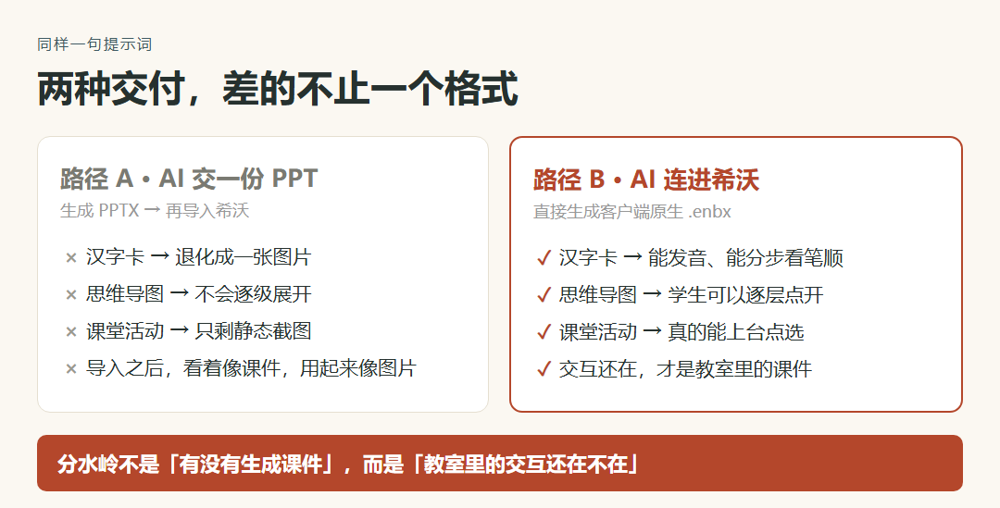

> **一句话纪律**：如果这节课不需要学生上台点、不需要笔顺演示、不需要导图展开，**用普通 PPT 就够了**。原生课件的价值全在「交互还在」，没有交互就没有必要多走这一步。

---

## 一、先搞清楚「原生课件」是什么

### 1.1 PPTX 和 `.enbx` 不是一回事

PPTX 是通用交换格式：文字、形状、图片，任何软件都能读。希沃的汉字卡、思维导图、判断对错却是**客户端里的原生元素**，它们自带教学资源库（汉字笔顺、拼音、部首）、自带交互状态机、自带评分逻辑——这些能力在通用格式里没有对应物。

所以「生成 PPT → 导入希沃」这条路上，导入器只能把它们压平成看得见、点不动的静态内容。这不是兼容性 bug，是格式表达能力的问题。

### 1.2 客户端到底提供了什么

本机 `capabilities.md` 从 `tools/list` 自动拉取到 **60 个 MCP 工具**，与做课件最相关的是这几组：

| 组 | 代表工具 | 用途 |
|---|---|---|
| 课件与 Shell | `en_find_shells`、`en_bind_shell`、`new_cloud_courseware`、`get_current_courseware_info` | 找到并绑定正在编辑的课件 |
| 页面 | `add_slide`、`get_slide_info`、`get_slide_screenshot` | 建页、回读、截图 |
| 背景 | `set_slide_background_image` | **把本地图片写进页面自身背景**（不是铺一张全画布图片） |
| 内容元素 | `add_text_element`、`add_table_element`、`add_mind_map_element` | 文本、表格、脑图 |
| 学科组件 | `add_hanzi_card_element`、`add_pinyin_card_element`、`add_classical_poem_element`、`add_function_plot_element` | 汉字卡、拼音卡、古诗词、函数图像 |
| 课堂活动 | `add_judge_activity_element`、`add_choice_activity_element`、`add_match_activity_element`、`add_classify_activity_element` | 判断对错、趣味选择、知识配对、超级分类 |

> 关键点：这些都是**客户端里的对象**，不是渲染出来的像素。回读时能看到 `HanziCard`、`表格.1`、`思维导图.1` 这样的元素名。

### 1.3 能力边界（必须提前说清）

| 能做 | 不能做 |
|---|---|
| 汉字卡朗读**整个音节**、演示笔顺、显示部首笔画 | `j—i—àng → jiàng` 这种声母韵母分解拼读、组词释义 |
| 课堂活动按你给的题目与答案逐题展示 | 改希沃活动模板的默认主题与封面（本次显示「夏季运动会」，属客户端模板） |
| 生成后自动同步到本地课件库 | 自动变成**云端课件**（`isCloudCourseware` 仍为 `false`，要上云需手动保存） |
| 备课态显示组件静态预览 | 备课态直接触发发音/笔顺交互（要点「开始授课」） |

---

## 二、从安装到生成：照着这四步说

> **这一章给一线老师看**：不用记命令，照着说就行。**四步**——装技能 → 连客户端 → 调用技能 → 一句话生成，每一步都给可直接复制的提示词。
> 命令、返回 JSON 与排障表放在 **2.6 之后**，给培训讲师备查，第一次做可以跳过。

### 2.1 第一步：在技能市场装「希沃白板助手」

**主路径是可视化安装**（2026-11-09 发布版采用这一条）：

| 步 | 点哪里 | 看到什么 |
|---|---|---|
| ① | WorkBuddy 左侧「专家 / 技能 / 连接器」 | 顶部出现「技能」页签 |
| ② | 切到 **SkillHub（技能市场）** | 内置 / 套件分类，右上角「已安装(56)」 |
| ③ | 搜索框输入「希沃」 | 第一项就是「希沃白板助手」，绿色 EN 图标 |
| ④ | 点卡片 → 安装 / 启用 | 详情弹窗显示 **v1.0.2**、开关变绿、按钮变「去试试」 |

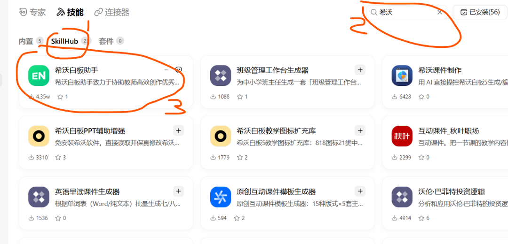

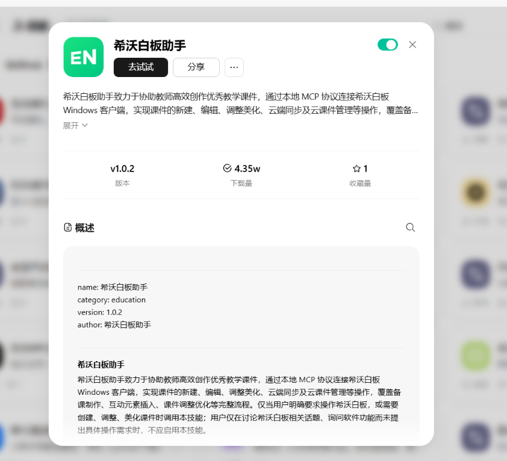

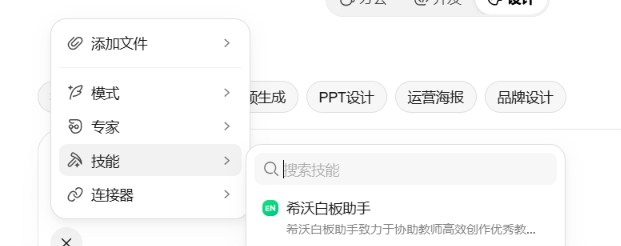

**备选路径**：不想点界面，就在对话框里发这一句，让它自己装。

```
seewo-easinote-assistant-skill，安装这个技能
```

装完确认一下：本机技能落在 `C:/Users/Administrator/.workbuddy/skills/seewo-easinote-assistant-skill__skillhub/`，版本 **v1.0.2**，`SKILL.md` 里能看到四阶段建课流程，`capabilities.md` 里能看到 60 个 MCP 工具。

> **别只装不加载。** 装完之后要用 `@希沃白板助手`、`@skill:seewo-easinote-assistant-skill` 或「用 seewo-easinote-assistant-skill …」把它调起来；否则只是普通聊天，不会连客户端。

### 2.2 第二步：连客户端（最容易卡住，务必照这一步确认）

> ⚠️ **先纠正一个把很多人卡住的误导**：**希沃白板 5.2.4 客户端里没有「MCP 开关」，设置里翻不到是正常的，别再找了。** 连接服务是客户端内置、随启动自动就绪的。
>
> 网上一些教程写「去客户端设置里打开 MCP / 第三方接入」，那是把技能文档里的兜底话术当成了可执行步骤。`ensure_connected.py` 自己的注释写的是「未启动 / 未登录，需用户确认登录后重试」，给的 `hint` 是 **`login_required`**——意思是**要登录、或客户端还没完全启动**，不是「去开开关」。
>
> 本书**第二篇第 8 章**也早已写明：「希沃 5.2.4 版本没有这个开关，连接服务随客户端内置启动」，本篇与它统一。

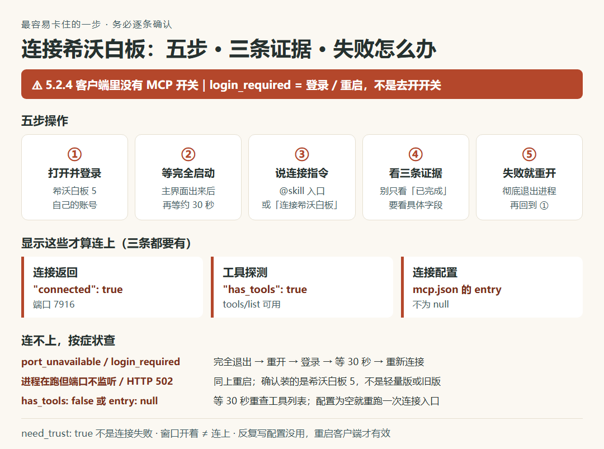

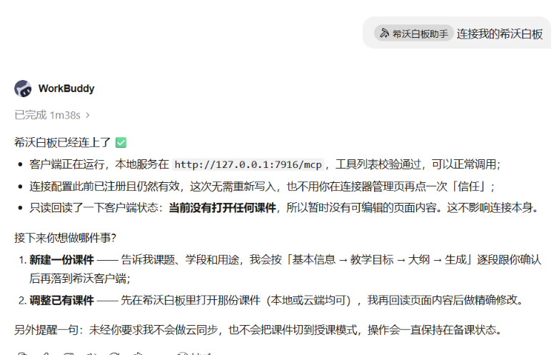

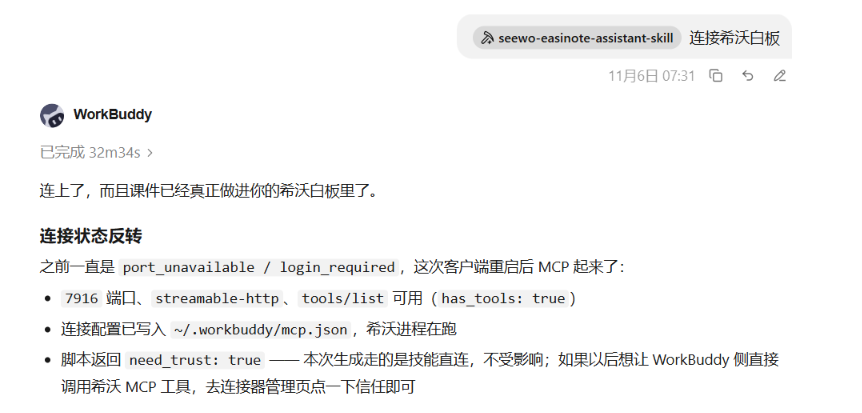

#### 2.2.1 正确操作：五步，一步都别跳

| 步 | 你做什么 | 注意 |
|---|---|---|
| ① | 打开 **希沃白板 5** 客户端，用自己的账号登录 | 不是轻白板、不是旧版；**登录态是关键** |
| ② | **等它完全启动**：主界面出来后再等约 30 秒 | 刚双击完就发指令，端口常常还没起来 |
| ③ | 在 WorkBuddy 里说下面任一句，或点对话框技能入口选中「希沃白板助手」后再说 | `@` 技能气泡 / `@skill` / 自然语言都行 |
| ④ | 看返回结果，按 **2.2.2 的三条证据**确认 | **不要只看「已完成」，要看具体字段** |
| ⑤ | 失败就**彻底退出客户端再重开**，回到 ① | 关窗口不算退出，要让进程真的结束 |

```
@希沃白板助手 连接希沃白板
```

```
@skill:seewo-easinote-assistant-skill 连接希沃白板
```

也可以说「连接希沃白板」「重新连接希沃」。技能会自己完成：检查希沃进程 → 必要时检测安装并启动 → 探测 MCP 端点 → 确认 `tools/list` 非空 → 写连接配置 → 启动退出监控。

> **「彻底退出」怎么做到**：右下角托盘图标 → 退出；或在任务管理器里结束 `EasiNote` / `EasiNote5` / `SeewoEasiNote` 全部进程，再重新双击打开。本机那次就是重启后进程号从 `14164 / 7748` 变成 `13504 / 13804`、端口才监听的。**很多时候真的就是重启一下。**

#### 2.2.2 显示什么算连上了（三条硬证据，缺一条都不算）

**证据一　连接入口返回 `connected: true`**

```json
{"connected": true, "port": 7916, "url": "http://127.0.0.1:7916/mcp",
 "already_registered": false, "need_trust": true, "skipped": false,
 "detail": "已写入 MCP 配置"}
```

**证据二　工具列表非空**（唯一能进客户端操作的判据）

```bash
python scripts/lifecycle/lifecycle.py probe --wait 30 --interval 2 --require-tools
```

```json
{"port": 7916, "url": "http://127.0.0.1:7916/mcp",
 "transport": "streamable-http", "detail": "tools/list 可用", "has_tools": true}
```

**证据三　连接配置已落地**

```bash
python scripts/lifecycle/lifecycle.py config --status
```

```json
{"config": "C:\\Users\\Administrator\\.workbuddy\\mcp.json",
 "entry": {"type": "http", "url": "http://127.0.0.1:7916/mcp"}}
```

`entry` 不为 `null` 才算注册成功。再补一条 `lifecycle.py process` 看到 EasiNote 进程在跑，就齐了。

> **`need_trust: true` 不是连接失败。** 它只是说宿主侧还要授权；技能自带的构建脚本直接发 HTTP 到 `127.0.0.1:7916/mcp`，不受影响（本次 9 页课件就是在这种情况下生成的）。以后想让 WorkBuddy 侧直接调用希沃 MCP 工具，再去连接器管理页点「信任」。

#### 2.2.3 连不上怎么办（按症状查，别乱试）

| 返回 / 现象 | 真实原因 | 怎么处理 |
|---|---|---|
| `{"connected": false, "code": "port_unavailable", "hint": "login_required"}` | **客户端没登录，或刚打开还没启动完** | 完全退出 → 重开 → 登录 → 等 30 秒 → 再说「重新连接希沃」；**不要去设置里找 MCP 开关** |
| 进程在跑，五个候选端口一个都不监听 | 同上，窗口开着 ≠ 服务就绪 | 彻底退出重开，重点看进程号有没有变 |
| `HTTP 502 / 响应不是 MCP initialize 握手` | 端口被别的程序占用，或客户端半启动 | 彻底退出重开；仍不行就确认装的是希沃白板 5 而非轻量版 / 旧版 |
| 端点可达但 `has_tools: false` | 服务还没就绪 | 等 30 秒重跑 `probe`，**此时不要注册配置** |
| `config --status` 里 `"entry": null` | 连接配置没写成 | 重跑一次 `ensure_connected.py`；反复失败不要反复写配置 |
| 反复重启两次仍失败 | 客户端版本 / 安装问题 | 确认是希沃白板 5（本机 5.2.4），必要时重装后重来 |

四步就绪判据的完整表格见 **2.7**，分步诊断命令见 **2.8**。

#### 2.2.4 四个常见误区

1. **「客户端设置里应该有 MCP 开关」**——5.2.4 没有，找不到是对的。
2. **「窗口开着就是连上了」**——不是，要以 `has_tools: true` 为准。
3. **「`need_trust: true` 说明没连上」**——不是，那是宿主授权，不影响脚本直连。
4. **「反复说连接、反复写配置就好」**——不会；服务没起来时写多少次配置都没用，**重启客户端才是有效动作**。

### 2.3 第三步：调用技能，把六件事说清

调用方式三选一：

- **点名技能**：`用 seewo-easinote-assistant-skill 生成……`
- **@ 入口**：`@skill:seewo-easinote-assistant-skill 生成……`
- **@ 技能气泡**：`@希沃白板助手 生成……`（或点对话框技能入口选中后直接说）

> 课件也可以**自己先设计好再发给它**，技能本身就带课件设计功能；不想自己设计，就用下面的一句话让它按四阶段问你。

一句话里最好带齐六件事，别让它猜：

| 要素 | 怎么写 | 本课示例 |
|---|---|---|
| 课题 + 教材版本 | 版本 / 年级 / 册次 / 第几课时 | 人教版小学语文三年级下册《赵州桥》第一课时 |
| 课堂目的 | 新授 / 复习 / 练习 / 展示 | 第一课时新授 |
| 页数区间 | 5-10 / 10-15 / 15-20 / 20-30 | 5-10 页 |
| 图片方案 | AI 生成 / 我提供 / 不要图 | 图片由 AI 生成 |
| **特有功能** | **点名汉字卡、思维导图、课堂活动等** | 汉字卡「匠慧赵」、思维导图、判断对错 5 题 |
| 交付物 | **希沃客户端里的 `.enbx` 原生课件** | 不要导出 PPT |

**最小可用版**（先把链路试通）：

```
用 seewo-easinote-assistant-skill 生成人教版小学语文三年级下册《赵州桥》第一课时的课件
```

**推荐版**（把特有功能点名，本次 9 页实测就用这一档）：

```
用 seewo-easinote-assistant-skill 生成人教版小学语文三年级下册《赵州桥》第一课时的课件：
5-10 页，图片由 AI 生成；
必须用到希沃特有的汉字卡（匠、慧、赵，带笔顺演示）、
思维导图（总说身份→分写雄伟/坚固/美观→总结文化遗产）、
判断对错课堂活动（5 题）；
交付物是希沃客户端里真实打开的 .enbx 原生课件，不要导出 PPT。
```

> **为什么必须点名**：技能按「学生动作」选组件，但它不知道你这节课的生字是哪几个、要练哪个易错点。你不点名，汉字卡可能不出现，或者出现的是别的字。**希沃特有功能是「点名才有」的**——这是本专题最该记住的一句话。

### 2.4 第四步：四阶段里每一步怎么回

技能不会一句话梭哈，会弹四次确认卡片：

| 阶段 | 它问你 | 你回什么（示例） |
|---|---|---|
| ① 基本信息 | 页数区间、图片方案、硬约束 | 「5-10 页，AI 生成图片，必须含汉字卡 / 导图 / 判断活动，交付 `.enbx`」 |
| ② 教学目标 | 4 条目标是否认可 | 「第 3 条改成『能各举一处课文依据』，其余不变」 |
| ③ 大纲设计 | 每页讲什么、用哪个组件 | 「生字关放第 4 页，脑图放第 6 页，判断活动单独一页」 |
| ④ 分段生成 | 确认开工 | 点确认，再补一句「生成完回读页数、组件和背景」 |

**别跳过确认。** 改动在 ②③④ 说一句话就行；等生成完再改，就得整册重跑。

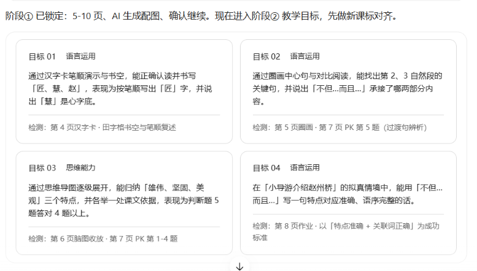

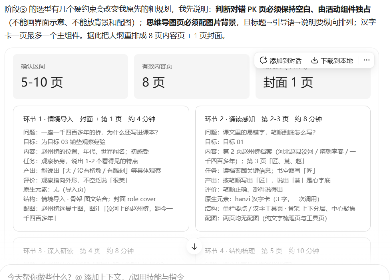

> 发布版里的「四次确认」就是这四张卡片：① 基本信息 → ② 教学目标 → ③ 大纲设计 → ④ 开工。**点名特有功能**要在 ① 或提示词里说清，③ 只看页序与组件落在哪一页。

### 2.5 希沃特有功能怎么点名（重点）

希沃值钱的不是排版，是下面这些**只有客户端里才有**的组件。每条都可以单独塞进生成提示词，也可以生成后追加。完整可复制版见**附录 B**。

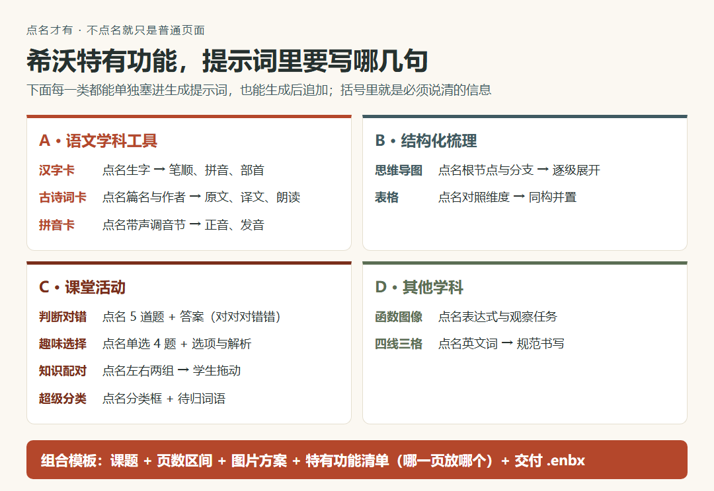

#### A　语文学科工具

```
在生字关那一页插入希沃汉字卡，字是「匠、慧、赵」，
要能播放笔顺、显示拼音和部首；这一页只放这一个主组件。
```

```
给《望庐山瀑布》单独一页，用希沃古诗词卡组件，带原文、译文和朗读。
```

```
正音页插入拼音卡，内容是「jiàng、huì、zhào」，带声调并能播放发音。
```

#### B　结构化梳理工具

```
用希沃思维导图梳理全文结构：根节点「赵州桥」，
一级分支「总说 / 分写 / 总结」，分写下面再分「雄伟 / 坚固 / 美观」；
节点不超过 4 字，详细解释放到页面文字里。
```

```
用希沃表格组件做两段关键句对照：维度是「关键句 / 管几段 / 句子作用」，
两列分别是第 2 自然段和第 3 自然段。
```

#### C　课堂活动（学生真能上台点）

```
加一页判断对错课堂活动，5 题：前三题考事实（位置、设计者、年代），
后两题考易错理解（小桥洞是为了好看、不但…而且…是全文中心句），答案对对对错错。
这一页由活动组件独占，不要加背景和正文。
```

```
加一页趣味选择活动，4 道单选，考「赵州桥三个特点分别对应哪处课文依据」，每题 4 个选项并写解析。
```

```
加一页知识配对活动，左边是「雄伟 / 坚固 / 美观」，右边是对应的课文原句，学生拖动配对。
```

```
加一页超级分类活动，三个分类框「写气势 / 写结构 / 写图案」，把 9 个词语拖进正确分类。
```

#### D　其他学科工具

```
数学页用希沃函数图像组件，表达式 x^2-2x+1，让学生拖着看顶点和对称轴。
```

```
英语页插入四线三格组件，内容是 "bridge arch"，用来练规范书写。
```

#### E　一次要多个组件：组合提示词

```
用 seewo-easinote-assistant-skill 生成人教版小学语文三年级下册《赵州桥》第一课时课件，5-10 页，
图片由 AI 生成。请按下面顺序安排希沃特有组件：
第 4 页汉字卡「匠慧赵」（带笔顺）；
第 5 页表格组件做两段关键句对照；
第 6 页思维导图梳理总分总；
第 7 页判断对错活动 5 题（独占空白页）。
其余页面用可编辑文字与同源背景，交付物是希沃客户端里的 .enbx 原生课件。
```

#### F　生成后追加或替换

```
把第 7 页的判断活动换成知识配对：左边三个特点，右边三处课文依据；
其他页不动，改完回读第 7 页元素确认。
```

#### 生成后怎么验（别只看「生成成功」）

| 组件 | 回读证据 | 课堂里怎么验 |
|---|---|---|
| 汉字卡 | `type: HanziCard`，页面信息里叫「汉字卡片.1」 | 点「开始授课」后喇叭能读、连续 / 分步能演示笔顺 |
| 思维导图 | `思维导图.1` 元素 | 节点逐级展开，不是一张贴图 |
| 表格 | `表格.1` 元素 | 单元格文字可编辑 |
| 课堂活动 | 页面类型「课堂活动页面」 | 备课态显示模板封面，点「开始授课」才逐题出题 |

> **共性前提**：备课 Edit 模式下原生组件只显示静态预览，交互要进授课模式才激活。这一条不写清楚，老师最容易以为「生成了个图片」。

### 2.6 技术备查：前置清单与命令

- 希沃白板 5 Windows 客户端已安装并**用自己账号登录**
- **客户端完全启动**：刚打开等 30 秒；连不上就彻底退出重开（5.2.4 没有 MCP 开关，见 2.2）
- WorkBuddy 里已装 `seewo-easinote-assistant-skill`（本机 v1.0.2）
- Python 3 可用（连接脚本只用标准库；图片预检需要 Pillow）

> **本机提醒**：PowerShell 会话里 `python` 不在 PATH，连接与构建脚本一律用 Bash 跑；否则报「无法将 python 项识别为 cmdlet」。

日常入口（幂等，就绪时直接返回）：

```bash
cd "C:/Users/Administrator/.workbuddy/skills/seewo-easinote-assistant-skill__skillhub"
python scripts/lifecycle/ensure_connected.py
```

### 2.7 技术备查：四步就绪判据

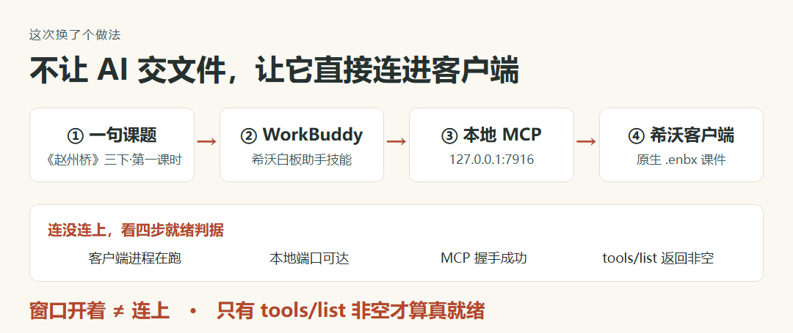

| # | 判据 | 查法 | 不通过的含义 |
|---|---|---|---|
| 1 | 希沃进程在跑 | `lifecycle.py process` | 客户端没开 |
| 2 | 本地端口可达 | 候选 `7916 / 7917 / 13247 / 19463 / 27733` | 客户端没登录 / 没完全启动（**不是没开 MCP 开关**） |
| 3 | MCP 端点握手成功 | `probe --require-tools` | 端口开着但不是 MCP |
| 4 | **`tools/list` 返回非空** | 同上，`has_tools: true` | 客户端未登录或未就绪 |

本机第一次试时，希沃进程在跑（PID 14164 / 7748），五个候选端口却一个都没监听，返回 `port_unavailable / login_required`；客户端重启后 PID 变成 13504 / 13804，端口才通。**很多时候真的就是重启一下；5.2.4 客户端里没有 MCP 开关可开。**

### 2.8 技术备查：分步诊断

```bash
python scripts/lifecycle/lifecycle.py process
python scripts/lifecycle/lifecycle.py detect
python scripts/lifecycle/lifecycle.py probe --wait 30 --interval 2 --require-tools
python scripts/lifecycle/lifecycle.py config --status
```

本机就绪后的三项结果：

```json
{"port": 7916, "url": "http://127.0.0.1:7916/mcp",
 "transport": "streamable-http", "detail": "tools/list 可用", "has_tools": true}
{"config": "C:\\Users\\Administrator\\.workbuddy\\mcp.json",
 "entry": {"type": "http", "url": "http://127.0.0.1:7916/mcp"}}
{"ok": true, "running": true, "pids": [13504, 13804],
 "exe_names": ["EasiNote.exe", "EasiNote5.exe", "SeewoEasiNote.exe"]}
```

### 2.9 技术备查：`need_trust` 是什么

连接配置写在 `~/.workbuddy/mcp.json`，服务键固定为 `seewo-easinote-assistant-skill`。`need_trust: true` 表示**宿主侧**还需要授权：以后想让 WorkBuddy 直接调用希沃 MCP 工具，去连接器管理页点「信任」。但技能自带的构建脚本是自己发 HTTP 请求到 `127.0.0.1:7916/mcp`，**不受这个开关影响**——本次生成就是在这种情况下跑通的。

### 2.10 技术备查：连接排障表

| 现象 | 处理 |
|---|---|
| 检测不到安装 | 确认安装位置；无法自动定位时由用户选择客户端，不要猜 exe |
| 全部端口失败 | 完全退出客户端 → 重开 → 登录 → 等启动完 → 重新连接；不要反复写配置，也别去设置里找 MCP 开关 |
| 端点可达但无工具 | 客户端服务未就绪，不注册配置 |
| 配置存在但宿主不可用 | 检查连接器信任状态 |
| 客户端退出后配置残留 | `lifecycle.py config --remove` 并检查监控是否启动 |
| 多个同名课件 / shell | 停下来让用户确认目标，不自动选最近项 |

---

## 三、四阶段建课流程

### 3.1 为什么不能「一句话梭哈」

技能把新建课件拆成四个检查点，**每个检查点先确认、再前进**，可回溯：

| 阶段 | 产出 | 谁拍板 |
|---|---|---|
| ① 基本信息 | 课题、学段、目的、页数区间、图片方案、硬约束 | 教师 |
| ② 教学目标 | 按新课标对齐的目标条目（含素养指向与检测方式） | 教师 |
| ③ 大纲设计 | 原生元素选型 + 环节大纲 + 详细设计网格 | 教师 |
| ④ 分段生成 | `pages.json` → 校验 → 出图 → 生成 → 回读 | AI 执行，教师验收 |

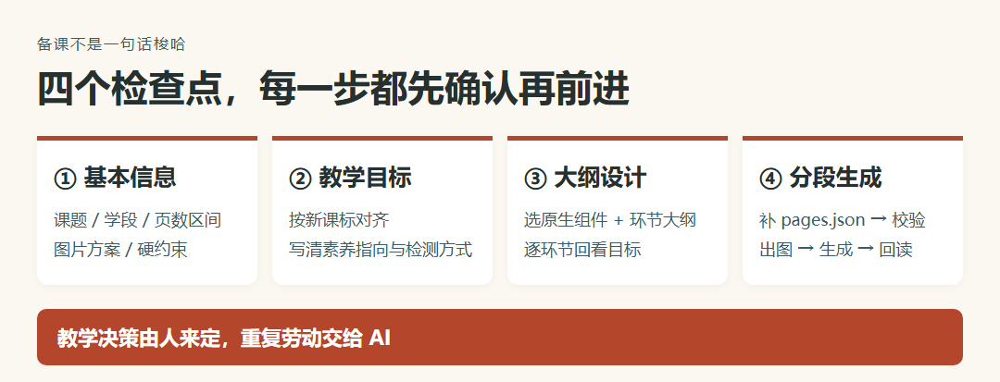

> **教学决策由人定，重复劳动交给 AI。** 目标、结构、题目、答案这些位置教师必须看；排版、配色、出图、写坐标、算对比度、逐页回读，交给 AI。

### 3.2 本次实例

| 项 | 值 |
|---|---|
| 课题 | 人教版小学语文三年级下册《赵州桥》第一课时 |
| 页数区间 | 5–10 页（实际 9 页：1 封面 + 8 内容页） |
| 图片方案 | `generated`（AI 生成） |
| 硬约束 | 必须出现汉字卡、思维导图、课堂活动；交付物必须是 `.enbx` |
| 教学目标 | 4 条（认读书写、找关键句、归纳三特点、用「不但…而且…」表达） |

### 3.3 校验器会替你挡住的几件事

- `authored_canvas` 内容页至少 3 种内容字段；
- 内容密度硬下限：`moment 80 / evidence 100 / sequence 120 / compare 120 / practice 100 / summary 80` 字；
- 相邻两页不得用同一结构类型，六页以上至少 4 种版面轮廓、相似度 < 82%；
- 字号硬下限：标题 42px、正文 22px，**不允许自动缩号**，空间不够只能扩大文本框、精简文案或拆页。

---

## 四、原生组件契约（本篇最硬的一节）

### 4.1 先判断学生动作，再选组件

| 学生要做的动作 | 组件 | `data` 关键字段 |
|---|---|---|
| 认读汉字、看笔顺部首 | `hanzi` | `characters`（1–20 字） |
| 梳理层级、对比总结 | `mindmap` | `markdown`（`#`/`##`/`###` 表层级） |
| 记录、比较结构化数据 | `table` | `markdownTable`（标准 Markdown 表格） |
| 判断陈述正误并即时反馈 | `judge` | `statements` + `answers` |
| 建立一一对应 | `match` | `pairs` |
| 按标准归类 | `classify` | `categories` |
| 拼读音节、正音 | `pinyin` | `pinyin`（带声调） |

完整四类参数（本次真实使用）：

```json
{"type": "hanzi",   "data": {"characters": "匠慧赵"}}
{"type": "table",   "data": {"markdownTable": "| 对照维度 | 第 2 自然段 | 第 3 自然段 |\n| --- | --- | --- |\n| 关键句 | 赵州桥非常雄伟 | 不但坚固，而且美观 |\n| 管几段 | 只管本段 | 连接两段 |"}}
{"type": "mindmap", "data": {"markdown": "# 赵州桥\n## 总说\n- 身份\n## 分写\n### 雄伟\n- 长五十米\n### 坚固\n- 大小桥洞\n### 美观\n- 栏板龙纹\n## 总结\n- 文化遗产"}}
{"activityType": "judge",
 "statements": ["赵州桥在河北省赵县的洨河上", "隋朝石匠李春设计并参加建造",
                "距今已有一千四百多年", "四个小桥洞是为了让桥更好看",
                "「不但坚固，而且美观」是全文中心句"],
 "answers": [true, true, true, false, false]}
```

### 4.2 五条硬契约

1. **课堂活动 `choice / judge / match / classify` 独占空白页**：不得声明 `visualPlan`，不得放背景、正文、装饰、配图或其他组件。活动会替换当前页内容与背景。
2. **一页最多一个主要原生元素**；工具页的标题与引导语要写「学生动作」，不写「本页使用某工具」。
3. **`mindmap` 页必须配同源图片背景**，不能退化成纯色底；节点文案 ≤4 字，详细解释外置到 `lead`/`items`；顶部文字按 标题 → 引导 → 说明 **纵向依次排**，不能并排。
4. **`hanzi` 1–7 字调用一次** `add_hanzi_card_element`；8–20 字要拆成两行两次调用。本次「匠慧赵」3 字，生成 1 行元素，实测尺寸 540×261px。
5. **学段活动密度**：小学低段可多用；小学中高段（3–6 年级）适度，本次只保留 1 个 `judge`；初中及以上以讲授/梳理/对比类工具为主。

### 4.3 工具安全区

原生组件占画布中部，逻辑坐标 `1280×720`，通用安全区是 **y 234–660**（汉字卡是 `y 234–669`）。校验器对每个前景元素算交叠比例，超过 2% 直接报错：

> `pages[3].visualPlan.elements[0] 与希沃原生工具安全区重叠`

所以汉字卡页、表格页、脑图页的**所有文字只能排在 y<234 或 y>669** 的窄带里。这就是为什么工具页的内容槽要精简、正文交给组件承载——不是教程偷懒，是客户端的几何约束。

### 4.4 四类组件的成品页

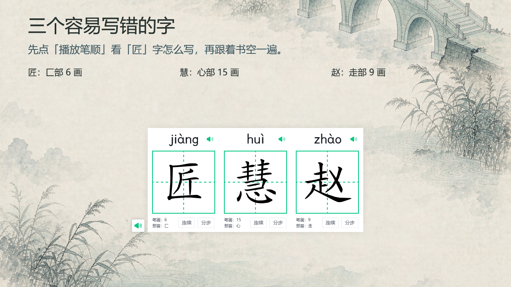

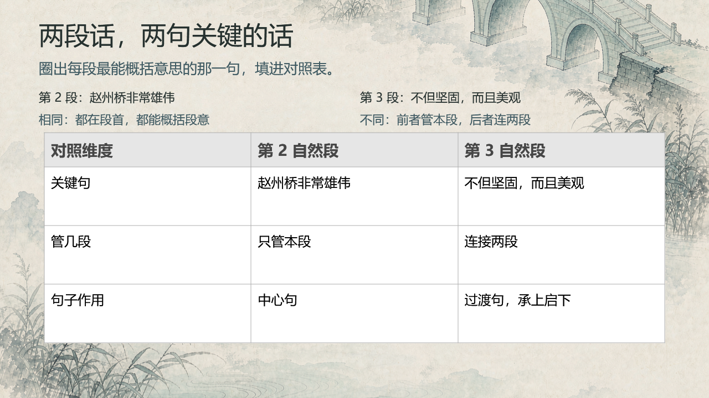

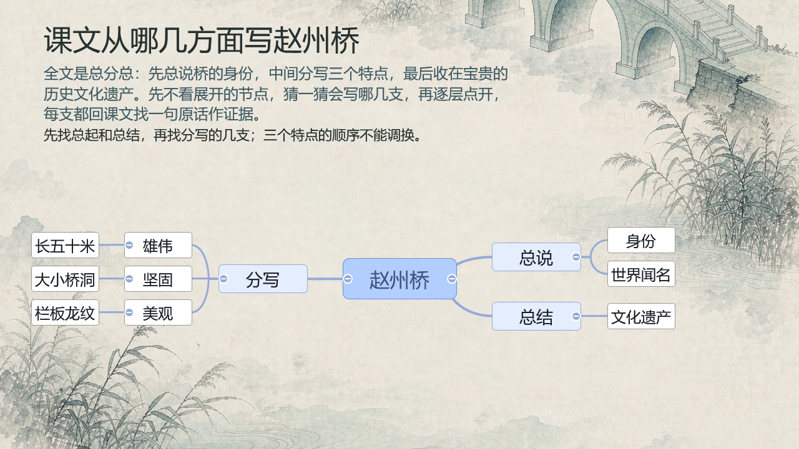


> 活动页显示希沃模板默认主题「夏季运动会」，是备课态预览；**点「开始授课」后**才逐题展示上面配的 5 道判断题。

---

## 五、视觉规划与出图

### 5.1 背景池：2–4 张同源图，不是每页一张

出图前先定一句 `creativeDirection`：本次是「一座桥的三种看法：远看其势、近观其构、细察其纹」。然后建 3 张同源国风水墨背景：

| 图 | 留白方向 | 用途 | 复用页数 |
|---|---|---|---|
| A 桥在右、左侧雾面留白 | `left` | 封面 | 1 |
| B 主体压四角、中心安静 | `center` | 讲解、汉字卡、表格、脑图 | 4 |
| C 上部淡山、中下部极安静 | `center` | 资料、表达、总结 | 3 |

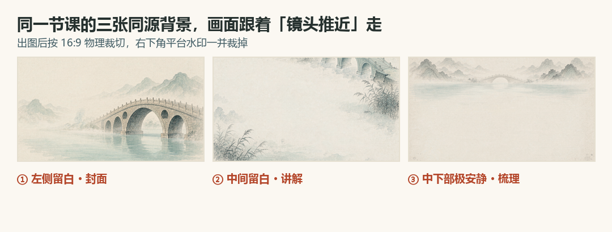

复用上限：中间留白 6 页、侧边留白 2 页、底部留白 4 页。校验器按此分档报错。

### 5.2 提示词六要素

每张背景图的提示词必须包含：**本课对象、动作/环境、镜头、画面重心、留白方向、16:9 + 无文字无水印**。内容页默认要「中间留白」（主体置边缘或四角、中心大面积安静），脑图页还要声明「画面中下部安静低细节以承载节点」。

### 5.3 两个必须做的图片处理

**① 按 16:9 物理裁切。** 出图工具给的是 1536×1024（3:2），而 spec 用的是 1280×720 逻辑坐标；不裁切，`imageLayout` 里写的位置对不上实际画面。

**② 顺带去掉平台水印。** 本机 ImageGen 会在右下角自动加「AI生成 / WORKBUDDY」，居中裁到 `y=80..944` 时，水印正好落在底部裁切带里被去掉：

```python
from PIL import Image
src = Image.open(p).convert("RGB")
w, h = src.size
th = int(w * 9 / 16)          # 1536 → 864
top = (h - th) // 2           # 80
crop = src.crop((0, top, w, top + th)).resize((1280, 720), Image.LANCZOS)
crop.save(out, optimize=True)
```

裁完**必须视觉回读**：确认主体框、留白方向、文字安全区的真实位置，再写 `imageLayout`，不能把生成前的设想当成出图后的结果。

### 5.4 文字配色：先算后写，禁止凭直觉

```bash
python scripts/courseware/design/text_contrast.py --bg "#D3CFC4" --fg "#26312F"
```

目标 ≥ 4.5:1（WCAG AA），硬底线 3:1。本机实测安全区平均色与选色结果：

| 背景实测色 | 文字色 | 对比度 | 结论 |
|---|---|---|---|
| `#D3CFC4`（最深的一块） | `#26312F` 深墨 | 8.63:1 | 采用 |
| `#D3CFC4` | `#3F5A62` 青灰 | 4.73:1 | 采用 |
| `#D3CFC4` | `#A0442B` 朱砂 | **4.02:1** | ❌ 不达标，改深 |
| `#D3CFC4` | `#7A2E1B` 深朱砂 | 6.04:1 | 采用 |

四个安全区的实测 `bgTone`：`#E5DFD0`、`#DFDCD2`、`#D3CFC4`、`#E7E1D5`。这些值要写进 `textSafeRegions`，校验器才能算对比度；也可写 `bgTone: "auto"` 让 Pillow 自动实测。

### 5.5 校验报错速查

| 报错 | 原因 | 修法 |
|---|---|---|
| `内容槽 XXX 未出现在视觉计划中` | 页面有字段但 `elements` 没绑定 | 每个槽绑定且只绑定一次 |
| `内容槽 lead 文本框容纳不足：需要 93.6px，可用 82px` | 按字号估宽算行数，差几像素也报错 | 扩大 `h` 或精简文案，**不许降字号** |
| `内容槽 title 与主主体「右上角桥影」重叠 51.6%` | 通栏标题压到背景主体 | 缩短标题宽度，或按回读结果收窄 `primary` 框 |
| `文字框未完整落入任何 textSafeRegion` | 安全区没覆盖到文字 | 扩大安全区或移动文字 |
| `课堂活动页必须保持空白，不得声明 visualPlan` | 活动页加了背景/装饰 | 删掉整个 `visualPlan` |
| `思维导图页必须使用…背景图` | 脑图页用了纯色底 | 换成同源图片背景 |
| `背景图 … 重复使用 N 页，超过上限` | 复用超档 | 换池项或新出一张同源图 |

---

## 六、完整 `pages.json` 示例

### 6.1 根级契约

```json
{
  "title": "赵州桥",
  "grade": "小学三年级下册",
  "imageStrategy": "generated",
  "pagePlan": { "range": [5, 10] },
  "teachingObjectives": ["…4 条，含素养指向与检测方式…"],
  "visualPlanning": {
    "backgroundImageMinRatio": 0.5,
    "creativeDirection": {
      "concept": "一座桥的三种看法：远看其势、近观其构、细察其纹",
      "visualMetaphor": "洨河水面上一道石弧，镜头从远景逐级推近到栏板上的龙纹",
      "backgroundStrategy": "封面用桥在右的远视图；讲解页用中心留白图；梳理页用中下部极安静的同源图；活动页不设背景"
    }
  },
  "pages": [ "…9 页…" ]
}
```

`title` 就是落稿文件名与客户端课件名；`specDir` 可由 `build_v2.py` 自动注入，单独跑校验时要么在课件目录执行，要么在根级写绝对路径。

### 6.2 三种页面的形态

| 页面 | `layout` | 关键字段 |
|---|---|---|
| 封面 | `authored_canvas` + `role: "cover"` | 结构页豁免内容密度，但仍需 `visualPlan` |
| 普通内容页 | `authored_canvas` | `lead`/`body`/`items`/`question`/`answer`/`summary` ≥3 种 |
| 工具页 | `tool_page` | `subjectTool: {type, data}`，文字全部避开安全区 |
| 活动页 | `activity_page` | `activity: {activityType, statements, answers}`，**无 `visualPlan`** |

### 6.3 一页工具页的完整写法

```json
{
  "layout": "tool_page",
  "title": "三个容易写错的字",
  "lead": "先点「播放笔顺」看「匠」字怎么写，再跟着书空一遍。",
  "items": ["匠：匚部 6 画", "慧：心部 15 画", "赵：走部 9 画"],
  "subjectTool": { "type": "hanzi", "data": { "characters": "匠慧赵" } },
  "visualPlan": {
    "teachingIntent": "practice",
    "designRationale": "汉字卡独占中下部交互区，顶部只留一条通栏标题与三个短提示。",
    "background": {
      "type": "image", "source": "images/bg-b.png", "fit": "cover",
      "imageLayout": {
        "hasRecognizableSubject": true, "whitespace": "center",
        "subjects": [{"label": "右上角桥影", "importance": "primary",
                      "box": {"x": 870, "y": 0, "w": 410, "h": 82}}],
        "textSafeRegions": [
          {"label": "全页安静带", "box": {"x": 50, "y": 20, "w": 1180, "h": 680},
           "bgTone": "#DFDCD2"}
        ]
      }
    },
    "elements": [
      {"kind": "text", "source": "title", "role": "title",
       "box": {"x": 60, "y": 20, "w": 800, "h": 70}, "z": 10,
       "style": {"fontSize": 46, "color": "#26312F", "bold": true, "lineSpacing": 1.2}},
      {"kind": "text", "source": "lead", "role": "lead",
       "box": {"x": 60, "y": 95, "w": 1160, "h": 50}, "z": 10,
       "style": {"fontSize": 26, "color": "#3F5A62", "lineSpacing": 1.3}}
    ]
  }
}
```

> 完整的 9 页 spec 见 `赵州桥示范课件/pages.json`（26 KB，可直接拿去改课题复用）。

### 6.4 校验三连

```bash
python scripts/courseware/design/inspect_visual_blocks.py --spec pages.json
python scripts/courseware/design/validate_deck.py --spec pages.json
python scripts/courseware/build_v2.py --spec pages.json --validate-only --require-images
```

本机最终状态：`validate_deck` **0 error / 5 条软告警**；`build_v2.py --validate-only` 计划级校验与配图预检全通过。5 条告警分别是 4 条「中心安静带侵入」（侧边留白封面图与上方淡山图的结构性提示，不阻塞）与 1 条「汉字卡尺寸需实机校准」。

---

## 七、正式生成与回读

### 7.1 七个阶段

```bash
python scripts/courseware/build_v2.py --spec pages.json --require-images
```

| 阶段 | 做什么 | 本次耗时 |
|---|---|---|
| 1 | 计划级校验 | 0.0s |
| 2 | 配图预检（缺失/损坏图片直接阻断） | 0.1s |
| 3 | 原生渲染 ENBX | 2.0s |
| 4 | 导入并绑定课件 shell | 8.0s |
| 5 | MCP 原生页面背景（8 页） | 1.0s |
| 6 | MCP 叠加交互层（4 类组件） | 9.8s |
| 7 | 云同步与终态 | 9.8s |

真实输出（节选）：

```
✓ enbx 已合成：…\赵州桥示范课件\赵州桥.enbx
✓ 已导入，shell=13804
✓ 第1页 原生背景（图片） … 第9页 原生背景（图片）
✓ 第4页 工具 hanzi（1 行：匠慧赵）
✓ 第5页 工具 table    ✓ 第6页 工具 mindmap    ✓ 第7页 活动 judge
✓ 落稿完成：赵州桥（9 页，4 个交互元素）  总耗时 31.0s
```

### 7.2 本机环境坑：注册表命令被禁用

`build_v2.py` 导入课件时要先定位 `swenlauncher.exe`，首选查注册表（`reg query HKCR\iseewo.enbx\...`）。本机安全策略把 `reg.exe` 列入黑名单，命令被拦截；脚本 `try/except` 吞掉异常后回退到 3 个预设路径，而本机希沃装在 `D:\Program Files\EasiNote5\swenlauncher\`，不在预设里，于是报：

```
✗ ENBX 导入前置处理失败：找不到课件启动程序，请确认所需应用已安装。
```

**解法：不修改技能包、不碰被禁命令，只在运行时把定位函数指向真实路径。**

```bash
python -c "
import sys, os
sys.path.insert(0, r'…\skillhub\scripts\courseware')
import build_v2
LAUNCHER = r'D:\Program Files\EasiNote5\swenlauncher\swenlauncher.exe'
assert os.path.isfile(LAUNCHER)
build_v2._find_swenlauncher = lambda: LAUNCHER
sys.argv = ['build_v2.py', '--spec', 'pages.json', '--require-images']
build_v2.main()
"
```

之后七个阶段全通。这条适配只影响本次运行，技能包保持原样。

### 7.3 另一条走不通的路

`ensys_open_file` 看起来能打开课件，实测它把 `filePath` 当可执行文件直接启动：

```
An error occurred trying to start process '…/赵州桥.enbx' …
The specified executable is not a valid application for this OS platform.
```

它不走文件关联，**不能用来打开 `.enbx`**。想用「先打开再 `--resume`」绕过导入阶段，这条路是断的。

### 7.4 生成后必须独立回读

技能红线：**MCP 返回成功不等于落地成功**。回读页数、元素、背景、模式：

```python
s.tools_call("en_find_shells", {"searchingMode": "all", "coursewareName": "赵州桥"})
s.tools_call("get_current_courseware_info", {"shellId": sid})
s.tools_call("get_slide_info", {"slideNumber": 4, "shellId": sid})
s.tools_call("get_slide_screenshot",
             {"slideNumber": 4, "expectedPngImageFilePath": abs_png, "shellId": sid})
```

本机结果：

```json
{"title": "赵州桥", "slideCount": 9,
 "defaultSlideSize": {"width": 1280, "height": 720},
 "filePath": "…\\赵州桥.enbx", "isCloudCourseware": false,
 "isSynced": true, "size": 4980387,
 "shellContext": {"id": "13804", "workingMode": "Edit"}}
```

第 4 页回读能看见 `汉字卡片.1: (369, 321) 540×261`，第 5 页 `表格.1`、第 6 页 `思维导图.1`、第 7 页「类型: 课堂活动页面」——组件确实落在预期页，不是响应里的「成功」两个字。

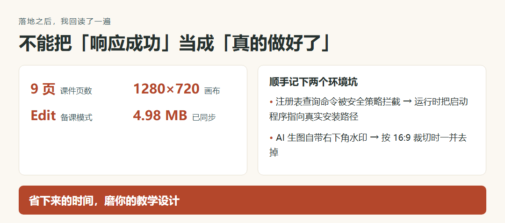

### 7.5 终态与云同步边界

- 终态保持 **Edit 备课模式**，不进入授课模式；
- `isSynced: true` 且能在课件库用「赵州桥」检索到，但 `isCloudCourseware: false` / `remoteId: null`——它是**本地课件**，要真正上云需用户在客户端另做「保存到云课件」；
- 未经用户要求不主动触发云同步。

### 7.6 截图也要防「假成功」

连续批量调用 `get_slide_screenshot` 会产出 **5 KB 的纯色空白图**（客户端还没渲染完那一页）。稳妥做法：逐页 `goto_slide` → 等 2 秒 → 截图 → 判断文件 >100 KB，不够就再等 2 秒重截。本次 9 页截图就是这样补齐的。

课件 shell 被关掉后，`open_cloud_courseware` 会返回「已打开 《赵州桥》 课件」，但 `en_find_shells` 查不到 shell；此时回退到 `swenlauncher.exe <enbx 路径>` 重新打开，才拿到新的 shell（本次 18664）。

---

## 八、汉字卡答疑：不是图片，也不是拼读机

这是发布后最容易被问到的问题，单独讲清楚。

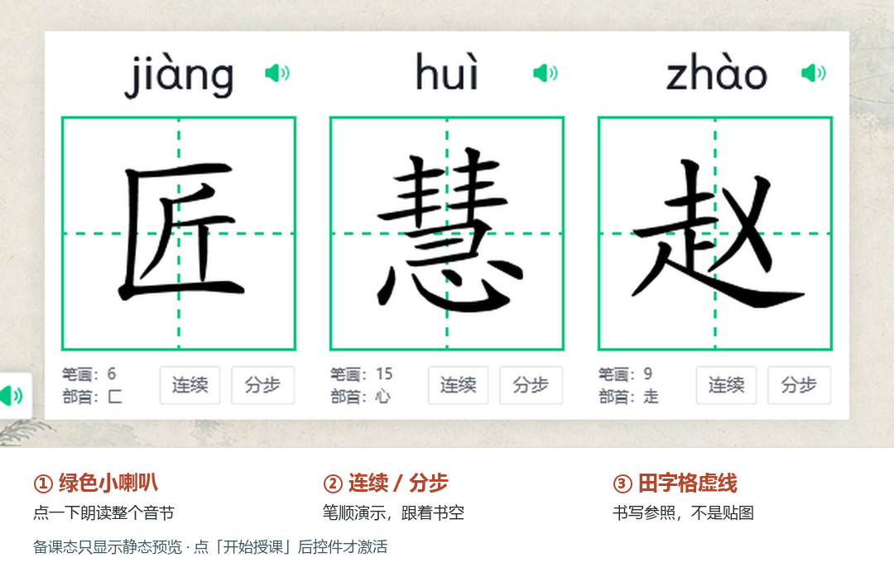

**① 不是图片。** 客户端回读：

```json
{"elements": [{"id": "5ec1ea2bdfb34d2593ed709b477c77d8", "type": "HanziCard"}]}
```

页面信息里叫「汉字卡片.1」，如果是贴图会叫「图片.1」。拼音 `jiàng / huì / zhào`、笔画 6/15/9、部首 匚/心/走，都是组件从本地汉字库带出来的，不是写死在页面上的静态文字。

**② 能做什么。** 每个字上方有绿色小喇叭（朗读音节），下方有「连续 / 分步」两个按钮（自动播放笔顺 / 逐笔演示），田字格带绿色虚线十字作书空参照。

**③ 为什么点了没反应。** 课件停在备课 Edit 模式，原生组件在备课态只显示**静态预览**；点「开始授课」进入 Display 模式后交互才激活。课堂活动页同理。

**④ 拼读的边界。** 它朗读的是整个音节，**不做** `j—i—àng → jiàng` 的声母韵母分解拼读，也没有组词释义。三年级《赵州桥》第一课时需要的是「认读 + 看清笔顺」，拼读分解属于低年级正音，不该硬塞进这一页。真要做拼读，用 `pinyin` 拼音卡组件或客户端「内容感知」里的汉字学习功能，那是另外的入口。

---

## 九、踩坑清单（20 条，全部实测）

| # | 现象 | 原因 | 解法 |
|---|---|---|---|
| 1 | `port_unavailable / login_required` | 客户端未登录或没完全启动（**不是没开 MCP 开关**） | 完全退出 → 重开 → 登录 → 等 30 秒 → 重新连接 |
| 2 | 进程在跑但五个端口全不监听 | 窗口开着不等于连上 | **彻底退出客户端重开**，再按四步判据逐项查 |
| 3 | PowerShell 里 `python` 不识别 | 该会话 PATH 不含 Python | 连接/构建脚本走 Bash |
| 4 | `need_trust: true` | 宿主侧未信任连接器 | 脚本直连不受影响；要用 MCP 工具才去信任 |
| 5 | 工具页元素「与安全区重叠」 | 组件占 y234–660 | 文字全部排到 y<234 / y>669 |
| 6 | 内容槽未绑定 / 重复绑定 | 每个槽必须且只能出现一次 | `elements[].source` 逐一对应 |
| 7 | 文本框差 2–14px 就报错 | 校验器按字号估宽算行数 | 扩大 `h` 或精简文案，不降字号 |
| 8 | 通栏标题压到背景桥影 | 与 `primary` 主体框交叠 | 缩短标题宽度 / 按回读收窄主体框 |
| 9 | `background.source 不存在` | 相对路径按 `specDir` 或 cwd 解析 | 在课件目录跑，或根级写 `specDir` |
| 10 | 朱砂色对比度 4.02:1 | 浅米背景上偏亮 | 改深到 `#7A2E1B`（6.04:1） |
| 11 | AI 出图右下角带水印 | 平台自动加 | 16:9 居中裁切时一并裁掉 |
| 12 | 原图 3:2 与逻辑坐标对不上 | 未裁切 | 先裁成 1280×720 再写 `imageLayout` |
| 13 | 活动页被判「不得声明 visualPlan」 | 活动组件独占整页 | 整页留空，题目写在 `activity` 里 |
| 14 | 脑图只渲染出根节点 | markdown 层级塌陷 | `#`/`##`/`###` 表父子，叶子用无缩进 `-` |
| 15 | 脑图节点被挤压 | 节点超 4 字 | 解释外置到 `lead`/`items` |
| 16 | 8–20 个汉字挤成一行 | 一次调用只创建一行 | 拆两组两次调用 |
| 17 | `找不到课件启动程序` | `reg.exe` 被安全策略禁 + 预设路径不匹配 | 运行时替换 `_find_swenlauncher` |
| 18 | `ensys_open_file` 打不开 `.enbx` | 它把路径当 exe 启动 | 走 `swenlauncher.exe <enbx>` |
| 19 | 批量截图出现 5 KB 空白图 | 页面尚未渲染完 | 逐页 goto + 等待 + 按大小重试 |
| 20 | `open_cloud_courseware` 说已打开却查不到 shell | 本地课件非云课件 | 用 launcher 重新打开本地 `.enbx` |

---

## 十、交付清单与文件位置

| 交付物 | 路径 | 说明 |
|---|---|---|
| 完整 spec | `赵州桥示范课件/pages.json` | 9 页，可直接改课题复用 |
| 课件成品 | `赵州桥示范课件/赵州桥.enbx` | 4.98 MB，已在希沃客户端打开 |
| 背景池 | `赵州桥示范课件/images/bg-a.png` ~ `bg-c.png` | 1280×720 已裁切；带水印源图在 `_src/` |
| 九页截图 | `公众号_希沃课件/附-九页完整截图/` | 客户端真实渲染 |
| 配图与清单 | `公众号_希沃课件/配图/`、`配图清单.md` | 00–11 按出现顺序编号 |
| 配图生成脚本 | `公众号_希沃课件/_build/gen_images.py` | HTML→PNG + Pillow 拼接，可复现 |
| 真实界面截图 | `assets_opt/seewo_full_14..24_*.png` | 技能市场 / 连接成功 / 四阶段确认，2026-11-08 / 11-09 本机截图 |
| 图文预览 | `公众号_希沃课件/图文预览.html`、`图文预览_独立版.html` | 后者图片已内嵌，可单独分享 |
| 公众号版 | `公众号_希沃课件/AI做的课件为什么在希沃里点不动.md` | 约 1500 字传播版 |
| 本篇阅读版 | `专题_希沃白板原生课件.html` | 单文件带图，双击即读 |


---

## 十一、三句话带走

1. **分水岭不是「有没有生成课件」，而是「教室里的交互还在不在」**——汉字还能不能读、导图还能不能展开、学生还能不能上台点一下。
2. **教学决策由人定，重复劳动交给 AI**：目标、结构、题目、答案教师拍板；排版、出图、坐标、对比度、逐页回读交给工具。
3. **响应成功 ≠ 落地成功**：生成后必须回读页数、元素、背景和模式，并逐页截图核对。

> **省下来的时间，磨你的教学设计。**

---

## 附录 A　命令速查

```bash
# 技能根目录
cd "C:/Users/Administrator/.workbuddy/skills/seewo-easinote-assistant-skill__skillhub"

# 连接
python scripts/lifecycle/ensure_connected.py
python scripts/lifecycle/lifecycle.py process
python scripts/lifecycle/lifecycle.py probe --wait 30 --interval 2 --require-tools
python scripts/lifecycle/lifecycle.py config --status

# 配色
python scripts/courseware/design/text_contrast.py --bg "#D3CFC4" --fg "#26312F"

# 校验
python scripts/courseware/design/inspect_visual_blocks.py --spec pages.json
python scripts/courseware/design/validate_deck.py --spec pages.json
python scripts/courseware/build_v2.py --spec pages.json --validate-only --require-images

# 正式生成（本机若注册表命令被禁，见 7.2 的运行时适配）
python scripts/courseware/build_v2.py --spec pages.json --require-images

# 局部返修（已打开的同名课件，不重新导入 ENBX）
python scripts/courseware/build_v2.py --spec pages.json --resume
```

---

## 附录 B　提示词总集：从安装到希沃特有功能

> 全部可直接复制，方括号里换成你自己的课题。**希沃特有功能是「点名才有」的**，B3 是本篇最常被翻到的一节。

### B1　安装与连接

| 目的 | 提示词 |
|---|---|
| 技能市场装技能 | 左侧「专家 / 技能 / 连接器」→ SkillHub 搜「希沃」→ 安装并启用「希沃白板助手」 |
| 一句话装技能 | `seewo-easinote-assistant-skill，安装这个技能` |
| 连客户端 | `@希沃白板助手 连接希沃白板` |
| 连客户端（等价写法） | `@skill:seewo-easinote-assistant-skill 连接希沃白板` |
| 连不上时重连 | `重新连接希沃白板，先按四步就绪判据查一遍再动手` |
| 查状态 | `看看希沃 MCP 现在连上没有，tools/list 是否非空` |
| 查技能版本 | `读一下 seewo-easinote-assistant-skill 的 SKILL.md，告诉我版本和新建课件流程` |

### B2　一句话建课（三档）

**最小档**（试链路）：

```
用 seewo-easinote-assistant-skill 生成人教版小学语文三年级下册《赵州桥》第一课时的课件
```

**推荐档**（点名特有功能，本次实测用这一档）：

```
用 seewo-easinote-assistant-skill 生成人教版小学语文三年级下册《赵州桥》第一课时的课件：
5-10 页，图片由 AI 生成；
必须用到希沃特有的汉字卡（匠、慧、赵，带笔顺演示）、
思维导图（总说身份→分写雄伟/坚固/美观→总结文化遗产）、
判断对错课堂活动（5 题）；
交付物是希沃客户端里真实打开的 .enbx 原生课件，不要导出 PPT。
```

**完整档**（连页位一起指定）：见 **2.5-E 组合提示词**。

### B3　11 类特有功能：逐条点名

> 每条都写清了「要什么」和「点名哪些信息」；生成后按 B5 验证。

**A　语文学科工具**

```
在生字关那一页插入希沃汉字卡，字是「匠、慧、赵」，
要能播放笔顺、显示拼音和部首；这一页只放这一个主组件。
```

```
给《望庐山瀑布》单独一页，用希沃古诗词卡组件，带原文、译文和朗读。
```

```
正音页插入拼音卡，内容是「jiàng、huì、zhào」，带声调并能播放发音。
```

**B　结构化梳理**

```
用希沃思维导图梳理全文结构：根节点「赵州桥」，
一级分支「总说 / 分写 / 总结」，分写下面再分「雄伟 / 坚固 / 美观」；
节点不超过 4 字，详细解释放到页面文字里。
```

```
用希沃表格组件做两段关键句对照：维度是「关键句 / 管几段 / 句子作用」，
两列分别是第 2 自然段和第 3 自然段。
```

**C　课堂活动（学生上台点）**

```
加一页判断对错课堂活动，5 题：前三题考事实（位置、设计者、年代），
后两题考易错理解（小桥洞是为了好看、不但…而且…是全文中心句），答案对对对错错。
这一页由活动组件独占，不要加背景和正文。
```

```
加一页趣味选择活动，4 道单选，考「赵州桥三个特点分别对应哪处课文依据」，每题 4 个选项并写解析。
```

```
加一页知识配对活动，左边是「雄伟 / 坚固 / 美观」，右边是对应的课文原句，学生拖动配对。
```

```
加一页超级分类活动，三个分类框「写气势 / 写结构 / 写图案」，把 9 个词语拖进正确分类。
```

**D　其他学科**

```
数学页用希沃函数图像组件，表达式 x^2-2x+1，让学生拖着看顶点和对称轴。
```

```
英语页插入四线三格组件，内容是 "bridge arch"，用来练规范书写。
```

**点名要点**：汉字卡要写**哪几个字**；思维导图要写**根节点和分支**；判断对错要写**题目和答案**；配对分类要写**左右两组或分类框与词表**；函数图像要写**表达式与观察任务**。只说「加个互动」等于没说。

### B4　组合生成（一次要多个组件）

```
用 seewo-easinote-assistant-skill 生成人教版小学语文三年级下册《赵州桥》第一课时课件，5-10 页，
图片由 AI 生成。请按下面顺序安排希沃特有组件：
第 4 页汉字卡「匠慧赵」（带笔顺）；
第 5 页表格组件做两段关键句对照；
第 6 页思维导图梳理总分总；
第 7 页判断对错活动 5 题（独占空白页）。
其余页面用可编辑文字与同源背景，交付物是希沃客户端里的 .enbx 原生课件。
```

> 小学中高段课堂活动**适度**，一册留 1 个检测环节就够；低段可以多用。别为凑功能把每页都塞成游戏。

### B5　生成后必查三件事（建议沉淀为强制检查项）

```
请把以下三条沉淀为希沃课件生成的强制检查项，以后每次生成都要执行：
1. 【对比度】深色背景页文字用白色或浅色，按 WCAG 4.5:1 校验；
   标题区加局部 scrims，禁止用全屏遮罩。
2. 【背景落地】每页生成后回读元素，确认背景图 source 有效，
   且已通过 set_slide_background_image 写入页面自身背景；缺失立即补写。
3. 【边界】所有表格、图文块的 box 完整落在 1280×720 画布内，
   四边留不小于 5% 安全边距，越界就拆页或缩列。
生成完成后逐页截图复核这三项，未通过不交付。
```

再补一句**组件回读**：

```
生成完请回读：页数、每页组件类型、背景 source、当前模式；
确认汉字卡是 HanziCard 元素而不是图片，活动页由组件独占，
终态保持 Edit 备课模式。
```

### B6　局部修改、追加与返修

| 目的 | 提示词 |
|---|---|
| 改某一页 | `把第 7 页的判断活动换成知识配对：左边三个特点，右边三处课文依据；其他页不动，改完回读第 7 页元素确认` |
| 加一页 | `在第 6 页后加一页趣味选择活动，4 道单选题，其余页保持不变` |
| 换课题复用 | `照这份 pages.json 的结构做《[新课题]》，保留四阶段确认和组件契约，页数区间不变` |
| 生成完回读 | `回读页数、组件、背景与模式，并把 9 页截图存到课件目录` |
| 生成中途失败 | `修正后从失败处续修，不要重新导入 ENBX，也不要重复创建已有元素` |

---

## 附录 C　配套产物与阅读顺序

| 想做什么 | 看哪个 |
|---|---|
| 第一次上手，只想快点做出来 | `专题_希沃白板课件_简版教程.md` |
| 照着已发布推文的四步做 | `公众号_希沃课件/极简教程_4步生成希沃原生课件.md` + `极简教程_配图/01–10` |
| 想直接复制生成提示词 | 本篇 **2.5** 与 **附录 B**（11 类特有功能逐条可抄） |
| 转发给同事、让对方明白值不值得做 | `公众号_希沃课件/图文预览_独立版.html` |
| 照着完整参数自己做一遍 | **本篇** + `赵州桥示范课件/pages.json` |
| 检查成品到底长什么样 | `公众号_希沃课件/附-九页完整截图/` |
| 改一版配图 / 换课题 | `公众号_希沃课件/_build/gen_images.py`、`配图清单.md` |

> **来源与核实**：本篇流程基于本机 `seewo-easinote-assistant-skill` v1.0.2 的 `SKILL.md`、`references/connection.md`、`creation_intake.md`、`subject_tool_guide.md`、`visual_planning.md`、`page_structure_guide.md`、`capabilities.md`，以及 `scripts/courseware/` 下的校验与构建脚本；简版教程另参考了念念微课·盖子老师《Workbuddy 直接操控希沃做课件，老师不用再一页页搬了》（2026-10-04）。所有数字与日志均为本机实测；特有功能提示词逐条对照 v1.0.2 的 `capabilities.md` 与 `subject_tool_guide.md` 核过，未做推测补全。**2026-11-09 另按已发布推文《workbuddy+希沃：4步直接在希沃里做出原生课件》对齐四步表述，并补入同批真实界面截图。**
