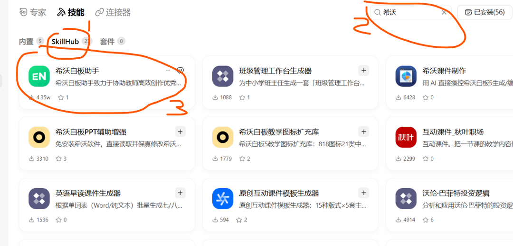
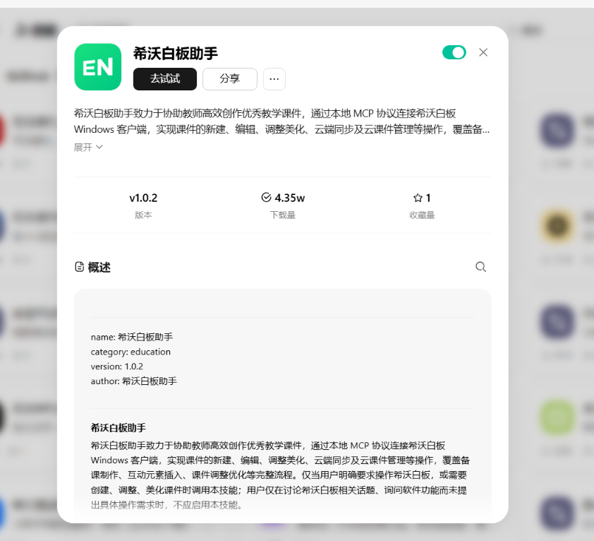
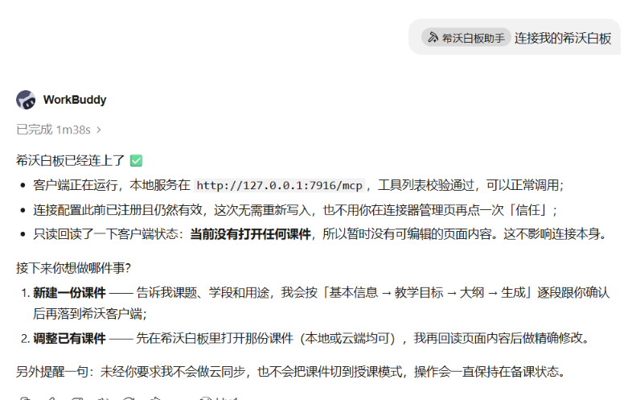
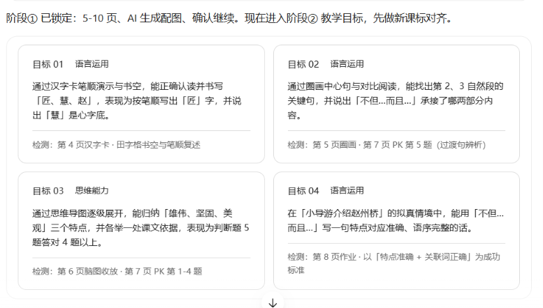
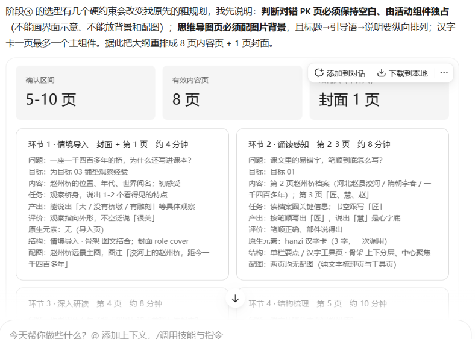
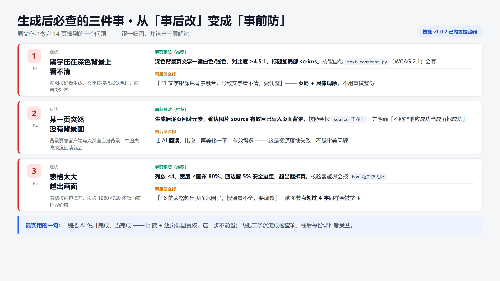

# 简版教程　用 WorkBuddy 直接做希沃白板课件

> **一句话**：不用学希沃怎么点，说清「哪一课、几年级、要几页」，AI 直接操控客户端把课件做出来；生成后按三件事检查一遍，就能拿去上课。
>
> **来源**：念念微课·盖子老师《Workbuddy 直接操控希沃做课件，老师不用再一页页搬了》（2026-10-04）。本篇在其操作流程基础上，补了问题归因、事前预防和检查清单。
>
> **本地核实**：希沃白板助手 `seewo-easinote-assistant-skill` **v1.0.2**（2026-11-05 本机），技能自带的三套校验器已逐一查过。

---

## 〇、三分钟看懂

| 项目 | 说明 |
|---|---|
| **能做什么** | 新建希沃课件、改已有课件、把 PPT 转成希沃课件、插入课堂活动 |
| **靠什么做** | 本地 MCP 协议连希沃白板 5 Windows 客户端，**直接操作软件里的元素**，不是导出一张张图片 |
| **做出来的东西** | 文字可编辑、可交互的 `.enbx` 课件，不是 PPT |
| **前提** | 装好希沃白板 5、用自己账号登录、客户端完全启动（**没有 MCP 开关**，见 1.2） |
| **第一份耗时** | 原作者实测 14 页约 **23 分钟**（含确认环节） |

**和普通 PPT 技能的根本区别**：希沃课件值钱的地方不是排版，是**能让学生上手动的原生组件**——汉字卡、思维导图、课堂活动。这些只有真正在希沃客户端里才加得进去。

---

## 一、开始：两句话连上希沃

### 1.1 装技能

**主路径：技能市场可视化安装**（2026-11-09 发布版写法）。左侧「专家 / 技能 / 连接器」→ 切到 **SkillHub（技能市场）** → 搜「希沃」→ 第一项「希沃白板助手」→ 安装并启用。详情弹窗能看到 **v1.0.2** 和绿色开关，就算装好了。





**备选**：不想点界面，直接在对话里说一句，让它自己装。

```
seewo-easinote-assistant-skill，安装这个技能
```

### 1.2 连客户端（最容易卡住的一步）

在对话里说下面任一句，或者点对话框的技能入口，选中「希沃白板助手」后直接说。

```
@希沃白板助手 连接希沃白板
```

```
@skill:seewo-easinote-assistant-skill 连接希沃白板
```



> ⚠️ **先说最容易踩的坑**：**希沃白板 5.2.4 客户端里没有「MCP 开关」**，设置里翻不到是正常的，别再找。连接服务随客户端内置启动。网上有些教程写「去设置里打开 MCP / 第三方接入」，那是把技能文档的兜底话术当成了操作步骤；脚本给的提示其实是 `login_required`，意思是**要登录、或客户端还没完全启动**。

**照这五步做**：① 打开希沃白板 5 并登录 → ② 等主界面出来后再等约 30 秒 → ③ 说上面任一句，或点对话框技能入口选中「希沃白板助手」 → ④ 看返回 → ⑤ 失败就**彻底退出客户端再重开**（关窗口不算，托盘退出或结束 EasiNote 进程），回到 ①。本机就是重启后连上的。

**显示这些才算连上**（三条都要有）：

| 看什么 | 要看到 |
|---|---|
| 连接返回 | `"connected": true, "port": 7916` |
| 工具探测 | `"has_tools": true` / `tools/list 可用` |
| 连接配置 | `mcp.json` 里 `entry` 不为 `null` |

> `need_trust: true` **不是**连接失败，只是宿主侧还要授权，不影响技能直连。

**连不上时按症状查**：`port_unavailable / login_required` → 完全退出重开、登录、等 30 秒再连；进程在跑但端口不监听 → 同上重启；`HTTP 502 不是 MCP 握手` → 确认装的是希沃白板 5 而非轻量版 / 旧版；`has_tools: false` → 等 30 秒重查；反复两次仍失败 → 重装客户端。**全程都不需要找 MCP 开关。**

完整命令、真实返回 JSON 与四步判据见 `专题_希沃白板原生课件.md` 的 **2.2 / 2.7 / 2.8**。

---

## 二、一键生成：说清学段学科

课件也可以**自己先设计好再发给它**，技能本身带课件设计功能；不想设计，就用一句话让它按四阶段问你。

```
用 seewo-easinote-assistant-skill 生成人教版语文八年级上册《三峡》的教学课件制作
```

它会**先确认、再动手**，一共四步，每一步都会弹卡片等你点：

| 步骤 | 它问你 | 你要给的 |
|---|---|---|
| ① 基本信息 | 做几页、配图怎么办 | 页数区间（5-10 / 10-15 / 15-20 / 20-30）、图片是 AI 生成还是自己提供 |
| ② 教学目标 | 目标写什么 | 不满意当场改，别等生成完再改 |
| ③ 大纲 | 每页讲什么 | 看结构对不对，比看措辞重要 |
| ④ 生成 | 确认开工 | 点确认后才真正做 |

**别跳过确认**。文章里那三个毛病，有两个本来能在第 ① 步就用一句话挡掉（见下一章）。





发布版里的「弹四次确认」就是这四张卡片：① 基本信息 → ② 教学目标 → ③ 大纲设计 → ④ 开工。

**生成时会做对的事**（原作者实测）：整体画风统一、《三峡》配山水、文字全部可编辑，还用上了希沃特有的汉字功能、可交互思维导图、判断对错 PK 小游戏，插入位置也合理。

---

## 三、生成后必查的三件事（本教程的重点）

原作者做完 14 页，发现了三个问题。我把它们逐一归因，并给出**事前预防 + 事后修 + 沉淀**三层解法。



### 3.1 问题一：黑字压在深色背景上，看不清（P1）

| | |
|---|---|
| **现象** | 文字是黑色，背景是深色山水，糊成一片 |
| **为什么会出** | 配图是按「好不好看」生成的，文字颜色是按模板默认值排的，两者没人对齐 |
| **技能里本来有的防线** | `text_contrast.py` 用 **WCAG 2.1 对比度算法**，默认要求 ≥ **4.5:1**；`visual_planning` 要求给背景图声明 `textSafeRegions` 和实测 `bgTone`，深色区域加**局部 scrims**（半透明蒙版）。规范里还明确写着 `overlay` 全屏遮罩**已废止** |
| **事前一句话** | 在 ① 基本信息里加：「深色背景页的文字一律用白色或浅色，标题下加局部蒙版，正文对比度不低于 4.5:1」 |
| **事后怎么修** | `P1 文字跟深色背景融合，导致文字看不清，要调整` —— 指出**页码 + 具体现象**，不用重做整份 |
| **更稳的做法** | 让 AI 生成后逐页截图复核，别只看它说「已完成」 |

### 3.2 问题二：某一页突然没有背景图（P4）

| | |
|---|---|
| **现象** | 别的页都有山水背景，第 4 页光秃秃的，文字还挤 |
| **为什么会出** | 希沃的背景图不是塞进文件就完事，是生成后调用 `set_slide_background_image` **写进页面自身背景**再回读确认。这一步中途失败、图片路径失效、或者没做回读，页面就没背景 |
| **技能里本来有的防线** | `visual_validator.py` 会报 `background.source 不存在`；技能总纲明确要求「**MCP 返回成功后回读页数、元素或模式，不能把响应成功当成落地成功**」，以及「不得静默丢内容、丢图片」 |
| **事前一句话** | 「生成完毕后逐页回读，确认每页背景图都已写入页面背景而不是全画布图片元素，缺的补上」 |
| **事后怎么修** | `P4 没有背景图，文字排版也很拥挤，一点也不好看，要调整` |
| **判断要点** | 这不是「AI 审美不稳定」，是**资源落地失败**。让它回读，比让它「再美化一下」有效得多 |

### 3.3 问题三：表格太大，越出画面（P6）

| | |
|---|---|
| **现象** | 授课时表格右边和下边看不见 |
| **为什么会出** | 表格按内容自动撑开，没被画布边界约束。希沃逻辑画布约 **1280×720**，超出就裁掉 |
| **技能里本来有的防线** | `visual_validator.py` 的 `_inside(box)` / `_contains(container, item)`，越界会报 `box 越界或无效`；配图面积上限 80%、元素 box 必须落在画布内 |
| **事前一句话** | 「表格列数不超过 4，宽度不超过画布 80%，四边留 5% 安全边距，超出就拆成两页」 |
| **事后怎么修** | `P6 的表格超出页面的范围了，导致授课的时候看不全，要调整` |
| **顺带一提** | 校验器对思维导图也有类似检查：**节点超过 4 个字会被定宽节点挤压**会报警告。做脑图时把节点写短 |

### 3.4 为什么「技能有校验」还是会出问题

三层原因，按可能性排：

1. **版本差**：原文发表于 2026-10-04，本机技能是 v1.0.2，校验器可能在这期间加强过
2. **没走完校验链**：技能要求先跑 `inspect_visual_blocks.py` 和 `build_v2.py --require-images`，跳过就容易漏
3. **客户端侧失败**：本地校验通过 ≠ 客户端导入成功，背景图这类操作必须**回读**才算数

**所以最实用的结论是**：*别把 AI 说「完成」当完成，回读 + 截图复核这一步不能省。*

---

## 四、让经验不白改：沉淀成检查项

原作者最后做了一件很聪明的事——把三次修改经验存下来：

```
总结我上述的修改经验，沉淀为检查项
```

这样下次生成时，AI 会按新的检查手册走，不再重蹈覆辙。

**我建议把这句换成更明确的版本**，直接把三条硬约束写死：

```
请把以下三条沉淀为希沃课件生成的强制检查项，以后每次生成都要执行：

1. 【对比度】深色背景页文字用白色或浅色，按 WCAG 4.5:1 校验；
   标题区加局部 scrims，禁止用全屏遮罩。
2. 【背景落地】每页生成后回读元素，确认背景图 source 有效、
   且已通过 set_slide_background_image 写入页面自身背景；缺失立即补写。
3. 【边界】所有表格、图文块的 box 完整落在 1280×720 画布内，
   四边留不小于 5% 安全边距，越界就拆页或缩列。

生成完成后逐页截图复核这三项，未通过不交付。
```

**这一步比任何一次「帮我改一下」都值钱**：改一次只救一页，沉淀一次救往后所有课件。

---

## 五、把已有的 PPT 转成希沃课件

老师手里都攒着 PPT，公开课想加互动，不用重做：

```
把这份 PPT 导入希沃白板，转成希沃课件
```

技能底层用的是 `new_cloud_courseware_from_pptx`，转完课件会保持打开状态。

转好之后顺手加一句：

```
给这份课件加一个课堂活动
```

**注意**：课堂活动类组件会**替换当前页的内容和背景**，所以要让它在**新页面**上加，别把精心排好的那页覆盖了。

---

## 六、希沃特有功能怎么点出来

这是这套打法真正的价值。写提示词时**直接点名要哪个**，别只说「做得互动一点」。

| 功能 | 适合什么知识点 | 提示词怎么写 |
|---|---|---|
| **汉字卡** | 生字笔顺、部首、笔画数 | `这一页加一个汉字卡，讲「峡」字，要能看笔顺` |
| **思维导图** | 结构梳理、层次关系 | `用思维导图梳理《三峡》写景顺序，节点别超过 4 个字` |
| **判断对错 PK** | 易错概念辨析 | `加一个判断对错的 PK 小游戏，5 道题` |
| **趣味选择** | 单选题、即时检测 | `加一个趣味选择活动，答完显示得分和解析` |
| **超级分类** | 归类、概念辨析 | `加一个超级分类，把描写手法分成 3 类` |
| **知识配对** | 对应关系、连线题 | `加一个知识配对，作者和作品配对，6 组` |

**三条使用要点**：

1. **汉字卡**常用 3500 字范围内才有笔顺数据，生僻字可能出不来
2. **思维导图**用多级 Markdown 列表传入，节点写短、层级别太深
3. **课堂活动**放新页，放在讲授之后、作业之前最顺（原作者就是这么排的）

---

## 七、踩坑与边界

| # | 事项 | 说明 |
|---|---|---|
| 1 | 客户端连不上 | 端口未监听 = MCP 未启用或未登录，见 1.2 |
| 2 | 别急着云同步 | 技能默认**不自动同步**，需要时明确说一声 |
| 3 | 终态保持备课模式 | 别让 AI 直接切到授课模式 |
| 4 | 同名课件会卡住 | 云端有多个同名时它会停下来让你选，不会瞎猜 |
| 5 | 第一份别卡着时间做 | 14 页约 23 分钟，公开课前一晚做更从容 |
| 6 | 课件不是目的 | 省下来的时间花在教学设计上，这才是课的魂 |

---

## 八、提示词速查（照抄即可）

```
seewo-easinote-assistant-skill，安装这个技能
```

技能市场可视化安装：左侧「专家 / 技能 / 连接器」→ SkillHub 搜「希沃」→ 安装并启用「希沃白板助手」。

```
@希沃白板助手 连接希沃白板
```

```
用 seewo-easinote-assistant-skill 生成人教版语文八年级上册《三峡》的教学课件制作
```

```
P1 文字跟深色背景融合，导致文字看不清，要调整
P4 没有背景图，文字排版也很拥挤，一点也不好看，要调整
P6 的表格超出页面的范围了，导致授课的时候看不全，要调整
```

```
请把以下三条沉淀为希沃课件生成的强制检查项：
1. 深色背景页文字用白/浅色，对比度 ≥4.5:1，加局部 scrims；
2. 每页回读背景图 source 并确认已写入页面自身背景；
3. 所有元素 box 落在 1280×720 内，四边留 ≥5% 安全边距。
生成后逐页截图复核，未通过不交付。
```

```
把这份 PPT 导入希沃白板，转成希沃课件
给这份课件加一个「判断对错」课堂活动，放在新的一页
```

---

**一句话收尾**：技能市场装技能 → @ 技能连客户端 → 说清课题 → 四步确认 → 查三件事 → 沉淀检查项。剩下的时间，磨你的教学设计。
