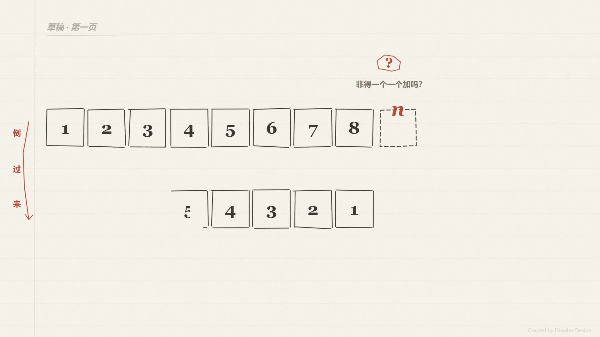
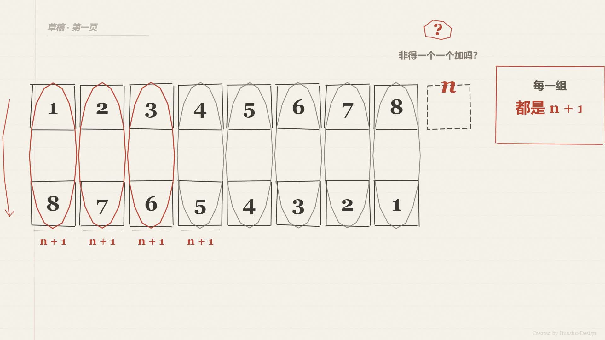
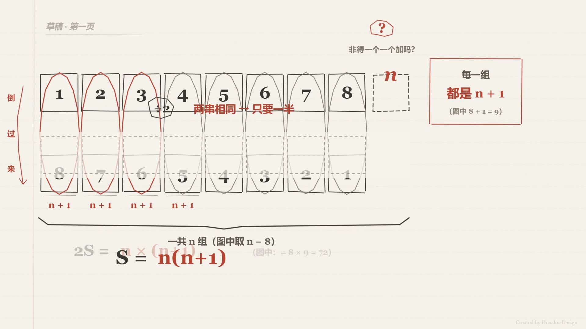
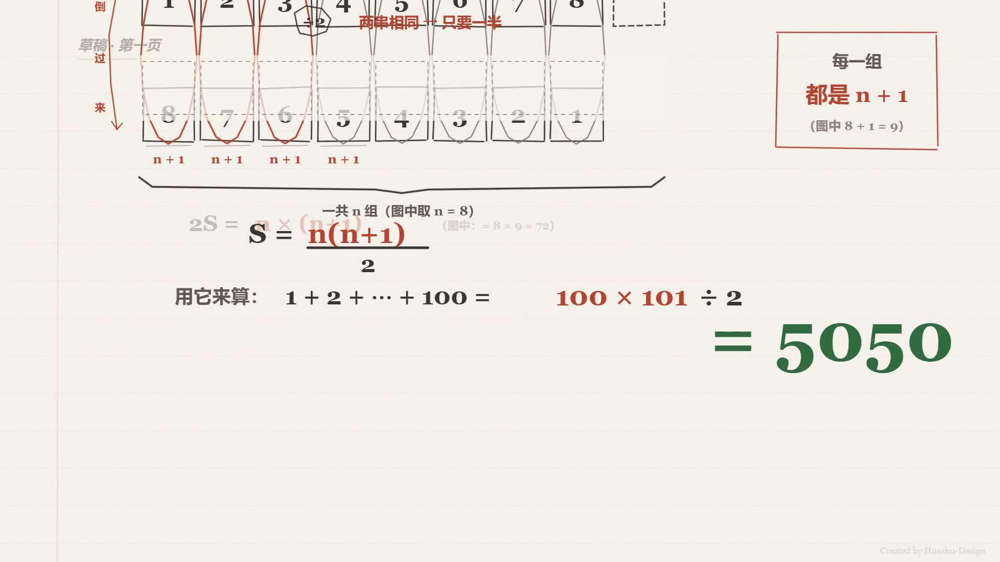
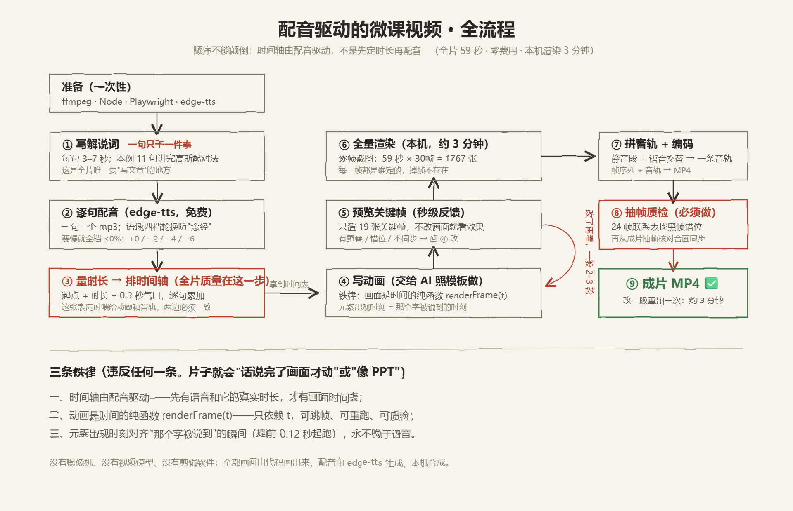
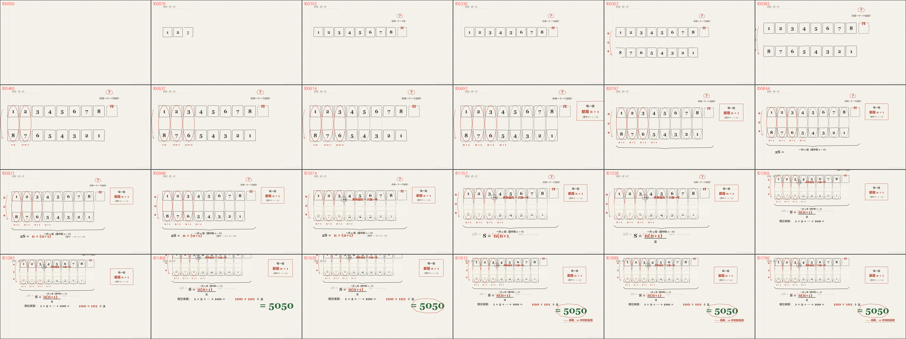
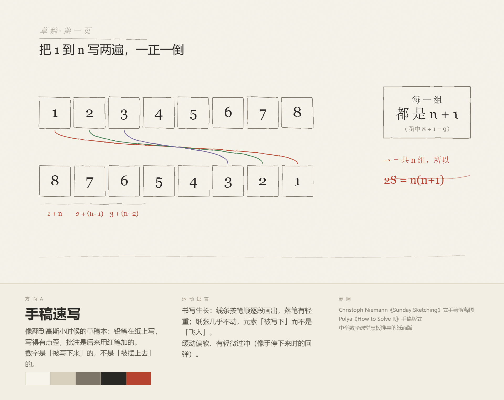
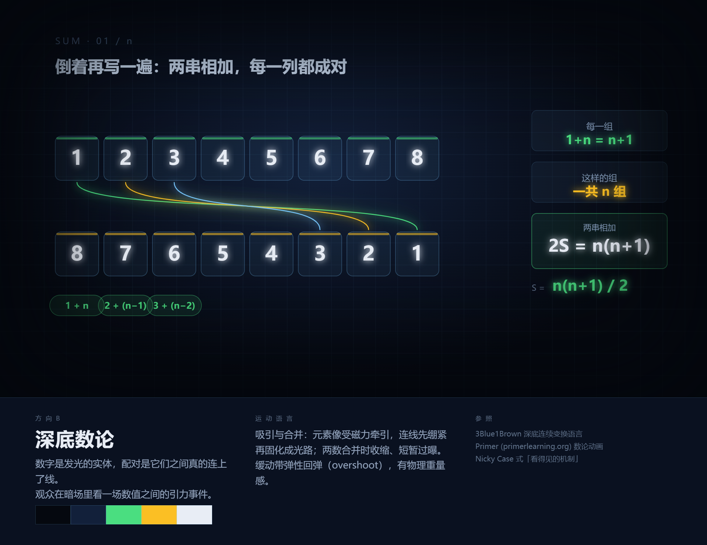
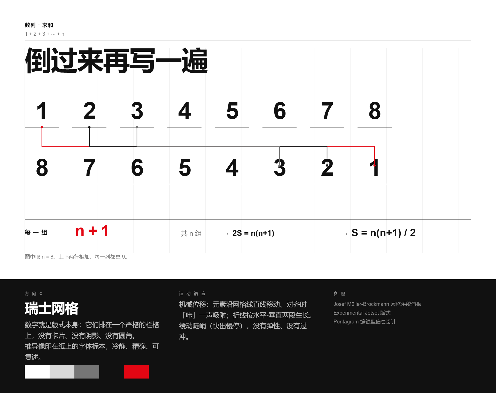

# 专题　微课视频制作全流程：解说词变成片，配音驱动，本机零费用

> **一句话**：不用摄像机、不用视频模型、不用剪辑软件——你只写 11 句解说词，配音、时间轴、动画、渲染、合成全部按流程走完，产出一支 1080p 的知识讲解微课。
>
> **本专题是实测记录**：所有截图来自 2026-10-28 真实制作的《1+2+3+⋯+n 求和公式》（59 秒，初中数学），全部命令原位可复制。跟着做，第一支片子约半天，第二支起每支约 1–2 小时。

---

## 〇、你将做出什么

一支这样的片子（以下四帧全部来自成片真实画面）：

**说到"倒过来"时，画面正在从右往左写下第二个八行：**



**说到"都等于 n 加一"时，四个 n+1 正好全部亮出：**



**说到"n 乘 n 加一"时，大公式的红字正在被写出：**



**说到"五千零五十"时，5050 同帧弹出并被红笔圈出：**



| 实测数据 | 数值 |
|---|---|
| 成片 | 59 秒 / 1080p30 / 14.2MB |
| 全量渲染 | 1767 帧，157 秒 |
| 第三方费用 | **0**（全本机） |
| 改一版重出一次 | 约 3 分钟 |

---

## 一、全流程图（先看懂，再动手）



**看图的三个要点：**

1. **③ 是全片质量所在**（红框标出）：时间轴由配音的真实时长推出，不是先定时长再配音——顺序不能颠倒。
2. **⑤→④ 是一个循环**：预览发现重叠、错位、不同步，回④改，一般 2–3 轮收敛。
3. **⑧ 是必须做的一步**：抽帧质检要"从渲染帧看一遍，再从成片 MP4 里抽一遍"——编码后的画面才是观众看到的。

---

## 二、准备（一次性，半小时）

### 2.1 四件工具，四条命令验证

| 组件 | 用途 | 验证命令 |
|---|---|---|
| ffmpeg | 读音频时长、拼接音轨、编码混流 | `ffmpeg -version` |
| Node 18+ | 跑逐帧渲染器 | `node -v` |
| Playwright | 无头浏览器逐帧截图 | `npx playwright --version` |
| edge-tts | 中文配音（免费） | `python -m edge_tts --help` |

再加上 Pillow（抽帧质检拼图用）：`py -c "import PIL"`。缺哪个装哪个，都是免费工具。

### 2.2 两个已经替你踩过的坑

**坑一：edge-tts 版本。** 旧版（7.2.8 及以下）会被微软语音端点拒绝，报 `403 Invalid response status`。**装 7.3.1 以上**，且建议装在独立 venv 里，别混进系统 Python：

```
py -m venv .venv-tts
.venv-tts\Scripts\pip install "edge-tts>=7.3.1"
```

之后所有配音命令都用 `.venv-tts\Scripts\python -m edge_tts …`。

**坑二：Playwright 浏览器。** Playwright 默认要找它自己下载的 chromium，本机若只装过别的版本会报找不到。解法见第⑥步渲染器里的 `BROWSER_CANDIDATES`——把本机已有的 Chrome/Edge 路径填进去即可，不用重新下载。

### 2.3 建一个课程目录

每支课一个文件夹，四件套复制自样例：

```
microcourse/
└─ 我的课/
   ├─ audio/          ← 配音 mp3 放这里
   ├─ index.html      ← 动画（第④步生成）
   ├─ render.js       ← 渲染器（从样例复制，不改）
   ├─ build.sh        ← 合成脚本（第⑦步，按句数改）
   └─ qa.py           ← 质检（从样例复制，不改）
```

> 样例仓库位置：`教师版蓝皮书/microcourse/` 下有 `sum_n/`、`sum_n_v2/` 两个完整实例，`render.js`、`qa.py` 直接复制即可。

---

## 三、第①步　写解说词：一句只干一件事

**这是全片唯一要"写文章"的地方，也是唯一不能交给 AI 的地方**——你知道学生卡在哪，AI 不知道。

**唯一约束：一句话只干一件事，每句 3–7 秒。** 句子短，配音才清楚，画面才跟得上。

《1+2+⋯+n》的 11 句原文（照这个颗粒度写）：

```
一加二加三，一直加到 n，有没有不用一个一个加的算法？
我们把这串数倒过来，在下面再写一遍。
上下对着看：一加 n，二加 n 减一，三加 n 减二。
你会发现，每一组的和，都等于 n 加一。
这样的组，一共有 n 个。
所以，两串数加起来，就是 n 乘以 n 加一。
可我们要求的，只是其中的一半。
所以，S 就等于 n 乘 n 加一，再除以二。
用它来算一加到一百：一百乘一百零一，再除以二。
答案是五千零五十，一下就算出来了。
这就是高斯小时候的办法，你也可以用它来算。
```

**自查三条**：① 每句话里有没有两个"哦对还有"？有就拆成两句。② 有没有"然后我们再来看一下"这种废话？删掉，画面自己会动。③ 每句能不能在脑子里"看见"一幅画面？看不见的句子（比如"这个定理很重要"）写不成画面，删。

---

## 四、第②步　逐句配音：一句一个 mp3

把 11 句存进 `tts.sh`（**逐句生成，不要一次生成整段**——后面量时长、排画面都按句进行）：

```bash
#!/usr/bin/env bash
set -e
cd "$(dirname "$0")"
V="zh-CN-YunxiaNeural"
declare -a RATES=('+0%' '-2%' '-4%' '-6%')
declare -a TEXTS=(
  '一加二加三，一直加到 n，有没有不用一个一个加的算法？'
  '我们把这串数倒过来，在下面再写一遍。'
  # ……（第③—⑩句照解说词填）
  '这就是高斯小时候的办法，你也可以用它来算。'
)
for i in "${!TEXTS[@]}"; do
  n=$((i+1)); r=${RATES[$((i % 4))]}
  py -m edge_tts --voice "$V" --rate="$r" --text "${TEXTS[$i]}" --write-media "audio/l$n.mp3"
done
```

运行：`bash tts.sh`，得到 `audio/l1.mp3 … l11.mp3`。

**两个实测出来的参数，别改错：**

1. **音色 `zh-CN-YunxiaNeural`**（少年音，清澈），讲数学干净不装腔。
2. **语速必须逐句轮换**，四句一循环——全用同一语速听起来像念经。**给学生听的，全部 ≤0%**（+0/−2/−4/−6 轮换），实测平均句长 4.7 秒，不赶。

---

## 五、第③步　量时长、排时间轴（全片质量在这一步）

### 5.1 量出每句真实时长

```bash
ffmpeg -nostdin -hide_banner -i audio/l1.mp3 2>&1 | grep -oE 'Duration: [0-9:.]+'
```

逐句量完（或用下面这段 Python 一次算完时间轴）：

```python
import subprocess, re
durs = []
for i in range(1, 12):
    r = subprocess.run(['ffmpeg','-nostdin','-hide_banner','-i',f'audio/l{i}.mp3'],
                       capture_output=True, text=True)
    m = re.search(r'Duration: (\d+):(\d+):([\d.]+)', r.stderr)
    d = int(m.group(1))*3600 + int(m.group(2))*60 + float(m.group(3)) - 0.02
    durs.append(round(d, 2))
GAP, LEAD, TAIL = 0.30, 1.50, 2.30      # 气口 / 片头 / 片尾
t = LEAD
for i, d in enumerate(durs, 1):
    print(f's{i}: [{t:.2f}, {t+d:.2f}]'); t += d + GAP
print('DURATION =', round(t + TAIL - GAP, 2))
```

实测结果（11 句）：

```
l1: 5.84s  l2: 4.25s  l3: 6.00s  l4: 4.97s  l5: 2.96s  l6: 4.80s
l7: 3.70s  l8: 5.28s  l9: 5.33s  l10: 4.25s  l11: 4.71s
```

### 5.2 排成时间轴

按「起点 + 时长 + 0.3 秒气口」累加，得到这张表——**它就是全片的分镜表**：

```
s1: [1.50, 7.34]   s2: [7.64, 11.89]   s3: [12.19, 18.19]
s4: [18.49, 23.46] s5: [23.76, 26.72]  s6: [27.02, 31.82]
s7: [32.12, 35.82] s8: [36.12, 41.40]  s9: [41.70, 47.03]
s10: [47.33, 51.58] s11: [51.88, 56.59]  DURATION = 58.89
```

**这张表要同时喂给两个地方**：动画代码里的 `TL` 常量、合成脚本里的音轨拼接——两边必须一致，改一个就要改另一个。实测成片音轨与时间轴零漂移。

### 5.3 字级对齐：治"话说完了画面才动"的那一刀

只有句级对齐还不够。每句话内部的元素，出现时刻按**那个字在句中的位置**折算：

```js
function at(seg, f){ const [a,b]=TL[seg]; return a + f*(b-a); }  // 句内第 f 份处 → 绝对秒
const T = {
  arc1: at('s3', 6/27),   // s3 共27字，"一加 n"说到第6字 → 弧1开始画
  arc2: at('s3', 10/27),  // "二加 n 减一" → 弧2
  e5050: at('s10', 3/18), // "答案是"说完 → 5050 弹出
};
```

再配两条实测纪律：

- **元素提前 0.12 秒起跑**（动画有过渡时间，提前起跑才保证"字到画到"）；
- **句内出现阈值一律放在前 40%**（放到 50% 以后，配音早说完画面才出现——这就是"话说完了等半天"的病根）。

---

## 六、第④步　写动画：交给 AI，你当验收

教师不需要手写几百行绘图代码。**把下面这段总控提示词原样发给 WorkBuddy（或任何 AI 编码助手），替换方括号内容**：

```
请帮我制作一个知识讲解微课动画，单文件 HTML + Canvas，要求：

【画面】1920×1080，手绘草稿纸风格：暖白纸底 + 淡横格线 + 左侧红边线 +
纸纹颗粒；所有线条是"铅笔双色笔触"（浅粗底层 + 深细上层）；方框四笔
独立绘制、端点略错开，像手写不齐；文字按"从左到右被写出"的方式出现。

【知识点】[填写：如 1+2+…+n 的配对法推导，图中取 n=8]

【时间轴】（已按配音实测排好，一个字不许改）
TL = { s1:[1.50,7.34], s2:[7.64,11.89], s3:[12.19,18.19], s4:[18.49,23.46],
       s5:[23.76,26.72], s6:[27.02,31.82], s7:[32.12,35.82], s8:[36.12,41.40],
       s9:[41.70,47.03], s10:[47.33,51.58], s11:[51.88,56.59], end:[56.59,58.89] }

【分镜】（每句一行，画面做什么）
[逐句填写：s1 写出第一行 1..8 和虚线 n 框；s2 从右往左写 8..1；s3 逐条描配对弧……]

【铁律】
1. renderFrame(t) 是时间纯函数：只依赖 t，不依赖上一帧，任何时刻可直接跳帧渲染；
2. 每个元素的出现时刻 = 解说词里那个字被说到的时刻（按字位折算，提前 0.12 秒）；
3. 整片是一个连续画面：没有"整页淡出再淡入"，两行数字框从第一笔用到最后一笔；
4. 画面内不画进度条、播放按钮、时间码。

【交付】暴露 window.renderFrame 与 window.__meta={duration,fps,width,height}；
浏览器直开可循环预览；文件名 index.html。
```

**你验收 AI 产出的三条标准**（对应上面铁律）：

1. 拖动进度条（或改 t 值）到任意时刻，画面正确——说明是纯函数；
2. 两行数字框从第 1 秒活到最后一秒，中间没有"换页感"；
3. 抽任意一句话，画面元素不晚于那句话说完。

> **进阶（可选）**：想先看几种外观再定，用 huashu-design skill 的三方向门——它会先出三个真实渲染的方向板让你选。本例选了"手稿速写"（另外两个候选是"深底数论"和"瑞士网格"），三张方向板见本专题末尾。

---

## 七、第⑤步　预览关键帧：几秒钟看一次效果

渲染器支持预览模式（只渲每幕关键时刻，19 张）：

```bash
node render.js --preview
```

真实运行输出：

```
  预览 0.8s -> t0_8.jpg
  预览 4.9s -> t4_9.jpg
  ……
预览完成，共 19 张
```

打开 `preview/` 文件夹逐张看，**只查四件事**：

1. **重叠**——元素压在一起（本例实测修掉了 7 处：气泡压 n 框、弧线折成直角、徽章横线画进方框、5050 压住例题……全是预览抓到的）；
2. **错位**——该对齐的没对齐；
3. **空档**——某句话正在说，画面却没东西动；
4. **早迟**——元素出现得比语音明显早/晚。

发现问题 → 回第④步改 → 再跑 `--preview`。**不要在全量渲染之后才发现重叠**——预览一轮几十秒，全量一轮三分钟。

---

## 八、第⑥步　全量渲染：逐帧截图

```bash
node render.js
```

真实运行输出：

```
渲染 1767 帧  1920x1080 @30fps  58.89s
  0/1767  0.0s
  500/1767  44.6s
  1500/1767  133.9s
完成：1767 帧，用时 157.2s
```

渲染器做的事很简单：让页面停掉自动播放，从 t=0 开始每 1/30 秒调一次 `renderFrame(t)`、截一张图。**因为动画是纯函数，每一帧都是确定的**——录屏会掉帧，这里不会；改了画面重跑一遍，结果完全可复现。

---

## 九、第⑦步　拼音轨 + 编码：一条命令出片

`build.sh`（按你的句数改循环）：

```bash
#!/usr/bin/env bash
set -e
FF=ffmpeg
# 静音段：片头 1.5s / 句间 0.3s / 片尾 2.3s（与时间轴一致）
$FF -y -loglevel error -f lavfi -i anullsrc=r=44100:cl=mono -t 1.50 audio/silLead.wav
$FF -y -loglevel error -f lavfi -i anullsrc=r=44100:cl=mono -t 0.30 audio/silGap.wav
$FF -y -loglevel error -f lavfi -i anullsrc=r=44100:cl=mono -t 2.30 audio/silTail.wav
for i in $(seq 1 11); do
  $FF -y -loglevel error -i "audio/l$i.mp3" -ar 44100 -ac 1 "audio/w$i.wav"; done
{ echo "file 'audio/silLead.wav'"
  for i in $(seq 1 11); do echo "file 'audio/w$i.wav'"
    [ "$i" -lt 11 ] && echo "file 'audio/silGap.wav'"; done
  echo "file 'audio/silTail.wav'"; } > concat.txt
$FF -y -loglevel error -f concat -safe 0 -i concat.txt -c copy audio/full.wav
# 帧序列 + 音轨 → MP4
$FF -y -loglevel error -framerate 30 -i frames/f%05d.jpg -i audio/full.wav \
  -c:v libx264 -preset medium -crf 20 -pix_fmt yuv420p \
  -c:a aac -b:a 128k -shortest -movflags +faststart \
  我的课.mp4
```

运行 `bash build.sh`，真实输出：

```
     音轨总长: 00:00:59.12
```

得到 `我的课.mp4`。**音轨总长应与 DURATION 基本一致**（差 0.2 秒以内正常，是 mp3 解码填充，`-shortest` 会以视频为准截齐）。

---

## 十、第⑧步　抽帧质检：必须做，做两遍

### 10.1 第一遍：渲染帧联系表

```bash
py qa.py
```

真实输出：

```
联系表: qa_sheet.png (2400, 900) 抽了 24 帧 / 共 1767
!! 可疑帧（过黑/过白/无变化）:
    ('f00000.jpg', 239.7, 0.1)
```

打开 `qa_sheet.png` 看 24 宫格。本例唯一"可疑帧"是 f00000——第一帧纯白纸面，笔还没落下，**设计如此**，不是事故。逐张查：黑帧、元素飞出画面、该动的没动。



### 10.2 第二遍：从成片 MP4 里抽，核对音画同步

```bash
mkdir -p syncchk
for ts in 9.3 22.4 38.5 48.3; do
  ffmpeg -y -loglevel error -ss $ts -i 我的课.mp4 -frames:v 1 "syncchk/mp_$ts.jpg"
done
```

时刻的选法：**每句"关键词被说到的时刻"**（从时间轴推）。然后逐张对照——本例四张的判读：

| 抽帧时刻 | 那句话 | 画面应有的 | 实测 |
|---|---|---|---|
| 9.3s | "倒过来"（8.98s 说） | 下行正从右往左写、箭头已出现 | ✅ |
| 22.4s | "都等于 n 加一"（21.0s 说） | 四个 n+1 徽章全亮 | ✅ |
| 38.5s | "n 乘 n 加一"（38.07s 说） | 大公式红字正在写 | ✅ |
| 48.3s | "五千零五十"（48.04s 说） | 5050 刚弹出 | ✅ |

**为什么必须从 MP4 里再抽一遍**：编码后的画面才是观众看到的——渲染正确不代表混流没出问题（音画错位、首帧丢失都发生在这一步）。

---

## 十一、改一版重出：两分钟循环

成片不是终点。发现要改（字号、颜色、某句词、某个元素晚半拍）：

```
改 index.html（或换一句配音）→ node render.js --preview 确认 → node render.js → bash build.sh
```

预览确认几十秒、全量渲染约 3 分钟。**全流程零费用，不限次数**——这是这套方法对"录屏式微课"的根本优势：录屏改一版要重录一遍，这里只是重新生成。

---

## 十二、踩坑清单（全部实测踩过）

| # | 坑 | 症状 | 解法 |
|---|---|---|---|
| 1 | edge-tts 旧版 403 | 配音命令报 `WSServerHandshakeError: 403` | 装 ≥7.3.1，独立 venv |
| 2 | 画面慢半拍 | 话说完了，元素才出现 | 字位折算 + 提前 0.12s + 阈值 ≤40% |
| 3 | 源元素"没搬空" | 格子飞走了，填充和格线还在，像复制 | 加 drain：填充渐隐、轮廓转虚线 |
| 4 | 配对弧折成直角 | 贝塞尔控制点写反（y1+78 > y2−78） | 控制点不交叉（y1+44 < y2−44） |
| 5 | 尺寸标注进图形 | 标注压在图形上 | 判断偏移方向；压字加白色描边 strokeText |
| 6 | 大数字带单位错位 | 数字变长把"种"顶跑 | measureText 量宽，单位跟着移动 |
| 7 | 素材假 | 随机符号拼"公式"像乱码 | 只用真实式子；教学材料里假的一眼被看穿 |
| 8 | 尾部音画差 0.2 秒 | 音轨比时间轴长一点 | mp3 解码填充所致，`-shortest` 以视频为准截齐，落在片尾静音区，无害 |

---

## 十三、换题材：只改四处

```
解说词 → 配音 → TL 时间轴 → 绘制函数
```

**版式按题材选**（实测两种都成立）：

- **论证型**（定理、公式、推导）：结论要一直看得见 → 右侧信息栏 / 常驻公式区；
- **叙事型**（人物、事件、过程）：画面要让给故事 → 底部字幕条。

选题三问：① 这东西"画出来"比"说出来"清楚吗？② 学生最常见的错误直觉是什么（做成一幕"误区卡片"）？③ 哪一帧是"啊哈时刻"（全片停在那一帧让学生先猜）？

---

## 十四、进阶：先看三个外观再动手（可选）

第④步之前，可以先用 huashu-design 的三方向门出**真实渲染的方向板**——每种外观一张真实画面 + 色板 + 一句定位，选定了再做，避免整支片子做完才发现外观不喜欢。本例的三个候选：

**A · 手稿速写**（本片采用）：铅笔在草稿纸上写，写得有点歪，批注是红笔后加的：



**B · 深底数论**：暗场发光数值，配对是连上的光路（3Blue1Brown 语言）：



**C · 瑞士网格**：数字即版式，纯黑白 + 唯一红（印刷语言）：



---

## 附：本例文件清单与成本

| 文件 | 作用 |
|---|---|
| `microcourse/sum_n_v2/index.html` | 动画（58.89s 时间轴 + 手稿风格绘制） |
| `microcourse/sum_n_v2/tts.sh` | 11 句配音脚本 |
| `microcourse/sum_n_v2/render.js` | 逐帧渲染器（--preview / 全量） |
| `microcourse/sum_n_v2/build.sh` | 音轨拼接 + 编码混流 |
| `microcourse/sum_n_v2/qa.py` | 抽帧联系表 + 黑帧检测 |
| `microcourse/sum_n_v2/导演稿.md` | 11 镜分镜卡（进阶参考） |
| 成片 | `sum_n_v2_microcourse.mp4`（59s / 14.2MB） |

| 成本项 | 数值 |
|---|---|
| 配音 | edge-tts，免费 |
| 渲染 | 本机 157 秒 |
| 编码 | ffmpeg，免费 |
| 全流程 | **0 元**，不限次数 |
