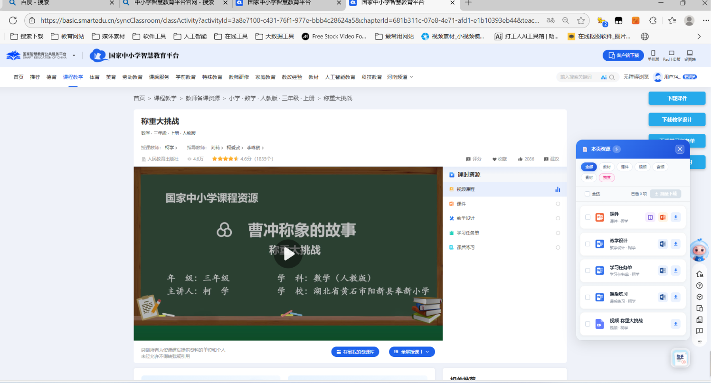
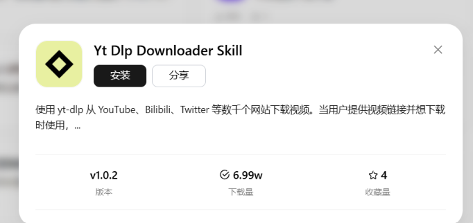

# 专题　教学资源下载：六类资源，六条路，还有一个自己造的工具

> **一句话**：教室里看得见的资源，怎样合法地拿到手——六类常见资源、每一步怎么点、哪里会踩坑，全部本机实测。
>
> **本专题定位**：全书已有《视频素材下载》与《疑难站点实战》两篇（2026-11-04 实测）。这一篇是 **2026-11-18 的重测与更新**：不但补齐了国家平台的「本页资源」助手新功能，还**推翻了此前两个结论**——抖音不再是「卡在 cookie 能过但麻烦」，视频号也不再是「基本无解」，两者都找到了无需登录的匿名方案。旧篇讲「怎么下」，本篇讲「下不了时怎么自己造一个工具」。
>
> **为什么值得收进蓝皮书**：本篇最值钱的不是任何一个下载命令，而是第五章那条完整的方法论——四种工具全失败之后，怎么「找开源 → 改造 → 做成自己的工具」。这正是第 24 章《打造属于你的 Skill》的一个真实案例：从一句「这个 tool 下不了」，到一个能打包发给全校老师用的 skill。
>
> **读法**：只想马上下载 → 第 00 章查表 + 对应平台章节；想知道工具怎么选 → 第 00 章 + 第 07 章；要给教研组做培训或讲「自己造工具」 → 第 05 章三步法。

| 配套物 | 位置 / 说明 |
|---|---|
| 技能资源包 | 夸克网盘 https://pan.quark.cn/s/db4482430652?pwd=bKXG （提取码 `bKXG`）——含本专题 4 个技能 + 教程 |
| 单文件 HTML 教程 | `D:/projects/download/专题教程/教学资源下载专题教程.html`（手机打开夸克 APP 保存） |
| 本专题截图 | `assets_opt/`（智慧教育平台助手面板、技能市场下载量对比） |
| 自制技能源码 | `D:/projects/download/教学资源下载技能资源包/skills/抖音匿名下载/`（`douyin-video-save`） |

---

## 写在前面：一张表看懂该用哪个工具

不同平台，下载方式完全不同。**先查表，再动手**，别指望一个工具通吃。

| 资源类型 | 用什么 | 要不要登录 | 难度 |
|---|---|---|---|
| 国家中小学智慧教育平台 | 网页直接下 / 点右侧"本页资源"助手 | 部分资源要 | ⭐ |
| B站视频 | yt-dlp（WorkBuddy 技能） | 不用 | ⭐ |
| 公众号文章里的视频 | 先把 vid 解出来，再用腾讯视频直链下 | 不用 | ⭐⭐ |
| 普通网页视频（搜狐等） | yt-dlp；失败就手动解直链 | 不用 | ⭐⭐⭐ |
| 抖音视频 | 专用匿名工具（本专题自制 skill） | 不用 | ⭐⭐ |
| 微信视频号视频 | 视频号下载技能 | 不用 | ⭐⭐ |
| 公众号文章正文 | 公众号文章转 Word 技能 | 不用 | ⭐ |

**一句话记忆**：
- B站、腾讯、搜狐这些"正规网页视频"，交给 yt-dlp；
- 微信生态（视频号、公众号）和抖音是"围墙花园"，各走各的专用工具；
- 国家平台最简单——网页上点一点就行，现在还有助手自动帮你找资源。

---

## 第一章 · 国家中小学智慧教育平台（最简单，先从这个上手）

### 1.1 老办法：网页上直接下载

打开课程页（如 `basic.smartedu.cn` 的课件页），页面右侧或资源列表里本来就有下载按钮，登录后点一下就能保存教材 PDF、课件、教学设计、学习任务单、课后练习等。

### 1.2 新办法：点右侧"本页资源"助手，自动识别、勾选下载

**这是本次实测发现的新功能**，也是这个平台最省事的地方。

操作步骤：

1. 打开任意一节课的页面（例：数学·三年级上册·人教版《称重大挑战》）
2. 看页面**右侧**，会浮出一个「本页资源」小面板
3. 面板顶部是一排标签：**教材 / 视频 / 课件 / 教学设计 / 学习任务单 / 课后练习**
4. 点想要的资源类型，面板会列出这节课对应的具体文件
5. 每条资源右侧有一个**下载图标**，点它就能下载；也可以多选后批量下



> **教学价值**：以前老师要在一堆标签页里翻找资源，现在助手自动把"这一页能下载什么"全列出来，点选即可。带教研组老师做培训时，这一幕特别直观。

### 1.3 批量/自动化下载：用专用技能（进阶）

如果要成建制地下载整章、整册资源，可以用现成的 `smartedu-download` 技能（本机已安装）。它支持教材 PDF、课程视频、课件、教学设计、学习任务单、课后练习，以及公开课直播回放；自动处理登录和加密视频。

---

## 第二章 · B站视频（yt-dlp 体验最好的平台）

B站是这几个平台里**最省心**的：yt-dlp 原生支持，不用登录、不用额外脚本。

### 操作步骤

1. 复制视频链接，例如 `https://www.bilibili.com/video/BV1uUsJ6BEDo/`
2. 对 WorkBuddy 说：**"下载这个视频 + 链接"**
3. 它调用 yt-dlp，自动选最高画质、下载音视频并合并成 MP4

### 实测结果

- 匿名访问即可下到 **1080P**（普通 1080P 就够用）
- 提示"1080P 高码率需大会员"——那是更高码率版本，不用管
- B站视频和音频是分开存的，yt-dlp 自动用 ffmpeg 合并成完整 MP4

**实测文件**：《百度世界2026「AI+自进化」分论坛》 1080P 竖屏 / 72 秒 / 4.9 MB，播放正常。

> **给老师的话**：B站上很多优质公开课、科普视频，用这个方法几秒钟就能存到本地，离线放给全班看，不怕断网。

---

## 第三章 · 微信公众号文章里的视频（两步走，别直接贴文章链接）

### 关键认知（先讲清楚，少走弯路）

公众号文章里的视频，**通常不是视频号视频，而是内嵌的腾讯视频**。所以：

- ❌ 直接把文章链接 `mp.weixin.qq.com/s/...` 丢给 yt-dlp → 报错 `Unsupported URL`
- ✅ 正确做法：**先从文章里解出腾讯视频的 vid，再用腾讯视频直链下载**

### 操作步骤

1. 把文章链接交给 WorkBuddy，让它**抓取页面源码，找出内嵌的腾讯视频 vid**
   - 文章里的视频一般是这样的 iframe：`v.qq.com/txp/iframe/player.html?vid=xxxxxxxx`
   - 取出 `vid`（一串字母数字，如 `x03800h6phd`）
2. 拼出腾讯视频直链：`https://v.qq.com/x/cover/<vid>/<vid>.html`
   - ⚠️ 注意是**两层** `<vid>/<vid>`，只写一层会下到空列表
3. 把这个直链交给 yt-dlp 下载，可选 720P / 480P

### 实测结果

一篇公众号文章里嵌的腾讯视频（vid=`x03800h6phd`），按上面两步成功下载：
720P / 约 61 分钟 / 230 MB，播放正常。

> **踩坑提醒**：腾讯视频是 HLS 分片，下载后需要 ffmpeg 修复封装——yt-dlp 会自动做，不用你管。

---

## 第四章 · 普通网页视频（搜狐等，工具失败时怎么办）

### 情况 A：yt-dlp 直接能用

很多网站 yt-dlp 原生支持，直接贴链接就能下。先试这一步。

### 情况 B：yt-dlp 识别了但下不了（手动解直链）

**实测案例：搜狐视频**（`tv.sohu.com`）。yt-dlp 能识别，但报 JSON 解析失败——它用来"分配视频服务器"的老接口失效了。

解法（让 WorkBuddy 执行）：

1. 请求搜狐元数据接口：`http://my.tv.sohu.com/play/videonew.do?vid=<视频ID>`，拿到 `clipsURL` 和 `su` 两个参数
2. 拼出分配请求，**注意必须用 HTTPS**：
   `https://data.vod.itc.cn/?prot=9&file=<clipsURL>&new=<su>&prod=h5n&rb=1`
3. 这个接口返回 JSON，里面的 `url` 就是真实 MP4 直链
4. 带上 `Referer: tv.sohu.com` 下载即可

**实测结果**：搜狐《百度音乐官方使用视频》 640×352 / 102 秒 / 6.6 MB，下载成功。

> **踩坑提醒**：元数据里有个现成的 `mp4PlayUrl` 字段，看着像直链，实际是 **404 陷阱**——别用它，要走上面第 2 步的分配接口。

> **方法论**：网页视频没有万能钥匙，各平台是私有接口。通用工具不满血时，就得"解链"——这是这一章唯一要记住的思路。

---

## 第五章 · 抖音视频（专用工具，别用 yt-dlp）

### 关键认知（本章最重要）

**yt-dlp 及其所有封装，都下载不了抖音。** 这不是配置问题，是工具能力边界。

我们实测了 4 个工具，全部失败：

| 工具 | 结果 |
|---|---|
| yt-dlp 直接下 | ❌ 403 Forbidden |
| 手动构造全套 Cookie | ❌ 403 UIFID 缺失 |
| `tl_video_downloader`（技能市场，11w 下载量） | ❌ 同一个 403，底层也是 yt-dlp |
| `douyin-save`（无水印解析技能） | ❌ 页面标记改版导致解析失败 |

**原因**：抖音的视频详情接口需要登录态签名（`s_v_web_id`、`UIFID` 等风控 Cookie），yt-dlp 官方源码里这行还是 TODO（未实现）。

### 工具不行怎么办：自己造一个（本章最值得讲的方法论）

四种方法都试过、都不行的时候，我们没有停在"抖音就是下不了"上，而是走了一条更有价值的路——**自己做一个工具**。这条路对所有老师都适用，分三步：

```
现成工具都不行  →  ① 找开源  →  ② 改造  →  ③ 做成自己的工具
```

**第 1 步：先找开源，别从零造轮子**
到开源社区（如 GitHub）搜"抖音下载"，看有没有别人已经写好的方案。我们找到了一套绿色版下载器，它的思路和 yt-dlp 完全不同——走公开分享页、匿名解析、无需 Cookie。这一步的关键是**换个思路找**，而不是同一个思路反复试。

**第 2 步：在开源基础上改造，为我所用**
开源工具能跑，但不一定顺手。我们做的改造是：把它封装成 WorkBuddy 能直接调用的 skill——以后只要粘贴链接、说一句"下载"，它自动完成；同时把输出目录、自动重试这些细节固化进去。改造不需要从头写代码，看懂开源脚本、改几个参数、加一层封装即可。

**第 3 步：做成自己的工具，还能分享给同事**
改好后，它成了 `douyin-video-save` skill，打包进本次资源包，讲课时直接发给老师们用。从"到处找工具"变成"我有个自己做的工具"——这就是 AI 时代教师可以做到的工具定制。

> **给老师的话**：以后遇到"现成工具满足不了教学需求"的情况，别急着放弃。先找开源，再按你的场景改造，最后封装成自己顺手的工具。这比反复抱怨工具不好用，要有价值得多。

### 正确做法：用匿名分享页工具（本专题自制 skill）

我们基于一套绿色版工具做了 `douyin-video-save` skill，**无需 Cookie、无需登录**，已实测成功。

**为什么它能匿名下载？**（原理，选读）

它不碰那个要风控的 `douyin.com/aweme/v1/.../detail/` 接口，而是访问公开的**分享页** `iesdouyin.com/share/video/<作品ID>/`：

1. 从分享页里读出 `_ROUTER_DATA` 中的视频信息
2. 拿到播放地址后，把 `/playwm/` 换成 `/play/`，就是无水印版
3. 有个细节：第一次访问只为拿 ttwid，重试第二次才有数据——所以脚本内置重试 3 次

### 操作步骤（照着做）

1. 在手机上点抖音「分享 → 复制链接」，得到一整段分享文本
2. 把整段文本（或纯链接）发给 WorkBuddy，说"下载这个抖音视频"
3. 视频保存到 `downloads/日期/` 下，按作品标题命名

**实测结果**：豆芽清水自然培育视频，720P / 85 秒 / 21 MB，无水印，播放正常。

### 视频号视频（顺带说一句）

微信视频号是另一套，和抖音不一样。本机已装 `wechat-channels-download` 技能：把视频号分享链接（`weixin.qq.com/sph/...`）发过去，就能解析出无水印 MP4。同样是"微信生态要用专用工具"的思路。

---

## 第六章 · 公众号文章正文（转 Word 存档）

如果目的是**把文章文字存下来**（不是视频），用 `wechat-article-to-word` 技能：

1. 把公众号文章链接发给 WorkBuddy
2. 它提取正文，自动剔除图片、二维码、表情、广告
3. 生成排版整洁的 Word 文档

> 边界：这个技能只留文字，不含文章里的图片和附件。要整号批量归档，另有 `wechat-article-archive` 技能。

---

## 第七章 · 工具选型与技能安装（给要照着配的老师）

### 需要装的技能（在 WorkBuddy 技能市场按名字搜）

| 用途 | 技能名 | 说明 |
|---|---|---|
| 网页/B站视频 | `Yt Dlp Downloader Skill` | 通用下载器，覆盖数千网站，**但不支持抖音/微信生态** |
| 智慧教育平台 | `smartedu-download` | 教材、视频、课件批量下 |
| 视频号 | `wechat-channels-download` | 视频号无水印视频 |
| 公众号正文 | `wechat-article-to-word` | 文章转 Word |
| 抖音（本专题自制） | `douyin-video-save` | 匿名下载，无需 Cookie，见随附 zip |



### 三条选型铁律

1. **看底层，别看简介**：名字里写"支持抖音"的技能，底层如果是 yt-dlp，就照样下不了抖音。
2. **下载类技能有保质期**：平台一改版（比如页面标记写法变了），技能就可能失效。今天能用不代表半年后能用。
3. **一个工具不包打天下**：正规网页视频、微信生态、抖音，三类三条路，认准了再选工具。

---

## 附录 A · 本次实测文件清单

所有文件保存在 `downloads/2026-11-18/`：

| 文件 | 来源 | 规格 |
|---|---|---|
| `微信文章内嵌视频_x03800h6phd_720p.mp4` | 公众号文章内嵌腾讯视频 | 720P / 61 分钟 / 230 MB |
| `搜狐视频_百度音乐官方使用视频.mp4` | 搜狐视频解链 | 640×352 / 102 秒 / 6.6 MB |
| `豆芽清水自然培育｜全程 0 添加 小合家手工豆芽🌱.mp4` | 抖音匿名下载 | 720P / 85 秒 / 21 MB |
| `B站_百度世界2026_AI自进化分论坛_1080P.mp4` | B站 yt-dlp | 1080P 竖屏 / 72 秒 / 4.9 MB |

## 附录 B · 版权与适用边界（务必对老师讲清楚）

- 下载内容**仅供个人学习与教学备份**，遵守平台规则与相关版权法规。
- 不要用于商用传播、二次贩卖或大规模分发。
- 公开资源也可能有版权限制，用于课堂前请确认本校的版权政策。
- 涉及收费、机构合作、课程销售，先确认本单位关于对外培训与成果归属的规定。

---

*本专题所有方法均于 2026-11-18 在本机实测。平台会改版，方法会失效，遇到问题以"看报错、查原理、换工具"的思路排查。*
