# 专题　教师个人工作台搭建全程实录：跟着做，搭出你自己的教师工作台

> **一句话**：不用写代码、不用装环境，照着发两段提示词，30 分钟就能在电脑上得到一个断网可用、数据只存本机的教师工作台。
>
> **本专题定位**：全书多数专题讲「用 WorkBuddy 做一次成品」，这一篇讲**把教师每天散落的工作流，沉淀成一个自己天天能打开的系统**。它不是概念介绍，而是一份可照做的全程实录：需求怎么问、提示词怎么从 V1 改到 V4、真用过一周后哪些地方会坏、坏的地方怎样变成第二轮提示词里的验收条款。
>
> **为什么值得收进蓝皮书**：这是全书唯一一篇把「提示词迭代过程」完整公开的专题——V3 负责从零生成，V4 负责用真实问题修到敢天天用。老师照着做，得到的不仅是一个网页，更是一套可迁移的方法。
>
> **读法**：只想先做出成品 → 第一、二阶段；想知道为什么这样改提示词 → 第三阶段 + 附录 A；要给教研组做培训 → 直接按 12 步带练，每步都有截图与完成标志。
>
> 这份教程只干一件事：**让你照着点、照着发，30 分钟后电脑上有一个能用的工作台。** 用到的**每一条提示词都放在它该用的那一步**，整段复制即可；每一步都配了截图和「完成标志」，做完打个勾再往下走。

| 配套物 | 位置 / 说明 |
|---|---|
| 单文件成品 | `D:/projects/教师工作台/教师工作台搭建教程/02_工作台成品/index.html` |
| 单文件 HTML 教程 | `D:/projects/教师工作台/教师工作台搭建教程/01_教程正文/分步实操教程_跟着做就能搭出来.html`（图片已内嵌） |
| 提示词四版全集 | `D:/projects/教师工作台/教师工作台搭建教程/03_提示词迭代/` |
| 优化审查记录（26 条问题） | `D:/projects/教师工作台/教师工作台搭建教程/04_流程记录/优化审查记录_v4.md` |
| 本专题截图 | `teacher_workbench/shots/`（14 张，已由构建脚本内嵌到正式版 HTML） |

---

## 开始前：准备 3 样东西

| 要准备的 | 具体是什么 | 说明 |
|----------|-----------|------|
| ① 一个文件夹 | 桌面新建「我的教师工作台」 | 成品和备份都放这里，别散落在下载文件夹 |
| ② 一个 AI 入口 | WorkBuddy，或任意能写网页的大模型对话窗口 | 两条路径都写在本教程里，不绑定产品 |
| ③ 一个 U 盘（可选） | 用来存备份 | 旧机房电脑常重做系统，备份别只放本机 |

**时间**：第一版约 30 分钟（含等 AI 生成）。第二轮打磨约 15 分钟，建议用满一周之后再做。

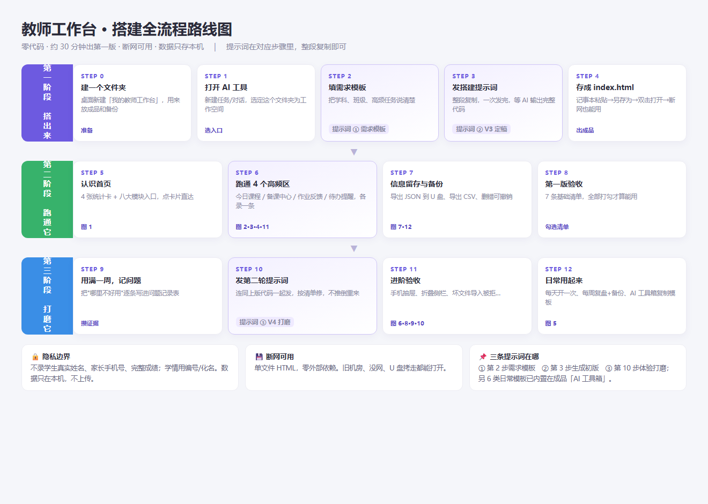
*图 0：全流程路线图。三阶段 12 步，紫色高亮的 3 步要复制提示词。*

---

# 第一阶段：把工作台搭出来

## 第 0 步 · 建一个文件夹

1. 在桌面右键 → 新建 → 文件夹，命名「我的教师工作台」。
2. 打开它，保持这个窗口不关。

> 为什么先建文件夹：AI 生成的文件要有个固定的家。后面教案、课件、导出的备份都放这里，学期末整个拷走就行。

✅ **完成标志**：桌面上有这个文件夹，且你知道它的位置。

---

## 第 1 步 · 打开 AI 工具，选定工作空间

两条路径，选一条：

**路径 A｜用 WorkBuddy**
1. 打开 WorkBuddy → 点左侧「项目」→「+ 新建」。
2. 项目名称填「我的教师工作台」。
3. 点「工作空间」，把第 0 步建的文件夹选进来。
4. 点「专家 + 添加」→ 搜索「工作台」→ 选「工作台搭建师」→ 确认。
   （不加专家也行，加了它更懂"工作台"这类需求。）

**路径 B｜用任意大模型**
1. 新建一个对话窗口，把工作目录/文件夹指到第 0 步的文件夹（支持上传文件夹的工具就上传）。
2. 没有工作空间概念的工具，什么都不用设，下一步直接发提示词。

> 说明：本教程不绑定任何产品。工具只是入口，真正决定成品好不好用的是提示词。若工具要求账号授权或数据上云，先确认本单位规定；**不要在此录入学生真实信息**。

✅ **完成标志**：有一个空白对话窗口，光标在输入框里。

---

## 第 2 步 · 先花 3 分钟，把需求说清楚

别一上来就喊"给我做个工作台"，那样生成的东西空荡荡。花 3 分钟填这份模板。

**你可以自己填（推荐，最贴你的实际）**——把括号里换成你的情况：

```
我的身份：初中语文老师
任教：七年级 2 个班
我最常做的事：备课、上课、作业反馈、家校沟通
我希望工作台包含：今日课程、备课中心、作业反馈、教学资源、班级事务、每周复盘
我希望首页先显示：今天课程、待办提醒、待批改数量、常用资料入口
记录习惯：按周复盘，按日期回看
```

**如果你懒得想，就让 AI 帮你问**——复制下面这段发过去，它会反过来问你 6～8 个问题，你照实回答即可：

```
请你扮演一位熟悉中小学教学的效率工具产品经理，帮我梳理"教师专属 AI 工作台"的需求，
先别写任何代码。

第一步：先向我提 6-8 个澄清问题，覆盖：
我教的学段/学科、带几个班、大概多少学生；
我每天/每周最耗时的 3 件重复工作；
我现在用哪些工具（微信/Excel/钉钉/纸质），数据散落在哪；
我最想解决却还没解决的 1 个痛点；
我希望学生或家长参与哪些环节。

第二步：根据我的回答，给我一份《工作台需求清单》，包含：
必做的 3 个核心模块（按优先级排序并说明原因）；
每个模块下 2-3 个具体功能点；
建议的"先做一个、跑顺再扩"的迭代路线；
首页仪表盘应展示哪些关键指标。

聊透之前不要写代码。
```

> 这一步的产出是一份「需求清单」。它不进代码，但决定了下一步 AI 会不会跑偏。**先圈出你最痛的 1—2 块**（多数老师是备课 + 作业），后面不够再补。

✅ **完成标志**：你能用一句话说清「我是谁、每天最烦哪几件事、首页要先看到什么」。

---

## 第 3 步 · 复制搭建提示词，一次发完 ★核心

> **这就是本教程最重要的提示词，整段复制，从第一行到最后一行，一次发完。**
> 不要拆成几次发，不要删掉里面的「硬性」条款——那些条款是后面所有好用特性的来源。
> 配套提示词原件（本步已全文收录）：`D:/projects/教师工作台/教师工作台搭建教程/03_提示词迭代/V3_定稿提示词.md`

```
你是一名资深前端工程师 + 教育产品设计师。请一次性生成一个【教师个人工作台】完整成品，
直接输出单个 index.html 的全部代码，不要分步、不要省略。

【一、交付契约（硬性，违反即不合格）】
1. 单个 index.html 文件，CSS/JS 全部内联，不引入任何外部 CDN、字体、图片、图标库
2. 双击即可在浏览器打开，断网可用，旧电脑也能跑
3. 全部中文界面；简约清爽教师风：浅灰背景 #f5f6fa、紫色主色、圆角卡片、轻投影
4. 顶部有问候语+当天日期，数据只存本机 localStorage，不联网上传

【二、实现架构（硬性）】
- 采用"配置驱动"：用一个模块配置对象统一定义每个模块的字段、类型、列名，
  由通用函数渲染表格与表单。禁止把 8 个模块写成 8 套重复代码。
  这样以后加一个字段只需改配置一处。

【三、布局】
- 左侧固定竖向导航栏（约 230px，可折叠），分 4 组：
  总览｜教学工作台｜班级与资源｜效率工具
- 右侧主内容区，点击导航切换视图，带淡入动效
- 响应式：窄屏(≤900px)统计卡两列、模块卡两列；手机(≤560px)单列

【四、八大模块（字段务必齐全）】
1 今日课程：日期/时间/学科/班级/地点/提醒
2 备课中心：课题/学科/周次/备课状态(待准备·准备中·已完成·已授课)/教案课件素材
3 课堂教学：日期/课程/班级/课堂安排/临时调整
4 作业反馈：作业名/班级/应交/已交/已批改/共性错题（显示批改百分比）
5 班级事务：日期/类型(班级通知·家校沟通·临时安排·学生事务)/内容/涉及人员/状态
6 教学资源：类型(课件·讲义·题库·模板)/名称/标签章节/存放位置/备注
7 学情记录：日期/学生/班级/维度(纪律·学习·卫生·体育·德育)/表现记录/跟进措施
8 每周复盘：周次/本周完成/遇到问题/下周计划/日期
另需工具区：
- 待办提醒：事项/优先级(普通·重要·紧急)/日期，首页可勾选完成
- AI 工具箱：内置以下 6 类可复制提示词模板，用 {占位符} 标注需替换处：
  ① AI备课助手 ② AI出题与组卷 ③ AI学情分析 ④ 家校沟通话术 ⑤ 学生评语生成 ⑥ 每周复盘助手
  每个模板要有标题、正文、一键复制按钮；说明文字讲清"替换花括号→复制到任意AI→粘贴使用"
- 数据管理：导出JSON备份 / 导入恢复 / 恢复演示数据 / 当前各模块记录数概览

【五、首页仪表盘】
- 紫色渐变问候横幅："早上好，今天也是充实的一天！"+ 当天日期星期
- 4 个统计卡：今日课程数、待备课数(status非已完成已授课)、待批改作业数(已批改<已交)、未完成待办数
- 今日课程列表、今日待办列表(可勾选)、八大模块入口卡片、作业批改进度条
- 所有统计必须由模块数据实时计算，增删改后自动刷新

【六、数据与健康】
- 所有模块可新增/编辑/删除，存 localStorage，刷新关机不丢
- 预置少量演示数据，日期用"当天"动态生成，人名一律用"某某/化名"
- 界面显著位置提示：请勿录入学生真实姓名、家长手机号等敏感信息
- 顶部标注"本地保存·断网可用"

【七、验收清单（交付前逐条自检，并在回复中报告结果）】
□ 双击 index.html 能打开、无 JS 报错、中文无乱码
□ 八个模块各能新增/编辑/删除一条记录
□ 新增一节今日课程后，首页"今日课程"数字 +1；勾选待办后"待办数"减少
□ 刷新页面后数据仍在；导出JSON再导入，数据一致
□ 缩窄窗口/手机尺寸下布局自动换列、不溢出

最后请用 3 句话说明：做了什么、数据存在哪里、老师如何换成自己的真实数据。
```

**发出去之后，等它输出完。** 常见两个卡壳：

- **AI 只给了一半代码 / 说"篇幅较长是否继续"** → 回一句：`请继续输出剩余部分，从刚才断开的地方接着写，不要重写开头。`
- **AI 反问你要不要拆成多个文件** → 回一句：`不拆，坚持单文件 index.html，按原要求一次性输出完整代码。`

✅ **完成标志**：对话里出现一大段以 `<!DOCTYPE html>` 开头、以 `</html>` 结尾的完整代码。

---

## 第 4 步 · 把代码存成 index.html，双击打开

**用 WorkBuddy / 带工作空间的工具**：它通常已直接把 `index.html` 生成在第 0 步的文件夹里，跳到第 5 步。

**用普通大模型对话窗口**，手动存一次（Windows 实操）：

1. 在 AI 的代码块右上角点「复制」，全选复制全部代码。
2. 打开**记事本**，粘贴。
3. 「文件 → 另存为」，存到第 0 步的文件夹，文件名填 `index.html`（**连引号一起输入 `"index.html"` 更保险**）。
4. 「保存类型」务必选 **所有文件 (\*.\*)**，「编码」选 **UTF-8**，保存。
5. 回到文件夹，确认文件名是 `index.html` 而**不是** `index.html.txt`。（若显示成 .txt，在资源管理器「查看」勾上「文件扩展名」后重命名。）
6. **双击** `index.html`，用浏览器打开。

> 真实约束提醒：这个页面不依赖任何外部资源，**断网、旧机房、没装任何软件都能打开**。你可以拔掉网线再双击一次验证——能开，就说明以后带去教室用没问题。

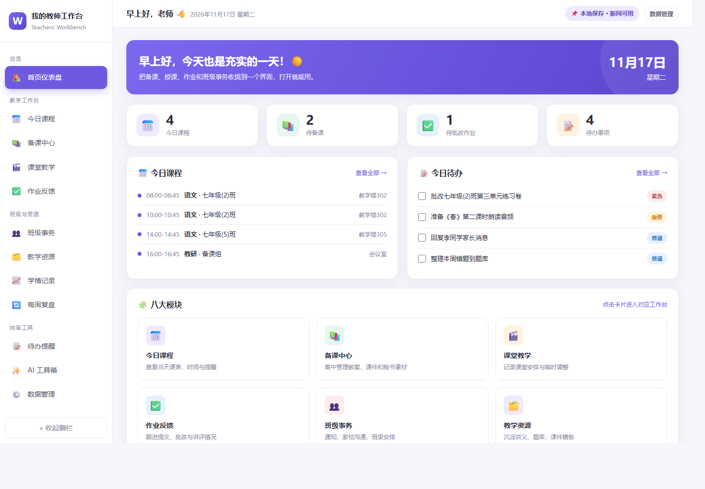
*图 1：打开后应该看到的样子——问候横幅、4 张统计卡、今日课程、今日待办、八大模块入口一屏可见。*

✅ **完成标志**：双击能看到图 1 的界面，中文不乱码、按钮能点。

---

# 第二阶段：跑通它

## 第 5 步 · 认识首页，点一遍

1. 看顶部 4 张统计卡：**今日课程 / 待备课 / 待批改作业 / 待办事项**。数字由各模块实时算出来，不是写死的。
2. 点一下任意统计卡，会直接跳到对应模块（V4 特性）。
3. 往下看「八大模块」卡片，随便点两个进去，再点左侧「首页仪表盘」回来。

✅ **完成标志**：左侧 12 个菜单都能点开、各有内容，不会白屏。

---

## 第 6 步 · 跑通 4 个高频区（第一次动手录入）

**第一版不用全填满，先把这 4 个区各动一次手。**

### 6.1 今日课程：新增一节课

1. 左侧点「今日课程」→ 右上角「＋ 新增记录」。
2. 弹窗里填：日期（默认今天）、时间、`学科`、`班级`，标红星的必填。
3. 点「保存」（或按 Ctrl+Enter）。

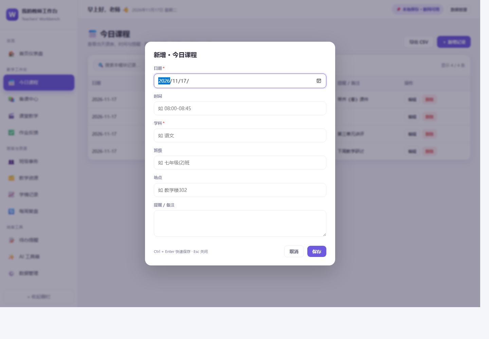
*图 2：新增记录弹窗。标 \`*\` 的是必填项；填错了会在字段下方红字提示；Esc 关闭、Ctrl+Enter 保存。*

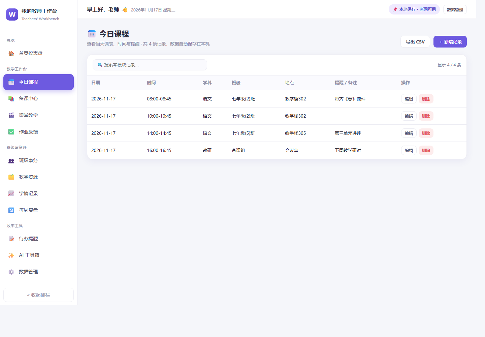
*图 3：保存后出现在列表里，按时间自动排序；顶部可直接搜索。*

4. 回首页看一眼：**「今日课程」统计卡数字 +1**。这一步最重要，说明数据是活的。

### 6.2 备课中心：改一次状态

1. 左侧点「备课中心」。
2. 直接**点状态标签**（如"待准备"），它会按顺序循环：待准备 → 准备中 → 已完成 → 已授课。不用进编辑弹窗。
3. 上面还有「全部 / 待准备 / 准备中 / …」筛选按钮，点一下试试。

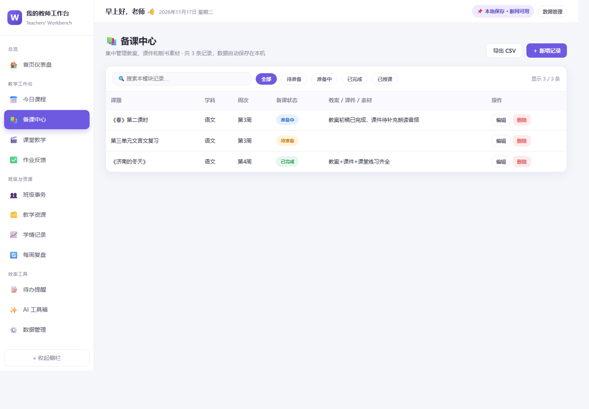
*图 4：搜索框 + 状态筛选 + 可点击循环的状态标签 + 导出 CSV。*

### 6.3 作业反馈：看批改进度

1. 左侧点「作业反馈」，看「已批改 / 已交」和百分比。
2. 试着把「已交」改成比「应交」大的数字 → 会红字报错、不让保存（V4 校验）。

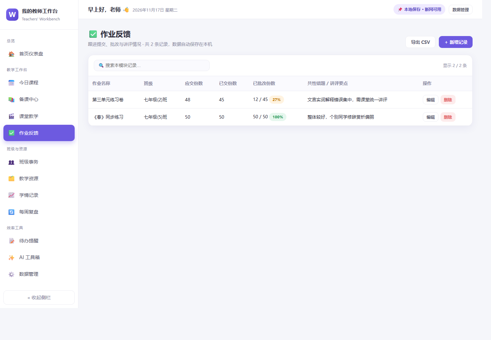
*图 5：应交/已交/已批改一目了然，自动算批改百分比，共性错题单独记录。*

### 6.4 待办提醒：勾掉一条

1. 回首页，在「今日待办」里勾掉一条。
2. 看「待办事项」统计卡数字减 1。

> V4 修好的一个坑：勾选后**停留在当前页**，不会把你强行甩到待办页。

✅ **完成标志**：4 个区都动过手，且首页统计数字会跟着变。

---

## 第 7 步 · 让信息留下来，并且学会备份

工作台值钱的不是页面，是**沉淀下来的记录**。建议留 4 类：备课记录、作业反馈、班级事务、每周复盘。

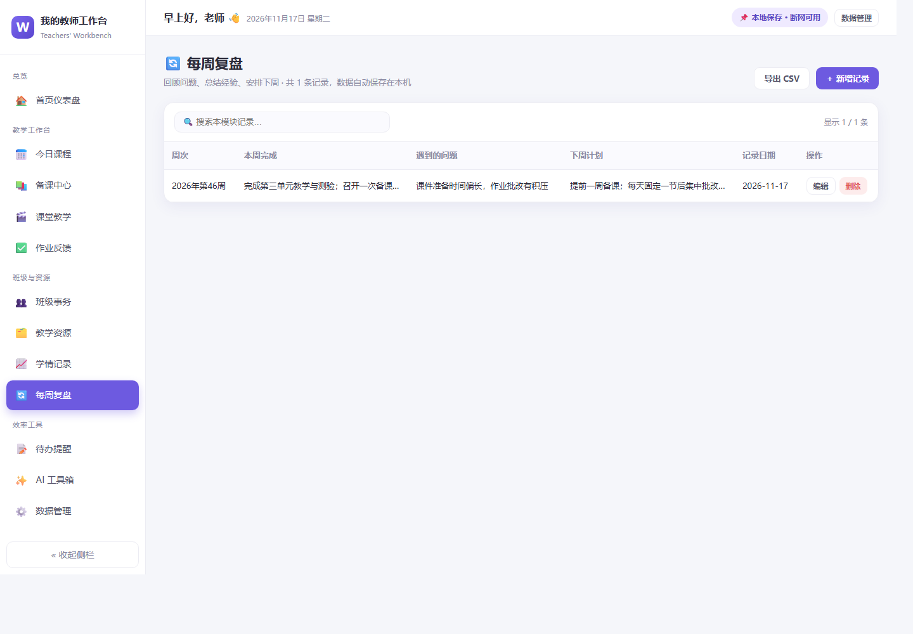
*图 6：每周复盘把"本周完成 / 遇到问题 / 下周计划"结构化沉淀，期末回看就是一份教学档案。*

现在做一次备份演练：

1. 左侧点「数据管理」。
2. 看「存储状态」：记录总数、占用 KB、上次保存 / 上次备份时间。
3. 点「导出数据备份」→ 得到一个 `教师工作台备份_日期.json`，**拷到 U 盘或网盘**。
4. 回到任一列表页点「导出 CSV」→ 用 Excel 打开，中文正常、可直接给同事。
5. 试着删一条记录 → 底部出现黑色提示条和黄色「撤销」→ 点撤销，记录原位回来。

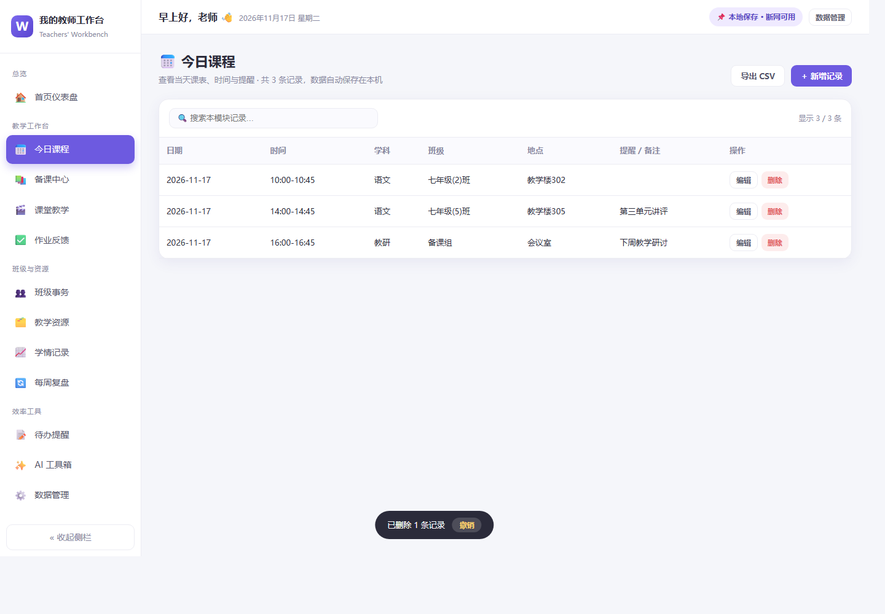
*图 7：删除后 4.5 秒内可撤销，不用再担心手滑。*

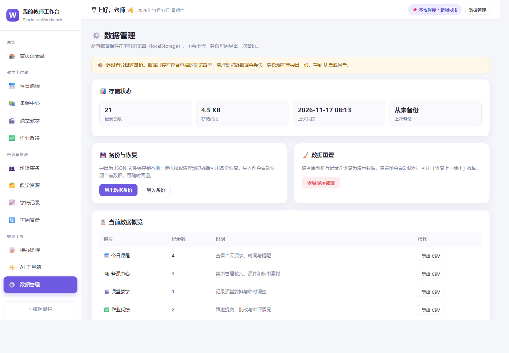
*图 8：未备份时顶部黄条提醒；导入/重置前自动快照，随时可「恢复上一版本」。*

> 隐私边界（务必照做）：**不要录入学生真实姓名、家长手机号、完整成绩**。学情记录用编号或化名（如 S01、张某某）。数据只在本机，不上传。本单位如有数据保管规定，以其为准。

✅ **完成标志**：U 盘里有一份 JSON 备份；你点过一次「撤销」并成功恢复。

---

## 第 7.5 步 · 真实文件放哪、怎么让工作台打开 ★常见疑问

这一步回答三个最常被问到的问题：**要不要建文件？文件放哪？工作台能不能打开？**

### 先说结论（三问三答）

| 你的问题 | 答案 |
|----------|------|
| 需要另外建文件、存文件吗？ | **需要，但只存"真实资料"**：教案、课件、Excel、PDF 这些大文件。工作台记录本身不用建文件，它自动存在浏览器里。 |
| 文件放在哪？ | 放在 `index.html` **旁边**的 `资料` 文件夹里，按 课件 / 讲义 / 题库 / 模板 分类。整个文件夹拷到 U 盘就能带走。 |
| 工作台能打开对应文件吗？ | **能**——在「教学资源」登记一次路径，列表里点「📄 打开」即可。**但只能打开明确指定的单个文件**，不能浏览文件夹。 |

### 动手做（5 分钟）

1. 打开 `index.html` 所在的文件夹，新建一个 `资料` 文件夹，里面再建 4 个子文件夹：

   ```
   我的教师工作台/
   ├── index.html              ← 工作台（双击打开）
   ├── 教师工作台备份_xxx.json  ← 导出的备份
   └── 资料/
       ├── 课件/    ← 放 pptx、ppt
       ├── 讲义/    ← 放 pdf、docx、txt
       ├── 题库/    ← 放 xlsx、csv
       └── 模板/    ← 放常用模板
   ```

2. 把你的教案、课件、题库**拷进去**（文件名别带 `/` `?` `#` 这几个符号）。

3. 打开工作台 → 左侧「教学资源」→「＋ 新增记录」：
   - 资料类型：选 课件 / 讲义 / 题库 / 模板
   - 资料名称：起个好找的名字，如 `《春》教学设计`
   - **文件路径**：填相对路径 `资料/课件/《春》教学设计.txt`
   - 点保存。

4. 回到列表，点这一行的「📄 打开」——文件就打开了。

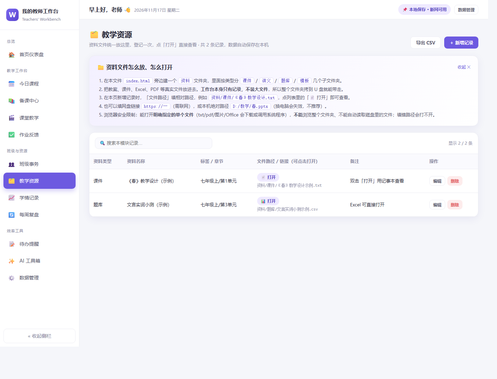
*图 7-1：「教学资源」页——顶部是文件夹使用说明，表格里点「打开」直接查看文件，下方灰字是登记的路径。*

### 三种路径写法，按场景选

| 写法 | 例子 | 什么时候用 | 注意 |
|------|------|-----------|------|
| **相对路径**（推荐） | `资料/课件/春.pptx` | 文件和 index.html 在同一个文件夹树里 | 整个文件夹拷走仍能打开；最稳 |
| 网盘链接 | `https://pan.quark.cn/s/xxx` | 文件在网盘、要发给同事 | 需联网；链接别失效 |
| 绝对路径 | `D:/教学/春.pptx` | 临时图省事 | 换电脑、挪位置就失效，**不推荐** |

### 能打开什么、不能做什么（浏览器的真实边界）

- ✅ **能**：打开你明确指定的**一个文件**——txt / pdf / 图片可直接在浏览器里看；Word / PPT / Excel 会下载或调用系统程序打开（正常现象，不是故障）。
- ❌ **不能**：让网页列出整个文件夹、自动读取磁盘里的文件、批量打开所有教案。这是浏览器的安全限制，所有网页都一样，不是这个工作台的缺陷。
- ⚠️ **打不开怎么办**：九成是路径写错。检查——文件名一模一样吗（含扩展名）？`资料` 文件夹和 `index.html` 是并排的吗？用了绝对路径但文件挪走了吗？

> 配套示例：成品文件夹里已放好 `资料/课件/《春》教学设计示例.txt` 和 `资料/题库/文言实词小测示例.csv` 两条真实文件，你可以先点「打开」体验，再换成自己的。

✅ **完成标志**：至少把 1 个自己的文件放进 `资料`，并在工作台里成功点「打开」看到它。

---

## 第 8 步 · 第一版验收（全部打勾再往下）

- [ ] 双击 `index.html` 能打开，中文正常、无报错
- [ ] 左侧 12 个菜单都能点开，各有内容
- [ ] 「今日课程」新增一节，首页统计卡数字变化
- [ ] 「待办提醒」勾选一项，首页待办数减少（且不跳页）
- [ ] 刷新页面，刚加的数据还在
- [ ] 导出备份成功，清空后导入能恢复
- [ ] 把窗口拉窄，排版自动变成两列/一列

✅ **完成标志**：7 个勾全打上。现在可以正式用起来了。

---

# 第三阶段：用出来的问题，才值得改

## 第 9 步 · 用满一周，把「不好用」记下来

别急着加功能。先真用一周，遇到问题随手记在这张表里（可直接抄到本子上）：

| 日期 | 在做什么 | 卡在哪 / 哪里别扭 | 严重吗 |
|------|----------|-------------------|--------|
| 例：11/18 | 手机上想记一笔 | 侧栏一直盖住内容，没法关 | 🔴 |
|  |  |  |  |

> 这一步不碰电脑，但它是第二轮提示词的**唯一燃料**。不问"哪里能改进"，只记"哪里坏了"。

✅ **完成标志**：纸上至少有 5 条具体问题。

---

## 第 10 步 · 复制打磨提示词，做第二轮 ★核心

> **这是第二条要整段复制的提示词。用法：把上一版的代码（或成品文件）连同这段一起发给 AI。**
> 用 WorkBuddy / 有工作空间的工具：把 `index.html` 放进工作空间，直接说"基于当前工作空间的 index.html 修复"即可，不用手动粘代码。
> 用普通大模型：把 `index.html` 全文粘在提示词末尾「附：当前完整代码如下」之后。
> 配套提示词原件（本步已全文收录）：`D:/projects/教师工作台/教师工作台搭建教程/03_提示词迭代/V4_体验打磨提示词.md`

```
这是我按你上一版提示词生成的教师工作台代码（附后）。我用了一周，发现以下问题。
请逐条修复，保持"单文件 HTML、内联 CSS/JS、零外部依赖、断网可用、localStorage 存储"
的交付契约不变，保持现有数据结构兼容（老数据打开不丢）。

【A. 移动端与导航（必须修）】
A1 窄屏(≤900px)侧栏改为抽屉：默认滑出隐藏，顶栏加汉堡按钮打开，
   点遮罩或选中菜单后自动关闭；桌面端折叠功能保留。
A2 桌面折叠态(68px)必须隐藏所有文字（品牌名/分组名/菜单文字），
   图标居中，菜单加 title 悬浮提示；折叠状态和上次浏览视图要持久化。
A3 首页勾选待办后停留在当前页刷新，禁止强制跳转。
A4 弹窗支持 Esc 关闭、点遮罩关闭、打开自动聚焦第一个字段、Ctrl+Enter 保存。
A5 导航和卡片加 role/tabindex/Enter 键支持，统一 focus-visible 描边。

【B. 数据保存健壮性（必须修）】
B1 导入备份必须白名单校验：只接受已定义模块、每个模块必须是数组、
   字段统一转字符串并截断(≤2000字)、id 强制转有限正数否则重新生成、
   作业数字钳制(已交≤应交、已批≤已交)、单模块≤5000条、文件≤5MB；
   不合法直接拒绝并提示，绝不能让坏文件进入渲染。
B2 本地数据解析失败时：先把原始内容存入单独的"损坏现场"键保留，
   再载入演示数据并明确提示用户；禁止静默覆盖。
B3 导入/重置等覆盖操作前，自动把当前数据快照到单独键；
   数据管理页提供"恢复上一版本"按钮。
B4 删除记录不再用 confirm：直接删除并在提示条里给"撤销"按钮，
   可原位恢复（记住原位置）。
B5 localStorage 写入失败时，顶栏下方显示常驻警示条，
   提醒"修改只在本页有效，请立即导出备份"。
B6 记录上次备份时间；从未备份或超过7天，在数据管理页显示提醒横幅。
B7 数据管理页显示：记录总数、存储占用KB、上次保存时间、上次备份时间。
B8 每个模块列表页加"导出 CSV"（带 BOM 头，Excel 打开中文不乱码，
   字段含逗号/引号/换行时按 CSV 规范转义）。

【C. 表单校验（必须修）】
C1 每模块指定主字段为必填（标红星），保存时行内报错，不允许只填备注就入库。
C2 数字字段只允许非负整数；已交>应交、已批>已交时行内报错并阻止保存。

【D. 查找与操作效率】
D1 每个列表页加即时搜索框（全字段匹配，输入时只重绘表体保持焦点），
   显示"当前 x / 总 y 条"。
D2 有状态的模块（备课/事务）：状态标签可点击循环切换；
   工具条加状态筛选 chips（全部+各状态）。
D3 待办列表加勾选列，完成划线置灰；排序=未完成优先+紧急>重要>普通。
D4 今日课程按日期+时间升序；课堂教学/事务/学情/复盘按日期降序。
D5 长文本截断单元格加 title 悬浮显示全文。
D6 空状态加"新增第一条"按钮。
D7 【资料文件可打开】"教学资源"模块的"路径/链接"字段要渲染成可点击的「打开」按钮：
   支持三种写法——相对路径(资料/课件/春.pptx，相对 index.html 所在目录)、
   网盘链接(http(s)://...)、本机绝对路径(D:/... 转 file:///)。
   中文路径需 encodeURI 编码后再放进 href。
   在该模块顶部加一个说明面板，讲清：资料放在 index.html 旁的"资料"文件夹、
   按课件/讲义/题库/模板分类、浏览器只能打开指定的单个文件而不能浏览文件夹。
   （老师常问"文件放哪、能不能打开"，这一条直接解决。）

【E. 视觉与细节打磨】
E1 首页横幅问候语随时间段变化（早上/中午/下午/晚上），与顶栏一致。
E2 四张统计卡可点击直达对应模块。
E3 首页作业进度加细进度条。
E4 紧急优先级用红色系标签（原来用灰色，语义反了）。
E5 加 @media print：打印时隐藏导航/工具条/操作列。
E6 细滚动条、弹窗弹出动画、卡片 hover 微交互统一。

【验收（交付前逐条自检并报告）】
□ 手机尺寸：抽屉能开能关，内容不被遮挡，统计卡两列
□ 桌面折叠：只剩图标无文字溢出，重开页面记住折叠状态
□ 构造一个坏 JSON 导入 → 被拒绝；构造恶意 id 的备份导入 → id 被替换为数字
□ 手工损坏 localStorage → 页面不崩、现场被保留、有提示
□ 导入/重置后点"恢复上一版本" → 数据完整回来
□ 删除一条记录 → 提示条出现"撤销" → 点击后原位恢复
□ 已交填 99（应交 10）→ 行内报错无法保存
□ 搜索"春" → 只显示匹配记录且输入焦点不丢
□ 备课状态标签连点 → 按 待准备→准备中→已完成→已授课 循环
□ 导出 CSV 用 Excel 打开 → 中文正常、含逗号字段不串列

附：当前完整代码如下
（粘贴 index.html 全部内容）
```

**拿到修复后的代码**：覆盖保存原来的 `index.html`，再双击打开。老数据不会丢（同一存储键）。

> 教学要点：**第一轮提示词靠想象，第二轮靠证据。** 你第 9 步记下的每一条问题，都变成了这段提示词里的一条约束。这就是提示词能力真正的成长路径。

✅ **完成标志**：AI 回复了逐条自检结果，且新版页面打开正常、老数据还在。

---

## 第 11 步 · 进阶验收（能构造反例才算过）

- [ ] 手机尺寸：点左上角 ☰ 能开抽屉，点右边遮罩能关，内容不被遮挡
- [ ] 桌面点「« 收起侧栏」：只剩图标无文字溢出；关掉重开还记得
- [ ] 随便改坏一个 JSON 文件去导入 → 被拒绝、页面不崩
- [ ] 删除一条记录 → 点「撤销」→ 原位恢复
- [ ] 导入/重置后点「恢复上一版本」→ 数据完整回来
- [ ] 作业「已交」填 99（应交 10）→ 红字报错，无法保存
- [ ] 搜索关键词 → 只显示匹配记录，输入焦点不丢
- [ ] 备课状态标签连点 → 按顺序循环
- [ ] 导出 CSV 用 Excel 打开 → 中文正常、不串列


*图 9：手机端首页——汉堡按钮 + 两列统计卡，班主任在手机上也能记一笔。*

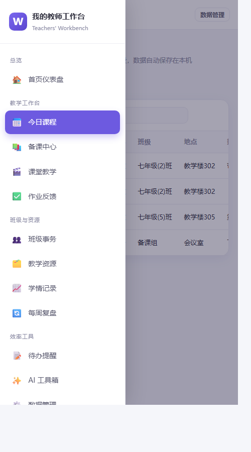
*图 10：点 ☰ 打开抽屉，选完菜单自动收起。*

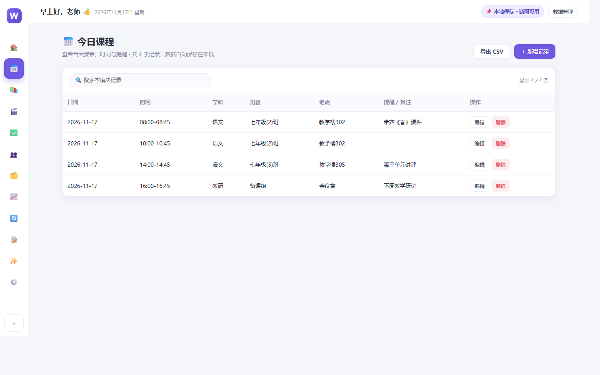
*图 11：桌面折叠后只剩图标，把屏幕让给内容。*

✅ **完成标志**：9 个勾全打上。这时工作台才真的"敢天天用"。

---

## 第 12 步 · 日常用起来：把提示词沉淀成自己的模板库

左侧点「AI 工具箱」——里面已经内置 6 类日常教学提示词模板，**复制 → 替换 `{花括号}` → 发给任意 AI → 粘贴结果**，不用每次重新写：

| 模板 | 什么时候用 |
|------|-----------|
| 📝 AI 备课助手 | 备新课，一次出目标/重难点/流程/板书/分层作业 |
| ✏️ AI 出题与组卷 | 单元练习、随堂小测 |
| 📊 AI 学情分析 | 考完后（数据先脱敏、去姓名） |
| 💬 家校沟通话术 | 发通知、回复家长 |
| 📄 学生评语生成 | 期末成绩单 |
| 🔁 每周复盘助手 | 周五下午，把本周记录粘进去 |

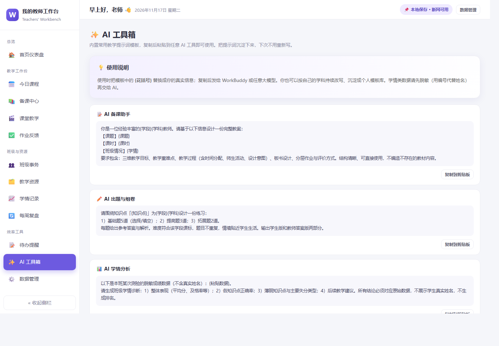
*图 12：6 类内置模板，每条都有一键复制按钮。把提示词沉淀下来，下次不用重新写。*

**建议的固定节奏**：

| 什么时候 | 做什么 |
|----------|--------|
| 每天早上 | 打开首页，看今日课程 + 今日待办 |
| 每节课后 | 顺手记一条课堂调整 / 学情观察 |
| 批改后 | 更新作业份数，记共性错题 |
| 每周五 | 写一条每周复盘 + **导出一次备份到 U 盘** |
| 学期末 | 导出各模块 CSV 归档，整个文件夹拷走 |

> 想继续改？不用重写提示词，直接对 AI 说人话就行。例如：`加一个"技能大赛备赛"模块，含赛事规则、训练计划、成绩统计`、`配色换成蓝色系`、`每天早上 8 点把当日待办推给我`。改完记得再导出一次备份。

✅ **完成标志**：连续用满一周，U 盘里至少有两份不同日期的备份。

---

## 常见卡壳对照表

| 现象 | 原因 | 怎么修 |
|------|------|--------|
| 双击打开是一片空白 | 文件名其实是 `index.html.txt`，或代码没复制全 | 显示扩展名后重命名；回对话确认代码以 `</html>` 结尾 |
| 中文全是乱码 | 记事本存成了 ANSI | 另存为时编码选 **UTF-8** |
| 刷新后数据没了 | 浏览器隐私/无痕模式，或每次用不同浏览器打开 | 换普通窗口；**固定用同一个浏览器**；先导出备份 |
| 顶部出现红条警示 | 浏览器不让写本地存储 | 立刻导出备份，别在这个窗口继续录数据 |
| 手机上打不开 | 手机浏览器不一定能直接开本地 HTML 文件 | 先把文件传到手机用浏览器打开；如需随时访问再考虑云端部署（须先确认本单位规定） |
| AI 生成的东西很空 | 需求没说清 | 回到第 2 步，补学科/年级/痛点，再发一次 |
| 想加自己的模块 | 不用重写长提示词 | 用第 12 步那句"加一个…模块"的短指令即可 |

---

## 附录 A：提示词在哪一步

| 提示词 | 用在哪一步 | 单独文件（方便复制/打印） |
|--------|-----------|--------------------------|
| ① 需求模板 + 头脑风暴 | 第 2 步 | `D:/projects/教师工作台/教师工作台搭建教程/03_提示词迭代/V1_初版提示词.md`、`V2_优化提示词.md` |
| ② V3 生成初版（约 60 行） | **第 3 步** | `D:/projects/教师工作台/教师工作台搭建教程/03_提示词迭代/V3_定稿提示词.md` |
| ③ V4 体验打磨（约 70 行） | **第 10 步** | `D:/projects/教师工作台/教师工作台搭建教程/03_提示词迭代/V4_体验打磨提示词.md` |
| ④ 6 类日常教学模板 | 第 12 步（已内置成品） | 成品「AI 工具箱」页，一键复制 |

> 想看懂「提示词为什么这样改」：`D:/projects/教师工作台/教师工作台搭建教程/03_提示词迭代/提示词优化对照表.md` 有四版横向对比；`D:/projects/教师工作台/教师工作台搭建教程/04_流程记录/优化审查记录_v4.md` 有 26 条真实问题清单。

## 附录 B：截图索引

| 图号 | 文件 | 用在哪一步 |
|------|------|-----------|
| 图 0 | `teacher_workbench/shots/搭建全流程路线图.png` | 开头 |
| 图 1 | `teacher_workbench/shots/01_首页仪表盘.png` | 第 4、5 步 |
| 图 2 | `teacher_workbench/shots/11_新增记录弹窗.png` | 第 6.1 步 |
| 图 3 | `teacher_workbench/shots/02_今日课程.png` | 第 6.1 步 |
| 图 4 | `teacher_workbench/shots/03_备课中心.png` | 第 6.2 步 |
| 图 5 | `teacher_workbench/shots/04_作业反馈.png` | 第 6.3 步 |
| 图 6 | `teacher_workbench/shots/06_每周复盘.png` | 第 7 步 |
| 图 7 | `teacher_workbench/shots/12_删除撤销提示.png` | 第 7 步 |
| 图 8 | `teacher_workbench/shots/07_数据管理.png` | 第 7 步 |
| 图 7-1 | `teacher_workbench/shots/13_教学资源_文件打开.png` | **第 7.5 步：文件怎么放、怎么打开** |
| 图 9 | `teacher_workbench/shots/08_移动端首页.png` | 第 11 步 |
| 图 10 | `teacher_workbench/shots/09_移动端抽屉菜单.png` | 第 11 步 |
| 图 11 | `teacher_workbench/shots/10_侧栏折叠态.png` | 第 11 步 |
| 图 12 | `teacher_workbench/shots/05_AI工具箱.png` | 第 12 步 |

---

## 版权与适用边界

- 本教程与配套提示词、代码为原创整理，**可自由复制、修改，用于教学与培训**；转载请注明出处。
- 教程参考了两篇微信公众号公开教程的思路与公开网络资料，来源见 `D:/projects/教师工作台/教师工作台搭建教程/06_原文与资料/网络资料汇总.md`。
- 不绑定任何商业产品；云端部署、账号授权、对外培训收费等操作，请遵守所在单位规定。
- **隐私**：请勿录入学生真实姓名、家长手机号、完整成绩等敏感信息；数据只保存在本机，不联网上传。
- 成品里的演示数据均为化名，仅用于展示结构，不代表任何真实学生。
