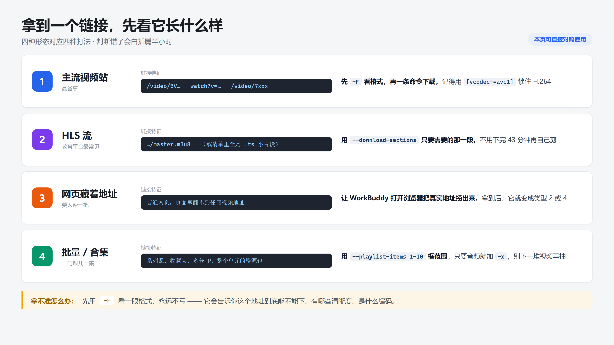

# 专题　视频素材下载：把「看得见、下不来」变成三步

> **一句话**：教室里最缺的往往不是创意，是一段能离线播放、能剪进课件、能反复用的视频——这个专题讲的就是把它拿到手，并且拿得合法。
>
> **本专题是实测记录**：所有命令、参数、体积、耗时来自 2026-11-04 在本机的真实运行（yt-dlp 2026.10.26 + ffmpeg 8.1，Windows 11）。含 6 个踩坑点，每一条都是当场撞出来的。

---

## 〇、先说痛点：教研里最尴尬的那十分钟

三个真实场景，你大概率遇到过其中至少一个。

**场景一：明天上午就要用**

讲《观潮》，你搜到一段央视的潮水实拍，画面正是课文描述的样子。想放进课件——右键点了七遍，没有「另存为」。页面上只有一个播放器。

**场景二：要的是 90 秒，平台只给你 43 分钟**

国家平台上一节优质课，你只需要其中讲「潮来时」的那一分半。全片在线看可以，想裁下来放课件里做对比教学，没有入口。

**场景三：好不容易下来了，放不出来**

借同事的号下了一段，13 MB、看着挺好。插进 PPT 展示的那台教室电脑——黑屏，声音有，画面没有。换台电脑又能放。最后发现是编码的事，跟文件好坏没关系。

这三个场景背后是同一件事：**视频在你眼前，但它不在你手里。**

而「拿不到」和「不该拿」之间，还有一条更麻烦的线——版权。很多老师干脆放弃：「算了，不下了，上课念文字吧。」

这个专题要同时解决这两件事：**怎么拿到**，以及**拿到哪一步为止是合法的**。

---

## 一、WorkBuddy 为什么能下载各类视频

先把一个常见的误解说清楚：**WorkBuddy 里没有「下载视频」这个按钮。**

它的能力不在这里。它是这样做到的——

### 1. 它能装、能跑专业工具

它是能在你这台电脑上开终端、装软件、跑命令的。视频下载这件事，开源社区早就把最硬的活干完了：

| 工具 | 干什么的 | 现状 |
|---|---|---|
| **yt-dlp** | 解析视频站地址，取出真实流 | 支持 1800+ 站点，每周还在更新 |
| **ffmpeg** | 合并音视频、转码、切片、抽音轨 | 视频处理的万能刀 |

你不需要自己记住 yt-dlp 那一堆参数。**你只需要说清要什么，它去查文档、拼命令、跑，跑错了改再跑。**

### 2. 它能像人一样操作浏览器

遇到 yt-dlp 认不出的网站（教育平台很多都属于这类），它可以打开浏览器，点进页面、找到真正的播放地址。这一步人是能做的，但要在开发者工具里翻网络请求——大部分老师不会，也不该学。

### 3. 它能看着报错自己改

这一点最不像「工具」，最像「同事」。

实测中真实发生过：我用 `height<=360` 去限制清晰度，报错 `Requested format is not available`。它一看格式列表就明白了——**那是个竖屏视频，它的「高」是 640 不是 360**，所以 `height<=360` 一个都匹配不上。换成按分辨率排序的 `-S "res:480"` 立刻就通了。

这种错误，一个参数化的下载器会原地失败；一个会看报错的助手能自己拐弯。

### 一句话总结

> WorkBuddy 的强项不是「支持多少个网站」，而是**遇到没见过的网站，也有办法往下走**。

它把「找地址 → 取流 → 合并 → 转码 → 裁切」这条链子上每一段都接上了，你只负责说清要哪一段、要多清楚、用来干什么。

---

## 二、准备：一次装好，往后不用再管

### 2.1 装 yt-dlp（约 1 分钟）

在 WorkBuddy 里直接说：

> 帮我装一下 yt-dlp

或者自己在终端里跑：

```bash
python -m pip install -U yt-dlp
```

验证：

```bash
python -m yt_dlp --version
# 2026.10.26
```

> **为什么用 `python -m yt_dlp` 而不是直接打 `yt-dlp`**：pip 装完之后，可执行文件常常落在 Python 的 Scripts 目录里，没进 PATH。用 `python -m` 调用永远不会出现「命令找不到」。这是我的实测结论——装完直接打 `yt-dlp` 是报错的。

### 2.2 确认 ffmpeg

```bash
ffmpeg -version
# ffmpeg version 8.1-full_build
```

**ffmpeg 不是可选项。** B 站、YouTube 这些站的音轨和视频轨是**分开的两个文件**，必须靠 ffmpeg 合起来。没有它，你只能下到「有画面的无声文件」或者反过来。

没装的话跟 WorkBuddy 说一声，它会用 winget 或官网包帮你装。

### 2.3 建一个固定的下载目录

```
D:\教学素材\视频\
  ├── 原始存底\        ← 下下来原样放着，别动
  ├── 课件用\          ← 转码、切片之后的成品
  └── 素材台账.xlsx    ← 第五章会给模板，很重要
```

**分两个目录是有原因的**：原始文件是「证据」，处理过的文件是「成品」。将来要证明素材来源，原始文件说了算。

---

## 三、四种类型，四种打法

拿到一个链接，先看它长什么样，再决定用哪一招。这是本专题最实用的一页：



### 类型一：主流视频站——一条命令

**看链接长这样**：`bilibili.com/video/BV...`、`youtube.com/watch?v=...`、`douyin.com/video/...`

这是最省事的一类，yt-dlp 原生支持。

**第一步，先看有什么（不下载）：**

```bash
python -m yt_dlp -F "https://www.bilibili.com/video/BV18x4M6rEFM"
```

实测输出（2026-11-04，一个 117 秒的竖屏视频）：

```
ID      EXT RESOLUTION FPS |   FILESIZE   TBR PROTO | VCODEC       ACODEC
30016   mp4 360x640     30 | ≈  7.38MiB  531k https | avc1.64001E  ...
100022  mp4 360x640     30 | ≈  4.05MiB  291k https | av01.0.08M.08 ...
30032   mp4 480x852     30 | ≈ 10.38MiB  746k https | avc1.64001F  ...
100023  mp4 480x852     30 | ≈  6.06MiB  436k https | av01.0.08M.08 ...
30064   mp4 720x1280    30 | ≈ 20.86MiB 1499k https | avc1.640028  ...
30080   mp4 1080x1920   30 | ≈ 42.84MiB 3079k https | avc1.640032  ...
```

几个必须看懂的细节：

- **同一清晰度有三行**，编码不同：`avc1` 是 H.264、`hvc1` 是 H.265、`av01` 是 AV1。**这一列决定了你的视频能不能在教室电脑上播**，后面细说。
- **`RESOLUTION` 是「宽×高」**。这是个竖屏视频，所以写着 `480x852`——高是 852，不是 480。
- **`audio only` 那几行是音轨**，要单独下、再合并。

**第二步，下载：**

```bash
python -m yt_dlp -f "bv*[vcodec^=avc1]+ba[ext=m4a]" -S "res:720" \
  --merge-output-format mp4 \
  -o "%(title)s.%(ext)s" \
  "https://www.bilibili.com/video/BV18x4M6rEFM"
```

拆开看这行命令，每个参数都在解决一个具体问题：

| 参数 | 作用 | 为什么必须有 |
|---|---|---|
| `-f "bv*[vcodec^=avc1]+ba[ext=m4a]"` | 视频选 H.264，音频选 m4a，两个都要 | 避开 AV1，保证 PPT/WPS 能播 |
| `-S "res:720"` | 在合格格式里优先挑接近 720p 的 | **不要用 `height<=720`**，见踩坑第 2 条 |
| `--merge-output-format mp4` | 合并后强制输出 mp4 | 默认可能给你 mkv，PPT 不认 |
| `-o "%(title)s.%(ext)s"` | 用视频标题做文件名 | 比 `video.mp4` 好找一百倍 |

**实测结果**：480×852 / H.264 / 116.7 秒 / 13 MB，音画同步，双击就能播。

---

### 类型二：HLS 流——教育平台和直播回放基本都是这个

**看链接长这样**：`.m3u8` 结尾，或者**根本没有明显的视频链接**（页面全靠 JS 加载）。

国家中小学智慧教育平台、很多高校的在线课程、所有直播回放，底层几乎都是 HLS（m3u8）。它不是「一个视频文件」，而是一张**播放清单**：里面写着几百个几秒钟的小片段在哪个地址。

人手动下是下不了的——几百个 ts 文件你一个个存？

**实测**（一个公开的 HLS 测试流）：

```bash
python -m yt_dlp -F "https://.../master.m3u8"
```

```
[generic] master: Downloading m3u8 information
ID    EXT RESOLUTION FPS |  FILESIZE  TBR PROTO | VCODEC
530   mp4 480x270     30 | ~37.96MiB 531k m3u8  | avc1.640015
561   mp4 480x270     30 | ~40.14MiB 561k m3u8  | avc1.640015
```

注意 `PROTO` 那一列写着 `m3u8`——这就是 HLS。

**下载并只保留前 12 秒**（课件里只要这么长）：

```bash
python -m yt_dlp -f "530+aud3-English" --download-sections "*0-12" \
  --merge-output-format mp4 -o "片段.%(ext)s" "https://.../master.m3u8"
```

实测产物：834 KB / 12.03 秒 / mp4。

**这一步是老师最该学会的**：`--download-sections` 让你从一开始就只要那一段，不用先下完整节 43 分钟的课再自己剪。省时间，也省硬盘。

**如果链接里没有 .m3u8 怎么办**：那就是类型三。

---

### 类型三：网页里藏着的直链——让 WorkBuddy 去找

**看链接长这样**：一个普通网页，比如 `basic.smartedu.cn/...`、学校自建平台、区县教研网。

实测过：yt-dlp 直接吃 `https://basic.smartedu.cn/` 会报 `Unsupported URL`——它不在支持站点清单里。**这种情况不用放弃**，改用两条路：

**路子 A：让它在浏览器里帮你找**

跟 WorkBuddy 说：

> 打开这个页面，播放一下视频，帮我把真正的视频地址（m3u8 或 mp4 直链）找出来

它会打开浏览器、点播放、从网络请求里捞出真实地址。拿到之后，**地址就变成类型二或类型四了**，回到命令行处理。

**路子 B：右键开发者工具的土办法（不想麻烦 AI 时）**

1. 在视频上按 `F12` 打开开发者工具
2. 切到 `网络 / Network` 面板
3. 筛选框输入 `m3u8` 或 `mp4`
4. 刷新页面、点播放
5. 列表里冒出来的那条，右键「复制链接地址」

拿到地址后同上。

> **注意**：能扒出地址 ≠ 可以随便用。有些平台在用户协议里明确禁止下载，这类内容就算技术上做得到，也应遵约不取。第五章讲边界。

---

### 类型四：批量——整门课、系列课、合集

**最省事的做法是不写代码，直接说清需求：**

> 把这个系列课的前 10 集下下来，每集 720p H.264，存到 D:\教学素材\视频\原始存底\

需要精确控制时，用这几个参数：

| 场景 | 参数 | 说明 |
|---|---|---|
| 只下前 10 个 | `--playlist-items 1-10` | 支持 `1,3,5` 这样的离散写法 |
| 跳着下 | `--playlist-items 2,4,7-9` | |
| B 站多分 P | 同上，分 P 按播放列表算 | |
| 只要音频（听力素材） | `-f "ba/b" -x --audio-format mp3` | 直接出 mp3，不用后处理 |
| 只下字幕 | `--write-subs --sub-langs "zh-Hans,en"` | 有些站的字幕要登录 |
| 断点续传 | 默认就支持，中断后重跑同一条命令 | 别删 .part 文件 |
| 慢一点别被限速 | `--limit-rate 2M` | 实测有用 |

**一个真实的批量场景**：整个单元的课文朗读，12 个音频。一条命令拿到 12 个 mp3，比一个一个点快得多，也不容易漏。

---

## 四、下载之后：四个教学加工

下到手的原始文件，通常还不能直接用。四个动作覆盖 90% 的需求。

### 4.1 转 H.264——教室电脑放不出来时

这是**最高频的问题**，也是我实测出最反直觉结论的地方。

B 站现在默认推 **AV1 编码**（省带宽，它省钱）。AV1 很先进，但：

- WPS 演示、Office 365 部分版本不能播
- 教室里的老电脑、老投影仪不能播
- 剪映 3.x 以下不能导入

**实测对比（同一段 117 秒视频、同一清晰度）**：

| 做法 | 文件 | 耗时 | 兼容性 |
|---|---|---|---|
| 直接下 AV1 版 | **8.3 MB** | 2 秒 | ❌ 多数教室电脑放不了 |
| **直接下 H.264 版** | **13 MB** | 2 秒 | ✅ 通吃 | 
| 下 AV1 再转 H.264 | **20 MB** | **30.5 秒** | ✅ 通吃 |

**结论很干脆：转码不如一开始就下对。**

转完的 20 MB 比原生的 13 MB 还大——因为 AV1 到 H.264 是「重新编码」，等于把压缩过的画面再压一次，同时丢画质又涨体积，还白等半分钟。

所以记住这条：**下载时用 `[vcodec^=avc1]` 锁死 H.264，别等下载后再补救。**

真需要转的时候（比如手里已经有一个 AV1 文件）：

```bash
ffmpeg -i 原始.mp4 -c:v libx264 -crf 23 -preset medium -c:a aac -b:a 128k 转码.mp4
```

`-crf` 是质量旋钮：18 很清晰、23 够用、28 明显糊。教学用 23，体积和质量平衡点。

### 4.2 截片段——0.14 秒的事

课件里放一整段是最糟的做法：注意力散了，时间也不够。只要那 60 秒。

```bash
ffmpeg -ss 00:00:20 -t 00:01:00 -i 输入.mp4 -c copy 片段.mp4
```

**实测：0.136 秒，输出 6.7 MB，画质零损失**（`-c copy` 是直接搬数据，不重新编码）。

`-ss` 放 `-i` 前面 = 快速定位（推荐）；放后面 = 逐帧解码到那个点（慢但精确到帧）。日常用前面那个。

### 4.3 抽音频——听力、朗读、背景音

视频里有用的可能只是声音。8.3 MB 的视频抽出来 2.3 MB 的 mp3，塞进听力材料正好。

```bash
ffmpeg -i 视频.mp4 -vn -c:a libmp3lame -q:a 3 音频.mp3
```

实测：MP3 / 44.1 kHz / 立体声 / 158 kbps / 116.7 秒。`-q:a 3` 约等于 175 kbps VBR，人声足够。

### 4.4 压体积——PPT 塞不下的时候

一门课录播动辄 800 MB，PPT 超过 100 MB 就卡。压：

```bash
ffmpeg -i 原始.mp4 -c:v libx264 -crf 26 -preset faster -vf "scale=-2:720" -c:a aac -b:a 96k 压缩.mp4
```

`scale=-2:720` 意思是「高度定死 720，宽度按比例自动算，且必须是偶数」（H.264 要求宽高为偶数，`-2` 就是在做这件事）。

---

## 五、版权：这一章比前面所有章节都重要

技术内容看一遍就会，边界搞错一次可能很麻烦。这一章请认真读完。

### 5.1 法律给你的空间，比你以为的大

《中华人民共和国著作权法》第二十四条写得很清楚，下列情况**可以不经许可、不付报酬**使用他人已发表作品：

> （六）为学校课堂教学或者科学研究，翻译、改编、汇编、播放或者**少量复制**已经发表的作品，供教学或者科研人员使用，**但不得出版发行**；

同时有两个前置条件：

> 应当**指明作者姓名或者名称、作品名称**，并且不得影响该作品的正常使用，也不得不合理地损害著作权人的合法权益。

翻译成老师能直接用的话——

**可以做的**：为了上一堂课，把一段公开视频下下来，剪出需要的部分，在课堂上播放；在课件里引用并标注出处。

**不可以做的**：

| 行为 | 为什么不行 |
|---|---|
| 把下载的视频传上 B 站、抖音、公众号 | 这是「向公众传播」，不是课堂教学 |
| 整部电影/整集纪录片放给学生看 | 超出「少量」 |
| 剪掉片头片尾当成自己的作品 | 侵犯署名权 |
| 把整理好的素材包拿去卖或引流 | 商品化使用 |
| 破解会员、绕过付费墙拿高清源 | 侵犯技术措施，性质完全不同 |

**一句话记法**：**在教室里用，随便；出了教室门，不行。** 边界不是「下没下」，而是「传没传」。

### 5.2 优先走合规来源，能省掉 90% 的麻烦

同样一段《观潮》，来源不同，风险差很远。按这个顺序找：

| 优先级 | 来源 | 说明 |
|---|---|---|
| ⭐⭐⭐ | **国家中小学智慧教育平台**（basic.smartedu.cn） | 官方免费，为教学而建，最稳 |
| ⭐⭐⭐ | **教材配套数字资源**（人教社等出版社官网） | 随教材授权，用起来最省心 |
| ⭐⭐ | **学校自有录播** | 自己的东西，随便用 |
| ⭐⭐ | **CC 协议 / 公共领域素材** | 如 Pexels、Pixabay、Blender 开源电影（CC-BY） |
| ⭐ | **公开平台的普通用户作品** | 讲课时用可以，注意标注作者 |
| ⚠️ | **影视剧、商业纪录片、付费课程** | 除非有明确授权，别整段用 |

**实用建议**：先花三分钟在官方平台找一遍。找不到再考虑别的。这一步能挡掉绝大部分风险。

### 5.3 素材台账——把「我觉得没问题」变成「我拿得出证据」

这是最容易被忽略、但最有用的一件事。每下一个素材，记一行：

| 文件名 | 标题 | 作者/机构 | 来源 URL | 下载日期 | 授权情况 | 用在哪儿 | 已标注出处 |
|---|---|---|---|---|---|---|---|
| 观潮_潮来片段.mp4 | 《观潮》潮水实拍 | 央视纪录频道 | https://... | 2026-11-04 | 课堂教学合理使用 | 八年级语文 第3课时 | 是（课件尾页） |
| 课文朗读01.mp3 | 观潮 课文朗读 | 国家中小学智慧教育平台 | https://... | 2026-11-04 | 官方教学资源 | 早读听力 | 是 |

三列最关键：**来源 URL、下载日期、用在哪里**。

真被问到的时候，这张表就是你的说明材料。养成习惯之后，每行只多花 20 秒。

**在课件里标注的写法**（放在最后一页，或者视频画面下方）：

> 素材来源：央视纪录频道《XXX》，用于八年级语文《观潮》课堂教学

### 5.4 一个容易踩的点：公开课录像

要录公开课、参赛课、上传到区教研平台——这时候性质变了。

「课堂教学使用」的豁免，通常不覆盖**把课堂录像公开发布**。录像里如果含他人视频片段，公开发布就需要单独授权。

**务实做法**：公开课版本里，把第三方素材换成自制或已授权的；实在要用，走学校出面取得授权。别拿日常上课的版本直接交。

---

## 六、踩坑清单（全部实测撞出来的）

| # | 现象 | 原因 | 解法 |
|---|---|---|---|
| 1 | `python: can't open file 'yt-dlp'` 或 `yt-dlp 不是内部命令` | pip 装了但可执行文件没进 PATH | 用 `python -m yt_dlp`，不要直接打 `yt-dlp` |
| 2 | `Requested format is not available` | 用 `height<=360` 过滤，但竖屏视频的「高」是 640 | 改用 `-S "res:480"` 按分辨率排序 |
| 3 | 下到的文件有画面没声音（或有声无画面） | 音视频是分开的两条轨，ffmpeg 没装或没调用 | 装 ffmpeg；格式里同时写 `+ba` |
| 4 | 插进 PPT 播不出来，换台电脑又能放 | 下到了 AV1 或 H.265 编码 | 下载时 `-f "bv*[vcodec^=avc1]+ba"` 锁 H.264 |
| 5 | 转码后文件反而更大 | AV1→H.264 是重编码，双重压缩 | 别转，一开始就下 H.264。实测 20 MB vs 13 MB |
| 6 | 4K/1080P 高码率显示 missing | 那是会员专属，需要登录 cookie | 别去破解。要么用能拿到的最高清，要么找有授权的来源 |
| 7 | `Unsupported URL`（教育平台常见） | 站点不在 yt-dlp 支持清单 | 让 WorkBuddy 用浏览器找真实 m3u8/直链，转成类型二 |
| 8 | 下载到一半断了 | 网络波动 | 直接重跑同一条命令，`.part` 文件会自动续传，别删 |

---

## 七、三句话记住

1. **看链接决定打法**：`BV`/`watch?v=` 这类直接一条命令；`.m3u8` 或没链接的页面，先让 WorkBuddy 把真实地址找出来。

2. **编码比清晰度重要**：`[vcodec^=avc1]` 这六个词值得背下来。教室电脑播不出来的视频，4K 也没用。

3. **界线在「传不传」**：课堂上用、标注出处、记好台账，没问题；传到网上、拿去卖、破会员，一样都别碰。

---

## 附：本篇实测数据（2026-11-04 本机）

| 项目 | 环境 / 结果 |
|---|---|
| yt-dlp | 2026.10.26 |
| ffmpeg | 8.1-full_build（gyan.dev） |
| 测试站点 | bilibili.com（连通 200）、basic.smartedu.cn（200，yt-dlp 不支持根地址） |
| B 站格式数 | 单个视频解析出 15 种（360p–1080p，含 H.264/H.265/AV1 三种编码） |
| AV1 下载 | 8.3 MB / 480×852 / 116.7 s |
| 原生 H.264 | 13 MB / 480×852 / 116.7 s |
| AV1→H.264 转码 | 20 MB / 耗时 30.5 s（CRF 23） |
| HLS 片段下载 | 834 KB / 12.03 s |
| 音频提取 | MP3 / 44.1 kHz / 158 kbps / 2.3 MB |
| 无损切片 | 60 s 片段 6.7 MB / 耗时 **0.136 s** |

**本专题所有命令都在这台机器上跑通过，参数可以原样复制。**
