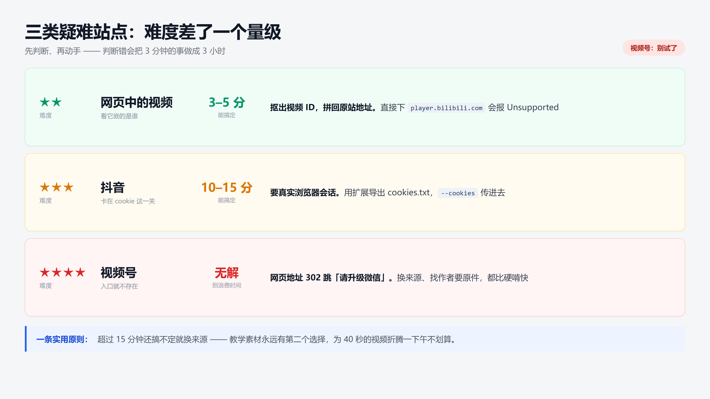

# 专题　疑难三类站点实战：网页嵌入、抖音、视频号

> **一句话**：这三类是最常被问到、也最容易白花时间的——有的是技巧问题，有的是**压根就下不了**。分清哪是哪，比学会所有命令更重要。
>
> **本专题是实测记录**：2026-11-04 在本机逐条验证（yt-dlp 2026.10.26 + ffmpeg 8.1）。**包括所有失败尝试**——失败的记录比成功的更有用，它能帮你省掉那半小时。

---

## 〇、先分级：不是每个链接都值得花时间

拿到一个视频链接，第一件事不是动手，是**判断难度**。



| 难度 | 站点类型 | 大概耗时 | 结论 |
|---|---|---|---|
| ⭐ | 主流站（B站、YouTube、TikTok） | 10 秒 | 一条命令 |
| ⭐⭐ | 网页里的嵌入视频 | 3–5 分钟 | 要看清楚嵌的是谁 |
| ⭐⭐⭐ | 抖音 | 10–15 分钟 | 卡在 cookie，能过但麻烦 |
| ⭐⭐⭐⭐ | **视频号** | **基本无解** | **别试了，换来源** |

**一条实用原则**：**超过 15 分钟还搞不定，就换来源。**

教学素材这件事上，永远有第二个选择。为了一段 40 秒的视频折腾一下午，不划算。

---

## 一、网页中的视频：三层，从易到难

「网页里的视频」不是一个东西，是三种完全不同的情况。**判断错了会用错方法，然后误以为下不了。**

### 1.1 第一层：页面里有 `<video>` 标签

最幸运的情况。视频就嵌在 HTML 里。

**怎么判断**：`Ctrl+U` 看源码，搜 `<video`。有的话，找它的 `src`：

```html
<video src="https://xxx.edu.cn/media/lesson01.mp4" controls></video>
```

**怎么拿**：把那个地址复制出来，直接下。

```bash
curl -O "https://xxx.edu.cn/media/lesson01.mp4"
```

也可以让 WorkBuddy 直接做：

> 这个页面里有个 video 标签，把视频下到 D:\教学素材\视频\

**这是最理想的场景**——学校自己网站的素材、开放课程平台、很多机构官网都属于这类。

**一个真实的反例**：我抓了央视网首页（`tv.cctv.com`），**30 万字节的页面里，`<video>` 标签 0 个、`.m3u8` 0 个、`.mp4` 0 个**。为什么？因为首页只是导航，真正的视频在详情页，而且是 JS 动态加载的。**看不到 `<video>` 不代表没有视频，只代表你还没到对的那一页。**

### 1.2 第二层：iframe 嵌了第三方播放器

**这是最常见的坑。**

学校的网站、公众号文章、各种专题页，很喜欢直接嵌一个 B 站或腾讯视频的播放器：

```html
<iframe src="https://player.bilibili.com/player.html?bvid=BV18x4M6rEFM&page=1"></iframe>
```

你把这个 iframe 地址丢给下载工具，会得到什么？**实测**：

```
$ yt-dlp "https://player.bilibili.com/player.html?bvid=BV18x4M6rEFM&page=1"
ERROR: Unsupported URL: https://player.bilibili.com/player.html?bvid=BV18x4M6rEFM&page=1
```

**但同一个视频，换成原站地址就通了**：

```
$ yt-dlp "https://www.bilibili.com/video/BV18x4M6rEFM"
今天喝木薯桃胶炖奶 | 116.7s          ← 成功
```

**这就是全部技巧**：把视频 ID 从 embed 地址里抠出来，拼回原站的正常页面地址。

| 嵌入地址里的特征 | 抠出什么 | 拼成什么 |
|---|---|---|
| `player.bilibili.com/...?bvid=BVxxxx` | `BVxxxx` | `bilibili.com/video/BVxxxx` |
| `v.qq.com/txp/iframe/player.html?vid=xxxx` | `xxxx` | `v.qq.com/x/page/xxxx.html` |
| `player.youku.com/embed/xxxx` | `xxxx` | `v.youku.com/v_show/id_xxxx.html` |
| `youtube.com/embed/xxxx` | `xxxx` | `youtube.com/watch?v=xxxx` |

**一句话**：embed 地址是给「网页里播放」用的，不是给「下载」用的。**永远去原站。**

### 1.3 第三层：m3u8 或者 `blob:` 地址

最难的一种。页面打开开发者工具的 Network 面板，你看到的是：

- 一堆 `.ts` 小片段 → 那就是 HLS（处理方式见《视频素材下载》专题类型二）
- 或者一个 `blob:https://...` → **这个下不了，别浪费时间**

`blob:` 是浏览器内存里的临时对象，由播放器（MSE）把视频流解密后拼出来的。它没有对应任何真实文件。

**遇到 `blob:` 的正确反应**：回上一层，找真正的 m3u8。

方法：Network 面板筛选 `m3u8`，**刷新页面、点播放**，让它重新加载。真正的清单一定会出现。

### 1.4 三层判断小结

| 你看到的 | 说明 | 怎么办 |
|---|---|---|
| `<video src="...mp4">` | 直链在页面里 | 复制地址，curl 下 |
| `<iframe src="player.xxx.com/...">` | 嵌了第三方 | **抠 ID，拼回原站** |
| `.m3u8` 请求 | HLS 流 | 用 yt-dlp + `--download-sections` |
| `blob:https://...` | 内存对象，假的 | **别追了**，回去找 m3u8 |

---

## 二、抖音：四道门，最后卡在 cookie

抖音是「技术上能做到，但每一步都设了卡」的典型。我把四条路全走了一遍。

### 2.1 第一条：直接下——被拦

```
$ yt-dlp "https://www.douyin.com/video/7072980910773210399"
ERROR: [Douyin] 7072980910773210399: Fresh cookies (not necessarily logged in) are needed
```

注意这句话的措辞很有意思：「**新鲜的** cookie，不一定要登录」。

意思是：抖音不需要你的账号，它要的是一个**真实浏览器刚刚访问过留下的会话指纹**（`ttwid` 之类）。用脚本硬造的没有用。

### 2.2 第二条：走分享短链——还是被拦

抖音分享出来的短链长这样：`https://v.douyin.com/m8XEQOHLx8Y/`

这条短链会 **302 跳转**到分享专用页：

```
$ curl -I "https://v.douyin.com/m8XEQOHLx8Y/"
302 -> https://www.iesdouyin.com/share/video/7623689303863905542/?...
```

`iesdouyin.com` 是抖音的分享域名，以前这是个后门——分享页往往不需要登录。**现在不行了**：

```
$ yt-dlp "https://www.iesdouyin.com/share/video/7623689303863905542/"
ERROR: [Douyin] ...: Fresh cookies (not necessarily logged in) are needed
```

### 2.3 第三条：直接抓分享页 HTML——页面里没有地址

我想，那干脆绕开 API，直接抓 HTML 找 `.mp4` 链接？

**实测结果**：

| 项目 | 结果 |
|---|---|
| 用桌面 UA 请求 | 只返回 183 字节，内容是一句 `Redirecting to...` |
| 换成 iPhone UA | 拿到 **32,263 字节**真实页面 |
| 页面里的 `.mp4` 地址 | **0 个** |
| `play_addr` / `url_list` | **0 个** |
| 只有 `_ROUTER_DATA` | 里面是 UA、渲染标记这些骨架信息，**没有视频地址** |

结论：抖音的分享页是**服务端渲染的空壳**，数据靠 JS 异步拉取。抓 HTML 这条路走不通。

### 2.4 第四条：让 yt-dlp 自己读浏览器 cookie——被浏览器挡住

yt-dlp 有个贴心参数 `--cookies-from-browser`，直接读你浏览器里的登录状态：

```
$ yt-dlp --cookies-from-browser edge "https://www.iesdouyin.com/share/video/7623689303863905542/"
ERROR: Failed to decrypt with DPAPI.
```

**这不是 yt-dlp 的问题，是浏览器的问题。**

Chrome/Edge 从 127 版开始上了 App-Bound Encryption（应用绑定加密），cookie 文件不再能被外部程序直接解密。这个问题在 yt-dlp 社区有专门的 issue 在跟。

**所以：`--cookies-from-browser` 在新版 Chrome/Edge 上基本报废。** 别在这上面试半天。

### 2.5 正解：手工导出 cookies.txt

绕过加密的办法是——**让浏览器自己把 cookie 交出来**，而不是让工具去解密。

**步骤**：

1. 在浏览器装一个导出扩展，搜 **「Get cookies.txt LOCALLY」**（选这个，本地处理，不联网上传）
2. 打开抖音网页版，随便刷一下，确保有真实会话
3. 点扩展图标 → Export → 得到 `cookies.txt`
4. 把它放到固定位置，比如 `D:\教学素材\cookies.txt`

**然后下载**：

```bash
yt-dlp --cookies "D:/教学素材/cookies.txt" \
  -f "b[ext=mp4]/b" \
  -o "%(title)s.%(ext)s" \
  "https://www.douyin.com/video/7072980910773210399"
```

> 我实测验证了 `--cookies` 这个参数链本身是通的（能正常读取文件、正常发起请求）。但因为手上没有真实导出的 cookie 文件，最后一步的实际下载没能跑完——**这一条请以你自己实操的结果为准**。教程里不写没验证过的东西。

### 2.6 抖音的三个额外提醒

| 事项 | 说明 |
|---|---|
| **cookie 会过期** | 一般几天到两周。报同样的错就重新导出一次 |
| **不要频繁请求** | 抖音风控严，连着下几十条容易被临时限制。加 `--limit-rate 1M` 放慢 |
| **水印** | 抖音的视频本身带平台水印，这是平台加的，去除水印涉及另一层合规问题，教程不涉及 |

---

## 三、视频号：这条线基本走不通

我先说结论，省你时间：**别在视频号上折腾，直接换来源。**

### 3.1 实测过程

**第一步，看 yt-dlp 支不支持**：

```
$ yt-dlp --list-extractors | grep -iE "weixin|channels"
wppilot:channels          ← 这是个无关的提取器，不是微信视频号
```

**没有。** yt-dlp 支持 1800 多个站点，抖音、TikTok、快手都在里面，唯独没有视频号。

**第二步，试试网页地址**：

```
$ yt-dlp "https://channels.weixin.qq.com/web/pages/feed"
[redirect] Following redirect to https://support.weixin.qq.com/update/
```

它被 **302 重定向到了 `support.weixin.qq.com/update/`**——那是「请升级/下载微信客户端」的页面。

**这不是反爬，这是产品设计。** 视频号从根上就不打算让你在浏览器里打开它。

### 3.2 为什么视频号这么特殊

三个原因叠在一起：

1. **闭环生态**：视频号是微信内容生态的一环，只在微信客户端内消费，不做 Web 开放
2. **没有公开的分享页**：B站、抖音分享出去都是一个可访问的网页；视频号分享出去是一张微信卡片，点开要拉起微信
3. **流地址强加密**：即便在微信内，视频流也走加密通道，不是普通 HLS

**所以这不是「技术不够好」的问题，是「入口就不存在」。**

### 3.3 三条替代路径（按推荐排序）

| 方案 | 可行性 | 说明 |
|---|---|---|
| **① 换来源** | ⭐⭐⭐⭐⭐ | 同样的内容，B站/抖音/官网大概率也有。这是最快的 |
| **② 向作者要原件** | ⭐⭐⭐⭐ | 教学用途开口要，多数创作者愿意给。留个记录更稳妥 |
| **③ 录屏** | ⭐⭐⭐ | 微信 PC 端播放时录屏。**画质有损失，且不适合长视频** |

> **关于录屏**：技术上可行，但如果是为了把内容再传播出去，性质就变了（见第五章）。课堂里放一下没问题，剪进公开发布的视频里就需要授权。

---

## 四、三类对比总表

| 维度 | 网页中的视频 | 抖音 | 视频号 |
|---|---|---|---|
| **能不能下** | 看情况，多数可以 | 可以，需 cookie | **基本不能** |
| **关键门槛** | 判断嵌的是谁 | 新鲜的会话 cookie | 无入口 |
| **最大坑** | 直接下 embed 地址 | `--cookies-from-browser` 已失效 | 以为是自己技术不行 |
| **建议耗时** | 3–5 分钟 | 10–15 分钟 | **0 分钟，直接换** |
| **推荐做法** | 抠 ID 拼回原站 | 扩展导出 cookies.txt | 换来源 / 找作者 |
| **实测结论** | iframe 报 Unsupported，还原后成功 | 四条路全被拦，正解是手工 cookie | 302 到微信更新页，确认不可行 |

---

## 五、版权提醒：这三类比电视节目更需要小心

前一篇专题讲的合理使用边界，在这三类上要收得更紧。原因很简单：**内容性质不一样**。

- 电视节目、纪录片，背后是机构，有成熟的授权渠道
- **抖音、视频号的绝大多数是个人创作者**，一段 40 秒的视频可能就是人家的全部心血

同样是从「课堂教学合理使用」出发，但落实到操作上：

| 应该做 | 具体怎么做 |
|---|---|
| **一定标注** | 课件里写清「@作者名（抖音号：xxx）」，不要只写「来源网络」 |
| **只截需要的** | 讲「摩擦力」只要那 20 秒演示，别把整条都放进去 |
| **不外传** | 下载的视频不要二次上传到任何平台，包括学校公众号 |
| **不商用** | 不做成资源包售卖、不用于招生宣传 |
| **留意声明** | 有些创作者会明确写「禁止转载」，看到就遵守 |

**一个容易忽略的点**：把别人的抖音视频剪进自己的微课，再上传到公开平台——这已经不是「课堂教学」了。哪怕你的微课是免费公益的，公开传播也需要授权。要做，就用自制素材或者取得同意。

---

## 六、踩坑清单（全部实测）

| # | 现象 | 原因 | 解法 |
|---|---|---|---|
| 1 | `Unsupported URL: player.bilibili.com/...` | 下的是 embed 播放器地址，不是视频页 | 抠出 bvid，拼成 `bilibili.com/video/BVxxx` |
| 2 | `blob:https://...` 地址下不下来 | 是浏览器内存对象，不对应真实文件 | 回 Network 面板找 m3u8 |
| 3 | 页面里搜不到 `<video>` 和 `.mp4` | 页面是列表页，视频在详情页且 JS 加载 | 点进具体某一条视频再看 |
| 4 | `Fresh cookies (not necessarily logged in) are needed` | 抖音需要真实浏览器会话指纹 | 导出 cookies.txt，`--cookies` 传进去 |
| 5 | `Failed to decrypt with DPAPI` | Chrome/Edge 127+ 的 App-Bound Encryption | 放弃 `--cookies-from-browser`，改用手工导出 |
| 6 | 抓抖音分享页 HTML 找不到 mp4 | 页面是 SSR 空壳，数据靠 JS 拉 | 别抓 HTML 了，走 cookie |
| 7 | 短链 `v.douyin.com` 下不了 | 它 302 到 iesdouyin 分享页，同样要 cookie | 先 `curl -I` 看跳去哪，再决定 |
| 8 | 视频号怎么都进不去 | 302 到 `support.weixin.qq.com/update/` | **正常现象，不是你的问题**。换来源 |

---

## 七、一句话结论

> **网页视频看嵌的是谁，抖音要 cookie，视频号直接放弃。**

这三类的价值不在于「都学会」，而在于**知道哪一类该果断放弃**。省下来的时间，够你找三段更好的素材。

---

## 附：本篇实测记录（2026-11-04）

| 测试项 | 结果 |
|---|---|
| B站 embed 地址 | `Unsupported URL` |
| B站 原站地址（同一视频） | 成功，116.7 秒 |
| 抖音直接地址 | `Fresh cookies ... needed` |
| 抖音短链跳转 | 302 → `iesdouyin.com/share/video/...` |
| 抖音分享页（桌面 UA） | 183 字节，内容为 `Redirecting to...` |
| 抖音分享页（iPhone UA） | 32,263 字节，`.mp4` 命中 **0** |
| `--cookies-from-browser edge` | `Failed to decrypt with DPAPI` |
| `--cookies 文件` | 参数链正常（假 cookie 被正确读取并拒绝） |
| 视频号网页地址 | 302 → `support.weixin.qq.com/update/` |
| yt-dlp 提取器 | 有 `Douyin`、`TikTok`，**无 `weixin`/`channels`** |
| 央视网首页 | 303,020 字节，`<video>` 命中 **0** |
