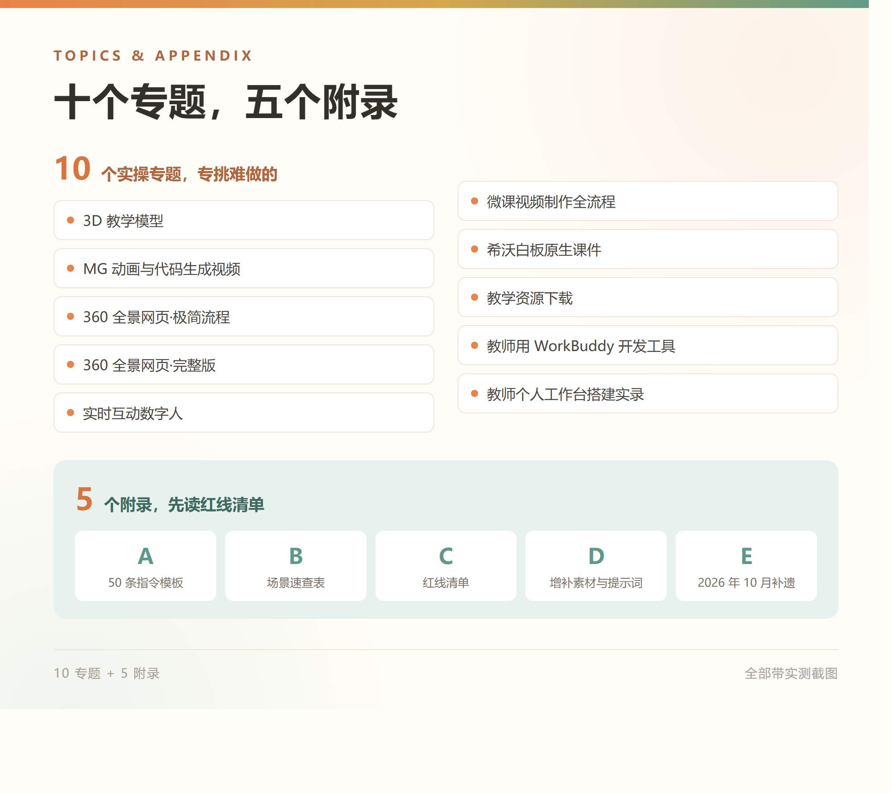
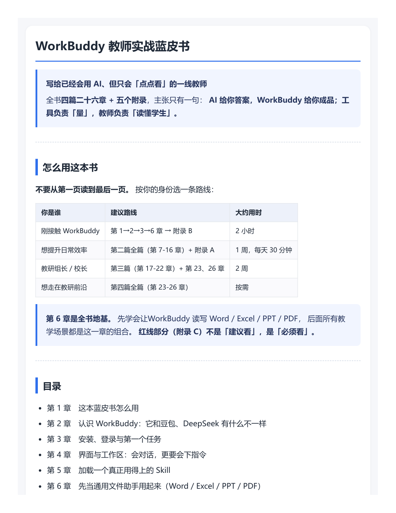

# 583 页 PDF，给县乡教师的 WorkBuddy 上手手册

26 个章节　10 个专题　5 个附录　50 条指令　161 张配图　583 页

写了两个月。县乡学校时间碎、设备杂、网不稳，书里每个做法都按这个前提写过一遍。里面有什么，四张图看完。

书里 161 张图，全部来自本机真实运行。

第 2 页有张按身份选路线的表，刚接触的、想提效的、教研组长、校长各有一条路。

---

**想直接拿走用的，私信回复 蓝皮书**，583 页带图 PDF 发你。

也可以自己取。

Gitee 源文件、Markdown、构建脚本
https://gitee.com/lanyacp/WorkBuddy-teacher-bluebook.git

飞书在线版，完整带图
https://my.feishu.cn/docx/MLgLdQhWAozaa8x2R6Acds1gncg

---

配图清单（发文时按顺序插入）

1. `图1_内容容量.png`　六个大数字
2. `图2_四篇二十六章.png`　四篇正文
3. `图3_教学全流程十章.png`　第二篇动线
4. `图4_专题与附录.png`　专题与附录
5. `书内实拍1_封面.png`　PDF 封面实拍
6. `书内实拍2_按身份选路线.png`　书内第 2 页实拍

正文约 140 字，不含标题、标签、链接与配图说明。
