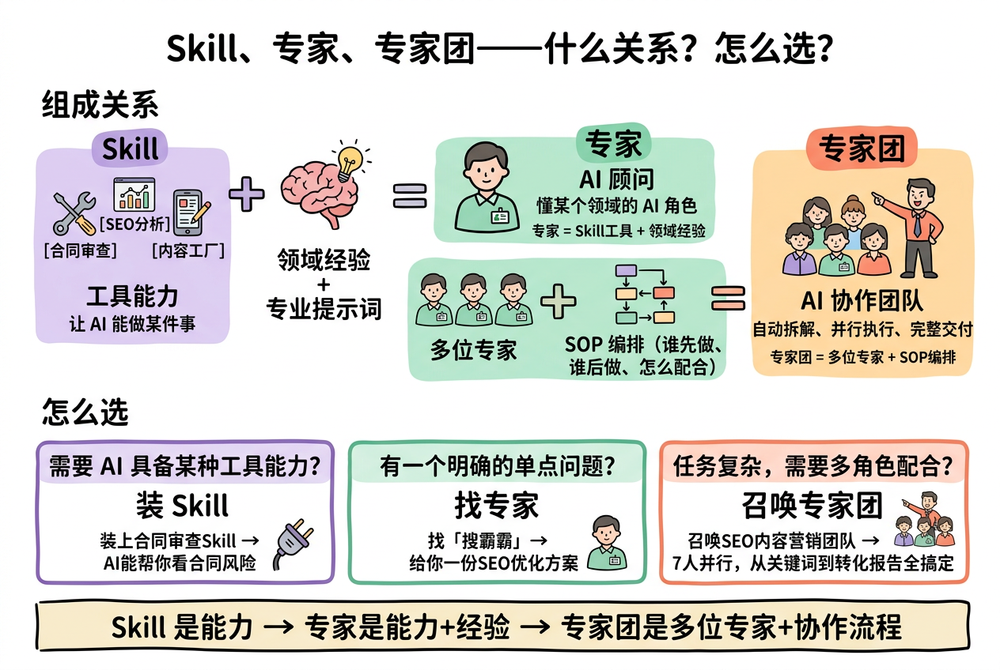
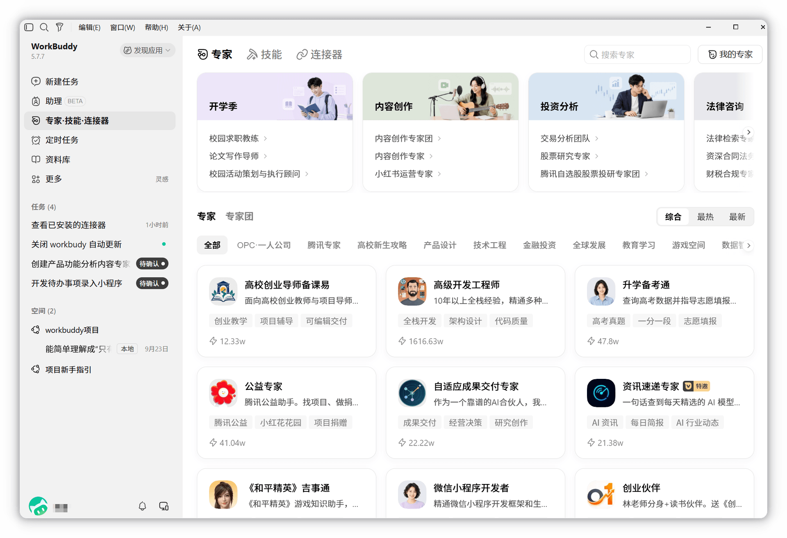
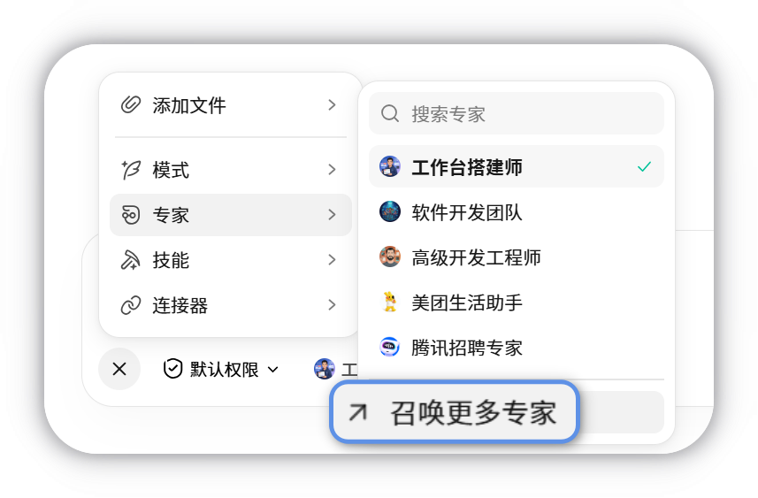
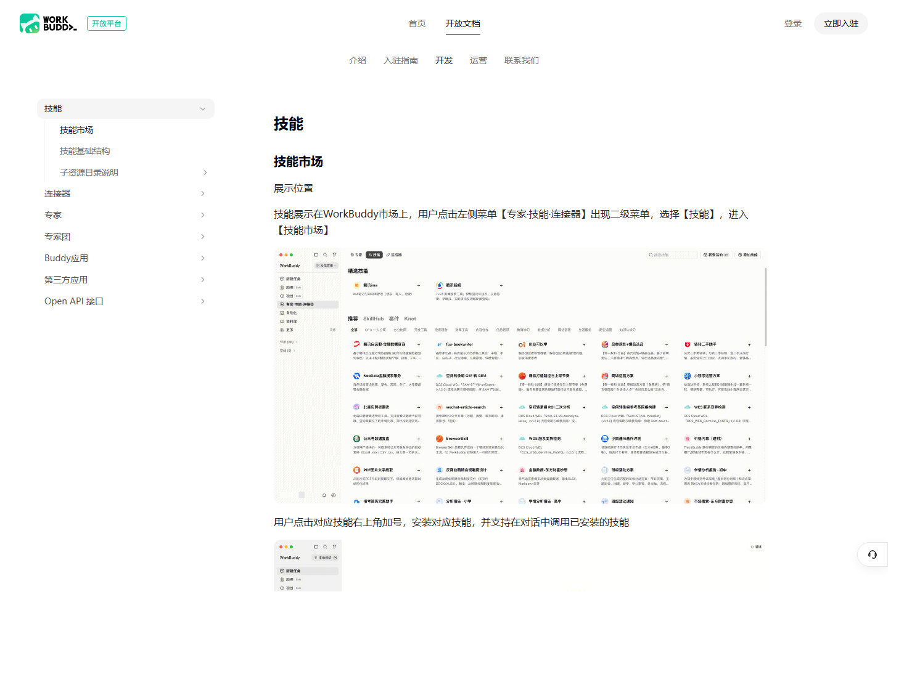
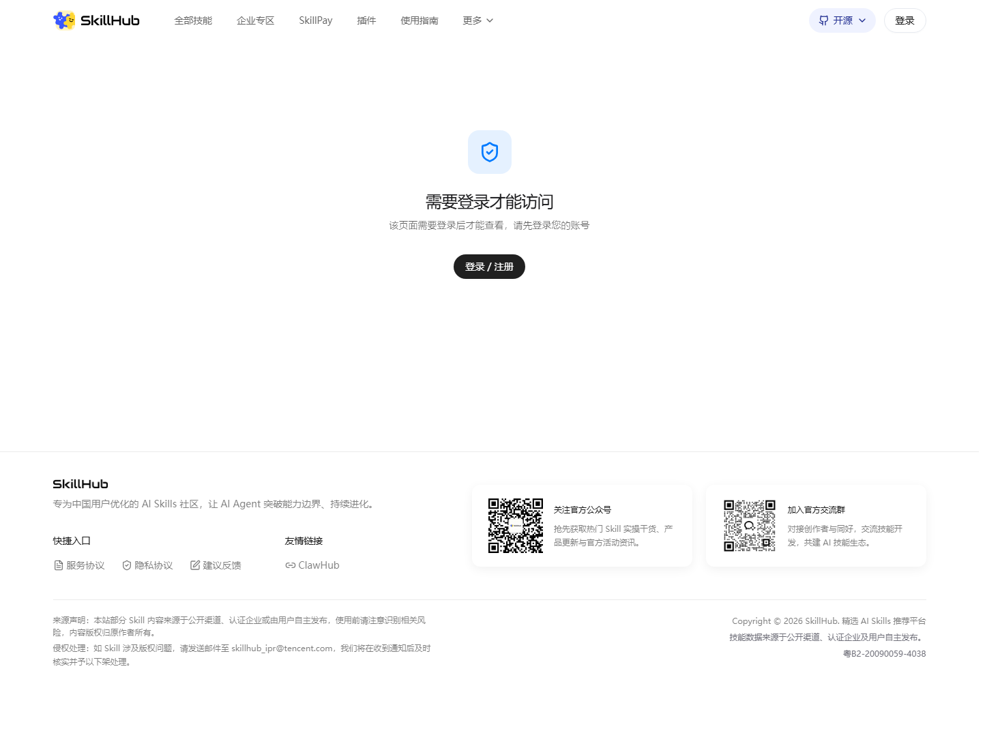
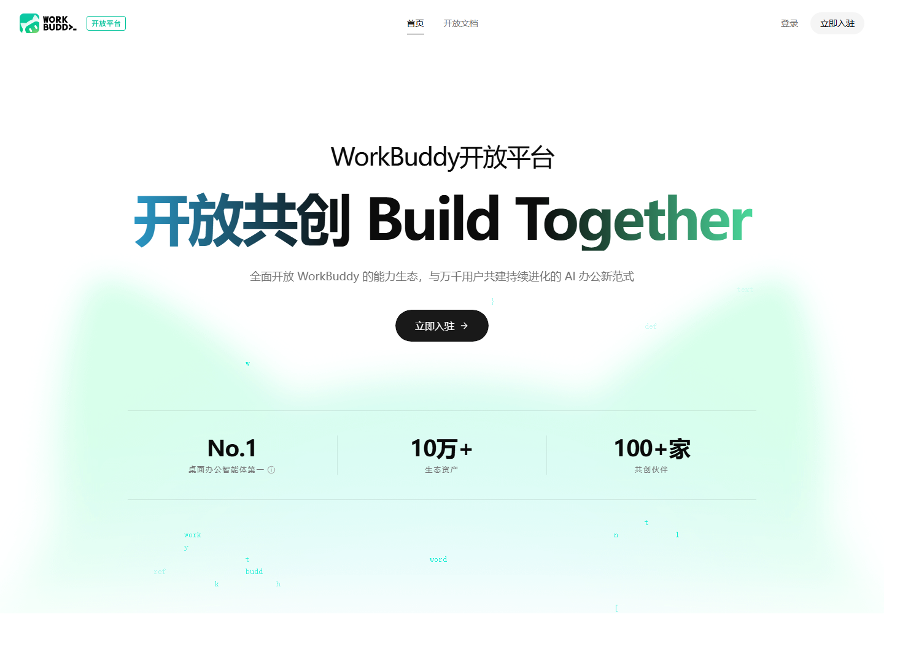
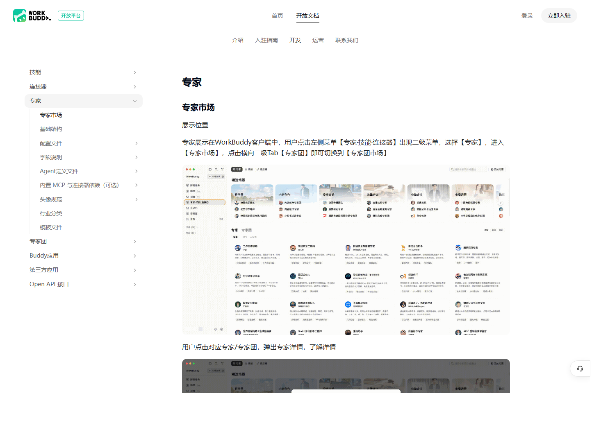

# WorkBuddy 技能与专家，到底怎么分、怎么分享出去

写给一线老师的一份实操说明。看完你能回答三个问题，技能与专家有什么不同、做好的东西怎么给同事用、怎么放到市场上让更多人用。

---

## 一、先把三件事分清

WorkBuddy 里最容易混的就是技能、专家、专家团。一句话记法是：

**技能是能力，专家是能力加经验，专家团是几位专家加一套协作流程。**

| 维度 | 技能 Skill | 专家 Expert | 专家团 Team |
|---|---|---|---|
| 本质 | 工具能力，让 AI 能做某件事 | AI 顾问，懂某个领域的角色 | AI 协作团队，自动拆解分工 |
| 组成 | 一个流程文件加可选脚本 | 人设 + 方法论 + 工具链 | 多位专家 + 团长 + 协作流程 |
| 适合 | 需要固定步骤的任务 | 目标明确的单点专业问题 | 复杂任务，要多角色配合 |
| 老师举例 | 批量排版试卷、生成周报、下载资源 | 作业设计专家、命题专家、听评课专家 | 一节课从备课到出题到评价完整交付 |
| 怎么选 | 想让 AI 按你的步骤干 | 想让 AI 用某个角色的判断 | 想让 AI 分头做再汇总 |



还有一个关键边界，专家本身不会主动去读你的文件，它只处理你主动给它的对话和上传文件。只有给它配了技能或连接器，它才会在你授权后去访问文件或外部服务。

官方原文参考
https://www.codebuddy.cn/docs/workbuddy/From-Beginner-to-Expert-Guide/Function-Description/Expert-Center
https://www.codebuddy.cn/docs/workbuddy/From-Beginner-to-Expert-Guide/Function-Description/Skills-Market

---

## 二、先做出一个能分享的技能或专家

### 2.1 最省事的做法，对话里让它自己生成

不用会写代码。在 WorkBuddy 对话框里把话说清楚就行。

做技能这样说

> 帮我创建一个技能。用途是把每次教研活动的记录整理成固定格式，包含时间、参与人、议题、结论、待办五项，输出 Markdown 文件，保存到当前工作目录。

做专家这样说

> 帮我创建一个作业设计专家。人设是有 15 年经验的县乡小学语文教研员，擅长分层作业设计。工作方法是先读课标再定目标，按基础、提升、拓展三层出题，每层给出设计理由。只做作业设计，不改试卷不评卷。输出包含题目、答案、设计说明三部分。

生成后先自己跑三到五个真实任务，输出稳定了再分享。

### 2.2 客户端入口在哪

左侧边栏点 **专家·技能·连接器**，默认进专家页；切到技能页管技能。



- 创建专家：专家页右上角 **我的专家** → **创建专家**，进入对话式引导。
- 创建技能：技能页右上角 **添加技能** → **创建技能**。
- 专家建好后在 **我的专家** 列表里，卡片右上角三个点可以修改、分享、删除。

创建专家有两个坑要记住，**名称创建后不能改**，要换名字只能重建；**删除专家不可恢复**，已经分享出去的专家删掉后对方也用不了。



### 2.3 技能包的目录长什么样

```
my-skill/
├── SKILL.md              # 必需，技能定义
├── references/           # 可选，参考文档
├── scripts/              # 可选，可执行脚本
└── templates/            # 可选，模板文件
```

SKILL.md 上半段是 YAML 说明身份，下半段是 Markdown 写具体步骤。**description 字段最关键**，写成一句话说清用途和触发词，写得含糊 AI 就不知道什么时候该用它。

### 2.4 专家包的目录长什么样

```
my-expert/
├── .codebuddy-plugin/
│   └── plugin.json       # 核心配置
├── avatars/
│   └── expert.png        # 头像 512×512 PNG，不超过 500KB
├── agents/
│   └── my-expert.md      # 人设与提示词
└── README.md
```

专家包的硬要求比技能多，头像必须 512×512 且小于 500KB，行业分类要从平台给的选项里挑，中文展示描述控制在 40 到 50 字。官方还提供了一个可以直接照抄的模板包。

模板下载
https://codebuddy-platform-1258344699.cos.ap-beijing.myqcloud.com/open/static/files/design-experts.zip

专家包规范的官方说明
https://open.workbuddy.cn/docs/expert

技能包规范的官方说明
https://open.workbuddy.cn/docs/skill

---

## 三、分享出去的三条路

三条路由轻到重，适用场景不一样。先对照着选。

| 方式 | 适合谁 | 对方怎么装 | 门槛 |
|---|---|---|---|
| 直接发压缩包 | 同事、朋友、小范围 | 本地导入 | 零 |
| SkillHub | 想公开给全网用 Skill | 网页或命令行安装 | 实名认证 |
| WorkBuddy 开放平台 | 想上架技能或专家，可免费可付费 | 市场里一键安装 | 开发者认证 + 审核 |

### 方式一　直接发送压缩包

最快，也最适合教研组内分享。

发送方做三件事

1. 把技能或专家的整个文件夹打成 zip。注意是**打包文件夹本身**，不是把里面的文件散着装。
2. 保留完整目录结构。技能的 SKILL.md、专家的 .codebuddy-plugin 和 plugin.json、avatars、agents 一个都不能少。最常见的失败就是漏了配置文件，导入直接报错。
3. 把 zip 发给对方，附上三句说明，这个东西解决什么问题、怎么用一句话触发、有什么限制。

接收方安装

左侧 **专家·技能·连接器** → **技能** 页 → **添加技能** → **上传技能** → 选中本地 zip，系统自动完成配置，不用额外操作。这就是官方说的「上传技能」入口。



给老师的提醒，对方装完最好新开一个对话再试。已经加载在当前会话的技能，本会话内还能用，但新会话才完全按新配置走。

### 方式二　上传到 SkillHub

SkillHub 是专为中国用户优化的 Skill 社区，WorkBuddy 的技能市场里就有 SkillHub 分类，装起来很顺。想把技能公开给全网用，走这里。


具体步骤

1. 打开 https://skillhub.cn/ ，右上角点 **发布 Skill**。
2. 首次发布要实名认证。平台用腾讯云人脸核身核验，信息加密存储，只用于身份核实。
3. 登录后进入发布页，按提示填技能信息、上传技能包。这一步需要登录，未登录会看到「需要登录才能访问」的提示。
4. 提交后平台做三层审核，内容合规过滤、科恩实验室深度漏洞扫描、云鼎实验室 AI 模型安全评估，全部通过才自动上架，任一不通过就拒绝。
5. 上架后别人有两条安装路，在 WorkBuddy 技能市场里搜到后点加号，或者复制 SkillHub 的安装指令贴到 WorkBuddy 对话里让它自动装。



SkillHub 还支持网页、CLI、Agent 三种发布方式。想用命令行的，先看安装说明。

https://skillhub.cn/install/skillhub.md

命令行安装技能时用 `--dir` 指向 WorkBuddy 的技能目录，不然默认装到当前目录的 skills 文件夹，WorkBuddy 认不到。

```bash
skillhub search 关键词
skillhub install 技能名 --dir ~/.workbuddy/skills/
```

### 方式三　WorkBuddy 开放平台

这条最正规。技能、专家、专家团、连接器都能上架，也能开通付费。老师分享给本校用，可以只走免费上架。



开放平台地址
https://open.workbuddy.cn/

完整七步

**第一步，注册并入驻。** 打开开放平台，点右上角 **立即入驻**，注册登录。

**第二步，完成开发者认证。** 个人准备身份证、手机号、邮箱，扫脸认证大约三分钟。企业可用法人扫码或腾讯云账号授权。认证完记得把开发者主页补好，头像、简介、联系方式，这决定别人敢不敢用你的东西。

**第三步，创建业务类型。** 在后台选你要发布的是技能还是专家，进入对应的发布管理页。

**第四步，完善信息和能力配置。** 上传打包好的 zip，填市场展示名称、头像、分类、功能介绍、适用行业、使用说明、风险提示。介绍写清三件事，谁用、解决什么具体问题、有什么限制。别写高效智能强大这类空词。


**第五步，提交审核。** 走配置资产、确认信息、提交审核三步。官方口径七个工作日内，实测快的第二天就过。

审核其实是四道关，不只是走流程：

- 代码和行为安检，看有没有硬编码密钥、危险函数、混淆代码，还会在隔离环境里实际跑一遍看文件读写和网络出站。
- 开发者身份核验，确认是谁做的，出问题找得到人。
- 能力评测，用真实任务测完成质量、准确性和稳定性。
- 上架后持续检测，命中风险会预警、限流或下架。

专家包里的技能和 MCP 配置也会一起查，不只是查专家本体。

**第六步，审核通过后手动点发布。** 这一步最容易漏，过审不等于上线，要在后台点 **发布** 并选 **公开发布**。没点的话资产一直躺在后台，市场上搜不到。发完自己去市场搜一下名字，确认卡片完整、提示句能跑通。

**第七步，需要收费才走变现。** 进开放平台后台的收入变现入口，开通收款账户、完成微信签约。有三个前置条件，完成开发者认证、账号无违规、至少有一个已经通过审核的免费技能或专家。所以想收费，得先免费上架一个跑通。



---

## 四、注意事项，按重要性排

**打包别漏文件。** 最高频的失败原因。技能必须有 SKILL.md，专家必须有 .codebuddy-plugin 下的 plugin.json、avatars 下的头像、agents 下的定义文件。打包前照着目录清点对一遍。

**付费方式上架后不能改。** 一次性买断和按月订阅，选了就定了，免费也不能直接转付费。想试水就先发免费的积累评价，再发一个新的付费版本。

**审核期间别反复改文件重新上传。** 可能打断流程，等结果出来再说。审核状态有时只显示已发布、没有进度提示，属于已知现象，预留几天耐心等。

**别硬编码密钥和令牌。** 专家包里严禁写真实 Token 和密钥。需要用户提供凭据的，用 MCP 依赖声明加 Token 表单，让用户自己填、存在本地。

**专家名称创建后不能改。** 想好再建。

**分享链接不等于上架市场。** 客户端「我的专家」里的分享，只是生成一个链接让别人召唤副本，对方的使用不影响你的配置，但别人在专家市场里搜不到。要公开发布得走开放平台。

**安全第一。** 优先用官方推荐的技能和专家。安装第三方包之前看清来源、权限申请和脚本内容。技能调用第三方、改本地文件、执行系统命令时，都是用你本人的身份执行，涉及删除、批量写入、资金操作，先小范围验证再放大。

**涉及数据要守规矩。** 上传学生作业、成绩、名单前，确认你有合法权利或已获授权，注意保护未成年人个人信息。生成内容仅供参考，重要判断要老师自己把关。

**积分消耗要看住。** 专家团会并行调多位专家、多轮交互，积分消耗通常是单专家的三到五倍。技能复杂时消耗也高。召唤前看一眼余额。

---

## 五、给老师的一句话建议

先做技能，从你每周都要重复干的那件事开始，比如周报、排版、资源整理。跑顺了再考虑做专家，把你最有判断力的那件事封装成角色。分享先从小范围的压缩包开始，同事用着好了，再考虑放上 SkillHub 或开放平台。

---

资料来源与核对日期，2026 年 11 月 25 日。流程与规则以平台最新页面为准，遇到问题可发邮件到 openworkbuddy@tencent.com，或在开放平台首页扫码进社群。
