# 第一篇 · 先把工具用起来

> 这一篇解决一件事：让你在三天内真正开始用，而不只是"知道有这个工具"。
> 六章读完，你应该能独立完成一次完整的任务，并且知道每一步该由谁来确认。
>
> **本篇截图说明**：第一章到第五章的操作界面图，全部来自官方蓝皮书《WorkBuddy 使用手册与实战指南》原版，已按教师场景重新编排。你可以直接照着图做，不用再自己截图。

---

## 第 1 章　这本蓝皮书怎么用

### 这不是一本需要读完的书

先说清楚一件事：你不会一次性读完 26 章，这本蓝皮书的设计是让你**做完一件事就走开**。

每一章的结构都是一样的：

| 部分 | 你要做什么 |
|---|---|
| 场景痛点 | 花 30 秒确认"这说的是我" |
| 备课五问 | 花 1 分钟想清楚自己的任务规格 |
| 推荐流程 | 照着走一遍 |
| 提示词示例 | 直接复制去用，然后改 |
| 常见错误 | 做完看一眼，避免踩坑 |
| 区域实践参照 | 看看别人怎么做的 |
| 你校可以怎么改 | **写你自己的做法** |

最后一栏是这本书和别的地方最不一样的地方。**它不是读完就完的教材，是要你往上写字的工作手册。** 一本书如果能让老师在里面写字，它才会被留下；只会被收藏。

### 三条阅读路线

**路线一：我先试试（适合第一次用）**
第 1 章 → 第 2 章 → 第 3 章 → **第 6 章（先学会读写文件）** → 挑第二篇里最急的一章直接做

**路线二：我是教研员，想推全校**
第 1 章 → 第 2 章 → 附录 C（红线）→ 第 17 章（教研组共用）→ 第 26 章（从个人到区域）

**路线三：我有明确任务，只想解决它**
直接翻**附录 B 场景速查表**，找到"我要做什么"对应的章节和提示词编号，跳过去做

### 一个前置提醒：先看附录 C

教育部《教师生成式人工智能应用指引》把边界划得很清楚——**六类场景鼓励用，六类行为规范是红线**。红线里最要紧的三条，请现在就记住：

1. **不得把学生个人信息、考试成绩、试题等敏感数据输入 AI 工具**
2. **不得直接用 AI 生成内容评价学生**
3. **价值观引导、德育、心理支持这些环节，教师必须主导完成**

这本书里所有的工作流设计，都建立在这三条之上。遇到需要上传学生材料的任务，本书会给出本地处理的替代方案（见第 11 章）。

### 这本蓝皮书的一句话主张

> **AI 给你答案，WorkBuddy 给你成品。**
>
> 这个差别在下一章展开，它是这本书存在的全部理由。

### 你需要准备什么

- 一台 Windows 或 Mac 电脑（Windows 更稳）
- 30 分钟不被打断的时间，用来跑通第 3 章
- 一份你手上真实的、正在烦的材料：一份要做的教案、一堆要改的作业、一份要写的通知

---

## 第 2 章　认识 WorkBuddy：它和豆包、DeepSeek 有什么不一样

### 先说结论

这一章是全书最重要的一章。如果只读一章，读这章。

很多老师第一次接触 WorkBuddy 时的反应是："这个功能豆包也有。"这个反应不算错——**但它混淆了两件根本不同的事。**

豆包、DeepSeek 这类工具，你给它一个提问，它给你一段答案。你要做的是：**把答案复制出来，自己去排版、做PPT、存成文件、发给同事。**

WorkBuddy 不是这样。你说清一件事，它自己在你的电脑上把事做完，**直接把能用的文件交到你手上**——教案是 Word，课件是 PPT，成绩单是 Excel。

### 一个真实的对比

假设你要做一节公开课的备课包，包含教案、PPT、逐字提问稿、板书设计、检测题、评价量表。

**用豆包或 DeepSeek：**

你得开五个对话框，依次问五次。然后你会遇到这些情况：
- 教案复制出来是一大段文字，标题层级全丢了
- 让你出 PPT，它给你一个大纲，你说"做成 PPT"，它说它不能直接生成文件
- 检测题的答案和题目混在一起，印出来学生能看到
- 五个回答的风格、术语、深浅前后不一致，还得自己统一

**用 WorkBuddy：**

你把要求一次说清（放在工作区里），它给出材料清单和每份的页数预览，你确认后生成：

```
教学设计.docx      18 页
公开课课件.pptx    17 页
逐字提问稿.docx     8 处提问 + 预设回答
课堂检测题.docx     6 题，答案在最后一页
评价量表.docx       4 维度，可直接打印
```

六份文件，风格一致，互相引用一致，改一处可以全量重出。

**差别不在模型聪不聪明，在它有没有手。** 对话式 AI 给你"大脑的输出"，WorkBuddy 给你"做完的活"。

### 六个具体差别

| 维度 | 豆包 / DeepSeek | WorkBuddy | 对你意味着 |
|---|---|---|---|
| **交付形态** | 给文字，你自己复制、排版、存文件 | 直接给 Word / PPT / Excel / PDF 文件 | 省掉的是"排版"这一整段劳动 |
| **提示词门槛** | 要会写长提示词，会追问、调格式 | 骨架式指令就能出成品 | 不用背"咒语"，也不用怕写错 |
| **文件操作** | 传不上去、或者只能传文本 | 直接读写你电脑里的文件，能批量 | 40 份试卷、20 份教案可以一次性处理 |
| **数据安全** | 内容上传到云端服务器 | **本地批量处理可以不上传云端** | 学生材料有不上传的方案 |
| **可否重复** | 每次从零开始 | 提示词存成 Skill，下次直接调用 | 一个班做完，全年级都能用 |
| **能力覆盖** | 生成内容为主 | 规划、执行、验证、交付一体 | 你要的不是"生成"，是"做完" |

**第三条和第四条，是老师最该关心的两条。** 后面会专门展开：第 11 章（批改与学情）会讲本地处理学生材料的具体做法；附录 C 会讲数据红线的完整清单。

### 一句话记住三句话心态

很多老师问"我该用什么心态用它"，答案其实就三句，来自一线教师实践的沉淀：

> 1. **我不是要它替我干活，我是要它替我做重复劳动。**
> 2. **我说的越具体，它做的越准。**
> 3. **不满意的不是它笨，是我没把标准说清。**

第 3 句最重要，也最反直觉。**本书后面 20 章，每一章都有一个"备课五问"表，就是把第 3 句拆成了可以照着填的五个问题。**

### 它适合做什么，不适合做什么

| 适合交给它 | 必须你来 |
|---|---|
| 从课标和教材整理出教学框架 | 决定这节课的核心目标 |
| 生成课件初稿、检测题初稿 | 判断题目是否超纲、是否符合学情 |
| 批量处理文件、转换格式、生成台账 | 决定哪些信息可以进系统 |
| 整理会议记录、写通知和总结初稿 | 决定这封信怎么写、什么话说 |
| 陪你打磨提示词、帮你建立工作流 | 在孩子困惑的时候，说话的那个人必须是你 |
| 陪你把公开课从 3 天压到 45 分钟 | 上台讲课的那个人必须是你 |

**这张表是本书的伦理底线。** 左边那些事，你做起来慢，AI 做起来又快又好。右边那些事，别人做不了。

### 区域实践参照：别人已经走到哪一步

在讲具体怎么用之前，先看几个已经跑起来的地方。以下均为公开报道，来源可查。

**安徽长丰**（安徽青年报 2026 年报道）：全县2026 年"好课堂"评选覆盖 21 个学科，**要求每个学科至少使用一种 AI 工具**，206 名教师参与。长丰县在市级教师人工智能应用案例征集中有 7 件入选，居五县市第一。语文教研员曹婷婷的体会是："以前评课靠感觉，说这堂课气氛不错，到底哪里好、哪里不好，说不清。现在 AI 报告一出来，提问分布、学生参与热力图一目了然，建议也有了依据。"

**广西贺州市**（贺州市人民政府网 2026 年报道）：2026 年 3—4 月开展覆盖全市各县区的深度应用培训。八步区新城实验小学唐甜老师的做法是把本地元素带进数学课——**把昭平的茶叶包装箱搬进课堂讲"观察物体"，用贺州地标建筑讲"确定位置"**。她说："学生看到自己家乡的场景出现在屏幕上，眼睛都亮了，这种'贺州味'的课堂，是以前不敢想的。"

**山东临沭**（临沭县人民政府网报道，九年级教师反馈）："系统评价的有效性依托于学生的真实写作水平。**因此需在课堂上预留充足时间组织现场写作**，确保文稿真实反映学生能力，使系统的问题定位、评分分析具有参考价值。"

这三条放在一起看，能得出一个很实用的结论：

> **长丰靠"硬性条件 + 数据模板"把 AI 推开了，贺州靠"本地化"让 AI 变得不可替代，临沭的老师提醒我们"离了真实场景的 AI 数据没有价值"。**
>
> 三个条件缺一个，AI 就会停在"用过一次但没用第二次"。

### 【2026 年 10 月增补】教师版 WorkBuddy：区别又多了一条"身份"

2026 年 9 月 2 日，腾讯企鹅教师助手联合 WorkBuddy 打造的**「企鹅教师助手 Buddy 应用」**在 WorkBuddy 内正式上线，9 月 6 日腾讯签约教育部第三期"尊师惠师公益行动"。这给"和豆包的区别"补上了最直接的一条：**豆包没有教师身份体系，WorkBuddy 有。**

教师版的四个事实（来源：公众号"AI-老骆"《教师版WorkBuddy正式发布》）：

| 事实 | 内容 |
|---|---|
| **身份认证** | 通过教育部"中国教师"小程序完成认证，可免费领 1000 开学专属积分（留意当期活动时限）；企鹅教师助手星星币 1.5 倍加速、1:1 兑换 WorkBuddy 积分 |
| **三工作模式** | 教学设计 / 家校共育 / 专业成长——**"切场景不切账号"** |
| **资源体量** | 33 位教育专家智能体（与北京大学共建）+ 15 项标准化教学 Skill + 21 类高频教学场景 |
| **官方定位** | "让教师掌握主导权，让 AI 承担辅助工作" |

**判断它值不值得用的三句话**（一线教师实测后的原话）：

> "以前：'均分掉了 3 分。'现在：'第 14 题全班失分率 68%，对应知识点是二次函数图像平移，低分段 12 人里 9 人卡在这一步。'"
>
> "AI 替代不了站在讲台上的那个人，它不懂你班上的孩子。但它能把备课、出卷、整理错题这些'谁做都差不多的碎活'接过去，把时间省出来——让你有时间去懂他们。"

另外一个常被问到的区别，用一段话就能说清（来源：《WorkBuddy 从入门到精通》系列）：

> **Ask 模式就是纯聊天，你问它答，跟你平时用豆包那种对话框是一样的。** Plan 是先出计划再动手；Craft 是平时干活的 Agent 模式。
> **注意 WorkBuddy 默认 Craft 模式**——你随便发一条消息，它就直接开干了，积分也就开始消耗了。**只想问问题的时候，先切到 Ask。**

---

## 第 3 章　安装、登录与第一个任务

### 安装前的三件事

**第一，确认电脑能装。** Windows 10/11 或 macOS 12 以上，8GB 内存以上，剩余磁盘空间 20GB 起。**教师用机的硬盘常年紧张，建议先清一次**——很多人第一次装完发现跑不动，原因是桌面和下载文件夹里堆了十几个 G 的旧课件。

**第二，想清楚文件放哪。** 装完之后你会有一个工作区。这个工作区就是你以后放"AI 相关材料"的地方，**建议一次就建好结构**，别以后乱：

```
我的AI工作区/
├─ 01_教学设计/
│  ├─ 2026秋_七年级/
│  └─ 2026秋_八年级/
├─ 02_课件成品/
├─ 03_试题与作业/
├─ 04_批改与学情/
├─ 05_教研材料/
├─ 06_行政文书/
└─ 99_提示词库/     ← 你的提示词都存这里
```

`99_提示词库` 这个文件夹是全书最值钱的一个。**你每一次成功的提示词，都应该存进去、命名、用起来。** 到学期末你会发现，教研组里最有价值的不是某个人会用 AI，而是他存了 30 个验证过的提示词。

**第三，想清楚第一件事做什么。** 不要拿最难的任务开局。**推荐用本章后面的"第一个任务"：把一份已经上过的课的教学设计，让它按你的格式重新出一版。** 它足够真实、足够简单、失败成本极低。

### 下载安装（Windows）

访问官网 `https://www.codebuddy.cn/work/`，选择 WorkBuddy 点击下载。网站会自动判断你的设备版本（Mac ARM64 / Mac x64 / Windows x64）。


自动识别系统版本，选择对应安装包：

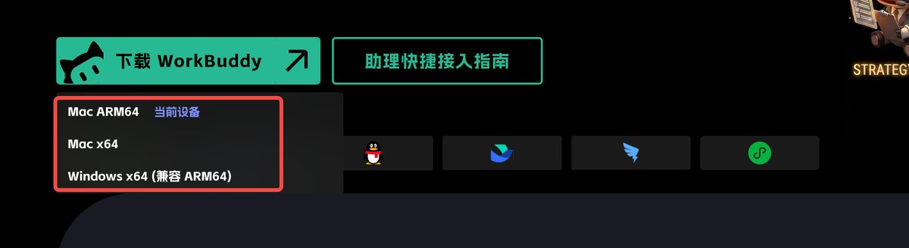

> **切记：从官方入口下载，不要从网盘或不明镜像获取安装包。**

下载完成后双击安装文件：

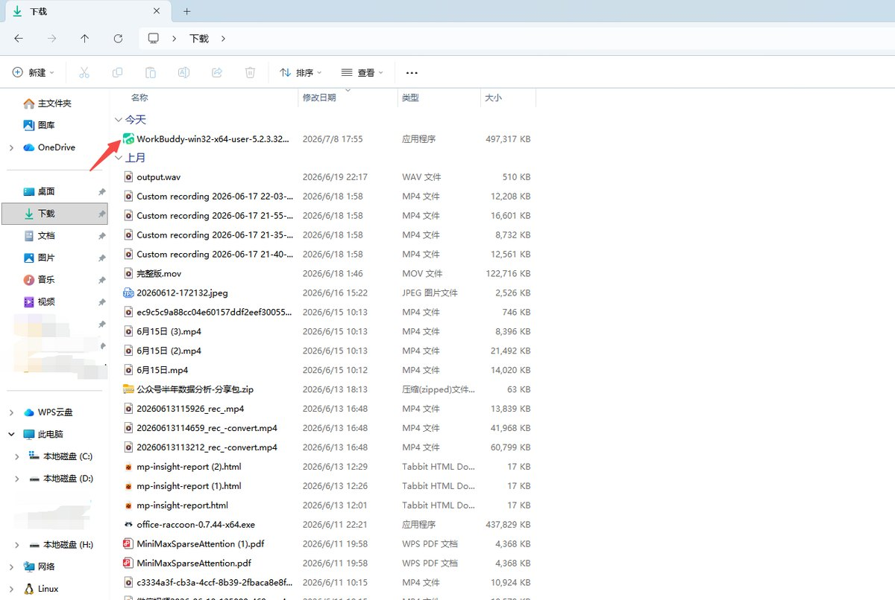

如系统弹出安全提示，先核对发布者与下载来源，再决定是否继续：

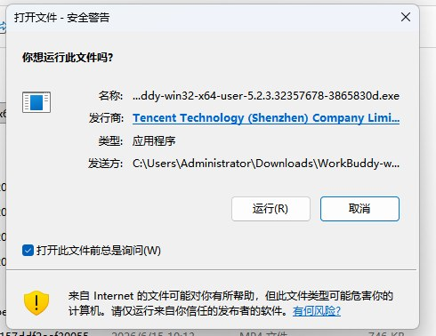

按安装向导完成安装：

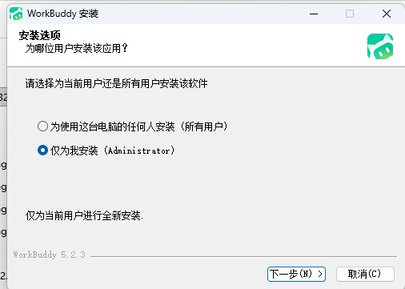

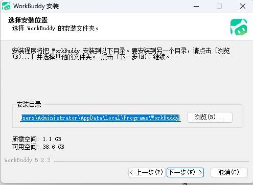

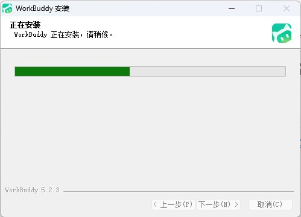

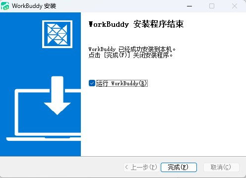

进入准备运行环境：

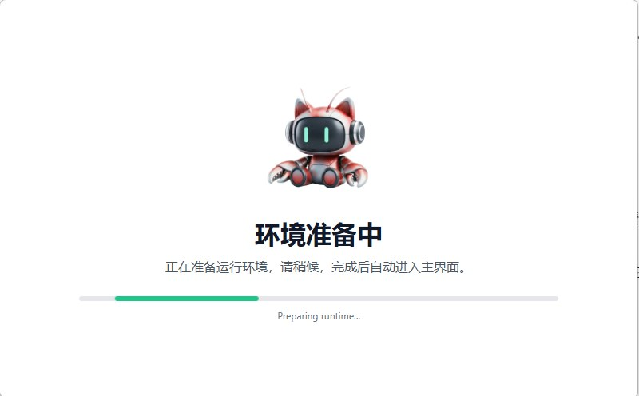

### macOS 安装（更简单，三步）

如果学校用的是 Mac，步骤更少：

打开安装文件，将 WorkBuddy 拖入"应用程序"：

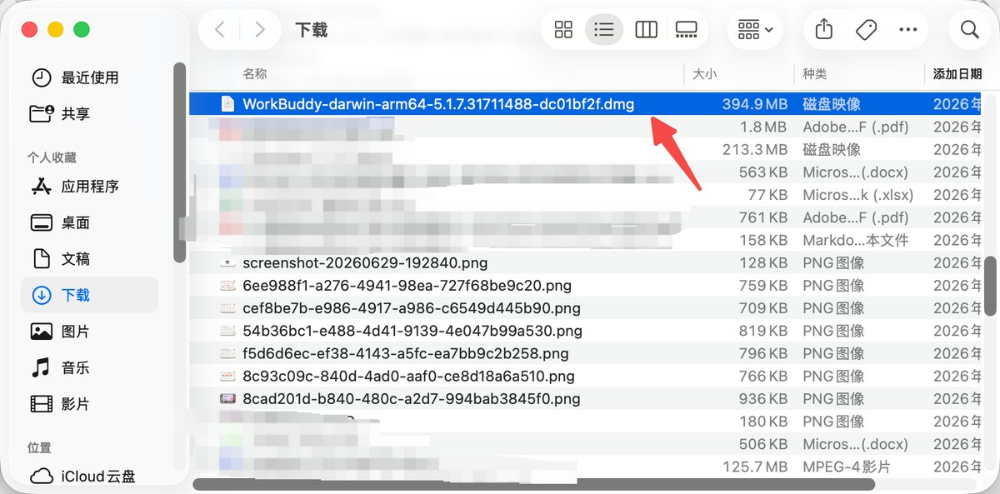

拖到位之后的样子：

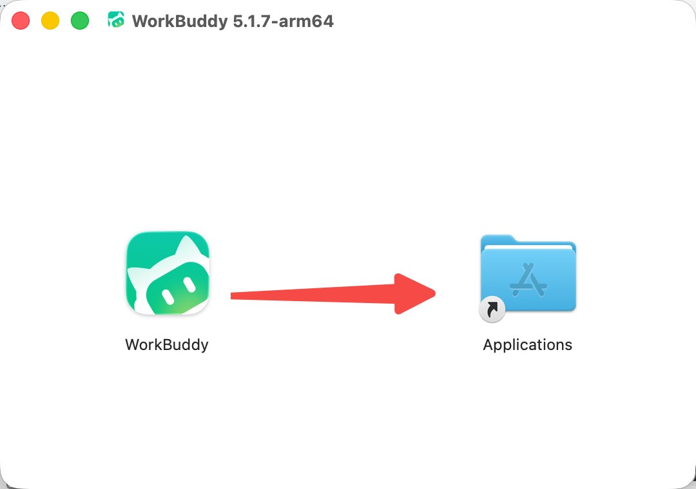

从"应用程序"启动：

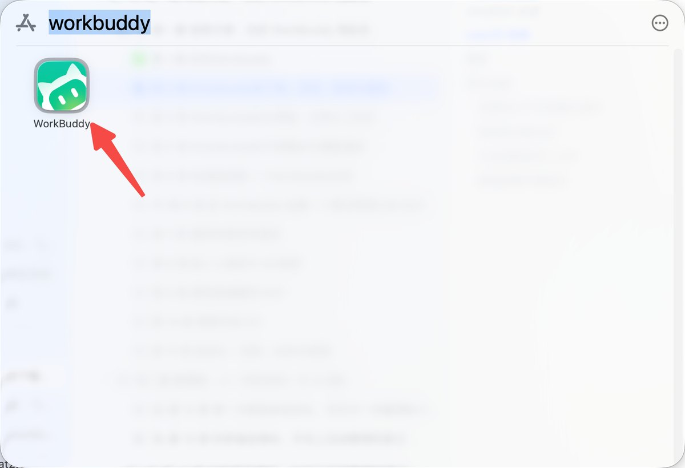

### 登录

点击登录按钮：

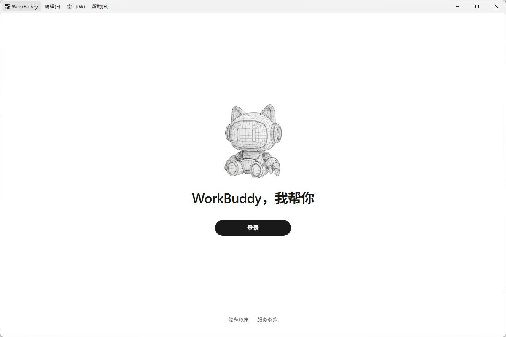

会自动跳转网页登录：

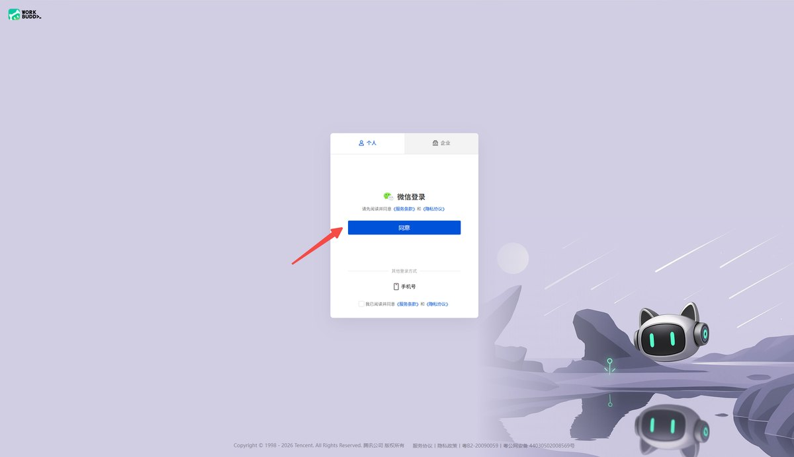

选择微信扫码登录，也可以手机号登录：


完成后即可使用：

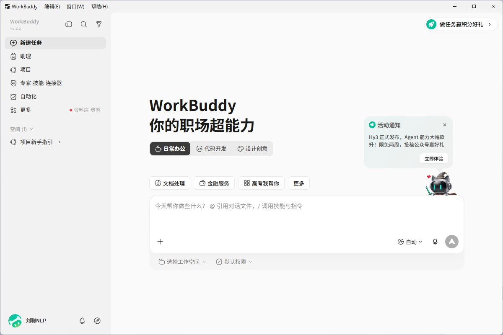

> **若学校电脑禁止安装软件，不要绕过终端安全策略**，应联系 IT 管理员确认白名单或企业部署方式。

### 更新

点击左下角个人中心，选择"检查更新"：

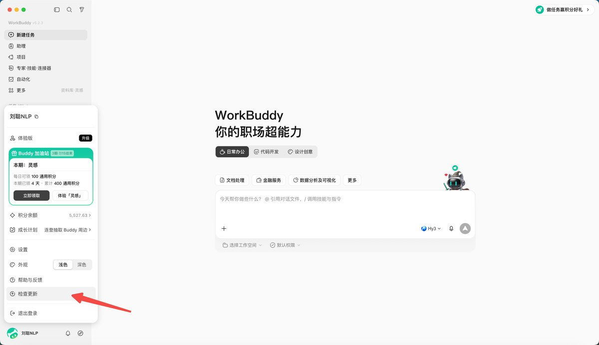

### 安装环节的四个常见问题

| 问题 | 怎么办 |
|---|---|
| 安装包打不开或提示损坏 | 删除安装包并从官网重新下载，核对系统和芯片版本；仍失败则记录系统版本、安装包名和报错截图走官方渠道，**不要随意关闭系统安全功能** |
| 登录后没有反应 | 检查默认浏览器是否拦截登录回跳、网络代理是否影响认证、系统时间是否准确；退出应用后重试 |
| 无法读取或写入文件 | 确认工作目录是否正确、系统是否授予目录权限、文件是否被其他程序锁定；**先用一个空白文本文件测试，不要拿重要文件反复试错** |
| 更新前要不要备份 | 应用更新一般不修改工作文件，但长期项目仍应把输入、产物、配置和自定义 Skill 纳入版本管理 |

### 登录后立刻做两件事

1. **确认模型设置。** 默认模型能用就别动。如果你要处理长文档或大批量文件，可以在设置里选能力更强的模型。
2. **找到 Skill 面板。** 这是 WorkBuddy 和对话式 AI 最大的结构差异——**它把"能力"做成了可安装的模块（Skill）**。你不需要懂技术，只需要知道去哪里找。第 5 章会讲怎么挑。

### 顺便装一个「企鹅教师助手」：给教育版准备的专属入口

**这一节强烈建议现在就做，因为在教师场景里，这是最省事的一步。**

很多老师装完 WorkBuddy 就直接开始用对话功能，**其实左下角还有一个专门给教育场景准备的东西没装。**

#### 先说清楚它在哪

**版本要求：5.5.0及以上才有这个入口。** 如果你的左侧栏找不到，说明需要更新。

更新方式：点击左下角个人中心，选择"检查更新"。

#### 找到「发现应用」

**在左侧菜单面板的右上角**，你会看到一个带外链箭头的入口，写着**「发现应用」**。


*图：WorkBuddy 5.7.6 真实界面。「发现应用」在左上角 Logo 右侧，点开后第一屏就是「最近使用」里的企鹅教师助手。*

点击它，会展开一个下拉菜单，里面分三类：

| 分类 | 是什么 | 对你的意义 |
|---|---|---|
| **最近使用** | 你近期开过的工具 | 常用的直接快捷进入 |
| **Buddy 应用** | 官方推荐的行业应用列表 | **这里能找到「企鹅教师助手」** |
| **探索更多** | 完整应用目录 | 想找其他行业应用时展开 |

下拉面板里除教育类应用外，还有通义信、美图设计室、腾讯自选股、腾讯电子签AI合同助手、Alpha派·Lite 等官方推荐，**说明 Buddy 应用是一个通用入口，不只是给教育用的**——但对教师来说，最该装的还是第一个：**企鹅教师助手**。

#### 装「企鹅教师助手」

在 Buddy 应用列表里找到**「企鹅教师助手」**，它的介绍是**"懂教学，更懂你的教学"**，右边有一个**「进入」**按钮。

点进去，中间会经过**授权、确认、绑定账号**这几个环节，**都是一次性的**，整个过程不用写一行代码。

装完之后，它会固定出现在你的侧栏里，**下次直接从"最近使用"进，不用再找。**

#### 装好之后，你的界面长这样

装上企鹅教师助手之后，整个界面会换成教育专用形态。**顶部是三个工作模式**，**中间一排是该模式下的教学场景入口**：


*图：企鹅教师助手「教学设计」模式。顶部三个模式是教学设计 / 家校共育 / 专业成长；下方一排是该模式的场景入口：创意教学设计、课件制作、教学目标生成、分层教学、写教案、教学评…（右侧还有箭头可横向翻页）。*

**注意这个「教学设计」是默认选中的**——这也印证了前面讲的：装上之后是教育版默认状态，你不需要自己配。

**另外两个模式长这样：**

| 模式 | 顶部场景入口 | 适合什么时候用 |
|---|---|---|
| **家校共育** | 个性化评价、家校沟通、分层作业、作业讲评、学生辅导、学情分析 | 和家长打交道、分析班情、布置分层作业 |
| **专业成长** | 教学研究、课题研究、教师培训、技能创作、网站开发、论文写作 | 写论文、做课题、搞培训、给自己开发小工具 |


*图：「家校共育」模式。左上角同时展开了「专家 · 技能 · 连接器」菜单——装上助手后，这三项教育内容已经内置，不用自己再配。*


*图：「专业成长」模式。注意这一排全是教师个人成长向的场景：教学研究、课题研究、教师培训、技能创作、网站开发、论文写作。*

> **把这三张图存下来，贴在办公桌前。** 你能一眼看出该干什么活的时候，切到哪个模式，这就是第 1 章说的"不用记功能，只记场景"。
>
> **三个模式的分界线是：**
> - **教学设计**＝课怎么上（备课、上课、课件、目标、分层）
> - **家校共育**＝课怎么延伸（家长、作业、讲评、辅导、学情）
> - **专业成长**＝自己怎么变强（研究、课题、培训、开发、写论文）

#### 它到底带来了什么

**这不是一个"功能"，是一个教育场景的工作台。** 装上之后，你不用自己配 Skill、不用自己写提示词，直接就是教育版的默认状态。

**你得到的是这四样：**

| 你得到什么 | 具体内容 |
|---|---|
| **教育专家** | 33 位教育专家（学科命题、学情分析、错题集生成等） |
| **教学 Skill** | 15 个即插即用的教学 Skill |
| **三大工作模式** | 教学设计 / 家校共育 / 专业成长，顶部一键切换 |
| **四类开箱能力** | 课件制作、创意教学、剧本教学、素材加工 |

**注意后两项。**「三大工作模式」和「四类开箱能力」是装上企鹅教师助手之后**直接出现在界面里的**，不是你还要自己去配——**这一句能帮你省掉至少半小时摸索。**

#### 一个容易踩的坑

> **官方早期文档写的是"点击左上角 Buddy 应用入口"，很多老用户会习惯性地往左上角找。**
>
> **但在5.5.3之后的界面里，它已经统一改名叫「发现应用」，位置也移到了顶部。**
>
> **名字变了，位置变了。别再找"左上角"了。**

#### 顺便认识一下能力的三层结构

**这一段值得你花两分钟看完，因为它能解释清楚你以后遇到的很多疑问。**

WorkBuddy 的能力分三层，**你现在用的是最下面那层，但教师最该用的是最上面那层：**

| 层 | 叫什么 | 是什么 | 教师的对应物 |
|---|---|---|---|
| **最底层** | **Skill** | 给它加某一种工具能力，比如读写 Excel、生成 PPT | 第 5 章讲的那些 |
| **中间层** | **Expert 专家** | 模拟某个岗位的 AI 角色 | 学科命题专家、学情分析专家 |
| **最上层** | **Buddy 应用** | **把能力、数据、品牌打包成一个独立工作台** | **企鹅教师助手** |

**用一个类比就清楚了：**

- **Skill 是零件**（一个扳手）
- **Expert 是角色**（一个汽车修理工）
- **Buddy 应用是整车**（一辆能直接开上路的车）

> **大部分人不会去拧零件，也不会去造角色。他们需要的是一辆能直接开上路的车，加满油，钥匙插进去就能发动。**
>
> **「发现应用」给的正是这个。而对教师来说，这辆车就是「企鹅教师助手」。**

**所以你现在要做的判断是：**

| 你想解决的问题 | 该在哪一层找 |
|---|---|
| 出一份分层作业 | 先试专家（教育版自带），不够再找 Skill |
| 这个流程我每周都做，想固化 | Skill → 做到第 24 章的封装 |
| **整体的教学工作台，不想自己拼** | **Buddy 应用 → 企鹅教师助手** |
| 要接学校自己的系统 | 连接器（第 7 章） |

### 【2026 年 10 月增补】开干之前，先给它三个"自我介绍文件"

装完不等于会用。一篇传播很广的教程（《WorkBuddy 的三个关键文件：90% 的人都没配置》）给了一个贴切的类比：

> **你招了一个新员工，上来就说"去做份产品 PPT"，不介绍公司、不说团队风格——你觉得他能交出让你满意的东西吗？**

三个文件让 WorkBuddy"懂你"，**配置一次，受益很久**：

| 文件 | 写什么 | 教师版示例 |
|---|---|---|
| **IDENTITY.md** | 它的身份与口吻（四行：名称/身份/风格/标识） | "小助手 · 初中数学教师的备课搭档" |
| **USER.md** | 你的档案：学科、学段、班级情况、写作习惯、交付偏好 | "八年级数学，两个班 92 人，几何证明普遍薄弱；报告要 Word，课件要 PPT；讨厌'AI 味'套话" |
| **SOUL.md** | 行为准则：核心价值观、边界、风格 | "数据说话不拍脑袋""不确定的先查证，不瞎编数字""给学生的话必须我过目" |

**最省事的写法**：不用自己从零写——直接告诉它你的职业、学科、教学习惯、希望它怎么称呼你，让它把三个文件写好给你，你再逐步调整。全程自然语言对话。

另一个等价做法（来源：《AI 驱动的个人知识库：中小学教师实战指南》）是先写一份**"个人教学说明书"**，15 分钟就够：

```
基本信息：初中数学，八年级，学生中等偏上但几何证明普遍薄弱，教龄 8 年。
我的教学风格：喜欢问题驱动，不喜欢满堂灌；备课最在意学生能不能真的动手。
作业偏好：分层设计，A/B/C 三档。
我希望 AI 怎么帮我：备课时给思路框架，不要直接给完整教案；
出题时参考我的教材版本和学生易错点；语言风格简洁直接，不要套话。
```

两种入口（三个文件 / 教学说明书）是同一件事：**把"AI 不知道、但会真实影响结果的信息"一次性交给它。** 这也是第 7 章备课增补里"上下文决定 AI 能走多远"的地基。

### 第一个任务：按你的格式重做一份教学设计

这是推荐给所有人的第一次任务。理由：真实、低风险、成果可对比。

**准备工作**：找到你上学期上过的、一份你比较满意的教学设计（Word 就行）。这是你的"参照物"。

**第一条指令**（直接复制，替换方括号内容）：

```
我要做一节公开课。

课题：【课题名】
教材版本：【人教版/北师大版/苏教版，几年级第几单元】
课时：【1课时 40 分钟】
听众：【区级教研员 + 兄弟校骨干教师】

请先不要生成文件，先给我一份材料清单：
1. 教学设计（我需要哪些部分）
2. 课件 PPT（多少页，每页大概放什么）
3. 逐字提问稿（几处提问）
4. 板书设计
5. 课堂检测题（几道，分几档）
6. 评价量表（几个维度）

每项写清楚：多少页、交付成什么格式、你会问我什么。
我要先确认清单，再生成。
```

**它在做什么**：不是直接给你教案，而是先给你一份**"施工图"让你审**。这一步是全书反复出现的模式——**先看计划，再看产出**。你审清单的那一分钟，比省下的一小时都值钱。

你确认后（比如"第 3 项改成 10 处提问，第 6 项改成 3 个维度"），它会重新出清单。然后你说"生成"。

**验收清单**（生成完逐条看）：

- [ ] 标题层级完整，能直接打印
- [ ] 内容能追溯到教材第几页
- [ ] 没有任何编造的事实、数据、引用
- [ ] 风格和你的习惯一致
- [ ] 有一个地方比你原来的版本**更好**（找到它，这是你下次要主动加的要求）

最后一条最重要。**如果生成的还不如你原来那版，别急着否定它——去找到它哪里不如，然后把这个差距写成一句话加进下一次指令。** 这就是"我说的越具体，它做的越准"的实际含义。

### 第一个任务里最可能卡住的地方

| 卡在哪 | 表现 | 怎么解 |
|---|---|---|
| 指令太笼统 | 给了个特别泛的东西，像"万能模板" | 补齐第 6 章的"对象/规格/约束/验收"四要素 |
| 不敢让它生成 | 一直在让它改、改、改，不敢说"生成" | 明确说"先出清单我确认"，然后就批准 |
| 生成后不知道好不好 | 只能凭"感觉还行" | 用上面那个验收清单逐条打勾 |
| 结果不如预期就放弃 | 第一次不满意就换工具 | 先找出差在哪里，把它写成一句要求，再试一次 |
| 材料没放到工作区 | 它找不到你的参照文件 | 把参照文件拖进工作区，指令里说清文件名 |

**"结果不如预期就放弃"是最常见的死法。** 一个不熟悉的工具，前三次的结果都不理想是正常的。第四次开始你会突然发现它懂了——因为你已经知道该怎么说了。

### 你现在应该做什么

跑完上面这个任务，然后：

1. 把成功的这条指令**存进 `99_提示词库`，命名成"公开课备课-初版"**
2. 记一句：这版哪里好、哪里差
3. 进入第 4 章

> **如果你刚才做第一个任务时卡在了"文件怎么放进去""结果怎么存出来"，先跳到第 6 章。** 那一章专门讲 Word / Excel / PPT / PDF 这类通用文件怎么处理，是后面所有教学场景的地基。

---

## 第 4 章　界面与工作区：会对话，更要会下指令

### 三个必须知道的区域

WorkBuddy 主界面可以理解为三个区域：左侧（侧边栏）管理任务，中间（对话区）下达和追踪任务，右侧（结果区）查看文件、变更、预览和最终产物。

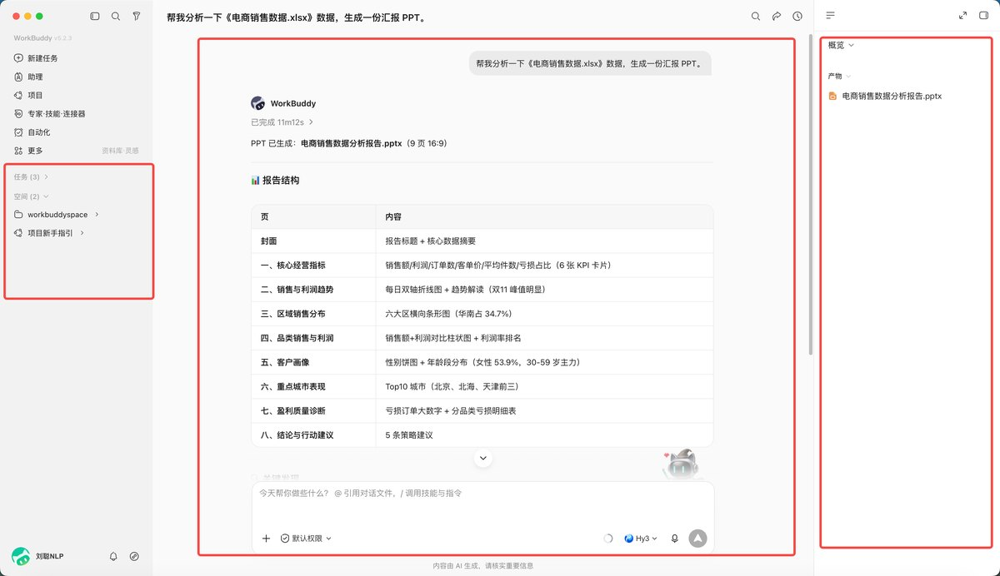

| 区域 | 主要用途 | 使用时重点检查 |
|---|---|---|
| 侧边栏 | 新建、搜索、切换和管理任务 | 是否进入了正确任务 |
| 对话区 | 描述需求、补充信息、确认计划 | 目标和约束是否完整 |
| 结果区 | 查看产物、全部文件、变更与预览 | 文件名、路径和改动是否符合预期 |

### 【新版功能】还有一种界面形态：文件浏览器

**现在 WorkBuddy 不只是"一个聊天窗口"，还可以是"一个文档编辑器"。**

**同样是三块地方，但用途不同：**

| | 对话界面（原有） | 文件浏览器（新增） |
|---|---|---|
| **左边** | 任务列表 | **正在看的文件** |
| **中间** | 对话 | **文档正文** |
| **右边** | 结果预览 | **AI 对话栏（默认收起）** |
| **怎么进** | 点开 WorkBuddy | **右键文件 → 打开方式 → WorkBuddy** |
| **适合** | 从零生成一份东西 | **改一份已经存在的文件** |

**两个要点：**

- **对话栏默认是收起的**——打开时先让你安静看文档，要说话再点「和 WorkBuddy 对话」。
- **一个窗口能开多个文件，用标签页切换**，切到哪个文件，右边就是那份文件的对话。

> **这一形态的详细用法见第 6 章「独立文件浏览器」那一节。**
>
> **一句话记住区别：** 对话界面是"让它做一份新的"，文件浏览器是"**在它旁边改你手上这份**"。

### 【新功能】全局搜索：不用记得问过什么

**这一条对教师特别重要，因为你的记忆容量是有限的。**

**2026 年 9 月 28 日（5.7.0）起，WorkBuddy 支持全局搜索。**

| 能搜什么 | 说明 |
|---|---|
| **资料库内容** | 你上传过的文档、课件、表格 |
| **聊天记录** | **半年内问过的问题、做过的任务，全都能搜回来** |

**为什么这条对教师重要？**

一年下来，你在 WorkBuddy 里问过几百个问题：
- "莱州的积分机制怎么设计的？"
- "小学科学命题专家怎么用？"
- "分层作业怎么设计第三档？"

**当时答得很好，但你不可能全记住。** 以前只能重新问一遍，**现在直接搜关键词就找回来。**

> **一个建议：** 养成习惯——**每做完一个有用的任务，就把关键词记在 `99_提示词库` 里**。
>
> **双保险：搜历史（找以前的答案）+ 查库（找自己的沉淀）。**

### "任务"和"工作空间"的区别

"工作空间"是 WorkBuddy 为了管理任务而设置的目录，每个任务都有一个对应的目录空间，任务可以在目录空间内进行操作。

若未设置，会在默认安装的目录下执行任务，对话保存在"任务"目录下。

**为什么必须隔离工作目录**

工作目录既是效率设置，也是安全边界。把发票、周报、客户材料混在同一个大目录里，会增加误读、误改和信息串用的风险。

对教师来说这条更实际：**学生的试卷、成绩单、作文原文，和你的课件、教案放在一起，就是一个随时可能出事的状态。**

可以按任务建目录空间，并且对目录空间的权限进行设置。当开启"允许完全访问"后，智能体可读写授权目录外文件，**请谨慎使用并优先按任务限定目录**。

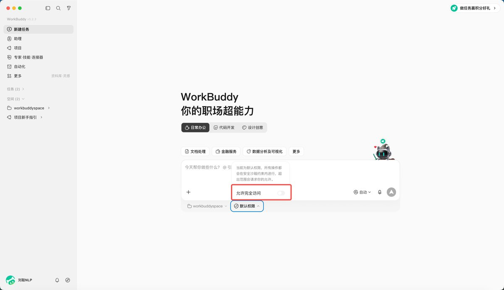

### 【2026 年 10 月增补】空间、任务、三层记忆：为什么"新建任务不记得上次教过的东西"

一篇被广泛转发的专栏（《WorkBuddy Day 11：任务、空间、工作空间——90% 的人搞混了这三个东西》）把这三个概念讲透了：

| 概念 | 是什么 | 类比 |
|---|---|---|
| **空间（Space）** | 任务的容器，管分类 | 一间办公室 |
| **工作空间（Workspace）** | 空间对应的物理目录 | 门牌地址 |
| **任务（Task）** | 让 AI 做的一件具体的事 | 办公桌上的一份待办 |

**关键规则在记忆上**——WorkBuddy 有三层记忆：全局记忆（所有任务共享的基础设定）、空间记忆（同一空间内共享的项目背景、格式偏好、术语表）、任务记忆（单个任务里的对话上下文）。**新建任务只继承全局记忆，不继承空间里积累的经验。**

这就解释了很多老师的一个困惑："我上个任务明明教过它我们的评分细则，怎么这个任务又不知道了？"——**因为那是空间记忆，你没有把它写进全局设定，或者你没有在同一个空间里继续做同类任务。**

一位老师的实际用法（四个空间各配一个物理目录）：

| 空间 | 目录 | AI 记住了什么 |
|---|---|---|
| 试卷批改 | D:\工作\试卷批改 | 批改标准和评分细则 |
| 数据分析 | D:\工作\数据报表 | 报表模板格式 |
| 内容创作 | D:\工作\公众号 | 写作风格和排版要求 |
| 学习整理 | D:\学习资料 | 笔记分类方式 |

配套的任务四守则：**① 一事一任务；② 任务名用"日期_主题_动作"（如 20261023_八年级月考_成绩分析）；③ 做完归档不删除（下次同类任务直接参考）；④ 文件直接拖进任务。**

> 一句口诀：**"空间管分类，任务管干活。"** 搞清楚这三者关系之后，WorkBuddy 才算真正上手——不然就跟拿了一把瑞士军刀只会当螺丝刀使一样：能用，但亏了。

### 三种工作模式

WorkBuddy 提供三种工作模式，**选错模式是新手最常见的浪费**：

| 模式 | 中文界面 | 能做什么 | 教师场景里什么时候用 |
|---|---|---|---|
| Ask | 问一问 | 问答、理解和查看，不修改文件 | 读课标、读教材、读一份已有材料，让你先讲清楚 |
| Craft | 做一做 | 可直接操作本地文件、运行代码及系统指令 | 路径清楚、风险较低的任务，比如批量改格式 |
| Plan | 想一想 | 先生成计划，确认后再执行 | **多步骤、涉及重要文件的任务，比如出一整套公开课材料** |

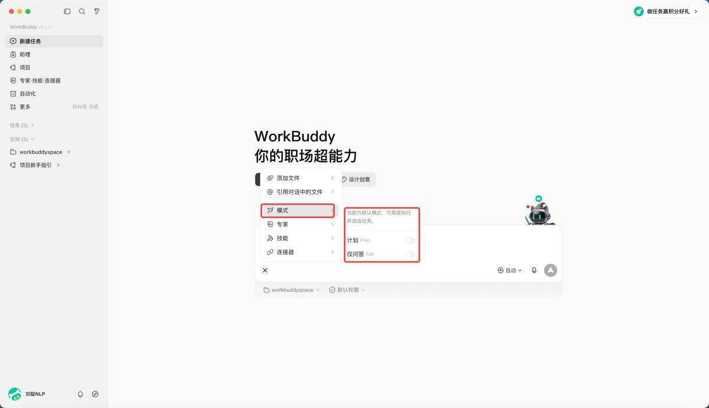

**给教师的建议：涉及学生材料的任务，一律先用 Plan。** 先看它打算怎么做，再决定让不让它做。

### 选择模型

默认为自动模式，可以指定你想使用的模型，不同模型积分消耗不同。


| 任务特征 | 优先关注 |
|---|---|
| 大量文本与长资料（整本教材、三年试卷） | 上下文长度，比如 100 万 tokens（1M） |
| 图片与截图（学生作文扫描件、实验照片） | 需要有视觉理解能力 |
| 高频简单任务（改个标题、换个格式） | 优先选择响应速度快、成本较低的模型 |

### 对话区最该知道的三个动作

**动作一：让它先给计划。**

几乎所有重要任务，第一句都应该是"先给我清单/计划，我确认后再生成"。

这不是不信任，是**把最便宜的一分钟放在最值钱的位置**。看计划花 1 分钟，改计划花 5 分钟，返工重出花 30 分钟。

**动作二：二次修改不要说"重写"。**

第一版不满意时，说差异，不要重来：

```
不要重新生成。在上一版基础上改：
1. 教学目标第 2 条太笼统，改成"能说出……并举例说明"这种可观测的表述；
2.逐字提问从 8 处减到 6 处，保留其中最有梯度的 3 处；
3. 检测题里第 4 题超纲了，换成本册第 5 单元的内容；
4. 板书设计加一个"易错点"区。
改完列出改了哪几处，其他不要动。
```

**"不要重新生成 + 说清差异"是全书反复出现的模式。** 重写会丢掉你上一版里已经对的东西，差异修改能保住它们。

**动作三：追问要往下问三层。**

它给的方案你看着不对，别只说"不行"：

```
第 1 层：这个设计里，学生的活动占比是多少？
第 2 层：分组是几个人一组，依据是什么？
第 3 层：如果班上有一个基础很弱的学生，这节课他会卡在哪一步？
```

**三层追问能把"感觉不对"变成"知道哪里不对"。** 知道了才能改，只说"不行"它只能猜。

### 一个任务的完整流程长什么样

新建任务的第一步是选模式。WorkBuddy 默认是 Craft，还可以设置成 Ask 或 Plan：

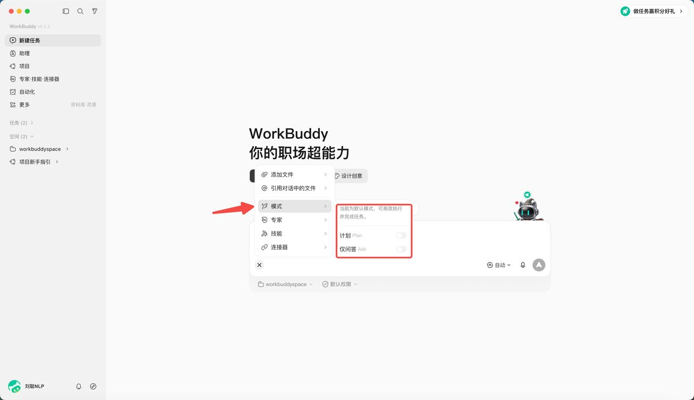

新建任务时要选择或创建独立工作目录：

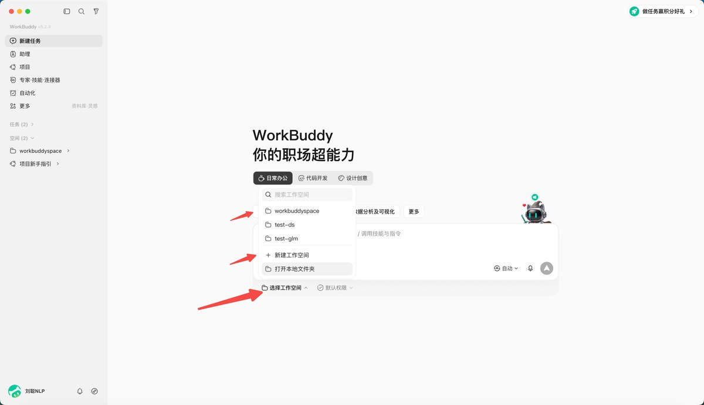

> **教师注意**：WorkBuddy 采用文件夹级授权与高危拦截机制。**首次操作请先在演练目录进行、留意授权范围，处理真实业务数据前谨慎确认。** 这句话尤其适用于你要处理学生材料的时候。

选择模型：

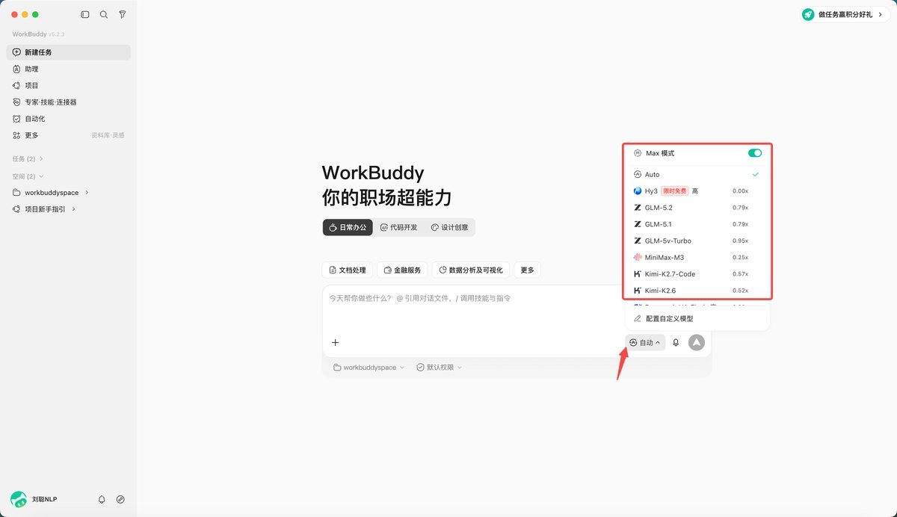

输入任务说明：

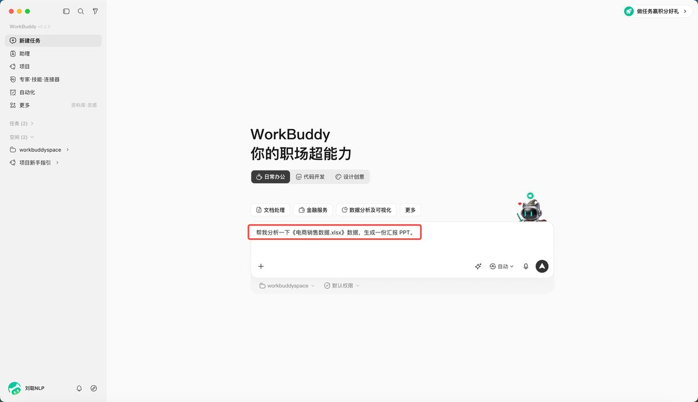

发送后观察计划、工具调用和文件变更：

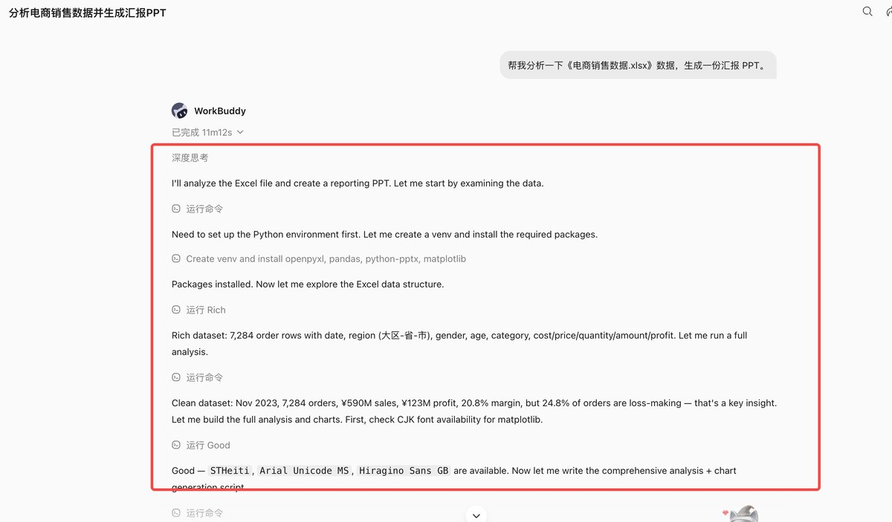

在结果区预览产物并验收：

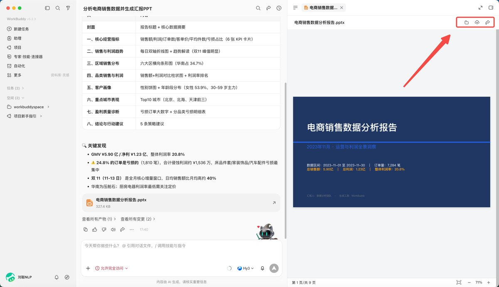

> 文件可以本地打开、上传云端或分享。**注意分享前先确认产物不含敏感或涉密信息**，按学校规范选择共享范围。学生成绩、名单、身份证号一律不要分享到校外。

### 一个任务说明该怎么写

这是全书最该背下来的表格。原书给出的六要素，我把它翻译成教师语言：

| 要素 | 要回答的问题 | 教师版举例 |
|---|---|---|
| 目标 | 最终要解决什么问题 | 让这节课的检测题覆盖三个层次 |
| 输入 | 使用哪些文件、目录或链接 | 工作区里2026秋_七年级/ 的单元测试卷 |
| 动作 | 需要分析、整理、转换还是生成 | 分析失分类型，生成变式题 |
| 约束 | 哪些不能改，采用什么规范 | 不超纲；不出现学生姓名；难度分布 3:5:2 |
| 输出 | 交付什么文件，放到哪里 | output/七年级_第三单元_变式练习.docx |
| 验收 | 用什么标准判断合格 | 每题标注考点；答案在最后一页 |

对照看三个原书的入门任务，你可以看出这个表格怎么落地：

**任务 A：整理文件**

```text
目标：整理 input 目录中的练习文件，便于按类型查找。
输入：仅处理当前工作区的 input 目录。
动作：识别文件类型，提出分类和重命名方案。
约束：不删除、不覆盖原文件；重名时保留两份并标记序号。
输出：先生成 inventory.xlsx 和 proposed-actions.md。
验收：清单文件数与input 实际文件数一致，所有动作可追溯。
在我确认 proposed-actions.md 前，不移动文件。
```

**任务 B：生成会议纪要**

```text
请把input/meeting.txt 整理为结构化会议纪要。
必须包含：会议结论、待办事项、负责人、截止日期、待确认问题。
不能从原文确认的负责人或日期写"待确认"，不要自行补全。
输出 output/会议纪要.md 和 output/待办清单.xlsx。
验收：每一项结论可以在原文找到依据；待办不遗漏负责人和时间状态。
```

**任务 C：Word 转 PPT**

```text
把 input/项目汇报.docx 转成 10 页以内的内部汇报 PPT。
受众：部门负责人；汇报时长：8 分钟。
保持原文事实和数字，不新增未经证实的数据。
结构：背景、现状、问题、方案、计划、需要决策。
使用 reference/brand-guide.pdf 中的颜色与字体规范。
输出 output/项目汇报_v1.pptx，同时提供逐页内容清单。
验收：每页只有一个核心观点，数字与原文一致，正文在投影状态可读。
```

**任务 C 换成教师场景就是**："把我的教案.docx 转成 12 页以内的公开课课件.pptx，受众是区级教研员，公开课 15 分钟，保持原文事实和数字不新增，每页一个核心观点，正文在投影状态可读。"

### 工作区的三条整理原则

**原则一：按"任务"分，不按"格式"分。**

不要建"Word 文件夹""PPT 文件夹"。要建"教学设计""课件""试题与作业"。**理由：你的任务会跨格式。** 一节公开课要 Word、要 PPT、要 Excel，如果按格式分，材料就被打散了，AI 也要到处找。

**原则二：原始材料和生成结果分开。**

```
03_试题与作业/
├─ _原始/        ← 学生卷子、扫描件、原题
└─ _产出/        ← AI 处理完的成品
```

这一条对**数据安全**尤其重要：原始材料里有学生姓名学号，你不会想让它在云端和产出之间到处跑。分开存放，是在文件系统层面就做了隔离。

**原则三：提示词单独放一个文件夹。**

这一条前面讲过了，但值得重复：`99_提示词库`。**每个提示词一个文件，文件名写成"场景-用途"格式**：

```
01_公开课备课-初版.md
02_分层作业设计-语文.md
03_学情分析-从成绩表到诊断.md
04_家长会通知-一小时版.md
```

到学期末，你的 `99_提示词库` 就是你个人的教学资产。**它比任何一份课件都值钱，因为它是你所有课件的生成方法。**

### 验收永远看文件

工作区里通常还有一个"文件/资料"视图，能看到 AI 动过哪些文件。

**这是你验收的唯一依据。** 不要相信它说"已完成"，去看它到底写了什么文件、内容对不对、有没有漏。

**验收永远看文件，不看它的汇报。** 这条适用于全书所有章节。

### 和它对话的三个忌讳

| 忌讳 | 为什么 | 改法 |
|---|---|---|
| 一句话扔个任务就跑 | 它只能猜，猜错你还要返工 | 用第 6 章的四要素补齐 |
| 说"你懂我意思吧" | 它没有你的上下文，"懂"是幻觉 |把背景、对象、标准都写出来 |
| 一次问十个问题 | 答案会互相稀释，每个都不到位 | 一次问一到三个，追问往下挖 |

### 【2026 年 11 月增补】值得动手设置的六类选项

来源：《花 2 分钟做好 WorkBuddy 这 5 类设置，聪明 10 倍》（阿若 Arrows，2026-11-04）、《简单设置，立刻让 WorkBuddy 聪明百倍》（Excel 星球·星光，2026-11-05）。两篇的设置侧栏清单一致，可以交叉印证。

**入口**：左下角（或右下角）头像 → 设置。侧栏大致是：通用 / 个人主页 / 套餐与积分 / 外观 / 快捷键 / 功能（个性化·记忆与进化·智能体·模型·助理·设备连接·对话流）/ 数据与安全（数据导入·数据管理·应用管理·安全中心）。

> **先说清楚不折腾什么：** 语言已经是简体中文、链接打开方式默认智能打开、网络代理跟随系统、开机自启动关着——**这些默认值不用动。** 第一次打开只碰下面六项就够。

| # | 设置项 | 在哪 | 一线教师为什么要用 |
|---|---|---|---|
| 1 | **自定义指令** | 设置 → 个性化 → 给 WorkBuddy 的指令 | 把你的身份、交付习惯一次写死，不用每次重复交代 |
| 2 | **记忆与进化** | 功能 → 记忆与进化 | 云端/本地记忆，技能分**用户级 / 项目级**——教研组共用一套工作流就靠这个 |
| 3 | **模型档位** | 功能 → 模型 | 快速 0.15x / 均衡 0.5x / 极致，可调上下文窗口（1M）和思考强度。**一个任务一个新会话** |
| 4 | **安全中心** | 数据与安全 → 安全中心 | 自动备份 + 沙箱限制文件夹读写——处理学生材料时的最后一道闸 |
| 5 | **个性化** | 功能 → 个性化 | 称呼、名字、回复风格、人设 |
| 6 | **对话流** | 功能 → 对话流 | 欢迎语、是否显示文件修改过程、队列发送方式 |

**第 1 项最值得先做。** 这段"自定义指令"原文，正是本书 B2 万能指令骨架、B3 四要素自检的原型出处：

```
收到任务后，不要立刻执行，先确认四件事：
想解决什么 / 交付什么 / 必须遵守的限制 / 怎样才算完成。
```

配套两条细则：**"嗯""行吧"不算确认**；简单任务可以直接执行，复杂任务先输出"目标·交付物·限制·验收·假设"再动手。

> **一处核对说明**：这两篇文章都没有提到"缓存""工作文件夹"这两个设置项。本书此前按真实界面截图确认过它们的位置，那一部分以截图为准；但**设置重心应放在上面六项**，不要一上来就钻缓存。

---

## 第 5 章　加载一个真正用得上的 Skill

### Skill 是什么

WorkBuddy 本身负责理解任务和组织执行；**Skill 则是一组可复用的说明、脚本、参考资料和资源**，告诉 Agent 某类任务应该怎样做、调用什么工具、交付什么格式。

Anthropic 在 2025 年 10 月正式推出 Agent Skills，2025 年 12 月将其发布为开放标准。

一个最标准的 Skill，大概长这样：

```Plain Text
my-skill/
├── SKILL.md
├── scripts/
│   └── check.py
├── references/
│   └── guide.md
└── assets/
    └── template.pptx
```

其中只有 `SKILL.md` 是必须的。

```Markdown
---
name: tech-article-writing
description: 用于撰写AI 产品、模型评测和科技行业相关文章
---

收到写作任务后：

1. 先确认文章核心角度
2. 查找一手资料
3. 对核心事实交叉验证
4. 根据用户写作风格完成初稿
5. 检查禁用句式和 AI 味表达
```

### Skill 到底是怎么被"记住"的

**这是原书里最值得教师理解的一段技术 explanation。** Skill 最关键的设计不是 SKILL.md，而是 Progressive Disclosure（渐进式披露）。

假设你的Agent 装了 100 个 Skill。它不会一上来把 100 个 Skill 的完整内容全部塞进上下文——这样不仅浪费 Token，还会让模型被大量无关指令干扰。

标准做法分三层：

**第一层，Agent 启动时只看所有 Skill 的名称和 description。**

```Plain Text
pptx
处理 PowerPoint 创建、编辑、读取任务

pdf
处理 PDF 提取、合并、编辑、填写任务

tech-article-writing
撰写 AI 和科技行业文章
```

**第二层，当你说"帮我写一篇 WorkBuddy 的公众号文章"**，Agent 根据 description 判断`tech-article-writing` 可能相关，这时才加载完整的 `SKILL.md`。

**第三层，执行过程中发现需要模仿你的写作风格**，才继续读取 `references/style.md`；需要检查 AI 味，才执行 `scripts/check-ai-phrases.py`。

所以 Skill 解决了一个长期困扰 Agent 的问题：

> **怎么给 Agent 很多知识和工作方法，又不把所有东西永远塞在 Prompt 里。**

**对教师的实操含义**：你那个 `99_提示词库`，如果只是躺在文件夹里，它和"每次复制粘贴"没区别。**只有变成 Skill，它才会被自动触发。** 这是从"个人习惯"到"个人系统"的分水岭。

### Skill 跟 Prompt 到底有什么区别

这是最核心的问题，也是本书附录 A 存在的原因：

| 维度 | Prompt | Skill |
| --- | --- | --- |
| 核心作用 |描述当前任务 | 定义一类任务怎么做 |
| 生命周期 | 通常针对一次请求 | 长期复用 |
| 触发方式 | 用户主动输入 | Agent 自动选择或用户显式调用 |
| 载体 | 主要是文本 | 文件夹 |
| 内容 | 指令、上下文、示例 | 指令、脚本、资料、模板、资源 |
| 上下文占用 | 通常直接进入上下文 | 按需加载 |
| 复用 | 经常复制粘贴 | 原生可复用 |
| 分享 | Prompt 文本 | 完整能力包 |
| 执行 | 本身只是指令 | 可以调用附带脚本和工具 |
| 模型参数 | 不改变 | 同样不改变 |

最简单的理解是：

```Plain Text
Prompt = 任务
Skill   = 做法
```

### Skill 有哪些作用

**第一个作用，是给模型补充程序性知识。**

大模型往往知道大量知识，但未必知道你的事情具体应该怎么做。比如它知道怎么写一份好的教学设计，但不知道你们学校的教案模板长什么样、你们的命题组习惯用什么术语、教研组要求每节课必须包含哪个环节。

这些知识非常适合做成一个 Skill。

**第二个作用，是固定复杂工作流。**

普通 Prompt 可能是"帮我出一套单元检测题"，模型每一次都会重新思考：考什么、怎么配难度、题干怎么写、答案放哪里。

Skill 可以把流程固定下来，变成 Encoded Preference Skill（编码偏好型）——把步骤按照团队或个人的工作方式组织起来。

对教师来说，这类 Skill 最有价值的例子是：**你们学校自己的命题规范、你们教研组统一的作业设计格式、你们学区的常规评价模板。** 这些东西一旦固化，全组人都省事。

另一类是 Capability Uplift Skill，给模型补充它原本做不好或不稳定的能力，例如复杂文档、PDF 和 PPT 处理。

**第三个作用，是减少重复 Prompt。**

你现在跟 AI 合作，其实有大量内容是在重复说，比如你经常告诉它：

```Plain Text
不要写得太 AI
长短句结合
不要过度点列
要有自己的判断
不要编造例子
不要出现学生真实姓名
```

这些其实已经天然适合做成一个 `writing-style` Skill。以后你的 Prompt 只需要说"写一篇教学反思"，写作习惯、资料标准、禁用表达就都由 Skill 提供了。

**第四个作用，是把个人经验和组织经验资产化。**

传统 Prompt 最大的问题是容易散落在聊天记录、飞书文档、Notion、个人脑子里。Skill 是文件，所以它可以 Git 管理、版本回滚、团队共享、持续更新。

### 为什么教师要关心 Skill

不是技术原因，是**稳定性的原因**。

不装 Skill，你每次都要在指令里描述"我要做成什么样、什么格式、什么排版"。装了 Skill，很多要求就变成了默认。

**这就像学校里的模板。** 新教师写教案要自己从零想格式，老教师有现成的模板——不是老教师水平高，是他把标准固化下来复用了。

### 在哪里找到 Skill

> **⚠️ 入口改过（2026 年 9 月 28 日，5.7.0 版本）**
>
> **现在的路径是：左侧栏「插件」→ 技能搜索与安装。**
>
> | 你在哪见过 | 现在去哪 |
> |---|---|
> | 左侧「专家·技能·连接器」里的技能市场 | **左侧栏「插件」页** |
> | SkillHub技能市场 | **同一个地方，入口统一了** |
>
> **另外 5.6.0 起还多了两件对教师有用的事：**
> - **「应用管理」**：能查看已授权的第三方应用与 Buddy 应用，**支持一键撤销授权**——某天你发现某个应用不太对劲，从这里断掉。
> - **闲置能力提醒卡片**：长期没用的插件和技能会提示你，**可以一键关闭**——这解决了"装了一堆用不上的东西导致变慢"的老问题，**不用再自己一个个去数了。**

打开「插件」页，可以搜索技能，也可以用"查找技能"描述需求：

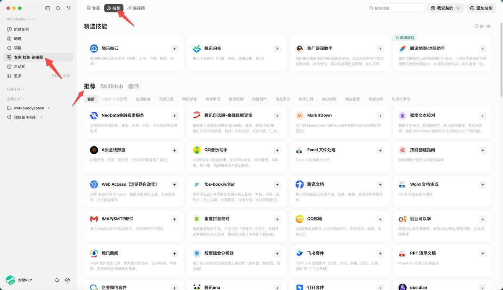

也可以在技能市场里找到合适的 Skill：

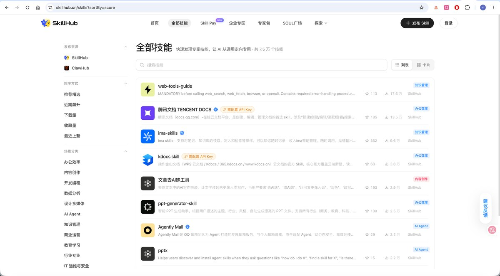

除了从推荐列表里直接安装，还可以**导入自己下载的技能**。比如你在网上看到一个好用的技能包，下载下来是一个 zip 压缩文件，点击"上传技能"加载即可：

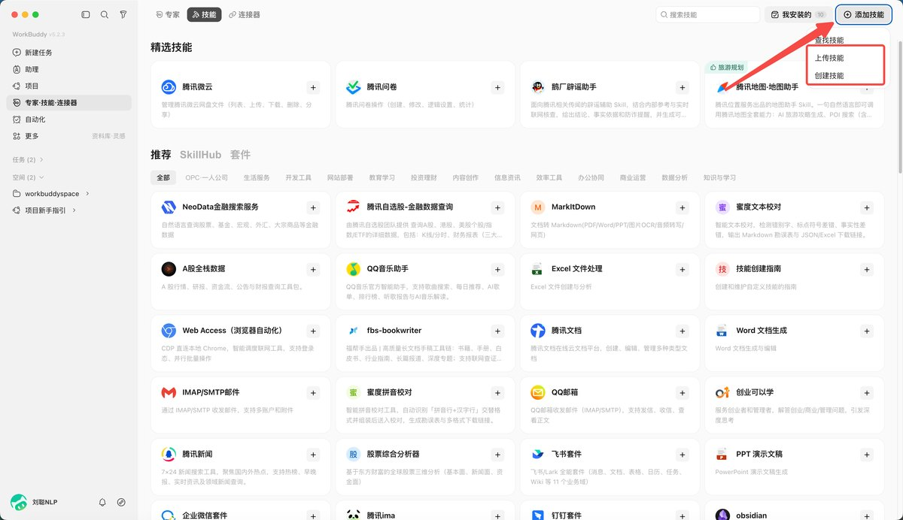

上传中的状态：

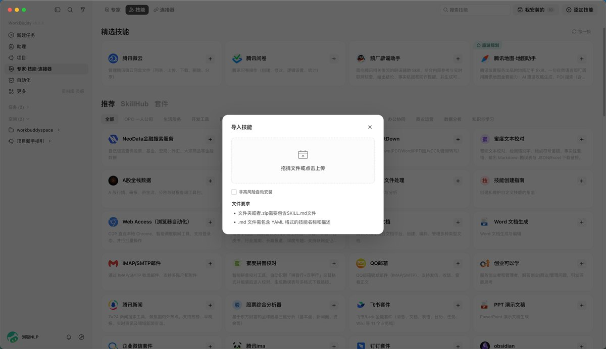

### 用 Skill 解决一个真实任务

这里用一个你一定会遇到的场景：**AI 写的东西有 AI 味，读着不像人写的。** 你可以把去 AI 味的规则做成一个 Skill，以后直接调用。

找到"文章去AI 味工具" Skill，安装之后，使用时直接用 `/` 唤出：

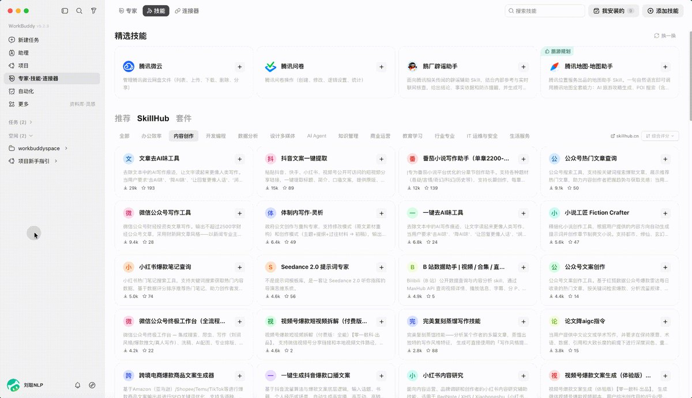

你只需要引用 Skill 内容，把文章给到即可：

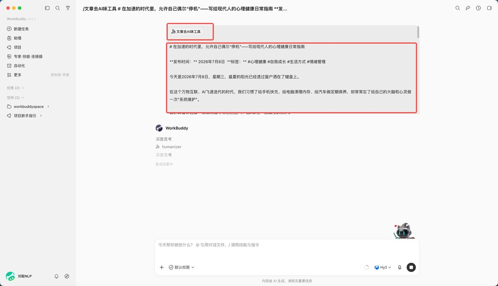

WorkBuddy 会先加载 skill 的内容：

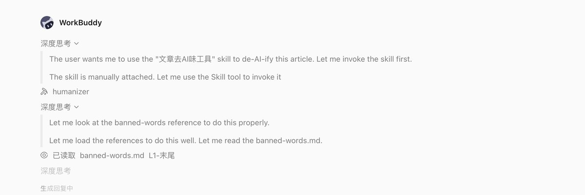

然后根据 skill 中的规则执行，比如要去除"不是……而是……"、双引号等表达：

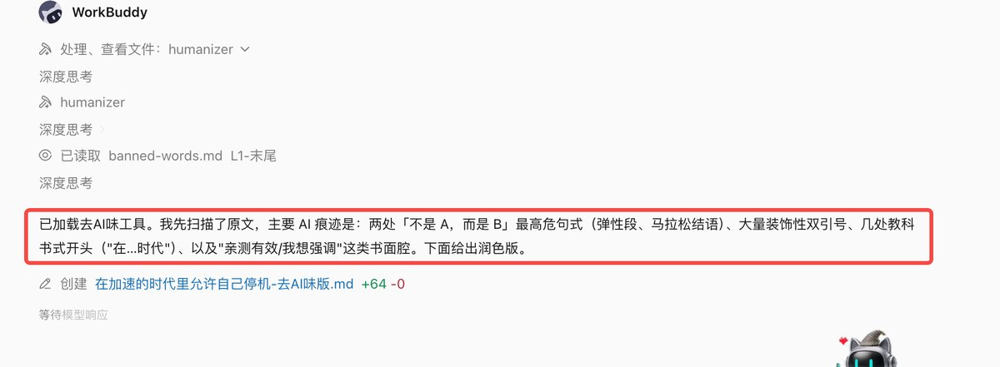

修改之后可以得到结果，确实去除了 AI 味：

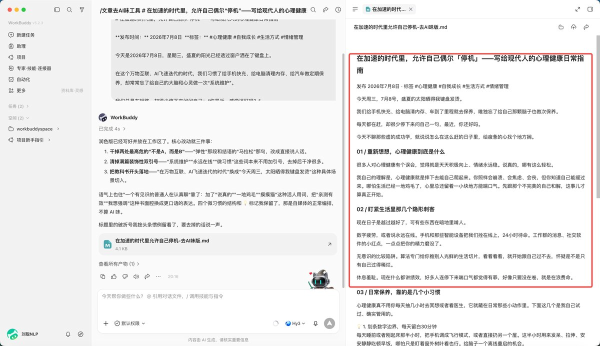

**这个流程你要记住，因为它是第 24 章（打造 Skill）的预演。** 你现在用别人的 Skill，第 24 章教你怎么把自己的方法做成 Skill。

### Skill 的关闭和卸载

从全部技能中，点击"我安装的"：

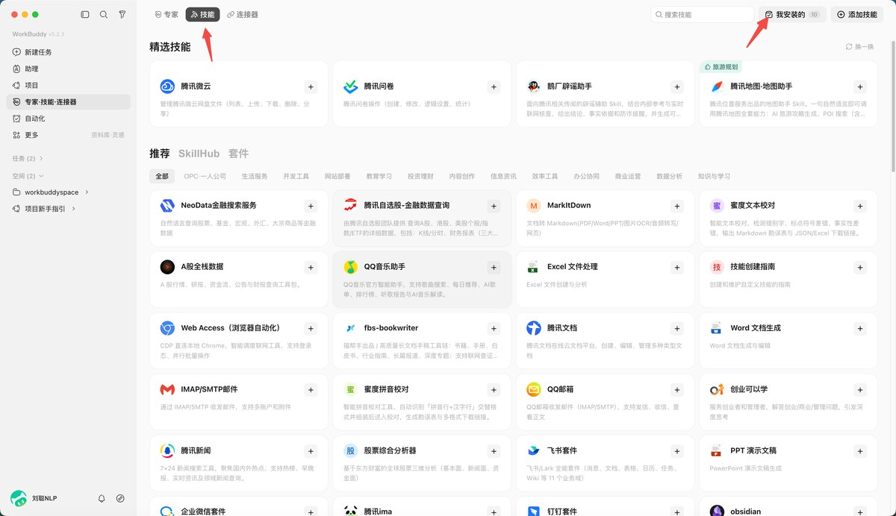

按钮关闭（则关闭该 Skill）：

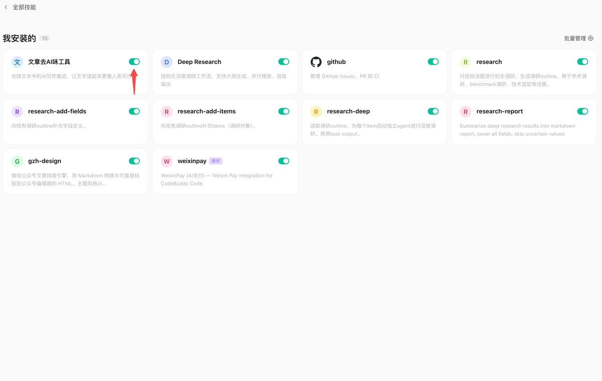

点击"···"，可以选择删除或编辑该 Skill：

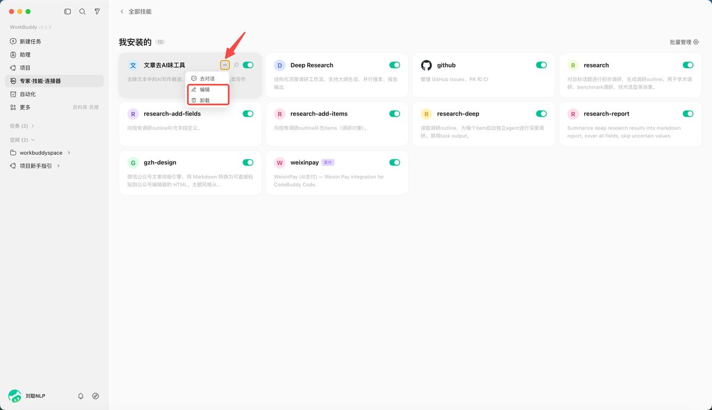

### 教育版已经帮你备好的现成资源

上面讲的是"怎么找 Skill"。这里要专门说一件事：**教育版里已经有一批现成的专家和 Skill，不用你从零研究。**

> **前提：你已经装了「企鹅教师助手」（第 3 章那一节）。** 装上之后，下面这些能力会直接出现在你的界面里，不用再单独配置。

据公开报道，WorkBuddy联合腾讯企鹅教师助手已上架 **33 位教育专家、15 个即插即用的教学 Skill**，覆盖备课、教研、学情管理、家校沟通全场景需求。已上线的示例包括小学科学命题专家、错题集生成器、学情分析专家等。

> **先把这些用起来，再想自己造。** 大多数教师的第一个瓶颈不是"不会造"，是"不知道已经有现成的"。

**桌面端有三个专门为教师切好的工作模式**，装上企鹅教师助手后就在界面顶部一键切换：


| 工作模式 | 覆盖什么 | 对应本书章节 |
|---|---|---|
| **教学设计** | 备课、出卷、课件、创意与剧本教学 | 第二篇第 7—11 章 |
| **家校共育** | 家长会材料、期末评语、个别学生沟通 | 第二篇第 16 章 |
| **专业成长** | 论文、课题、教研、培训材料 | 第三篇第 17—22 章 |

**四类开箱即用能力：**

| 能力类型 | 具体内容 | 你能直接拿到什么 |
|---|---|---|
| **课件制作** | 课前准备 → 课后复盘全流程 | 教案 + 课件 + 反思三件套 |
| **创意教学** | PBL 方案、辩论赛、分层任务单 | 活动设计 + 任务单 |
| **剧本教学** | 角色扮演、推理探案 | 互动剧本 + 实施流程 |
| **素材加工** | 优化教案、论文、课题、家长会材料 | 把已有材料改到可用 |

**专家和 Skill 到底有什么区别？** 这两个概念在第 25 章还会详细讲，这里先记住最实用的一句区分：

| | 定位 | 适合什么场景 | 交互方式 |
|---|---|---|---|
| **教育专家** | 顾问型 | 需要持续对话、需要专业判断 | 你问它答，来回打磨 |
| **教学 Skill** | 交付型 | 目标明确、要一个成品文件 | 一键触发，直接产出 |

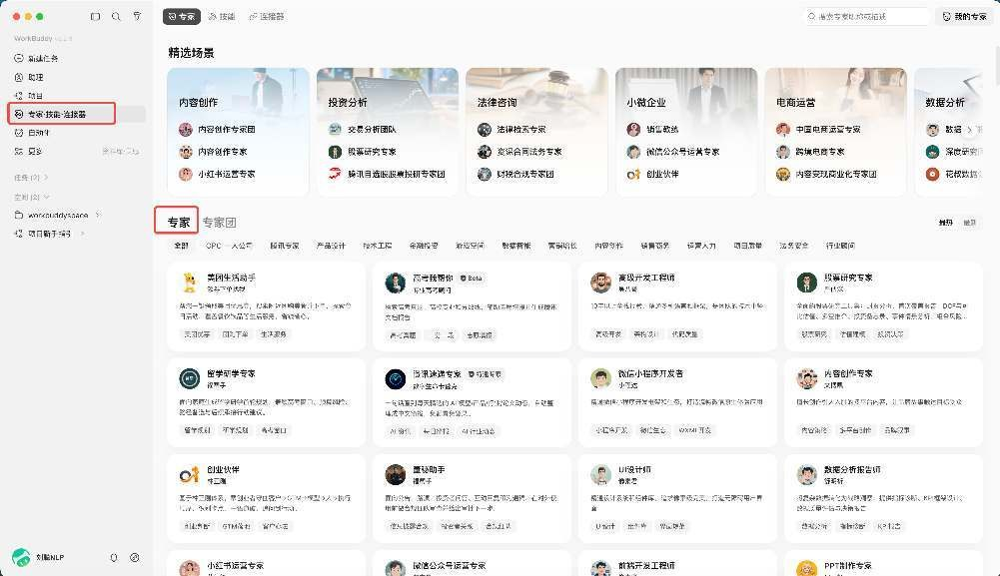

**这张图其实是四种方式的完整对照**，第 25 章会展开讲。这里你要先记住的是：**它们不是同一层级的东西，不要混着用。**

### 这三个月还多了哪些能力（2026 年 8—10 月更新）

**这一节是给"觉得界面和书上不一样"的你。** 从 8 月到现在不到三个月，官方发布了 20 多个版本，下面挑**对教师真正有用**的说。

| 能力 | 什么时候能用 | 对教师的用处 |
|---|---|---|
| **独立文件浏览器** | 5.5.5 起，5.7.x 完善 | 右键打开本地文件直接改，**第 6 章整节在讲这个** |
| **定时任务改名 + 汇总页** | 5.5.4 改名，5.7.5 加汇总页 | 「自动化」改叫「定时任务」，历次运行按时间线看 |
| **任务完成通知** | 5.7.0 | 跑完在电脑和手机都收到提醒，**不用守着干等** |
| **全局搜索** | 5.7.0 | **能搜资料库内容和聊天记录**——去年问过的事忘了，直接搜关键词找回来 |
| **后台任务可查看/取消** | 5.5.5 | 长任务跑到一半发现方向不对，**能直接停掉**，不用等它跑完 |
| **资料库当参考** | 5.5.5 | 发起任务时可以直接把资料库里的文档当参考，**不用先下载到本地** |
| **图片处理** | 5.5.0 | 去文字/水印、修复、增强、美颜、**透明背景抠图**——做课件配图用得上 |
| **创意设计** | 5.5.5 | 图片生成、视频生成、品牌设计 |
| **3D 模型生成** | 5.4.0 | 理科教室模型、实验器材示意图 |
| **微信聊天记录直接转发** | 5.5.0（Windows/macOS 系统分享入口） | 群里收到的讨论、领导的语音整改要求，**直接转发进来当材料** |
| **锁屏运行三档** | 5.5.4 | 关闭 / 熄屏继续跑 / 屏幕常亮，**长任务不用守着电脑** |
| **腾讯文档读写增强** | 5.5.0 起多次 | 直接读改学校在腾讯文档上的教案、成绩表 |

> **其中对教师最实用的三个，我推荐优先用：**
>
> **① 全局搜索（5.7.0）** —— 教师一年下来问过几百个问题，
> **能搜到三个月前的对话，比重新问一遍省太多时间。**
>
> **② 后台任务可取消（5.5.5）** —— 以前只能等它跑完，现在发现方向错了随时停。
>
> **③ 微信记录直接转发（5.5.0）** —— 教研群里讨论的内容，
> **转发进来就能让它整理，不用自己复制粘贴。**

**至于版本号本身：** 官方从 3 月到现在发布了 91 个版本，**平均不到三天一版**。

> **所以本书给的不该是"某个版本的截图"，而是"这件事怎么做"。**
>
> **你的界面和这里不一样时，判断标准是：这个功能的核心动作是什么、风险在哪、有没有替代路径。**
> **界面会变，那三样不会变。**
>
> **本书凡是标了 ⚠️ 的地方，都是已知会过时的地方**——把旧截图换掉即可，文字部分仍然成立。

**典型用法对照：**

- **顾问型**——"读取我工作空间里的三次月考 Excel，按'材料—依据—待确认项—教学动作'的顺序，输出本班数学薄弱点诊断与下周教学建议。"（用学情分析专家，你和它来回讨论诊断结论）

  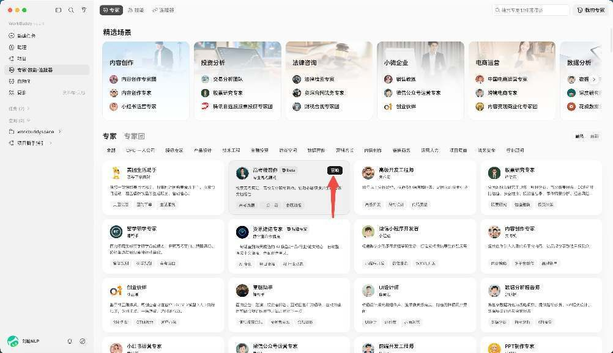

- **交付型**——"帮我出一套教科版三年级下册第一单元测试卷，含选择、填空、实验探究三类题型，配标准答案与评分标准，导出 Word。"（用命题专家 + 出卷 Skill，直接拿文件）

**一条判断：** 如果你还要跟它来回讨论、改三遍，选专家；**如果你要的是一个能发出去的成品文件，选 Skill。**

### 【2026 年 10 月增补】教师 Skill 生态全景：四份清单、一张去重表、两条新渠道

这一节回答老师们最常问的三个问题：**装哪些？去哪找？装多了怎么办？**（素材来自知识库近期多篇文章，来源随条目标注。）

**① 一线实测过的 12 个教学 Skill**（来源：《教师版WorkBuddy正式发布!12个Skill让备课出卷错题全搞定》，含完整提示词，详见增补篇）

| 环节 | Skill（英文标识照录） | 一句话用途 |
|---|---|---|
| 备课 | `lesson-pack` | "学科+年级+课题+课时长"一次产出教案/课件/学案/分层练习/作业五件套 |
| 备课 | `office-kejian` | 五种课型课件（新授/公开课/复习/说课/家长会），先大纲确认再出成品 |
| 备课 | `k12-lesson-design` | 固定教案结构 + 45 分钟分配基线 + 三层作业模板 |
| 备课 | `yueureka-lab-edu` | 21 个分支"全家桶"：评语、家长会、公开课打磨、课题等低频高烦任务 |
| 出卷 | `exam-generator` | 按教材版本/知识点出卷，产可打印试卷 + Word + 答案 |
| 出卷 | `tizhuang-question-bank` | **从 2000 万+ K12 真题库抽题**——"返回服务端真实题目，不虚构、不改写" |
| 出卷 | `chuti-zujuan` | 先建双向细目表，确认后再逐题编写 + 评分标准 |
| 错题 | `cuoti-fast` | 拍批改过的卷子照片 → 自动识别错题、重绘插图 → Markdown 错题集 |
| 学情 | `xueqing-analysis` | 试卷照片 → 带趋势仪表盘的 HTML 学情报告 |
| 学情 | `class-analysis-junior`（小学 primary / 高中 senior） | 考试数据 → 班级诊断报告 + "3-2-1 教学建议" |
| 管理 | `find-skills` | 帮你在市场里找 Skill |
| 管理 | `skill-creator` | 把你自己的重复流程封成 Skill |

**批量安装一句话**（原文摘录，直接粘给 WorkBuddy）：

```
请到技能市场帮我安装下面这些 skill，已经装过的跳过，不要重复装。
要装的名单：lesson-pack、office-kejian、k12-lesson-design、yueureka-lab-edu、
exam-generator、tizhuang-question-bank、chuti-zujuan、cuoti-fast、
xueqing-analysis、class-analysis-junior、find-skills、skill-creator
```

**② 重叠去重表——别重复安装**

| 重叠组 | 两个名字 | 实际关系 | 怎么选 |
|---|---|---|---|
| 学情分析 | `class-analysis-junior/primary/senior` ↔ 官方 15 Skill 里的「学情分析报告·初中 / 分析报告·小学 / 学情分析报告·高中」 | **同一功能两种叫法**（腾讯 SSV 与北大联合研发） | 认准一个装，按学段选 |
| 备课三件 | `lesson-pack` / `k12-lesson-design` / `yueureka-lab-edu` | 都产教案/课件 | 要全套五件套→lesson-pack；学校格式硬要求→k12-lesson-design；要评语/家长会等杂活→yueureka |
| 出卷三件 | `exam-generator` / `tizhuang-question-bank` / `chuti-zujuan` | 生成 / 抽真题 / 细目表组卷 | **实测建议：先抽真题，凑不齐的再用生成补——两种来源混着用，比全靠生成可信得多** |

**③ 官方市场之外的第二条渠道：教师 Skill 专属平台**

黎加厚教授团队的 **ESMS 教育 Skill 平台**（skill-ms.cn）专门面向教师，使用四步（来源：《终于找到了专属教师的 Skill 平台》）：

1. **FIND 先带着一件要做的事去找**（别一上来收藏几十个）；
2. **PREVIEW 看小样**——每个 Skill 详情页有真实作品小样可放映预览，比读介绍直观；
3. **USE 一键复制安装提示词**，粘到 WorkBuddy 对话框按提示装；
4. **SHARE** 把自己做的 Skill 上传给同行。

> 配套习惯值得养成：**每次准备让 AI 从零做课件之前，先去看看有没有老师已经做过类似的事情。能借鉴的先借鉴，把省下来的时间留给这节课真正需要自己想清楚的问题。**

另有高校教师李笃峰开源的 19 个教育理论 Skill（布卢姆目标设计、BOPPPS、PBL、5E 模型、量规设计等，skillhub 可搜，按 CC BY-NC-ND 协议共享——**引用/转发请注明原作者，不得未经许可用于训练 AI 或上传知识库**），其中 `bloom-taxonomy-master` 明确支持中小学"三维目标 + 核心素养"呈现，中小学教师可用。

**④ "管理比安装更重要"**

- 开着的 Skill 会常驻占用对话空间，装满几十个同时开会**响应变慢、误调用增多**。原则：**做什么开什么。**
- 一句量化提醒（来源：《写 Skill 实战手册》）：装 20 个 Skill，光名称和描述就要吃掉 1,000–3,000 Token 的常驻上下文。
- 找与造的"双地基"：`find-skills` 负责找，`skill-creator` 负责造——**这两件是 Skill 体系的基本零件，先装上。**

### 挑 Skill 的三步法

**第一步：从你的高频任务倒推，不要从 Skill 列表正推。**

正确做法：拿出你这一周的工作清单，标出"每周至少做一次"的事。**只有每周都做的事才值得装 Skill。**

一次性任务不值得——为它研究半天不划算。

**第二步：看三个信息，不要看介绍。**

- 它能处理什么类型的文件（输入输出格式）
- 它有没有前置条件（要不要先装别的东西、要不要联网）
- 它处理数据的方式（本地处理还是上传云端）——**第三个对涉及学生材料的 Skill 是硬要求**

**第三步：装一个，用三次，再判断要不要继续用。**

一次说明不了问题，三次才能看出它在你这儿的真实表现。

### 卸载 Skill 的一个提醒

从技能市场里装的 Skill 数量多了以后，模型每次启动都要读所有 Skill 的名称和描述。**装 50 个用不上的 Skill，不会让它更强，只会让它更慢更容易选错。**

定期清理：一个月没用上的，删掉或关掉。

> **现在有一件事帮上忙了（5.6.0 起）：闲置能力提醒卡片。**
>
> **长期没打开过的插件和技能，会在界面上提示你，并给你一个「一键关闭」的按钮。**
>
> **所以这件事不用再靠你自己记了。** 看到提示就顺手关掉——**每一次清理都是在让剩下的 Skill 更好用。**

### 【2026 年 11 月增补】两个现成 Skill 的例子

**① Anatomy —— 把概念拆成一台能点的机器**

来源：《简单 3 步，做出高质量 3D 互动课件！新 Skill》（梁老师，2026-11-09，真实实测）

这个 Skill 专门画"有内部部件、有连接关系、有动作变化"的东西：内燃机、勾股定理、骨骼、地球内部圈层。成品是一个等距视角的交互图，**部件可以点开拆解**。

三步走：

```
1. 帮我安装这个skill,github地址:https://github.com/wheresryan22/anatomy
2. 用别的 AI 把需求写厚成高质量提示词（四段骨架见下）
3. 把提示词发回 WorkBuddy，调用 Anatomy 生成
```

提示词四段骨架：**【任务】【核心内容】【视觉与配色】【交互设计】**。

一篇实测的代价：等 49 分钟出首版、消耗 91.8 积分、修了 7 处才可用（如曲轴箱被切，靠改 `el=0.76/dist=51` 修正）。**别指望一次成型。**

> **这里有个方法论值得单学：让 AI 写提示词，再喂给 WorkBuddy。**
>
> 先用 DeepSeek 把大白话扩写成结构完整的高质量提示词，再粘回 WorkBuddy 执行。适合工具本身复杂、提示词门槛高的场景。原文请求示例：
>
> ```
> 用anatomy画动图解释……给初中生讲解的3D课件，颜色合适，
> UI设计要合理，最好有交互性。请帮我写出高质量提示词，
> 注意，只要提示词。
> ```

**② 公众号互动效果 Skill —— 50 多种现成动效**

来源：《公众号文章也能点着玩？50 多种互动效果做成了开源 Skill》（梦飞 AI，2026-11-08）

仓库 `github.com/MFAI-LAB/wechat-crayon-interactions`，8 章 54 种效果：渐显、翻牌、长按换图、自动轮播、单选判断、多题闯关、分支剧情、抽签盲盒、转盘等。**调用方式极简——说出动画名字即可。**

它本来是给公众号排版用的，但里面的**闯关、分支剧情、多题判断**稍加转化就是课件互动组件。可作"现成 Skill 直接安装"的典型示例。

> 提醒：偏公众号运营场景，迁移到课堂要先想清楚**教学用途**；外部链接和 Skill 来源要注明，别当成自己做的。

---

## 第 6 章　先当通用文件助手用起来

**这一章是第二篇的地基。** 第二篇所有教学场景——备课、出卷、批改、课件——底下的动作都是"读文件、写文件、读表格、生成文档"。**这一章把这些动作单独拆出来讲一遍。**

如果你现在只想记住一件事，记住这个：

> **它不是一个只会聊天的地方，它是一个能真正读写你电脑里文件的助手。**
>
> **你能把文件拖进去，它就能读；你说清要什么格式，它就能写出来。**

### 【新版功能】独立文件浏览器：右键就能开

**这是最近更新的功能，也是本书出版后变化最大的一处。** 以前的用法是"把文件复制进工作区"；现在**更简单的路径是：右键 → 打开方式 → WorkBuddy**。

**三句话说完它是什么：**

| 一句话 | 说明 |
|---|---|
| **右键直接打开** | Word / Excel / PPT / PDF / Markdown / HTML / TXT / 图片 / 音频，以及腾讯文档在线文档，都能用它打开 |
| **左边看文件，右边聊 AI** | 打开后右侧是对话栏，**默认是收起的**，要说话再点「和 WorkBuddy 对话」 |
| **选中哪里，AI 就改哪里** | 在文档里选中一段，AI 只改这一段，改完用黄色标记显示 |

**它最大的价值是"人机双写"**——过去 AI 改完文件，你在另一个窗口看到它；现在你和 AI 在**同一份文件**上一起改，**不用再把文字贴来贴去**。

**这就是它打开后的样子：**

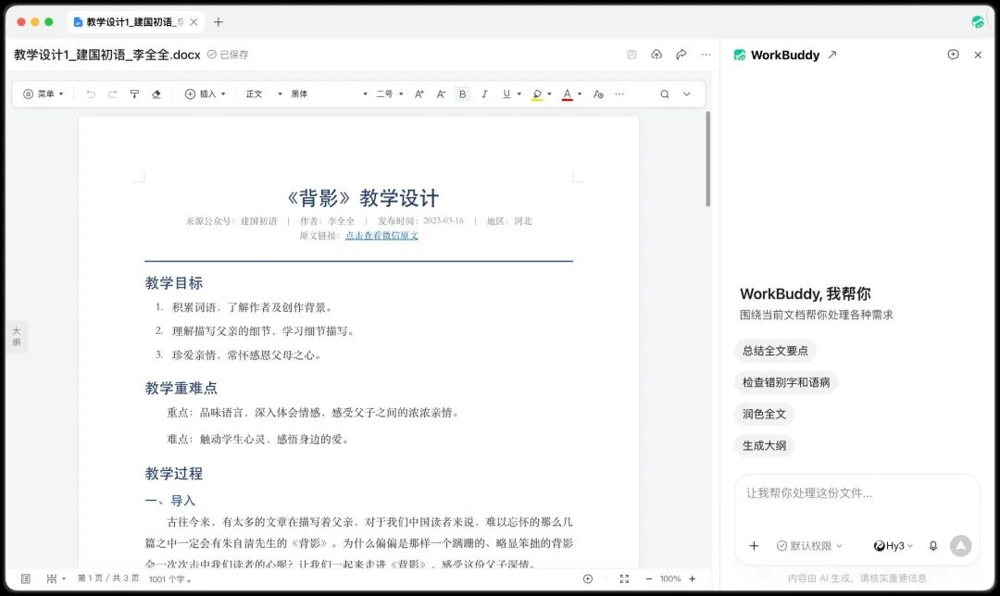

*图：文件浏览器界面。左边是文档正文，右边是「WorkBuddy，我帮你」对话栏。注意右上角那个按钮——对话栏默认收起，点它才展开。下方四个快捷按钮（总结全文要点 / 检查错别字和语病 / 润色全文 / 生成大纲）就是它对"当前这份文件"能做的事。*

> **对比一下第 4 章那张图。** 那是"对话界面"——中间是聊天框，产物在结果区。
> **这张是"文件界面"——中间是文档本身，AI 在旁边。**
>
> **要用哪一种，取决于你是"做一份新的"还是"改一份现有的"。**

#### 三种打开方式，你可以选一种

| 方式 | 怎么做 | 适合谁 |
|---|---|---|
| **右键打开**（推荐） | 右键文件 → 打开方式 → WorkBuddy | 手上正拿着一份文件要改 |
| **默认打开方式** | 设置里把 `.docx`/`.md` 的默认打开方式改成它 | 天天跟md、Word 打交道 |
| **微信里打开** | 微信收到 md/html → 用其他应用打开 → WorkBuddy 小程序 | 手机上收到的文件 |

**① 右键打开**——在文件上点右键，「打开方式」里选 WorkBuddy：

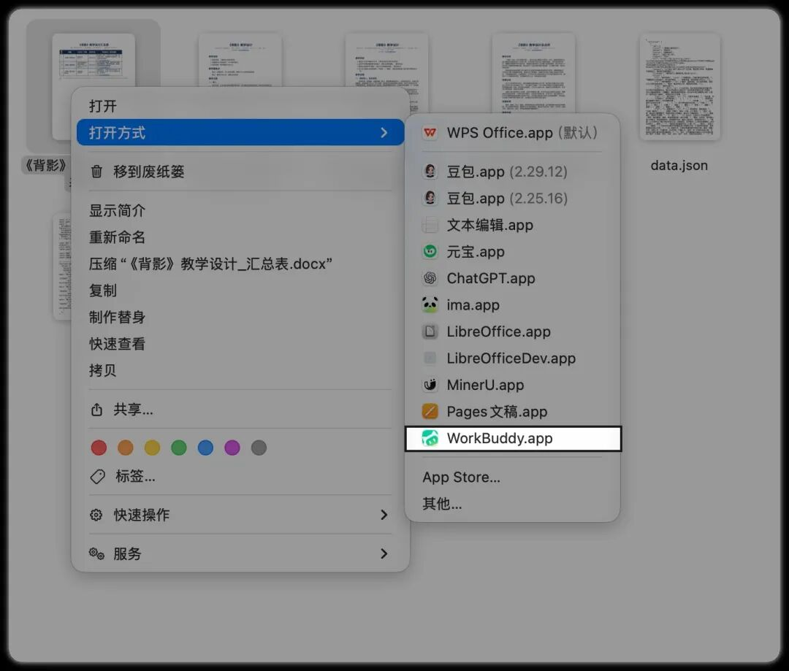

*图：右键菜单的「打开方式」子菜单，WorkBuddy.app 和 WPS Office.app 并列。这是 5.5.0 之后新增的入口。*

**② 设成默认打开方式**——之后双击就直接进来：

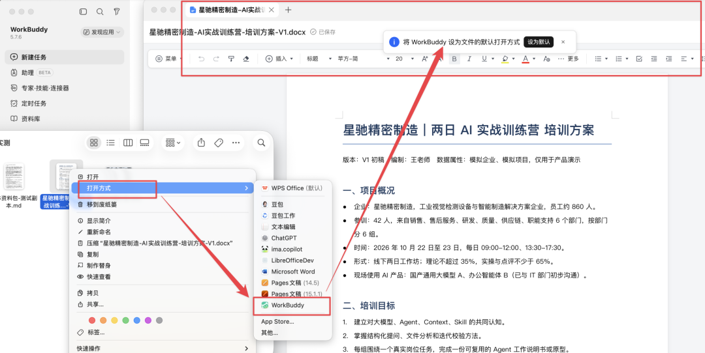

*图：文档打开时的提示条「将 WorkBuddy 设为文档的默认打开方式」，点「设为默认」即可。*

> **设成默认打开方式的价值：** 以后双击就进去，**省掉一次"复制到工作区"的动作**。如果你经常开 md 文件（AI 生成的东西一半是 md），强烈建议设上。

**③ 微信里打开**（手机上）：

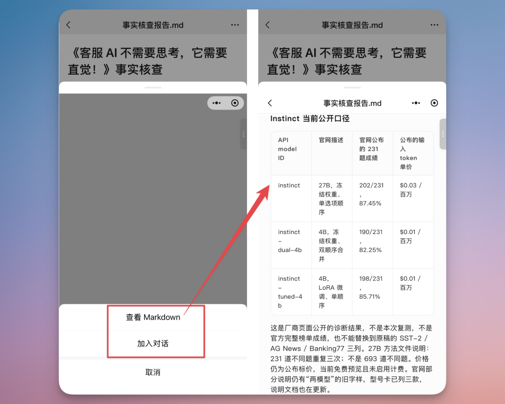

*图：微信里收到 markdown 文件 →「用其他应用打开」→ WorkBuddy 小程序 → 左边「查看 Markdown」、左边「加入对话」。*

#### 打开后能做什么：人机双写

**选中哪一段，就只改哪一段。**

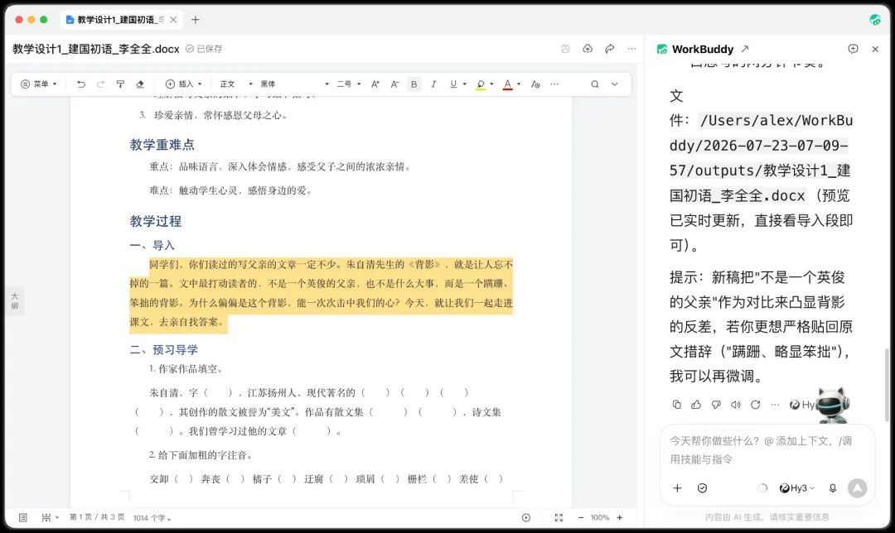

*图：选中「同学们，你们读过的写父亲的文章一定不少…」这一段，让 AI 缩短导入。右侧对话栏显示 AI 已完成，**文档里改动的地方用黄色高亮标出**，你可以对着原文判断要不要接受。*

**这个"黄色标记"很重要——它就是最直观的"改动对照"。**

> **对比本书第 6 章后面讲的「三件事：读、写、对照」：**
> 黄色标记告诉你"改了"，但不告诉你"为什么改"。
> **所以改动大的时候，还是让它补一句"我改了哪几处、为什么"。**

#### 一份文件配一份对话

**这个细节很重要，很多老师第一次用就发现了。**

一个窗口可以开多个文件，用**标签页切换**。切到哪个文件，右边就切到那份文件对应的对话——**每份材料各有自己的讨论，互不干扰。**

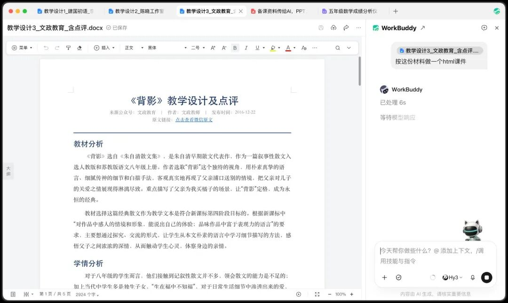

*图：一个窗口开了 5 个文件（教学设计 / 原文教材 / 备课资料 / 五年级成绩分析 / 骨架工作稿），顶部是标签页。**每个标签页都对应右侧自己的一份对话，互不干扰。***

**这意味着：** 你在A 教案里讨论怎么改导入，切到 B 成绩单里讨论统计口径，**两边的上下文不会串**。

**而且关闭文件再打开，之前的对话还在。** 下次课后发现练习要改，重新打开这份教案，**回看当时讨论过什么，再交代新的要求**。

> ⚠️ **但有一个必须知道的限制：聊天记录不是版本记录。**
>
> **它记得"当时说过什么"，不记得"文件当时长什么样"。**
>
> **想保留每一版，还是得自己另存副本。**

#### 它改的是"当前这份本地文件"，保存会写回原处

**这一条是本书反复强调的红线，现在尤其重要。**

| 文件类型 | 保存方式 |
|---|---|
| Word / Excel / PPT | 要点保存，或按 `Ctrl / Command + S` |
| Markdown | **自动保存**（没有单独的保存按钮） |
| HTML | 退出编辑状态时**自动保存** |

**"存回原文件"意味着：改错了，原文件就没了。**

> **⚠️ 动手前必做：先留副本。**
>
> **按 `Ctrl+S` 之前，先复制一份，改副本。**
> 学校模板、合同原件、只有一份的教案——**这些尤其不要直接动手。**

**两个保护机制要知道（这是新版的加分项）：**

| 情况 | 会发生什么 |
|---|---|
| 文件正被 Word / WPS 占着 | **只能看，不能改**（提示先关掉占用程序） |
| 文件在别处被改过 | 保存前**提示刷新或另存**，不会悄悄覆盖同事的修改 |

**第二个尤其重要**——它保护的是"同事正在同一份文档上协作"这种场景。**你不会把别人的修改静默盖掉。**

文件窗口右上角还有「打开文件夹」和「另存为」两个入口——**"另存为"就是最快的留副本方式**，改之前先点一下：

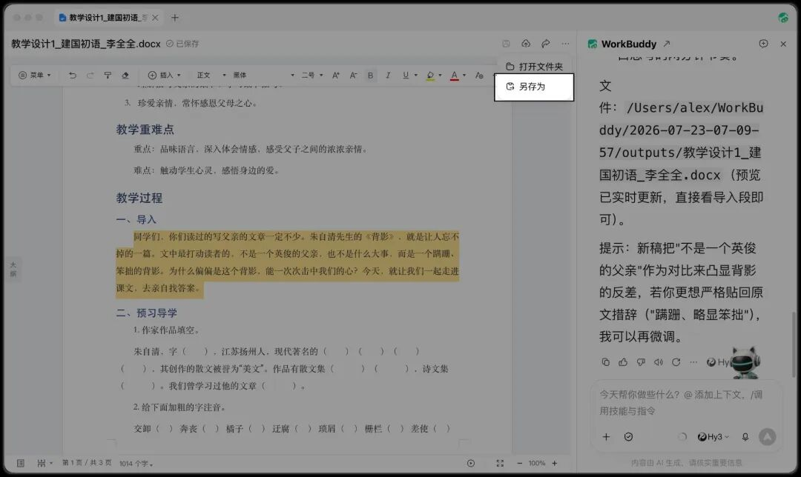

*图：文档右上角「⋯」菜单里的「打开文件夹」和「另存为」。改之前先「另存为」一份，是最省事的保险动作。*

#### 从材料接着做下一份成果

**这是新功能里最实用的一条：改完当前这份，还能接着往下做。**

```
按这份问卷做一个网页版训前调研报告：
各部门的 AI 基础、最耗时的任务、最该优先讲的 3 个场景（写清依据哪几份问卷）。
单页 HTML，手机也能看，数字必须能回到表里。
```

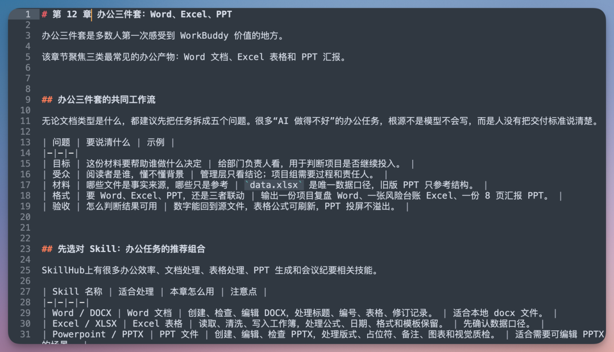

*图：把当前材料当附件传给右侧对话，让它"按这份材料做一个 html 课件"。**注意对话框里的附件卡片——这是当前这份文件的引用**，对话栏顶部也显示「已引用 我的文档 ...」。*

**生成的 HTML 默认放在原文件所在的目录**，在对话里点一下就在新标签打开。

> **注意这个提示词的写法，两处是关键：**
> - **"数字必须能回到表里"**——防止它编数据
> - **"写清依据哪几份问卷"**——让结论可追溯
>
> **这个思路可以用在任何材料上：** 先分析、核对，再根据确认过的结果做成果。**AI 不能替你决定这个班的真实情况。**

**再往前一步：从教案接着做说课稿。**

目标、活动定好了，让它据此拟说课稿、整理课件提纲——**你核对后，再继续往下做。**

#### 网页课件（.html）终于能改了

**这一条对做互动课件的老师价值最大。**

`.html` 就是网页文件。以前拖进浏览器**只能看不能改**，发现个错别字还得回代码里找。

现在用WorkBuddy 打开：进入编辑状态，**可以自己改，也可以让 AI 帮着改**。改完自动保存。

| 场景 | 具体做法 |
|---|---|
| 同事分享的互动练习 | 玩法合适、题目不合适 → 从这个文件改 |
| 以前存的网页课件 | 打开 → 点「编辑」→ 让 AI 换配色、补数据来源 |
| 换题 | **把答案和判断规则一起交代清楚** |

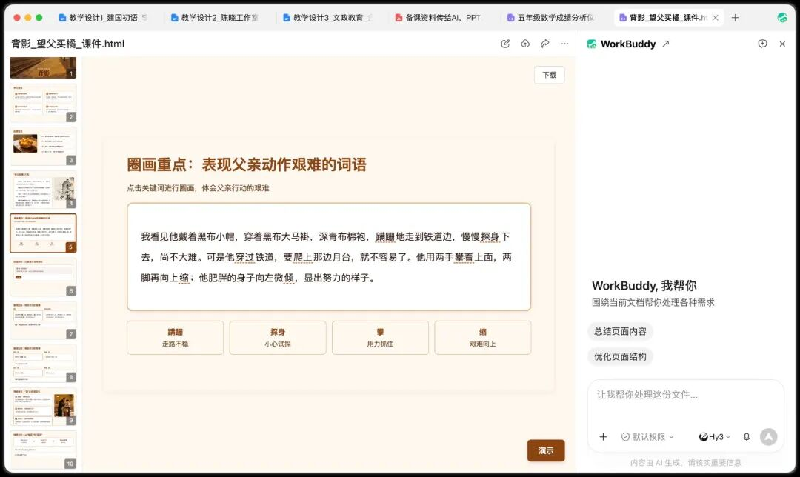

*图：html 课件在文件浏览器里打开的样子——**左边是 10 页课件缩略图，中间是页面预览**，右边对话栏可以直接让它改。右侧对话框里「总结页面内容」「优化页面结构」就是针对这份课件的。*

> **改完必须按学生使用的顺序试一遍。** 按钮、拖拽、反馈是否正常，**还是要拿实际课件检查**——AI 说改好了，不代表交互没坏。

**顺带一提：markdown 文件也一样能就地改。**

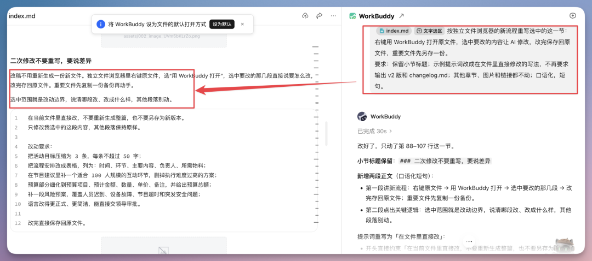

*图：md 文件打开后的样子——**左边是渲染好的正文，右边是源码视图**，改完存回文件。如果你天天跟 md 打交道，把它设成默认打开方式。*

#### 微信里也能看能处理

**手机上收到的文件，现在有出路了。**

以前微信收到 md/html 只会弹一句"暂不支持打开此类文件"。现在：

| 选项 | 能做什么 |
|---|---|
| **查看** | md 渲染成排版好的文档，html 渲染成网页，svg 也能看 |
| **加入对话** | 文件变成附件卡片，补一句要求就能让它干活 |

**预览页还能作为小程序卡片转发出去**，对方点开就能看：


*图：微信里把 html 预览页作为小程序卡片转发给同事。截图里的文件名来自原始公众号文章，属第三方示例，与本书内容无关。*

> ⚠️ **两个限制必须知道：**
> - **小程序单次只处理一个文件**，多个得一个个来
> - **能预览 ≠ 所有动画、拖拽、音频都能正常运行**
>
> **准备在哪个设备上用，就在那个设备上试。**
>
> **含学生信息的，先处理掉再转发。**

#### 分享与积分：两条实用信息

| 想做什么 | 怎么做 |
|---|---|
| **分享给同事** | 文件窗口点「分享」→ 自动上传到资料库 → 生成在线链接 → 设"获得链接的人可查看" |
| **进团队协作** | 「上传」→ 选资料库 / 腾讯文档 / ima 知识库 / 乐享知识库 |

**分享时可以设置访问权限——这一步别跳过：**

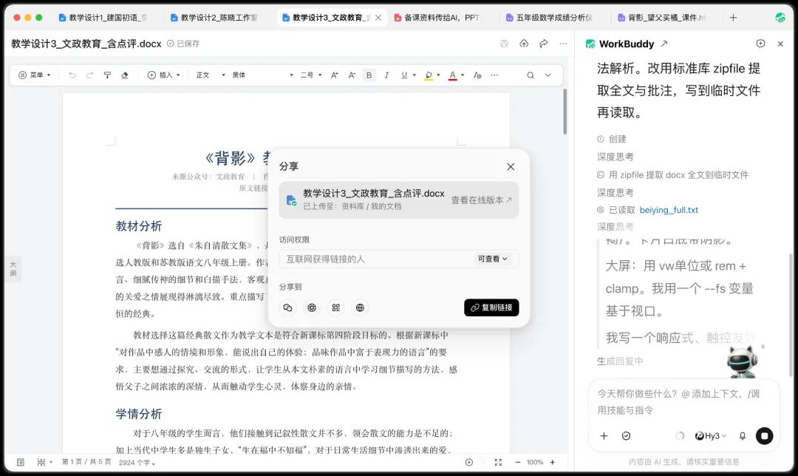

*图：分享对话框。「已上传至：资料库/我的文档」，下方是**访问权限**（这里设的是"互联网获得链接的人可查看"），旁边有「复制链接」。右侧对话栏显示工具的调用记录（创建 / 深度思考 / 用 zipfile 提取全文 / 已读取）。*

> ⚠️ **看仔细这个权限选项。** 默认可能是"互联网获得链接的人可查看"——
> **这意味着任何拿到链接的人都能打开。**
>
> **含学生信息的材料，务必改成指定人可见，或者干脆别分享。**


*图：生成在线链接后的分享卡片。*

**积分怎么算（很多老师会关心）：**

- **查看、手动编辑、预览 —— 不消耗积分**
- **让 AI 分析、改写、生成 —— 消耗积分**

> **所以"自己改"和"让 AI 改"是两回事。** 格式微调、错别字修正，你自己动手不花积分；**要 AI 大段生成的，才要花。**
>
> **版本 5.4.7 之后有「订阅和用量」设置页**，可以查看套餐概览、分类积分和资源包明细，在应用内直接购买积分。**在设置里就能查，不用回来问我。**

#### 一个必须澄清的误解

**这一点关系到数据安全，非常重要：**

> **"改完存回本地"说的是保存位置，不等于所有 AI 处理都离线进行。**
>
> **独立文件浏览器只读取你主动打开或添加的文件，不会扫描整个电脑。** 但这说的是**文件访问范围**，
>
> **不代表你让它调用 AI 处理时，内容不上传。**
>
> **涉及学生姓名、成绩、身份证的材料，请按附录 C-4 的三步法处理：**
> **文件用学号命名 → 去标识化 → 只让它处理脱敏后的版本。**

### 先建立一个认知：它和"在线版AI"的根本差别

| 你在做的事 | 用普通网页版 AI | 用 WorkBuddy |
|---|---|---|
| 改一份学生名单 | 复制粘贴到网页 → 复制回来 → 手动对齐格式 | **右键打开原文件**，在旁边让它改，存回原处 |
| 处理 40 份作业 | 一份一份传，一份一份下 | 一次性放进一个文件夹，说"按统一标准处理" |
| 生成 PPT | 得到一个大纲，自己做 | 直接得到能投屏的 `.pptx` |
| 改网页课件 | 只能看，改要回代码 | **打开就能改**，人机双写 |
| 批量改名/转格式 | 逐个操作 | 一句话说明规则 |
| 手机上收到的文件 | "暂不支持打开" | **微信小程序里直接看和对话** |
| 处理学生数据 | 材料要上传到第三方 | 可以明确要求**全程本地处理** |

**最后一行是老师最该在意的。** 涉及学生姓名、成绩、身份证的材料，**优先在本机处理**，这是本书对数据安全的基本要求（详见附录 C-4）。

> **一个转变值得留意：** 以前处理文件是"搬进工作区"，现在是"**在原地改**"。
>
> **方便了很多，但也更危险了——因为它真的会覆盖你的原文件。**
>
> **所以下面这一节尤其要看。**

### 第一步：认识它能读写的文件类型

不用背。按你手上真实有的文件试一遍就有感觉了。

**这批文件都可以直接右键 → 打开方式 → WorkBuddy：**

| 类型 | 常见格式 | 它能做什么 |
|---|---|---|
| **文档** | `.docx` `.md` `.txt` `.pdf` | 改写、续写、换格式、按模板重排 |
| **表格** | `.xlsx` `.csv` | 清洗、统计、算列、合并多表、导出 |
| **演示** | `.pptx` | 生成、改版、配图、加备注 |
| **图片** | `.png` `.jpg` | 识图取信息、插图、裁切压缩 |
| **数据** | `.json` `.sql` | 整理格式、转换结构 |
| **压缩包** | `.zip` | 批量解压、批量处理里面的文件 |

> **注意 Markdown 和 HTML 是重点。** AI 生成的东西一大半是这两种格式，
> **而它们在本地最难打开**（md 双击满屏井号、html 拖进浏览器只能看不能改）。
>
> **现在都能用WorkBuddy 正常打开并直接编辑了**——建议把 `.md` 设成默认打开方式。

**右键打开，直接问它：**

```
告诉我这个文件里有什么。
读得出来，说明它能读。

然后生成一份新文件放在我工作区，文件名叫 test_out.docx。
生成成功，说明它能写。
```

> **这两句建议试一遍。** 跑通了，你就知道后面所有任务它都能接。

### 文件处理三件事：读、写、对照

不管你处理什么文件，都逃不出这三步。

#### 一、读：先让它"看一遍"再说

**最常见的错误是：不看文件内容就下指令。**

比如你直接说"帮我改这份教案"，它可能改的是三年前的旧教案。**正确的做法是先让它复述。**

```
先读工作区里的 教案.docx，
然后告诉我：这份教案有哪几个部分？每个部分大概多长？有没有缺项？
先不要改。
```

**这一句话能省掉你后面十分钟的返工。**

#### 二、写：一定要说清输出格式

**最常见的错误是：不说要什么格式，它给你一段文字让你自己复制。**

正确的说法：

```
基于这份教案，生成一份新的教学设计，
存成 docx，放在我的工作区，文件名 教学设计_v2.docx。
用我原来这份的标题层级，不要改小标题的措辞。
```

**四个要素，缺一个都可能返工：**

| 要素 | 例子 | 少了会怎样 |
|---|---|---|
| **对象** | 基于哪份文件 | 它可能凭空生成 |
| **规格** | docx / pptx / xlsx、文件名 | 可能只给你一段文字 |
| **约束** | 沿用原格式、字数、不加内容 | 可能大改你不想动的地方 |
| **验收** | "改完告诉我改了哪几处" | 你看不出它到底动了什么 |

#### 三、对照：让它自己交代改动

**这一步是老师最该养成的习惯。**

```
改完之后，列一张对照表：
哪些地方改了、原文是什么、改成了什么、为什么改。
```

**为什么重要？** 因为 AI 改文件时经常"顺手"改掉你精心写的东西——比如把"三维目标"改成"知识与技能"（这是新课标术语，旧的写法才对），或者悄悄删掉一句过渡语。

> **不给对照表，你就是闭着眼睛验收。给了对照表，你才是编辑，不是读者。**

> **用了新功能之后，这一节要改一改说法：**
>
> **右键打开改文件时，AI 改过的地方会带黄色标记，你能直接对着原文看。**
>
> **黄色标记本身就是一种"对照"**——但它只告诉你"改了"，不告诉你"为什么改"。
>
> **所以改大段内容时，还是让它补一句改动说明。**

### Word / 文档：最常用的三种玩法

> **现在有两条路可选：**
> - **改完不动的**（如模板重排、批量格式化）→ **右键打开原文件，直接让它改**
> - **要保留原稿的**（如借鉴同事的教案）→ 走下面的"工作区 + 输出新文件"

#### 玩法一：按模板重排

教师手里往往有一份学校要求的格式模板。**不要重写内容，只让它套格式。**

**如果你就是要重排这份文件本身——直接右键打开：**

```
请把这份文档按下面的格式统一排版：
正文宋体小四号、行距 1.5、标题黑体、页面 A4、上下边距 2.54cm。
只改格式，一个字都不要改。
```

**如果你要保留原稿、另存一份——在工作区里这样写：**

```
工作区里有 两份文件：
- 学校模板.docx（格式要求）
- 我的教案.docx（内容）

请把 教案.docx 的内容，按 学校模板.docx 的标题层级和字体格式重排，
内容不要删改，输出 教案_按模板排版.docx。
```

**要点：说"内容不要删改"，它就只动格式。** 不说，它会顺手"优化"你的表述。

> **⚠️ 走右键这条路之前，先 `Ctrl+S` 留一份副本。**
> 因为保存会写回原文件——**改坏了没有后悔药。**

#### 玩法二：批量改格式

**这个必须走工作区**，因为要一次处理一整个文件夹：

```
把工作区里所有 docx 统一成：正文宋体小四号、行距 1.5、
标题黑体、页面 A4、上下边距 2.54cm。
逐个处理，处理完列清单。
```

#### 玩法三：长文档的结构化

```
读这份 20 页的方案，帮我生成一张表格：
章节标题 | 起止页 | 这一章主要说了什么 | 有没有具体数据支撑
```

**这在读长文件时特别有用**——它先给你一张地图，你再决定哪几段要细读。

> **不要一次让它"总结这份20 页文件"。** 直接要结构化表格，比要一段总结有用得多——**因为表格逼它逐节交代，不会漏。**

### Excel / 表格：三个高频场景

#### 场景一：成绩表清洗与统计

这是教师用得最多、也最容易出错的地方。

```
读 工作区/期中成绩.xlsx，只做三件事：
1. 检查缺失值，列出来，不要自己填
2. 算平均分、最高分、最低分、及格率，按班级分组
3. 把不及格的学生单独列一个 sheet

输出到 成绩分析.xlsx，原文件不要改。
```

**这里有三条必须写进指令的话：**

| 这句话 | 挡掉什么风险 |
|---|---|
| **"列出来，不要自己填"** | 它编造一个分数填进空格子 |
| **"原文件不要改"** | 它直接覆盖你的原始数据 |
| **"不确定的标'待核'，不要猜"** | 它推测出一个数看起来像真的 |

> **⚠️ 用了独立文件浏览器之后，这三条里的第二条要特别注意：**
>
> **右键打开 Excel 改文件，保存就是写回原文件。**
>
> **原始成绩数据是最不该被随手覆盖的东西。** 两个做法：
>
> | 做法 | 怎么做 |
> |---|---|
> | **推荐：改副本** | 先复制一份 `期中成绩_备份.xlsx`，再右键打开副本改 |
> | **只让它读** | 在指令里明确写"**只读，不要修改这个文件**"，把分析结果输出到新文件 |
>
> **无论哪种，都先确认原件还在。**

#### 场景二：多表合并

```
工作区里有 3 个 sheet，分别是三个班的学生名单。
按学号合并成一张总表，
缺失的标出来，重复的列出学号让我确认。
```

#### 场景三：数据转成材料

```
读 成绩分析.xlsx，
把及格率按从低到高排序，
做成一张可以直接放进 PPT 的对比表（要有标题、行标题列）。
```

**最后那句"可以直接放进 PPT"是关键**——它决定了输出是"表格数据"还是"可上投屏的材料"。

> **一个衔接：** 做出这张表之后，可以直接**在当前对话里让它接着做成网页或PPT**——
> 这就是本章前面讲的「从材料接着做成果」，不用把文件再导出去。

> **一张提醒：含学生姓名的表格，别丢到云端工具里。** 要处理就在本机跑，并按附录 C-4 的三步法去标识化（文件名用学号、输出不出现姓名）。

### PPT：分成两种情况处理

#### 情况一：从零做一份新 PPT

```
我要做一份公开课课件，主题是【课题】，时长【X】分钟，
面向【X】年级，风格【活泼/严谨】。

请生成 pptx，包含封面、导入、新课、练习、小结五部分。
每页要点不超过 5 条，配图用教育类实拍风格，不用花哨背景。
```

**要点：给"每页不超过 5 条"这种硬约束。** 不给，它会给你满屏文字——那种 PPT 投出来没人看。

#### 情况二：改一份已有的

**现在有两条路：**

**路A：改副本（推荐）**——把文件复制一份，右键打开副本：

```
读 工作区里的 公开课_改副本.pptx，
把第 7、8、9 页的文字压缩到每页 3 条以内，
保留原有的背景和配色，改完列清单。
```

**路 B：直接右键打开原文件**（就是那份投过的原件）：

```
只改第 7、8、9 页，文字压缩到每页 3 条以内。
保留原有的背景和配色。其他页不要动。
```

> **⚠️ 走路 B 之前，先 `Ctrl+S` 留副本。** 保存会写回原处。
>
> **而且 pptx 正被 PowerPoint / WPS 打开时，它只能看不能改**——先关掉放映窗口。

**"保留原有的背景和配色"这句必须加。** 否则它会重新设计一套风格，改完之后跟你原来的 PPT 拼不到一起。

**新功能对 PPT 最实用的两点：**

| 用途 | 怎么做 |
|---|---|
| **让它提建议**（不改） | 右键打开 → 点「和 WorkBuddy 对话」→ "这一页文字太多，按学生理解程度给修改建议" |
| **直接改** | 在页面里选中那段文字 → 让它改 → **黄色标记显示改了什么** |

### PDF：两类完全不同的用法

#### 用法一：读 PDF

```
读 工作区里的 课程标准.pdf，
提取其中关于【某章节】的原文要求，逐条列出，并标注页码。
```

**加"标注页码"很重要**——你要能回头核对，**AI 转述的标准有时候会有偏差**。

#### 用法二：PDF 输出

```
把这批教案导出成 PDF，合并成一个文件，按章节顺序排列，
每章从新页开始。
```

### 一个通用模板：所有文件任务都能套

**如果你记不住上面这么多条，就记这一个模板。**

```
【对象】读 工作区里的 【文件名】
【任务】我要 【做什么】
【规格】输出格式 【docx/pptx/xlsx/pdf】，文件名 【xxx】
【约束】保留 【哪些不能动】，不要 【禁止的操作】
【验收】做完告诉我改了哪里；不确定的地方标"待核"，不要猜
```

**填一次，能用几十次。** 建议现在就把它存进 `99_提示词库`，以后每次直接复制。

### 四个必须知道的坑

> **坑一（最重要）：它真的会覆盖你的原文件。**
> 右键打开改文件，保存就写回原处。
> 对策：**动手前先 `Ctrl+S` 复制一份副本，改副本。**
> 学校模板、合同原件、只有一份的教案、原始成绩数据——**这四类绝不直接动手。**
>
> 顺带记两个保护机制：**文件被 Word/WPS 占用时只能看不能改**；
> **文件在别处被改过会提示刷新或另存**，不会静默盖掉同事的修改。

> **坑二：它可能"顺手"改掉你不想动的地方。**
> 对策：**永远加一句"内容不要删改"或"只改格式"。**

> **坑三：它可能编造内容还编得很像真的。**
> 对策：**永远加一句"不确定的标'待核'，不要猜"。**
> 涉及政策、课标、数据的地方，必须自己回原文核对。

> **坑四：长任务中途可能偏离方向。**
> 对策：**分步来，不要一口气做完。**
> 先让它读 → 确认理解对了 → 再让它写 → 验收 → 再改。
> 一次做完的事，出错你都不知道错在哪一步。

### 安全提醒：三类文件不要丢进去

| 类型 | 例子 | 为什么 |
|---|---|---|
| **含学生身份信息** | 成绩单、点名册、身份证信息、家庭情况 | 有法律风险，也伤害学生 |
| **涉密文件** | 学校内部文件、涉密课题、未公开的教研材料 | 不该流出单位 |
| **原始档案** | 你的原始素材、留档文件 | 可能被覆盖或改坏 |

**处理含学生信息的正确做法**：文件名用学号代替姓名 → 在本机处理 → 明确要求"输出不出现姓名" → 抽 5 份对照原件。**完整步骤见附录 C-4。**

> **⚠️ 用新功能时，这一条要多想一层：**
>
> **"独立文件浏览器只读取你主动打开的文件，不会扫描整个电脑"——这句话说的是文件访问范围。**
>
> **它不等于"所有 AI 处理都离线进行"。**
>
> **你让它调用 AI 改内容时，内容是要送到模型那里的。**
>
> **所以规矩不变：** 含学生信息的材料，**先脱敏，再让它处理。**

> **另一个必须知道的：分享之前看清权限。**
>
> 用「分享」会把文件**自动上传到资料库**并生成在线链接，可以设"获得链接的人可查看"。
>
> **涉及学生信息的材料，分享前先脱敏，再确认谁能访问。**
>
> 另有一条好消息：**查看、手动编辑、预览都不消耗积分**，只有让 AI 分析、改写、生成才扣。

### 本章自测：五道题

学完这章，你应该能答上：

1. 怎么让它读一份文件？读之前该先说什么？
2. 让它写文件时，指令里必须包含哪四个要素？
3. **右键打开改文件，最大的风险是什么？你会怎么防？**
4. **"关闭文件再打开，对话还在"——这意味着什么？它不意味着什么？**
5. 含学生姓名的成绩表，应该怎么处理？

> **答不上来也没关系，这章最该做的是两件事：**
> **① 右键打开一份你不太重要的文件，改一段试试；**
> **② 把 Word 或 md 设成默认打开方式。**
> **跑通了，这一章就够了。**

### 下一章你要做什么

**你已经掌握了"让它读写文件"这件事。接下来第二篇所有教学场景，都是这一章的组合。**

| 你会的（本章） | 你要学的（第二、三篇） |
|---|---|
| 右键打开、就地改文件 | 第 7 章　备课：从课标和模板出发，出教学设计 |
| 按模板重排 docx | 第 8 章　课件：教学设计 → 能投屏的 pptx |
| 表格统计与清洗 | 第 11 章　批改与学情分析：成绩表 → 可汇报的结论 |
| 改网页课件 html | 第 15 章　理科图表与交互课件 |
| 批量处理 | 第 20 章　行政文书：通知、计划、总结的批量生成 |

> **所以现在直接进第二篇第 7 章。** 那一章会告诉你，一份合格的教学设计是怎么在几分钟内出来的。

---

## 本篇收尾　一张能力自测表：你现在在哪一格

读完前五章，你已经可以上手了。但"会用"和"用好"是两件事。

**这一节给你一个坐标。** 后面每一篇都会对应到这张表里的某一项，你可以随时回来对照。

### 教师 AI 的四个维度

这四个维度不是学术分类，是从一线实践中长出来的。**一个老师卡在哪里，这张表就能看出来。**

| 维度 | 是什么 | 典型表现（你在哪一格） |
|---|---|---|
| **指令力** | 把需求说清楚 | 能说出"做一份教案"是**不合格**的指令；能说清学科、年级、数量、风格、约束才是合格 |
| **拆解力** | 把复杂任务拆成可验收的子步骤 | 让 AI "帮我做一份期末复习方案"，它给你一个笼统的大纲；拆解力强的人会先问"这一步做完长什么样算对" |
| **判断力** | 识别 AI 的错、核对事实、做最终决策 | 能看出 AI 出的题超纲了、引的课文出处是错的、学生名单对不上 |
| **沉淀力** | 把做法变成可复用的指令、Skill、案例 | 每次都重新写一遍提示词；沉淀力强的人会把验证过的提示词存进 `99_提示词库` |

**这张表最值得看的是它的顺序。**

> **指令力是入门票，拆解力是主干，判断力是天花板，沉淀力是复利。**
>
> 绝大多数教师卡在"判断力"这一格——不是不会用，是**看不出它什么时候在胡说**。
>
> 而沉淀力，是唯一能让前三种能力随时间增长的。

### 三段进阶路径

| 阶段 | 特征 | 你大概在这里 |
|---|---|---|
| **单点提效** | 替代重复劳动，一件事一件事来 | "帮我排一下这节课的课件""帮我改一下这份通知" |
| **流程自动化** | 定时、批量，一次配置长期运行 | "每天晚上自动整理教学日志""每周五自动汇总周报" |
| **经验产品化** | 做成 Skill 或专家，让别人也能用 | "我们组的这套出卷流程我封装成了一个 Skill" |

**自动化是分水岭。** 从"单点提效"到"流程自动化"这一步，看起来只是省时间，实际上变了性质：

- **单点提效是"我做完一件事"** —— 明天还得再做一遍
- **流程自动化是"这件事以后都在跑"** —— 你今天配置一次，下周它还在

> **判断你有没有跨过这条线的方法很简单：问自己"我上次配置了一个持续运行的东西，是什么时候？"**
>
> 如果想不起来，你还在第一段。

### 关于经验：中年教师的优势

有一句话值得专门说：**AI 时代，经验可能重新成为优势。**

有经验的一线教师，脑子里有教学理解——什么时候该讲、什么时候该放、哪个学生一句话就懂。这些是 AI 替代不了的。**AI 能帮你把想法快速变成现实，但不能替你判断哪个想法是对的。**

所以这一章开头的三句话心态，第 3 句是最重要的：**不满意的不是它笨，是我没把标准说清。** 而"说清标准"这件事，恰恰只有懂教学的人做得到。

> **你不需要比 AI 更快，你需要比 AI 更准。而更准，靠的是你多年的教学积累。**

---