# 第四篇 · 进阶：把工具变成你的系统

> 前三篇讲的是"用"。这一篇讲的是"**让它替你做重复的事**"。
> 四章，从自动任务到打造自己的 Skill，到多 Agent，最后到把工作流交给学校。
> 这一篇是全书杠杆最长的地方——**前面所有章节的投入，都在这一篇变成可复用的资产。**

---

## 第 23 章　定时任务：把每天都要做的事交给它

> **⚠️ 名称已更新（2026 年 9 月 8 日，5.5.4 版本）**
>
> **这个功能原来的名字叫「自动化」，现在统一改叫「定时任务」。**
>
> | 你可能在哪见过旧名字 | 现在叫什么 |
> |---|---|
> | 左侧栏「自动化」 | **左侧栏「定时任务」** |
> | 「添加自动化」按钮 | **「新建定时任务」** |
> | 「自动化任务列表」 | **「定时任务」页面** |
>
> **老资料、老截图、别人的教程里还写着"自动化"，指的是同一个东西。**
> **你在新版界面上找不到"自动化"，不是功能没了，是改名了。**
>
> **这一章统一用新名字「定时任务」，但概念上还叫"自动化"——把重复的事交给机器做，这个做法本身就是自动化。**

### 这个场景的痛点

- **有些事天天做、天天一样。** 每天整理今天的作业、每周汇总一次、每学期更新一次教学计划。
- **手工做很枯燥。** 不难，但没意思，而且容易出错。
- **老是忘记。** 不是不想做，是压根想不起来。
- **别人也在做同样的事。** 全组老师每天都在干同一件重复劳动。

**核心判断：不是所有重复劳动都值得自动化。** 值得的标准是三个同时满足：

| 标准 | 说明 | 不满足会怎样 |
|---|---|---|
| **高频** | 每周至少一次 | 低频的事手工更快 |
| **规则明确** | 步骤可以写清楚 | 规则不明确会做错 |
| **输入输出清楚** | 有明确的文件进、有文件出 | 不清楚就做不了 |

**三个都满足，才值得自动化。** 很多"自动化"失败，是因为把一个还没跑顺的流程自动化了——**结果是把一个混乱的流程，变成了一个高速的混乱流程。**

> **一个已经内置好的能力：每月多日期执行周期（5.4.0 起）**
>
> 以前"每月第 1 天"只能设一个日子，现在**可以一个月设多个日期**。
> **对教师最实用的场景：** "每月 1 日、15 日、25 日"分别汇总三次月考情况——
> **以前要建三个任务，现在一个就够。**

### 先看：教师最值得自动化的五类事

| 类别 | 具体例子 | 为什么值得 |
|---|---|---|
| **1. 周期性汇总** | 每周把学生错题汇总成教研组用表 | 高频 + 规则明确 |
| **2. 定期提醒** | 每周一早提醒本组交听课本 | 高频 + 规则明确 |
| **3. 批量加工** | 每月把一批材料转成统一格式 | 高频 + 输入输出清楚 |
| **4. 定期检查** | 每月检查我存了多少条提示词、效果如何 | 需要人主动做，容易忘 |
| **5. 素材追踪** | 每月收集一次公开可用的教学素材 | 高频 + 输入输出清楚 |

**注意：这五类里，没有一类是"备课"或"批改"。** 备课和批改**不适合自动化**——它们需要你的专业判断，自动化了反而坏事。

**自动化的对象应该是"搬运"和"提醒"，不是"判断"和"设计"。**

### 推荐流程：先手动做，再自动化

**这个顺序不能颠倒。**

| 步骤 | 做什么 | 为什么 |
|---|---|---|
| 1 | **手动做 3 次** | 你才知道完整的流程是什么样的 |
| 2 | 把这 3 次的过程写下来 | 写下来才发现原来有这么多隐含规则 |
| 3 | 找出"每次都一样"的部分 | 这才是能自动化的 |
| 4 | 做成自动化任务 | |
| 5 | **检查前 3 次输出对不对** | 自动化最怕"一直在跑但一直跑错" |

**第 2 步是很多人跳过、但最关键的一步。** 你以为自己会了，写下来才发现"哦，原来每次我都要先检查一下有没有重复的"——**这些隐含的规则不写下来，自动化任务里就没有，然后它每次都做错。**

### 提示词示例：设置周期任务

```
我需要设置几个周期任务。请先帮我设计，不要直接设置。

【任务一：每周错题汇总】
- 时间：每周五下午 5 点
- 任务：把我本周的错题文件汇总成一份教研组用的表
- 输入：D:/教学/错题/本周错题/ 目录下的新文件
- 输出：D:/教学/错题/周汇总/ 目录，文件名为"第X周错题汇总.xlsx"
- 要求：
  1. 只处理本周新增的文件，不动之前的
  2. 汇总表包含：学号、考查知识点、错因分类、错误描述
  3. 只能出现学号，不能出现姓名
  4. 新增 0 个文件时，发一条提示，不要生成空表
- 失败处理：出错了告诉我，不要重试三次

【任务二：教研组提醒】
- 时间：每周一上午 8:00
- 任务：给我一条提醒
- 内容：提醒我今天下班前收齐本组三个人的听课本，
  并附一句话：听课本的三个要点（提前听课、记录观察、
  当天反馈）
- 注意：不要发给别人，只提醒我自己

【任务三：每月提示词库盘点】
- 时间：每月最后一天下午 6 点
- 任务：盘点我的提示词库
- 位置：D:/教学/99_提示词库/
- 要求：
  1. 统计：共多少条？多少条标了"适用条件"？多少条超过 3 个月没更新？
  2. 找出：有 3 条以上重复效果的，提示我可能该合并
  3. 找出：标了"效果差"但还在用的，提示我确认
  4. 输出一份简短的盘点报告

先给我看这几个任务的配置方案（时间、做什么、失败怎么办），
我确认后你再设置。
```

**这段设计里有四个值得学的地方：**

1. **"出错了告诉我，不要重试三次"** —— **这是自动化的黄金规则。** 自动化任务失败时最危险的行为是"默默重试三次"：一是浪费时间，二是可能产生三份重复的错数据。
2. **"新增 0 个文件时发提示，不要生成空表"** —— 防止产生一堆无意义的空文件。
3. **"只提醒我自己，不要发给别人"** —— 自动化涉及"发出去"的东西，要格外谨慎。
4. **"先给我看配置方案，我确认后你再设置"** —— 和全书反复出现的模式一致：**先看计划，再执行。**

### 实际怎么设置：跟着界面走一遍

上面这段提示词，落到界面上是这样几步。

**打开左侧栏的「定时任务」页面**，可以查看已安排任务和历史执行记录：

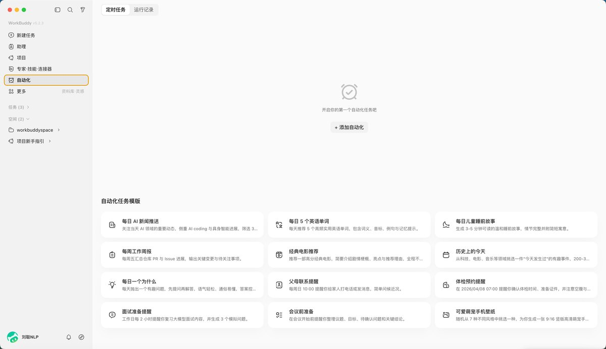

> **⚠️ 这张图是旧版界面（5.3.x），按钮上写的是「添加自动化」。**
> **新版按钮叫「新建定时任务」**，位置略有不同，但配置项基本一致。
> **你手上如果有更新的截图，替换掉这一张更好。**

点击「新建定时任务」，就可以自定义你的任务：

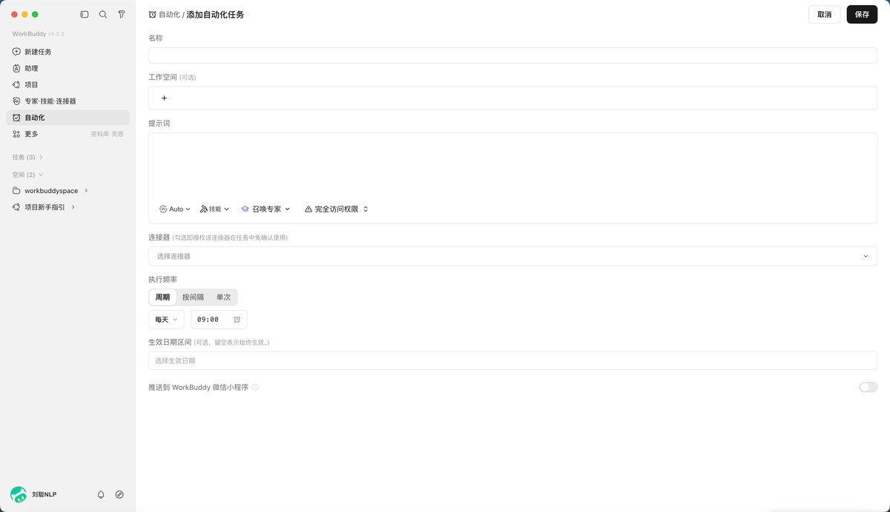

> **同样，这张也是旧版界面。** 新版的界面在 5.7.0 又"焕新"过一次（见下面「定时任务页面长什么样」）。

填好名称、工作目录、提示词、模型与技能、定时规则。比如做一个"每日AI 资讯新闻推送"，定时 8 点发送：

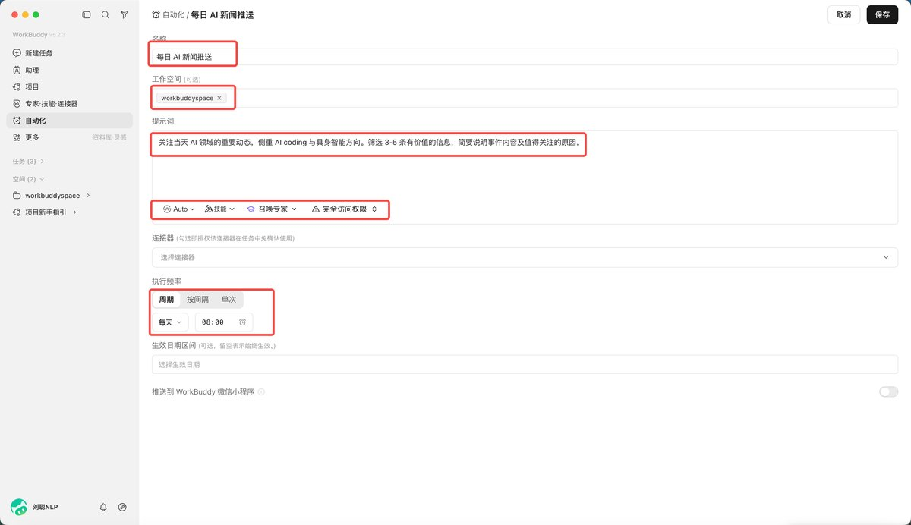

配置项逐项的填写建议：

| 配置项 | 作用 | 填写建议 |
|---|---|---|
| 名称 | 区分不同定时任务 | 写清对象和频率，如"每周错题汇总" |
| 工作空间 | 限定执行目录和文件保存位置 | 为每项任务使用独立目录，避免互相覆盖 |
| 提示词 | 描述目标、步骤、输出和边界 | 用上面的任务模板，不只写一句口号 |
| 模型和技能 | 决定可用的理解与执行能力 | 只选择任务真正需要的 Skill 和连接器 |
| 定时规则 | 设置频率和生效日期 | **先低频试运行，再逐步提高频率** |
| 推送到小程序 | 完成后在手机查看结果 | 开启前确认哪些结果会通过安全链路同步到云端 |

**最后一行对教师尤其关键。** "推送到小程序"意味着结果会离开你的电脑。涉及学生数据的任务，**这一格不要开**。

#### 定时任务页面长什么样（5.7.0 起焕新）

**如果你现在的界面和上面的图对不上，看这里。**

| 版本 | 变化 |
|---|---|
| **5.7.0（2026-09-28）** | 定时任务页面**焕新**：集中查看任务模板、配置与运行记录，**任务失败时更容易找到原因** |
| **5.7.5（2026-10-03）** | 新增**汇总页**：同一任务的历次运行按**时间线**展示，可集中查看执行结果和产物 |
| **5.7.5（2026-10-03）** | 新增**产物系统通知**，点击提醒即可打开对应产物 |
| **5.7.3（2026-09-30）** | 修复 Windows 上从模板创建定时任务失败的问题 |

> **对教师最有用的一条是「汇总页」。**
>
> 以前要判断"上周那次定时任务到底跑没跑、跑出来什么"，得翻历史记录。
> **现在同一任务的历次运行按时间线摆在一起，点开就能看产物。**
>
> **这对"每月汇总三次月考"这类任务特别有用——你能一眼看出三次的结果有没有差别。**

> **另一个对教师友好的改动：任务通知（5.7.0 起）**
>
> 任务完成后**在电脑和关联移动端都能收到提醒**，点提醒直接打开产物。
>
> **它的价值在于"不用守着"。** 以前你只能开着电脑干等，现在跑完了它会叫你。

### 不想从零写，可以先用模板

官方任务模板覆盖新闻推送、周报生成、体检预约和学习计划等常见场景。模板的价值是提供基本字段和任务结构，**但它不是最终答案**。

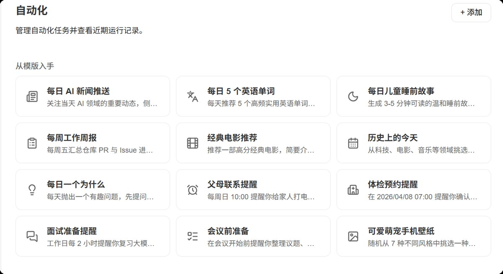

选用后仍应修改**数据来源、时间范围、输出位置、验收标准和禁止动作**这五项。对教师来说，最需要改的是"数据来源"和"禁止动作"——模板里不会有"不能出现学生姓名"这种话。

下面是官方给出的完整配置项清单和填写建议，可以逐项对照着设：


如果你还想要"设好就忘"的效果，可以打开"推送到小程序"，每天早上在手机上直接看结果：

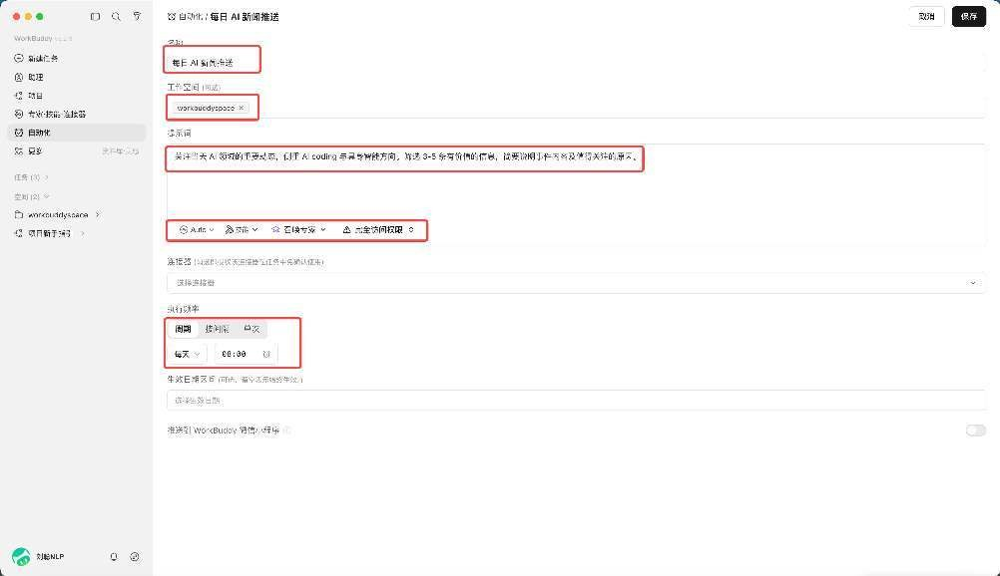

**开这一格之前先确认一件事：哪些结果会通过安全链路同步到云端。** 涉及学生数据的自动化，这一格不要开。

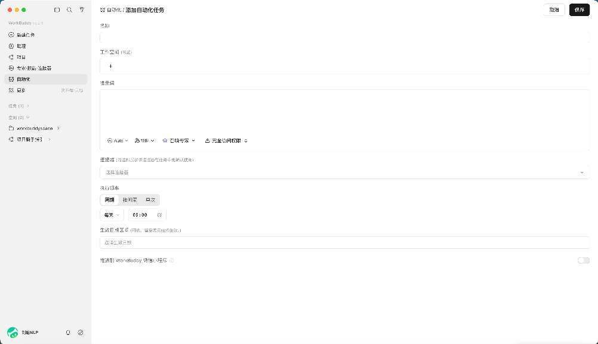

**除了新闻推送，官方还列了一批更值得尝试的场景**，这张表建议直接对照你的工作：


**这张表最值得看的是最后一列——"建议保留的人工检查"。** 周报汇总要"确认进度和风险表述后再发送"，费用报销要"提交前核对税额、重复票据"，自媒体选题要"人工判断品牌立场"。

> **这条比任何一句"你要小心"都管用。** 连工具作者都在模板里默认"这一步需要人看一眼"，你就更不该指望它自己判断。

### 原书给的一份完整自动化配置示例

这份配置写得很规范，可以直接当模板改：

```text
任务名称：每日AI 行业简报
触发时间：每天 08:00，时区 Asia/Shanghai
工作目录：automation/ai-daily

输入：
- 检索过去 24 小时的 AI 产品、模型和行业新闻
- 仅使用可以访问并保留链接的公开来源

处理规则：
1. 合并重复事件，按产品、技术、商业三类整理
2. 每条包含标题、100 字摘要、来源、发布时间和链接
3. 无法确认发布时间或来源的内容放入"待核验"，不要编造

输出：
- 保存为 YYYY-MM-DD-ai-daily.md
- 正文最多 10 条，最后附来源清单
```

**注意第 3 条规则："无法确认的放入待核验，不要编造"。** 这条在教师场景里要写成"无法确认的知识点归属，放进待人工核实，不要猜"。

**另外要注意，这份配置里没有写"失败怎么办"。** 上一节你自己写的那句"出错了告诉我，不要重试三次"，是必须自己补上的——原书模板不会替你写。

### 进阶：自动化任务的可靠性设计

**自动化的核心风险不是"不跑"，是"一直跑错但你不知道"。**

**四条可靠性规则：**

| 规则 | 说明 | 反例（不要这样） |
|---|---|---|
| **1. 失败要响** | 出错必须通知，不能默默跳过 | "失败了重试三次，都失败就跳过" |
| **2. 输出要能查** | 每次运行留日志：处理了什么、生成在哪 | 不留任何记录 |
| **3. 破坏性操作要先确认** | 删文件、覆盖文件前要停下来 | 直接覆盖已有文件 |
| **4. 定期人工抽查** | 每隔一段时间，亲眼确认一次结果 | 假设它一直在对 |

**第 3 条要重点说。** 自动化任务如果会覆盖或删除文件，**必须设成"先预览、再执行"**。我见过太多"跑了一个学期突然发现提示词库被清空了"的情况。

**第 4 条是最反直觉的：** 即使前面三条都做了，**你仍然需要定期亲眼看一次结果。** 因为自动化会随环境变化失效——文件夹改名了、文件格式变了、软件更新了。**定期抽查是唯一的发现方式。**

### 进阶：五个必须提前知道的坑

这一节是教师自动化最容易踩的地方。前四个坑都会让任务"跑错了但你不发现"，第五个会让任务"根本不跑"。

| 坑 | 会发生什么 | 怎么避开 |
|---|---|---|
| **1. 忽略时区** | 默认可能是 UTC，你设的"9:00"实际下午才跑，或者凌晨突然执行 | **勾选「使用本机时区」，或在指令里写明"北京时间 21:00"** |
| **2. 工作区路径错** | 自动化默认在工作区根目录执行，要读子文件夹却没写路径，直接读不到 | **在指令里写明完整路径**，如"读取工作区 `教学日志/原始/2026-08-25.md`" |
| **3. 记录不持续** | 平时不写、周五才补，AI 无米下锅，生成一堆空话 | **日报周报的前提是"平时随手记"**，不是周五回忆 |
| **4. 一上来就全自动外发** | 内容直接推到群里，错一次全校可见 | **首次上线先保存文件人工检查**，确认稳定再接通知渠道 |
| **5. 混淆全局与项目级** | 找不到或选错触发范围 | **搞清楚当前自动化属于全局还是当前项目**，两者作用范围不同 |

**第 3 条是根本性的。** 它和第 4 章开头那条"记录不持续是最大的坑"是同一件事，只是换成了自动化的场景。

> **自动化的前提永远是"上游已经有结构化的输入"。**
>
> **AI 不替你凭空发明课堂，它负责把你的碎片变成结构。** 如果原始记录本来就没有，自动化只会把"没有"变成"看起来有"——**这比不自动化更危险，因为它掩盖了问题。**

**第 4 条要特别强调，因为它是不可逆的。** 一次错误外发到群里，是需要解释、需要挽回、可能影响信任的事。**先在本地跑两周，确认稳定了再开外发。**

### 进阶：一条完整的三级流水线

这是自动化在教师工作里最实用的一种形态。**它的核心不是某个定时任务，是三级之间的衔接。**

```
随手记 → 每晚结构化 → 每周汇总
（碎片）    （规范日志）    （周报）
```

**第一级：随手记（降低记录成本）**

**这一级的唯一目标是让你愿意记。** 所以不要一上来就要求写规范日志，用最省力的方式：

- **课间 30 秒语音**（推荐）——"高二3班今天《导数》讲太快，一半人没跟上，下周重练基础题。"
- 腾讯文档按日期追加条目
- 本地工作区建 `教学日志/原始/` 文件夹，每天丢一个 `2026-08-25.md`

**注意那个例子——"一半人没跟上"就是最有价值的信息。** 它同时是学情、节奏问题、下一周的备课依据。**AI 帮你整理日志，价值不在于让它变好看，在于让你三个月后还能想起这句话。**

**第二级：每晚结构化（定时任务）**

触发器选 Daily，时间设在**一天教学结束之后**（比如 21:00，确保记录已写完）。执行体描述可以这样写：

> 读取工作区"教学日志/原始/2026-08-25.md"（或腾讯文档《教学日志-原始》今日条目），按以下结构整理成规范教学日志并保存到"教学日志/已整理/"：
> ① 日期与时段 ② 教学内容与进度 ③ 学生表现（共性/个性，**用代号或"学生A"替代真实姓名**）④ 教学得失与反思 ⑤ 待办。
> **若某条目信息不足，保留原文并标注"[待补充]"，不要编造。**

**加粗的两处不能省。** 学生用代号是隐私红线，"信息不足不要编造"是数据质量红线——**这两条写进指令里，比事后检查可靠得多。**

**第三级：每周汇总（接周报）**

在周报任务里，把"读取《教学日常工作记录》"改成"**读取工作区'教学日志/已整理/'本周全部文件**"。这样周报直接吃整理好的日志，**不用再翻原始碎片。**

**这条流水线的价值在于它闭环了：** 平时不额外花时间，周五不用现凑，学期末还自动攒下了一份可检索的教学档案。

**含学生姓名、成绩的日志，建议在本地工作区处理。** 确需云协作时，再回写云端文档。**这是附录 C 红线的一条实操落法。**

### 常见错误与修正方式

| 常见错误 | 为什么会发生 | 更好的写法 |
|---|---|---|
| 把手工流程直接自动化 | 流程本身还没跑顺 | **先手动做 3 次** |
| 自动化"判断"类工作 | 想省事 | 只自动化"搬运"和"提醒" |
| 失败默默重试 | 怕麻烦 | **失败要通知，不要重试** |
| 自动覆盖文件 | 没意识到风险 | 覆盖删除前必须确认 |
| 建了不看 | 以为它一直在对 | 定期人工抽查 |
| 定时太密 | 想"多干点" | 宁少勿多，先跑对一个 |
| 任务互相干扰 | 没规划好 | 一个任务只干一件事 |

### 区域实践参照

**这一章的方法在区域实践中有一个很清晰的对应：周期性任务的"集中统一"和"个人自定"两种模式。**

**江苏连云港赣榆区**（《江苏教育报》2026-04-24）：依托中小学作文智能批阅系统普及应用，**形成"数据监测—教研反馈—学校改进"闭环机制，依托"日监测、周通报、月评估"数据看板**。

校长陈涛的评价是："系统的核心价值在于**用技术手段攻克了传统作文教学中'数据难采集、学情难量化'的顽疾**。"

**"日监测、周通报、月评估"这三个频率，正是自动化的理想形态。** 三个不同周期的工作，频率明确、规则明确、输入输出清楚——**完全符合本章开头那三个标准。**

**而且这个设计有一个很值得学的点：三个频率的产出，用途不同。**

| 频率 | 产出 | 给谁用 | 特点 |
|---|---|---|---|
| 日监测 | 当天的问题 | 任课教师本人 | 及时、量小 |
| 周通报 | 本周整体情况 | 教研组 | 粗、趋势 |
| 月评估 | 月度改进建议 | 学校管理层 | 指向管理改进 |

**这和第 11 章"数据监测—教研反馈—学校改进"是一个闭环。** 自动化负责"监测"和"汇总"，**人的判断在"反馈"和"改进"这两个环节。**

**另一个值得学的点：这个系统是"区域统一建设"的，不是个别教师自己搭的。** **教师个人的自动化任务只能解决自己那一小块；区域统一建设才能让"学情可量化"成为可能。** 这也提示了一个重要的事实：

> **自动化任务的真正价值，不是省你一个人的时间，而是让"数据"这件事在一个区域内成为可能。**
>
> 你手工整理三个班的错题，是个人效率问题；全区教师的数据都沉淀下来，才可能看到"哪个年级普遍卡在二次根式化简"这种**只有大规模数据才能看到的规律**。

**安徽合肥**（中新网安徽频道 2026-09-23）四十八中望湖教育集团的"作业布置 → 智能采集 → 学情诊断 → 精准备课 → 靶向辅导"闭环，以及 1300 余道区本试题库，也是同一个逻辑的体现——**单次任务自动化容易，长期沉淀形成资产才有价值。**

### 你校可以怎么改

> 1. 我每周都要做的重复劳动有哪些（列出来，看哪些满足"高频+规则明确+输入输出清楚"）：
> 2. 我每个月要做的重复劳动有哪些：
> 3. 我最想自动化的"搬运"工作是哪个（把每周发同一份通知这类也算）：
> 4. 我有没有"一直没想起来做"的定期任务（说明它可能值得自动化）：
> 5. 哪些工作绝对不能自动化（我判断哪些必须自己做的）：

---

## 第 24 章　打造属于你的 Skill

**这一章是全书"复利"最直接的一章。**

前面第 5 章讲了"加载一个用得上的 Skill"。这一章反过来：**当你发现某个流程你做第 4 次还嫌烦，就把它做成自己的 Skill。**

### 什么时候该做自己的 Skill

**三个信号，任意一个就够了：**

| 信号 | 说明 |
|---|---|
| **1. 同一段提示词，第 4 次了** | 你已经有现成的提示词了，加个壳就能固化 |
| **2. 每次都要说"照这个格式"** | 你有一个稳定的格式要求，值得固化 |
| **3. 别人问你要"你那个怎么做的"** | 你的方法有价值，可以给别人用 |

**最常见的起点是第 1 个。** 大多数人做 Skill 都是从"我把这段提示词用腻了"开始的，而不是从"我要做一个很厉害的 Skill"。

### 核心理解：Skill 是什么

**一句话：Skill 就是一个"把你的工作方法打包成可以反复调用的东西"。**

它包含四样东西：

| 组成 | 说明 | 例子 |
|---|---|---|
| **触发说明** | 什么时候该用它 | "当需要出一套分层作业时" |
| **输入要求** | 用之前要准备什么 | 教材范围、学生分层、已有易错点 |
| **执行步骤** | 具体怎么做 | 先出细目表 → 确认 → 出题 → 出答案 |
| **输出标准** | 做成什么样算对 | 每题标知识点、答案单独成页 |

**第 4 样最容易被忽略，但它是 Skill 质量的决定因素。** 没有输出标准，Skill 只会生成"看起来像"的东西。

### 做 Skill 的完整流程

```
我想做一个 Skill，用来出一套分层作业。

我先说清楚我每次做这件事的实际流程，你帮我把它整理成一个 Skill。

【我的实际流程】
1. 我先看教材，确定这节课考哪几个知识点
2. 我想好这次要重点解决学生哪个易错点（我上期统计出来的）
3. 我按我班的情况分档（我班是 48 人，两极分化比较明显）
4. 我出题，每题标了知识点
5. 基础档我给解题思路提示，不给答案
6. 提高档我标典型错因
7. 挑战档是开放题
8. 最后出答案，答案单独放最后

【我每次都要说但很烦的话】
- "我是初中数学老师"
- "面向八年级，两极分化明显"
- "题量：3 档共 12 题"
- "必须包含：知识点标注、易错点覆盖、基础档思路提示、挑战档说明"
- "答案单独放最后"

请帮我把这个流程做成一个 Skill，要求：

1. 触发说明怎么写（什么情况下我会想起用它）
2. 需要我提前准备什么（要列成清单，我要能照着准备）
3. 执行步骤（分步，每步有确认点）
4. 输出标准（做成什么样算合格，我要能验收）
5. 一个可以直接用的完整提示词模板
   （要留出填空位，我每次改填空位就行）
6. 一份"使用说明"，给以后的我自己看，
   要写清楚：这套东西解决什么问题、什么时候别用

另外：
- 这个 Skill 我打算给同组老师用，所以要写得像别人也能看懂
- 不要把它写成只有我能懂的（我怕以后自己都看不懂）
```

**"不要把它写成只有我能懂的"这一条要求，是这一章最重要的设计原则。**

**Skill 做成"只有自己能看懂"，等于没做。** 因为：
- 三个月后你自己也忘了
- 给别人用不了
- 一旦你调岗、退休，就彻底失效

**"给以后的我自己看""给同组老师用"这两个约束，会强迫你把它写成通用文档。**

### 进阶：不止沉淀自己的经验，还可以"蒸馏"一本书

上面这一节讲的是**把你已经会的东西固化下来**。但有的时候你想固化的是**别人写的方法论**——比如一本讲教学设计的书、一份课标解读、一个你看了觉得好的公开课实录。

这时候要用到**知识蒸馏（Knowledge Distillation for Skills）**。

**先说它要解决什么问题。** 读完一本书，笔记做了、金句划了，合上书以为升级了。**两周后遇到真实问题，那些方法论却抓不住。** 知识在记忆里，但激活路径不清晰。

> **知识蒸馏要解决的就是"学了用不上"这个问题。**

它的定义是：**从书本或视频中，提取出具有独立触发条件和执行步骤的原子化知识单元（Skill），让 AI 在遇到对应场景时能够自动激活并给出可落地的行动路径。**

**这里的关键区别**，三条笔记工具和知识蒸馏的差别：

| 做法 | 产出 | 遇到问题时会怎样 |
|---|---|---|
| 读书笔记 | 结构化原文 | 需要你自己回想、翻找 |
| RAG 索引 | 存储原文片段供检索 | 能检索到原文，但不会自动执行 |
| **知识蒸馏** | **可自动触发的执行单元** | **遇到场景自动激活，给出操作步骤** |

**对教师来说，这有一个非常实际的用法。** 教研组里如果有专家做的专题讲座、有你自己整理的《中考命题趋势研究》，都可以蒸馏成 Skill，之后遇到相关任务就自动调用，**而不需要每次都重新翻资料。**

### 六阶段蒸馏 SOP

官方推荐的开源工具是 `cangjie-skill`，它用六个阶段把一本书或一组视频蒸馏成一套 Skill。

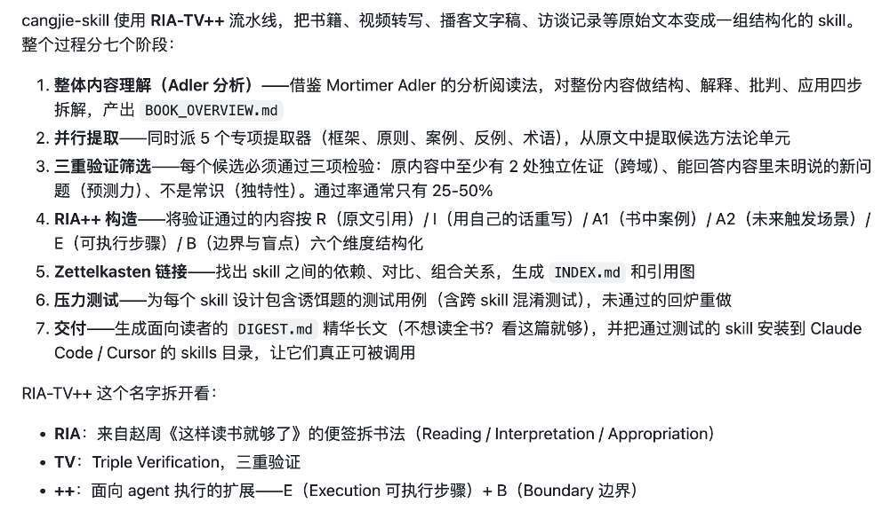

**阶段 0：整书/整片理解**

**这一步决定后续提取的质量上限。** 不是从摘取金句开始，而是先读清整本书的骨架——全书主旨是什么、核心论证链怎么走、关键术语作者如何定义和使用、作者自身的局限与盲点在哪里。

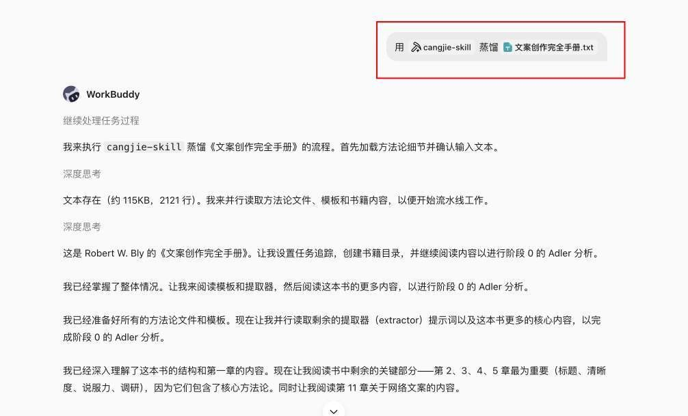

**跳过这一步直接提取，容易把作者反对的观点当成他支持的方法论。**

**阶段 1：五个 Agent 并行提取**

五个 Agent 同时从五个维度扫描全文，独立工作、互不干扰：

| Agent | 提取目标 |
|---|---|
| 框架提取 Agent | 作者构建的分析或决策框架 |
| 原则提取 Agent | 可跨场景复用的行为原则 |
| 案例提取 Agent | 作者援引的正面案例和成功路径 |
| **反例提取 Agent** | **作者援引的失败案例和反面教训** |
| 术语词典 Agent | 作者专有术语及其定义 |

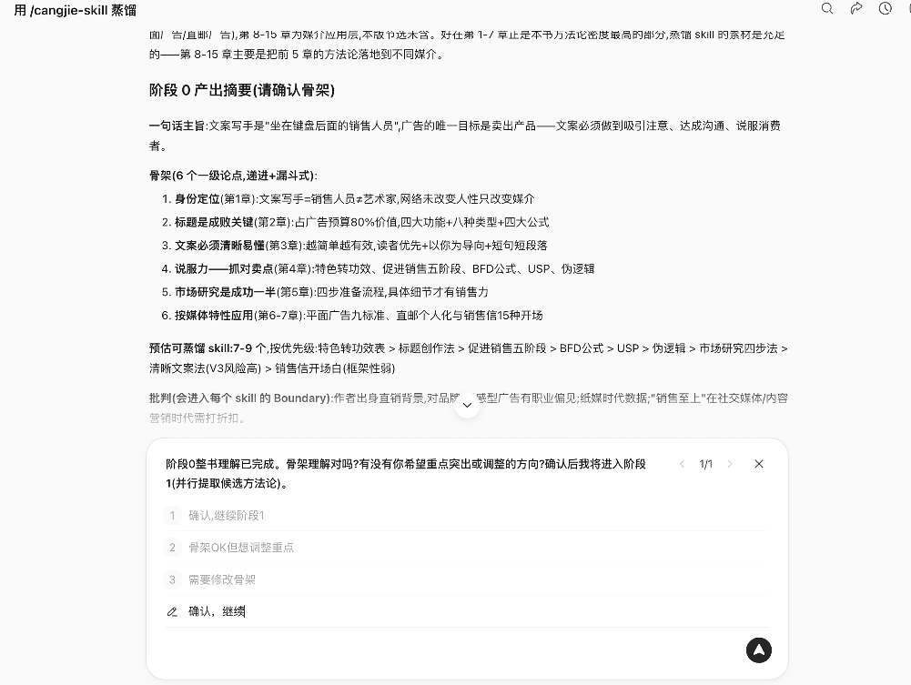

**注意第三个和第四个是成对的。** 只提取正面案例，蒸馏出来的 Skill 会显得很完美、很正确；**把失败案例也提取进来，Skill 才真正有用**——因为教师用 Skill 的时候，缺的往往不是"应该怎么做"，是"哪些坑别踩"。

**阶段 1.5：三重验证筛选**

每个候选知识单元必须通过三关，未通过直接淘汰：

| 验证类型 | 检查内容 |
|---|---|
| **跨域验证** | 该方法论在书中至少两个独立场景出现过，不是孤证 |
| **预测力测试** | 能用它推导出书中没有直接讨论的问题吗 |
| **独特性检验** | 是不是任何人都能说出来的常识？常识不构成 Skill |

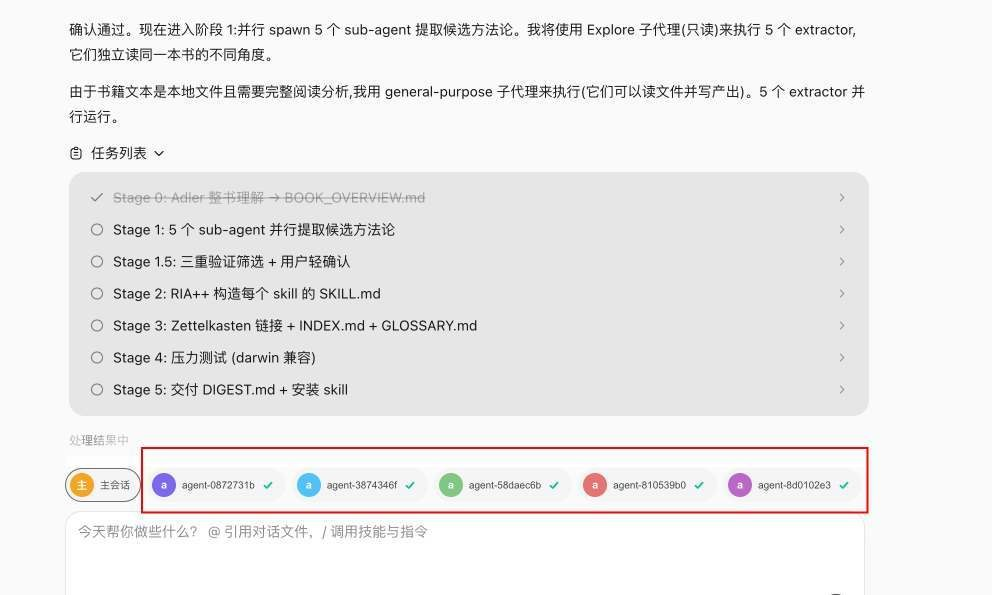

**宁缺毋滥。** 一本书通常有 50–100 个候选单元，通过三重验证后**只保留 10–25 个。**

> **"独特性检验"这一条对教师特别有用。** "上课要认真"、"要关注学生差异"——这些是常识，不是 Skill。**过不了这一关的候选单元，蒸馏出来只是把常识换了个说法。**

**阶段 2：构造 Skill**

每个通过验证的知识单元被构造成一个 Skill，核心是设计**触发条件**：

- 什么场景下自动激活
- 激活后执行什么步骤
- 什么时候不该用（边界）
- 质量验证标准是什么

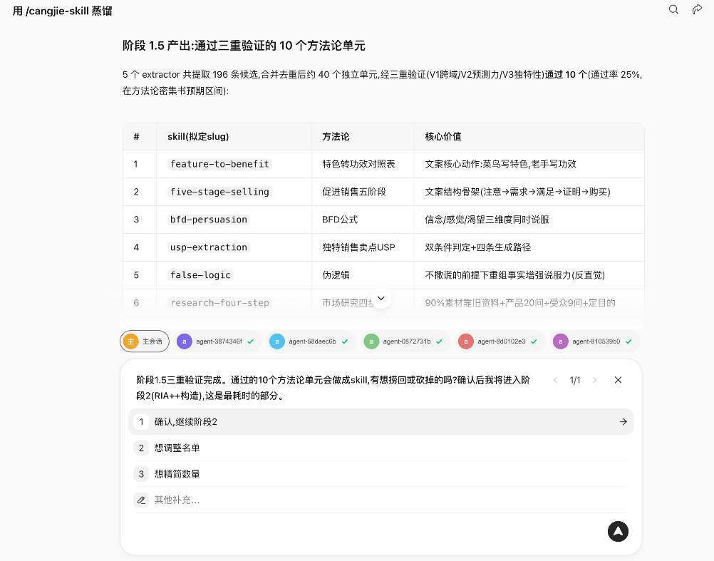

**触发条件的设计是最难也最关键的一步。** 没有触发条件的 Skill，在实际使用中无法被 AI 正确识别和调用。

**阶段 4：链接**

找出 Skill 之间的关系，形成知识网络：

- **依赖**：Skill A 的执行需要先调用 Skill B 的输出
- **对比**：Skill A 和 Skill B 适用于相似场景但方向相反
- **组合**：Skill A 和 Skill C 联合使用效果更好

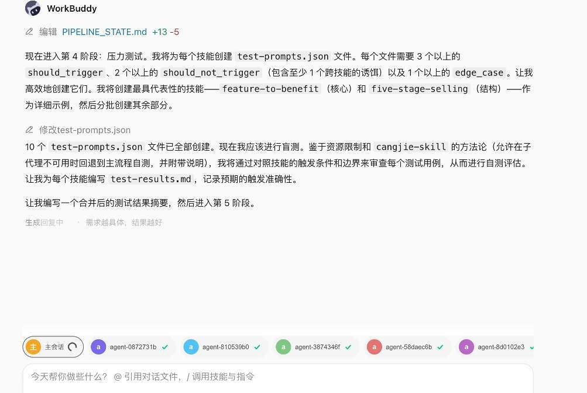

链接层让 AI 在遇到复杂问题时，**能够选择一组 Skill 而不只是单个 Skill。**

**阶段 5：压力测试**

两种测试，缺一不可：

- **诱饵测试**：故意给不该触发的场景，检验 Skill 是否能"忍住"不激活。**一个没有边界的 Skill，在错误场景下调用反而帮倒忙。**
- **执行验证**：给出真实问题，验证 Skill 是否能输出可落地的步骤，**而不是正确的废话**。

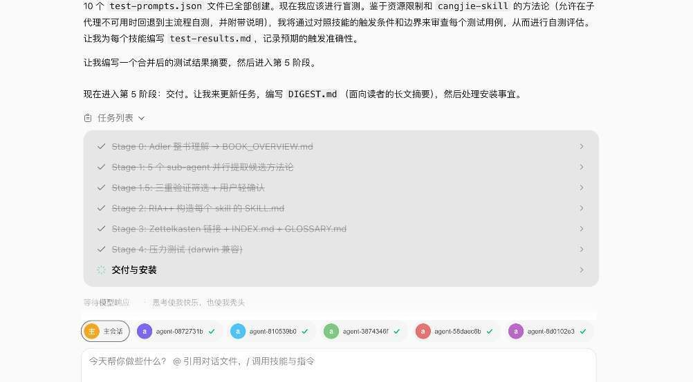

**"正确的废话"这个说法很准。** 输出"要精心设计教学、因材施教"——这句话没错，但没有任何可操作性。**判断标准很简单：看完之后你能不能立刻开始做？**

### 做 Skill 的四条设计原则

**原则一：从你真实做过 3 次的流程里提取，不要凭空设计。**

**凭空设计的 Skill 一定不好用**，因为你会漏掉很多隐含规则。**只有做过 3 次以上，你才知道真正的流程是什么样的。**

**原则二：一个 Skill 只解决一件事。**

不要做一个"教学全能 Skill"。做"分层作业出题 Skill"、"家长会问答手册 Skill"、"课堂观察报告 Skill"。

**一个 Skill 干一件事，它才能被复用；干三件事，它就只能被你一个人在一个场景下用。**

**原则三：留填空位，不要留判断题。**

**好的提示词模板是"填空题"，不是"作文题"。**

| 写法 | 评价 |
|---|---|
| "请为我班学生出一套分层作业" | ❌ 作文题，每次结果都不一样 |
| "面向【年级】，共【N】人，分层情况【描述】，重点解决易错点【列出】，题量 3 档共【N】题" | ✅ 填空题，输出稳定 |

**原则四：加"不适用条件"。**

这一条很多 Skill 漏了，但它极其重要：

```
这个 Skill 不适用于以下情况：
1. 题目涉及跨单元综合（这个 Skill 只处理单课时范围）
2. 我需要做"整册复习卷"（这个 Skill 是针对单课时的）
3. 我班没有明显分层（那就该用第 9 章的三档默认设计）
4. 我需要竞赛题（这个 Skill 出的是课内水平）
```

**"不适用条件"的作用是防止你在错误的情境下用它，然后否定整个 Skill。** 这句话是本书反复出现的一个原则。

### 进阶：把 Skill 变成教研组的资产

```
我想把我自己做的"分层作业出题 Skill"给数学教研组用，
让全组 6 位老师都能用。

请帮我设计推广方案：

1. 推广方式：
   - 我该怎么做，才不会变成"我教你们用"？
   - 我该用什么方式让老师愿意试？
   - 如果有人不想用，怎么尊重这个选择？

2. 需要准备的材料：
   - 除了 Skill 本身，还要准备什么
   - 要不要做一个"3 分钟上手"的说明

3. 收集反馈：
   - 我该问什么问题，才知道它好不好用
   - 反馈要问哪些方面（易用性、效果、稳定性、边界）

4. 维护机制（重点）：
   - 这个 Skill 由谁维护
   - 多久复核一次
   - 组员改了怎么办（版本管理）
   - **如何避免它变成只有我在维护的负担**
   - 如果我调走了，这个 Skill 怎么办

5. 三个月后的目标：
   - 我希望三个月后，这个组是什么状态
   - 用什么指标衡量（几个人在用？用了多少次？有没有人改进了它？）

要求：
- 不要设计成"某个热心人长期负责"的机制，
  我可能会调走，不能依赖我
- 维护要低到"顺手就做了"，不要设成"定期专门整理"
```

**第 4 条"如何避免它变成只有我在维护的负担"是这一节最实际的问题。**

**答案在第 22 章说过，但值得重复：设计成"用的时候顺手就补"，不是"定期专门整理"。**

具体来说：
- 有人用得好、发现一个问题 → 顺手改
- 有人想改 → 自己改，改完告诉大家
- 每月教研活动花 5 分钟问一句"最近有人用吗？有什么问题？"
- **不做"季度整理版本"这种大动作**

**第 5 条"三个月后的目标"建议用一个可核实的指标：**

> **"改进了它的人有几个"** —— 这个指标比"几个人在用"好，因为它说明这个 Skill 是活的，不是被束之高阁的。

### 常见错误与修正方式

| 常见错误 | 为什么会发生 | 更好的写法 |
|---|---|---|
| 凭空设计 Skill | 还没做过 3 次 | **从真实做过的流程里提取** |
| 一个 Skill 干很多事 | 想一次做完 | 一个 Skill 只解决一件事 |
| 模板留的是"作文题" | 懒得分 | 改成填空题 |
| 没写不适用条件 | 想不到 | 明确列出 4 条不适用情况 |
| 只写给自己看 | 习惯 | 按"给同组用"来写 |
| 靠一个人维护 | 想省事 | **用的时候顺手就补** |
| 推广变成"我教你们" | 表达欲 | 让老师自己试，你只答疑 |
| 三个月没复盘 | 忘了 | 设一个月度 5 分钟检查 |

### 区域实践参照

**这一章在区域实践中对应的是长丰的"种子教师—三研教师"培养路径，以及微课题机制。**

**安徽长丰**（《安徽青年报》2026 年报道）培养了 116 名种子教师和 106 名三研教师培育站成员，**"立项 AI 相关微课题百余项"**，"校本教研逐步走向精准化、实证化"。

**这个培养路径和 Skill 建设的关系是：**

| 长丰的层级 | 做什么 | 对应本书第几层 |
|---|---|---|
| 种子教师（116 名） | 跑通自己的第一个工作流 | L1→L2：单次辅助 → 固定模板 |
| 三研教师（106 名） | 做出组内可复用的工作流/Skill | L2→L3：固定模板 → 工作流 |
| 兼职教研员（81 名） | 带教研组落地 | L3 |
| 名师工作室主持人（74 名） | 做学校/区域系统 | L4：团队能力 |

**这条路径和本书第 17 章讲的长丰"四个层级"完全一致。** 它的意义在于：**成长是有台阶的，每个人知道自己现在在第几级、下一步往哪走。**

**而"微课题百余项"是这条路径里最值得学的一环。** 为什么？

> **微课题的本质是"一次小规模的工作流改进尝试"。**
>
> 而"做 Skill"和"做微课题"本质上是同一件事：**都是把一个自己反复做的工作，变成一个可复用的改进。**
>
> 区别只是：微课题写成文章，Skill 做成工具。**但两者的思维是一样的——找到那个"每次都要重复做、每次都做得不够好"的环节，把它改进并固化。**

**所以如果你要做微课题，最好的选题来源就是你的提示词库。** 你的提示词库里那些"效果不稳定""每次都要重新调整"的提示词，**背后就是一个真实的、值得研究的教学问题。**

**另一个值得注意的细节**：长丰的骨干培养和"好课堂"评选是**同时推进**的——评选要求至少使用一种 AI 工具，参与者是 206 名教师，最后认定种子教师 116 名。**也就是说，通过率约 56%。**

**这个比例说明：认定标准是筛过的，不是人人有份。** 这对个人的启示是：**不要把"学了 AI"当成荣誉，要把它当成能力。** 有没有做出东西，是唯一可靠的标志。

### 你校可以怎么改

> 1. 我现在有哪些流程已经做过 3 次以上（列出来，这些是 Skill 候选）：
> 2. 我最想固化的一段提示词是哪一条：
> 3. 我做这件事时，每次都要重复说的话是什么（这些是模板的填空位）：
> 4. 这个 Skill 有什么"不适用"的情况（我什么时候不该用它）：
> 5. 如果给同组用，谁最可能第一个愿意试：

### 【2026 年 10 月增补】六步法骨架、工程化评估、数据规律、蒸馏捷径

**① 高质量 Skill 写作六步法**（来源：《skill你会写吗？从会到精通只差这一步》，与本章"知识蒸馏六阶段"逐条对应）

| 六步 | 一句话要点 |
|---|---|
| 一、明确边界与定位 | 聚焦"高频、重复、规则明确"，明确输入与期望产出格式 |
| 二、打磨触发词与描述 | description 是触发开关；写"何时触发"也要写"**不适用于 XX**"；用第三人称 |
| 三、构建执行流程 | 输入→校验→执行→输出；**关键节点设自检，边界情况设断点主动问用户** |
| 四、提供示例与规则 | 3-5 个示例覆盖正常/边界/错误场景；**规则与理由并重**；拿 3 份成熟材料反复测试对比 |
| 五、优化结构渐进加载 | 主文件 500 行以内；详细资料拆到 references/ 按需读取 |
| 六、建立迭代与验收 | 末尾设验收清单让 AI 输出前自检；把每次踩的坑转化为新规则或示例 |

一句话制作法（原文）："把制作过程流程走完，顺便加一句'**帮根据上面的制作框架细节要求制作 skill**'，workbuddy 就主动调用 skill-creator 完成封装。"

**② 工程化评估：给 Skill 做"单元测试"**（来源：《写 Skill 实战手册》）

- 触发评估：自造 20 个问题（一半该触发一半不该），**触发准确率 ≥85%** 算达标；
- 效果评估：拿测试用例对比"有 Skill / 无 Skill"两组，**通过率 ≥80%、相对提升 ≥30%**；
- Token 账：装 20 个 Skill 光描述就吃 1,000-3,000 Token 常驻上下文——第 5 章"做什么开什么"的量化依据；
- 调试经验：**70% 的问题出在"没加载成功"或"description 写得不好"**；多 Skill 冲突时，"把'什么不做'写清楚，比把'做什么'写得更详细更有效"。

**③ 数据说话：好 Skill 的四条工程规律**（来源：《Skill 蓝皮书 2026》对 67,196 条 Skill 的数据分析）

Agent 视角的描述平均质量分高 7.7 分；**含 MISTAKES.md（踩坑记录）的高 8.6 分——但只有 1.2% 的作者这么做**；10-20KB 大小质量最高（"太长太短都是死"）；持续迭代的 Skill 涨星率 58.8%，冷冻的只有 3.8%。给教师的启示：**你的 Skill 配一份"踩坑记录"，就已经赢过 98% 的作者**；"好的 Skill 像一把锋利的刀，不是瑞士军刀"。

**④ 知识蒸馏的捷径：把一本教学书编译成 Skill**（来源：pdf2skill 工具体验文）

"**总结是读后感，编译是可执行的能力**"——PDF 书进、Skill 包出（方法论书/操作手册最适配，文学作品不推荐）。限制：500 页以内，第三方内测服务**PDF 会上传服务端编译——只用于公开出版物，涉学生数据与校本保密资料禁用**；教师自建 Skill 走 skill-creator（本地）更安全。适用场景：把一本备课方法论书、一份校本教研手册变成全组可调用的能力。

**⑤ 安全检查（分享给同事前过一遍）**：Skill 里的脚本是会被真实执行的——不硬编码密钥；危险操作必须加确认；**"数据永远不应该被当成指令来执行"**（防提示词注入）。

### 【2026 年 11 月增补】技能与专家怎么分工，做好之后怎么分享出去

前面讲的是怎么做出一个 Skill。做出来之后还有两个绕不开的问题，它和专家到底该怎么分工，做好的东西怎么给同事和更多人用。这节把这两件事一次说清，内容整理自官方帮助文档与开放平台说明，核对日期 2026 年 11 月 25 日。

**① 一句话记住三者的关系**

技能是能力，专家是能力加经验，专家团是几位专家加一套协作流程。

| 维度 | 技能 Skill | 专家 Expert | 专家团 Team |
|---|---|---|---|
| 本质 | 工具能力，让 AI 能做某件事 | AI 顾问，懂某个领域的角色 | AI 协作团队，自动拆解分工 |
| 组成 | 一个流程文件加可选脚本 | 人设 + 方法论 + 工具链 | 多位专家 + 团长 + 协作流程 |
| 适合 | 需要固定步骤的任务 | 目标明确的单点专业问题 | 复杂任务，要多角色配合 |
| 老师举例 | 批量排版试卷、生成周报 | 作业设计专家、命题专家 | 一节课从备课到出题到评价完整交付 |

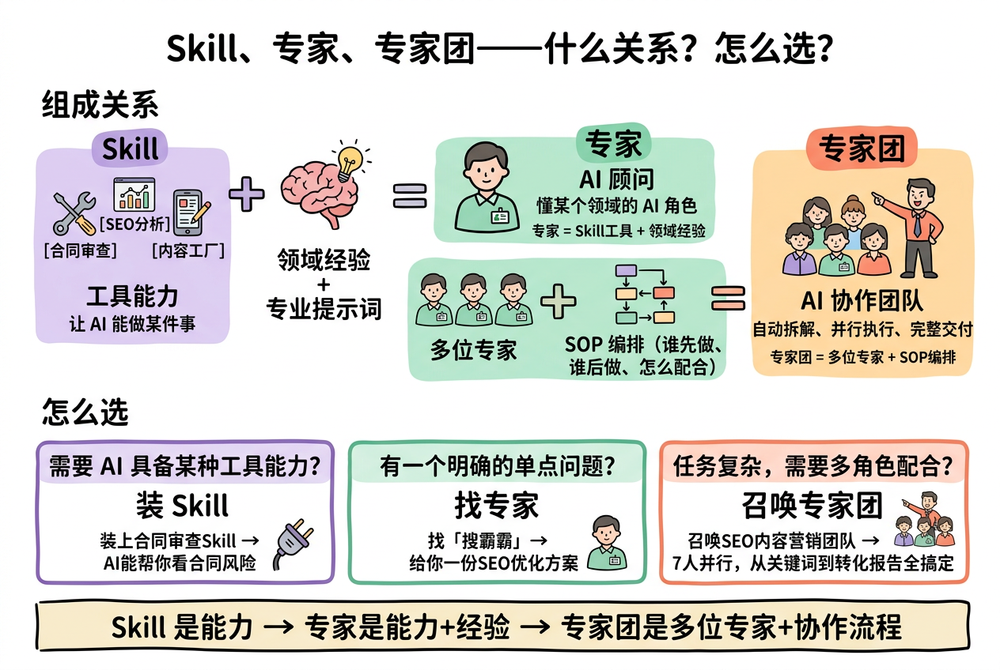

一个容易忽略的边界：**专家本身不会主动去读你的文件**，它只处理你主动给的对话和上传文件。只有给它配了技能或连接器，它才会在你授权后访问文件或外部服务。

选的时候按需求走。要 AI 按固定步骤干活，做技能；有个明确的单点专业问题，找专家；任务复杂要分头做再汇总，才上专家团。第 25 章专门讲专家团。

**② 三种分享路径，按范围选**

| 方式 | 适合谁 | 对方怎么装 | 门槛 |
|---|---|---|---|
| 直接发压缩包 | 同事、朋友、小范围 | 本地导入 | 零 |
| SkillHub | 想公开给全网用技能 | 网页或命令行安装 | 实名认证 |
| WorkBuddy 开放平台 | 想上架技能或专家，可免费可付费 | 市场里一键安装 | 开发者认证 + 审核 |

**路径一，直接发压缩包。** 把整个文件夹打成 zip，打包的是文件夹本身，不是散装里面的文件。技能必须有 SKILL.md，专家必须有 .codebuddy-plugin 下的 plugin.json、avatars 下的头像、agents 下的定义文件，漏一个就导入失败。发给对方时附三句话，解决什么问题、怎么触发、有什么限制。

对方在左侧「专家·技能·连接器」→「技能」页 →「添加技能」→「上传技能」，选中 zip 即可，系统自动完成配置。装完最好新开一个对话再试，已加载到当前会话的技能要新会话才完全按新配置走。

**路径二，上传到 SkillHub。** SkillHub 是专为中国用户优化的 Skill 社区，WorkBuddy 技能市场里就有 SkillHub 分类。打开 https://skillhub.cn/ 点右上角「发布 Skill」，首次发布要实名认证，平台用腾讯云人脸核身核验。提交后过三层审核，内容合规过滤、科恩实验室深度漏洞扫描、云鼎实验室 AI 模型安全评估，全过才自动上架。

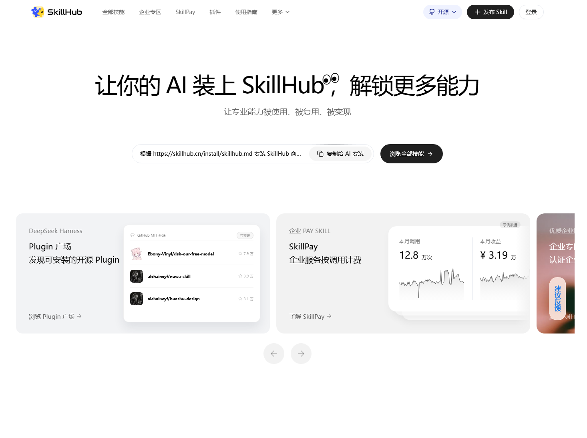

发布页需要登录，未登录会看到登录提示。发布支持网页、命令行、Agent 三种方式。

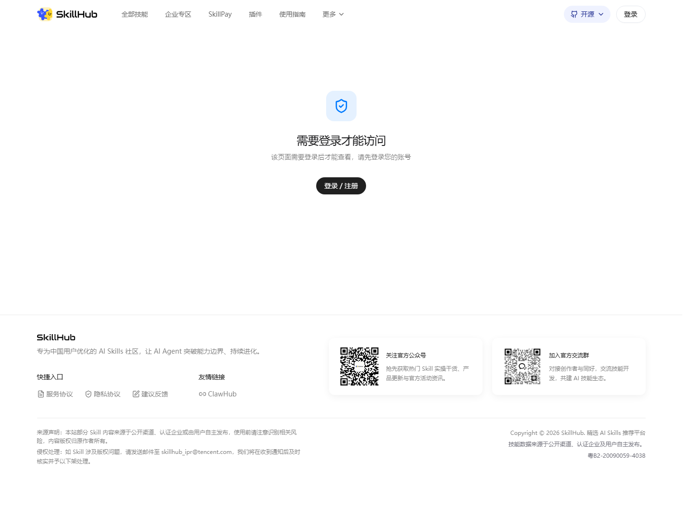

别人安装有两条路，在 WorkBuddy 技能市场搜到后点加号，或者复制 SkillHub 的安装指令贴到对话里让它自动装。用命令行安装时记得带 `--dir` 指向技能目录，否则默认装到当前目录的 skills 文件夹，WorkBuddy 认不到。

```bash
skillhub search 关键词
skillhub install 技能名 --dir ~/.workbuddy/skills/
```

**路径三，WorkBuddy 开放平台。** 最正规的一条，技能、专家、专家团、连接器都能上架，可免费可付费。地址 https://open.workbuddy.cn/ ，完整七步。

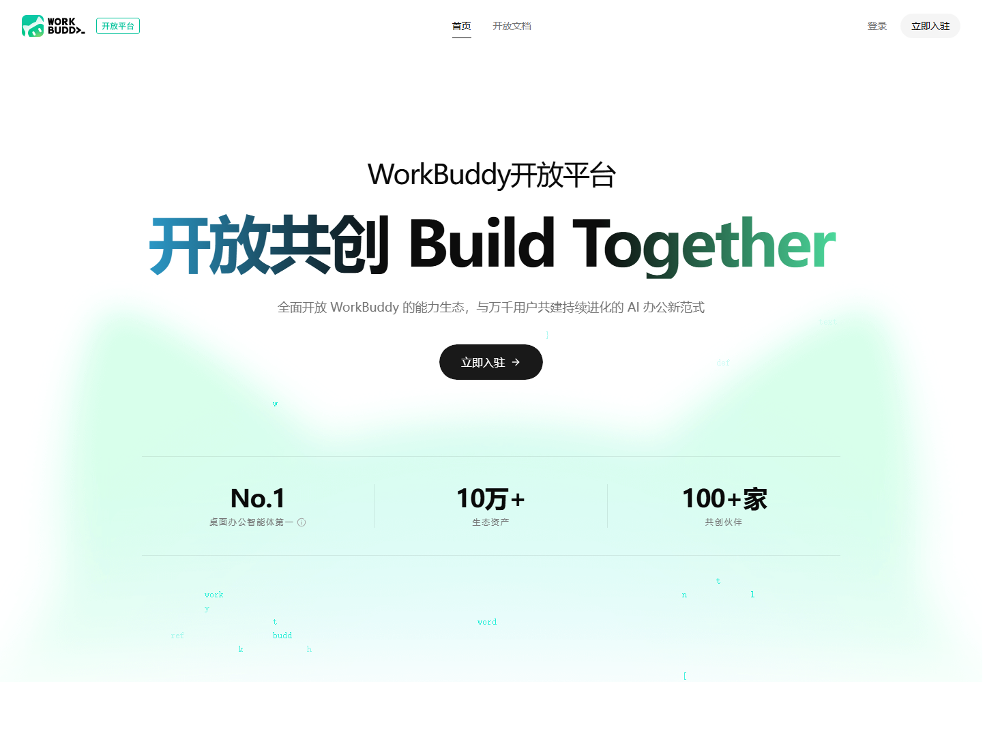

1. 注册并入驻，点右上角「立即入驻」。
2. 完成开发者认证。个人准备身份证、手机号、邮箱，扫脸约三分钟；企业用法人扫码或腾讯云账号授权。认证完把开发者主页补好，头像、简介、联系方式，这决定别人敢不敢用。
3. 创建业务类型，选要发布的是技能还是专家。
4. 完善信息和能力配置，上传 zip，填展示名称、头像、分类、功能介绍、适用行业、使用说明、风险提示。介绍写清谁用、解决什么具体问题、有什么限制，别写高效智能强大这类空词。
5. 提交审核，走配置资产、确认信息、提交审核三步。官方口径七个工作日内，实测快的第二天就过。
6. **过审后必须手动点「发布」并选「公开发布」。** 这步最容易漏，没点的话资产一直躺在后台，市场上搜不到。发完自己去市场搜一下名字，确认卡片完整、提示句能跑通。
7. 要收费才走收入变现。三个前置条件，完成开发者认证、账号无违规、至少有一个已过审的免费技能或专家。所以想收费得先免费上架一个跑通。

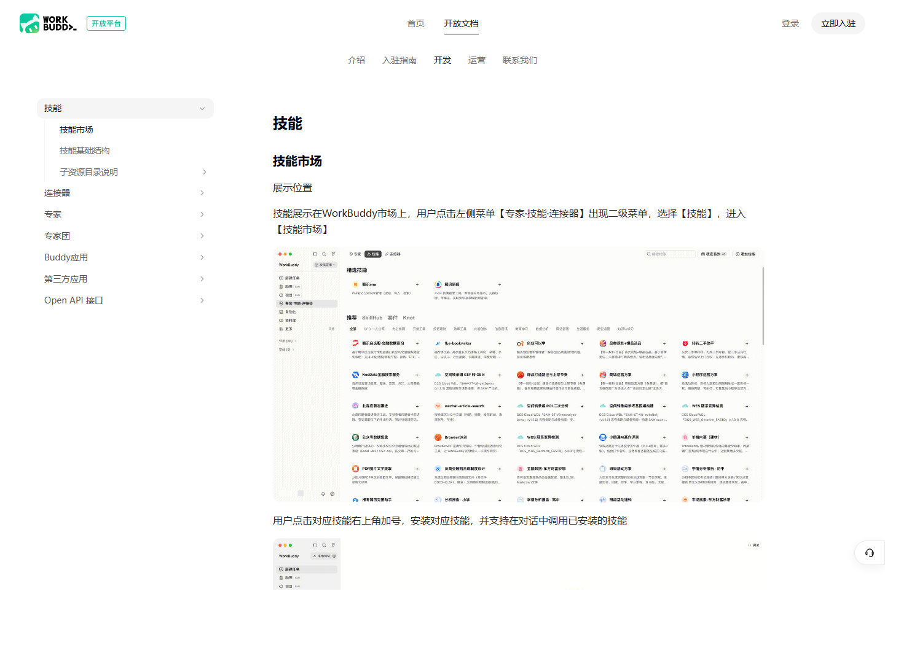

审核其实是四道关，不只是走流程。代码和行为安检，看有没有硬编码密钥、危险函数、混淆代码，还会在隔离环境实跑一遍看文件读写和网络出站；开发者身份核验，确认是谁做的、出问题找得到人；能力评测，用真实任务测完成质量、准确性和稳定性；上架后持续检测，命中风险会预警、限流或下架。专家包里带的技能和 MCP 配置也会一起查，不只查专家本体。

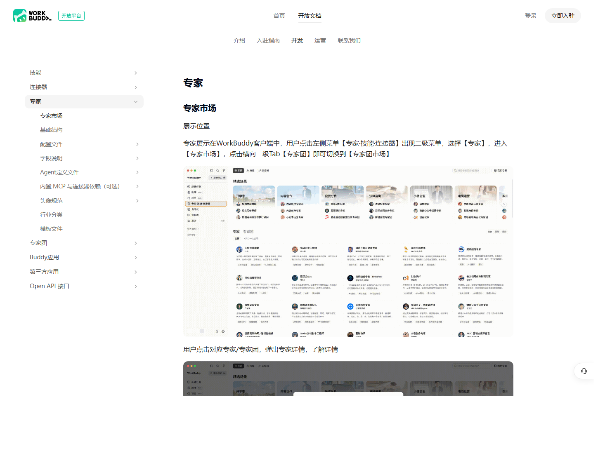

**③ 八条注意事项，按重要性排**

- **打包别漏文件。** 最高频的失败原因，照着目录清点对一遍再压。
- **付费方式上架后不能改。** 一次性买断和按月订阅选了就定了，免费也不能直接转付费。想试水先发免费版积累评价，再发一个新的付费版。
- **审核期间别反复改文件重新上传。** 可能打断流程。状态有时只显示「已发布」没有进度提示，属于已知现象，预留几天。
- **别硬编码密钥和令牌。** 需要用户提供凭据的，用 MCP 依赖声明加 Token 表单，让用户自己填、存在本地。
- **专家名称创建后不能改。** 想好再建。删除专家不可恢复，已分享出去的删掉后对方也用不了。
- **客户端「分享」不等于上架市场。** 我的专家卡片三个点里的分享只生成召唤链接，对方拿的是副本，你的配置不受影响，但别人在市场里搜不到。要公开得走开放平台。
- **安全第一。** 优先用官方推荐的技能和专家。装第三方包前看清来源、权限申请和脚本内容。技能调用第三方、改本地文件、执行系统命令时都以你本人身份执行，涉及删除、批量写入、资金操作先小范围验证。
- **学生数据要守规矩。** 上传学生作业、成绩、名单前确认你有合法权利或已获授权，注意保护未成年人个人信息。生成内容仅供参考，重要判断老师自己把关。

一句话建议，先做技能，从每周都要重复干的那件事开始；跑顺了再把最有判断力的那件事封装成专家；分享先从压缩包给同事开始，用着好了再考虑放上 SkillHub 或开放平台。

---

## 第 25 章　多 Agent 与专家团：一个教研组配一支 AI 团队

**这一章是全书最"高阶"的一章。** 如果前三篇是"你一个人用起来"，这一章是"**组织一支 AI 团队**"。

**先说结论：多 Agent 不是必须的。** 如果你的日常任务就是备课、批改、改作业，**用不到这一章。** 那一半的内容是关于"什么时候该上多 Agent"的判断。

### 什么情况下真的需要多 Agent

**只有一个理由：当一件事需要几种不同的专业判断，而且它们必须来回对话才能收敛。**

| 场景 | 是不是真需要 | 为什么 |
|---|---|---|
| 出一套分层作业 | **不需要** | 一个任务，一次判断 |
| 批改并分析学情 | **不需要** | 数据 → 分类 → 统计，一条链 |
| 上一节完整的公开课 | 弱需求 | 一个精心设计的提示词就够了 |
| 做一个学期的整体教学规划 | **可能需要** | 要同时考虑课标、学情、进度、资源、变化 |
| 设计一个校本课程体系 | **需要** | 要同时考虑目标、内容、课时、评价、教师负担 |
| 做一个跨学科的综合实践项目 | **需要** | 不同学科的视角必须碰撞 |
| 做一个校本研修方案 | **需要** | 要同时考虑教师需求、内容设计、组织方式、评估 |

**判断标准：这件事是一次性的还是持续性的？工作流是一条链还是需要来回讨论？**

- **一次性 + 一条链** → 不用多 Agent
- **持续性 + 需要来回讨论** → 考虑多 Agent

### 专家团是什么意思

**"专家团"就是让 AI 扮演多个不同角色的专家，一起完成一件事。**

听起来玄学，但实际很有用。**因为它解决的是一个真实问题：单一视角的方案有明显盲区。**

**举个例子：设计一个校本研修方案。**

单一角色的局限很明显：
- 让它做"教学专家" → 只关心内容，做出来的研修全是讲座
- 让它做"学校管理专家" → 只关心组织，做出来的研修学员没兴趣
- 让它做"培训专家" → 只关心形式，安排得满满当当但学员没收获

**多个角色一起讨论，会自然暴露这些盲区。**

### 专家和专家团：先搞清楚这两个概念

这一节补一个原书里讲得很清楚的基础区分，很多人到这一步还是糊的。

WorkBuddy 本身是一个通用 Agent，什么任务都能接。但**通用不意味着每个领域都应该用同一种方式处理。**

同样是分析一份销售数据，普通 Agent 可能会读取数据、生成图表、总结趋势。数据分析专家会先理解业务目标，再确定核心指标，检查数据质量，寻找异常变化，分析可能原因，最后给出可以执行的业务建议。

**专家 = 有明确岗位和专业经验的 AI 同事。**

而专家团是**一种协作执行机制**：一个专家团由多位专家组成，由团长自动拆解任务、分配工作、并行执行，最后整合交付。你只需要告诉团长学校背景、当前需求和预期成果，不需要自己挑选团员，也不需要自己拆分任务。

| 方式 | 本质 | 教师场景里什么时候用 |
|---|---|---|
| 普通任务 | 通用理解与执行 | 一次性的清楚任务，比如改个格式 |
| Skill | 特定工具能力 | 需要稳定执行某个动作，比如每次都做同一套卷 |
| 专家 | 人设 + 方法论 + 工具链 | 明确领域的单点专业问题，比如"帮我评这个教学设计" |
| 专家团 | 多位专家 + 协作流程 | 需要拆解、并行、汇总的复杂项目，比如设计校本研修方案 |

**判断要不要用专家团的一个简单标准：这件事是不是有明显的立场冲突。**

如果几个方面都指向同一个答案（比如整理错题表），普通任务就够。**只有当"教学上该这么设计"和"现实上能不能做到"需要同时被说出来的时候，才需要多角色。**

### 进阶：单 Agent 和多 Agent 到底差在哪

这一节补一组官方对照，看完你就不会再问"多开几个是不是就更强"。

| 维度 | 单 Agent | 多 Agent |
|---|---|---|
| **上下文** | 所有信息在一个任务里 | 按角色分头持有 |
| **工具** | 同一组权限 | **可按角色隔离工具和权限** |
| **质量** | 自己生成、自己检查 | **可设置独立评审者** |
| **成本** | 较低 | 协调、模型和工具调用更多 |
| **风险** | 一处错误影响整体 | **错误可能在角色间传播** |

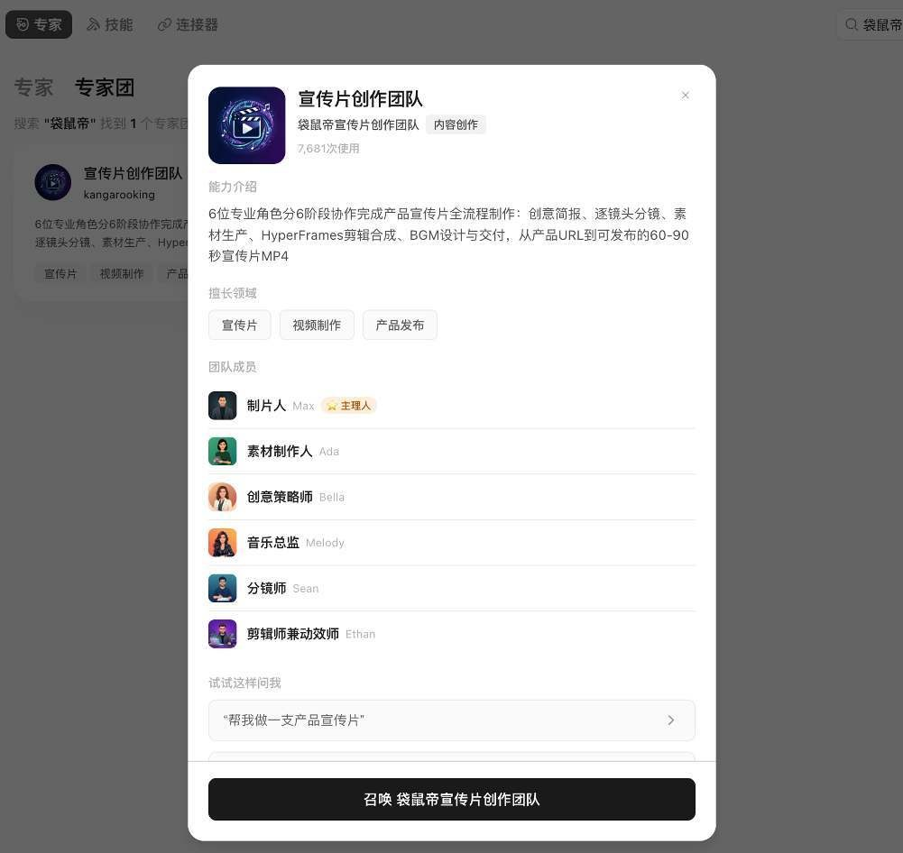

**这张表里最重要的两行是"质量"和"风险"。**

多 Agent 的质量优势来自**"可设置独立评审者"**——这是单 Agent 做不到的。单 Agent 自己写、自己检查，天然有盲区；**多 Agent 可以让一个角色专门做挑错，它的任务就是找茬。**


但代价写在最后一行：**错误可能在角色间传播。** 一个角色理解错了任务，团长会把错误的结果继续往下传，最后整合出一个"看起来完整但方向全错"的成果。**所以多 Agent 的可靠性取决于团长，团长的拆解质量决定一切。**

> **官方这句话说得非常准：**
>
> **多 Agent 的价值来自专业分工、并行、权限隔离或独立评审，不来自角色数量。**
>
> 换句话说，**加三个角色不一定比一个强，加对了才行。**

### 什么任务值得拆成多 Agent

官方给了六个判断条件，**满足越多越适合多 Agent：**

| 条件 | 说明 |
|---|---|
| **1. 至少两个子任务可以独立进行** | 不拆就没法并行 |
| **2. 子任务需要不同方法、资料或工具** | 同一个方法做不出差异 |
| **3. 输出可以定义清楚的交接格式** | 团长才能整合 |
| **4. 并行能显著缩短等待** | 有时间收益 |
| **5. 有明确总负责人和最终验收** | 有人拍板 |
| **6. 预算允许多轮调用** | 成本能承受 |

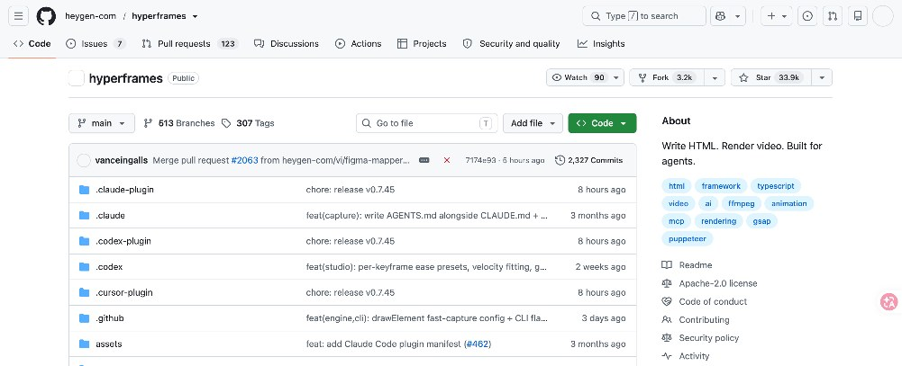

**第 3 条最容易被忽略，但它决定成败。** **如果两个子任务的输出没法定义清楚的格式，团长就没法整合，只能把两段文字拼在一起**——那就是"生成一堆文字"，不是"完成一个项目"。

**第 5 条更实际：多 Agent 必须有一个人（或者说一个角色）负责最终验收。** 没有这个角色，就是"多个人一起做但没人管对不对"。

**反过来看，什么时候绝对不要拆？**

> **只改一封邮件、总结一份 PDF 或格式化一个表格，不需要专家团。**

**这一条对教师特别重要。** 很多教师一听说"专家团"就觉得"我要用它做大事"，其实你的日常任务——改个通知格式、整理一份成绩单——**用单 Agent 更快、更稳、更便宜。** **多 Agent 是留给真正复杂的任务的。**

### 一个真实案例：专家团是怎么干活的

官方给了一个产品宣传片专家团的案例，**它的流程对教师设计校本研修特别有参考价值。**

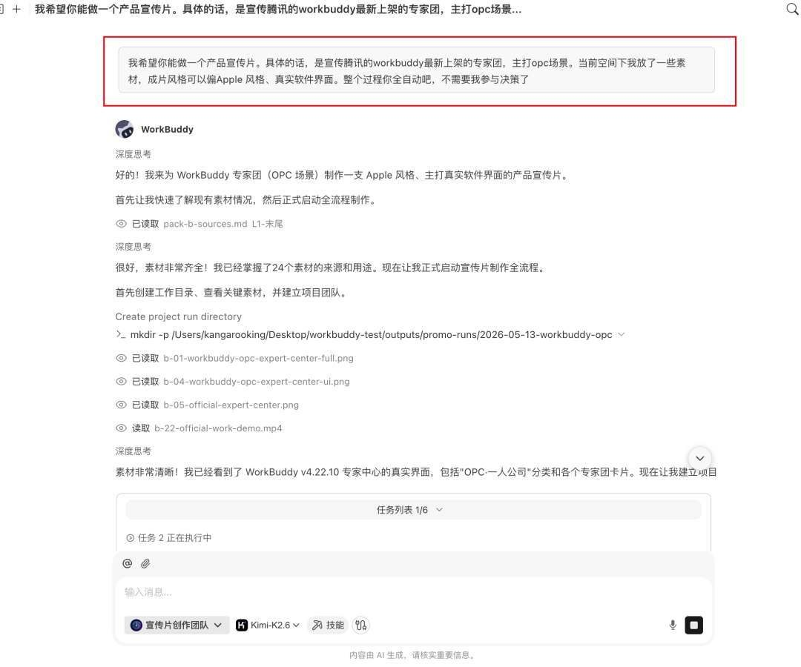

**第一步：团长拆解任务。** 团长把"做一支宣传片"拆成了一串子任务——先搞清楚这个产品到底是什么、卖给谁、核心价值是什么；再决定叙事结构、镜头数量、节奏；然后分头做素材、剪辑、配乐。

**第二步：角色各干各的。** brief 角色去翻官网、产品介绍，输出一份 brief；分镜师接着 brief 干活，把 60 秒拆成 7 个镜头，每个镜头细到时间码、画面。

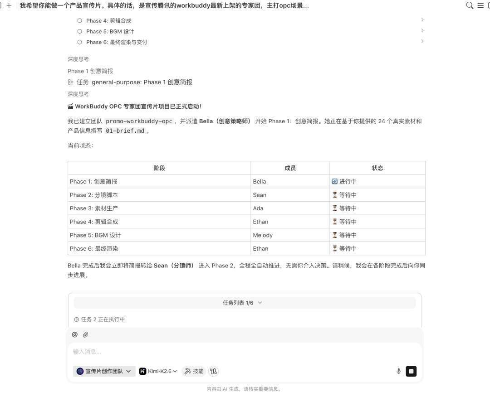

**第三步：人在关键节点拍板。** 原话是"整个过程我基本就是个旁观者：偶尔在关键节点拍一下板，比如分镜要不要这么排、BGM 喜不喜欢、字幕文案要不要改"。

> **注意"偶尔"这个词。** 人的介入是**稀疏的、精准的、只在关键决策点上**。
>
> **这正是"多 Agent + 人的判断"该有的样子：AI 负责执行密度，人负责决策质量。**
>
> 这条和第 26 章那条红线完全一致——**成长不是把判断权交给 AI，而是用 AI 放大你的专业判断。**

**这个案例搬到学校场景，就是这样：**

| 专家团角色 | 对应学校的谁 | 产出什么 |
|---|---|---|
| 团长 | 教务主任 | 拆解研修需求、统筹节奏 |
| brief 角色 | 课程标准研究者 | 梳理政策依据与目标 |
| 设计角色 | 骨干教师代表 | 把目标转成可执行环节 |
| 评估角色 | 教务/教科室 | 设计观察表与验收标准 |

### 实际怎么召唤

打开"专家·技能·连接器"，选择"专家"，可以看到可用的专家：

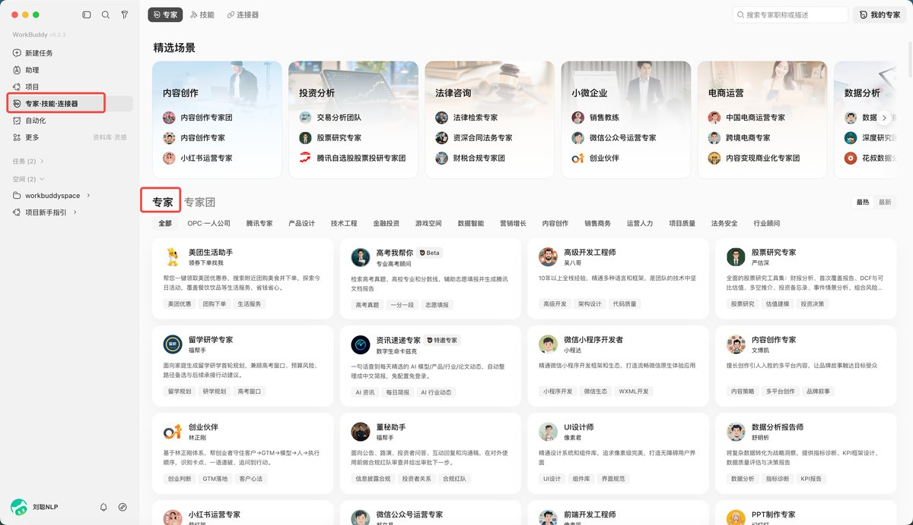

点击"召唤专家"，比如选一个教育类专家：

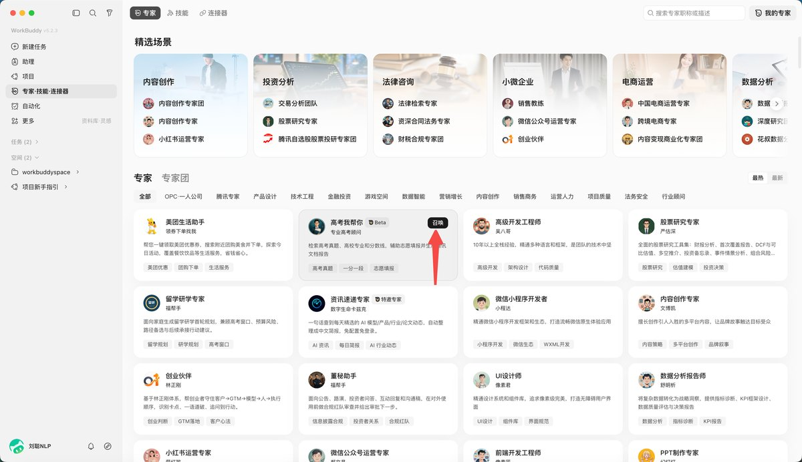

然后直接给任务内容，比如"帮我查一下2026 年高考数学真题"：

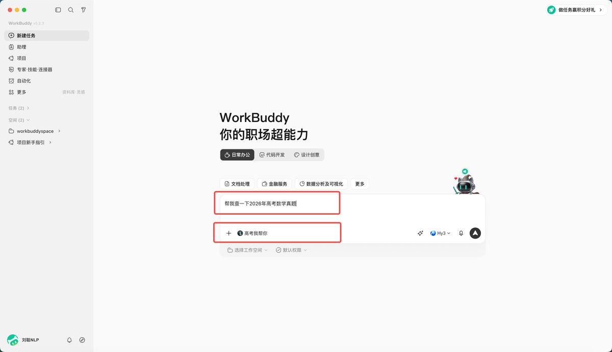

如果你要做成自己的专家，可以点"我的专家"创建，比如创建一个专门做教学设计的专家：

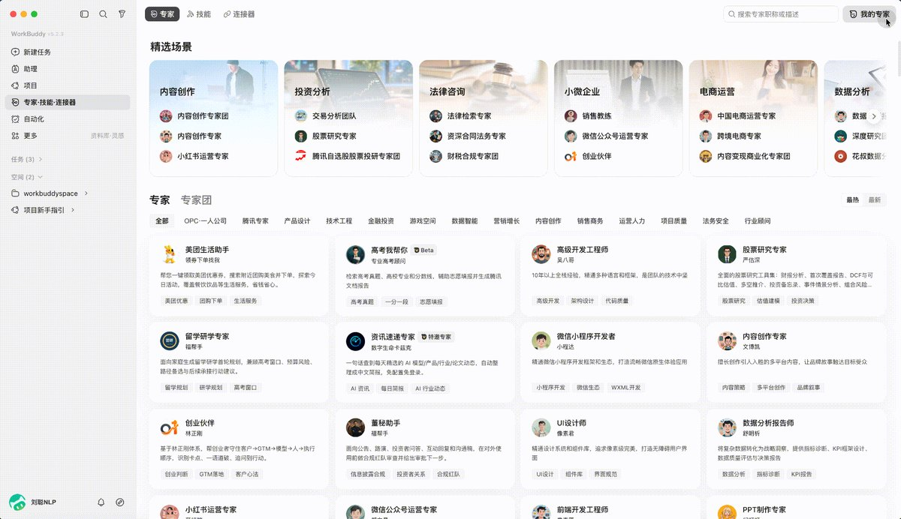

设定它的关注点和说话风格：

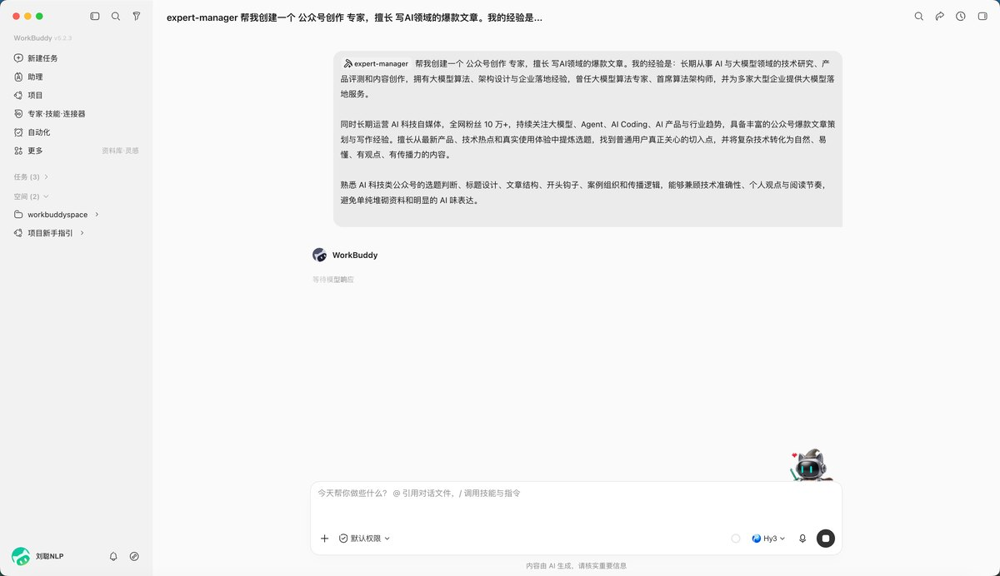

生成完成后可以先测试：

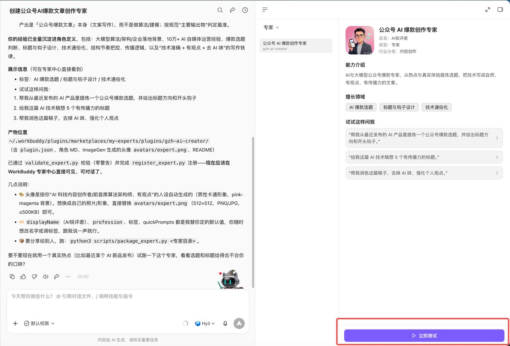

之后在"我的专家"里就能找到它：

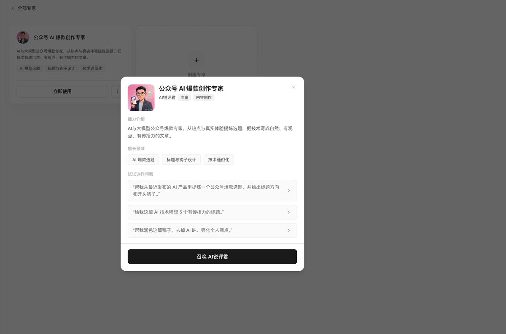

**这一步对教研组特别有价值。** 一个学科组长可以把"我们组的教学设计标准"做成一个专属专家，全组统一用它——**这比在群里反复强调"教案要写什么"有效得多。**

召唤专家团则是选择"专家团"后点击召唤：

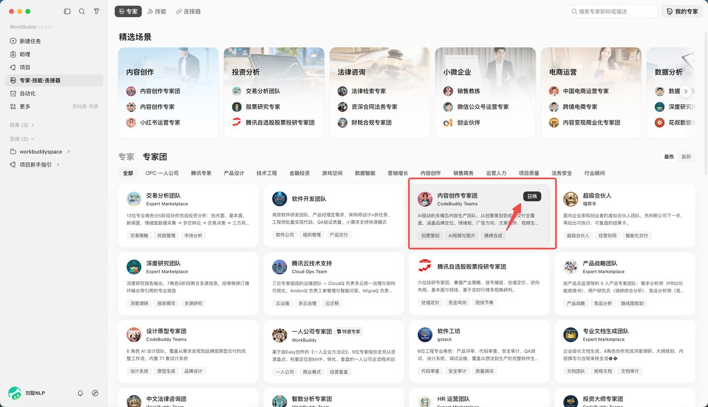

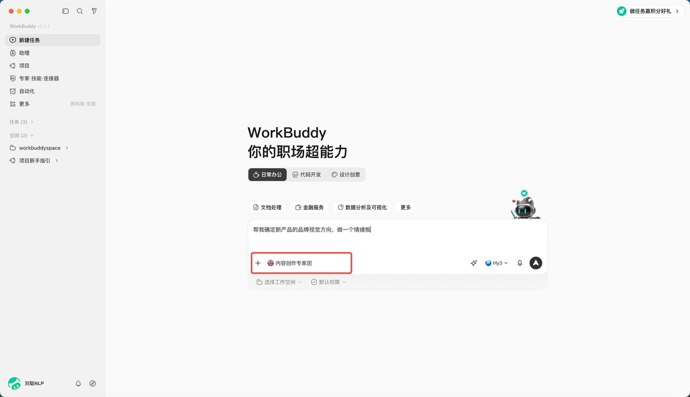

**专家团由团长负责拆解和汇总，成员按角色并行或串行执行。** 任务开始前先确认四件事：成员分工是否覆盖完整、哪些步骤依赖前一步、什么时候需要人来拍板、最终由谁整合。

**这四个问题的答案，就是下面那段提示词要写的东西。**

### 提示词示例：用专家团设计校本研修

```
我需要设计一个校本研修方案，请用专家团的方式来做。

【背景】
- 我校是县域初级中学，68 名教师
- 教师队伍结构：35 岁以下 22 人，35-50 岁 31 人，50 岁以上 15 人
- 最大问题：
  ① 年轻教师想用 AI 但不知道从哪开始
  ② 老教师觉得"用不上"，抵触
  ③ 全校没有统一的规范，个别老师用得很随意
- 我们的优势：教研活动一直坚持了 8 年，有固定时间
- 我们的困难：教师普遍很忙，不愿意额外投入时间
- 硬约束：不能占用上课时间，只能用现有的教研活动时间（每周五下午，1 小时）

【请你扮演以下四个专家，一起完成这个方案】

专家 A：教学 theorist（教学理论专家）
- 关注：研修内容有没有理论支撑、是否符合课标和学科核心素养
- 说话风格：会追问"这个做法背后的教育学依据是什么"

专家 B：学校管理者（校长/教研主任视角）
- 关注：能不能执行、教师愿不愿意、时间够不够、会不会流于形式
- 说话风格：务实，会直接指出"这个方案老师不会参加"

专家 C：教师发展专家
- 关注：不同年龄段教师的差异、成长路径设计、怎么让老教师接受
- 说话风格：温和，会关注人的感受

专家 D：AI 应用实践者
- 关注：AI 具体怎么用、用到什么程度、哪些环节 AI 不能碰
- 说话风格：具体，喜欢给可操作的步骤

【工作方式】
1. 先让四位专家**各自独立**说一遍他们的方案要点（不要互相参考，
   避免一开始就趋同）
2. 再让他们**互相质疑**：每个专家要指出其他专家方案里的一个问题
3. 最后形成综合方案，要说明：
   - 采用了谁的哪些建议
   - 拒绝了哪些建议，为什么
   - 分歧最大的地方是什么，怎么折中的

【方案必须包含】
1. 研修目标（可观测，不要"提升专业素养"这种空话）
2. 分层设计：35 岁以下 / 35-50 岁 / 50 岁以上，三类教师分别怎么安排
3. 60 分钟的单次活动设计（时间轴，要具体到每个环节几分钟）
4. 一学期的 16 次安排（每次的主题和形式）
5. 需要教师额外投入的时间（要诚实，不能假装零负担）
6. 风险预案：最可能的三种失败情况
7. 一个"怎么判断这次研修有没有用"的评估方法

【最后的硬要求】
- 整个方案不能增加教师额外负担（硬约束：只用现有时间）
- 必须让 50 岁以上教师觉得"这和我有关"，
  不能只对年轻教师有用
- 不要用"赋能""抓手""闭环"这类词
```

**这份指令里有五处高阶设计，值得逐个说：**

**一、"先让四位专家各自独立说一遍（不要互相参考，避免一开始就趋同）"**

这是最关键的一个技巧。**如果让他们依次发言，先发言的会影响后面的，最后四个人说出来的基本是同一个东西。**

**"独立先说一遍"保证了真实的分歧。** 分歧才是多 Agent 的价值所在。

**二、"再让他们互相质疑：每个专家要指出其他方案里的一个问题"**

**"互相质疑"这一步产出的东西，通常比"各自说方案"更有价值。** 因为它逼每个专家跳出自己的立场。

**三、"最后说明采用了谁的建议、拒绝了哪些建议、为什么"**

**这一条让多 Agent 讨论产生可解释的结论，而不是一团和气。** 而且它对你特别有用——**你能看到不同立场各自的道理，在做决定时多一个视角。**

**四、硬约束写清楚（不能占用上课时间、只用现有教研时间）"**

**多 Agent 特别容易产出"理论上好、执行起来难"的方案。** 因为 AI 不知道你们学校真实的约束。**约束必须你来写死。**

**五、"不要用'赋能''抓手''闭环'这类词"**

这一条看似小事，但很实用。**这类词在教育系统里是"正确的废话"，写进方案里会让方案显得很套路。** 避开它们，方案的语言会更实在。

### 进阶：多 Agent 设计的四个注意点

| 注意点 | 说明 | 反例 |
|---|---|---|
| **1. 角色要有真实分歧** | 四个角色如果观点一致，就是浪费 | 找四个真的会吵起来的视角 |
| **2. 人数 3-5 个最好** | 太多则讨论发散，太少则盲区多 | 10 个角色 |
| **3. 必须有人在环** | AI 讨论完你要做判断 | 直接采纳 AI 的综合方案 |
| **4. 记录讨论过程** | 争论的地方往往是最有价值的 | 只保存最终结果 |

**第 4 条值得多说一句。** 专家团讨论里，**争议最大的那个点，通常就是你方案里最脆弱的地方。** 把争论过程记下来，比记结论有用得多。

**这也和第 22 章的提示词库逻辑一致：过程中的判断比最终的结果更值钱。**

### 常见错误与修正方式

| 常见错误 | 为什么会发生 | 更好的写法 |
|---|---|---|
| 什么事都用多 Agent | 觉得高级 | 先问"是不是一次性+一条链" |
| 四个角色观点一样 | 角色定得太像 | **找真的会吵起来的视角** |
| 角色太多 | 想全面 | 3-5 个最好 |
| 不给硬约束 | 忘了 AI 不知道你校的限制 | **把不能违反的写死** |
| 直接采纳 AI 的综合方案 | 省事 | **你在环，你做判断** |
| 只存最终方案 | 省事 | 记录争论过程 |
| 用"赋能""抓手"这类词 | 顺口 | 明确禁用这类套话 |

### 区域实践参照

**这一章的方法，在教研共同体层面已经被验证过了，只是形式不同。**

**安徽长丰**（《安徽青年报》2026 年报道）培养了四个层级的骨干梯队：**116 名种子教师、106 名三研教师培育站成员、81 名兼职教研员、74 名名师工作室主持人**。

**这四个层级恰好构成了一种"人类多 Agent 结构"：**

| 层级 | 人数 | 在这个结构里的角色 |
|---|---|---|
| 名师工作室主持人 | 74 | 定方向（像"专家 A"：理论与方向） |
| 兼职教研员 | 81 | 组织落地（像"专家 B/C"：管理与人的因素） |
| 三研教师培育站成员 | 106 | 研究方法（像"专家 D"：具体怎么做） |
| 种子教师 | 116 | 一线试验（提供真实反馈） |

**这个结构有意思的地方是：它把"定方向""管组织""做研究""做实验"分给了不同的人。**

**而任何一个教师，都不可能同时是这四种角色。** 这就是多 Agent 思路在真人组织里的体现——**不是因为人多好，而是因为不同的视角必须有人替它说话。**

**这里有一个数字很有意思：116 名种子教师，第一季度示范课 42 节，辐射 1200 人次。**

**42 节示范课 / 116 名种子教师 = 每人不到 0.4 节。** 也就是说，**116 人不是每人都上了公开课，而是少数人上、多数人学。**

**这正是多 Agent 结构的现实形态：不是所有人都在台上，是台上有几个人，台下有几十个人在学。**

**长丰还说了一句很有价值的话**：

> "越来越多的教师开始意识到，**AI 赋能不是简单的'会操作工具'，而是要让工具真正服务教学目标、学生发展和课堂改进**。"

**这句话点出了多 Agent 的真正意义：不是为了用几个 Agent 而用，是为了"服务教学目标"这个目的。** 手段和目的的区分，是这一章最需要记住的东西。

### 你校可以怎么改

> 1. 我手上有一件"需要几种不同专业判断"的工作吗（列出来）：
> 2. 如果有，这几种判断分别会吵起来吗（会吵才值得做多 Agent）：
> 3. 我校有没有"能撑起一个团队"的几个人（哪怕只有三个愿意折腾的）：
> 4. 我做决定时，AI 给的建议我一般怎么用（参考？启发？还是直接采纳）：

### 【2026 年 10 月增补】专家团成本账、成绩分析专家团、一次真实跑通的参考

**① 用专家团之前，先算这笔账**（来源：《WorkBuddy 从入门到精通》系列）

专家团的机制：**团长自动拆任务 → 分给不同专家并行跑 → 跑完整合交付**。软件开发的例子：交付总监主理 + 产品经理、架构师、工程师、QA 各司其职。**关键数字：多个专家同时跑，积分消耗大约是单个专家的 3 到 5 倍**——教师场景先问一句"这活值不值得 3 倍成本"，多数日常任务（备课、出卷）单专家+Skill 就够，专家团留给真正需要多视角打磨的场合（公开课终审、校本研修方案设计——正是本章正文的判断）。

**② 教育场景的专家团实例**（来源：2026 年 9 月武汉《WorkBuddy 赋能智慧课程》工作坊模块）

成绩分析/教学评价专家团的分工设计：成绩清洗 → 分布统计 → 得分率分析 → 学生分层 → 达成度诊断 → 改进闭环，各环节交给对应专家，教师只看汇总结论与做最终决策。同场工作坊还有"创建课程 AI 工具平台"模块（HTML 交互课件 + 3D 演示聚合）——专家团不止出报告，还能出"看得见的成品"。

**③ 一次"AI 军团"跑完培训交付的参照**（来源：《分享我的 AI 培训军团》，工具为商汤小浣熊，取其流程思想）

两支专家团串起"需求诊断→教研设计→课件→物料归档"整条链，一句话启动："**为澜山家居交付一场企业 AI 培训，资料在客户工作区**"。两个可迁移的细节：**缺资料时"它不会硬编，会老老实实标上'推断'两个字"**（对 AI 输出的品格要求，可写进你给专家团的指令里）；定时任务每天 8 点自动生成行业动态晨报"喂给诊断顾问当弹药"（专家团+自动化的组合拳，对应第 23 章）。

---

## 第 26 章　从个人到区域：把工作流交给学校

**全书最后一章。** 前面 25 章讲的是"你"，这一章讲的是"**一个学校、一个区域**"。

**这一章的判断标准不是"技术上能不能做到"，而是"这个方案在县域学校能不能活下来"。**

### 真实的层级现实

**县域推进 AI 落地，通常会遇到四种状态：**

| 状态 | 特征 | 风险 |
|---|---|---|
| **1. 自发探索** | 几个老师自己在用，方式各异 | 走不远，因为没有沉淀 |
| **2. 集中培训** | 办几场讲座，全员参加 | 培训完就没了 |
| **3. 机制推动** | 有制度、有评比、有考核 | 可能变成"为应付而应付" |
| **4. 机制 + 生态** | 机制推动 + 有沉淀资产 + 有同伴支持 | **这才是能活下来的状态** |

**大多数县域卡在 2 和 3 之间。** 培训办完了，机制建立了，但**没有资产沉淀**（提示词、题库、工作流都没留下），所以过两年又从零开始。

**长丰走到了第 4 层。** 它的证据不只是"116 名种子教师"这个数字，而是**同课异构 60 余次、对比报告 120 余份、微课题百余项、课堂观察 20 条、1300 道试题库**——**这些是资产，不是活动。**

### 三个层次的实际推动

### 层次一：让工作流成为资产（最重要，也最容易被忽略）

**判断标准：一个学校有没有"资产"，看它能不能回答这三个问题：**

| 问题 | 有资产的学校 | 没资产的学校 |
|---|---|---|
| 新来一个年轻教师，学校能给他什么？ | 有 30 条验证过的提示词、5 份单元设计 | "你自己摸索一下" |
| 我们学校最好的教学做法是什么？ | 写在文件里、有人能用 | 在某个老师脑子里 |
| 我们这届学生和上届比有什么变化？ | 有数据可查 | 说不清 |

**第一个问题最能说明问题。** **"新老师来了能得到什么"是学校最大的隐性资产指标。**

**推动方法（成本从低到高）：**

| 层次 | 做法 | 成本 | 效果 |
|---|---|---|---|
| **1. 建一个共享提示词库** | 全校贡献，教研组长维护 | 极低 | 立刻可见 |
| **2. 沉淀单元设计** | 每学期每单元一份，教研组用 | 低 | 高 |
| **3. 建校本题库** | 几年积累 | 中 | 高 |
| **4. 建课堂观察标准** | 统一观察表 + 积累数据 | 中 | 高 |
| **5. 建校本研修序列** | 三年一规划 | 高 | 最高 |

**从第 1 项做起。** 它成本最低、见效最快，而且**"每个人贡献一条提示词"这个动作本身就有价值**——它让人意识到自己可以贡献东西。

### 层次二：让骨干带队伍（机制层面）

**长丰的四层结构（种子教师—三研教师—兼职教研员—名师工作室主持人）是一条可参考的路径。**

**但如果你的学校没有 116 人，缩小版本是什么？**

**一个 68 人的学校版本：**

| 角色 | 人数 | 做什么 | 怎么认定 |
|---|---|---|---|
| **先行者** | 2-3 人 | 跑通工作流，拿出可展示的东西 | 自愿 + 有一点成果 |
| **骨干** | 5-8 人 | 承担组内指导，收集问题 | 先行者自然成长 |
| **全员** | 全体 | 使用 + 贡献 | 不设门槛 |

**关键设计：先行者的认定标准不是"会用工具"，而是"做出了能被看到的东西"。**

比如：
- 一份被同学直接用的分层作业设计
- 一次被听过的示范课
- 一个提示词被 5 个人以上用过

**这个标准很重要，因为它把"会用 AI"变成了"做出了成果"。** 前者无法验证，后者可以。

### 层次三：让数据可用（区域层面）

这一层是教研员和教育局的事，但教师要理解它的逻辑，因为**它决定了教师每天在做什么。**

**核心问题：区域的教育数据能不能支持"精确的教学决策"？**

**赣榆区的做法**（《江苏教育报》2026-04-24）是：**"数据监测—教研反馈—学校改进"闭环，"日监测、周通报、月评估"数据看板。**

**校长陈涛说的核心价值是**："系统的核心价值在于**用技术手段攻克了传统作文教学中'数据难采集、学情难量化'的顽疾**。"

**这四句话里的"学情难量化"是关键。** 在没有数据的情况下，教师的判断只能来自经验；**有了数据，判断才有依据。**

**温州的做法又是另一种路径**（温州市教育局 2026-05-11）：**"智能初评 → 教师精批 → 学生互评 → 自主修改"四步评改流程**，并提出了"到 2027 年形成 100 个可复制推广的 AI 赋能教育教学创新案例"的目标。

**赣榆是"数据先行"，温州是"流程先行"。** 两条路径都可以，但都不跳过"教师精批/复核"这一环。

### 一张清单：判断你的学校到了哪一级

**用这张表自查，每一项打勾。**

| 层次 | 判断标准 | 我们学校有吗 |
|---|---|---|
| **L1 有工具** | 知道有这个工具 | □ |
| **L2 有人用** | 至少 3 个老师在真实工作中用 | □ |
| **L3 有沉淀** | 有共享的提示词库或单元设计 | □ |
| **L4 有机制** | 有固定的活动时间（如教研活动） | □ |
| **L5 有标准** | 有统一的观察表或评价标准 | □ |
| **L6 有资产** | 新老师来了有东西可用 | □ |
| **L7 有数据** | 能回答"我们学校/年级哪里最弱" | □ |
| **L8 有机制 + 生态** | 有机制推动，也有同伴支持和资产沉淀 | □ |

**请诚实回答，不要拔高。**

**这个清单的价值在于它能告诉你下一步做什么。** 绝大多数学校在 L2-L3 之间，**卡住的原因不是没有工具，是没有沉淀。**

**从 L2 到 L3 最简单的一步：建一个共享的提示词库。** 下次教研活动，分 10 分钟，每个人贡献一条自己验证过的提示词，存进共享文件夹。**一个学期后，这个文件夹就是学校的第一个资产。**

### 一个可以照着走的成长模型：四阶段

上面讲的是学校层面。这一节讲**你个人**该怎么走。

有一个已经跑起来的完整样本：**山东莱州**。2026 年秋季"开学 AI 第一课"上，莱州市教育和体育局张勇局长提出三个转变——**从"找工具"到"工具找教师"，从"人人应用"到"全场景融入"，从"会用 AI"到"用好 AI"。**

**他们走出来的路径分四个阶段，你可以对照自己现在在哪一格：**

| 阶段 | 特征 | 判断标准 | 大概多久 |
|---|---|---|---|
| **体验者** | 敢用 | 知道有这个工具，试过几次 | 一个月 |
| **使用者** | 常用 | **每周稳定用 3 次以上** | 三到六个月 |
| **创造者** | 会封装 | 把自己的做法做成提示词库、Skill 或专家 | 一年 |
| **引领者** | 能带人 | 带动同事用起来，输出可复制经验 | 两年以上 |

> **这条路径最关键的一句话是：不要一上来就想"做个 Skill"，先从"每周稳定用 3 次"开始。**
>
> 几乎所有失败案例都死在跳过第二阶段——**造了一个自己都不常用的 Skill，然后束之高阁。**

**莱州的几个数据值得看：**

- **2024 年**先组建"人工智能教育小组"，由**乐于探索、有分享精神的骨干教师**组成——注意这个前提，不是全员
- 走的是渐进路径：基础应用 → 课程短视频 → **至少熟练掌握一个智能体**
- **2026 年 7 月**正式组建人工智能教育工作室，遴选首批实验校
- **2026 年暑假，推荐使用 WorkBuddy 的教师比例达到 76.5%**，在接触过的智能体中认可度领先

**76.5% 这个数字怎么解读？** 它最值得看的不是数值大小，而是**它建立在什么基础上**——三年时间、从十几人的小组起步、有人带、每周都在用。**换来的，不是一时的热度。**

**任军涛主任的那句话，是这套实践里最值钱的一句：**

> **"有经验的一线教师是充满才智的。"**

**他特别看重中年教师和管理者**，理由是经验在 AI 时代可能重新成为优势——**因为你多年的教学理解，正是 AI 拿不走、也无法替代的部分。**

这也回答了本章开头那个问题：**为什么学校推动 AI，最该动的不是最年轻的那批人。** 最该动的是**教学经验最厚的那批人**——他们一旦动起来，效果比年轻人大一倍。

### 机制：为什么光靠热情不行

莱州这条路能走通，还有一个机制层面的原因：**它从一开始就不是"个人兴趣"，而是"组织行为"。**

张勇局长的话点得很准：**要通过学校负责人制、骨干教师带动和积分激励，让 AI 应用"从个别人的兴趣逐渐变成一种组织行为"。**

**这句话点破了一个关键现实：如果没有激励，AI 很容易沦为"少数人玩、多数人观望"的摆设。**

对应的机制是**双轮设计**：

| 机制 | 面向谁 | 作用 | 逻辑 |
|---|---|---|---|
| **积分普惠** | 全体教师 | 人人可参与、人人能得分 | **入场券**——降低参与门槛，让大多数人在参与中获得正向反馈 |
| **AI 先锋教师激励计划** | 真正沉淀经验、带动他人的教师 | 专属激励、培训支持，有望成为区域"AI 先锋教育者"代表 | **放大器**——让优秀实践被放大 |

腾讯 SSV 数字教育实验室杨京表示，腾讯将发起 AI 先锋教师激励计划，为在教学办公领域利用 AI 提效创新的先锋代表提供专属激励、培训支持等。

**"普惠 = 入场券，激励 = 放大器"这个设计值得抄。** 它解决的是一个很实际的问题：**如果只有少数人得奖，多数人会觉得"那跟我没关系"。** 先用普惠让所有人进来，再用激励让真正做事的人被看见。

**还有一条最容易被忽略的机制：组织兜底。** 激励不能是"线上发奖"，要**嵌入学校工作安排**——学校负责人制 + 骨干教师带动。**没有这一条，激励就只是平台上的一个数字，跟你的实际工作没关系。**

**最后是"沉淀即收益"这条：把优质互动课件、教学应用、学情管理应用沉淀为可复制、可共享的专家和 Skill，本身就是激励计划鼓励的方向。**

> **换句话说，你把东西留下来这件事本身就有价值。**
>
> 这条正好呼应第 24 章：**做 Skill 的最大回报不是省了自己的时间，是别人开始用你的东西。**

### 一条不能越过的红线

前面所有内容都在讲"怎么往前走"。这一节讲"走到哪都要守住的那条线"。

腾讯 SSV 数字教育实验室何嘉珞明确提醒：

> **"老师自己一定要严守人工审核的最后一关。"**

**这句话应该被贴在任何一份 AI 使用手册的第一页。**

**怎么理解这句话？回到第 2 章那张表：**

| 交给它的 | 必须你来 |
|---|---|
| 从课标和教材整理出教学框架 | **决定这节课的核心目标** |
| 生成课件初稿、检测题初稿 | **判断题目是否超纲、是否符合学情** |
| 批量处理文件、转换格式 | **决定哪些信息可以进系统** |

**成长不是把判断权交给 AI，而是用 AI 放大你的专业判断。** 这两句话看起来矛盾，其实是一件事：

> **AI 让你的产出速度变快十倍，但你的判断决定了这十倍值不值。**
>
> **一个用了 AI 但没有判断力的教师，产出的垃圾也是十倍。**

**具体到操作层面，这条红线有三个必须落到的地方：**

| 环节 | 红线 | 怎么落地 |
|---|---|---|
| **内容出口** | 学生要看的，必须过你一遍 | AI 出的题、写的评语，**发出去之前必须自己读一遍** |
| **数据入口** | 涉及学生的，不随便出本地 | 批改、成绩分析走本地处理，见第 11 章 |
| **外发环节** | 群发、通知类，必须先预览 | 见第 23 章那五个坑的第 4 条 |

**第三条尤其要强调，因为它最不可逆。** 学生看到的不对，改不回来；家长群里发出去的错话，收不回来。

### 常见错误与修正方式

| 常见错误 | 为什么会发生 | 更好的写法 |
|---|---|---|
| 办完培训就结束 | 以为培训 =落地 | 培训后必须有沉淀环节 |
| 认定标准是"会用工具" | 无法验证 | 改成"做出了能被看到的成果" |
| 没有共享资产 | 各干各的 | 先建提示词库，成本最低 |
| 资产靠一个人维护 | 靠热心人 | 用的时候顺手补 |
| 追求活动数量 | 政绩思维 | 看资产不看活动 |
| 跳过"教师复核"环节 | 效率优先 | **必须保留人的判断环节** |
| 一步到位建完整体系 | 不现实 | 从 L2→L3 做起 |
| 拔高自查结果 | 自我评价失真 | 诚实回答才有价值 |

### 区域实践参照：五个地方的完整对照

**这本书里所有案例，到这一章可以合成一张表。** 这是全书最有价值的一页。

| 地方 | 切入点 | 核心机制 | 可迁移的做法 | 来源 |
|---|---|---|---|---|
| **安徽长丰** | 教研与课堂评价 | 评选要求至少用一种 AI 工具 + 20 余项课堂数据 + 20 条观察标准 | **把使用变成硬性条件；骨干把经验标准化** | 安徽青年报 2026 |
| **广西贺州** | 培训与本土化 | 覆盖全市的深度应用培训 + "从找资源到建资源" | **把本地元素放进课，让 AI 课件不可替代** | 贺州市政府网 2026 |
| **江苏赣榆** | 作文批改 | 日监测/周通报/月评估数据看板 + AI初评-教师精评-学生再创 | **数据三频分层，用途不同** | 江苏教育报 2026-04-24 |
| **浙江温州** | 评改流程 | 智能初评→教师精批→学生互评→自主修改 + 100 个可复制案例目标 | **让学生能反驳 AI 批注** | 温州市教育局 2026-05-11 |
| **山东临沭** | 作文批改 | 现场写作 → 智能批改 → 针对性辅导 → 优化提升 | **现场写作保证数据真实** | 临沭县政府网 |
| **安徽合肥** | 作业与题库 | 1300 余道区本试题库 + 电子错题本（归集/相似题推送/微课） | **错题要配同类题和讲解** | 中新网安徽 2026-09-23 |
| **内蒙古准格尔** | 学科全流程 | 课前搭资源/课中做可视化/课后自动补讲解 | **三段式分工** | 鄂尔多斯市政府网 2026-05-21 |
| **广东蓬江** | 阅读与数学 | AI 文本分析 + 动态演示工具 | **AI 用来解决"静态讲不清的知识点"** | 蓬江区政府网 |
| **浙江诸暨** | 作文 + 家校 | AI 初诊→教师复核→学生修改→家长协同 | **家长要"借助报告"而不是"接收通知"** | 绍兴日报 2026-02-25 |
| **广西永福** | 教研常态化 | 语文数学英语三组常态化 AI 教研系列活动 | **一次培训只能教会工具，持续教研才形成能力** | 永福县政府网 |

**从这张表能读出五条结论：**

**一、所有地方都保留"人"的判断环节。** 长丰"教师复核"、温州"教师精批"、赣榆"教师精评"、临沭"现场写作"——**没有一个地方把判断交给 AI。** **这不是巧合，这是这类技术能被学校接受的前提。**

**二、所有地方都从"某个具体环节"切入，不是一上来全面铺开。** 长丰从课堂观察切、赣榆和温州从作文切、合肥从作业切、准格尔从地理和数学切。

> **切口的共同特征：那里已经"痛"了，而且数据可采集。**
>
> **选切口的标准不是"哪个最容易用 AI"，是"哪个最痛、最好验证"。**

**三、几乎所有地方都做了"本土化"。** 贺州的茶叶和地标、永福的瑶族元素、蓬江的 AI 动态演示——**AI 生成的通用内容很快会变成新的"千篇一律"。**

**四、"可持续"的都是常态机制，不是专项活动。** 长丰的 60 余次同课异构、永福的常态化教研系列、温州的 100 个案例目标——**都是可以重复一年的机制，而不是办完就结束的活动。**

**五、成功的地方都有一个"骨干梯队"。** 长丰 116/106/81/74 四层、合肥的四十八中集团模式、诸暨的"创客空间"——**没有例外。**

> **这五条合起来，是这本书想说的话：**
>
> **AI 进学校这件事，工具只占很小一部分。真正决定成败的，是有没有"痛的地方可以切"、"人还留着判断"、"做完留下了东西"、"有人愿意带"。
>
> **这四句话里，一个都不需要技术支持，但每一个都需要有人去做。**

### 你校可以怎么改

> 1. 对照那张 L1-L8 清单，我们学校到了第几级（诚实回答）：
> 2. 我们学校现有的"资产"有哪些（提示词、单元设计、题库、观察表、其他）：
> 3. 如果只能做一件事提升一个层级，我做哪件（提示：从 L2→L3 建提示词库开始）：
> 4. 我们学校谁是"先行者"（愿意折腾、做出东西的人）：
> 5. 新来的年轻教师，现在能得到什么（这个问题最能暴露问题）：
> 6. 我能影响的那一级判断，哪一项我不同意（写下你的理由，这可能就是你推动的起点）：

### 【2026 年 10 月增补】政策链条、莱州案例、学生端研究与家校对策

**① 2026 年 9 月政策链条（完整版）**（来源：教育部 9 月 4 日新闻发布会多方报道互证）

```
国务院《关于深入实施"人工智能+"行动的意见》
  └→ 2026 年 4 月 教育部等五部门《"人工智能+教育"行动计划》（教科信〔2026〕1号）
       └→ 9 月 4 日 教育部发布会：实施"人工智能+教师发展"行动（教师工作司司长王磊）
            ├→ 抓手一：国家智慧教育平台教师中心上线 AI 素养专区（免费课程包+实操案例）
            ├→ 抓手二：依托"国培计划"线下示范培训，覆盖城乡全体教师
            │          "拒绝悬浮、脱离教学的 AI 培训，坚持'拿来就能用，用了就管用'"
            └→ 抓手三：万名 AI 素养先锋计划（种子教师、课堂方案全国共享）
操作层配套：《教师生成式人工智能应用指引（第一版）》30 个场景示例 + 18 个行为边界
国际参照：UNESCO《教师人工智能能力框架》（5 维度 15 项能力，习得—深化—创造三级进阶）
```

官方表态三句话值得抄进学校的推进方案："**希望人工智能成为教师手中的'智慧烛台'，而不是压在肩头的负担**""让技术成全教师，而不是为难教师""人工智能+教师发展，不等于把教师训练成 AI 工程师"。

**平衡视角也要讲**（来源：《全国 1870.1 万教师的 AI 素养培训，教的是工具，缺的是教学》）：AI 素养培训已并入继续教育学时刚性指标（5 年 240 学时），基层担忧"培训变新负担"；《中国教育报》的药方是**"AI 初稿生成—教师重构优化—课堂实践检验—复盘迭代升级"** 的完整闭环——从"会用工具"到"善用育人"。学校推动时把这句话写进方案，能避掉"为学时而学"的形式化。

**② 区域新样本：山东莱州**（来源：多篇公开报道互证）

莱州给全市 **6000 多名中小学教师人手配一台 WorkBuddy**——全国首个区域全员部署。教体局局长张勇："人工智能不会取代教师，但善用人工智能的教师，必将走在前列。"一线实测的对比（一线教师原话）："以前：'均分掉了 3 分。'现在：'第 14 题全班失分率 68%，对应知识点是二次函数图像平移，低分段 12 人里 9 人卡在这一步。'"——与本章已有的区域案例表可并列使用。

**③ 学生端滥用的硬证据与家校对策**（来源：CEPR 工作论文 DP21577，26,811 名中国学生 30 个月追踪）

给家长会和教师培训引用的数据：用 AI 的学生**作业分数上涨 18%，但闭卷考试分数下跌 20%**；其中 81% 属"外包型"（作业用时不到 50 分钟、作业分高、考试分极低）；**延迟显化：月考 6 个月内显化，中考高考的惩罚要 2 年才完全显现**。

教师侧与家长侧的三个动作（家校沟通材料可直接用）：

1. **红线信号**："作业用时 < 30 分钟 + 作业分数 > 95%"——不要骂，先"诊断性断食一周"（停用 AI 写作业）；
2. **AI 使用三层分级**：L1 辅导（讲思路，可用）／L2 校对（写完检查，可用）／**L3 外包（直接问答案，禁用）**；
3. **家庭作业契约五条**："作业是自己的事。先想，卡了再问。／AI 是工具，不是答案。问'为什么'，不问'答案是啥'。／作业用时是真实用时，不是'AI 用时'。／每周日晚 8 点，和家长一起看本周作业时间表。／排名掉的时候，我们聊'学到了什么'，不聊'分丢了'。"

教师侧的启示：**作业设计要降低"AI 可外包性"**——课堂限时完成、口头讲题、过程性任务（这正好与第 9、12 章的方法闭环）。配学生智能体的设计原则一句话（来源：《老师应该给学生准备哪些AI智能体》）："**用教学逻辑替代 AI 的答案思维**——解题辅导不说'解题给答案'，说'解题导学'。"

---

# 全书完

**26 章，四篇，五个附录。**

**从第 1 章的"这工具和豆包有什么不一样"，到第 26 章的"我们学校到了第几级"。**

**回到最开始的那句话：**

> **AI 给你答案，WorkBuddy 给你成品。**
>
> 这个差别在第 2 章。
>
> 但真正把 AI 变成教育生产力的，不是这个差别——
>
> **是你有没有把工作方法沉淀下来。**
>
> **一个人会用 AI，是一个人的效率；一个教研组会把工作流沉淀成资产，那是一个学校的产能。**
>
> **这中间的距离，就是这本书想陪你走的那段路。**

---

**下一步建议**

1. **不要一次做完。** 回到附录 B 场景速查表，找一个你明天就要做的任务，做完那一章。
2. **今天就开始建提示词库。** 哪怕只有两条。这是复利的起点。
3. **给一个同事看这本书。** 两个人用和一个人用，差别在第三周就会出现。
4. **一个学期后回来看第 26 章的 L1-L8 清单。** 看看你们学校升了几级。

**祝你在教育里用上工具，也不丢掉教育本身。**
