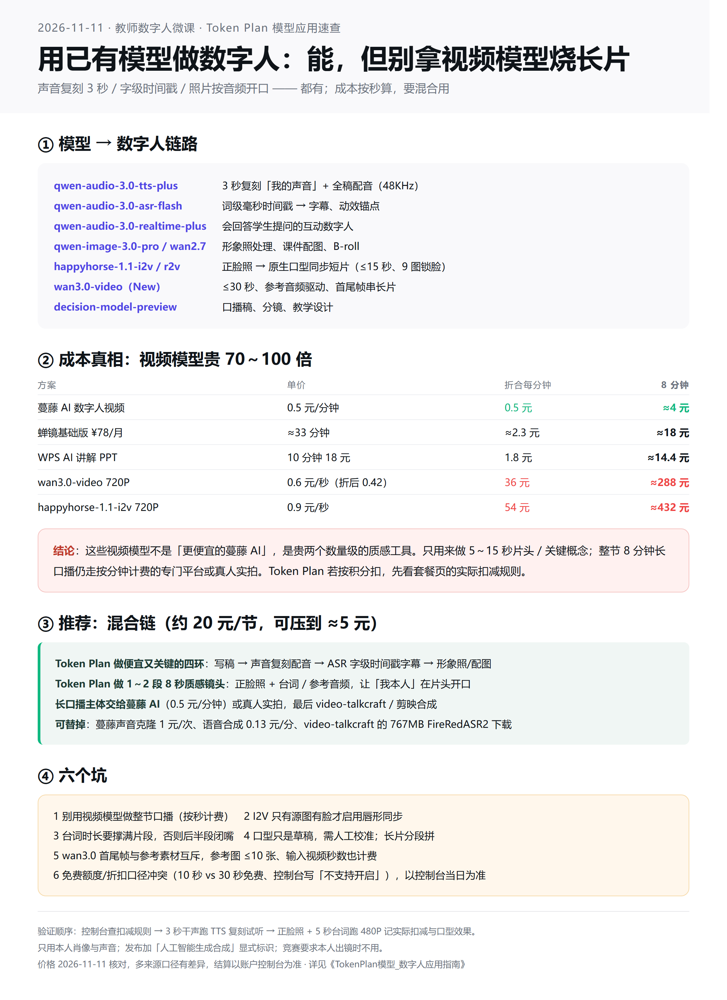

# Token Plan 模型 → 数字人微课应用指南

> **回答的问题**：我 Token Plan 里已有这 11 个模型，怎么用到「用自己的形象 + 自己的声音」的数字人微课里？哪些环节能替掉付费平台，哪些反而是更贵的陷阱？
>
> **一句话结论**：**能，而且比想象中完整**——`qwen-audio-3.0-tts-plus` 三秒就能复刻你的声音，`wan3.0-video` / `happyhorse-1.1-i2v` 能让你的正脸照按音频开口说话，`qwen-audio-3.0-asr-flash` 直接给字级时间戳。但**视频生成按秒计费，1 分钟 720P 原价约 36～54 元，是蔓藤 AI（0.5 元/分钟）的 70～100 倍**。所以正确用法是「混合」：用 Token Plan 做声音、字幕、稿、图和少量质感短镜头，长口播仍交给专门的数字人平台或真人实拍。
>
> 配套文档：同目录《测试教程_用自己形象和声音跑通数字人》《教师数字人微课制作教程（成本优先版）》。



---

## 〇、你截图里的 11 个模型（逐字核对）

| 分组 | 模型 | 官方标注 | 在数字人链路里的位置 |
|---|---|---|---|
| 语音 | `qwen-audio-3.0-asr-flash` | 语音识别 | 字幕、**字级/词级时间戳**、动效锚点 |
| 语音 | `qwen-audio-3.0-realtime-plus` | 实时对话 | 会回答学生提问的**互动数字人**（超出录播） |
| 语音 | `qwen-audio-3.0-tts-plus` | 语音合成 | **克隆你的声音** + 全稿配音（48KHz 影视级） |
| 图像 | `qwen-image-3.0-pro` | 图片生成 | 形象照处理、背景统一、课件配图 |
| 万相 | `wan2.7-image` / `wan2.7-image-pro` | 图片生成 | B-roll、风格化插图、证据截图美化 |
| 万相 | `wan3.0-video`（标绿 New） | 视频生成 | **最长 30 秒、支持参考音频驱动口型**、首尾帧串长片 |
| HappyHorse | `happyhorse-1.1-r2v` | 视频生成 | 最多 9 张参考图锁定「就是我」，多镜头不变脸 |
| HappyHorse | `happyhorse-1.1-t2v` | 视频生成 | 纯文字生成带声视频（无需形象照） |
| HappyHorse | `happyhorse-1.1-i2v` | 视频生成 | **一张正脸照 → 会说话、口型同步的短片** |
| 领域模型 | `decision-model-preview` | 文本生成 | 口播稿、分镜、教学设计、事实红线清单 |

**关键能力核实**（2026-11-11 查）：

- `qwen-audio-3.0-tts-plus` 官方示例明确列出**声音复刻**：用一段参考音频复刻专属音色，再合成任意文本；模型本身支持 **3 秒极速语音克隆**、Voice Design（用文字描述设计音色）、自然语言指令控制情绪/语速/方言、14 个控制标签 + 7 个富语言标签、文本正则化（把「15~20 分钟」自动读成「十五到二十分钟」）、20 种中文方言。官方列的适用场景第一条就是「**数字人播报**」。
- `qwen-audio-3.0-asr-flash` 非流式识别返回 `output.sentence.words[]`，每项含 `begin_time` / `end_time` / `text` / `punctuation`，**毫秒级词/字时间戳**；还支持热词表（最多 50 个，权重 50 为超级热词）、对话上下文消歧、说话人分离、长音频 12 小时转写。
- `wan3.0-video` 是**全能参考**模型：输入支持 Text / Image / Video / **Audio** / File(docx、ppt、pdf) / Link，输出最长 30 秒、480P/720P/1080P，有声音开关、参考音频、首帧/首尾帧、智能时长。社区实测用 `--image-voice` 传入配音 mp3、提示词里用 `Image 1` / `Audio 1` 指代，**人物会跟着这段音频动嘴**。
- `happyhorse-1.1` 系列是**原生音视频联合生成**：台词写进 prompt 就自动出人声 + 音素级唇形同步（含中文普通话、粤语等 7 种语言）；`i2v` 一张首帧图即可，但**只有源图里有人脸时才启用 lip-sync**；`r2v` 最多 9 张参考图锁五官/服装/场景。单片段 3–15 秒、最高 1080P、24fps。
- `qwen-audio-3.0-realtime-plus` 是 WebSocket 端到端实时语音对话，低延迟、可打断、可注册工具调用，官方给了陪伴对话 / 工具智能体 / 推理智能体三类最小示例。

---

## 一、成本真相（先看这一章，别一上来就跑）

这是最容易被「我套餐里已经有这些模型」误导的地方。**语音和文本很便宜，视频生成按秒收费且很贵**：

| 方案 | 计价口径 | 折合每分钟 | 8 分钟数字人片段 |
|---|---|---|---|
| 蔓藤 AI 数字人视频 | 750 积分/分钟，1500 积分=1 元 | **0.5 元/分钟** | **≈ 4 元** |
| 蝉镜基础版 ¥78/月≈33 分钟 | 月卡 | ≈ 2.3 元/分钟 | ≈ 18 元 |
| WPS AI 讲解 PPT | 10 分钟 18 元 | 1.8 元/分钟 | ≈ 14.4 元 |
| `happyhorse-1.1-i2v` 720P | **0.9 元/秒**（百炼详情页口径） | **54 元/分钟** | **≈ 432 元** |
| `wan3.0-video` 720P | **0.6 元/秒**，限时 7 折 0.42 | 36 元/分钟（折后 25.2） | ≈ 288 元（折后 202） |
| `wan3.0-video` 480P | 0.3 元/秒，折后 0.21 | 18 元/分钟 | ≈ 144 元 |
| `qwen-audio-3.0-tts-plus` 语音合成 | 按字符/tokens | 远低于 1 元/分钟 | 可忽略 |

> 价格口径有冲突：另有计费页写 HappyHorse 480P/720P/1080P = 0.54/1.08/1.44 元/秒，wan3.0 写 0.36/0.72/1.44，还流传「10 秒免费」「30 秒免费」「限时 7 折」的说法；但百炼控制台模型页又显示 HappyHorse-1.1-I2V「**免费额度 不支持开启**」。**一律以你账户控制台当日显示为准**，本表用于判断量级，不用于结算。另注意 `wan3.0-video` 的**输入视频秒数也计费**（输入+输出分别按秒算）。

**结论很直白**：这些视频模型**不是「更便宜的蔓藤 AI」**，而是贵 50～100 倍的质感工具。它们值钱的地方是「一张照片就能让本人口型对上、带环境音与运镜」的电影感，适合 **5～15 秒的片头、关键概念、公开课开场**；拿它生成一整节 8 分钟口播，账单会很难看。你的 Token Plan 若是包月积分制，扣的是已付额度，边际成本另算——**先去套餐页确认这几个模型的实际扣减规则**再决定用量。

---

## 二、三条可跑的路线

### 路线 A（推荐）混合链：Token Plan 做「便宜且关键」的环节

```
decision-model-preview 写稿
   ↓
qwen-audio-3.0-tts-plus 声音复刻（3 秒样本）→ 全稿配音 mp3   ← 替掉蔓藤「声音克隆 1 元/次 + 语音合成」
   ↓
qwen-audio-3.0-asr-flash 拿词级时间戳 → 字幕 + 动效锚点      ← 替掉 video-talkcraft 的 767MB FireRedASR2
   ↓
qwen-image-3.0-pro / wan2.7-image-pro 做形象照与配图
   ↓
【可选】happyhorse-1.1-i2v 或 wan3.0-video 做 1～2 段 8 秒「我的脸在说话」
   ↓
长口播主体：蔓藤 AI 数字人视频（0.5 元/分钟）或真人实拍
   ↓
video-talkcraft / 剪映 合成动效与课件
```

**为什么这样分**：声音、字幕、文本、图片这四环用 Token Plan 几乎不产生额外成本，却决定了「像不像我、讲得顺不顺」；「脸跟着声音动」这一环只在最需要露脸的几秒用贵模型，其余交给按分钟计费的专门平台。**8 分钟微课估算**：声音/字幕/稿/图 ≈ 可忽略 + 蔓藤长口播 ≈ 4～5 元 + 2 段 8 秒 720P 质感镜头 ≈ 14.4 元 → **约 20 元/节**；若把那两段也交给蔓藤，则回到 **≈ 5 元/节**。这 15 元差价买的是「片头那一下像本人出镜」，做公开课/精品课时值，做日常复习课时可以省。

### 路线 B 全 Token Plan 短片（≤30 秒，测试与片头专用）

只做一条 20～30 秒成片，全部用套餐内模型，适合**先验证效果**、做公众号短片或课前 90 秒导入：

1. 正脸照 + 3 秒干声分别备好；
2. `qwen-audio-3.0-tts-plus` 复刻音色 → 生成 25 秒配音；
3. `happyhorse-1.1-i2v`：**把台词直接写进 prompt**（模型自己出人声并同步口型），或 `wan3.0-video`：传入 `Audio 1` 作为参考音频让口型跟你的配音走；
4. 单段上限：HappyHorse 15 秒 / wan3.0 30 秒。25 秒片要么用 wan3.0 一次生成，要么拆成 2 段用首尾帧串联；
5. 480P 先测（单价约为 720P 的一半），效果确认后再上 720P。

**成本**：25 秒 × 480P ≈ 5～8 元（折后更低）；若控制台有免费额度则先跑免费的。**这条路线正好可以替掉《测试教程》里的 Step 1+2+3+4，而且不用上传声纹和人脸到蔓藤**——素材在你自己的百炼账户里，隐私边界更清楚。

### 路线 C 互动数字人（超出录播，但要开发）

`qwen-audio-3.0-realtime-plus` + 一张形象图（或 `happyhorse-1.1-r2v` 生成的形象视频）→ 做成**能回答学生提问**的数字人：学生说话 → ASR 转写 → 模型组织回答 → TTS 用你的复刻音色说出来 → 形象动嘴。官方给了 WebSocket SDK 与三类最小示例（陪伴对话约 50 行、工具智能体约 80 行、推理智能体约 100 行）。

适合课前答疑、课后补差、公开课互动环节；但**这是三条里唯一需要写代码、做前后端的**，不是点几下就能用。前面几轮说的「数字人答不了临时提问」，用这条路线才真正被解决。

---

## 三、四段可复制的调用示例

> 以下为**官方示例/公开实测的形态**，参数名与音色创建接口以阿里云百炼官方示例仓库 `github.com/aliyun/alibabacloud-bailian-speech-demo` 与控制台为准；不要凭这段文字猜字段名。

**① 声音复刻 + 合成（`qwen-audio-3.0-tts-plus`）**

官方示例目录里对应 `synthesize_speech_from_text_with_qwen_audio_tts_by_cloned_voice`。基础合成形态：

```python
from dashscope.audio.tts_v2 import SpeechSynthesizer

synthesizer = SpeechSynthesizer(
    model="qwen-audio-3.0-tts-plus",
    voice="<你复刻出来的音色 ID>",       # 3 秒参考音频创建，见官方示例
    instruction="温和清晰的中年女教师，语速偏慢，适合给小学生讲解",
)
synthesizer.streaming_call("同学们好，今天我们只做一个小测试。")
audio = synthesizer.streaming_complete()
# 保存为 voiceover.wav；Plus 输出 48KHz
```

讲稿里可嵌标签控制情绪：`[excited] 今天天气真不错！`、`[serious] 请注意安全事项。`。数字单位交给文本正则化处理，别自己改成汉字又和 ASR 对不上。

**② 拿字级时间戳（`qwen-audio-3.0-asr-flash`）**

对①生成的 `voiceover.wav` 做非流式识别，返回结构（毫秒）：

```json
{"output":{"sentence":{"begin_time":0,"end_time":3240,"text":"今天学点啥。",
  "words":[{"begin_time":0,"end_time":500,"text":"今天","punctuation":""},
           {"begin_time":500,"end_time":1000,"text":"学点","punctuation":""},
           {"begin_time":1000,"end_time":2200,"text":"啥","punctuation":"。"}]}}}
```

把 `words[]` 直接喂给字幕、动效锚点，或作为 `video-talkcraft` 的 `timing.json` 输入——**省掉它默认 FireRedASR2-CTC 那 767MB 模型下载**。学科术语用热词表（`weight: 50`）锁死，避免「洨河」被识别错。

**③ 参考音频驱动口型（`wan3.0-video`）**

第三方 CLI 实测形态（非官方 API，仅示意参数关系）：

```bash
bl video ref \
  --prompt "Image 1 是讲台前的教师，正面半身，看着镜头开口说：Audio 1 的内容。镜头极缓推近，背景是简洁教室，不要字幕" \
  --image ./my_face.jpg --image-voice ./voiceover.wav \
  --model wan3.0-video --duration 10 --resolution 720P --ratio 16:9
```

要点：`Image 1` / `Audio 1` 按上传顺序指代；**台词时长要撑满视频时长**（社区实测 3.26 秒台词放进 5 秒视频，后 1.7 秒人物闭嘴）；首尾帧模式与参考素材互斥；参考图上限 10 张（不是 20），参考视频/音频各 ≤5 段且各 ≤15 秒。百炼 API 层另有 `wan2.2-s2v`（支持卡通形象）和 `videoretalk` 两条更专门的对口型通路，Token Plan 里未列出，需要时单独开通。

**④ 一句话让照片开口（`happyhorse-1.1-i2v`）**

官方控制台给出的最小请求：

```bash
curl --location 'https://[workspace-id].cn-beijing.maas.aliyuncs.com/api/v1/services/aigc/video-generation/video-synthesis' \
  -H 'X-DashScope-Async: enable' \
  -H "Authorization: Bearer $DASHSCOPE_API_KEY" \
  -H 'Content-Type: application/json' \
  -d '{
    "model": "happyhorse-1.1-i2v",
    "input": {
      "prompt": "照片中的教师看着镜头，用温和清晰的普通话说：\"同学们好，今天我们只做一个小测试。\" 面部自然，轻微点头， classroom 背景虚化",
      "media": [{"type": "first_frame", "url": "https://你的图床/my_face.jpg"}]
    },
    "parameters": {"resolution": "720P", "duration": 5}
  }'
```

**台词放进引号里**是触发原生对白 + 唇形同步的写法。`r2v` 换 `"model": "happyhorse-1.1-r2v"` 并传多张参考图，在 prompt 里用 `character1`… 指代，可让多段视频里的五官服装保持一致。

---

## 四、与前两轮教程的衔接（哪些环节可以升级）

| 《测试教程》里的步骤 | 原来怎么做 | 现在可以用 Token Plan 升级为 |
|---|---|---|
| Step 2 声音克隆 | 蔓藤 1500 积分/次（1 元），传 10–30 秒干声 | `qwen-audio-3.0-tts-plus` **3 秒**复刻，音色还能用指令调情绪/方言 |
| Step 3 语音合成 | 蔓藤 200 积分/分钟 | 同上，48KHz Plus 档；文本正则化自动处理数字单位 |
| Step 4 数字人视频 | 蔓藤 750 积分/分钟 | 短片可改用 `happyhorse-1.1-i2v` / `wan3.0-video`；**长片仍建议留蔓藤** |
| 字幕 / 时间锚 | 平台自动烧字幕 | `qwen-audio-3.0-asr-flash` 给毫秒级字级时间戳，可校对、可做动效锚点 |
| 讲稿 / 分镜 | 手写或让 WorkBuddy 改口语 | `decision-model-preview` + 前面教程里的 B7/B8 提示词 |
| 形象照 / 配图 | 手机原图 | `qwen-image-3.0-pro` / `wan2.7-image-pro` 统一背景与风格 |
| video-talkcraft 时间戳 | 下 767MB FireRedASR2 模型本机 CPU 对齐 | 直接用②的 `words[]`，省下载、省一轮推理 |

**不变的**：AI 显式标识、只用本人肖像与声音、竞赛要求本人出镜时不用、学生素材不上传第三方。

---

## 五、六个坑

1. **别用视频模型做整节口播**——按秒计费，8 分钟 720P 可达数百元，比专门数字人平台贵两个数量级。
2. **I2V 只有源图里有脸才启用唇形同步**；正脸、清晰、无遮挡是硬前提。
3. **台词时长要撑满片段**，否则后半段人物闭嘴；拆段时按完整句子/自然停顿切，别硬切。
4. **口型是草稿，仍需人工校准**；社区实测结论是「AI 给口型草稿，人工再校」。长片必须分段拼接（HappyHorse ≤15 秒、wan3.0 ≤30 秒），用首尾帧串联过渡。
5. **参数互斥与上限**：wan3.0 首尾帧模式不能与参考图/视频/音频/文档同用；参考图 ≤10 张、参考视频与音频各 ≤5 段且各 ≤15 秒；`wan3.0-video` 输入视频秒数也计费。
6. **免费额度与折扣口径冲突**（「10 秒免费」「30 秒免费」「限时 7 折」vs 控制台「免费额度 不支持开启」），**以你账户控制台当日显示为准**，先跑一条 480P 短片看实际扣减再放量。

---

## 六、建议的三步验证（我没有替你执行）

任何涉及 API Key、计费、上传本人肖像与声纹的动作，都应由你在控制台完成。建议按这个顺序试，半天内能得到结论：

```
1. 打开百炼控制台 → 确认 Token Plan 对 tts-plus / asr-flash /
   happyhorse-1.1-i2v / wan3.0-video 的实际扣减规则与免费额度，截图留账。
2. 录 3 秒自己的干声 → 跑一次 TTS 声音复刻 → 试听像不像。
3. 用一张正脸照 + 一句 5 秒台词 → happyhorse-1.1-i2v 480P 跑一条 →
   记录实际扣减、口型效果、生成耗时。
```

三步都过了，再决定要不要把「脸」这一环纳入正式流程；不通过就按路线 A，把「脸」继续交给蔓藤或真人实拍。

---

## 附录　来源（2026-11-11 核对）

| # | 来源 | 用途 |
|---|---|---|
| 1 | 用户提供的「支持模型 / 当前个人版 Token Plan」截图 | 11 个模型清单与官方能力标注 |
| 2 | 阿里云百炼 Qwen-Audio-3.0 示例仓库说明（`alibabacloud-bailian-speech-demo`） | TTS 声音复刻、指令控制、ASR 热词/上下文、Realtime 三场景 |
| 3 | 阿里云帮助中心《非实时语音识别 qwen-audio-3.0-asr-flash》 | `words[]` 毫秒级词级时间戳结构 |
| 4 | 阿里云帮助中心《wan3.0-video》与《视频生成与编辑》模型选型页 | 30 秒上限、多模态输入、参考音频、首尾帧、480/720/1080P 原价 |
| 5 | 百炼控制台 `happyhorse-1.1-i2v` 模型页与 API 示例 | 图生视频请求格式、0.45/0.9/1.2 元/秒、免费额度状态 |
| 6 | 阿里云开发者社区 HappyHorse-1.1 详解 / 计费文章 | T2V/I2V/R2V 差异、9 图一致性、原生音视频与唇形同步、价格口径 |
| 7 | 第三方 Wan 3.0 实测（参考音频驱动口型） | `Image 1` / `Audio 1` 写法、台词时长坑、口型需人工校准 |
| 8 | 同目录《测试教程》《成本优先版主教程》 | 蔓藤 AI、蝉镜、WPS、秘塔的既有成本基线 |

> 价格、免费额度、限时折扣均会变动，且不同来源口径存在差异；本文用于判断量级与选型，**结算以你账户控制台当日显示为准**。
