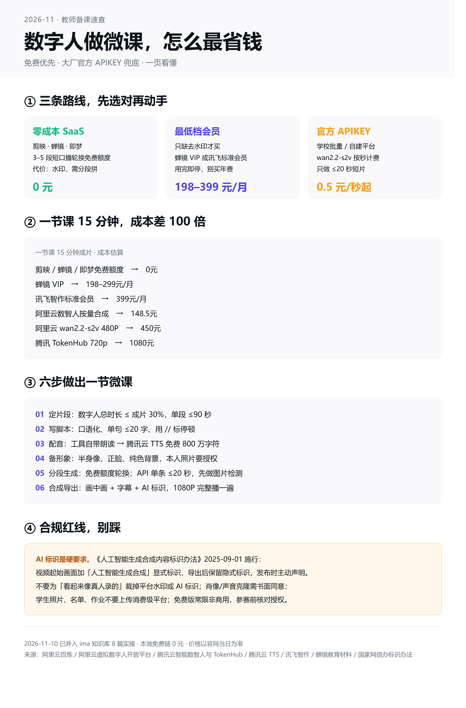

# 教师数字人微课制作教程（成本优先版）

> **给谁看**：要上微课、公开课、赛课、精品课，但不想出镜、不想买几千元数字人定制服务的一线教师。
>
> **一句话结论**：**一节课的数字人部分，完全可以零成本做出来**。把数字人当成「片头 + 两三处重难点讲解」的配角，用剪映、蝉镜、即梦这类工具的免费额度分段生成，再拼进 PPT 录屏里；只有学校要批量建课、或需要程序化调度时，才值得去开大厂官方 API Key，而且必须按「20 秒短片」的思路用，千万别用按秒计费的模型去生成整节课。
>
> **成本口径**：本文价格来自 2026 年 9–11 月可查的官方文档与公开资料，**全部标注来源与日期**。数字人产品迭代和调价极快，任何预算表落笔前请到官网控制台看当日价格并截图留档。



---

## 〇、本版资料来源与整合说明

**2026-11-10 已并入你 ima 知识库「学AI的李老师」的收藏。** 知识库共 1249 条资料，本次按「查库 → 检索 → 读正文」逐篇取证，精读了 8 篇与教师数字人微课直接相关的原文（均为公众号文章）：

| # | 标题 | 作者 / 日期 | 本教程用到了什么 |
|---|---|---|---|
| 1 | 不用真人出镜！WorkBuddy 数字人，一键制作规范微课 | 信科智教坊 · 2026-11-04 | 三样材料四工具、逐字稿六要素提示词、VoiceBox 本地声音克隆、QCAPI 对口型、剪映抠像同框 |
| 2 | 不出镜、不录音，用WorkBuddy做数字人微课 | 信科智教坊 · 2026-10-27 | 四步流程、MiniMax 官方 API 配音、QCAPI 约 0.06 元/秒、55 秒分段、API Key 不外传 |
| 3 | 让数字人替你"站"进课件里：用WorkBuddy做国平台同款微课视频 | 科研行 · 2026-11-02 | 国平台同款画中画做法、MCP 配置、剪映色度抠像五步 |
| 4 | 用WorkBuddy做AI数字人口播视频（附完整操作SOP） | 可可AI轻创业 · 2026-10-25 | 七步 SOP、先查工具再动手、5 秒样片、wan2.2-s2v 实测、67 秒切 4–5 段、三次返工、Flova 140 元反例 |
| 5 | AI数字人-打造你的数字分身 | 嘚不嘚叮当猫 · 2026-11-04 | 有言 / 硅基 / 蝉镜 / 剪映 / 腾讯智影选型对比、伦理与职业道德、AI 标识义务 |
| 6 | AI时代的微课制作（脚本撰写） | 课件老师 · 2026-10-29 | 微课脚本六栏标准、一次生成成功四件事、教学设计优先 |
| 7 | 接上篇｜3D 互动课件如何加入数字人实时讲解 | 小白AI技术学习 · 2026-10-26 | 完全免费的 edge-tts + 绿幕抽帧 + 单文件 HTML 讲解员方案 |
| 8 | 一节公开课必须融入的5处AI | 用AI伴学 · 2026-10-30 | 赛课/公开课里 AI 该加在哪五处、「加在哪比加多少重要」、配图提示词写在当页 |

**整合原则**：知识库里的路线我按你的成本要求做了筛选与批判，不是照抄——

- 优先收编**真正零成本**的部分：本地 VoiceBox 声音克隆、edge-tts 免费配音、剪映抠像、单文件 HTML 讲解员、微课脚本规范。
- **大厂官方 APIKEY** 路线保留：MiniMax 语音、阿里云百炼 `wan2.2-s2v`、腾讯云 TTS。
- 知识库里的 **QCAPI 第三方对口型平台**（约 0.06 元/秒）确实比大厂按秒模型便宜一个数量级，但它是第三方小平台，涉及预付算力、上传肖像与音频、版权条款由平台免责，本教程**列为「可选、需先核验」**，不列为推荐主线。
- 知识库里 **Flova 会员 140 元**那条，作者自己也是「忍不住才买」，本教程作为**反例**写进成本对照。

公开官方资料（价格、免费额度、标识办法）与知识库实操内容在文中分别标注，附录 B 有完整来源表。

**已核实的外部来源**（详见附录 B）：

- 阿里云百炼 `wan2.2-s2v` 官方文档与价格页（更新至 2026-09-14）
- 阿里云虚拟数字人开放平台 Pricing 页
- 腾讯云智能数智人购买指南、价格指南、AIGC 直播计费文档
- 腾讯云 TokenHub `YT-Video-HumanActor` 介绍、腾讯云 TTS 计费概述
- 讯飞智作会员中心、蝉镜教育场景推广材料、剪映/即梦公开用法
- 《人工智能生成合成内容标识办法》（2025-09-01 施行）及中国政府网、国家网信办解读

---

## 一、先想清楚：数字人在微课里该干什么

**最常见的技术误用，是把整节课都交给数字人念稿。** 评委和学生都容易疲劳，而且免费工具的单段时长、水印、口型同步都会集中暴露。

### 1.1 值得用数字人的四个位置

| 位置 | 建议时长 | 作用 | 典型做法 |
|---|---|---|---|
| 片头情境导入 | 15–30 秒 | 出题、抛问题、介绍课题 | 数字人半身像 + 课题字卡 |
| 重难点讲解 | 每段 60–90 秒，全片 2–3 段 | 把抽象概念讲一遍 | 数字人画中画 + PPT 板书同步 |
| 课本人物开口 | 20–40 秒 | 语文/历史情境化 | 即梦生成角色 + 绿幕抠图嵌入 |
| 片尾小结与作业 | 15–30 秒 | 收束、布置任务 | 数字人 + 要点清单 |

**经验值**：数字人总时长控制在成片的 **30% 以内**，其余留给 PPT 录屏、真实板书、实验演示、学生活动。这样既省额度又更像一堂课。

### 1.2 不建议用数字人的三种情况

1. **需要演示操作过程**（实验、作图、软件操作）——录屏 + 真人手写更清楚。
2. **情感浓度高的环节**（朗读、德育、课堂对话）——合成语音容易出戏。
3. **评审明确要求「本人出镜」的赛事**——先读赛事文件，别赌。

### 1.3 赛课评审真正在看什么

技术分只是加分项。评委主要看：教学目标是否清晰、有没有学生视角、重难点是否真被突破、是否有互动与反馈、技术是否**服务内容**而不是炫技。数字人用得克制，比用得满更容易得高分。

---

## 二、三条路线与成本地图

先把产品分成三类，定价逻辑完全不同，混着比就会得出「为什么有人说 0 元、有人说 5 万」的矛盾结论。

| 类型 | 代表 | 计费口径 | 适合谁 |
|---|---|---|---|
| ① SaaS 创作工具 | 剪映、蝉镜、腾讯智影、即梦、课件帮、讯飞智作 | 免费额度 / 会员包月 | **绝大多数教师，首选** |
| ② 云厂商数智人视频合成 | 腾讯云智能数智人、阿里云虚拟数字人开放平台 | 小时包、按分钟 | 学校/机构批量采购 |
| ③ 生成式模型 API | 阿里云百炼 `wan2.2-s2v`、腾讯云 TokenHub `YT-Video-HumanActor` | 按秒 | 学校自建平台、程序化批量短片 |

### 2.1 决策树（照着选，不用纠结）

```
要做几段数字人？
├─ 只是这一节课，3–5 段短口播
│   └─ 走【零成本路线】：剪映 / 蝉镜 / 即梦 免费额度轮换 → 第三章
├─ 一学期要做十几节，且要去掉水印
│   └─ 买【最低档会员】：蝉镜 VIP 或讯飞标准会员 → 2.3 节
└─ 学校要建自有平台，批量生成几十上百条，要统一审核与水印
    └─ 走【官方 APIKEY 路线】，且必须拆成 ≤20 秒短片 → 第四章
```

### 2.2 零成本工具清单（2026 年仍可用）

| 工具 | 免费能给什么 | 主要限制 | 最适合的活 |
|---|---|---|---|
| **剪映数字人**（字节） | 基础形象、输入文案生成口播、剪辑与自动字幕免费，数字人制作不限时长 | 导出带水印；高写实 3D / 真人克隆需会员；单次生成约 3 分钟 | 主力剪辑台、片头片尾、字幕 |
| **蝉镜**（chanjing.cc） | 2 分钟视频合成、1GB 存储、30+ 免费公共形象、50+ 教育模板、PPT/PDF 一键导入、基础版 AI 免费逐字稿 | 导出 2 分钟内 1080P 带水印；长视频/去水印/形象克隆需 VIP | **教育场景最省事**，PPT 直接转讲解视频 |
| **即梦 AI**（jimeng.jianying.com） | 每日登录送积分，上传角色图 + 台词 + 动作描述生成会说话的角色 | 需做绿幕/纯色背景再抠图；积分有限 | 「课本人物开口说话」，语文历史情境化 |
| **腾讯智影**（zenvideo.qq.com） | 网页端免安装，授课风格 2D 形象、照片生成 2D 分身、PPT 联动；第三方整理免费约 5 分钟/月 | 免费版带水印；真人克隆付费；**有业务调整传闻，用前务必到官网确认可用性** | 播报型片头、通知类短片 |
| **课件帮** | 免费版支持 Word/PPT 转数字人讲解视频，专业模式可解析 2 万字内长文档 | 免费形象与定制额度有限 | 长教案快速转讲解初稿 |
| **讯飞智作** | 免费额度有限（第三方称每月 5–10 分钟、带水印），中文语音与方言、多语种朗读质量好 | 额度少 | 语文、英语朗读类微课 |
| **万彩动画大师 / Focusky** | 免费版可导出无水印 720P，卡通数字人、3D 转场 | 卡通风格为主，真人形象少 | 小学趣味科普 |
| **开源本地方案** | Wav2Lip + GFPGAN、LivePortrait、Linly-Talker，完全免费、素材不上云 | 需显卡与技术基础 | 有信息技术老师、重视素材隐私的学校 |

> **零成本的关键技巧**：把一节课拆成 **3–5 个 2 分钟以内的片段**，在剪映、蝉镜、即梦、腾讯智影之间轮换免费额度，最后回剪映统一拼接。代价只有水印和画质，成本是 0 元。

### 2.2b　知识库里的四条实测路线（按成本排序）

> 来源：知识库 1–4、7 号文章，均为作者本人跑通的流程；价格为文中记录，非官网承诺。

| 路线 | 工具链 | 一节课成本 | 效果与代价 |
|---|---|---|---|
| **A　本地零成本** | WorkBuddy 写稿 + **edge-tts** 免费配音 + 绿幕抽帧 / 剪映数字人 + 剪映合成 | **0 元** | 完全离线、无 API Key；声音是合成音色不是本人原声，形象是循环帧不是真 3D |
| **B　本地声音克隆 + 免费额度** | WorkBuddy + **VoiceBox**（本地克隆自己的声音）+ 剪映 / 蝉镜免费形象 | **0 元** | 能听到「自己的声音」，VoiceBox 需装桌面端并配一次 MCP |
| **C　大厂官方 APIKEY** | WorkBuddy + **MiniMax** 语音 或 **阿里云百炼 wan2.2-s2v**（100 秒新人免费额度） | **0 元起**，之后按量 | 口型最稳、可程序化；长片按秒算不划算 |
| **D　第三方对口型平台** | WorkBuddy + **QCAPI** 类平台（让 WorkBuddy 把接口文档做成一个 skill） | 约 **0.06 元/秒**，2 分钟约 7 元 | 比大厂便宜十倍；但需预付算力、上传肖像音频、平台免责条款要自己核 |

**知识库里最值得抄的一句方法论**（4 号文）：*先让 WorkBuddy 检查「当前已安装、已授权、本会话已启用」的工具，说明哪些能直接调用、哪些还要装，不要把搜到的服务当成已接通；这一步只检查，不生成、不提交付费任务。* 很多老师的钱就是花在「以为接上了」上面。

### 2.3 什么时候才该花第一笔钱

按「缺什么买什么」，不要一上来买年费：

| 你缺的 | 最小付费动作 | 参考价 |
|---|---|---|
| 只想去掉水印 | 买一档最低会员，用完即停 | 蝉镜 VIP 约 198–299 元/月；腾讯智影专业版约 99–299 元/月 |
| 想要稳定长视频额度 | 讯飞智作标准会员 | 399 元/月（含 60 分钟数字人视频，≈6.65 元/分钟） |
| 想「像本人」 | 照片克隆类（蝉镜 / 课件帮 / 腾讯智影） | 数百到 2000 元级 |
| 想「1:1 真人分身上云」 | 阿里云 2D 真人形象定制 | **6999 元/形象/年，不退**，个人教师不建议 |

**特别提醒**：别信「几千元永久买断」的套壳软件；也别为了一次赛课去做 1:1 真人分身，公版形象已经足够。

**知识库给的省钱组合**（1、2、4 号文）：写稿用 WorkBuddy，配音用本地 VoiceBox 或免费 edge-tts，形象用剪映/蝉镜免费额度或绿幕抽帧，最后剪映抠像同框。**一整条链可以完全不出现账单**；只有「必须像本人、必须长片、必须批量」才升级到付费。

---

## 三、零成本路线：六步做出一节微课

### 总览

```
① 定片段 → ② 写口播脚本 → ③ 配音 → ④ 备形象与背景
        → ⑤ 分段生成 → ⑥ 剪映合成、加标识、导出
```

### 第 ① 步　定片段（决定了成本上限）

先写一张分镜表，把「哪里用数字人」钉死，别边做边加。

| 段 | 时间 | 画面 | 数字人 | 时长 |
|---|---|---|---|---|
| 1 | 0:00–0:25 | 课题页 | 片头提问 | 25 秒 |
| 2 | 0:25–2:10 | PPT 录屏 + 板书 | 无 | — |
| 3 | 2:10–3:30 | 概念图 | 重难点讲解 A | 80 秒 |
| 4 | 3:30–5:40 | 例题演示（录屏） | 无 | — |
| 5 | 5:40–6:50 | 易错点对照 | 重难点讲解 B | 70 秒 |
| 6 | 6:50–7:10 | 小结页 | 片尾作业 | 20 秒 |

**数字人合计约 3 分钟**，全部落在免费工具的单段能力内。

### 第 ② 步　写口播脚本（成败在这一步，与工具无关）

规则：

1. **单句 ≤20 字**，口语化，别把书面教案直接粘进去。
2. **语速 220–240 字/分钟**；3 分钟口播约 660–720 字。
3. 用 `//` 标停顿，专业术语标拼音，重音用加粗。
4. 一段只讲一个知识点，讲完就停，方便分段生成。

可复制的脚本提示词：

```
你是小学/初中【学科】教师，请为微课写一段数字人口播稿。

课题：《【课题】》
学段：【三年级 / 八年级…】
本段任务：【只讲清楚一个知识点，例如「为什么赵州桥的小桥洞能减冲击力」】
时长：约 80 秒（按 230 字/分钟估算字数）
要求：
1. 口语化，像老师对着学生说话，单句不超过 20 字；
2. 每讲完一层意思用 // 标停顿；
3. 专业术语第一次出现时标拼音，例如「洨河（xiáo hé）」；
4. 开头一句抓注意力，结尾一句留问题；
5. 不要写「同学们好我是 AI 老师」这类出戏的话；
6. 只输出逐字稿，不要分镜、不要解释。
```

> 实测经验：把一篇书面通知直接丢进数字人，读出来非常生硬；改成「同学们注意啦，下周的期末考试安排出来了，大家记一下时间」就自然得多。

### 第 ③ 步　配音（优先用免费，别急着开 API）

| 优先级 | 做法 | 成本 |
|---|---|---|
| 1 | 用剪映 / 蝉镜 / 腾讯智影自带的免费朗读，选「教师 / 播音」音色，语速中等偏慢 | 0 元 |
| 2 | 需要更好中文语音：腾讯云 TTS 免费资源包（基础/精品音色 **800 万字符**、大模型音色 10 万字符、超自然大模型音色 2 万字符，控制台领取，3 个月有效，一账号一次） | 0 元 |
| 3 | 阿里云百炼 Qwen-TTS / CosyVoice（北京地域开通后 90 天内 1000 次免费音色创建；CosyVoice 创建音色免费） | 0 元起 |
| 4 | 实在要本人音色：讯飞/蝉镜声音克隆（付费） | 数十到数百元 |

**注意**：腾讯云免费资源包用尽会**停服**，不会自动转后付费，需提前在控制台开通或买资源包；别在交稿前一晚才发现额度没了。

导出 `mp3/wav` 备用。**音频时长直接决定按秒计费 API 的成本**，所以脚本定稿后再配音。

**知识库补充的三条配音路（都更省）**：

- **edge-tts，完全免费、不用申请 Key**（7 号文、4 号文都实测过）。微软 Edge 在线神经语音，Python 装 `edge-tts` 即可；中文常用 `zh-CN-YunxiaNeural`（云夏，清亮少年声）、`zh-CN-XiaoxiaoNeural`（晓晓，女声）、`zh-CN-YunxiNeural`（云希，男声）。知识库给的「不像念经」配方是：`pitch=+15Hz`，语速逐句在 `+12% / +14% / +16% / +18%` 之间轮换，每句裁掉首尾静音。**联网生成一次，之后把 mp3 转 base64 内嵌进 HTML，断网也能播。**
- **VoiceBox 本地声音克隆**（1、3 号文）：桌面端 `voicebox.sh` → 右上角「创建声音」→ 上传或录一段 **30 秒以内**音频 → 语言切「中文」、引擎选 **Qwen3-TTS** → WorkBuddy 左侧「连接器 → 自定义连接器 → 配置 MCP」粘贴 `http://127.0.0.1:17493/mcp` 并点信任 → 回 VoiceBox「设置 → MCP」把 workbuddy 客户端绑定到该声音档案。之后一句话即可合成：「请调用 `voicebox.speak`，用我绑定的克隆音色，把下面口播稿合成 MP3 并保存，完成后告诉我文件路径」。**本地跑、素材不上传、0 元。**
- **MiniMax 官方 API**（2 号文，符合「大厂官方 APIKEY」）：开放平台实名 → 建 API Key（**只显示一次，立刻存好**）→ 音色库按「教育讲解」筛，试听后复制 `voice_id` → 把 `API Key + voice_id + 口播稿` 一次发给 WorkBuddy 合成。注意知识库原文是让 AI 代填 Key，**本教程建议改成环境变量或服务端配置，不要粘进对话框、更不要截图外传**。

### 第 ④ 步　备形象与背景

- 选 **半身像**，不选全身像：全身动作幅度大，容易不自然。
- **正脸、无遮挡、光线均匀**，背景用纯色或虚化教室，别用花哨图。
- 用公版形象时，看清「是否允许参赛 / 商用」。
- **课本人物开口**（语文、历史很好用）：即梦里生成纯色/绿幕背景的角色图 → 加台词与动作描述生成视频 → 剪映「色度抠图」去背 → 叠到 PPT 上。这是广州市教师培训中心公开推荐的做法。
- 用自己或同事的照片，必须拿到**书面同意**；学生照片、名单、作业不要上传消费级平台。

### 第 ⑤ 步　分段生成

**免费工具路线**（推荐）：

1. 蝉镜：PPT/PDF 一键导入 → 免费生成并优化逐字稿 → 选免费形象与教育模板 → 预览 → 导出 2 分钟内 1080P（带水印）。
2. 剪映：贴入逐字稿 → 选数字人形象 → 生成口播 → 加课件贴纸、公式、自动字幕。
3. 即梦：角色图 + 台词 → 生成会说话的角色 → 导出后抠图。
4. 每生成一段就检查：**口型是否同步、语速是否偏快、有没有读错字**。口型对不上时，把语速调慢 10%–20%，或把长句拆成两句分段生成。

**三条来自知识库的分段硬经验**：

1. **单段 ≤55 秒**（1、2 号文）。QCAPI 类接口和不少免费工具都按 55 秒切段，超了自动拆；知识库作者把这条写进了自建 skill 的自动拦截里，避免「白扣点」。
2. **「≤20 秒」是每次接口调用的音频片段，不是整条视频**（4 号文特别澄清）。作者录了 1 分 07 秒完整原声，按完整句子/自然停顿切成 **4–5 段**，每段 <20 秒分别调用 `wan2.2-s2v`，再合成 67 秒成片。别误会成「只能做 20 秒微课」。
3. **先做 5 秒样片再出全片**（4 号文）。只用第一句约 5.55 秒音频、不加字幕音乐，只看三件事：人物还是不是同一个人、声音有没有变、嘴型能不能跟上。样片过了再做全片，能省下整条重做。

**API 路线**（学校/批量，详见第四章）：单条 ≤20 秒，先跑图片合规检测，再异步生成，最后拼接。

### 第 ⑥ 步　合成、加标识、导出

在剪映里做最后组装：

1. 主轨放 PPT 录屏 / 板书 / 实验视频。
2. 数字人片段用**画中画**放在右下或左下，不遮住板书与公式。
3. 自动字幕 + 人工校对（专业术语、拼音、标点最容易错）。
4. 加片头课题页、片尾作业页。
5. **加 AI 显式标识**（见第六章），这是硬要求，不是可选项。
6. 导出 1080P / 25 或 30fps，音频 AAC，检查音量统一。

**知识库版「数字人与课件同框」五步**（1、3 号文，国平台同款微课就是这么做的）：

1. 导入两份素材：数字人视频、课件录屏；
2. 上下分层摆到轨道，对齐时间轴；
3. 选中数字人视频 → 右侧「画面」→「抠像」→ 自定义抠像或色度抠像（所以形象图建议纯色/白底/绿幕）；
4. 用智能擦除笔刷清掉残留背景，只留人物；
5. 缩放移动人像放到**课件右下角**，避开板书与关键内容。

4 号文返工三次踩的坑也记一下：画中画挡住脸、人物小窗太小、脸被截掉、小窗口型和声音没对上。**修改要指到具体位置和现象**，只重跑对应片段，别默认整条重做。

---

## 四、官方 APIKEY 路线（学校、批量、自建平台）

> **先给结论**：按秒计费的模型，**不适合生成整节课**。15 分钟成片用 `wan2.2-s2v` 480P 约 450 元，用腾讯 TokenHub 720p 约 1080 元，反而比会员贵一个数量级。API 的价值在于「无人值守、批量短片、统一审核与水印」，不在于便宜。

### 4.1 阿里云百炼 `wan2.2-s2v`（按秒最便宜、文档最完整）

| 项目 | 单价 | 免费额度 |
|---|---|---|
| `wan2.2-s2v-detect` 图片合规检测 | 0.004 元/张 | 200 张 |
| 生成 480P | **0.5 元/秒** | 两档合计 100 秒 |
| 生成 720P | **0.9 元/秒** | 两档合计 100 秒 |
| 角色替换 animate-mix | 0.6 / 0.9 元/秒 | 合计 50 秒 |
| 动作模仿 animate-move | 0.4 / 0.6 元/秒 | 合计 50 秒 |

**硬限制**（踩坑高发）：

- 仅适用于**华北 2（北京）地域，且必须使用该地域的 API Key**；
- 单条视频 **≤20 秒**，输出 480P / 720P；
- 任务下发 RPS = 1，同时处理中任务最多 100 个；
- 异步两步：先创建任务拿 `task_id`，再轮询结果，`task_id` 查询有效期 24 小时；
- 输入是「单张图片 + 音频 URL」，支持说话 / 唱歌 / 表演三种口型场景。

**最小可跑通的两步调用**（把 API Key 放在环境变量里，不要写进课件或截图）：

```bash
# 第 1 步：图片合规检测（必须先做）
curl 'https://dashscope.aliyuncs.com/api/v1/services/aigc/image2video/video-synthesis' \
  --header 'X-DashScope-Async: enable' \
  --header "Authorization: Bearer $DASHSCOPE_API_KEY" \
  --header 'Content-Type: application/json' \
  --data '{
    "model": "wan2.2-s2v-detect",
    "input": { "image_url": "https://你的图床/teacher.png" }
  }'
```

```bash
# 第 2 步：检测通过后，提交生成任务
curl 'https://dashscope.aliyuncs.com/api/v1/services/aigc/image2video/video-synthesis' \
  --header 'X-DashScope-Async: enable' \
  --header "Authorization: Bearer $DASHSCOPE_API_KEY" \
  --header 'Content-Type: application/json' \
  --data '{
    "model": "wan2.2-s2v",
    "input": {
      "image_url": "https://你的图床/teacher.png",
      "audio_url": "https://你的对象存储/lesson_part1.mp3"
    },
    "parameters": { "style": "speech" }
  }'

# 第 3 步：用返回的 task_id 查询结果（24 小时内）
curl -X GET "https://dashscope.aliyuncs.com/api/v1/tasks/$TASK_ID" \
  --header "Authorization: Bearer $DASHSCOPE_API_KEY"
```

> 免费 100 秒足够做 5 条 20 秒样片。先用免费额度把形象、音色、口型跑通，再决定要不要充值。

#### 4.1b　知识库作者的七步 SOP（4 号文，实测 67 秒成片）

```
① 想法和文案初稿 → ② 检查、接好工具 → ③ 备素材、录音、定分镜
→ ④ 短样片 → ⑤ 完整视频 → ⑥ 验收修改 → ⑦ 导出归档
```

- **第 ② 步最关键**：先让 WorkBuddy 列清「哪个工具负责哪件事、当前能不能用、缺什么、怎么计费」，并区分**已安装 / 已授权 / 本会话已启用 / 账号有额度**四件事；账号登录与费用确认自己完成，不让 AI 代付。
- **第 ③ 步**：人物图、场景图、产品图、资料图、口播文案、录音、脚本分镜按需准备，不硬凑；**先录音，再按录音真实时长定分镜**，文件按顺序编号让 AI 不用猜。
- **第 ④ 步**：5 秒样片，只验人物一致性、声音、口型。
- **第 ⑥ 步**：自己从头播一遍，检查漏词/加速、嘴型、手与物件变形、小窗截脸、字幕遮挡、配乐盖人声；问题按「哪一秒 + 什么现象 + 怎么改」提。
- **第 ⑦ 步**：**保留 AI 生成标识**，文件名分清预览版/修改版/终稿，不覆盖唯一原文件；原图、录音、分段素材、脚本、剪辑工程一起留档。

**成本反例**：同一位作者后来为试 Flova 会员花了 **140 元**做一条简单茶饮口播，自己在文里也写「忍不住才买」。对照 4.3 的表，这 140 元够买讯飞标准会员 3 个月、或让免费额度轮换做完整学期的微课。

### 4.2 其他官方口径（做预算时用）

| 平台 / 产品 | 官方价格 | 备注 |
|---|---|---|
| 阿里云虚拟数字人开放平台 · 视频合成 | **9.9 元/分钟**（精确到秒，≈0.165 元/秒） | 可出长片；形象另计 |
| 阿里云 · 2D 真人形象定制 | **6999 元/形象/年** | 5–10 分钟素材，训练最长 10 个工作日，不退 |
| 阿里云 · 3D 数字人流媒体 | 5749 元/路/月；按量 0.60 元/路/分钟 | 交互直播场景 |
| 腾讯云智能数智人 · 2D 精品 10 小时包 | **2000 元/10 小时**（≈3.3 元/分钟）；50 个以上 600 元/10 小时 | 起购门槛高，默认并发 5 |
| 腾讯云 · 3D 写实 10 小时包 | 19200 元起 | 个人不用考虑 |
| 腾讯云 TokenHub `YT-Video-HumanActor` | 720p **1 积分/秒**、1080p 2 积分/秒；1 积分 = 1.2 元（部分页面写 1 元，**以控制台账单为准**） | 生成失败不计费；单张照片驱动 |
| 腾讯云直播 AIGC 数字人 | 生成数字人 6 元/分钟；AIGC 形象 42 元/分钟 | 直播场景，非微课 |
| 讯飞智作标准 / 尊享会员 | 399 元/月含 60 分钟；2999 元/月含 1000 分钟 | 折合约 6.65 / 3 元每分钟 |
| 百度智能云曦灵 · 视频时长包 | 10 分钟 30 元、100 分钟 300 元、1000 分钟 3000 元 | 约 3 元/分钟，商务报价为主 |
| 海外 HeyGen / D-ID / Synthesia | $48 / $24 / $28–67 每月起 | 国内教师一般不必要 |

**免费体验入口**：腾讯云智能数智人提供「音视频播报 1 小时 + 免训练数字人 30 分钟」的免费体验（`xiaowei.cloud.tencent.com/ivh`），可以先零成本试效果，再决定要不要采购。

### 4.3 一节课到底花多少钱（15 分钟成片，切成 5 段 3 分钟）

| 路径 | 估算成本 | 说明 |
|---|---|---|
| 剪映 / 蝉镜 / 即梦 / 腾讯智影免费额度轮换 | **0 元** | 有水印、需分段拼 |
| 蝉镜 VIP | 约 198–299 元/月 | 去水印、约 90 分钟/月 |
| 讯飞智作标准会员 | 399 元（含 60 分钟） | 一节课约占 1/4 额度 |
| 阿里云开放平台按量合成 | 15 × 9.9 = **148.5 元** | 可出长片，形象另计 |
| 腾讯 2D 10 小时包 | 2000 元起购 | 单节折算约 129 元，但门槛高 |
| 阿里云 `wan2.2-s2v` 480P | 15×60×0.5 = **450 元** | 需拆 45 个 20 秒片段 |
| 腾讯 TokenHub 720p | 15×60×1.2 = **1080 元** | 越短越划算，长片很贵 |

**核算公式**（批量时比看单价可靠）：

```
单条有效成片成本 =（API 费用 + 存储带宽 + 人工 + 失败重试）÷ 验收通过条数
```

### 4.4 APIKEY 安全与数据边界

1. Key 只放**环境变量 / 服务端配置**，绝不写进课件、PPT、截图、学生作业或聊天记录。
2. 图片与音频要放在**可公网访问的 URL**（对象存储 / 图床）；涉及学生数据的素材不要上传。
3. 开子账号、设最小权限、配用量告警与日限额，避免脚本死循环刷账单。
4. 生成任务失败重试要设上限，按「失败不计费」的口径也要核实账单。
5. 学校统一采购时，优先谈**小时包 / 资源包**，比按秒零散调用划算。

---

## 五、赛课专项：别让技术扣了内容的分

### 5.1 评委视角的四条加分项

1. **数字人服务于难点**：只在抽象、易错、需要「换个角色讲」的地方出现。
2. **有学生视角**：脚本里留提问、停顿、等待，而不是一路念到底。
3. **画面有主次**：数字人画中画不遮板书，关键公式给特写。
4. **技术交代清楚**：在教学设计或说课里一句话说明「为何用数字人、用了哪一段、如何评价效果」。

### 5.2 常见扣分点（对照自查）

| 现象 | 怎么改 |
|---|---|
| 全程数字人念稿，像播报 | 数字人总时长压到 30% 以内，中间切回板书/录屏 |
| 口型对不上、语速偏快 | 语速调慢 10–20%，长句拆短，分段重生成 |
| 字幕错别字、术语读错 | 逐字校对，术语标拼音，必要时换 TTS 音色 |
| 形象与学段不符 | 小学选亲和卡通，中学选稳重教师形象 |
| 片头拖沓 | 15 秒内出课题 |
| 水印满屏 / 或违规去水印 | 参赛前看清赛事规则；按授权用付费版去水印 |
| 没有 AI 标识 | 见第六章，必须补 |
| 时长超标 | 按赛事文件裁，优先砍数字人段落 |

### 5.2b　知识库给的公开课「五处 AI」清单

> 来源：知识库 8 号文《一节公开课必须融入的5处AI》· 用AI伴学 · 2026-10-30（已读正文）。

| 位置 | 做什么 | 数字人该不该出场 |
|---|---|---|
| ① 课前 90 秒 | AI 导入视频，用一个画面把问题挂进教室 | **适合**，片头 20–30 秒数字人抛问题 |
| ② 重难点 | VR / 可视化把现场搬进教室，一体机就能逛 | 不必，画面比人脸重要 |
| ③ 学生卡壳 | 智能体只追问不给答案，答案让学生自己说 | 不适合，这是交互不是播报 |
| ④ 练习环节 | 拖拽配对、击鼓传花等小游戏 | 不适合 |
| ⑤ 课件配图 | AI 生成配图，**把提示词写在当页角落** | — |

原文两句最值得记：**「AI 加在哪，比加多少重要」**；**「评委打的分，从来不是你用了几个 AI，是 AI 替你解了哪道题」**。还有一条很实在的赛课细节：AI 配图的**提示词要写在当页**，评委问「这图怎么来的」时张口就来；有老师图省事把提示词删了，当场被问住。数字人只占第 ① 处，别让它占满整节课。

### 5.3 建议的片头片尾结构

```
0:00–0:03  课题页（含右下角 AI 显式标识）
0:03–0:25  数字人抛问题
0:25–…     PPT 录屏 + 板书 + 2–3 段数字人讲解
片尾        要点清单 + 作业 + 「本片含 AI 生成合成内容」说明
```

---

## 六、合规与伦理（这一章不能跳过）

### 6.1 AI 生成内容标识是硬要求

《人工智能生成合成内容标识办法》由网信办、工信部、公安部、广电总局联合发布，**2025 年 9 月 1 日起施行**，配套强制性国家标准《网络安全技术 人工智能生成合成内容标识方法》同步实施。

- **显式标识**：视频要在**起始画面和播放周边适当位置**添加显著提示；官方解读给出的常见做法是起始画面右下角加「人工智能生成合成」。导出、下载、复制时要确保文件里仍带着显式标识。
- **隐式标识**：文件元数据中应含生成合成属性、服务提供者名称或编码、内容编号等；鼓励加数字水印。多数平台的导出文件已自带，不要主动抹掉。
- **发布者义务**：用网络信息内容传播服务发布生成合成内容时，应**主动声明**并使用平台提供的标识功能。
- **红线**：任何组织和个人不得恶意删除、篡改、伪造、隐匿标识，也不得为他人提供这类工具或服务。

**教师落地做法**：片头右下角加一行小字「本片含 AI 生成合成内容」，片尾或说明页再写一次，并在赛课申报表 / 教学设计里主动声明。**不要为了「看起来像真人录的」去裁掉平台水印或 AI 标识**——这既可能违反平台授权，也可能触碰标识红线。

### 6.2 肖像、声音与版权

- 用本人或同事的形象、声音做克隆，取得**书面同意**，写明使用范围与期限。
- 用公版形象前确认授权范围：不少免费版**仅限个人学习/非商用**，公开课、评比、发表、校本资源上架都可能超出范围。
- 学生照片、姓名、作业、成绩等**不要上传消费级平台**；确需出镜走学校审批与脱敏。
- 课件里的图片、音乐、字体同样要合规，数字人只是其中一环。

**知识库 5 号文（《AI数字人-打造你的数字分身》· 2026-11-04）补充的伦理要点**，建议直接写进校本培训：

- 数字人是技术生成的虚拟形象，**能模仿表达但没有思想、情感和判断**；它说的话仍由创作者和使用者负责。
- **形象克隆要授权**，用他人（含学生）照片必须取得同意；自己的形象放上网也有公开风险。权益受侵可依《民法典》肖像权、声音保护权主张。
- **声音克隆十几秒录音就能做到语调语气高度相似**，作者现场用它提醒诈骗风险：接到「熟人」来电别先开口，确认异常直接挂断。这也反过来说明——**别把同事或学生的声音拿去做克隆素材**。
- 公开时应标明「这是我的数字人」，与第六章的 AI 显式标识要求一致。
- 该文还给了选型实测：讲者试过剪映（收费高）、腾讯智影、蝉镜，最终选「有言」做校内汇报/演讲/微课；**硅基**神态动作更自然且免费版可用自己声音；**边界**免费版表情僵硬；**蝉镜**每天送积分，可免费做几分钟小播报。这些是作者主观体验，**不是官方承诺**，做预算仍以官网为准。

### 6.3 产品可持续性风险

- 多方资料提到**腾讯智影数字人业务有调整传闻**，同时仍有 2026 年会员报价在流传。用前到 `zenvideo.qq.com` 确认当前可用性，别把它当作长期唯一依赖。
- 腾讯云积分单价在不同页面存在「1 元 / 1.2 元」表述差异，以控制台账单为准。
- 讯飞「API 低至 0.1 元/分钟」等低价说法未见官方出处，**不要用于预算测算**。

---

## 七、踩坑清单（16 条，按出现频率排）

| # | 坑 | 解法 |
|---|---|---|
| 1 | 整节课全用数字人 | 只留片头 + 2–3 段难点，总时长 ≤30% |
| 2 | 书面语直接当口播稿 | 口语化改写，单句 ≤20 字 |
| 3 | 长句导致口型不同步 | 拆句、语速慢 10–20% |
| 4 | 选全身像，动作僵硬 | 换半身像 |
| 5 | 背景花哨抢注意力 | 纯色 / 虚化教室 |
| 6 | 交稿前才发现免费额度用完 | 排期时先查额度，腾讯云 TTS 免费包用尽可能停服 |
| 7 | 免费版水印影响参赛 | 提前读赛事规则，必要时买最低档会员 |
| 8 | 依赖单一平台，业务调整就断供 | 至少准备剪映 + 蝉镜两条路 |
| 9 | `wan2.2-s2v` 用了非北京地域 Key | 必须华北 2（北京）地域 API Key |
| 10 | 单条视频超过 20 秒导致失败 | 拆成 ≤20 秒短片再拼 |
| 11 | 跳过 `wan2.2-s2v-detect` 被拒 | 先做图片合规检测 |
| 12 | 把 API Key 写进课件或截图 | 只用环境变量 / 服务端配置 |
| 13 | 上传含学生信息的素材 | 脱敏或改用本地开源方案 |
| 14 | 免费版「不可商用」却拿去参赛 | 核对授权范围 |
| 15 | 只比单价，忽略失败重试与人工 | 用「单条有效成片成本」核算 |
| 16 | 裁掉 AI 标识 | 保留显式 + 隐式标识，主动声明 |
| 17 | 以为「≤20 秒」是整片时长 | 那是每次 API 调用的音频片段；67 秒原声可切 4–5 段再合成（知识库 4 号文） |
| 18 | 没做样片就跑全片 | 先做 5 秒样片验人物一致性、声音、口型，再出全片 |
| 19 | 画中画挡脸 / 小窗截脸 / 口型与声音错位 | 按「哪一秒 + 什么现象 + 怎么改」返工，只重跑对应片段 |
| 20 | 把 API Key 粘进对话框、截图外传 | 用环境变量 / 服务端配置；知识库 2 号文也把「密钥别截图外传」列为三条小提醒之一 |
| 21 | 浏览器打开课件却没声音 | 浏览器禁止无交互自动播放；被拦时先让字幕按时长走，角落提示「点一下页面」 |

---

## 八、可复制提示词库

### B1　写口播逐字稿

```
你是【学段】【学科】教师，为微课写数字人口播稿。
课题《【】》，本段只讲【一个知识点】，约【80】秒（230 字/分钟）。
口语化、单句 ≤20 字、用 // 标停顿、术语首次出现标拼音、
开头抓注意力、结尾留问题、只输出逐字稿。
```

### B2　拆分镜与定数字人位置

```
把下面这份教案拆成微课分镜表，列：时间段 / 画面 / 是否用数字人 / 数字人时长 / 字幕要点。
约束：数字人总时长 ≤ 成片 30%，每段 ≤90 秒，
演示、板书、实验环节一律不用数字人，片头 15 秒内出课题。
教案：【粘贴】
```

### B3　生成形象描述（给即梦 / 文生图）

```
一位【学段】教师形象，半身，正面，微笑，简洁衬衫，
纯色浅灰绿背景，柔和均匀布光，写实但不过度锐化，
画面干净无文字、无水印、无logo、无其他人物，16:9 留白在右侧。
```

### B4　课本人物开口（即梦 + 剪映抠图）

```
让这张【课本人物/历史人物】图开口说一段 25 秒的话，
纯绿幕背景，半身，表情自然，口型与台词同步，
不要添加文字、字幕、水印，不要改变服装与年代特征。
台词：【逐字稿】
```

### B5　字幕与术语校对

```
校对下面这份微课字幕，只输出修改后文本：
1. 改正错别字与标点；2. 学科术语、人名、地名、古诗文逐字核对；
3. 多音字标注拼音；4. 长句按 // 断句；5. 不改写原意、不增删内容。
【粘贴字幕】
```

### B6　赛课自查（评委视角）

```
以【微课/优质课】评委身份审这份教学设计，只指出会扣分的问题：
数字人使用是否过量、是否服务重难点、有没有学生视角与互动、
AI 标识与授权是否合规、时长与节奏是否达标。
按「问题 / 证据 / 一句话改法」三列输出，不要泛泛表扬。
【粘贴设计或分镜】
```

---

### B7　知识库版逐字稿提示词（1、3 号文，六要素最全）

```
你是【微课编导兼某学科教师】，把下面资源改写成数字人逐字口播稿。
资源是【课件／教案／习题／教材片段】，划分单元规则：课件按页、教案按环节、习题按题号。
补充信息【学段、学科、主题、总时长、语速、单句上限】。
每单元单独一段，不合并、不跳过内容；只输出朗读文本，不加画面备注，
公式、符号、英文转为中文读法；内容严格依据素材，不额外编造信息。
输出内容包含：资源分析、完整口播文稿、适合语音合成的纯文本版本、
按单段时长不超过【55】秒拆分的分段建议。
完成后自行核对四点：单元数量匹配素材、总时长符合要求、
语句难度适配对应学段、不存在难以朗读的符号，不达标则重新撰写。
```

### B8　六栏分镜脚本（6 号文，适合让 AI 一次性生成合格视频）

```
按六栏输出微课分镜表：镜头编号 / 时间 / 画外音·同期声 / 画面设计 / 屏幕文字·图形 / 制作备注。
要求：一个镜头只讲一个重点；给每段明确时长并控制总时长；
画外音写具体口播内容，不写「配上讲解」；画面设计写可执行的视觉描述；
古诗原文、公式、概念、关键字幕注明逐字保留；
统一要求（画风、人物形象、音色、字幕字体、比例、配乐）写在表头，不在每镜头重复。
```

### B9　零成本语音实现提示词（7 号文，可复刻到任意 HTML 课件）

```
帮我给这个 HTML 课件加中文讲解语音，必须离线可用。
引擎 edge-tts（pip install edge-tts，联网生成一次即可）。
音色 zh-CN-YunxiaNeural；pitch=+15Hz；
语速逐句在 +12% / +14% / +16% / +18% 之间轮换，不要全程一个速度。
实现：讲解稿按「一句一段」拆列表并给唯一 key → 逐段合成 mp3 →
裁掉每段首尾静音 → 转 base64 输出 voice.js → HTML 用 new Audio() 播放并同步显示该句字幕。
音频全部内嵌，不引用外部文件，断网也要能播。
先生成 1~2 段给我试听，音色确认后再批量生成；生成脚本单独存 voice.py 方便改文案重跑。
```

## 九、导出前十项检查清单

- [ ] 数字人总时长 ≤ 成片 30%，单段 ≤90 秒
- [ ] 片头 15 秒内出现课题
- [ ] 口型同步、语速适中、无读错字
- [ ] 字幕逐字校对，术语与拼音正确
- [ ] 数字人画中画不遮挡板书、公式、例题
- [ ] 音量统一，无爆音、无底噪
- [ ] 起始画面有「人工智能生成合成」显式标识
- [ ] 片尾或说明页再次声明，申报材料主动写明
- [ ] 形象、声音、音乐、图片授权范围已核对
- [ ] 1080P 导出，完整播放一遍无黑帧、无卡顿

---

## 十、完全不用 API 的路线：单文件 HTML 讲解员

> 来源：知识库 7 号文《接上篇｜3D 互动课件如何加入数字人实时讲解》· 小白AI技术学习 · 2026-10-26（已读正文）。这是本教程里**最省钱、最适合教室电脑**的一条路：不注册任何平台、不开 Key、不充值，成品一个 HTML 文件，双击就开，断网可用。

### 10.1 成品长什么样

作者的地理「地球运动」课件：**2.87MB 单文件**，中间是可 360° 拖动的 3D 地球，左侧图层开关、右侧实时数据、底部时间轴，**左下角站着一个会讲的数字人**。共 5 个场景、18 句讲解；切场景上一段立刻停、新一段接上，不切就不说话。卡片三个键：`✕ 关掉`（投影时不想分心）、`↻ 重讲本段`（没听清再放）、`🔊 静音`（字幕照走，自习课可用）。

### 10.2 四步做出来

| 步 | 做法 | 成本 |
|---|---|---|
| ① 给需求 | 提示词：「保留之前的 HTML 文件，另做两个新版，增加会说话的数字人教师讲解，讲解可以打开也可以手动关闭」 | 0 |
| ② 形象从现成视频里拆 | 用豆包等做一段**纯绿幕**数字人短视频（15 秒、720×1280）；按「绿通道超出红蓝均值」抠像去绿边；挑身体几乎不动、只有口型和轻微摆头的一段（作者取 275–329 帧），每两帧取一张 → **28 帧 @12fps、压成 280×350 WebP、共约 550KB**，内嵌 HTML 循环播放并加极轻呼吸浮动 | 0 |
| ③ 声音换三版 | 浏览器自带语音合成太机械 → 改 **edge-tts** 预生成，一句一段、语速逐句轮换、裁首尾静音（18 句约 404KB）→ 转 **base64 内嵌**，成品从 2.34MB 变 2.87MB，断网也能播 | 0 |
| ④ 让嘴跟着声音动 | 读音频的**实时音量包络**驱动帧推进：字密时嘴动快、停顿时几乎不动、一句话说完自然停；字幕与音频同源不会错位 | 0 |

**作者那句判断最关键**：*不是在做一个 3D 人物，是在放一组图片。想清楚这一点，成本就下来了。*

### 10.3 四个必须提前知道的坑

1. **浏览器不让自动出声**：没拿到用户操作前，页面不能自己放音频。被拦时先让字幕按时长走完，角落提示「点一下页面」，学生随便点哪儿声音就回来。
2. **答不了临时提问**：学生问「为什么不是离太阳近就热」，它只会背下一句稿子，这种问题还得老师接。
3. **稿子写错它照念**：作者本人不教地理，讲解词每个说法都请学科老师核过一遍，这个环节省不掉。
4. **机型有差异**：手机横屏能跑，机房老机器别指望顺滑，稳妥做法是教师机投屏。

### 10.4 什么时候选它

- ✅ 教室电脑常断网、U 盘拷来拷去、要发给学生自己点开、学校不允许上传素材到外部平台。
- ✅ 已经有 3D/互动 HTML 课件，只想加个「讲解员」。
- ❌ 需要真人出镜质感、需要本人原声、需要参赛视频文件（这条产出的是可交互课件，不是 MP4）。

**可复用的不是地球，是流程**（作者原话）：先写稿（一句一个意思、每句落在「看哪里」）→ 再挂场景（切场景播，不切不播）→ 最后才做形象和声音。他同一套壳还套到了生物「胃的结构与消化」上，换的只是名词、镜头和稿子。

---

## 附录 A　价格速查（2026-11-09 核对，以官网当日为准）

| 项目 | 价格 | 免费额度 |
|---|---|---|
| 剪映数字人 | 基础免费 | 导出带水印 |
| 蝉镜 | VIP 约 198–299 元/月 | 2 分钟合成、30+ 形象、50+ 模板 |
| 腾讯智影 | 8 元/分钟；时长包低至 2.6 元/分钟；会员 99–299 元/月 | 约 5 分钟/月（第三方口径，需官网确认） |
| 讯飞智作 | 标准 399 元/月、尊享 2999 元/月 | 有限免费额度 |
| 阿里云百炼 `wan2.2-s2v` | 480P 0.5 元/秒、720P 0.9 元/秒 | 100 秒；检测 200 张 |
| 阿里云数智人视频合成 | 9.9 元/分钟 | — |
| 阿里云 2D 真人形象定制 | 6999 元/形象/年 | — |
| 腾讯云智能数智人 2D | 2000 元/10 小时 | 免费体验 1 小时播报 + 30 分钟免训练 |
| 腾讯 TokenHub `YT-Video-HumanActor` | 720p 1 积分/秒（1 积分=1.2 元） | 新人体验额度 |
| 腾讯云 TTS | 后付费 / 资源包 | 基础精品 800 万字符等免费包（3 个月） |
| 百度曦灵 | 约 3 元/分钟（时长包） | — |

## 附录 B　来源与信息日期

| # | 来源 | 用途 |
|---|---|---|
| 1 | 阿里云帮助中心《wan2.2-s2v 视频生成》《Wanxiang - Digital Human》（更新 2026-09-14） | 模型价格、免费额度、地域与两步调用 |
| 2 | 阿里云虚拟数字人开放平台 Pricing 页 | 9.9 元/分钟、6999 元形象定制 |
| 3 | 腾讯云智能数智人购买指南 / 价格指南、AIGC 直播计费文档 | 小时包阶梯价、6 元与 42 元/分钟 |
| 4 | 腾讯云 TokenHub `YT-Video-HumanActor` 介绍 | 按秒积分计费 |
| 5 | 腾讯云语音合成《计费概述（在线版）》《购买方式》 | TTS 免费资源包口径 |
| 6 | 讯飞智作会员中心（2026-09） | 会员档位与分钟数 |
| 7 | 山东省垦利第一中学《融合创新第四十二期：蝉镜》 | 教育免费额度与 5 分钟流程 |
| 8 | 广州市教师培训中心公开用法、教师 AI 工具清单类资料 | 即梦绿幕抠图、脚本与口型经验 |
| 9 | 国家网信办《人工智能生成合成内容标识办法》（2025-09-01 施行）、中国政府网解读、人民日报报道 | 显式/隐式标识要求 |
| 10 | 本轮公开检索汇总（2026-11-09） | 免费工具、成本对照、可持续性风险 |
| 11 | ima 知识库「学AI的李老师」·《不用真人出镜！WorkBuddy 数字人，一键制作规范微课》信科智教坊 2026-11-04 | 三样材料四工具、逐字稿提示词、VoiceBox、QCAPI、剪映抠像 |
| 12 | 同上 ·《不出镜、不录音，用WorkBuddy做数字人微课》信科智教坊 2026-10-27 | 四步流程、MiniMax、0.06 元/秒、55 秒分段 |
| 13 | 同上 ·《让数字人替你"站"进课件里：用WorkBuddy做国平台同款微课视频》科研行 2026-11-02 | 国平台同款画中画、MCP 配置 |
| 14 | 同上 ·《用WorkBuddy做AI数字人口播视频（附完整操作SOP）》可可AI轻创业 2026-10-25 | 七步 SOP、5 秒样片、67 秒切段、三次返工、Flova 140 元反例 |
| 15 | 同上 ·《AI数字人-打造你的数字分身》嘚不嘚叮当猫 2026-11-04 | 工具选型对比、伦理与 AI 标识义务 |
| 16 | 同上 ·《AI时代的微课制作（脚本撰写）》课件老师 2026-10-29 | 六栏分镜脚本标准、教学设计优先 |
| 17 | 同上 ·《接上篇｜3D 互动课件如何加入数字人实时讲解》小白AI技术学习 2026-10-26 | edge-tts、绿幕抽帧、单文件 HTML 讲解员 |
| 18 | 同上 ·《一节公开课必须融入的5处AI》用AI伴学 2026-10-30 | 赛课五处 AI、加在哪比加多少重要 |

> **2026-11-10 更新**：ima 知识库已重新授权成功，按「查库 → 检索 → 读正文」精读 8 篇原文并逐条并入第〇、二、三、四、五、六、七、八、十章，来源见本表 11–18 行。两个超大的检索结果文件仅用于定位条目 ID，**未作为内容来源**，所有引用均来自 `fetch_media_content` 返回的正文。

---

*本教程只做技术与成本建议，不构成采购或法律意见；参赛与发布前请以赛事文件、平台条款和官网当日价格为准。*
