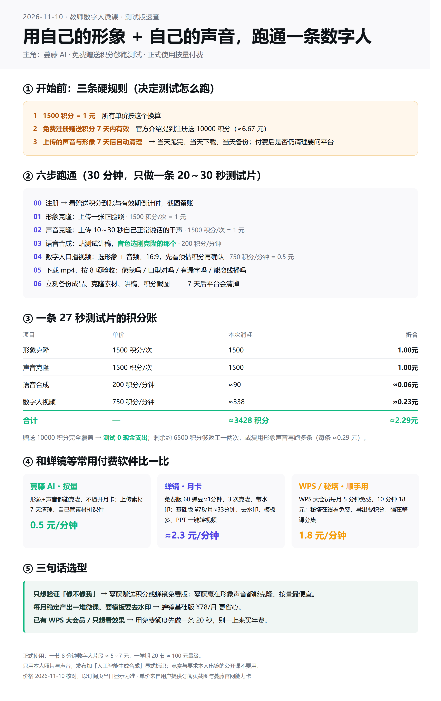

# 测试教程｜用自己的形象 + 自己的声音，30 分钟跑通一条数字人微课

> **目标**：不花一分钱，用平台免费赠送的积分，把「一张我的照片 → 我的数字形象」「一段我的录音 → 我的克隆声音」「两者合成 → 一条 20～30 秒能下载的测试片」这条链完整走一遍，然后拿到一个明确结论：**这套东西像不像我、值不值得正式花钱**。
>
> **这份是测试教程，不是生产教程**：只做一条短片、只测一条链路、不买会员、不上传任何学生或同事的素材。正式做整节微课的成本与流程，见同目录《教师数字人微课制作教程（成本优先版）》。
>
> **主角平台**：蔓藤 AI（mindtechassist.com，杭州复现智能科技有限公司）。订阅页 `https://www.mindtechassist.com/subscribe`，你给的截图就是它的「积分怎么花」页。



---

## 〇、先说清楚：哪一步必须你本人做

「用自己的形象、自己的声音」意味着要上传**脸和声纹**，这是生物特征信息，也涉及肖像权与声音权。所以这一步我不替你做、也不该替你做：

| 环节 | 谁做 |
|---|---|
| 拍一张自己的正脸照、录一段自己的干声 | **你本人**（并确认只用于本次测试） |
| 注册账号、上传素材、点生成、下载成品 | **你本人**（在官方页面完成） |
| 讲稿、积分预算、验收清单、返工话术、付费对比 | 本教程已备好，直接复制 |

我能替你把「不确定的部分」全部消掉：每一步点哪里、扣多少积分、什么算成功、失败了改哪一句、正式用要花多少钱、和蝉镜等比谁更划算。你只需要按第 2 章准备两样素材，然后照第 3 章点六下。

### 为什么主线选蔓藤 AI，而不是那两篇文章里的工具

你给的两篇文章是很好的「别人怎么做」参照，但都不满足这次的测试条件：

| 参考 | 文章做法 | 为什么不做本次主线 |
|---|---|---|
| 《WPS这个功能不错：PPT变为数字人讲解视频只需要几分钟》（课件老师） | PPT → 文件 → 输出为视频 → **AI 讲解 PPT**，讲解稿可取自备注页，17 种人物摆放模板，形象可自定义 | 要 WPS 大会员（每月 5 分钟免费，10 分钟 18 元）；文章只写了「人物形象可自定义」，**没提能克隆自己的声音** |
| 《把教案课件丢进秘塔学点啥，自动生成高级感满满的讲课数字人》 | 上传教案 + 一张照片 → 自动生成分集讲课视频，口型、字幕、转场全自动 | 在线看免费，**导出要积分**；强项是「把一门课拆成 110 集」，不是「把形象和声音都变成我的」；文章自己也说「这一步之前，先别买会员」 |

蔓藤 AI 是这堆工具里少见的、**把「形象克隆」和「声音克隆」拆成两个明码标价的能力、且按量计费不逼你买月卡**的平台：形象克隆 1 元/次、声音克隆 1 元/次、数字人视频 0.5 元/分钟。测试期用赠送积分就够，正式用再按分钟付，正好对上你说的「测试可以用，真正使用要付费」。

---

## 一、开始前必须看清的三条硬规则

> 来源：你提供的订阅页截图「积分怎么花」，逐字核对。

1. **1500 积分 = 1 元人民币**。所有单价都按这个换算，别被「1500」这个大数字吓到。
2. **积分有效期**：会员及付费积分永久有效，**免费注册赠送积分 7 天内有效**。官方介绍文章提到「注册送 10000 积分，够把一条 60 秒以内的片子从头跑到尾」，10000 积分 ≈ **6.67 元**；实际到账数量与倒计时以你账户页为准。
3. **素材清理**：**上传的声音与形象将在 7 天后自动清理**。

第 3 条是这次测试最关键的一条，它推出三个动作：

- **当天跑完、当天下载、当天备份**，别想着「下周再导」；
- 7 天后想继续用，形象和声音很可能要**重新上传、重新克隆**（每次各 1 元），所以别在免费期反复重传；
- 正式使用前，**必须向平台确认付费/会员状态下素材是否仍会被清理**。付费积分永久有效 ≠ 素材永久保留，这是两件事。截图没写付费用户例外，别自己假设。

**隐私与合规**（一次说清，后面不再重复）：只用本人照片与本人声音；不用学生、同事、网图；发布时加「人工智能生成合成」显式标识（《人工智能生成合成内容标识办法》2025-09-01 施行）；竞赛、评审、明确要求本人出镜的公开课不要用；给学生看时要说明这是 AI 生成/录播，别装成现场。

---

## 二、准备三样测试素材（约 10 分钟）

**① 一张正脸照** `my_face_test.jpg`

- 正脸、光线均匀、表情自然、不戴墨镜/口罩、头发不遮脸；
- 背景简单或纯色（后面做画中画/抠像更干净）；
- 胸像或半身，**脸和嘴部清晰**；别用证件照那种僵表情，也别用美颜过度的自拍；
- 手机原相机拍一张就够，不用棚拍。

**② 一段 10～30 秒干声** `my_voice_test.wav`（或 mp3）

- 安静房间、手机录音即可；正常说话，**别念稿腔**、别背课文；
- 不要背景音乐、不要混响、不要中途停顿太久；
- 内容建议就念下面这段测试讲稿的前两句，这样克隆音色和后面合成的内容是同一种语气。

**③ 一段 20～30 秒测试讲稿**（可直接复制）

```
同学们好，今天我们只做一个小测试。//
先记住一句话，数字人不是替你上课，是帮你把同一句话讲第五遍。//
你现在看到的这张脸，用的是我自己的照片；你听到的声音，用的是我自己的录音。//
如果口型和声音能对上，这条路就算跑通了。//
最后留个问题给你，你觉得哪一节课，最适合交给它来讲？
```

约 105 字，按 230 字/分钟约 27 秒。写作要点（来自知识库和秘塔那篇的共同结论）：口语化、单句 ≤20 字、`//` 标停顿、**不写「如图所示」**（数字人没有手，指不了图）、每三句留一个停顿。

**可选 ④ 一页 PPT/PDF**：如果还想顺手测「数字人讲解视频」（上传课件自动出讲解），做一页就够，别一上来放整份教案。

---

## 三、六步跑通（核心，照着点）

> 每一步都标了**积分单价**和**验收点**。平台界面会改版，菜单名以你当下看到的为准；能力名和单价来自订阅页与官网能力卡。

### Step 0　注册并先记账

打开 `https://www.mindtechassist.com/` 注册登录，进「AI 应用中心」。先做三件事：

1. 看账户里赠送积分**实际到账多少**、**有效期到哪天**，截个图；
2. 打开订阅页，确认「积分怎么花」的单价与你截图一致（价格会调）；
3. 在本地建一个文件夹 `数字人测试_2026-11-10/`，把照片、录音、讲稿放进去。

> 别跳过记账。免费积分 7 天清零，跑完不记，下周就不知道自己花在哪了。

### Step 1　形象克隆 → 拿到「我的脸」

- 入口：AI 应用中心 → **形象克隆**（有的版本叫「数字人形象定制」）
- 上传 `my_face_test.jpg`，按页面要求确认（是否单人、正脸、清晰）
- 单价：**1500 积分/次 = 1 元**
- 提交前看一眼预估扣减，确认后生成

**验收**：生成的形象还是不是你？脸有没有被「美化」到认不出、边缘有没有残影、嘴部是否完整。不像就换一张照片重拍，别急着往下走——后面所有帧都基于这张脸。

### Step 2　声音克隆 → 拿到「我的嗓子」

- 入口：**声音克隆 / 声音复刻**
- 上传 `my_voice_test.wav`；有的版本会要求**照着屏幕上的指定文本念一段**，照做即可
- 单价：**1500 积分/次 = 1 元**
- 生成后**先试听一句**再继续

**验收**：像不像你？有没有金属音、电音、句尾拖音？语速是否偏快？不像就重录一段更自然的，别用第一次的将就。

### Step 3　语音合成 → 把讲稿变成我的声音

- 入口：**配音 / 语音合成**
- 贴入第 2 章的测试讲稿，**音色选 Step 2 刚克隆的那个**（这一步是「用自己的声音」的落点，别选平台公共音色）
- 单价：**200 积分/分钟 ≈ 0.13 元/分钟**；27 秒约 **90 积分 ≈ 0.06 元**
- 下载 mp3 到本地文件夹

> 省事替代：也可以跳过 Step 3，直接在 Step 4 里贴文案 + 选克隆音色一步出片。但**分开做更好排查**——口型不对时，你能立刻分辨是音频问题还是视频问题。第一次测试建议分开。

### Step 4　数字人口播视频 → 让脸按我的声音动

- 入口：**数字人口播视频 / 数字人视频**
- 选 Step 1 的形象 + Step 3 的音频（或贴文案并选克隆音色）
- 画幅选 **16:9 横屏**（微课/班级大屏），分辨率按页面档位选，先别上最高档
- 单价：**750 积分/分钟 = 0.5 元/分钟**；27 秒约 **338 积分 ≈ 0.23 元**
- **页面会给预估积分，先看清再点确认**；生成是异步的，等通知即可

> 若想测课件联动，另有一条「**数字人讲解视频**」：上传 PPT/PDF 生成数字人出镜讲解，约 750 积分/分钟。测试期**只传 1 页**，别把整份教案丢进去烧额度（秘塔那篇也劝「先只做前 3–5 页试水」）。

### Step 5　下载 + 按 8 项验收

下载 mp4，命名 `test_v1_20s.mp4`。逐项打勾，判断「跑没跑通」：

- [ ] 形象是我本人，没换脸、没变形
- [ ] 声音是我的，无金属音、无机械腔
- [ ] **口型与声音对齐**（重点看每句开头和结尾）
- [ ] 没有漏字、没有被加速、句尾不拖
- [ ] 字幕准确、无错别字（若平台自动烧字幕）
- [ ] 16:9、脸没被裁、没被画中画挡住
- [ ] 能下载、能离线播放
- [ ] 已加（或已记下要加）AI 生成显式标识

### Step 6　立刻备份（因为 7 天后素材会被清理）

把 `test_v1_20s.mp4`、克隆形象成品、克隆声音成品、讲稿、积分消耗截图、订阅页单价截图，全部存进 `数字人测试_2026-11-10/`。**素材在平台上会被清掉，本地这份才是你的**。

---

## 四、这次测试到底花多少（积分账）

| 项目 | 单价 | 27 秒测试片 | 折合人民币 |
|---|---|---|---|
| 形象克隆 | 1500 积分/次 | 1500 | 1.00 元 |
| 声音克隆 | 1500 积分/次 | 1500 | 1.00 元 |
| 语音合成 | 200 积分/分钟 | ≈ 90 | ≈ 0.06 元 |
| 数字人视频 | 750 积分/分钟 | ≈ 338 | ≈ 0.23 元 |
| **合计** | — | **≈ 3428 积分** | **≈ 2.29 元** |

- 注册赠送 10000 积分（≈ 6.67 元）**完全覆盖**，还能剩约 6500 积分；
- 剩下这些够你**返工一两次**，或者复用已克隆的形象/声音再跑好几条短片（复用后每条 27 秒只要 ≈ 0.29 元）；
- **所以：测试 0 现金支出**。真正的成本是「7 天内跑完」这个时间窗。

> 单价核对提示：网上另有资料写「数字人视频 1500 积分/分钟」「视频翻译 1550 积分/分钟」，与你截图的 750 / 800 不一致；语音合成也有「3000 积分/万字符」的旧口径。**一律以你账户里订阅页当下显示的为准**，本表按你的截图计算。

---

## 五、从「测试能用」到「真正要付费」

测试够用，是因为同时满足三个前提：**片子短（≤60 秒）、7 天内用完、只做一两次**。正式拿它做微课，会撞上四堵墙：

1. 赠送积分 7 天过期，之后要充值；
2. 上传的形象与声音 7 天自动清理，长期用要反复重传/重克隆（每次各 1 元），或确认付费后策略；
3. 按时长扣费，做得越多花得越多，不再有「免费额度」兜底；
4. 水印、商用授权、作品保留期，要看付费档位条款。

**一节微课的实数测算**（数字人片段 8 分钟，其余用 PPT 录屏与板书）：

| 项目 | 计算 | 成本 |
|---|---|---|
| 形象克隆（一次性） | 1500 积分 | 1.00 元 |
| 声音克隆（一次性） | 1500 积分 | 1.00 元 |
| 语音合成 | 200 × 8 分钟 | ≈ 1.07 元 |
| 数字人视频 | 750 × 8 分钟 | 4.00 元 |
| **第一节** | | **≈ 7.07 元** |
| **之后每节**（形象声音复用） | | **≈ 5.07 元** |
| **一学期 20 节** | 2 + 20 × 5.07 | **≈ 103 元** |

**结论**：测试期零现金；正式使用按量付费，一节约 5～7 元、一学期约 100 元量级。单价在同类里很低，代价是接受「素材 7 天清理」和「自己管素材、自己拼课件」。

---

## 六、横向对比：蔓藤 AI vs 蝉镜 等常用付费软件

> 「禅境」按 **蝉镜（chanjing.cc）** 理解。蝉镜价格以官方帮助中心《会员套餐与权益》为准；网上还流传 ¥198/月、¥298/月、¥999/月 等渠道口径，差异较大，**以下单页为准**。

| 平台 | 形象+声音都能用自己的 | 免费额度 | 正式价格 | 折合 | 素材/作品保留 | 更适合 |
|---|---|---|---|---|---|---|
| **蔓藤 AI**（本次主线） | ✅ 形象克隆 1 元/次 + 声音克隆 1 元/次，明码标价 | 注册送 10000 积分（**7 天**）≈ 6.67 元 | 语音 200 积分/分、数字人视频 750 积分/分、动效短片约 500 积分/分 | **0.5 元/分钟**（视频） | **上传形象与声音 7 天自动清理** | 零成本测试、低频按量、要求「就是我本人」 |
| **蝉镜** | ✅ 免费版可克隆 3 次 2D 数字人 + 3 次声音；付费版 2D 无限 | 60 蝉豆 ≈ 1 分钟、30+ 公共形象、50+ 教育模板、带水印、作品保留 60 天 | 体验版 ¥48/月（≈10 分）；基础版 **¥78/月**（连续包月，2000 蝉豆≈33 分）；¥98 单月；专业版 ¥758/月（≈333 分、4K）；半年 ¥438 | **≈ 2.3 元/分钟** | 基础版作品保留 180 天、去水印；蝉豆按月发放 | 每月稳定产出、PPT/PDF 一键转视频、要模板与批量 |
| **WPS AI 讲解 PPT** | 形象可自定义；**声音克隆未见文章说明，需自行确认** | 大会员每月 5 分钟免费 | 10 分钟 18 元 | **1.8 元/分钟** | 随 WPS 账号 | 已有 WPS 大会员、讲稿已写在 PPT 备注里 |
| **秘塔「今天学点啥」** | 上传照片生成分身；实测文提到可传 2–15 秒音频复刻声线 | **在线看免费**；导出「音频讲解+PPT」450 积分 | 按积分，整课分集 | 按导出计 | 在线书架 | 把整门课拆成分集、先白嫖看效果 |
| **腾讯智影** | 有照片生成 2D 分身、真人克隆付费 | 约 5 分钟/月、带水印 | 会员约 99–299 元/月，或 8 元/分钟 | 数元/分钟 | 平台内 | 播报型片头、通知短片（有业务调整传闻，用前先确认） |
| **剪映数字人** | 基础形象可用，声音克隆需会员 | 基础数字人 + 自动字幕免费，导出带水印 | 会员制 | 0 元起 | 本地 | 零预算、愿意自己剪辑拼接 |

**三句话选型**：

1. **只想验证「像不像我」** → 蔓藤 AI 赠送积分或蝉镜免费版都行；蔓藤赢在形象和声音都能克隆、按量最便宜、不逼你开月卡。
2. **要每月稳定做一堆微课、要 PPT 一键转视频、要去水印** → 蝉镜基础版 ¥78/月 更省心，模板和批量能力是蔓藤按量模式给不了的。
3. **已经有 WPS 大会员 / 只想看效果** → 顺手用 WPS 的 5 分钟，或用秘塔在线免费看一集。**别一上来买年费**，先用免费额度做一条 20 秒再决定。

**成本直觉**：同样 8 分钟数字人片段，蔓藤按量 ≈ 5 元、蝉镜基础版内 ≈ 19 元、WPS 购买时长 ≈ 14.4 元、腾讯智影按分钟 ≈ 64 元。蔓藤最便宜，但它是「自己管素材、自己拼课件」的半自助模式；蝉镜贵在省事。

---

## 七、没跑通怎么办（按症状返工）

| 现象 | 只改这一处 |
|---|---|
| 脸不像 / 变形 | 换一张更正、光线更匀的照片，重跑 Step 1 |
| 声音金属感、不像我 | 安静环境重录 10–30 秒自然说话，重跑 Step 2 |
| 口型对不上 | 先确认 Step 3 的音频没被变速；再把长句拆短、语速放慢 10–20%，只重跑 Step 4 |
| 读错字 / 漏字 | 改讲稿里的多音字、公式、英文（转成中文读法），重跑 Step 3 |
| 字幕错别字 | 以实际录音为准校对，别让平台改写台词 |
| 脸被裁 / 被遮挡 | 换人物摆放位置或画幅，别整条重做 |
| 积分扣得比预估多 | 看订阅页单价是否调整、分辨率档位是否选高了 |
| 7 天后素材没了 | 正常。重传重克隆（各 1 元），或正式使用前先问清付费后是否仍清理 |

原则（来自知识库 4 号文实测 SOP）：**告诉它「哪一秒 + 什么现象 + 怎么改」，只重跑对应片段，别默认整条重做**。

---

## 八、跑通之后，写下这三行结论

```
测试日期 / 平台 / 赠送积分实际到账：
跑通了吗（像我吗 / 口型对吗 / 能下载吗）：
是否继续：继续 → 选哪个平台、预算多少；不继续 → 卡在哪一步
```

通过了，就把 20 秒扩成一节真实知识点的 3 分钟，再决定充值；没通过，按第 7 章定位到具体环节。秘塔那篇给的判断标准很好用：**找三个学生看，只问「哪一句没听懂」**，别问「做得怎么样」，他们会客气。

---

## 附录　本教程的数据来源

| # | 来源 | 用途 |
|---|---|---|
| 1 | 蔓藤 AI 订阅页 `https://www.mindtechassist.com/subscribe`「积分怎么花」**用户截图** | 1500 积分=1 元、7 天有效期与素材清理、6 项单价 |
| 2 | 蔓藤 AI 官网能力卡 `https://www.mindtechassist.com/vrm-interactive` | 各能力名称与约数单价、数字人讲解视频需先传 PPT/PDF |
| 3 | 蔓藤 AI 官方介绍文（动效短片篇，2026） | 注册送 10000 积分、按帧结算、失败退渲染积分 |
| 4 | 蝉镜官方帮助中心《会员套餐与权益》 `doc.chanjing.cc/help-center/billing/membership-plans-and-benefits` | ¥78/¥98/¥758 档位与蝉豆时长 |
| 5 | 蝉镜会员页 `chanjing.cc/member.html` | 免费版 60 蝉豆、3 次克隆、作品保留天数 |
| 6 | 微信文章《WPS这个功能不错：PPT变为数字人讲解视频只需要几分钟》（课件老师） | WPS 路径、17 种模板、5 分钟/月、10 分钟 18 元 |
| 7 | 微信文章《把教案课件丢进秘塔学点啥，自动生成高级感满满的讲课数字人》 | 六家横评、三个讲稿细节、四个坑、先别买会员 |
| 8 | 秘塔「今天学点啥」实测类文章（补充检索） | 单份 ≤100MB、2–15 秒音频复刻、导出 450 积分、最多 20 页 |
| 9 | 《人工智能生成合成内容标识办法》（2025-09-01 施行） | 显式/隐式标识要求 |
| 10 | 本目录《教师数字人微课制作教程（成本优先版）》 | 免费额度、脚本规范、验收与合规基线 |

> 所有价格均为 **2026-11-10 核对**，平台调价频繁，落笔前以订阅页/下单页当日显示为准。订阅页为动态渲染，公开抓取只能拿到站点标题，**具体单价以你提供的截图为准**。
